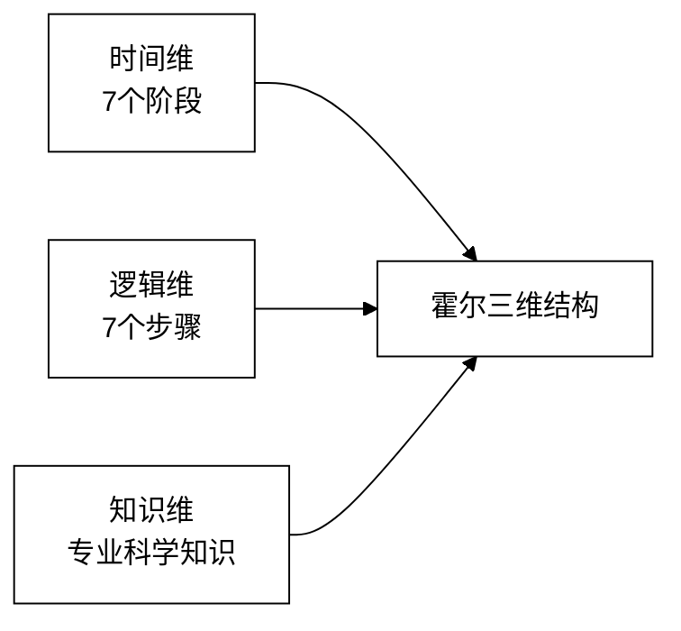

# 系统分析师｜第1章 绪论（备考讲义＋章节自测题）

> **教材依据**：《系统分析师教程（第2版）》第1章 绪论（共3节：1.1 信息与信息系统｜1.2 系统分析师｜1.3 系统分析师的知识体系）。第2版相对第1版：开篇引言更新为《国家信息化发展战略纲要》相关表述；「系统分析师的知识体系」由第1版1.2.3升格为独立1.3节；信息系统生命周期第5阶段由「系统运行与评价」更名为「系统运行与维护」；知识体系中「信息系统工程知识」内涵由系统论、控制论、信息论调整为系统规划与分析、需求分析、系统设计、架构设计等；其余实质知识点两版无变动。本章无教材外补充。
>
> **考纲定位说明**：2024版考纲科目一「系统分析师综合知识」无独立「绪论」条目（考纲-教材映射以 `第00章—考纲总纲.md` 为准），本章为方法论铺垫章；关联【考试说明·考试要求】第(2)条 掌握开发信息系统所需的综合技术知识、第(3)条 熟悉企业或政府信息化建设并掌握组织信息化战略规划的知识、第(4)条 熟练掌握信息系统的开发过程和方法。
>
> **考试形式**：上午综合知识单选题；2021年以后真题约0～1道（全量统计窗仅2023上检出1道，2024上～2026上未检出）；方法论铺垫章、单章权重低；案例分析、论文几乎不涉及本章内容。
>
> 标签：系统分析师、上午题、绪论、信息、信息系统、系统工程、霍尔三维、系统分析师角色、知识体系

[TOC]

## 章节结构对照与来源标注

> 本讲义为**系统分析师（第2版）教材第1章《绪论》**的学习讲义。本章知识点全部来自教材第2版，无教材外补充；2021年以后真题近年频次窗内未检出（0场；全量统计窗仅2023上1道），各知识点统一标注【教材｜了解】。

| 讲义模块 | 对应教材第2版章节 | 内容性质 | 备考要求 |
|---|---|---|---|
| 模块1 信息的基本概念 | 1.1.1 信息的基本概念 | 教材 | 了解：香农信息定义与信息量、信息11特征、信息5功能、信息/数据/知识关系 |
| 模块2 系统及相关理论 | 1.1.2 系统及相关理论 | 教材 | 了解：系统定义与9特性、系统理论8原理、信息系统三模型；拓展：系统论的任务 |
| 模块3 系统工程方法论 | 1.1.3 系统工程方法论 | 教材 | 了解：霍尔三维结构、软系统方法论 |
| 模块4 信息系统工程 | 1.1.4 信息系统工程 | 教材 | 了解：生命周期5阶段、建设原则 |
| 模块5 系统分析师的角色与任务 | 1.2.1 系统分析师的角色定位｜1.2.2 系统分析师的任务 | 教材 | 了解：人才结构、6角色、素质要求、CIO定位、5大类任务 |
| 模块6 系统分析师的知识体系 | 1.3 系统分析师的知识体系 | 教材 | 了解：知识体系四大类 |

> 教材第2版第1章章节结构（按教材原文核读）：1.1 信息与信息系统（1.1.1 信息的基本概念｜1.1.2 系统及相关理论｜1.1.3 系统工程方法论｜1.1.4 信息系统工程）｜1.2 系统分析师（1.2.1 系统分析师的角色定位｜1.2.2 系统分析师的任务）｜1.3 系统分析师的知识体系。
>
> ⚠️ 教材第2版第1章**不包含**：无。两源核查均未发现事项——**源①**（对照第1版第1章《绪论》逐节对比）：节级结构一致，无第1版独有、第2版删除的内容；「系统分析师的知识体系」由第1版1.2.3升格为第2版1.3，信息系统生命周期第5阶段由「系统运行与评价」更名为「系统运行与维护」，均无实质删减。**源②**（对照考纲核对）：本章无独立考纲条目，无子项缺口。

---

## 模块1：信息的基本概念（教材 1.1.1）【教材｜了解】

**前置说明**：本模块对应教材第2版第1章 **1.1.1 信息的基本概念**；教材原文内容为主；适配上午综合选择题（概念辨析、信息量计算）。
**模块优先级**：🟢 了解为主 —— 2024上～2026上未检出（0场；全量统计窗仅2023上1道）
**考情分析**（2021年以后真题）：2024上～2026上未检出（0场；全量统计窗仅2023上1道）；核心考点：香农信息定义、信息特征、信息量计算、信息与数据/知识的关系。

### 1.1 核心知识点精讲

#### 1.1.1 香农的信息定义与信息量（教材1.1.1）【教材｜了解】

- **香农定义**：信息是**不确定性的减少**（即确定性的增加）。
- **信息量单位**：比特（bit）。当变异度为2（非此即彼的二状态，如大和小、高和低、快和慢）时，1比特为消除该不确定性所需的信息量。
- **信息量公式**：

$$H(X) = -\sum_{i=1}^{n} P(x_i) \mathrm{lb} P(x_i)$$

  - 式中$x_i$代表$n$个状态中的第$i$个状态，$P(x_i)$为出现第$i$个状态的概率，$H(X)$代表用以消除系统不确定性所需的信息量，即以比特为单位的负熵；$\mathrm{lb}$为以2为底的对数。
- 信息是系统**有序程度**的度量，表现为**负熵**；热力学中的熵是系统无序程度的度量，二者正好相反。

#### 1.1.2 信息的特征（11条）（教材1.1.1）【教材｜了解】

教材明确列出信息的11个基本特征：

| 序号 | 特征 | 要点 |
|------|------|------|
| 1 | **客观性** | 信息是客观事物在人脑中的反映；分主观信息（决策、指令、计划）和客观信息（国际形势、经济发展、一年四季），主观信息必然要转化成客观信息 |
| 2 | 普遍性 | 物质决定精神，物质的普遍性决定了信息的普遍存在 |
| 3 | 无限性 | 客观世界无限→信息总量无限；每个具体事物产生的信息也可以是无限的 |
| 4 | 动态性 | 信息随时间变化而变化 |
| 5 | 相对性 | 不同认识主体从同一事物获取的信息及信息量可能不同 |
| 6 | **依附性** | 信息由客观事物产生（无源信息不存在）；须依附一定载体存在，不能完全脱离物质而独立存在 |
| 7 | 变换性 | 信息通过处理可实现变换或转换，使其形式和内容发生变化 |
| 8 | 传递性 | 时间上的传递=存储；空间上的传递=转移或扩散 |
| 9 | 层次性 | 客观世界分层次→反映它的信息也分层次 |
| 10 | 系统性 | 信息可表示为集合，不同类别信息形成不同整体，可形成与现实世界相对应的信息系统 |
| 11 | 转化性 | 信息的产生不能没有物质，传递不能没有能量；但有效使用信息可转化为物质或能量 |

> 补充：金融信息最重要特性是**安全性**，市场信息最重要特性是**及时性**——信息应用的场合不同，其侧重面也不一样。

#### 1.1.3 信息的功能（5条）（教材1.1.1）【教材｜了解】

1. 为认识世界提供依据
2. 为改造世界提供指导
3. 为有序的建立提供保证
4. 为资源开发提供条件（有形资源=物质+能量；无形资源主要是信息资源）
5. 为知识的生产提供材料

#### 1.1.4 信息与数据、知识的关系（教材1.1.1）【教材｜了解】

- **信息与数据**：信息是经过加工后的数据；数据是信息生成的材料，是信息的存在形式和状态。信息=被解释或被理解的数据。
  > 例：「张啸杰」「男」「19」「大二」各自是数据，组合起来是关系数据库中的一条记录，四者之间有逻辑关系，至此四者就成为信息。
- **信息与知识**：知识是经过加工的信息。
  > 例：「张啸杰是湖南永州人」「李国杰是湖南邵阳人」是信息；得出「张啸杰和李国杰是湖南同乡」则为知识。

---

## 模块2：系统及相关理论（教材 1.1.2）【教材｜了解】

**前置说明**：本模块对应教材第2版第1章 **1.1.2 系统及相关理论**；教材原文内容为主；适配上午综合选择题。
**模块优先级**：🟢 了解为主 —— 2024上～2026上未检出（0场；全量统计窗仅2023上1道）
**考情分析**（2021年以后真题）：2024上～2026上未检出（0场；全量统计窗仅2023上1道）；核心考点：系统9大特性、信息系统三模型。

### 2.1 核心知识点精讲

#### 2.1.1 系统的定义（教材1.1.2）【教材｜了解】

系统是由**相互联系、相互依赖、相互作用**的事物或过程组成的具有**整体功能和综合行为**的统一体。从数学角度来看，系统是一个集合，是由许多相互作用、相互依存的事物（集合元素）为了达到某个目标组成的集合。

#### 2.1.2 系统的特性（9条）（教材1.1.2）【教材｜了解】

| 序号 | 特性 | 要点 |
|------|------|------|
| 1 | **整体性** | 元素按一定原则有序排列，产生系统的特定功能 |
| 2 | **层次性** | 系统与元素相对；研究问题的角度变一变，系统就成为更高一级系统的元素（子系统） |
| 3 | **目的性** | 任何系统都有一定的目的或目标 |
| 4 | 稳定性 | 开放系统有自我稳定能力，可在一定范围内自我调节，保持和恢复原来的有序状态及原有结构和功能 |
| 5 | 突变性 | 系统通过失稳从一种状态进入另一种状态的剧变过程，是质变的基本形式 |
| 6 | 自组织性 | 开放系统在内外因素作用下自发组织，从无序到有序、从低级有序到高级有序 |
| 7 | 相似性 | 系统具有同构和同态性质，根本原因是世界的物质统一性 |
| 8 | 相关性 | 元素间有实实在在的、具体的联系（非哲学上的普遍联系） |
| 9 | **环境适应性** | 系统与环境发生相互作用，进行物质和能量交换 |

> 记忆口诀：整体、层次、目的、稳定、突变、组织、相似、相关、适应（9个）。

#### 2.1.3 系统理论8个基本原理（教材1.1.2）【教材｜了解】

1. **整体性原理**：系统有整体的形态、结构、边界、特性、行为、功能、空间占有和时间展开
2. **整体突变原理（非加和原理）**：系统整体性质 ≠ 各元素性质和功能的简单相加
3. **层次性原理**：系统组织在地位与作用、结构与功能上表现出等级秩序
4. **开放性原理（开放系统）**：系统不断与外界环境交换物质、能量、信息
5. **目的性原理**：系统在与环境相互作用中，坚持表现出某种趋向预先确定的状态的特性
6. **环境互塑共生原理**：系统对环境有功能（积极）和污染（消极）两种输出；环境对系统有资源（积极）和压力（消极）两种输入
7. **秩序原理**：系统形成和发展全过程中存在有序和无序两种形态
8. **生命周期原理（演化原理）**：系统从产生到发展、直至最终消亡的不断演化过程

#### 2.1.4 信息系统（教材1.1.2）【教材｜了解】

- **定义**：简单地说，信息系统就是接受输入数据，通过加工处理产生信息的系统。**面向管理是信息系统的显著特点**。
- 以计算机为基础的信息系统：结合管理理论和方法，应用信息技术解决管理问题，为管理决策提供支持的系统。

**三模型结合产生信息系统**：

| 模型 | 含义 |
|------|------|
| **管理模型** | 系统服务对象领域的专门知识，以及分析和处理该领域问题的模型（也称对象的处理模型） |
| **信息处理模型** | 系统处理信息的结构和方法；将管理模型中的理论和方法转化为信息获取、存储、传输、加工和使用的规则 |
| **系统实现条件** | 可供应用的计算机技术和通信技术、从事对象领域工作的人员，以及对这些资源的控制与融合 |

> 记忆：管理模型定「领域知识」、信息处理模型定「加工规则」、实现条件定「技术与人」。

### 拓展阅读：教材原生但备考非必学内容

> 【教材｜非必学】教材有原文，但考纲未单独列出、真题极少直接命题，仅作概念了解，不配置例题与习题。

#### 拓展·系统论的任务（教材1.1.2）【教材｜非必学】

系统论的任务不仅在于认识系统的特点和规律，更在于利用这些规律去**控制、管理、改造或创造系统**，使系统的存在、发展更符合人们需要。作用三方面：
1. **改变人类的思维方式**：传统分析法把事物分解成部分、从局部看问题（单项因果决定论），只适用于认识简单事物；系统分析方法站在较高层次纵观全局，为认识复杂问题提供了有效思维方式。
2. **提供科学的理论和方法**：反映现代科学整体化趋势与社会化大生产特点，为政治、经济、军事、科学、文化等领域的复杂问题提供方法论基础。
3. **形成统一的系统科学体系**：一般系统论创始人贝塔朗菲（L. Bertalanffy）把系统论分为**狭义系统论**（着重对系统本身分析研究）与**广义系统论**（研究一类相关的系统科学原理，含系统科学、系统技术、系统哲学三方面）。

> 记忆：系统论任务=改变思维方式＋提供方法＋形成统一体系；贝塔朗菲=狭义/广义系统论。

---

## 模块3：系统工程方法论（教材 1.1.3）【教材｜了解】

**前置说明**：本模块对应教材第2版第1章 **1.1.3 系统工程方法论**；教材原文内容为主；适配上午综合选择题。
**模块优先级**：🟢 了解为主 —— 2024上～2026上未检出（0场；全量统计窗仅2023上1道），但逻辑维步骤顺序属经典辨析点
**考情分析**（2021年以后真题）：2024上～2026上未检出（0场；全量统计窗仅2023上1道）；核心考点：霍尔三维结构（时间维/逻辑维步骤顺序）、硬系统与软系统方法论区别。

### 3.1 核心知识点精讲

#### 3.1.1 系统工程与方法论概述（教材1.1.3）【教材｜了解】

- **系统工程**：从整体出发合理开发、设计、实施和运用系统科学的工程技术，以达到最优规划、最优设计、最优管理和最优控制的目的。
- **系统工程方法论**：运用系统工程研究问题的一套程序化的工作方法和策略，是用于解决复杂系统问题的一套工作步骤、方法、工具和技术。
- 代表性方法论：**霍尔三维结构**（硬系统方法论）和**切克兰德软系统方法论（SSM）**。

#### 3.1.2 霍尔三维结构（教材1.1.3）【教材｜了解】

霍尔将系统工程活动分为 **7个阶段**（时间维）和 **7个步骤**（逻辑维），结合所需专业知识（知识维），形成三维空间结构。

**（1）逻辑维——解决问题的7个步骤（顺序是经典辨析点）**：

| 步骤 | 名称 | 说明 |
|------|------|------|
| 1 | 问题确定 | 全面收集资料数据，弄清问题的历史、现状及发展趋势 |
| 2 | 目标确定 | 提出解决问题所要达到的目标，制定评价方案的标准和指标 |
| 3 | 系统综合 | 按问题的性质和预期目标，形成一组可供选择的系统方案 |
| 4 | 系统分析 | 对可能入选的方案说明其性质、特点及与整个系统的相互关系（往往通过构造模型） |
| 5 | 方案选择 | 系统优化，在一定限制条件下选择最优方案或确定方案的优劣顺序 |
| 6 | 评价决策 | 决策者根据全面要求，最后确定一个或几个方案来试行 |
| 7 | 实施计划 | 将最后选定的方案付诸实施 |

> 记忆：问题→目标→综合→分析→选择→评价→实施

**（2）时间维——工作进程的7个阶段**：
规划→制定方案→研制→生产→安装→运行→更新

**（3）知识维——专业科学知识**：
工程、医药、建筑、商业、法律、管理、社会科学和艺术等。

> 记忆：时间维管「阶段」（从规划到更新），逻辑维管「步骤」（从问题确定到实施计划），知识维管「专业」。

#### 3.1.3 切克兰德软系统方法论（SSM）（教材1.1.3）【教材｜了解】

- **背景**：霍尔方法适用于目标明确、结构清楚的**结构化问题**（硬系统）。20世纪70年代后，系统工程面临与人的因素密切相关、与社会/政治/经济/生态等因素纠缠的**非结构化问题**，霍尔方法遇到困难。
- **核心区别**：
  - 霍尔（硬系统）：强调明确目标，核心是**模型化和最优化**。
  - 切克兰德（软系统）：目标模糊，「可行」和「满意」代替「最优」，核心不是最优化而是**比较**。
- **SSM 五个步骤**：
  1. 问题现状说明（目的是改善现状，弄清问题本身的基本定义）
  2. 理清问题的关联因素
  3. 建立概念模型（可用结构模型或流程图表达）
  4. 比较（将概念模型和现状进行比较，逐步得出满意的可行解）
  5. 实施

> 记忆：硬系统求最优、软系统求满意（学习过程）。

> 注意：本模块方法论与第10章系统规划与分析中的系统分析方法相关联，复习时勿混淆。

---

## 模块4：信息系统工程（教材 1.1.4）【教材｜了解】

**前置说明**：本模块对应教材第2版第1章 **1.1.4 信息系统工程**；教材原文内容为主；适配上午综合选择题。
**模块优先级**：🟢 了解为主 —— 2024上～2026上未检出（0场；全量统计窗仅2023上1道），生命周期5阶段为经典概念点
**考情分析**（2021年以后真题）：2024上～2026上未检出（0场；全量统计窗仅2023上1道）；核心考点：生命周期5阶段顺序、建设原则。

### 4.1 核心知识点精讲

#### 4.1.1 信息系统工程概述（教材1.1.4）【教材｜了解】

- **定义**：以系统工程的方法来实现信息系统建设的过程，是用系统工程的原理、方法来指导信息系统建设与管理的一门工程技术学科，是系统工程的一个分支学科。
- **专业特征**：研究方法上具有**整体性**，技术应用上具有**综合性**，工程管理上具有**科学性**。

#### 4.1.2 信息系统生命周期（5阶段）（教材1.1.4）【教材｜了解】

信息系统从产生到消亡的整个过程，分为5个阶段：

| 阶段 | 主要任务 | 后续章节 |
|------|----------|----------|
| 1. **系统规划** | 指明信息系统在企业战略中的作用和地位；包括开发目标、总体架构、组织结构和管理流程、实施计划、技术规范 | 第9章 |
| 2. **系统分析** | 在可行性分析和总体规划基础上详细调查，整理成规范的文档资料，分析组织结构/业务流程/信息需求，**构建逻辑模型** | 第10、11章 |
| 3. **系统设计** | 根据分析结果设计实施方案，为开发人员提供清晰而完整的**物理设计说明** | 第12、13章 |
| 4. **系统实现** | 将设计文档变成能在计算机上运行的软件系统 | 第14章 |
| 5. **系统运行与维护** | 维护评价、记录运行情况、根据规格对系统进行必要修改、评价工作质量和经济效益 | 第15章 |

> 关键区分：系统分析产出**逻辑模型**；系统设计产出**物理设计说明**。
> 注意：这是**信息系统生命周期**（5阶段），与后续软件工程章节讨论的**软件生命周期**口径相近但所属章节不同，勿混淆。

#### 4.1.3 信息系统建设的原则（教材1.1.4）【教材｜了解】

**四大基本原则**：

1. **高层管理人员介入原则**（一把手原则）：信息系统建设服务于企业战略，必须有高层介入（可直接参加、决策或指导、经济和人事等方面的支持）。该原则在现阶段已逐步具体化，那就是 **CIO** 的出现。
2. **用户参与开发原则**：
  - 用户有确定范围（信息系统的使用者=核心用户，用户单位的领导=辅助用户或外围用户）
  - 用户应参与**全过程**（从规划设计直到系统运行的整个过程）
  - 用户应**深度参与**，既以甲方代表身份出现，又成为真正的开发人员
3. **自顶向下规划原则**：主要目标是达到**信息的一致性**，避免因缺乏总体规划导致信息不一致。
4. **工程化原则**：软件危机的教训——没有按照工程化原则进行软件开发是软件危机发生的根本原因；信息系统同样需要工程化方法。

**其他补充原则**：创新性原则、整体性原则、发展性原则、经济性原则、先进性原则等。

---

## 模块5：系统分析师的角色与任务（教材 1.2）【教材｜了解】

**前置说明**：本模块对应教材第2版第1章 **1.2 系统分析师**（涵盖 1.2.1 角色定位、1.2.2 任务）；教材原文内容为主；适配上午综合选择题。
**模块优先级**：🟢 了解为主 —— 2024上～2026上未检出（0场；全量统计窗仅2023上1道）
**考情分析**（2021年以后真题）：2024上～2026上未检出（0场；全量统计窗仅2023上1道）；核心考点：6种角色、CIO定位、5大类任务。

### 5.1 核心知识点精讲

#### 5.1.1 信息化的人才结构（教材1.2.1）【教材｜了解】

- **横向**：IT人员（CIO、系统分析师、软件/硬件/通信/数据工程师，以及系统操作员、网络维护员和数据管理员等）和非IT人员。CIO和系统分析师既属IT人员又属非IT人员（即企业管理人员）。
- **纵向（金字塔三层）**：
  - 上层（决策层）：CEO、CFO、CIO等高层领导成员
  - 中层（管理业务层）：中层经理、**系统分析师**、经济师、会计师，以及软硬件/通信/数据工程师
  - 下层（操作层）：计算机通信操作人员、维护人员、数据处理人员，以及企业各部门和基层单位的业务人员

**决策层高管缩写**：

| 缩写 | 英文全称 | 中文 |
|------|----------|------|
| CEO | Chief Executive Officer | 首席执行官 |
| CFO | Chief Financial Officer | 首席财务官 |
| CIO | Chief Information Officer | 首席信息官 |

#### 5.1.2 系统分析师的6种角色（教材1.2.1）【教材｜了解】

| 角色 | 要点 |
|------|------|
| 1. **IT专家** | 首要角色；须谙练信息技术，对新产品和新技术有正确的评估与选择能力 |
| 2. **管理业务专家** | 信息系统建设是极为复杂的管理系统工程，须有丰富的管理业务知识和经验 |
| 3. **IT人员与非IT人员的沟通者** | 作为双方沟通桥梁，消除隔阂（很多项目失败源于此隔阂） |
| 4. **对外谈判者** | 代表企业与专业开发组织/商品化软件供应商「讨价还价」 |
| 5. **信息系统运行的指导者** | 从纲领和细节两方面指导系统运行管理、评价维护、升级扩展和再工程 |
| 6. **信息系统建设项目的技术负责人** | 建设单位角度：高层领导任项目负责人，分析师任技术负责人；承建单位角度：开发项目负责人由信息系统项目管理师担任，分析师任技术经理或研发经理 |

#### 5.1.3 系统分析师的7条素质要求（教材1.2.1）【教材｜了解】

1. 深入观察问题的能力、逻辑思维能力和归纳能力（既能「从树木中见森林」，也能「从森林中见树木」）
2. 丰富的开发实践经验、想象力和创造力，善于从经验积累中创新
3. 较强的学习能力，熟练掌握系统开发基本原理，精通信息系统开发的各种方法和技术，熟悉开发环境和工具
4. 较强的谈判协商能力和人际交往能力，能说服用户接受自己的主张
5. 较强的组织和管理能力，能在大型系统开发中担任技术负责人，指导工程师和程序员
6. 与他人合作共事的能力，带领团队齐心协力完成任务
7. 一定的远见和前瞻能力，适应业务环境和技术的快速变化

#### 5.1.4 CIO是系统分析师的代表（教材1.2.1）【教材｜了解】

- 系统分析师也处于一个金字塔结构之中：系统分析师是一个群体，处于金字塔的**中上层**。
- 从信息化的角度来看，最上层是企业的 **CIO**，而且 **CIO 本身也应该是系统分析师**——就像总工程师本身是工程师、总会计师本身是会计师一样。
- 因此，**CIO 是系统分析师的典型代表**。

#### 5.1.5 系统分析师的5大类任务（教材1.2.2）【教材｜了解】

**1. 信息化战略管理中的任务**：
- 深入理解企业发展战略目标和业务发展方向，明确战略对信息化的需求
- 分析评估内外部信息化环境、行业信息化水平与企业信息化现状
- 与高层一起设计并确定信息系统建设长期目标并分解
- 主持制定企业信息化战略规划

**2. 信息化基础建设中的任务**：
- 了解计算机系统发展、配置和性能，估算投资成本，把握性能/价格比
- 把握网络技术，对局域网/内联网/外联网/Internet建设做出可行性分析报告、提出建设方案
- 负责信息系统安全制度和规范的制定
- 设计信息系统评价体系
- 主持制定信息化管理制度并动态调整
- 审定企业信息化标准规范

**3. 信息系统建设中的任务（5个阶段）**：
- 规划阶段：可行性研究、制定开发策略、编写可研报告、参与或主持制订开发计划
- 分析阶段：建立业务模型、完成需求分析、构建逻辑模型
- 设计阶段：与系统架构设计师配合设计系统架构、指导系统设计工作
- 实施阶段：指导软硬件和网络配置、组织应用软件开发、组织或指导用户培训、指导进度成本质量控制
- 运行维护阶段：主持制定运维规章制度、检查指导日常工作、综合评价运行效果、制定调整升级扩展方案

**4. 企业流程管理中的任务**：
- 关注并研究企业流程问题
- 将流程改进/重组作为系统修正、功能扩展和升级的主要影响因素
- 研究评价流程分析工具，条件具备时选用流程分析软件辅助流程管理

**5. 信息资源开发利用中的任务**：
- 调查分析企业信息资源，指导或领导制定开发利用规划和实施方案
- 制定信息资源管理基础标准和制度
- 指导或领导信息资源开发利用工作并纳入系统建设
- 指导、检查和评估日常信息资源管理工作

---

## 模块6：系统分析师的知识体系（教材 1.3）【教材｜了解】

**前置说明**：本模块对应教材第2版第1章 **1.3 系统分析师的知识体系**；教材原文内容为主；适配上午综合选择题。
**模块优先级**：🟢 了解为主 —— 2024上～2026上未检出（0场；全量统计窗仅2023上1道），为全书知识地图框架
**考情分析**（2021年以后真题）：2024上～2026上未检出（0场；全量统计窗仅2023上1道）；核心考点：知识体系四大类框架。

### 6.1 核心知识点精讲

系统分析师属于复合型人才，知识体系由其担任的角色和工作任务决定，分为**四大类**：

#### 6.1.1 技术知识与技能（7方面）（教材1.3）【教材｜了解】

| 序号 | 知识领域 | 内容 |
|------|----------|------|
| 1 | 计算机系统知识 | 发展概况、系统配置、系统性能 |
| 2 | 计算机科学与技术 | 数据结构、操作系统、编译原理、算法设计与分析，以及程序语言、软件工程、数据库、人工智能 |
| 3 | 计算机网络 | 通信技术、局域网/广域网技术、Internet与Intranet、网络规划与设计、网络配置与管理 |
| 4 | 系统安全 | 通信与网络安全、安全管理的实施、应用和系统开发安全、安全架构和模型、计算机操作安全、业务安全、系统灾难的恢复、信息安全机制 |
| 5 | 信息系统工程 | 系统规划与分析、需求分析、系统设计、架构设计、系统实现与测试、系统运行与维护 |
| 6 | 数学及相关学科 | 微积分、线性代数、概率论、统计学、离散数学、运筹学 |
| 7 | 经济管理 | 财务会计、管理会计、技术经济学 |

#### 6.1.2 经营管理知识与技能（5方面）（教材1.3）【教材｜了解】

1. **人际沟通知识**：口头和书面沟通；**决定系统成败的关键因素往往是沟通技能而不是技术技能**
2. **人际关系知识**：团队合作、领导艺术、管理变化和冲突
3. **项目管理知识**：项目管理的理论、方法和相关工具
4. **企业管理知识**：企业战略管理、知识管理、日常运作管理
5. **市场营销知识**：担任谈判者或从事「售前」工作时需要

#### 6.1.3 业务知识与技能（教材1.3）【教材｜了解】

- 与个人专业出身、职业经历、供职单位业务特点和岗位职责相关（如供职保险公司应掌握一定保险业务知识）
- IT企业的系统分析师需具备很强的学习能力，快速熟悉用户业务领域的专业知识，由外行迅速转变为「业内人士」

#### 6.1.4 人文修养（5方面）（教材1.3）【教材｜了解】

1. **人格与道德规范**：经常接触秘密和敏感信息，需优秀人格和道德规范
2. **遵守法律法规**：熟练掌握信息系统开发和应用相关的法律法规
3. **诚信道德修养**：守时守信，维护所在单位信用
4. **职业道德修养**：调节职业活动中人与人之间的关系；分析师作为高级工程师，其思想和行为会对其他人员产生很大影响
5. **健康的心理素质**：开朗豁达、坚毅意志、有主见又果断、沉着冷静、既有灵活性又不失原则

---

# 章节总复习综合模拟题

## 一、单项选择题（6题）

1. 某系统发送8种等概率消息，每条消息携带的信息量为（）
A. 1比特 B. 2比特 C. 3比特 D. 8比特

> 【解析】香农认为信息是不确定性的减少；等概率消息的信息量为$\log_2 8 = 3$比特。
> 【答案】C

2. 系统的9大特性不包括（）
A. 整体性 B. 层次性 C. 可移植性 D. 环境适应性

> 【解析】系统9大特性：整体性、层次性、目的性、稳定性、突变性、自组织性、相似性、相关性、环境适应性；「可移植性」不在其中。
> 【答案】C

3. 霍尔三维结构逻辑维的正确顺序是（）
A. 问题确定→目标确定→系统综合→系统分析→方案选择→评价决策→实施计划
B. 问题确定→系统综合→目标确定→系统分析→方案选择→评价决策→实施计划
C. 目标确定→问题确定→系统综合→系统分析→方案选择→评价决策→实施计划
D. 问题确定→目标确定→系统分析→系统综合→方案选择→评价决策→实施计划

> 【解析】逻辑维7步：问题确定→目标确定→系统综合→系统分析→方案选择→评价决策→实施计划。
> 【答案】A

4. 信息系统生命周期中，产出物理设计说明的阶段是（）
A. 系统规划 B. 系统分析 C. 系统设计 D. 系统实现

> 【解析】系统设计阶段为开发人员提供清晰而完整的物理设计说明；系统分析阶段产出逻辑模型。
> 【答案】C

5. 关于CIO与系统分析师的关系，正确的是（）
A. CIO与系统分析师无关
B. CIO是系统分析师的典型代表
C. CIO是系统分析师的下属
D. CIO不需要具备系统分析师能力

> 【解析】教材明确：CIO本身也应该是系统分析师（就像总工程师本身是工程师一样），CIO是系统分析师的典型代表。
> 【答案】B

6. 下列哪项不属于系统分析师知识体系的四大分类？（）
A. 技术知识与技能 B. 经营管理知识与技能 C. 业务知识与技能 D. 机械制图与金工技能

> 【解析】四大类：技术知识与技能、经营管理知识与技能、业务知识与技能、人文修养。
> 【答案】D

---

> **备考提示**：本章2021年以后真题上午约0～1道（全量统计窗仅2023上检出1道，2024上～2026上未检出），重点掌握：①香农信息定义与信息量计算；②霍尔三维逻辑维7步顺序；③信息系统生命周期5阶段；④硬系统与软系统方法论区别。其余内容以理解为主，不必死记。
