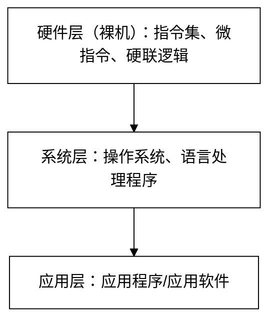
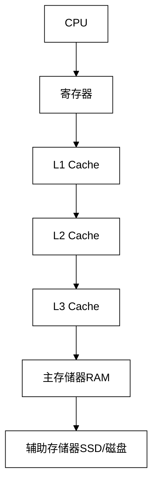
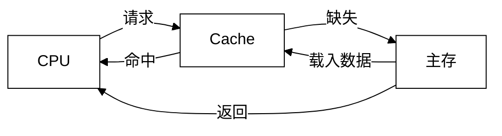
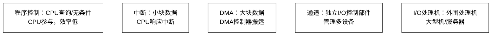
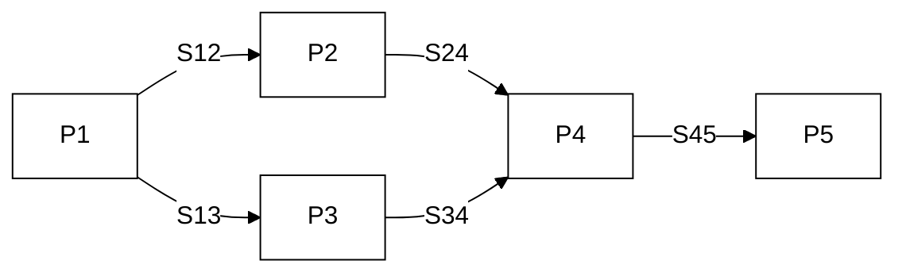

# 系统分析师｜第3章 计算机系统（备考讲义+章节自测题）

> **教材依据**：《系统分析师教程（第2版）》第3章《计算机系统》，共6节（3.1 计算机系统概述｜3.2 存储器系统｜3.3 输入输出系统｜3.4 指令系统｜3.5 多处理机系统｜3.6 操作系统）。操作系统（3.6）占教材本章近半篇幅、考纲1.6完整列出，讲义单列为独立模块。
>
> **考纲定位说明**：2024版考纲科目一「系统分析师综合知识」第1条 **计算机系统基础知识**（子项：1.1 计算机系统概述｜1.2 存储器系统｜1.3 输入输出系统｜1.4 指令系统｜1.5 多处理机系统｜1.6 操作系统），与教材第2版第3章 3.1～3.6 各节一一对应；其中 3.6 操作系统含 3.6.1～3.6.7 七个子节，与考纲 1.6.1～1.6.7 逐项对应。本章考纲子项在教材第2版均有对应小节或原文，无跨章归口调入的内容；第1版「第3章」与第2版「第3章」并不同构，对照关系见本节末说明。
>
> **考试形式**：上午综合知识单选题＋少量计算题；近年频次窗（2024上～2026上，5场）约47道/5场，为同期科目一题量最高的章节。窗内无单一考点族达成5场全中（最多的族为4道/4场），按统一判据本章模块最高为中等（🟡）；其中操作系统（3.6）板块题量最集中（约22道/5场），其余5个模块合计约25道/5场。案例分析科目近年频次窗无独立的计算机系统题组（0题组），本章内容作为背景知识使用。
>
> 标签：系统分析师、上午题、计算机系统、体系结构、存储层次、Cache、指令系统、操作系统、进程与线程、备考

[TOC]

## 章节结构对照与来源标注

> 本讲义为**系统分析师（第2版）教材第3章《计算机系统》**的学习讲义，模块顺序与教材 3.1～3.6 保持一致。操作系统（3.6）占教材本章近半篇幅、真题出题最集中，讲义单列为独立模块；教材未展开而需补回的内容清单见下方「⚠️ 不包含」块。

| 讲义模块 | 对应教材第2版章节 | 内容性质 | 备考要求 |
|---|---|---|---|
| 模块1 计算机系统概述 | 3.1 计算机系统概述 | 教材 | 掌握：冯·诺依曼结构与CPU组成、语言处理程序；拓展：CPU内部寄存器与数据通路；了解：计算机系统层次结构、计算机软件分类 |
| 模块2 存储器系统 | 3.2 存储器系统 | 教材 | 掌握：存储三级层次结构与局部性原理；拓展：网络存储（DAS/NAS/SAN）、虚拟存储技术（存储虚拟化）；了解：RAM与ROM、磁盘容量与平均存取时间、RAID、Cache基本原理与命中率/平均访问时间、三种映射与地址计算、写策略与替换算法 |
| 模块3 输入输出工作方式与接口 | 3.3.1 输入输出工作方式、3.3.3 I/O接口 | 教材 | 掌握：五种I/O工作方式的特点与适用场景、多中断源的处理方法；了解：DMA控制器获取总线的三种方法、I/O接口功能与分类、I/O端口编址 |
| 模块4 总线系统 | 3.3.2 总线 | 教材 | 了解为主：总线分类、性能指标与带宽计算、总线标准归类 |
| 模块5 指令系统 | 3.4 指令系统 | 教材 | 掌握：RISC指令系统的特点与关键技术；了解：指令系统的设计要求与基本指令类型、CISC的特点与缺陷 |
| 模块6 多处理机系统 | 3.5 多处理机系统 | 教材 | 了解为主：多处理机与并行处理机的比较、紧/松耦合、MPP与SVM、SMP与共享存储模型、互连函数与互连方式 |
| 模块7 操作系统 | 3.6 操作系统 | 教材＋第1版补充 | 掌握：进程与线程及资源共享、死锁四条件与银行家算法、虚拟存储管理、文件的逻辑结构与目录；了解：信号量与前趋图、分区/分页/分段/段页式、设备管理与磁盘调度、索引文件与存储空间管理、作业与用户界面、国产操作系统、可变分区分配算法（第1版补充）、客户/服务器（微内核）结构（第1版补充） |

> 拓展收录依据：「CPU内部寄存器与数据通路」为考纲1.1.2（计算机系统硬件组成·总纲归口本章）的内容，两版教材均无系统原文，而2024上第24、25题与2024下第13题（3道/2场）依托该知识点命题，故按【真题补充｜考频｜两版教材均无原文】收于模块1末尾拓展阅读，不作为必考考点、不进入模块例题与课后习题。

> 教材第2版第3章章节结构（按教材原文核读）：3.1 计算机系统概述（3.1.1 计算机系统层次结构、3.1.2 计算机系统硬件、3.1.3 计算机软件）｜3.2 存储器系统（3.2.1 主存储器、3.2.2 辅助存储器、3.2.3 高速缓冲存储器、3.2.4 网络存储技术、3.2.5 虚拟存储技术）｜3.3 输入输出系统（3.3.1 输入输出工作方式、3.3.2 总线、3.3.3 I/O接口）｜3.4 指令系统（3.4.1 基本指令系统、3.4.2 复杂指令系统、3.4.3 精简指令系统）｜3.5 多处理机系统（3.5.1 多处理机系统概述、3.5.2 海量并行处理结构、3.5.3 对称多处理机结构、3.5.4 互连网络）｜3.6 操作系统（3.6.1 操作系统概述、3.6.2 进程管理、3.6.3 存储器管理、3.6.4 设备管理、3.6.5 文件管理、3.6.6 作业与用户界面、3.6.7 国产操作系统）。

> ⚠️ 教材第2版第3章**不包含**（两源核查）：**源①**（对照第1版第3章《操作系统基本原理》逐节核对；该章全为操作系统内容，**仅对应第2版 3.6**）——①操作系统的结构类型（第1版3.1.2：整体结构、层次结构、客户/服务器结构、面向对象结构）：第2版 3.6.1 只讲作用、特征、功能与分类，不设结构类型；其中「客户/服务器结构＝微内核结构、多数服务由用户态服务器进程实现」为2026上第20题（甲套，1道/1场）依托，讲义按【第1版补充｜掌握】低频降档补回于模块7，其余三种结构2021年以后无检出，不收录；②可变分区的分配算法（第1版3.3.2，含首次适应、最佳适应等）：第2版 3.6.3 未展开，2024下第24题（1道/1场，考查最佳适应算法空闲区按容量递增登记）依托，讲义按【第1版补充｜掌握】低频降档补回于模块7；③多重分区与存储器保护、死锁检测与解除的展开（含资源分配图化简）、多线程模型（一对一/多对一/多对多）、分布式文件系统DFS：第2版无原文且2021年以后无检出，不收录；④操作系统分类中的「单用户操作系统」（第1版分类首项）：第2版分类为批处理、分时、实时、网络、分布式、嵌入式6类，不含该项，2021年以后无检出，不收录。**源②**（对照考纲1.1～1.6子项与教材3.1～3.6小节核对，考纲有子项、教材无对应小节即列入）——本章考纲全部子项均有对应小节或原文（含1.3.3 I/O接口与端口、1.4.1基本指令系统、1.6.7国产操作系统等低频或未检出者），**无源②事项**，故讲义不存在「考纲有条目而教材无对应章节」的补回内容。

> 说明（两版「第3章」并非同构）：两版教材的同号章节主题不同 —— 第1版第3章《操作系统基本原理》**仅对应第2版 3.6**；第2版 3.1～3.5（概述／存储器／输入输出／指令系统／多处理机）的内容在第1版属**第6章《系统配置与性能分析》**。因此Flynn分类（SISD/SIMD/MISD/MIMD）、指令流水线的总时间/吞吐率/加速比/效率与三类冒险、总线仲裁三方式等虽为第1版第6章原文（哈佛结构则两版均无原文），但**既不在本章考纲子项之列、2021年以后正式统计窗内亦无检出**（同类命题仅见于2026上L1-01乙套第23题的流水线加速比题，该套已按信源裁决转候选池、不计入统计），按来源标签规则一律不收录：不在正文、不配例题习题、不进备考提示。复习时注意区分，勿误当成该章本身内容。

---

## 模块1：计算机系统概述（教材3.1）【教材｜掌握】

**前置说明**：本模块对应教材第2版第3章 **3.1 计算机系统概述**（3.1.1 计算机系统层次结构、3.1.2 计算机系统硬件、3.1.3 计算机软件），对应考纲 **1.1 计算机系统概述**；教材原文为主，CPU内部寄存器与数据通路为两版教材均无系统原文而由真题依托的内容，收于本模块末尾拓展阅读；适配上午综合选择题（概念辨析）。
**模块优先级**：🟡 中频 —— 近年频次窗内CPU组成与流水线3道/2场（该族的实际命题为CPU组成、数据通路与CPU寄存器，不含流水线计算）、程序设计语言处理2道/2场，两族按统一判据（2～4场＝中频）均判中频。
**考情分析**（近年频次窗＝2024上～2026上，5场）：CPU组成与流水线3道/2场（2024上第24题＝控制器负责把程序指令从主存取入CPU执行、2024上第25题＝数据通路承担CPU内部运算器与寄存器及寄存器之间的数据交换、2024下第13题＝CPU所含寄存器的判别）；程序设计语言处理2道/2场（2025下、2026上；2026上第34题＝边读取源程序、边翻译、边执行且不生成独立目标文件的处理程序为解释程序）。冯·诺依曼结构、层次结构与软件分类三项近年频次窗未检出（0场），按了解级处理、不配练习题。

### 1.1 核心知识点精讲

#### 1.1.1 计算机系统层次结构（教材3.1.1）【教材｜了解】

计算机系统通常划分为**硬件层、系统层、应用层**的多级层次结构：

- **硬件层（裸机）**：细分为硬联逻辑级（门电路、触发器）、微程序级（微指令集）、传统机器级（指令集）。
- **系统层**：操作系统级（管理软硬件资源）＋语言处理程序级（编译、汇编、解释程序）。
- **应用层**：面向不同用户的各类应用程序（应用软件）。

#### 1.1.2 冯·诺依曼体系与计算机硬件组成（教材3.1.2）【教材｜掌握】

计算机自1946年诞生以来，虽制造技术已发生巨大变化，但就其体系而言都是基于**存储程序**的原理，也称为**冯·诺依曼体系结构**。教材给出硬件组成的5个基本部分：**运算器、控制器、存储器、输入设备、输出设备**。

- **CPU**：运算器、控制器等部件被集成在一起，统称为中央处理单元（CPU）。CPU是硬件系统的核心，用于数据的加工处理，能完成各种算术、逻辑运算及控制功能。
- **存储器**：是计算机的记忆设备，也是实现「存储程序控制」的基础，分为内部存储器与（外部存储器）——前者速度高、容量小，用于临时存放程序、数据及中间结果；后者容量大、速度慢，可以长期保存程序和数据。
- **外部设备**：输入设备与输出设备合称外部设备（外设），前者输入原始数据及各种命令，后者输出计算机运行的结果。

> 记忆：硬件5部分＝「运算器＋控制器＝CPU」、「存储器（内存＋外存）」、「输入＋输出＝外设」；冯·诺依曼＝「存储程序」。

#### 1.1.3 计算机软件分类（教材3.1.3）【教材｜了解】

- **系统软件**：实现计算机系统的管理、调度、监视和服务等功能，通常分为5类：操作系统、语言处理程序、服务性程序、数据库管理系统、计算机网络软件。
- **应用软件**：为解决某种应用问题而编制的程序（财务管理软件、项目管理软件等）。
- **固件**：存储在能永久保存信息的器件（EPROM/EEPROM）中的程序，是具有软件功能的硬件；固件的性能指标介于硬件与软件之间，执行速度快于软件、灵活性优于硬件。

#### 1.1.4 语言处理程序（教材3.1.3）【教材｜掌握】

教材在硬件层之上的「语言处理程序级」列出编译程序、汇编程序与解释程序；语言处理程序是把用程序设计语言编写的程序翻译成某种机器语言程序、使其可在计算机上运行的系统软件：

| 处理程序 | 输入来源 | 是否生成目标程序 | 执行方式 |
|---|---|---|---|
| 编译程序 | 高级语言源程序 | 是（机器语言目标程序） | 先整体翻译、后执行目标程序 |
| 汇编程序 | 汇编语言源程序 | 是（机器语言目标程序） | 先整体翻译、后执行 |
| 解释程序 | 源程序 | 否 | 边读取源程序、边翻译、边执行 |

> 记忆：编译/汇编都「先翻译后执行」并留下目标程序；解释程序「边读边译边执行」、**不生成独立的目标文件**（2026上第34题、2025下相关题按此判别）。

#### 1.1.5 典型易错点（计算机系统概述）

1. 语言处理程序三类当中，只有**解释程序**不生成独立的目标文件，编译与汇编都会留下机器语言目标程序【🟡中频】；
2. CPU由运算器与控制器等部件集成而来，同时承担算术、逻辑运算与控制功能，不能只理解成「做算术运算的部件」【🟡中频】。

### 1.2 典型例题

**例题1【CPU的核心地位】**

CPU被称为硬件系统核心的原因是（）

A. 它专门负责算术运算 B. 它由运算器与控制器等集成，能完成算术、逻辑运算及控制功能 C. 它容量最大、保存最久 D. 它独立于冯·诺依曼体系之外

> 【解析】教材：运算器、控制器等部件集成后统称为CPU，是硬件系统核心，用于数据加工处理，能完成各种算术、逻辑运算及控制功能；A漏掉了逻辑运算与控制功能，C是外存的特点。
> 【答案】B

**例题2【语言处理程序判别】**

边读取源程序、边翻译、边执行，且不生成独立机器语言目标文件的处理程序是（）

A. 编译程序 B. 汇编程序 C. 解释程序 D. 装入程序

> 【解析】解释程序对源程序逐条取出解释并立即执行，不产生可保存的目标程序。
> 【答案】C

### 1.3 课后习题

**习题1**

下列不属于教材所列系统软件类别的是（）
A. 语言处理程序 B. 服务性程序 C. 数据库管理系统 D. 财务管理软件

> 【解析】教材所列系统软件5类为操作系统、语言处理程序、服务性程序、数据库管理系统、计算机网络软件；财务管理软件属应用软件。
> 【答案】D

### 拓展阅读：真题依托补充（可考但两版教材均无系统原文）

##### 拓展·CPU内部寄存器与数据通路【真题补充｜考频｜两版教材均无原文】

> 收录依据：考纲1.1.2（计算机系统硬件组成，总纲归口本章）；真题依托为2024上第24、25题与2024下第13题（3道/2场，中频）。两版教材均未系统列出CPU寄存器清单，故不列为必考内容。

- **CPU内部主要寄存器**：程序计数器（PC，存放下一条待取指令的地址）、指令寄存器（IR，存放当前正在执行的指令）、内存地址寄存器（AR，存放要访问的内存单元地址）、数据寄存器（DR，暂存读出或写入的指令/数据）、累加寄存器（AC）与状态条件寄存器（PSW）。
- **判别关键**：**地址译码器不属于CPU**——它是对存储单元地址进行译码以选中某个存储单元的部件，挂在存储器一侧（2024下第13题据此设问）。
- **数据通路**：CPU内部各部件（运算器与寄存器、寄存器与寄存器）之间传送信息的路径。其功能是完成**数据交换**，既不是控制信号交换也不是数据存储（2024上第25题据此设问）；控制器的职能则是把程序指令从主存取入CPU并逐条分析执行（2024上第24题据此设问）。

**随堂小测（仅本节）**：下列部件中不属于CPU的是（）
A. 程序计数器 B. 指令寄存器 C. 地址译码器 D. 数据寄存器

> 【解析】地址译码器属存储器的译码选通部件。
> 【答案】C

---

## 模块2：存储器系统（教材3.2）【教材｜掌握】

**前置说明**：本模块对应教材第2版第3章 **3.2 存储器系统**（3.2.1 主存储器、3.2.2 辅助存储器、3.2.3 高速缓冲存储器、3.2.4 网络存储技术、3.2.5 虚拟存储技术），对应考纲 **1.2 存储器系统**；教材原文为主，其中存储器三级层次与局部性原理为近年频次窗中最稳定的考点族，Cache计算类考点近年窗仅零星检出（按了解级处理，讲清原理、不配练习题）；适配上午综合选择题，计算类以选择题形式出现。
**模块优先级**：🟡 中频 —— 近年频次窗内存储器层次结构4道/3场（中频）；Cache映射与计算、Cache命中率计算、Cache平均访问时间计算、磁盘阵列RAID各仅1道/1场（低频），按了解级处理。
**考情分析**（近年频次窗＝2024上～2026上，5场）：存储器层次结构4道/3场 —— 2024下第16题（寄存器/Cache/主存/辅存的速度排序）、2025上第7题与第10题、2026上第27题（三级存储结构的组成）；磁盘阵列RAID 1道/1场 —— 2024上第6题（无独立校验盘、采用分布式奇偶校验者＝RAID5）；Cache命中率/平均访问时间/映射计算近年窗各1道/1场（2024下第15题＝命中率反算、2025上第1题＝Cache＋主存的平均访存时间、2025下＝组相联映射与地址字段）；RAM与ROM、磁盘容量与平均存取时间、写策略与替换算法近年频次窗未检出（0场），按了解级处理。

### 2.1 核心知识点精讲

#### 2.1.1 存储层次体系（教材3.2）【教材｜掌握】

存储器是存放程序和数据的部件，是计算机能够实现「存储程序控制」的基础；规模较大的存储器往往分成若干级，称为**存储器系统**。教材明确：**传统的存储器系统一般分为高速缓冲存储器（Cache）、主存储器、辅助存储器三级**。

- 存储金字塔自上而下：**寄存器 → Cache（L1/L2/L3）→ 主存储器 → 辅助存储器（磁盘/SSD）**；越靠近CPU，速度越快、容量越小、单位价格越高。
- 教材给出存储器中数据常用的4种存取方式：**顺序存取、直接存取、随机存取、相联存取**。
- 构造 Cache—主存—辅存层次的核心依据是**程序局部性原理**（时间局部性、空间局部性）。

> 记忆：三级存储＝「Cache＋主存＋辅存」；速度由快到慢＝「寄存器→Cache→主存→辅存」（2024下第16题、2026上第27题按此判别）。

#### 2.1.2 主存储器：RAM与ROM（教材3.2.1）【教材｜了解】

- 主存按工艺与信息的可变性分 **RAM（随机存取存储器）** 与 **ROM（只读存储器）**：RAM断电后信息丢失（DRAM需定时刷新、SRAM不断电即不丢失），ROM断电后信息不丢失（存放BIOS等，也可用EPROM/EEPROM存放固件）。
- ROM派生出 PROM、EPROM、EEPROM、闪速存储器（Flash）等，属非易失性存储器。
- RAM又分SRAM（速度快、集成度低、成本高，用于Cache）与DRAM（密度高、需刷新，用于主存）。

#### 2.1.3 辅助存储器：磁盘容量与平均存取时间（教材3.2.2）【教材｜了解】

- 硬盘信息分布层次：记录面、圆柱面（柱面）、磁道、扇区；存取地址用驱动器号、柱面号、磁头号、扇区号表示。
- **格式化存储容量**：
$$存储容量 = n \times t \times s \times b$$
其中 $n$ 为保存数据的总记录面数，$t$ 为每面的磁道数，$s$ 为每道的扇区数，$b$ 为每个扇区存储的字节数（格式化容量一般约为非格式化容量的60%～70%）。
- **磁盘访问时间＝寻道时间＋等待（旋转延迟）时间**，读写操作时间相对二者可忽略：
$$T_a \approx T_s + T_w = \dfrac{t_{smin}+t_{smax}}{2} + \dfrac{t_{wmin}+t_{wmax}}{2}$$
其中 $T_w$ 为平均等待时间，取旋转一周时间的一半。

> 记忆：格式化容量 $=n\times t\times s\times b$；平均存取时间 $=$ 平均寻道 $+$ 平均等待（旋转延迟取旋转一周之半）。

#### 2.1.4 磁盘阵列 RAID 级别（教材3.2.2）【教材｜了解】

教材按8个级别介绍（核心考点在0、1、5）：

| 级别 | 关键技术 | 特点 |
| --- | --- | --- |
| RAID0 | 无冗余无校验的数据分块 | I/O性能与空间利用率最高，故障率高，非冗余 |
| RAID1 | 磁盘镜像 | 工作盘与镜像盘成对，安全性最高，空间利用率50% |
| RAID2 | 纠错海明码 | 需校验盘，单纠错双验错，实际很少用 |
| RAID3/4 | 奇偶校验码＋独立校验盘 | 一盘失效可异或恢复，读快写慢；RAID3位交叉、RAID4块交叉 |
| RAID5 | 奇偶校验分布式 | 无独立校验盘，校验分布各盘，兼顾性能与容错，最常用 |
| RAID6/7 | 多校验盘/优化异步 | 冗余更强或性能更高，价格昂贵 |
| RAID10 | RAID0＋RAID1组合 | 高可靠性与高性能组合，性价比较高 |

> 2024上第6题设问「无独立校验盘的奇偶校验磁盘阵列」＝**RAID5**（校验信息分布式存放在各成员盘上），是RAID行唯一的近窗命题，按了解级记忆。

#### 2.1.5 Cache基本原理与命中率/平均访问时间（教材3.2.3）【教材｜了解】

- 使用Cache的依据是**程序局部性原理**（时间局部性、空间局部性）；Cache位于CPU与主存之间，存放主存中活跃块的副本。
- 命中：待访问的数据已在Cache中；失效率（未命中率）$=1-h$，$h$ 为命中率。
- **平均存储周期**（教材3.2.3公式，$t_1$ 为Cache周期、$t_2$ 为内存周期）：
$$t_3 = t_1 \times h + t_2 \times (1 - h)$$

> 说明：教材公式按「未命中时以一次内存周期 $t_2$ 计」；若题干表述为「未命中时先访Cache、再额外访主存」，则改用 $t_3 = h\cdot t_1 + (1-h)(t_1+t_2)$，以题面口径为准。2025上第1题即按「Cache命中率＋主存命中加权」的思路设问。

#### 2.1.6 Cache三种映射与地址计算（教材3.2.3）【教材｜了解】

1. **直接映射**：主存块只能映射到Cache唯一行，$K = I \mod C$（$K$为Cache块号、$I$为主存页号、$C$为Cache块数）。硬件简单，冲突高。
2. **全相联映射**：主存每页可映射到Cache任一块。灵活但需比较全部标记，速度慢、成本高，只适合小容量。
3. **组相联映射**：先直接映射定组、再全相联定块，$J = I \mod Q$（$J$为组号、$Q$为Cache组数）。工程最常用（2路、4路组相联）。

**地址划分（组相联，按字节编址）**：
$$主存地址 = 标记（区号）\ |\ 组号\ |\ 块内地址$$

- 块内地址位数 ＝ $\log_2(\text{块大小})$；
- Cache组数 ＝ Cache容量 /（块大小 × 每组块数）；
- 组号位数 ＝ $\log_2(\text{组数})$；
- 标记（区号）位数 ＝ 主存地址位数 － 块内位数 － 组号位数。

> 教材在3.2.3的组相联举例中给出完整的体例算式：「Cache容量为64块、每4块一组即分为16组；主存容量为4096页且**以字编址**，由主存与Cache块容量一致得每页128个字，主存地址需要**19位**，主存组号需8位」——考生对照该题时体会「先算组数、再算字/页大小与地址位数」的顺序即可。

#### 2.1.7 Cache写策略（教材3.2.3）【教材｜了解】

- **写直达（Write Through）**：写Cache的同时写回内存。实现简单、主存始终正确，但可能增加不必要的主存写入、降低速度。
- **写回（Write Back）**：CPU修改Cache后不立即写内存，块被淘汰时才写回；需在块表中置标志位（脏位），替换时若为1则先写回。速度快，但存在主存不一致窗口。
- **标记法**：为每个Cache数据设有效位，修改时写入内存并将有效位置0，读取时测试有效位。

> 记忆：写直达「同步写主存、保一致、慢」；写回「延迟写、快、需脏位标记」。

#### 2.1.8 替换算法（教材3.2.3）【教材｜了解】

最常用：**随机算法、先进先出（FIFO）、近期最少使用（LRU）**（三者中LRU在考试中最常出现）。直接映射无替换选择（唯一行）；全相联/组相联需要替换策略。

### 拓展阅读：教材原生但备考非必学内容

##### 拓展·网络存储技术 DAS/NAS/SAN（教材3.2.4）【教材｜非必学】

- **DAS 直接附加存储**：存储设备经SCSI电缆直连服务器，存储操作依赖服务器，扩展受限（又称服务器附加存储SAS）。
- **NAS 网络附加存储**：存储设备通过NFS/CIFS等文件协议经网络访问，文件级共享，即插即用、经济，但性能一般。
- **SAN 存储区域网络**：经专用交换机把磁盘阵列与服务器连成高速专用子网，块级存储，性能最高；按协议分FC SAN、IP SAN（iSCSI）、IB SAN。
> 低频（🟢），概念一句带过即可，不配例题习题。

##### 拓展·虚拟存储技术（教材3.2.5）【教材｜非必学】

- 教材3.2.5「虚拟存储」指**存储虚拟化**：把多个存储介质模块（硬盘、RAID）集中管理成统一**存储池**，物理存储与逻辑表示分离，应用服务器只与逻辑卷交互。
- 分类：按拓扑分对称式/非对称式；按实现原理分数据块虚拟/虚拟文件系统。
- 实现方式：主机级、存储设备级、网络级虚拟化。
> 注意：此处的「虚拟存储」是**存储虚拟化**，与模块7（操作系统）教材3.6.3的「虚拟存储管理」（缺页换入换出）是不同概念，勿混淆。低频（🟢），不配例题习题。

### 2.2 典型例题

**例题1【三级存储结构（近年真题）】**

计算机系统常见的三级存储结构包括（）

A. 寄存器、主存、网卡 B. 高速缓冲存储器、主存和辅存 C. 虚拟内存、数据库、磁带 D. ROM、BIOS、操作系统

> 【解析】教材：传统的存储器系统一般分为高速缓冲存储器（Cache）、主存储器、辅助存储器三级（2026上第27题原文设问）。
> 【答案】B

### 2.3 课后习题

**习题1**

按访问速度由快到慢排列，正确的是（）
A. 主存→Cache→寄存器→辅存 B. 寄存器→Cache→主存→辅存 C. Cache→寄存器→主存→辅存 D. 寄存器→主存→Cache→辅存

> 【解析】越靠近CPU速度越快：寄存器最快，其次是各级Cache，再次主存，辅存最慢（2024下第16题同类设问）。
> 【答案】B

---

## 模块3：输入输出工作方式与接口（教材3.3.1、3.3.3）【教材｜掌握】

**前置说明**：本模块对应教材第2版第3章 **3.3.1 输入输出工作方式** 与 **3.3.3 I/O接口**（二者同为「输入输出系统」下的相邻小节，一并组织），对应考纲 **1.3.1 输入输出工作方式** 与 **1.3.3 I/O接口**；教材原文为主，适配上午综合选择题（概念辨析＋适用场景判断）。
**模块优先级**：🟡 中频 —— 近年频次窗内中断与DMA 4道/4场，按统一判据（2～4场＝中频）判中频。
**考情分析**（近年频次窗＝2024上～2026上，5场）：中断与DMA连续4场均有命题 —— 2024下第4题、2025上第6题、2025下、2026上第17题（甲套，以「下列说法错误的是」形式辨析中断方式与DMA方式在CPU参与度、传输效率与适用场景上的差别），是本章唯一「连年不断线」的考点族；I/O接口与端口、DMA控制器获取总线的方法近年频次窗未检出（0场），按了解级处理、不配练习题。

### 3.1 核心知识点精讲

#### 3.1.1 五种I/O工作方式（教材3.3.1）【教材｜掌握】

教材给出I/O系统的5种工作方式：

1. **程序控制方式**：由CPU执行I/O程序实现数据传送，分两种：
   - **无条件传送**：CPU默认外设始终就绪，直接访问I/O端口，仅用于简单开关量控制；
   - **程序查询（轮询）**：CPU循环查询外设状态，就绪才传送，CPU被独占、利用率低。
2. **程序中断方式**：外设准备好后发中断，CPU暂停当前任务（保护现场）转去处理，处理完返回（恢复现场）；CPU无需等待、效率较高，适合小块数据（如键盘）。中断过程分中断请求、判优、响应、处理、返回五阶段。
3. **DMA工作方式**：为高速批量数据交换设置，由DMA控制器（DMAC）接管总线、提供地址与读写控制信号，主存与外设直接大块传输，**不需CPU逐字节参与**；传送前CPU做预处理、传送后经中断做后处理。DMAC获取总线有CPU停止访存法、存储器分时法、周期挪用（窃取）法。
4. **通道方式**：通道是高级I/O控制部件，硬件＋软件实现对I/O的控制与传送，更多免去CPU介入；但不能完全脱离CPU（启动、停止仍受CPU管理）。按传送方式分字节多路通道、选择通道、数组多路通道。
5. **I/O处理机（外围处理机）**：具有丰富指令系统和完善中断系统，专用于大型高效计算机系统处理外设I/O，可承担码制转换、数据校验、文件管理、人机对话等。

#### 3.1.2 多中断源的处理方法（教材3.3.1）【教材｜掌握】

系统中存在多个中断源时，教材给出5种常用处理方法：**多中断信号线法、中断软件查询法、雏菊链法、总线仲裁法和中断向量表法**。

- **多中断信号线法**：每个中断源各有一条中断请求线直接送CPU，硬件线数多但判别最快。
- **中断软件查询法**：多个中断源共用一条请求线，CPU响应后执行查询程序依序判别是哪个源。
- **雏菊链（菊花链）法**：各设备按物理连接顺序串成链，离CPU近者优先获得响应，优先级由硬件连接位置决定。
- **总线仲裁法**：借用总线的仲裁机制裁决哪个中断源获得请求权。
- **中断向量表法**：由中断源提供向量号，CPU据向量号查中断向量表直接转入对应服务程序，是实际机器最常采用的方式。

> 记忆：教材的5种方法＝「多线、软件查询、雏菊链、总线仲裁、向量表」；其中只有**中断向量表法**给出「中断源→向量号→服务程序入口」的直接映射。
> 注意：教材此处是在**中断判优**的语境下列举上述方法，「总线仲裁」仅出现于本语境；教材并未展开链式查询/计数器定时查询/独立请求等总线仲裁细节。

#### 3.1.3 I/O接口与端口（教材3.3.3）【教材｜了解】

主机与外设在信息形式与工作速度上差异很大，**I/O接口**（简称接口，也称I/O控制器）就是为解决这些差异而设置的主机与外设之间的界面。

- **接口的功能5项**：①实现主机和外设的通信联络控制；②进行地址译码和设备选择；③实现数据缓冲；④数据格式的变换（并串转换、数模转换等）；⑤传递控制命令和状态信息。
- **接口的分类**：按I/O信号分数字接口/模拟接口；按通用性分通用接口/专用接口；按功能选择的灵活性分可编程接口/不可编程接口；按外设与I/O模块交换数据的方式分串行接口/并行接口。串行通信又分**异步通信**（字符间隔任意，靠起止位同步，设备简单但效率低）与**同步通信**（收发双方同频同相，靠同步字符建立同步后逐位收发）。
- **I/O端口**：接口电路中可被CPU直接访问的寄存器；由若干端口＋相应控制逻辑组成接口。接口包含**数据端口、命令端口和状态端口**。
- **端口编址两种方式**：**独立编址**（I/O映射，主存与端口地址空间各自独立、需专门I/O指令）与**统一编址**（存储器映射，端口与主存单元统一编址、用一般数据传送指令访问）。

#### 3.1.4 典型易错点（I/O控制方式）

1. DMA传输期间CPU不参与数据搬运，但传送前预处理、传送后中断后处理仍需要CPU【🟡中频】；
2. 磁盘等高速大批量读写用DMA；键盘等小块低速数据用中断【🟡中频】；
3. 程序查询CPU被独占、利用率低；无条件传送仅适合简单开关量【🟡中频】；
4. 通道/I/O处理机仍需CPU管理启动、停止，不能完全脱离CPU【🟡中频】。

### 3.2 典型例题

**例题1【I/O方式选择】**

磁盘大批量读写数据，优先选用哪种I/O方式？

> 【解析】磁盘数据块大、吞吐要求高，用DMA让控制器直接搬运，减少CPU干预。
> 【答案】DMA

**例题2【中断与DMA辨析】**

关于程序中断方式与DMA方式的描述，错误的是（）

A. 程序中断方式需要CPU参与数据传输 B. DMA传输效率通常高于程序中断方式
C. DMA方式适合高速数据传输 D. 程序中断方式的传输效率通常高于DMA方式

> 【解析】DMA由控制器直接在主存与外设间搬运大块数据，传输期间不占用CPU，效率高于每传一次都要CPU介入的中断方式（2026上第17题同类设问）。
> 【答案】D

### 3.3 课后习题

**习题1**

大批量磁盘数据传输，优先选择哪一种I/O方式（）
A. 程序查询 B. 中断 C. DMA D. 通道

> 【解析】大块数据用DMA控制器搬运，CPU不干预数据传输。
> 【答案】C

**习题2**

下列哪种I/O方式下，CPU不需要参与数据传输过程（）
A. 程序查询 B. 中断 C. DMA数据传送 D. 都是

> 【解析】DMA传送期间由DMA控制器管理总线，CPU不参与搬运（预处理/后处理仍需CPU）。
> 【答案】C

---

## 模块4：总线系统（教材3.3.2）【教材｜了解】

**前置说明**：本模块对应教材第2版第3章 **3.3.2 总线**，对应考纲 **1.3.2 总线**（总线的分类、标准和性能指标）；教材原文为主，适配上午综合选择题。
**模块优先级**：🟢 了解为主 —— 近年频次窗内总线与接口3道/1场（低频，全部出自2024上），且均为总线分类/标准类概念题，故按了解级处理，不设例题、课后习题与易错点。
**考情分析**（近年频次窗＝2024上～2026上，5场）：总线与接口3道/1场 —— 2024上第8题（按总线功能划分不含者＝服务总线）、第34题与第35题（总线标准与接口归类），属同一场次的集中命题；2024下～2026上再无检出。总线带宽计算近年频次窗未检出（0场）。

### 4.1 核心知识点精讲

#### 4.1.1 总线的分类（教材3.3.2）【教材｜了解】

总线是一组能为多个部件**分时共享**的公共信息传送线路。共享是指总线上可以挂接多个部件、相互间的信息都可通过这组公共线路传送；分时是指同一时刻只允许有一个部件向总线发送信息。教材给出4种分类方法：

1. 按总线功能：地址总线、数据总线、控制总线（此为2024上第8题的设问角度，备选项「服务总线」不属于此分类）；
2. 按在微机系统中位置：机内总线、机外总线；
3. 按总线功用：局部总线、系统总线、通信总线；
4. 按数据线多少：并行总线（多位同时传输、速率高）、串行总线（一位按序传输、适合远距离）。

#### 4.1.2 总线性能指标与带宽计算（教材3.3.2）【教材｜了解】

总线主要性能指标5种：**总线宽度、总线带宽、总线负载、总线分时复用、总线猝发传输**。

- **总线宽度**：总线的线数，影响地址线和数据线的数量（如32位的PCI总线允许寻址的主存空间为 $2^{32}$ 个单元）。
- **总线带宽**（最大数据传输速率，单位B/s）：
$$总线带宽 = 总线宽度 \times 总线频率$$
其中总线宽度以**字节**计（位宽除以8）。例：一个总线周期并行传输4B、周期0.2μs，则带宽 $= 4/0.2 = 20$MB/s。

#### 4.1.3 总线标准归类（教材3.3.2）【教材｜了解】

- 总线标准分正式标准（IEEE等）与工业标准（事实标准，厂家提出后被广为采用）。
- 按串行/并行归类：并行——PCI、PATA；串行——PCIe、USB、SATA（USB在教材3.3.3常见接口中列出，为串行总线接口，最多可连接127个设备并支持热插拔）。

---

## 模块5：指令系统（教材3.4）【教材｜掌握】

**前置说明**：本模块对应教材第2版第3章 **3.4 指令系统**（3.4.1 基本指令系统、3.4.2 复杂指令系统CISC、3.4.3 精简指令系统RISC），对应考纲 **1.4 指令系统**；教材原文为主，适配上午综合选择题（以「下列说法错误的是」的正误辨析为主）。
**模块优先级**：🟡 中频 —— 近年频次窗内RISC与CISC指令系统特点4道/4场，按统一判据（2～4场＝中频）判中频。
**考情分析**（近年频次窗＝2024上～2026上，5场）：RISC与CISC指令系统特点连续4场命题 —— 2024上第9题、2025上第4题、2025下、2026上第18题（甲套，均以「关于RISC的描述，错误的是」形式设问，干扰项集中在「指令长度不固定」「以微程序控制为主」这两条CISC特征上）；指令系统（含寻址方式）1道/1场（2024上第23题＝寄存器间接寻址方式下操作数存放在主存单元）；CISC的专门考点近年窗无独立检出。

### 5.1 核心知识点精讲

#### 5.1.1 指令系统的设计要求与基本指令（教材3.4.1）【教材｜了解】

- 指令是**指示计算机执行某些操作的命令**，一台计算机的所有指令的集合构成**指令系统**（指令集）；指令系统是计算机系统中**软件与硬件分界面的一个主要标志**。凡能在机器上直接运行的目标程序，都由若干条机器指令组成。
- **设计要求4项**：完整性（具备通用计算机应有的基本指令种类）、规整性（含对称性与均匀性）、高效率（的执行速度快、使用频率高）、兼容性（是计算机系统生命力所在）。
- **基本指令5类**：数据传送类、运算类（算术运算/逻辑运算/移位，在指令系统中应占较大比重）、程序控制类（转移、程序调用和返回、循环控制）、I/O指令（通常采用单一的直接寻址方式，多用户多任务环境下属特权指令）、处理机控制和调试指令。
- 某项功能用硬件指令还是软件子程序实现，主要考虑**速度、价格、灵活性**三因素：硬件实现速度快、价格高、灵活性差；软件实现速度慢、价格低、灵活性好。

#### 5.1.2 复杂指令系统 CISC（教材3.4.2）【教材｜了解】

把一些原来由软件实现的常用功能改用硬件来实现（以增多复杂指令来增强指令功能）的计算机称为**复杂指令系统计算机（CISC）**。特点：

1. 指令数量众多（通常有100～250条左右）；
2. 指令使用频率相差悬殊（约20%的简单指令占80%的使用频率，其余复杂指令很少用到）；
3. 支持很多种寻址方式（通常5～20种）；
4. **变长的指令**，增加了指令译码电路的复杂性；
5. 指令可以对主存单元中的数据**直接进行处理**；
6. **以微程序控制为主**（指令系统复杂，难以用硬布线逻辑电路实现控制器）。

> 缺陷方面：复杂的指令系统带来研制周期长、难以保证正确性、调试维护困难等负担，其中大量的冷门指令即上述第2条的80-20规律所致。

#### 5.1.3 精简指令系统 RISC（教材3.4.3）【教材｜掌握】

教材给出RISC的主要特点：

1. **指令数量少**，只选取使用频率最高的一些简单指令；
2. **只提供LOAD/STORE两条指令访问存储器**，其余操作都在寄存器之间进行；
3. **指令的寻址方式少**（通常只支持**寄存器寻址、立即数寻址和相对寻址**三种）；
4. **指令长度固定、指令格式少**；
5. 以**硬布线逻辑控制**为主（不采用或少用微程序控制）；
6. **单周期指令执行**，并采用流水线技术（因指令系统简化，很容易利用流水线）；
7. **优化的编译器**（减少寄存器分配等带来的麻烦）；
8. **通用寄存器数量多**（通常32个以上）。

**RISC核心思想**：执行程序所需时间 $P = I \times CPI \times T$（$I$ 为指令数、$CPI$ 为每条指令平均周期数、$T$ 为每周期时间）。RISC通过**减小CPI**（约1或略大于1）使处理速度比同规模CISC提高3～5倍（CISC的CPI约4～10，$T$ 约为RISC的3倍）。

**RISC关键技术**（教材列举，须注意它们都是为保证流水线持续充满而设计）：

- **延迟转移技术**：RISC中指令一般采用流水线方式工作，转移指令会使流水线断流；办法是在转移指令之后插入一条与转移无关的有效指令（延迟槽），即在转移真正生效前先执行该指令。
- **指令取消技术**：为提高执行效率应尽量少取消指令以保持流水线充满；当后续指令不能执行时才取消（教材以转移成功与否为例）。
- **重叠寄存器窗口技术**：用寄存器组的大量寄存器做成多个重叠的窗口，供过程调用/返回时直接切换，省去保存与恢复现场的大量访存。
- **指令流调整技术**：编译器分析程序的**数据流和控制流**，发现可能导致流水线断流时调整指令序列；对可通过变量重新命名消除的**数据相关**也尽量消除。
- **硬件为主、固件为辅**：尽量用硬布线逻辑实现指令，不依赖微程序。

> 注意：现代x86内部会把CISC指令解码成RISC微指令，商品化RISC机器也常辅以少量复杂指令，属二者结合。
> 考试提示：本窗4次命题全部是「选出**不属于RISC特点**」的反向设问，最常见的两条干扰项是「指令长度不固定」与「以微程序控制为主」——这两条恰恰是CISC特点。

#### 5.1.4 典型易错点（指令系统）

1. RISC是Load/Store架构，运算指令不能直接访问内存；能直接处理主存单元数据的是CISC【🟡中频】；
2. RISC指令长度固定、寻址方式少、以硬布线控制为主；「指令长度不固定」「以微程序控制为主」属CISC【🟡中频】；
3. 重叠寄存器窗口、延迟转移、指令流调整都是为保证流水线不断流的RISC关键技术，不是某一项来代替它们【🟡中频】。

### 5.2 典型例题

**例题1【CISC/RISC判断】**

RISC架构的特征**不包含**（）

A. 定长指令 B. 大量通用寄存器 C. 丰富复杂的寻址方式 D. Load/Store架构

> 【解析】丰富复杂的寻址方式是CISC特征；RISC寻址方式少（通常只有寄存器、立即数、相对三种）、指令定长、通用寄存器多、采用Load/Store架构。
> 【答案】C

**例题2【RISC反向设问（近年真题）】**

下列关于RISC的描述，错误的是（）

A. 指令数量较少 B. 指令长度通常固定 C. 通常采用微程序控制为主 D. 适合流水线优化

> 【解析】RISC以硬布线逻辑控制为主，采用微程序控制为主的是CISC（2026上第18题原文设问）。
> 【答案】C

### 5.3 课后习题

**习题1**

下列所述中，属于CISC特点的是（）
A. 指令寻址方式极少 B. 以微程序控制为主 C. 只有LOAD/STORE可访问存储器 D. 单周期指令、单用硬布线控制

> 【解析】「以微程序控制为主」「变长指令」「支持5～20种寻址方式」「可直接处理主存单元数据」均为CISC特点；其余三项属RISC。
> 【答案】B

---

## 模块6：多处理机系统（教材3.5）【教材｜了解】

**前置说明**：本模块对应教材第2版第3章 **3.5 多处理机系统**（3.5.1 多处理机系统概述、3.5.2 海量并行处理结构MPP/SVM、3.5.3 对称多处理机结构SMP/S2MP、3.5.4 互连网络），对应考纲 **1.5 多处理机系统**；教材原文为主，适配上午综合选择题。
**模块优先级**：🟢 了解为主 —— 近年频次窗（2024上～2026上，5场）**未检出（0场）**；全量统计窗内多处理机与并行、多处理机调试各1道/1场（分别出自2023上、2021上），故保留收录但按了解级处理，不设例题、课后习题与易错点。
**考情分析**：近年频次窗0场；全量统计窗内2023上第14～15题（多处理机与并行处理机的比较）、2021上第16题（多处理机调试等概念）。本模块的概念辨析（SIMD/MIMD、紧/松耦合、共享存储模型）是理解模块1—CPU组成与高性能计算背景的铺垫，了解即可。

### 6.1 核心知识点精讲

#### 6.1.1 多处理机系统概述与耦合度（教材3.5.1）【教材｜了解】

- **多处理机**：两个以上处理机共享I/O子系统，在操作系统统一控制下，通过共享主存或高速通信网络通信，协同求解复杂问题。属于**MIMD**结构。
- **并行处理机（向量/阵列处理机）**：基于**SIMD**结构，只有一个控制器、多个处理单元，适合矩阵/向量计算。多处理机与并行处理机在结构灵活性、程序并行性、并行任务派生、进程同步、资源分配与调度5方面不同。
- 多处理机访问内存的两种方式，对应两种耦合：
  - **共享存储方式 → 紧耦合（直接耦合）系统**：各处理机通过互连网络共享SM，如SMP；特点易管理、编程易，但处理机数目有限、扩充难。
  - **分布式存储方式 → 松耦合（间接耦合）系统**：各处理机独占本地存储器LM，如MPP；特点结构灵活、易扩充，但数据传递/任务分配复杂，适合粗粒度并行。

> 记忆：紧耦合「共享主存（SMP）」；松耦合「各自本地存储（MPP）」。

#### 6.1.2 MPP海量并行处理与SVM（教材3.5.2）【教材｜了解】

- **MPP（海量并行处理）**：具有几百/几千台处理机的机器，采用分布式存储，可扩展性强；但各处理机不能直接访问非本地存储器，只能用消息机制共享，编程难、通信开销大。
- **SVM（虚拟共享存储器/DSM共享分布存储器）**：在分布式存储多处理机上，把物理分散的LM在逻辑上统一编址成统一虚拟地址空间，实现逻辑共享。实现途径：硬件实现、操作系统和库实现、编译实现。

#### 6.1.3 SMP对称多处理机结构与共享存储模型（教材3.5.3）【教材｜了解】

- **SMP**：共享存储多处理机，有统一共享的SM（与MPP最大差别在存储系统）。
- 共享存储有三种模型：
  - **UMA 均匀存储器存取**：物理存储器被所有处理机均匀共享，访问时间一致；
  - **NUMA 非均匀存储器存取**：SM物理分布在所有处理机的LM上，访问本地快、访问远程慢，平均访存时延低、带宽可扩展；
  - **COMA 只用高速缓存的存储器结构**：NUMA特例，把分布主存换成高速缓存。
- **S2MP（可扩展共享存储多处理机）**：本质上属NUMA结构，解决SMP性能与扩展能力问题，支持细粒度应用。

#### 6.1.4 互连网络（教材3.5.4）【教材｜了解】

- 互连网络连接各处理部件、存储模块、外设，是并行处理系统核心，影响性能/价格比。
- **互连函数**：恒等置换、交换置换、方体置换、均匀洗牌置换、蝶式置换、位序颠倒置换（以概念识别为主，不必展开计算）。
- **互连方式**（5种）：总线方式（最简单、争用最严重）、交叉开关（争用最低、复杂度最高）、开关枢纽（由仲裁单元与开关单元组成，前者完成冲突处理、后者完成连接）、多端口存储器（把交叉点仲裁逻辑移到存储器去控制）、多级互连网络（总线与交叉开关的折中，扩展性好）。

---

## 模块7：操作系统（教材3.6）【教材＋第1版补充】

**前置说明**：本模块对应教材第2版第3章 **3.6 操作系统**（3.6.1 操作系统概述、3.6.2 进程管理、3.6.3 存储器管理、3.6.4 设备管理、3.6.5 文件管理、3.6.6 作业与用户界面、3.6.7 国产操作系统），对应考纲 **1.6 操作系统**，占教材本章近半篇幅；教材原文为主，另有两处「第1版有而第2版删除、近年仍有真题依托」的内容（可变分区的分配算法、客户/服务器＝微内核结构）按【第1版补充｜掌握】低频降档收录；适配上午综合选择题与少量计算题。
**模块优先级**：🟡 中频 —— 近年频次窗内线程与资源共享4道/4场、死锁与银行家算法3道/3场、虚拟存储4道/2场、文件逻辑结构2道/2场，均为2～4场的中频族；无单一族达成5场全中。
**考情分析**（近年频次窗＝2024上～2026上，5场）：本模块合计22道/5场，为本章题量最集中的板块 —— ①线程与资源共享4道/4场（2024上第21题＝依赖内核、由内核内部需求创建和撤销者＝内核线程；2024下第3题；2025上第11题；2025下）；②死锁与银行家算法3道/3场（2024上第1题＝不是产生死锁必要条件者＝共享条件；2024下第29题；2025上第9题）；③虚拟存储4道/2场（2024上第7题＝虚拟存储实现方式的判别、第18题＝FIFO置换的缺页中断次数；2024下第2题、第30题）；④文件逻辑结构2道/2场（2024下第26题＝属逻辑结构者＝流式文件；2025上第8题）。另有9个低频族各1道/1场：前趋图与PV操作（2025上第2题＝互斥信号量初值为1）、存储管理（2024上第19题＝编译后的目标程序在内存中的地址称逻辑地址）、操作系统功能（2025上第3题）、操作系统概述（2026上第20题＝微内核的服务放在用户态）、文件目录结构（2024上第2题＝UNIX与Windows都采用树形目录）、段页式存储管理（2025上第5题）、磁盘调度（2024下第23题＝会产生饥饿现象的算法）、进程状态（2024上第20题）、可变分区存储管理（2024下第24题）。位示图、文件索引结构、国产操作系统近年频次窗未检出（0场），全量统计窗内分别只有2022上、2021上、2023上的检出，按了解级处理。

### 7.1 核心知识点精讲

#### 7.1.1 操作系统概述与分类（教材3.6.1）【教材｜了解】

- 作用：操作系统是计算机系统的资源管理者，通过资源管理提高系统效率、改善人机界面。
- 特征：**并发性、共享性、虚拟性、不确定性**。
- 5种主要功能：**处理机管理（进程管理）、存储器管理、设备管理、文件管理、用户界面**。
- 分类：通常分为批处理、分时、实时、网络、分布式、嵌入式操作系统（教材逐类介绍；嵌入式具有微型化、可定制、实时性、可靠性、易移植性等特点）。

#### 7.1.2 客户/服务器结构与微内核（教材3.6.1未设）【第1版补充｜掌握】

> 第1版第3章3.1.2「操作系统的结构」的原内容；第2版 3.6.1 不设结构类型。2026上第20题（甲套，1道/1场）依托本知识点命题，按低频降档处理：只保概念要点与记忆口诀，不配例题、课后习题，不设易错点。

- 现代操作系统大多拥有两种工作状态：**核心态**与**用户态**。一般应用程序工作在用户态，内核模块与最基本的操作系统核心工作在核心态。
- **客户/服务器结构也称为微内核结构**：把传统的操作系统代码放置到更高层，从操作系统中去掉尽可能多的东西，只留下一个最小的核心，称为**微内核**；多数操作系统功能由**在用户态运行的服务器进程**实现，用户进程（客户进程）把请求发给服务器进程，后者完成后把结果返回。
- 由此带来的两个直接后果（也是命题点）：服务器以用户进程形式运行、**不运行在核心态**，因此不能直接访问硬件，某个服务器崩溃不会导致整个系统崩溃；结构上更适合分布式系统。
- **微内核技术的主要优点**：①统一的接口（用户态与核心态之间无需识别是哪个进程）；②可伸缩性好；③可移植性好（与具体机器特征相关的代码全部隔离在微内核中）；④实时性好；⑤安全可靠性高；⑥支持分布式系统与多处理器体系结构。

> 记忆（2026上第20题）：微内核把**文件系统、设备驱动等多数服务放在用户态**，只把**进程通信、调度等最基本的机制放在核心态**。

#### 7.1.3 进程与线程（教材3.6.2）【教材｜掌握】

- **进程**：资源分配的基本单位，有独立地址空间；状态：就绪、运行、阻塞（等待），三者可迁移；教材另给出五态模型（在三态基础上加入新建与终止）。单处理机系统中任一时刻只能有一个进程处于运行状态。
- **线程**：CPU调度的基本单位，轻量级，**共享所属进程的地址空间与资源**。教材指出线程分为**用户级线程**（不依赖于内核，创建、撤销与切换都不利用系统调用）与**内核支持线程**（依赖于内核，由内核的内部需求进行创建和撤销）两类。
  - 线程可共享：进程内代码、数据、堆、全局变量、打开的文件；
  - 线程独有：程序计数器、一组寄存器和栈。

> 记忆：进程「资源」单位、有独立空间；线程「调度」单位、共享进程资源、只有栈/寄存器/PC独有；「由内核创建和撤销」者＝内核支持线程（2024上第21题）。

#### 7.1.4 信号量、前趋图与PV操作（教材3.6.2）【教材｜了解】

- **信号量**：整型变量，$P$ 操作（wait）＝申请资源（减1，小于0则阻塞），$V$ 操作（signal）＝释放资源（加1，唤醒等待者）。用于**互斥**（初值1）与**同步**（初值0或资源数）。
- **前趋图**：有向边表示执行顺序约束；每对前趋关系配一个同步信号量，初值0。某进程开始执行前需对**其所有直接前驱**对应信号量执行 $P$ 操作；执行完毕后对其**所有直接后继**对应信号量执行 $V$ 操作。
- 典型模型：生产者－消费者（缓冲区）、读者－写者。教材以「输入—计算—输出」三程序段的例题给出使用前趋图描述并发执行的做法。

> 说明：上图中每条有向边对应一个同步信号量（初值0），如 P4 开始前需先 $P(S_{24})$、$P(S_{34})$；互斥信号量则相反，初值为1（2025上第2题直问互斥场景的初值）。

#### 7.1.5 死锁四条件与银行家算法（教材3.6.2）【教材｜掌握】

- **死锁四个必要条件**（缺一不可）：①**互斥**；②**占有且等待**；③**不可剥夺**；④**循环等待**（环路条件）。
- **处理策略**：预防（破坏四条件之一）、避免（银行家算法）、检测与解除。
- **银行家算法**：判定某分配后系统是否存在安全序列 —— 反复找一个满足 $Need_i \le Available$ 且未完成的进程，分配并回收其资源，若所有进程都能依次完成则该状态安全。

> 反向设问的规律（2024上第1题）：题干中混入的干扰项为「共享条件」「请求与保持顺序」等，**四个必要条件里没有「共享条件」**；安全状态必定不死锁，但不安全状态只是可能死锁。

#### 7.1.6 存储管理：分区 / 分页 / 分段 / 段页式（教材3.6.3）【教材｜了解】

- **分区**：连续分配，简单但产生外部碎片。教材分为固定分区、可变分区和可重定位分区（后者用「拼接」把零散空白区合并成大的空白空间）。
- **分页**：主存按固定块（页框）划分，进程逻辑地址按同样大小分页。**逻辑地址＝页号＋页内偏移**；经页表把页号映射为块号（页框号）。
$$物理地址 = 块号 \times 页大小 + 页内偏移$$
- **分段**：按逻辑模块分段，段长可变；逻辑地址＝段号＋段内偏移，经段表映射为段基址＋偏移（产生外部碎片）。
- **段页式**：先分段、段内再分页；逻辑地址＝段号＋页号＋页内偏移，访问需经段表查页表起始、再经页表查块号，两次查表。
- 源程序经编译链接后装入之前使用的是逻辑地址（相对地址），装入后才形成内存中的物理地址（2024上第19题据此设问）。

#### 7.1.7 可变分区的分配算法（教材3.6.3未展开）【第1版补充｜掌握】

> 第1版第3章3.3.2的原内容；第2版 3.6.3 只列出固定分区/可变分区/可重定位分区三类，不展开分配算法。2024下第24题（1道/1场）依托本知识点命题，按低频降档处理：只保概念要点与记忆口诀，不配例题、课后习题，不设易错点。

可变分区（动态分区）在装入作业时从可用内存中划出一块正好等于作业大小的连续区域；分配前首先要找到一个足够大的空闲分区，然后将其一分为二（已分配部分＋剩余空闲区），回收时检查是否与前后空闲区相邻并合并。选择哪个空闲分区由算法决定：

| 算法 | 空闲区表的排序方式 | 分配规则与特点 |
|---|---|---|
| **首次适应** | 按**地址由低到高**排序 | 从表头起找最先能满足要求的空闲区分配；目的在于减少查找时间 |
| **最佳适应** | 按**容量从小到大**排序 | 从全部空闲区中找出能满足要求且**最小**的空闲区，使碎片尽量小；自表头开始查找第一个满足要求的即分配 |
| **最坏适应** | 按**容量由大到小**排序 | 从所有未分配分区中挑选**最大**且不小于作业大小的分区分配；对中、小作业比较有利 |

> 记忆（2024下第24题）：问「空闲区按什么次序登记在空闲区表中」时 —— 首次适应＝按**地址**递增，最佳适应＝按**长度（容量）递增**，最坏适应＝按长度递减。实践表明：首次适应可能比最佳适应好，而二者一定比最坏适应好。

#### 7.1.8 虚拟存储管理（教材3.6.3）【教材｜掌握】

- 基于**局部性原理**，只把部分页面装入主存，缺页时按淘汰算法换入换出。教材把它放在分页存储管理、分段存储管理、段页式存储管理之后介绍，其基本特征是部分装入、按需调页与置换。
- 常用淘汰（页面置换）算法：**OPT（最优）、FIFO、LRU、Clock**；其中Stack类算法（OPT、LRU）不会产生Belady现象，FIFO则可能在某些访问序列下页面数增加反而缺页更多。
- 页面置换的**缺页中断次数**是近年窗的实际命题形式（2024上第18题＝给2个页帧、给定访问序列、按FIFO数缺页次数）。
- **抖动/颠簸（Thrashing）**：进程频繁地从辅存请求页面，使缺页率居高不下；教材引入**工作集理论**加以解决 —— 使程序的工作集驻留在主存中就可使缺页保持在合理水平。

> 注意区分：此「虚拟存储管理」是操作系统内的请求调页/页面置换，与模块2教材3.2.5的「虚拟存储技术（存储虚拟化）」是不同概念，考试勿混淆（2024上第7题问的是虚拟存储的**实现方式**，切忌按OS同样作答）。

#### 7.1.9 设备管理与磁盘调度（教材3.6.4）【教材｜了解】

- 设备管理功能：设备分配、设备传输控制、设备独立性；常采用缓冲技术和虚拟技术实现设备与主机并行。
- **磁盘调度算法**：
  - **SSTF 最短寻道时间优先**：优先访问离当前磁头最近柱面，吞吐较好但可能「饥饿」（2024下第23题＝易被判为产生饥饿现象的算法）；
  - **SCAN 电梯算法**：磁头沿一个方向扫到端再反向，均衡；
  - 其他：FCFS先来先服务、C-SCAN循环扫描。

#### 7.1.10 文件的逻辑结构与目录（教材3.6.5）【教材｜掌握】

- **文件的逻辑结构两大类**（教材原文）：一是**有结构的记录式文件**（由一个以上的记录构成）；二是**无结构的流式文件**（由一串顺序字符流构成）。UNIX系统把所有的文件都看作流式文件。流式／记录式属**逻辑结构**，不可与物理结构（连续/链接/索引）混为一谈（2024下第26题据此设问）。
- **文件目录**：由文件控制块（FCB，也称文件的说明或目录项）组成，专门用于文件的检索。常见目录结构有**一级目录、二级目录、树形目录**3种；UNIX与Windows都采用**树形目录结构**（2024上第2题原文设问）。

#### 7.1.11 文件物理结构与存储空间管理（教材3.6.5）【教材｜了解】

- **文件物理结构**：连续、链接（隐式/显式）、索引（单级/多级索引）。UNIX的文件索引表项分4种寻址方式：**直接寻址、一级间接寻址、二级间接寻址和三级间接寻址**。
- **索引文件寻址判定**：给定盘块大小与地址占用字节数，先算每块可存盘块号数，再判某文件偏移落在直接地址区、一级间接区还是二级间接区（直接区覆盖＝直接块数×块大小；一级间接区＝每块地址数×块大小；二级间接区＝每块地址数²×块大小）。
- **空闲空间的管理方法4种**：**位示图、空闲区表、空闲块链、成组链接法**。位示图用一位对应一个盘块：
$$盘块号 = 字号 \times 字长 + 位号$$
（字号、位号均从0起时；具体映射方向以教材约定为准）

#### 7.1.12 作业与用户界面（教材3.6.6）【教材｜了解】

作业调度（先来先服务、短作业优先、最高响应比等）与用户界面（也称用户接口，用于使用户灵活方便地使用计算机和系统资源）概念低频，了解即可，不配复杂计算。

#### 7.1.13 国产操作系统（教材3.6.7）【教材｜了解】

- 共同技术基础：国产操作系统主要以**开源的 Linux 为基础进行二次开发**。
- 教材列出认知度较高的 8 款：

| 系统 | 要点 |
|---|---|
| 银河麒麟（KylinOS） | 国防科技大学、中国软件、联想、浪潮等合作研制；目标打破国外服务器操作系统垄断；完全版含实时版、安全版、服务器版 |
| 深度（deepin） | 基于 Linux 内核、以桌面应用为主的开源 GNU/Linux 系统，含深度桌面环境（DDE）与近 30 款原创应用 |
| 统信（UOS） | 统信软件技术有限公司研发，基于 deepin 深度开发，已较为完善 |
| 中标麒麟 | 上海中标软件，面向桌面应用，采用强化 Linux 内核；分桌面版、通用版、高级版、安全版 |
| 红旗 Linux | 中科红旗开发的一系列 Linux 发行版，国内较大、较成熟的发行版，较出名 |
| 安超 OS 2020 | 基于服务器架构的通用型云操作系统，软硬件解耦、支持混合业务负载 |
| 中科方德 | 基于核高基桌面操作系统基础版，采用核高基安全加固内核，与国产兆芯处理器适配优化 |
| StartOS（起点操作系统） | 前身为雨林木风 ylmfos，从 Linux 底层构建，符合中国人操作习惯的桌面 Linux |

> 记忆：国产 OS 均基于 Linux 二次开发 —— 「麒麟两家（银河麒麟、中标麒麟）、深度统信（同源）、红旗方德、安超起点」。

#### 7.1.14 典型易错点（操作系统）

1. 线程共享进程资源，但栈、寄存器、程序计数器（PC）为线程独有【🟡中频】；
2. 「依赖于内核、由内核内部需求创建和撤销」的是内核支持线程，用户级线程的创建与切换不经系统调用【🟡中频】；
3. 死锁四个必要条件中没有「共享条件」；银行家算法判定的是「是否存在安全序列」【🟡中频】；
4. 安全状态必不死锁；不安全状态只是**可能**死锁，已发生死锁一定不处于任何可完成序列之中【🟡中频】；
5. 流式文件、记录式文件是**逻辑结构**；连续/链接/索引是**物理结构**，二者不可混答【🟡中频】。

### 7.2 典型例题

**例题1【线程与资源共享】**

下列不能被同一进程的多个线程共享的是（）

A. 进程的全局变量 B. 打开的磁盘文件 C. 程序计数器（PC） D. 堆

> 【解析】教材：线程基本上不拥有资源，只拥有一点运行中必不可少的资源（如程序计数器、一组寄存器和栈），故PC为线程独有；全局变量、打开的文件、堆均属进程资源而为线程共享。
> 【答案】C

**例题2【死锁必要条件辨析】**

不是产生死锁必要条件的是（）

A. 互斥条件 B. 共享条件 C. 环路条件 D. 不可剥夺条件

> 【解析】四个必要条件为互斥、占有且等待、不可剥夺、循环等待（环路）；「共享条件」不在其中（2024上第1题原文设问）。
> 【答案】B

**例题3【虚拟存储·FIFO缺页次数】**

页面访问序列为（0，0，1，1，3，1，2），系统为该程序分配2个页帧，按先进先出（FIFO）页面置换算法，共产生几次缺页中断（）

A. 3次 B. 2次 C. 4次 D. 5次

> 【解析】依次装入：0（缺）、0（命中）、1（缺）、1（命中）、3（缺，淘汰最早进入的0）、1（命中）、2（缺，淘汰最早进入的1）；共4次缺页（2024上第18题原题）。
> 【答案】C

**例题4【文件逻辑结构与目录】**

下列文件类型中，属于文件**逻辑结构**的是（）

A. 系统文件 B. 索引文件 C. 流式文件 D. 链接文件

> 【解析】教材给出文件的逻辑结构分有结构的记录式文件与无结构的流式文件两类；索引文件、链接文件属物理结构，系统文件是按用途分类（2024下第26题原题）。
> 【答案】C

### 7.3 课后习题

**习题1**

UNIX和Windows操作系统都采用的目录结构是（）
A. 顺序 B. 树形 C. 一级 D. 二级

> 【解析】教材：常见的目录结构有一级、二级、树形3种，现代通用操作系统普遍采用树形目录结构（2024上第2题原题）。
> 【答案】B

**习题2**

编译后的目标程序在内存中的地址称为（）

A. 绝对地址 B. 物理地址 C. 逻辑地址 D. 实际地址

> 【解析】源程序经编译（或汇编）后尚未装入内存，其目标程序中的地址仍为相对于本模块起点的逻辑地址；装入时才确定物理地址。
> 【答案】C

**习题3**

某分页系统页大小1KB，逻辑地址（页号3，页内偏移512），页3映射块7，其物理地址为（）
A. 7168 B. 7680 C. 5632 D. 6656

> 【解析】物理地址 $= 7\times1024 + 512 = 7168 + 512 = 7680$。
> 【答案】B

---

# 章节总复习综合模拟题（覆盖全部7模块）

> 说明：题型贴合系统分析师上午真题风格；选题以近年频次窗内的中等族群（操作系统·中断与DMA·RISC与CISC·存储器层次·CPU组成与语言处理程序）为主，了解级知识点按规范至多配1道概念题（第5、11题的「总线分类」「Cache命中率」即属此类），第1版补充低频降档内容亦仅配1道概念题（第4题＝可变分区最佳适应）。全卷不含与掌握级无关的计算。

## 一、单项选择题（11题）

1. 【CPU组成】计算机系统中负责把程序指令从主存取入CPU并逐条分析执行的是（）
A. 算术逻辑单元 B. 主存储器 C. 控制器 D. 高速缓存
> 【解析】CPU由运算器、控制器等集成，完成算术、逻辑运算及控制功能；「取指令、分析指令」属控制器的职能（2024上第24题考点）。
> 【答案】C

2. 【语言处理程序】边读取源程序、边翻译、边执行且不生成独立目标文件的处理程序是（）
A. 编译程序 B. 汇编程序 C. 解释程序 D. 装入程序
> 【解析】编译与汇编都先生成机器语言目标程序；解释程序逐条取出解释执行，不产生可保存的目标程序（2026上第34题考点）。
> 【答案】C

3. 【存储层次】计算机系统常见的三级存储结构是指（）
A. 寄存器、主存、网卡 B. 高速缓冲存储器、主存和辅存 C. 虚拟内存、数据库、磁带 D. ROM、BIOS、操作系统
> 【解析】教材：传统的存储器系统一般分为Cache、主存储器、辅助存储器三级（2026上第27题原题）。
> 【答案】B

4. 【可变分区】采用最佳适应算法时，空闲区表中的空闲区应按何种次序登记（）
A. 地址递增 B. 长度递增 C. 地址递减 D. 长度递减
> 【解析】最佳适应按容量从小到大排序，自表头开始查找第一个满足要求的空闲区；按地址递增登记的是首次适应算法（2024下第24题考点，第1版补充）。
> 【答案】B

5. 【总线分类】按照总线功能划分，不包括（）
A. 数据总线 B. 地址总线 C. 控制总线 D. 服务总线
> 【解析】教材按总线功能分为地址总线、数据总线、控制总线三类（2024上第8题原题，本题知识点属了解级）。
> 【答案】D

6. 【中断与DMA】关于程序中断方式与DMA方式的描述，错误的是（）
A. 程序中断方式需要CPU参与数据传输 B. DMA传输效率通常高于程序中断方式
C. DMA方式适合高速数据传输 D. 程序中断方式的传输效率通常高于DMA方式
> 【解析】DMA由控制器直接搬运大块数据、不占用CPU，效率高于每传一次都要CPU介入的中断方式（2026上第17题原题）。
> 【答案】D

7. 【RISC】下列关于RISC的描述，错误的是（）
A. 指令数量较少 B. 指令长度通常固定 C. 通常采用微程序控制为主 D. 适合流水线优化
> 【解析】RISC以硬布线逻辑控制为主；采用微程序控制为主的是CISC（2026上第18题原题）。
> 【答案】C

8. 【线程】下列属于线程独有、不能被同一进程的其他线程共享的是（）
A. 进程的全局变量 B. 打开的磁盘文件 C. 程序计数器（PC） D. 堆
> 【解析】教材：线程只拥有一点运行中必不可少的资源（程序计数器、一组寄存器和栈），其余进程资源为线程共享。
> 【答案】C

9. 【死锁】不是产生死锁必要条件的是（）
A. 互斥条件 B. 共享条件 C. 环路条件 D. 不可剥夺条件
> 【解析】四个必要条件为互斥、占有且等待、不可剥夺、循环等待；「共享条件」不在其中（2024上第1题原题）。
> 【答案】B

10. 【文件的逻辑结构】下列文件类型中，属于文件逻辑结构的是（）
A. 系统文件 B. 索引文件 C. 流式文件 D. 链接文件
> 【解析】教材把文件的逻辑结构分为有结构的记录式文件与无结构的流式文件；索引、链接属物理结构（2024下第26题原题）。
> 【答案】C

11. 【Cache命中率】访问内存1000次，其中Cache未命中50次，则命中率为（）
A. 5% B. 95% C. 5.5% D. 95.5%
> 【解析】命中率 $= (1000-50)/1000 = 95\%$（2024下第15题原题，本题知识点属了解级）。
> 【答案】B

## 二、计算题（1道，真题风格）

1. 【银行家安全序列】系统资源总数 $T=(10,5,7)$。5个进程的Allocation与Need如下：P0 Alloc(0,1,0) Need(7,4,3)；P1 Alloc(2,0,0) Need(1,2,2)；P2 Alloc(3,0,2) Need(6,0,0)；P3 Alloc(2,1,1) Need(0,1,1)；P4 Alloc(0,0,2) Need(4,3,1)。判断当前状态是否安全，若安全给出一个安全序列。

> 【解析】
> 已分配总和 $=(7,2,5)$，Available $= T - (7,2,5) = (3,3,2)$。
> 依次检查满足 $Need_i \le Available$ 且未完成的进程：
> - P1 Need(1,2,2)≤(3,3,2) ✓ → 回收，Available=(5,3,2)；
> - P3 Need(0,1,1)≤(5,3,2) ✓ → 回收，Available=(7,4,3)；
> - P0 Need(7,4,3)≤(7,4,3) ✓ → 回收，Available=(7,5,3)；
> - P2 Need(6,0,0)≤(7,5,3) ✓ → 回收，Available=(10,5,5)；
> - P4 Need(4,3,1)≤(10,5,5) ✓。
> 全部进程可依次完成，状态安全。
> 【答案】安全；安全序列 P1→P3→P0→P2→P4

## 三、简答概念题（2道，用于案例选择辨析）

1. 简述DMA方式与中断方式的区别

> 【解析】中断方式每次传输都需要CPU响应中断并参与，适合小块数据；DMA由DMA控制器直接在主存与外设间搬运大块数据，传输期间不需要CPU干预，CPU仅在传送前做预处理、传送后做后处理。

2. 简述RISC与CISC的主要区别

> 【解析】RISC：指令少、定长、寻址方式少、多寄存器、Load/Store架构、硬布线控制，适合流水线、功耗低；CISC：指令多、长度不定、寻址方式丰富、微程序控制，译码复杂、流水线设计难。

---

> **备考提示**：本章对应2024版考纲科目一「第1条 计算机系统基础知识」，近年频次窗（2024上～2026上，5场）约47道/5场，是同期科目一题量最高的章节；但窗内无单一考点族达成5场全中，题量分散在多个中等族群上，宜按板块复习而非押单个考点。建议次序：①**操作系统（3.6，约22道/5场）** —— 线程与资源共享、死锁四条件与银行家算法、虚拟存储（含FIFO缺页次数）、文件的逻辑结构与目录四族最集中；②**中断与DMA（3.3.1，4道/4场）**、**RISC与CISC（3.4，4道/4场）**、**存储器三级层次（3.2，4道/3场）**；③**CPU组成与语言处理程序（3.1，合计5道/2场）**。了解级内容（RAM/ROM、磁盘容量与存取时间、RAID、Cache映射与命中率计算、写策略与替换算法、总线与接口、寻址方式、段页式、磁盘调度、索引文件与存储空间管理、作业与用户界面、国产操作系统、多处理机系统）以概念为主、不必刷计算；第1版补充的两项（可变分区分配算法、客户/服务器＝微内核结构）按低频降档、记住结论即可。案例分析近年频次窗无独立的计算机系统题组（0题组），本章作为背景知识使用即可。
