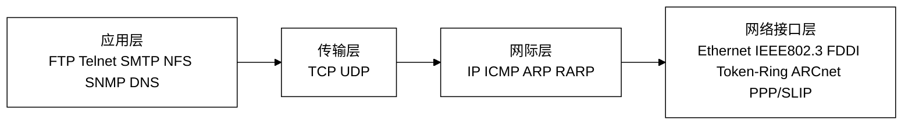
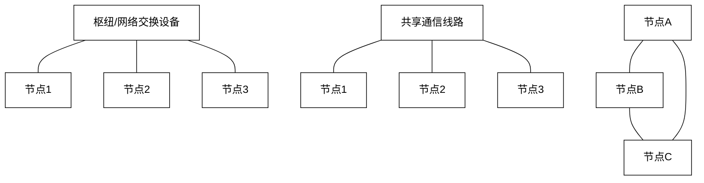
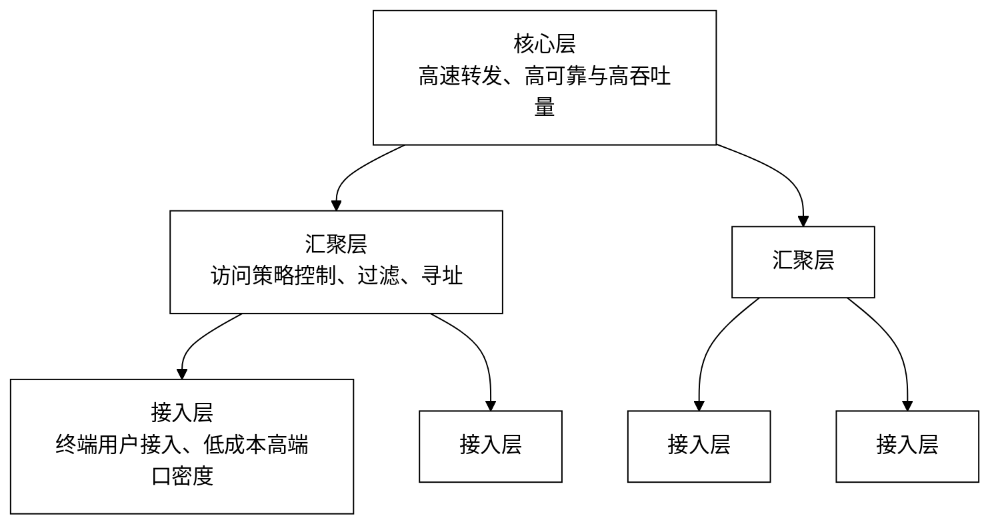

# 系统分析师｜第4章 计算机网络与分布式系统（备考讲义＋章节自测题）

> **教材依据**：《系统分析师教程（第2版）》第4章《计算机网络与分布式系统》（共8节：4.1 计算机网络基础｜4.2 网络体系结构与协议｜4.3 局域网与广域网｜4.4 网络工程｜4.5 分布式系统｜4.6 构件与中间件｜4.7 Web服务｜4.8 云计算）。第1版同号章为《数据通信与计算机网络》，**覆盖范围不同**：第1版本章只到网络工程（其4.5），不含分布式系统、构件与中间件、Web服务、云计算；第1版4.1.1《信道特性》的部分内容由第2版4.1.1《数据通信基础》承接，但时延公式组未保留；第1版独有的4.1.2 数据传输技术、4.1.3 中的归零性/极性编码、4.3.5 网络接入技术、4.4 网络互连与常用设备在第2版已删除。第2版新增的本章节号4.5～4.8中，分布式文件系统主题由第1版3.4.3跨章移至4.5，构件/中间件及云计算也承接第1版其他章节部分内容，并非全为教材新主题。教材外内容来源口径：本章正文以教材第2版原文为主；两版教材均无原文且2021年以后真题未反复命题的内容一律不收录，逐项见「⚠️ 不包含」与节末说明；本章无第1版补充内容回补（时延计算公式等第1版独有内容2021年以后无检出，按不收录处理）。
>
> **考纲定位说明**：2024版考纲科目一「系统分析师综合知识」第2条 **计算机网络与分布式系统**（2.1 计算机网络基础｜2.2 网络体系结构与协议｜2.3 局域网与广域网｜2.4 网络工程｜2.5 分布式系统｜2.6 构件与中间件｜2.7 Web服务｜2.8 云计算），与教材第2版第4章 4.1～4.8 各节一一对应；考纲二级子项在教材本章均有对应小节或原文，无「考纲有、教材无」的空缺。
>
> **考试形式**：上午综合知识单选题＋少量计算题（计算集中在**子网划分与可用主机数**、**信道容量（香农定理）**两处，均出单选题）；近年频次窗（2024上～2026上，5场）约24道/5场，为同期科目一题量居前的章节，其中TCP/IP协议簇8道/5场全中，是本章唯一的高频族。案例分析科目近年频次窗无独立的计算机网络题组（0题组），本章内容作为背景知识使用；论文科目「网络规划及应用」方向归口本章，但2021年以后8场无论题检出（0题次）。
>
> 标签：系统分析师、上午题、计算机网络、TCP/IP、子网划分、局域网与以太网、分布式系统、中间件、Web服务、云计算、备考

[TOC]

## 章节结构对照与来源标注

> 本讲义为《系统分析师教程（第2版）》第4章《计算机网络与分布式系统》的学习讲义，模块顺序与教材 4.1～4.8 保持一致；本章知识点几乎全部来自教材第2版，无教材外补充（教材未展开而考生材料中可能遇到的内容见「⚠️ 不包含」）。

| 讲义模块 | 对应教材第2版章节 | 内容性质 | 备考要求 |
|---|---|---|---|
| 模块1 计算机网络基础 | 4.1 计算机网络基础 | 教材 | 掌握：信道带宽与奈奎斯特/香农定理（含信道容量计算）、模拟与数字数据编码；了解：数据通信基本概念与信道、误码率与信道延迟、差错控制（奇偶校验/海明码/CRC） |
| 模块2 网络体系结构与协议 | 4.2 网络体系结构与协议 | 教材 | 掌握：TCP/IP四层模型与协议簇、传输层TCP与UDP、子网划分与子网掩码；了解：网络协议三要素与分层设计、OSI体系结构、应用层协议、IP地址分类与保留地址、构造超网与CIDR路由聚合、IPv6 |
| 模块3 局域网与广域网 | 4.3 局域网与广域网 | 教材 | 掌握：局域网的特点与四种拓扑结构；了解：以太网基础与CSMA/CD、以太网类型、无线局域网、广域网相关技术与分类 |
| 模块4 网络工程 | 4.4 网络工程 | 教材 | 了解：网络规划（需求分析/可行性研究/现有网络分析）、网络设计（任务与分层设计）、网络实施步骤 |
| 模块5 分布式系统 | 4.5 分布式系统 | 教材 | 了解：分布式系统的定义与关键特征、构建挑战（含八种透明性）、分布式锁与并发控制、分布式文件系统、分布式缓存系统 |
| 模块6 构件与中间件 | 4.6 构件与中间件 | 教材 | 了解：构件与构件模型、构件组装、中间件的功能与分类、中间件与构件的关系 |
| 模块7 Web服务 | 4.7 Web服务 | 教材 | 了解：Web服务的体系结构、Web服务的技术平台（HTTP/XML/SOAP/WSDL/UDDI） |
| 模块8 云计算 | 4.8 云计算 | 教材 | 掌握：云计算的服务方式（SaaS/PaaS/IaaS）；了解：云计算的概念与四种部署模式 |

> 教材第2版第4章章节结构（按教材原文核读）：4.1 计算机网络基础（4.1.1 数据通信基础、4.1.2 数据编码、4.1.3 差错控制）｜4.2 网络体系结构与协议（4.2.1 OSI体系结构、4.2.2 TCP/IP协议簇、4.2.3 网络地址）｜4.3 局域网与广域网（4.3.1 局域网、4.3.2 以太网、4.3.3 无线局域网、4.3.4 广域网）｜4.4 网络工程（4.4.1 网络规划、4.4.2 网络设计、4.4.3 网络实施）｜4.5 分布式系统｜4.6 构件与中间件（4.6.1 构件、4.6.2 中间件）｜4.7 Web服务｜4.8 云计算。其中 4.5、4.7、4.8 三节教材未再分设子节。

> ⚠️ 教材第2版第4章**不包含**（两源核查）：**源①**（对照第1版第4章《数据通信与计算机网络》逐节核对）——①时延的计算公式组（第1版4.1.1：总时延＝发送时延＋传播时延＋处理时延；发送时延＝数据帧长度/信道带宽；传播时延＝信道长度/电磁波传播速率）：第2版 4.1.1 只给出信道延迟的概念与典型介质的时延量级（500m同轴电缆约2.5μs、卫星信道约270ms），**不给计算公式**；2021年以后真题无检出，不收录；②数据传输技术（第1版4.1.2：并行传输与串行传输、异步传输与同步传输、基带传输与频带传输）：第2版无对应小节，不收录；③归零性编码与极性编码（第1版4.1.3：单极性、极性、双极性编码）：第2版 4.1.2 改用「模拟数据编码＋数字数据编码」分类，不设该组术语，不收录；④网络接入技术（第1版4.3.5：PSTN、ISDN、ADSL、FTTx＋LAN、同轴＋光纤）：第2版整体删除，不收录；⑤网络互连与常用设备（第1版4.4：中继器/网桥/路由器/网关/集线器/二、三、多层交换机的互联设备表、交换技术、路由技术）：第2版整体删除该节（其第2版4.4为网络工程）；其中路由器仅在第2版 4.2.3 子网判断例中出现、中继器在 4.3 略有提及，其余设备分层与交换/路由技术2021年以后无检出，不收录；⑥无线局域网的CSMA/CA与「冲突避免」（第1版4.3.2）：第2版 4.3.3 只讲WLAN标准与三种拓扑（点对点型、HUB型、完全分布型），**无CSMA/CA原文**，2021年以后真题未正面命题（2026上第7、33题以太网介质访问控制题中仅作为干扰项出现），不收录。**源②**（对照考纲2.1～2.8子项与教材4.1～4.8小节核对）——考纲全部二级子项（含2.4.1网络规划/2.4.2网络设计/2.4.3网络实施、2.6.1构件/2.6.2中间件、2.7 Web服务、2.8云计算）在教材本章均有对应小节或原文，**无源②事项**，故讲义不存在「考纲有条目而教材无对应章节」的补回内容。

> 说明（两版「第4章」覆盖范围不同）：两版同号章主题范围不一致 —— 第1版第4章只到网络工程（其4.5，对应第2版4.4，编号位移一节），第2版的分布式系统、构件与中间件、Web服务、云计算四节为第1版本章所无。因此按编号机械对照会把「第2版新增」误判为「第1版删减」，复习时注意区分。此外，旧版讲义曾收录的**VPN（虚拟专用网）与隧道协议、以太网最短帧长64字节、应用层协议端口号表、REST风格接口**，经核查**两版教材均无原文**，且2021年以后真题未在本章考点族内检出（VPN全窗仅2026上甲套第35题作为干扰项出现一次），本次一并移除，不作备考范围。

---

## 模块1：计算机网络基础（教材4.1）【教材｜掌握】

**前置说明**：本模块对应教材第2版第4章 **4.1 计算机网络基础**（4.1.1 数据通信基础、4.1.2 数据编码、4.1.3 差错控制），对应考纲 **2.1 计算机网络基础**（2.1.1 数据通信基础、2.1.2 数据编码、2.1.3 差错控制）；全部为教材原文，适配上午综合选择题（概念辨析）。

**模块优先级**：🟡 中频 —— 近年频次窗内「数据通信基础与编码」族3道/2场（2024上、2024下），按统一判据（2～4场＝中频）判中频。

**考情分析**（2021年以后真题）：近年频次窗（2024上～2026上，5场）3道/2场 —— 2024上第17题（信道带宽2MHz、信噪比30dB时的信道容量，香农定理）、2024下第22题（模拟信号转换为数字信号的过程不包括信道编码）、2024下第65题（HDLC帧不包括确认帧，教材无HDLC原文，属偶发外延）；2025上、2025下、2026上三场均未检出。需注意：族内3道分属不同子节，其中**信道容量（香农定理）与模拟/数字数据编码两项各有真题支撑，按【教材｜掌握】处理并配例题与习题**；数据通信基本概念、误码率与信道延迟、差错控制近年频次窗未检出（0场），全量统计窗内亦无独立命题，按【教材｜了解】处理。

### 1.1 核心知识点精讲

【前置基础｜教材】数据通信的基本模型：产生和发送信息的一端称**信源**，接收信息的一端称**信宿**，两者之间的通信线路称**信道**。信息进入信道前要变换为适合信道传输的形式。信道的物理性质不同，对通信速率与传输质量的影响也不同；信息在传输中会受到噪声干扰（电信号受电磁场干扰，光纤信道基本不受）。**模拟信号**是随时间连续变化的信号（以幅度、相位、频率等参量表示信息），**数字信号**只取有限个离散值，以某一瞬间的状态表示信息。

#### 1.1.1 数据通信基本概念与信道（教材4.1.1）【教材｜了解】

- **码元**：一个数字脉冲称为一个码元；**码元速率（波特率）**表示单位时间内通过信道传输的码元个数，单位为波特（Baud）。若信号码元宽度为T秒，则码元速率B＝1/T。
- **数据速率（比特率）**：单位时间内在信道上传送的信息量（位数），单位b/s。一个码元携带的信息量n（位）与码元种类数N的关系为 n＝log₂N（N＝2ⁿ）。
- 二者关系：R＝B·log₂N。**仅当码元取两个离散值（N＝2）时，波特率与比特率数值才相等**。
- **两种带宽概念**：模拟信道带宽按 W＝f₂－f₁ 计算（如CATV电缆为600MHz或1000MHz）；数字信道带宽指信道能达到的最大数据速率（如以太网10Mb/s或100Mb/s）。二者可互相转换。

#### 1.1.2 信道带宽与奈奎斯特、香农定理（教材4.1.1）【教材｜掌握】

- **奈奎斯特定理**（有限带宽**无噪声**信道）：最大码元速率 B＝2W（Baud），W为信道带宽；相应的极限数据速率 R＝2W·log₂N（b/s）。超过奈奎斯特极限传送脉冲信号是不可能的，要进一步提高波特率必须改善信道带宽。
- **香农定理**（**有噪声**信道）：极限数据速率 C＝W·log₂(1＋S/N)，W为带宽、S为信号平均功率、N为噪声平均功率，S/N为信噪比。分贝与信噪比的关系为 dB＝10·lg(S/N)；例如 S/N＝1000 时信噪比为30dB。该极限与信号取的离散值个数无关，只由带宽与信噪比决定。
- 教材示例：信道带宽3000Hz、信噪比30dB时，C＝3000·log₂(1＋1000)≈3000×9.97≈30000b/s；实际电话线上能达到9600b/s已较理想。

> 记忆：奈奎斯特＝无噪声、看码元状态数（2W·log₂N）；香农＝有噪声、看信噪比（W·log₂(1＋S/N)）。二者都是**理论极限值**。

#### 1.1.3 误码率与信道延迟（教材4.1.1）【教材｜了解】

- **误码率**：传输二进制位时出现差错的概率，Pc＝Ne（出错的位数）/N（传送的总位数）。计算机通信网络中误码率一般要求低于10⁻⁶，即平均每传送1Mb才允许错1b；误码率低于一定数值时可用差错控制办法检查与纠正。
- **信道延迟**：信号在信道中从源端传播到宿端需要时间，与距离及信号传播速度有关（电信号一般接近光速，电缆中约为光速的77%，即200m/μs左右）。实际网络中更关注相距最远两站之间的**传播时延**：500m同轴电缆的时延约2.5μs，卫星信道约270ms。时延对交互式应用影响很大。

#### 1.1.4 数据编码：模拟数据编码与数字数据编码（教材4.1.2）【教材｜掌握】

数据在模拟信道中传输要调制成模拟信号，在数字信道中传输则要重新编码后进行基带传输。

**（1）模拟数据编码（三种基本调制方法）**

| 方法 | 含义 | 别称 | 特点 |
|---|---|---|---|
| 调幅 | 载波振幅随基带数字信号变化（1有载波、0无载波） | 幅移键控ASK | 易实现、技术简单，抗干扰能力差 |
| 调频 | 载波频率随基带数字信号变化 | 频移键控FSK | 易实现、技术简单，抗干扰能力较强 |
| 调相 | 载波初始相位随基带数字信号变化（1对应180°、0对应0°） | 相移键控PSK | 抗干扰能力较强，实现技术较复杂 |

**（2）数字数据编码（基带传输）**

- **不归零编码NRZ**：低电平表示0、高电平表示1；缺点是无法判断每一位的开始与结束，收发双方不能保持同步，必须用另一个信道传送同步信号。
- **曼彻斯特编码ME**：不用电平高低、而用**电平跳变**表示二进制；**每一比特的中间均有一个跳变，既作时钟信号又作数据信号**（电平由高到低跳变表示1，由低到高跳变表示0）。
- **差分曼彻斯特编码DME**：对曼彻斯特编码的改进，**每比特中间的跳变仅做同步之用**；每比特的值根据其**开始边界是否发生跳变**决定（开始无跳变表示1，有跳变表示0）。
- **多电平编码**：码元可取多个电平之一，每个码元可代表几个二进制位；数据速率大于波特率、提高频带利用率，但抗噪声特性不好。
- **4B/5B编码**：用5bit的二进制码代表4bit的二进制码，避免曼彻斯特类编码「波特率是数据速率两倍」的开销，降低高速网络的硬件成本。

> 曼彻斯特与差分曼彻斯特的优点是**无须另发同步信号**；缺点是**编码效率低**（传送10Mb/s数据需要20MHz脉冲）。

#### 1.1.5 差错控制：奇偶校验、海明码与CRC（教材4.1.3）【教材｜了解】

差错分两类：**随机错误**（热噪声引起，幅度小、频谱宽、影响个别位）与**突发错误**（冲击噪声如雷电、电焊引起，持续短、幅度大，引起一个位串出错）。

- **奇偶校验检错码**：在7位ASCII码后增加一位，使码字中1的个数成奇数（奇校验）或偶数（偶校验）。简单实用，但只能对付少量随机性错误；检测突发性位串出错可用**校验和**（数据块中每个字节按模256相加，和作为校验字节发送）。
- **海明码**：纠错码。码字之间的**海明距离**是一个码字变成另一个码字必须改变的最小位数。若任意两个码字间海明距离为d，则所有小于等于d－1位的错误都可检查出来，所有小于d/2位的错误都可纠正。对m位数据增加r位冗余位组成 n＝m＋r 位的纠错码，需满足 **m＋r＋1 ≤ 2ʳ**（该式给出r的下界）。校验位分配在1、2、4、8等位置（2的幂），其余位放数据。
- **循环冗余校验码CRC**：循环码的一种，任一有效码字循环移位后仍为有效码字；检错能力强且易于硬件实现，广泛用于局域网。用生成多项式G(x)除 xʳ·D(x) 得商与余式R(x)，实际传送的码字多项式为 F(x)＝xʳ·D(x)＋R(x)；接收端对F(x)计算校验和应为0，若不能被G(x)整除则有错。常用国际标准有CRC-CCITT、CRC-16、CRC-12、**CRC-32（常用于局域网）**。

#### 1.1.6 典型易错点（数据通信与编码）

1. 奈奎斯特与香农的适用条件：奈奎斯特用于**无噪声**信道、极限码元速率B＝2W（数据速率再乘log₂N）；香农用于**有噪声**信道、C＝W·log₂(1＋S/N)，与离散值个数无关【🟡中频】；
2. 香农题的分贝换算：dB＝10·lg(S/N)，**30dB对应S/N＝1000而非30**，换算后再代入公式【🟡中频】；
3. 模拟信号转换为数字信号的过程是**采样、量化、编码**，**不含信道编码**（信道编码属差错控制环节）【🟡中频】。

### 1.2 典型例题

**例题1【信道容量计算·香农定理】**

某信道带宽为3000Hz，信噪比为30dB，按香农定理该信道的极限数据速率约为（）

A. 3kb/s B. 30kb/s C. 300kb/s D. 3Mb/s

> 【解析】30dB对应S/N＝10³＝1000；C＝W·log₂(1＋S/N)＝3000×log₂1001≈3000×9.97≈29910b/s≈30kb/s。教材以该例说明「实际电话线上能达到9600b/s已较理想」，即理论极限远高于实际可达速率。
> 【答案】B

### 1.3 课后习题

**习题1【模拟信号数字化的过程】**

把模拟信号转换为数字信号的过程中，不包括下列哪一个环节（）

A. 采样 B. 量化 C. 编码 D. 信道编码

> 【解析】教材：模拟信号数字化经采样、量化、编码三步得到数字信号；信道编码（奇偶校验、海明码、CRC等）属差错控制环节，是在数字信号形成之后为检错纠错而附加的冗余，不属于模数转换过程。
> 【答案】D

---

## 模块2：网络体系结构与协议（教材4.2）【教材｜掌握】

**前置说明**：本模块对应教材第2版第4章 **4.2 网络体系结构与协议**（4.2.1 OSI体系结构、4.2.2 TCP/IP协议簇、4.2.3 网络地址），对应考纲 **2.2 网络体系结构与协议**（2.2.1 OSI体系结构、2.2.2 TCP/IP协议簇、2.2.3 网络地址）；全部为教材原文，适配上午综合选择题＋计算题（子网划分）。

**模块优先级**：🔴 高频 —— TCP/IP协议簇近年频次窗8道/**5场全中**，是本章唯一达成5场全中的考点族，也是全库科目一少数高频族之一。

**考情分析**（2021年以后真题）：近年频次窗（2024上～2026上，5场）约8道/5场全中 —— 2024上第15题（FTP运行在TCP之上）、2024下第17题（基于TCP发送电子邮件的协议＝SMTP）、2024下第18～19题（TCP/IP最底层＝网络接口层、解决路由选择＝网络互联层）、2025上第16题（不属于TCP协议的是SNMP）、2025上第17题（C类IP地址判别）、2025下第3～4题（TCP属传输层、IP属网络层）、2026上第62题（视频会议优先选UDP）。子网划分与主机容量计算2道/2场（2024下第20题子网掩码判断、2025下第24题划分子网选掩码），按统一判据为中频。OSI体系结构、构造超网与CIDR聚合、IPv6三项近年频次窗未检出（0场；OSI全量窗仅2023上第8题、全量窗CIDR类命题仅2023上第70题，均属旧大纲期）。

### 2.1 核心知识点精讲

#### 2.1.1 网络协议三要素与分层设计（教材4.2）【教材｜了解】

- **网络协议**：计算机之间交换数据必须遵守的事先约定好的规则，用于规定信息的格式以及如何发送和接收信息。三要素：**语法**（控制信息或数据的结构和格式）、**语义**（发出何种控制信息、完成何种动作、做出何种应答）、**同步**（事件实现顺序的详细说明）。
- **网络体系结构**：计算机网络的各层及其协议的集合。采用分层设计方法，按信息传输过程把整体功能分解为多个功能层；不同机器上的同等功能层之间用相同协议，同一机器上相邻功能层之间通过接口传递信息。

#### 2.1.2 OSI体系结构（教材4.2.1）【教材｜了解】

OSI/RM开放系统互连参考模型共分7层，层与层之间逻辑上对等通信，最后由物理层实现真正的通信，每一层完成相应功能、下一层为上一层提供服务。

| 层次 | 主要功能 | 数据单位/要点 |
|---|---|---|
| 物理层 | 建立在传输媒介基础上实现设备间的物理接口，实现实体之间的按位传输 | 位流；规定机械、电气、功能特性 |
| 数据链路层 | 在相邻实体间可靠传送信息，进行差错检测与校正、流量控制 | **帧** |
| 网络层（通信子网层） | 控制通信子网操作，提供**路由**选择最佳路径，含拥塞控制、顺序控制、网络记账 | **包** |
| 传输层 | 高低层之间衔接的接口层，是整个分层体系协议的**核心**；把数据切成较小的数据片并保证正确到达 | 报文/段 |
| 会话层 | 建立、管理、终止两个应用系统之间的会话；分建立链路、数据交换、释放链路3阶段 | 会话连接映射到传输连接 |
| 表示层 | 处理用户信息的表示问题，完成**数据编码格式转换、压缩/解压缩、加密/解密** | 语法选择与语法转换 |
| 应用层 | 通信用户之间的窗口，提供网络管理、文件传输、事务处理等服务 | 若干独立的用户通用服务协议模块 |

#### 2.1.3 TCP/IP协议簇与四层模型（教材4.2.2）【教材｜掌握】

TCP/IP是为使接入互联网的异种网络、不同设备能正常通信而制定的一组约定，由美国国防部高级研究计划署为建立ARPANET开发；因两个最知名的协议TCP与IP而得名，还包括UDP、ICMP、RIP、Telnet、FTP、SMTP及ARP等。

TCP/IP分为4层，由下至上是**网络接口层、网际层、传输层、应用层**：

- **应用层**：与用户打交道的部分（收发电子邮件、文件传输等）；SNMP是典型的应用层协议。
- **传输层**：对应用层传递的用户信息分段并加入附加说明（如顺序），保证可靠收到；有TCP与UDP两个协议。
- **网际层**：把传输层形成的信息段构造为IP数据报，在报头填入地址信息并选择发送路径；含IP、ICMP、ARP、RARP。
- **网络接口层（链路层）**：最底层，接收和发送IP数据报，负责与传输媒介打交道。
- TCP/IP本质上采用**分组交换**技术：一方面避免单个用户长时间占用线路，另一方面传输出错时只需重传出错的包。

**主要协议要点**：

- **IP协议**：IP数据报由首部与数据两部分组成，首部含固定20字节基本首部与0～40字节可变长任选项。关键字段：版本号（IPv4/IPv6）、IHL（IP头长度，以32位字计数，最小为5即20字节）、服务类型、段总长度、标识符、标志（含分段与重装配的M标志、禁止分段标志）、段偏置值、**生存期（用经过的路由器个数表示）**、协议（上层是TCP还是UDP）、头校验和、源地址、目的地址。用户数据与IP头合计不超过65535字节。
- **ICMP**：与IP同属网络层，传送有关通信问题的消息（数据报不能到达目标站、路由器缓存不足、提供最短通路信息等）；ICMP报文封装在IP数据报中传送，**不保证可靠提交**；报文有11种之多。
- **ARP与RARP**：驻留在网际层。**ARP**将IP地址转换为物理地址——先查ARP高速缓存，若没有则在局域网广播ARP请求包，匹配者回送含物理地址的ARP应答。**RARP**将物理地址转换为IP地址，需要网络中有一台RARP服务器并事先存储网卡IP与物理地址的对应。

#### 2.1.4 传输层协议：TCP与UDP（教材4.2.2）【教材｜掌握】

- **TCP**：面向连接的协议，只有一种PDU叫**TCP段**。段头关键字段：源端口/目标端口（各16位）、发送顺序号与接收顺序号（各32位，指**字节流**中某个字节的顺序号）、偏置值、**标志字段**（URG紧急指针有效、ACK接收顺序号有效、PSH推进功能有效、RST连接复位、SYN顺序号同步用于连接建立、FIN数据发送完可释放连接）、窗口（16位，流控分配的信息量）、校验和、紧急指针。
  - **三次握手**：同步标志SYN用于连接建立阶段，TCP用三次握手过程建立连接。
  - **滑动窗口**：窗口字段、发送顺序号和应答顺序号共同实现滑动窗口协议；TCP采用积累接收机制。
  - 端口编号用于标识TCP用户（上层协议），Telnet、FTP、SMTP等公用端口号可在RFC中查到。TCP头与IP头合在一起共40字节开销。
- **UDP**：**无连接**的协议，在IP之上只加上**端口寻址**功能。UDP头仅含源端口、目标端口、段长、校验和4个字段；校验和是任选的，若为0则对用户数据不校验。它不保证可靠与顺序提交，但**协议开销少**，在网络管理方面大多使用UDP。

| 对比项 | TCP | UDP |
|---|---|---|
| 连接 | 面向连接（三次握手建立） | 无连接 |
| 可靠性 | 可靠、按序提交、可重传 | 不可靠、不保证顺序 |
| 流控/拥塞 | 滑动窗口实现流量控制 | 无 |
| 首部开销 | TCP头＋IP头共40字节 | UDP头仅4个字段，开销小 |
| 典型用途 | FTP、SMTP、Telnet等需可靠传输的应用 | SNMP等网络管理、视频会议等实时应用 |

#### 2.1.5 应用层协议（教材4.2.2）【教材｜了解】

应用级标准的实现协议称应用层协议，相对OSI参考模型处于较高层次，也称高层协议。教材列出的常用应用层协议有 **NFS、Telnet、SMTP、DNS、SNMP、FTP**。

- **FTP（文件传输协议）**：网络上两台计算机传送文件的协议，**运行在TCP之上**。
- **SMTP（简单邮件传输协议）**：基于TCP、用于**发送**电子邮件。
- **Telnet**：远程登录协议。**SNMP**：简单网络管理协议，基于UDP的应用层协议。**DNS**：域名解析。**NFS**：网络文件服务协议。

> 判别要点（按真题问法）：「基于TCP能发送电子邮件的协议」＝SMTP；「不属于TCP协议的」＝SNMP（基于UDP）；「FTP运行在哪一层协议之上」＝TCP。

#### 2.1.6 IP地址分类与保留地址（教材4.2.3）【教材｜了解】

- IPv4地址是32位二进制逻辑地址，习惯上划分为4个字节、每字节用十进制表示、字节间以「.」分隔（如192.168.200.128）。每个IP地址由**网络号＋主机号**两部分组成，按划分方式分为5类：

| 类别 | 最高位 | 网络号/主机号 | 用途 |
|---|---|---|---|
| A类 | 0 | 高8位网络号，后24位主机号 | 单播 |
| B类 | 10 | 高16位网络号，后16位主机号 | 单播 |
| C类 | 110 | 高24位网络号，后8位主机号 | 单播 |
| D类 | — | — | **组播地址** |
| E类 | — | — | 保留地址，目前未定义和使用 |

- **保留地址**（不在公网使用）：A类 10.0.0.0～10.255.255.255（1个网络）；B类 172.16.0.0～172.31.255.255（16个网络）；C类 192.168.0.0～192.168.255.255（255个网络）。

#### 2.1.7 子网划分与子网掩码（教材4.2.3）【教材｜掌握】

- 划分子网的思想：把IP地址划分成**网络号、子网号、主机号**三部分，利用主机号部分继续划分子网，从而灵活控制每个子网的规模、缓解IP地址浪费。
- **子网掩码**：32位二进制数，**网络标识与子网标识部分全为1、主机标识部分全为0**（如255.255.240.0）。
- **同一子网判别方法**：将两个IP地址与给定子网掩码分别做**逻辑与**运算，结果相等则属同一子网，否则不属于。教材示例：190.78.240.1与190.78.250.1经255.255.240.0运算后结果相同（在同一子网），190.78.230.1属于另一个子网。
- 可用主机数＝2^(主机位数)－2（扣除全0的网络地址与全1的广播地址）。

#### 2.1.8 构造超网与CIDR路由聚合（教材4.2.3）【教材｜了解】

- **CIDR（无分类域间路由）**两个特点：①消除传统IP地址分类与划分子网的概念，把32位地址划分为**网络前缀＋主机**两部分，记法为「IP地址/网络前缀位数」（如128.14.35.7/20表示前缀20位、主机号12位）；②把网络前缀相同的连续IP地址组成一个**CIDR地址块**（如上例最小地址128.14.32.0、最大地址128.14.47.255）。
- **路由汇聚（路由聚合）**：路由表中用CIDR地址块查找目的网络。好处是缩小路由表尺寸、减少每个路由跳的延迟与查询平均时间、减少路由登录项广播数量从而降低路由协议开销。

#### 2.1.9 IPv6（教材4.2.3）【教材｜了解】

与IPv4相比，IPv6的优势：①**地址空间更大**（地址长度128位，IPv4为32位）；②**路由表更小**（地址分配遵循路由汇聚原则，一条记录可表示一个子网）；③**增强的组播支持与对流的支持**，为QoS控制提供良好平台；④**支持自动配置**（对DHCP的改进与扩展）；⑤**更高的安全性**（可对网络层数据加密并对IP报文校验）。

过渡技术（解决IPv6孤岛之间、孤岛与IPv4海洋之间的通信）归纳为3种：**隧道技术**（IPv6节点之间经IPv4网络通信）、**双协议栈技术**（IPv4与IPv6共存于同一设备和网络）、**翻译技术**（纯IPv6节点与纯IPv4节点互通）。

#### 2.1.10 典型易错点（网络体系结构与协议）

1. TCP与UDP的判别：需要可靠传输、按序提交选TCP；追求开销小与实时性（视频会议、网络管理SNMP）选UDP【🔴高频】；
2. TCP/IP四层的次序与职责：最底层是网络接口层（收发IP数据报），**路由选择由网际层（网络互联层）完成**【🔴高频】；
3. 应用层协议的承载关系：FTP、SMTP、Telnet基于TCP，SNMP基于UDP【🔴高频】；
4. 子网判别是「IP地址与子网掩码做逻辑与后比较结果」，不是比较IP地址本身相近【🟡中频】；
5. 可用主机数要减2（网络地址＋广播地址）；IPv6地址长度为128位而非32位【🟡中频】。

### 2.2 典型例题

**例题1【TCP/IP层次职责】**

在TCP/IP结构模型中，处于模型最底层的是（），解决路由选择问题的是（）

A. 传输层、应用层 B. 网络接口层、网络互联层 C. 应用层、传输层 D. 网络互联层、网络接口层

> 【解析】教材：TCP/IP由下至上为网络接口层、网际层、传输层、应用层；网络接口层是最底层，负责接收和发送IP数据报并与传输媒介打交道；网际层把信息构造为IP数据报、填入地址信息并选择发送路径，即解决路由选择。
> 【答案】B

**例题2【TCP与UDP选型】**

某视频会议系统优先要求实时性和流畅性，允许少量丢包，通常应优先选择（）

A. TCP B. UDP C. FTP D. SMTP

> 【解析】UDP无连接、不保证可靠与顺序提交，但协议开销少、实时性好；视频会议允许少量丢包而对时延敏感，故选UDP。TCP面向连接、可靠但开销大，FTP与SMTP是应用层协议。
> 【答案】B

**例题3【应用层协议承载关系】**

下列协议中，基于TCP、用于发送电子邮件的是（）

A. FTP B. DNS C. SMTP D. SNMP

> 【解析】SMTP为简单邮件传输协议，基于TCP用于发送电子邮件；SNMP基于UDP用于网络管理；FTP用于文件传输；DNS用于域名解析。
> 【答案】C

**例题4【子网划分与掩码】**

把 192.168.10.0/24 划分成4个子网，若要求每个子网至少支持30台主机，应选择的子网掩码是（）

A. 255.255.255.192 B. 255.255.255.224 C. 255.255.255.240 D. 255.255.255.248

> 【解析】划分4个子网需从主机位借2位（2²＝4），前缀变为/26，掩码为255.255.255.192；此时主机位6位，可用主机数2⁶－2＝62≥30。若选/27（255.255.255.224）主机位5位、可用30台，虽恰好满足但只能划分8个子网且题设要求划分为4个；按题设先满足4个子网的最小借位，取/26。
> 【答案】A

### 2.3 课后习题

**习题1**

下列协议中，不属于基于TCP协议的是（）

A. FTP B. Telnet C. SNMP D. SMTP

> 【解析】SNMP是简单网络管理协议，教材明确SNMP是基于UDP协议的一个应用协议；FTP、Telnet、SMTP均基于TCP。
> 【答案】C

**习题2**

IP地址 212.32.15.18 与 212.33.16.31 要位于同一个子网，子网掩码应是（）

A. 255.255.255.0 B. 255.255.0.0 C. 255.0.0.0 D. 255.255.255.254

> 【解析】两个地址的第二字节不同（32与33），只有把网络前缀缩短到8位、即掩码255.0.0.0，两者与掩码做逻辑与后结果才相同（均为212.0.0.0），才可能位于同一子网。
> 【答案】C

**习题3**

下列关于IPv6的说法，错误的是（）

A. 地址长度为128位 B. 地址分配遵循路由汇聚原则，路由表更小 C. 过渡技术包括隧道技术、双协议栈技术与翻译技术 D. 不支持对网络层数据加密

> 【解析】教材：使用IPv6网络时用户可以对网络层的数据进行加密并对IP报文进行校验，安全性更高；D与教材相反。
> 【答案】D

---

## 模块3：局域网与广域网（教材4.3）【教材｜掌握】

**前置说明**：本模块对应教材第2版第4章 **4.3 局域网与广域网**（4.3.1 局域网、4.3.2 以太网、4.3.3 无线局域网、4.3.4 广域网），对应考纲 **2.3 局域网与广域网**（2.3.1 局域网、2.3.2 以太网、2.3.3 无线局域网、2.3.4 广域网）；全部为教材原文，适配上午综合选择题（概念辨析）。

**模块优先级**：🟡 中频 —— 近年频次窗内局域网拓扑结构2道/2场（2024上第3题、2025上第12题），以太网介质访问控制2道/1场（2026上第7、33题），合并按「局域网与以太网」族计为3道/2场，按统一判据（2～4场＝中频）判中频。

**考情分析**（2021年以后真题）：近年频次窗（2024上～2026上，5场）3道/2场 —— 2024上第3题（局域网的拓扑结构不包括点对点）、2025上第12题（所有计算机连到中心节点、由中心节点转发的拓扑＝星型）、2026上第7题与第33题（以太网采用的介质访问控制方法＝CSMA/CD）。无线局域网、以太网类型、广域网相关技术与分类近年频次窗未检出（0场）；网络故障诊断全量窗仅2021上第69题，属旧大纲期。

### 3.1 核心知识点精讲

#### 3.1.1 局域网的特点与拓扑结构（教材4.3.1）【教材｜掌握】

局域网（LAN）是把有限地理范围内多台计算机通过传输媒体连接起来的通信网络；通常具备以下特点：①地理分布范围较小（数百米至数公里）；②数据传输速率高（早期10～100Mb/s，目前1000Mb/s已很普遍）；③数据误码率低（采用短距离基带传输）；④一般以PC为主体，不架设主骨干网系统；⑤协议简单、结构灵活，建网成本低、周期短，便于管理和扩充。

构成局域网的网络拓扑结构主要有4种：

- **星形结构**：所有节点都连接到位于中间的枢纽（网络交换设备）上，形成星形拓扑。
- **总线结构**：由一条共享的通信线路（同轴电缆或其他介质）把所有节点连接在一起；传统以太网属于总线结构。
- **环形结构**：共享线路闭合，所有节点排列成环，每个节点只与两个邻居直接相连；一个节点给另一个节点发信息，报文必须经过它们之间的所有节点。
- **网状结构**：任何节点彼此之间都有一根物理通信线路相连，任何节点故障都不影响其他节点；但布线麻烦、建设成本高、控制方法复杂，实际很少见。

> 判别要点：局域网的**四种**拓扑是星形、总线、环形、网状——「点对点」是无线局域网的拓扑类型（点对点型），**不属于局域网的拓扑结构**（2024上第3题按此判别）。

#### 3.1.2 以太网基础与CSMA/CD（教材4.3.2）【教材｜了解】

以太网技术在局域网领域占据主导地位，几乎成为局域网的代名词；以太网采用**带冲突检测的载波监听多路访问CSMA/CD**技术。

**（1）载波监听**（通过监听算法缓解冲突）：

| 监听算法 | 信道空闲时 | 信道忙时 | 特点 |
|---|---|---|---|
| 非坚持型 | 立即发送 | 等待N，再监听 | 减少冲突，信道利用率降低 |
| 1-坚持型 | 立即发送 | 继续监听 | 提高信道利用率，增大了冲突 |
| P-坚持型 | 以概率P发送 | 继续监听 | 有效平衡，但复杂 |

**（2）冲突检测**：载波监听只能减少冲突概率而无法完全避免；CSMA/CD采用「**边发边听**」的冲突检测方法——发送者一边发送一边自己接收回来，发现结果不同立即停止发送并发出冲突信号，所有节点收到阻塞信息后**随机等待一段时间**（常用二进制指数退避算法）再重新监听。

#### 3.1.3 以太网类型（教材4.3.2）【教材｜了解】

| 标准 | 速率 | 传输介质 | 说明 |
|---|---|---|---|
| IEEE 802.3（标准局域网） | 10Mb/s | 细同轴电缆 | 定义过10Base5、10Base2、10Base-T（双绞线）、10Base-F（光纤） |
| IEEE 802.3u（快速以太网） | 100Mb/s | 双绞线/光纤 | 向下兼容，介质访问控制层仍用CSMA/CD；分100BaseTX、100BaseFX、100BaseT4 |
| IEEE 802.3z（千兆以太网） | 1000Mb/s | 光纤/宽带同轴/5类UTP | 重新制定物理层标准，介质访问控制方法仍为CSMA/CD |

千兆以太网在物理层支持3种传输介质：光纤系统（多模500m、单模2000m）、宽带同轴电缆系统（25m）、5类UTP电缆（100m，链路操作模式为半双工）；采用以交换机为中心的星形拓扑，主要用于交换机之间或交换机与企业超级服务器之间的高速连接。

#### 3.1.4 无线局域网（教材4.3.3）【教材｜了解】

无线局域网（WLAN）使用的关键技术除红外传输技术、扩频技术、窄带微波技术外，还有调制技术、加解扰技术、无线分集接收技术、功率控制技术和节能技术。与有线网络相比具有安装便捷、使用灵活、经济节约、易于扩展等优点。

- **WLAN标准**：IEEE 802.11最早（1～2Mb/s，无连接协议）；802.11b速率可达11Mb/s；802.11a可达54Mb/s；802.11g接入速率与802.11a相同且兼容802.11b，工作于免费的2.4GHz频段；802.11n速率可达200Mb/s以上。
- **WLAN拓扑结构**主要有3种：**点对点型**（用单频或扩频微波电台、红外等连接两个固定的有线LAN网段，实为一种网络互连方案，可获得中远距离高速率链路）、**HUB型**（由中心节点HUB与若干外围节点组成，任何两个外围节点间通信都须经过HUB，是典型的集中控制式通信；优点是用户设备简单、维护费用低，缺点是通信延迟增加、抗毁性差、中心节点故障导致全网瘫痪）、**完全分布型**（目前还无具体应用，仅处于理论探讨阶段，类似分组无线网；抗毁性好、移动能力强、可形成多跳网，但复杂性与成本高、网络管理困难）。

#### 3.1.5 广域网（教材4.3.4）【教材｜了解】

广域网（WAN）是把分布于更广区域（城市、国家甚至国家之间）的计算机设备连接起来的网络。特点：①主要提供面向数据通信的服务，支持用户远距离信息交换；②覆盖范围广、通信距离远、**没有固定拓扑结构**；③由电信部门或公司组建、管理和维护，向社会提供有偿服务。

广域网由**通信子网**（通信节点设备与链路，负责数据转发；链路分传输主干链路与末端用户线路）与**资源子网**（实现资源共享的设备及软件集合，如服务器、用户计算机、网络存储系统、软件与数据资源）组成。

- **广域网相关技术**：①**同步光网络SONET**（使用光纤进行数字化信息通信的标准；SDH由SONET发展而来，两者均为传输网络物理层技术）；②**数字数据网DDN**（利用数字信道提供半永久性连接电路；传输速率与质量高、协议简单、连接灵活、可靠性高）；③**帧中继FR**（运行于OSI/RM物理层与数据链路层的数据包交换技术，是X.25的简化版本；采用虚电路技术，吞吐量高、时延低、适合突发性业务）；④**异步传输模式ATM**（以信元为基础的面向连接的分组交换与复用技术，信元长度固定53字节，典型速率150Mb/s）。
- **广域网的分类**：公共传输网络（政府电信部门组建，分电路交换网络与分组交换网络）、专用传输网络（单个组织自建自用，主要是DDN，租用期间独占带宽）、无线传输网络（移动无线网，如GSM、TD-SCDMA/WCDMA/CDMA-2000、LTE、5G）。

#### 3.1.6 典型易错点（局域网与广域网）

1. 局域网四种拓扑＝星形、总线、环形、网状；「点对点」是**无线局域网**的拓扑类型，不是局域网拓扑【🟡中频】；
2. 以太网（有线、IEEE 802.3系）的介质访问控制方法是 **CSMA/CD**（带冲突检测），千兆以太网重新制定物理层标准后仍采用CSMA/CD【🟡中频】；
3. 广域网没有固定拓扑结构，由通信子网（转发）与资源子网（资源共享）组成；帧中继运行于物理层与数据链路层【教材｜了解】。

### 3.2 典型例题

**例题1【局域网拓扑判别】**

局域网的拓扑结构不包括（）

A. 星型 B. 点对点 C. 环形 D. 总线型

> 【解析】教材：构成局域网的网络拓扑结构主要有星形、总线、环形和网状结构四种；点对点型是无线局域网（WLAN）的拓扑形式。
> 【答案】B

**例题2【中心节点转发型拓扑】**

所有计算机都连接到一个中心节点上，传输数据时节点先把数据传到中心节点、再由中心节点转发到目的节点，该拓扑结构是（）

A. 网状结构 B. 环形结构 C. 星型结构 D. 总线结构

> 【解析】星形结构是所有节点连接到中间枢纽（网络交换设备）上；HUB型无线局域网也是典型的集中控制式通信。总线结构是共享一条线路，环形结构节点只与两个邻居相连，网状结构节点间两两直连。
> 【答案】C

### 3.3 课后习题

**习题1【以太网介质访问控制】**

以太网采用的介质访问控制方法是（）

A. CSMA/CD B. CSMA/CA C. Token Ring D. TDMA

> 【解析】教材：以太网采用带冲突检测的载波监听多路访问CSMA/CD技术，IEEE 802.3u与802.3z的介质访问控制层也都采用CSMA/CD。
> 【答案】A

**习题2【广域网技术归属】**

下列关于广域网技术的说法，正确的是（）

A. 帧中继运行于OSI/RM的网络层 B. ATM的信元长度可变 C. DDN利用数字信道提供半永久性连接电路 D. 广域网有固定的星形拓扑结构

> 【解析】帧中继运行于物理层和数据链路层；ATM信元长度固定为53字节；广域网**没有固定拓扑结构**；只有C与教材一致。
> 【答案】C

---

## 模块4：网络工程（教材4.4）【教材｜了解】

**前置说明**：本模块对应教材第2版第4章 **4.4 网络工程**（4.4.1 网络规划、4.4.2 网络设计、4.4.3 网络实施），对应考纲 **2.4 网络工程**（2.4.1 网络规划、2.4.2 网络设计、2.4.3 网络实施）；全部为教材原文，适配上午综合选择题（概念辨析）。

**模块优先级**：🟢 了解为主 —— 近年频次窗**未检出（0场）**，全量统计窗（2021上～2026上，8场）内亦无本模块考点的检出记录；教材与考纲均设本节，按了解级保留概念。

**考情分析**（2021年以后真题）：近年频次窗（2024上～2026上，5场）0道/0场（未检出）；全量统计窗内亦无检出。教材 4.4.2 的「核心层/汇聚层/接入层」分层设计在案例分析科目中出现的「数据接入层/数据核心层」属大数据平台架构语境，与本节的网络三层架构不是同一概念，勿混淆。本模块知识点一律按【教材｜了解】处理，不配例题与课后习题。

### 4.1 核心知识点精讲

网络工程的建设是复杂的系统工程，按实施过程先后分为**网络规划、网络设计、网络实施**3个阶段。

#### 4.1.1 网络规划（教材4.4.1）【教材｜了解】

网络规划以需求为基础，同时考虑技术和工程的可行性，包括网络需求分析、可行性研究和对现有网络的分析与描述。

- **网络需求分析**（通常采用自顶向下的结构化方法）：①功能需求（用网络完成什么功能）；②通信需求（通信类型、频度、时间和通信量）；③性能需求（容量/带宽、利用率、吞吐量、可提供负载、效率、延迟、延时变化量、响应时间、端到端差错率、网络效率）；④可靠性需求（精确度、错误率、稳定性、无故障时间、数据备份）；⑤安全需求（可用性、**完整性**、**保密性**）；⑥运行与维护需求；⑦管理需求（用户管理、资源管理、配置管理、性能管理、网络维护）。
- **可行性研究**：通常从技术可行性、经济可行性、法律可行性和用户使用可行性等方面论证。
- **对现有网络的分析与描述**：调研服务器的数量与位置（中心机房往往是瓶颈所在）、客户机的数量与位置、同时访问的数量（峰值）、每天的用户数、每次使用的时间、每次数据传输的数据量、网络拥塞的时间段、采用的协议、通信模式。在此基础上保证原始投资的措施：不要推倒重来，基于现有设备升级改造；把现有设备降级使用并新增更先进的设备。

#### 4.1.2 网络设计（教材4.4.2）【教材｜了解】

- **网络设计的任务**：①确定网络总体目标；②确定总体设计原则（实用性、开放性、高可用性/可靠性、安全性、先进性、易用性、可扩展性等）；③**通信子网设计**（拓扑结构与网络总体规划、分层设计、远程接入访问设计；拓扑与总体规划应结合费用、灵活性和可靠性三方面综合考虑）；④**资源子网设计**（服务器的接入和子网连接）；⑤**设备选型**（厂商选择原则、扩展性原则、按方案实际需要选型；核心交换机要求高性能高速率、便于升级扩展、高可靠、强网络控制能力与可管理性；汇聚层/接入层交换机要求灵活、高性能、便宜易用、具备一定QoS与控制能力）；⑥网络操作系统与服务器资源设备；⑦**网络安全设计**（基本原则有木桶原则、整体性原则、有效性与实用性原则、等级性原则、设计为本原则、自主和可控性原则、安全有价原则）。
- **分层设计**：引入三个关键层——**接入层**（网络中直接面向用户连接或访问网络的部分，允许终端用户连接到网络，交换机具有低成本和高端口密度特性）、**汇聚层/分布层**（接入层与核心层的分界面，完成网络访问策略控制、数据包处理、过滤、寻址及其他数据处理任务；是多台接入层交换机的汇聚点，需更高性能、更少接口和更高交换速率）、**核心层**（网络主干部分，通过高速转发通信提供优化、可靠的骨干传输结构；应拥有更高的可靠性、性能和吞吐量）。

#### 4.1.3 网络实施（教材4.4.3）【教材｜了解】

网络实施主要包括7个步骤：①工程实施计划；②网络设备到货验收（规格、数量、质量核实与证明文件检查）；③设备安装（综合布线系统、机房工程、网络设备、服务器、系统软件、应用软件；综合布线多涉及隐蔽工程，覆盖后故障查找与恢复代价较高）；④**系统测试**（三个层次：网络设备测试——交换机、路由器、防火墙和线缆等；网络系统测试——连通性、链路传输率、吞吐率、传输时延、丢包率、链路利用率、错误率、广播帧及组播帧及冲突率；网络应用测试——DHCP、DNS、Web、E-mail、FTP等服务性能）；⑤系统试运行；⑥用户培训；⑦**系统转换**（三种方法：直接转换、并行转换和分段转换）。

---

## 模块5：分布式系统（教材4.5）【教材｜了解】

**前置说明**：本模块对应教材第2版第4章 **4.5 分布式系统**（教材本节未再分设子节），对应考纲 **2.5 分布式系统**（分布式系统的特点、分布式文件系统、分布式缓存系统）；全部为教材原文，适配上午综合选择题（概念辨析）。

**模块优先级**：🟢 了解为主 —— 近年频次窗内本模块各族均为低频：分布式存储与文件存储1道/1场、分布式锁1道/1场、分布式系统与中间件1道/1场（三题同出2025上），分布式系统的特点与八种透明性未检出（0场）。

**考情分析**（2021年以后真题）：近年频次窗（2024上～2026上，5场）3道/1场（集中在2025上）—— 2025上第19题（医院影像文件适合用分布式存储）、2025上第20题（秒杀场景用分布式锁解决超卖，Redis的SETNX）、2025上第15题（后端服务器性能不均时负载均衡选加权轮询）；分布式系统定义、八种透明性、分布式缓存系统等近年频次窗未检出（0场）。本模块知识点一律按【教材｜了解】处理，不配例题与课后习题。

### 5.1 核心知识点精讲

#### 5.1.1 分布式系统的定义与关键特征（教材4.5）【教材｜了解】

**分布式系统**是其组件分布在联网的计算机上、组件之间通过**消息传递**进行通信和动作协调的系统。

- **关键特征**：组件的**并发性**（进程间并发）、**缺乏全局时钟**、**组件故障的独立性**。
- 构建和使用分布式系统的主要动力来源于对**共享资源**的期望；资源可以是硬件（磁盘、打印机），也可以是软件（文件、数据库、应用服务）。

#### 5.1.2 构建分布式系统的挑战（教材4.5）【教材｜了解】

构建分布式系统的挑战是处理其组件的**异构性、开放性、安全性、可伸缩性、故障处理、并发性、透明性和服务质量（QoS）**：

1. **异构性**：互联网由多种异构网络组成，但所有设备使用相同的网络协议通信，区别被屏蔽；整型等数据类型在不同硬件上表示方式不同（大端/小端存储）；不同操作系统可为协议提供不同接口实现；不同编程语言表示字符与数据结构的方式不同，需用公共标准（如远程过程通信协议gRPC）。
2. **开放性**：取决于新的资源共享服务能被增加和供多种客户程序使用的程度；解决方法是**发布关键接口**（类似接口标准化）。互联网协议设计者引入了**RFC**文档（含规约和讨论）。开放分布式系统的特点：①发布系统的关键接口；②基于一致的通信机制和发布接口访问共享资源；③可基于异构硬件和软件构造系统。
3. **安全性**：包括**机密性**（防止泄露未经授权的个人数据）、**完整性**（防止被改变或破坏）、**可用性**（防止对访问资源的干扰，如DDoS攻击）。
4. **可伸缩性**：资源数量和用户数量激增时系统仍能保持有效性。理想状态下系统规模增加时系统和应用不需要随之改变，但这一点很难达到。
5. **故障处理**：分布式系统的故障是**部分的**。常见技术：检测故障（如校验和检测出错数据）、掩盖故障（如消息重传、双磁盘写入）、容错（客户被设计成容错的，如Web服务器不可用时浏览器不一直等待）、故障恢复（崩溃后永久数据状态能被恢复或回滚，如数据库事务与分布式事务）。
6. **并发性**：服务和应用通常允许并发处理多个客户请求；为避免进程间竞争可使用**分布式锁**保证资源服务的顺序性，为避免一个进程中多个线程间的竞争可使用不同粒度的锁（读锁、写锁、公平锁、非公平锁）。
7. **透明性**：对用户和开发人员屏蔽分布式系统组件的分离性，使系统被认为是一个整体。ANSA参考手册与ISO的开放分布式处理参考模型RM-ODP识别出**8种透明性**（用移动透明性替换迁移透明性）：**访问透明性**（用相同操作访问本地与远程资源，隐藏数据表示与访问方式差异）、**位置透明性**（为资源分配逻辑名，用户不需要知道物理或网络位置）、**并发透明性**（多个进程并发使用共享资源互不干扰）、**复制透明性**（使用多个实例提升可靠性与性能而无须知道副本信息）、**故障透明性**（屏蔽软硬件故障与恢复过程）、**移动透明性**（资源和客户在系统内移动不影响用户或程序操作）、**性能透明性**（负载变化时系统能被重新配置以适配性能）、**伸缩透明性**（系统和应用能扩展而不改变系统结构或应用算法）。有时也将访问透明性与位置透明性统称为**网络透明性**。
8. **服务质量**：系统的主要非功能特性（可靠性、安全性和性能）影响客户与用户体验。

典型分布式系统类型：分布式文件系统、分布式数据库、分布式缓存系统、分布式协调服务系统、分布式计算框架等。

#### 5.1.3 分布式锁与并发控制（教材4.5）【教材｜了解】

由上述「并发性」挑战派生：分布式系统中多个客户可能同时访问共享资源，管理共享资源的进程若一次只接收一个客户请求会限制吞吐量，故通常允许并发处理；为避免进程间的竞争，可使用**分布式锁**保证资源服务的顺序性；为避免一个进程中多个线程间的竞争，可使用**不同粒度的锁（读锁、写锁、公平锁、非公平锁）**保证数据一致性。

#### 5.1.4 分布式文件系统（教材4.5）【教材｜了解】

分布式存储最早由谷歌提出，目的是用廉价的服务器为大规模、高并发的网页访问场景提供服务；**扩展能力强，容量随节点数线性上涨，可达到EB级别，但网络时延会成为对外提供服务时的瓶颈**。主流分布式文件系统有 GFS、HDFS、TFS、Ceph、Lustre、MogileFS、MooseFS、FastDFS、GridFS 等：

- **GFS**：Google为满足自身需求开发的基于Linux的专有分布式文件系统，运行于廉价普通硬件并提供容错功能（未开源）。
- **HDFS**：具备高度容错性，适合部署在廉价机器上；采用**主从（Master/Slave）结构模型**，一个集群由一个**NameNode**（主服务器，管理命名空间与客户端访问操作）和若干**DataNode**（管理存储的数据）组成。
- **TFS**：高可扩展、高可用、高性能，面向互联网服务的海量非结构化数据（淘宝海量小文件，通常不超过1MB）；采用HA架构和平滑扩容，扁平化的数据组织结构把文件名映射到物理地址。
- **MooseFS**：由管理服务器（Master Server）、数据服务器（Chunk Server）、元数据备份服务器（Metalogger Server）和客户机4部分组成，基于FUSE机制。

#### 5.1.5 分布式缓存系统（教材4.5）【教材｜了解】

分布式缓存系统是指缓存数据分布在不同服务器上，通过缓存技术实现数据的快速访问和高并发请求处理；典型应用是缓存经过复杂计算得到的数据，或缓存系统中频繁访问的热点数据以减轻数据库压力。常见系统有 Memcache、Redis、Tair。

- **Memcache**：在内存中维护一个统一的巨大Hash表提高读取速度；使用物理内存作缓存区，以key/value存储，采用**LRU**缓存淘汰策略与Lazy Expiration策略；**不支持持久化**，重启会丢失数据；服务器之间彼此不通信，分布式能力由客户端实现。常见路由算法：①**哈希取余**（Hash(key)%N）；②**一致性哈希**（节点排列在首尾相接的Hash环上，按顺时针找邻接节点，节点加入或退出时仅影响环上顺时针相邻的后续节点）；③**虚拟Hash槽**（把数据映射到远大于节点数的整数集合「槽」，槽是数据管理和迁移的基本单位）。
- **Redis**：开源高性能键值对存储系统，支持多种数据结构（字符串、哈希、列表、集合、有序集合）；分布式缓存使用一致性哈希把缓存分散在多个节点；优点是高性能读写、多数据类型、持久化、高可用架构、支持分布式分片集群、单线程读写性能极高；缺点是多线程读写较Memcache慢。
- **Tair**：阿里研发的高性能高可用分布式key/value存储系统，分持久化与非持久化两种；由一个中心控制节点（Config Server）和一系列服务节点（Data Server）组成，中心控制节点采用一主一备保证可靠性；以**桶**作为负载均衡和数据迁移的基本单位，使用一致性哈希作负载均衡策略；默认包含mdb（高效缓存存储引擎）和fdb（持久化存储引擎）。

---

## 模块6：构件与中间件（教材4.6）【教材｜了解】

**前置说明**：本模块对应教材第2版第4章 **4.6 构件与中间件**（4.6.1 构件、4.6.2 中间件），对应考纲 **2.6 构件与中间件**（2.6.1 构件：构件模型、构件组装；2.6.2 中间件：中间件的分类、中间件的应用、中间件与构件的关系）；全部为教材原文，适配上午综合选择题（概念辨析）。

**模块优先级**：🟢 了解为主 —— 近年频次窗内中间件本体未检出，「分布式系统与中间件」族的1道/1场（2025上第15题）实为负载均衡策略题；构件模型与构件组装未检出（0场）。

**考情分析**（2021年以后真题）：近年频次窗（2024上～2026上，5场）1道/1场 —— 2025上第15题（后端服务器性能不均时最适合的负载均衡策略＝加权轮询，对应教材「中间件提供应用的负载均衡和高可用性」这一基本功能）；构件、构件组装、中间件分类近年频次窗未检出（0场）。中间件在案例科目曾两次作为设问出现（2024上试题五嵌入式、2026上案例第15题），但案例方向分别归口他章，本章不计入。本模块知识点一律按【教材｜了解】处理，不配例题与课后习题。

### 6.1 核心知识点精讲

【前置基础｜教材】**构件**又称组件，是一个**自包容、可复用**的程序集，通过源程序或二进制代码提供，整体向外提供统一的访问接口，构件外部只能通过接口访问构件而不能直接操作其内部；两个最重要的特性是**自包容与可重用**。**中间件**是为应用提供通用服务和功能的软件，数据管理、应用服务、消息传递、身份验证和API管理通常都要通过中间件。

#### 6.1.1 构件与构件模型（教材4.6.1）【教材｜了解】

**基于构件的软件工程CBSE**是一种基于分布对象技术、强调通过可复用构件设计与构造软件系统的软件复用途径；构件可以是**COTS（Commercial-Off-the-Shelf）构件**，也可以是自行开发的构件。

- **构件模型**定义了构件实现、文档化以及开发的标准（为构件开发者确保互操作性而设立）。目前主流的构件模型是**Web Services模型、Sun公司的EJB模型和微软的.NET模型**。
- 模型要素：①**接口**（规定如何定义构件接口及接口定义应包含的要素，如操作名、参数、异常）；②**使用信息**（构件需有全局唯一的名字或句柄；构件元数据描述接口和属性信息，用户可通过元数据发现服务；部署时必须对构件进行配置以适应应用系统）；③**部署**（规格说明指出应如何打包构件使其部署成为独立的可执行实体）。
- 构件模型提供一组通用服务：**平台服务**（允许构件在分布式环境下通信和互操作）与**支持服务**（很多构件需要的共性服务，如身份认证服务）。中间件实现共性的构件服务并提供接口；构件被部署在**容器**中（容器是支持服务的一个实现加上一个接口定义）。

#### 6.1.2 构件组装（教材4.6.1）【教材｜了解】

构件组装是构件相互直接集成、或用专门编写的「胶水代码」将它们整合在一起以创造一个系统或另一个构件的过程。3种常见方式：

- **顺序组装**：按顺序调用已存在的构件，用两个已有构件创造一个新构件；需要胶水代码保证上一个构件的输出与下一个构件的输入相兼容。
- **层次组装**：一个构件直接调用另一个构件所提供的服务；被调用构件的「提供」接口必须与调用构件的「请求」接口兼容，否则需胶水代码转换。
- **叠加组装**：两个或两个以上构件放在一起创建一个新构件，新构件合并原构件功能并对外提供新接口，原有构件不互相依赖也不互相调用。

**接口不兼容的3种情况**：参数不兼容（操作名相同但参数类型或个数不同）、操作不兼容（提供接口与请求接口的操作名不同）、操作不完备（一个构件的提供接口是另一个构件请求接口的子集，或相反）。解决办法是编写**适配器构件**把一个接口转换为另一个接口。

#### 6.1.3 中间件的功能与分类（教材4.6.2）【教材｜了解】

中间件是一种独立的系统软件或服务程序，分布式应用软件借助它在不同的技术之间共享资源；中间件**位于操作系统之上**，管理计算资源和网络通信，实现应用之间的互操作。基本功能6个方面：①负责客户机与服务器之间、客户机与应用层之间的连接与高效通信；②提供应用层不同服务之间、应用层与数据库之间的互操作与连接控制机制；③提供多层架构的应用开发和运行平台与应用开发框架，支持模块化开发；④**屏蔽硬件、操作系统、网络和数据库的差异**；⑤提供应用的**负载均衡和高可用性**、安全机制与管理功能，以及交易管理机制保证交易一致性；⑥提供一组通用服务执行不同功能，避免重复工作并使应用之间协作。

**分类（两种视角）**：

- **自底向上分3个层次**：底层中间件（JVM、CLR、ACE等）、通用型中间件／平台（RPC、ORB、面向消息的中间件MOM等）、集成型中间件（WorkFlow、EAI等）。
- **按在分布式系统中承担的职责划分8类**：①**通信处理（消息）中间件**（保证不同平台间可靠、高效、实时的跨平台数据传输，是市面上销售额最大的中间件产品，如BEA eLink、IBM MQSeries、TongLINK）；②**事务处理（交易）中间件**（大量事务在多台应用服务器上实时并发运行并进行负载平衡调度，需具备监视和调度整个系统的功能）；③**数据存取管理中间件**（为网络上虚拟缓冲存取、格式转换、解压等带来方便）；④**Web服务器中间件**（弥补浏览器会话能力差、不擅长数据写入、受HTTP协议限制等不足）；⑤**安全中间件**；⑥**跨平台和架构的中间件**（如CORBA、JavaBeans、COM+）；⑦**专用平台中间件**（为特定应用领域设计领域参考模式）；⑧**网络中间件**（网管、接入、网络测试、虚拟社区、虚拟缓冲等）。

**中间件的应用**：提供应用系统基本的运行环境，也提供更多高级服务功能（名字服务、事件服务、通告服务、日志服务等）；在企业应用集成中扮演重要角色，可从不同层次采用不同种类、不同技术的中间件产品进行应用集成。

#### 6.1.4 中间件与构件的关系（教材4.6.2）【教材｜了解】

中间件本质上是对分布式应用的抽象，抛开与应用相关的业务逻辑细节、保留典型的分布交互模式的关键特征，以统一形式呈现给应用；应用在中间件提供的环境中可更好集中于业务逻辑，并以构件的形式存在，从而在异构环境中实现良好协同。中间件遵循特定的构件标准，为构件互连提供支持并提供公共服务。

中间件与构件的关系可从7个方面理解：①**面向需求**（基于中间件开发的应用是真正面向需求的，符合构件化设计思想）；②**业务的分隔和包容性**；③**设计与实现分离**（构件通过接口交互，IDL是描述接口的语言规范，DCE、CORBA、DCOM、RMI都使用IDL）；④**隔离复杂的系统资源**（保证构件可复用甚至即插即用）；⑤**符合标准的交互模型**；⑥**软件复用**（提供构件封装、交互规则、与环境隔离等机制，并可通过建立访问通道或运行容器封装遗留系统）；⑦**提供对应用构件的管理**（构件可通过标识机制划分，如COM利用Windows注册表、CORBA的接口池与实现池）。

---

## 模块7：Web服务（教材4.7）【教材｜了解】

**前置说明**：本模块对应教材第2版第4章 **4.7 Web服务**（教材本节未再分设子节），对应考纲 **2.7 Web服务**（Web服务的体系结构、Web服务的技术平台、实施Web服务的领域）；全部为教材原文，适配上午综合选择题（概念辨析）。

**模块优先级**：🟢 了解为主 —— 近年频次窗1道/1场（2025下），按统一判据（仅1场＝低频）判低频。

**考情分析**（2021年以后真题）：近年频次窗（2024上～2026上，5场）1道/1场 —— 2025下第54题（Web Service技术栈：用WSDL描述、SOAP传输信息、UDDI发现服务）。本模块知识点一律按【教材｜了解】处理，不配例题与课后习题。

### 7.1 核心知识点精讲

【前置基础｜教材】Web服务是指由企业发布的、完成其特别商务需求的在线应用服务，其他公司或应用软件能够通过互联网访问并使用。其核心是**面向服务的架构SOA**，即通过完善的接口实现远程访问应用；从技术角度讲，Web服务是一种用来解决跨越网络的应用集成问题的开发模式，为实现「软件即服务」提供技术保障。

#### 7.1.1 Web服务的体系结构（教材4.7）【教材｜了解】

Web服务体系结构包含三个角色（**服务提供者**与**服务请求者**是必需的，**服务注册中心**是可选的）：

- **服务提供者**（服务器）：Web服务的所有者（如企业、ICP），负责定义并实现Web服务，使用服务描述语言对Web服务进行详细、准确、规范的描述，并将该描述发布到服务注册中心供查找和绑定使用。
- **服务请求者**（客户端）：Web服务的使用者，是查找、绑定并调用服务或与服务交互的应用程序（可由浏览器担当，由人或程序控制）。
- **服务注册中心**：连接服务提供者与服务请求者的纽带，某些情况下可选——使用静态绑定时服务提供者可直接把描述发送给服务请求者；没有注册中心时请求者也可从文件、FTP站点、Web站点等其他来源得到服务描述。

**Web服务模型中的3种操作**：**发布服务描述**、**查找服务描述**、**根据服务描述绑定或调用服务**。

#### 7.1.2 Web服务的技术平台（教材4.7）【教材｜了解】

Web服务平台由支持Web服务的基本技术和协议组成，主要包括**HTTP、XML、SOAP、WSDL、UDDI、WSIF和WSFL**等；Web服务栈以层次结构表示（自下而上：网络层→基于XML的消息层→服务描述层→服务发现层），高层在低层基础之上构建。

- **HTTP**：超文本传输协议，互联网上应用最为广泛的一种网络协议，所有WWW文件都必须遵守该标准。
- **XML**：可扩展标记语言，是一种数据存储语言，使用一系列简单的标记描述数据；是互联网环境中跨平台的、依赖于内容的技术。
- **SOAP**：目前被广泛接受的**消息传输协议**，用于在网络应用程序之间交换结构化数据，是一种**基于XML**的机制；在分布、分散的环境中提供跨互联网调用服务的框架结构，并提供独立于编程语言和分布对象底层基础结构的跨平台集成机制。
- **WSDL**：Web服务的接口由**基于XML的WSDL**定义，提供应用访问指定Web服务所必需的全部信息，**描述服务提供什么功能、服务位于何处以及服务如何调用**。
- **UDDI**：一套基于Web的、分布式的、为Web服务提供的**信息注册中心**实现标准规范，同时包含一组使企业能将自身提供的Web服务注册以使别的企业能够发现的访问协议的实现标准。

> 三者的分工（2025下第54题按此判别）：**WSDL描述、SOAP传输、UDDI发现/注册**。

---

## 模块8：云计算（教材4.8）【教材｜掌握】

**前置说明**：本模块对应教材第2版第4章 **4.8 云计算**（教材本节未再分设子节），对应考纲 **2.8 云计算**（云计算相关概念、云计算的服务方式、云计算的发展历程、云计算的部署模式）；全部为教材原文，适配上午综合选择题（概念辨析）。

**模块优先级**：🟡 中频 —— 近年频次窗3道/2场（2024下、2025上），集中在服务方式与弹性扩展的辨析上，按统一判据（2～4场＝中频）判中频。

**考情分析**（2021年以后真题）：近年频次窗（2024上～2026上，5场）3道/2场 —— 2024下第9题（为应对流量增长需快速扩展应用，最好的服务方式＝PaaS）、2024下第66题（云计算不包括HAAS）、2025上第18题（增加服务器数量＝水平扩展）；四种部署模式近年频次窗未检出（0场），全量统计窗内2022上第21题（云计算体系结构5部分中为用户提供资源层各项服务封装的＝平台层）属旧大纲期。

### 8.1 核心知识点精讲

【前置基础｜教材】云计算指通过计算机网络（多指因特网）形成的计算能力极强的系统，可存储、集合相关资源，并可按需配置，向用户提供个性化服务。狭义上是一种提供资源的网络，使用者可随时获取「云」上的资源、按需求量使用，「云」可看成无限扩展的，只要按使用量付费；广义上是与信息技术、软件、互联网相关的一种服务，这种计算资源共享池叫做「云」。

#### 8.1.1 云计算的概念与部署模式（教材4.8）【教材｜了解】

按美国国家标准与技术研究院（NIST）的定义，云计算从部署模式上分为4种：

| 部署模式 | 要点 |
|---|---|
| **公有云** | 云基础设施公开，可自由分配给公众；企业、学术界与政府机构都可拥有和管理；能以低廉价格提供服务、创造新业务价值，并整合上下游打造新价值链和生态系统 |
| **社区云** | 云基础设施分配给一些社区组织所专有，这些组织共同关注任务、安全需求、政策等；被社区内一个或多个组织拥有、管理及操作；是公有云范畴内的一个组成部分 |
| **私有云** | 云基础服务设施分配给由多种用户组成的单个组织；可由该组织或其他第三方组织拥有、管理及操作 |
| **混合云** | 公有云、私有云和社区云的组合；出于安全和控制原因，企业把公有信息与私有信息分别放置 |

#### 8.1.2 云计算的服务方式：SaaS、PaaS、IaaS（教材4.8）【教材｜掌握】

产业界和学术界一致认为云计算有3类典型服务方式，**自上而下**分别为软件即服务SaaS、平台即服务PaaS和基础设施即服务IaaS：

| 服务方式 | 提供什么 | 教材要点 |
|---|---|---|
| **SaaS** | 应用软件 | 服务提供商将应用软件统一部署在云计算平台上，客户通过互联网订购，按订购软件数量与时间长短收费，通过标准浏览器提供应用服务 |
| **PaaS** | 开发运行平台 | 将分布式开发环境与平台作为服务提供；厂商提供开发环境、服务器平台、硬件资源，客户在其基础上定制开发自己的应用程序并通过其服务器和互联网传递给其他客户 |
| **IaaS** | 基础设施 | 将多台服务器组成的「云端」基础设施作为计量服务提供；把内存、I/O设备、存储和计算能力整合为一个虚拟资源池，提供存储资源、虚拟化服务器等服务 |

三类服务方式的特征：

1. **灵活性**：SaaS → PaaS → IaaS **依次增强**（用户可控制的资源越来越底层、粒度越来越小、控制力增强）。
2. **方便性**：IaaS → PaaS → SaaS **依次增强**（IaaS只提供CPU、存储等底层能力，用户需自行构建应用；SaaS直接提供具备基本功能的应用软件，简单配置即可上线）。
3. **PaaS是最关键的一层**，在整个云计算体系中起支撑作用；通常以特定互联网资源为中心，采用开放平台形式对外提供基于Web的API服务，其地位相当于系统软件，需要为上层SaaS应用提供API以支持各种SaaS应用的开发。

> 判别要点：给「软件」的是SaaS、给「平台（开发环境/数据库/中间件/运行时）」的是PaaS、给「机器（虚拟机/存储/网络）」的是IaaS；**需要快速扩展应用（应对流量增长）选PaaS**；「云计算不包括HAAS」按三类服务方式判别；云计算按需提供弹性资源、增加服务器数量属于**水平扩展**。

#### 8.1.3 典型易错点（云计算）

1. 三类服务方式的判别以「提供什么」为准，且教材明确其为**自上而下**的 SaaS→PaaS→IaaS 次序【🟡中频】；
2. 灵活性与方便性的排序方向相反：灵活性 SaaS→PaaS→IaaS 增强，方便性 IaaS→PaaS→SaaS 增强【🟡中频】；
3. PaaS是云计算服务模式中最关键的一层，地位相当于系统软件，为上层SaaS提供API【🟡中频】。

### 8.2 典型例题

**例题1【PaaS的适用场景】**

某企业为应对流量增长，需要快速扩展应用，选择的最好的服务方式是（）

A. 私有云 B. PaaS C. IaaS D. SaaS

> 【解析】PaaS把分布式开发环境与平台作为服务提供，厂商提供开发环境、服务器平台与硬件资源，客户在其基础上定制开发并快速部署应用，最适合「快速扩展应用」；IaaS只提供底层计算能力、工作量较大，SaaS是直接使用现成软件，私有云是部署模式而非服务方式。
> 【答案】B

**例题2【三类服务方式的判别】**

云计算不包括下列哪一种服务方式（）

A. PAAS B. SAAS C. HAAS D. IAAS

> 【解析】教材：云计算有3类典型服务方式，即SaaS、PaaS和IaaS；HAAS不在其中。
> 【答案】C

### 8.3 课后习题

**习题1【服务水平判别】**

云服务商直接提供具备基本功能的应用软件，用户通过标准浏览器使用并按订购数量与时长付费，该服务方式是（）

A. IaaS B. PaaS C. SaaS D. 社区云

> 【解析】SaaS将应用软件统一部署在云计算平台上，客户通过互联网订购、通过标准浏览器使用，按软件数量与时间长短收费。
> 【答案】C

**习题2【部署模式】**

下列关于云计算部署模式的说法，正确的是（）

A. 社区云属于公有云范畴内的一个组成部分 B. 私有云的云基础设施可自由分配给公众 C. 混合云只是公有云与私有云的组合，不含社区云 D. 公有云只能由政府机构拥有和管理

> 【解析】教材：社区云是公有云范畴内的一个组成部分；混合云是公有云、私有云和社区云的组合；私有云分配给单个组织；公有云企业、学术界与政府机构都可拥有和管理。
> 【答案】A

---

# 章节总复习综合模拟题

## 一、单项选择题（12题）

1. 【TCP/IP层次】在TCP/IP结构模型中，处于模型最底层的是（）
A. 传输层 B. 应用层 C. 网络互联层 D. 网络接口层
> 【解析】TCP/IP由下至上为网络接口层、网际层、传输层、应用层；网络接口层是最底层，负责接收和发送IP数据报并与传输媒介打交道。
> 【答案】D

2. 【TCP/IP层次】TCP/IP模型中解决路由选择问题的层次是（）
A. 网络接口层 B. 网络互联层 C. 传输层 D. 应用层
> 【解析】网际层（网络互联层）把传输层形成的信息段构造为IP数据报、填入地址信息并选择发送路径，即解决路由选择。
> 【答案】B

3. 【传输层协议】某视频会议系统优先要求实时性和流畅性、允许少量丢包，通常应优先选择（）
A. TCP B. UDP C. FTP D. SMTP
> 【解析】UDP无连接、开销小、实时性好；TCP面向连接可靠但开销大；FTP与SMTP是应用层协议。
> 【答案】B

4. 【传输层协议】下列协议中，不属于基于TCP协议的是（）
A. FTP B. Telnet C. SNMP D. SMTP
> 【解析】教材明确SNMP是基于UDP协议的一个应用协议；FTP、Telnet、SMTP均基于TCP。
> 【答案】C

5. 【应用层协议】下列协议中，基于TCP、用于发送电子邮件的是（）
A. FTP B. DNS C. SMTP D. SNMP
> 【解析】SMTP为简单邮件传输协议，基于TCP，用于发送电子邮件。
> 【答案】C

6. 【IP地址分类】下列属于C类IP地址的是（）
A. 127.0.0.1 B. 192.168.0.1 C. 172.16.0.1 D. 10.0.0.1
> 【解析】C类地址最高位为110、高24位为网络号，首字节范围192～223，192.168.0.1属C类（且属保留地址）；10.0.0.1为A类保留地址，172.16.0.1为B类保留地址，127.0.0.1为回送地址。
> 【答案】B

7. 【子网划分】把某 /24 网络划分成4个子网，且每个子网至少支持30台主机，应选择的子网掩码是（）
A. 255.255.255.248 B. 255.255.255.240 C. 255.255.255.224 D. 255.255.255.192
> 【解析】划分4个子网需借2位，前缀变为/26，掩码255.255.255.192；主机位6位，可用主机2⁶－2＝62≥30。
> 【答案】D

8. 【局域网拓扑】局域网的拓扑结构不包括（）
A. 星型 B. 环形 C. 总线型 D. 点对点
> 【解析】教材：局域网拓扑为星形、总线、环形、网状四种；点对点型是无线局域网的拓扑形式。
> 【答案】D

9. 【以太网】以太网采用的介质访问控制方法是（）
A. CSMA/CD B. CSMA/CA C. 令牌环 D. TDMA
> 【解析】以太网采用带冲突检测的载波监听多路访问CSMA/CD，IEEE 802.3u与802.3z的介质访问控制层也都采用CSMA/CD。
> 【答案】A

10. 【云计算服务方式】某企业为应对流量增长需快速扩展应用，最好的服务方式是（）
A. 私有云 B. IaaS C. PaaS D. SaaS
> 【解析】PaaS提供分布式开发环境与平台，客户在其基础上定制开发并快速部署应用；IaaS只提供底层计算能力，SaaS是直接使用现成软件，私有云是部署模式。
> 【答案】C

11. 【云计算服务方式】云计算不包括下列哪一种服务方式（）
A. PAAS B. SAAS C. HAAS D. IAAS
> 【解析】云计算三类典型服务方式为SaaS、PaaS、IaaS。
> 【答案】C

12. 【数据通信】信道带宽为2MHz、信噪比为30dB，按香农定理该信道的极限数据速率约为（）
A. 10Mb/s B. 20Mb/s C. 50Mb/s D. 100Mb/s
> 【解析】30dB对应S/N＝10³＝1000；C＝W·log₂(1＋S/N)＝2×10⁶×log₂1001≈2×10⁶×9.97≈19.94×10⁶b/s≈20Mb/s。
> 【答案】B

## 二、计算题（2道，真题风格）

1. 【子网划分】把 172.16.0.0/16 划分成8个子网，求子网掩码与每个子网的可用主机数。

> 【解析】8＝2³，需从主机位借3位，网络前缀变为16＋3＝19，掩码为255.255.224.0；主机位＝32－19＝13位，可用主机数＝2¹³－2＝8190。
> 【答案】子网掩码255.255.224.0，每个子网可用主机8190台

2. 【子网掩码判断】判断 IP 地址 212.32.15.18 与 212.33.16.31 是否位于同一个子网，若要求两者位于同一子网，子网掩码应取哪一个？

> 【解析】两个地址的第二字节不同（32与33），只有在网络前缀不长于8位时两者与掩码做逻辑与的结果才相同；取255.0.0.0时结果均为212.0.0.0，属同一子网。若取255.255.0.0，结果分别为212.32.0.0与212.33.0.0，不属同一子网。
> 【答案】按255.255.0.0判断两者不在同一子网；要求位于同一子网时掩码应取255.0.0.0

## 三、简答概念题（2道）

1. 简述TCP与UDP的主要区别

> 【解析】TCP是面向连接的协议，只有一种PDU即TCP段，通过SYN三次握手建立连接，依靠窗口、发送顺序号与应答顺序号实现滑动窗口与流量控制，可靠、按序提交，TCP头与IP头合计40字节开销；UDP是无连接的，在IP之上只增加端口寻址功能，头部仅源端口、目标端口、段长、校验和4个字段，不保证可靠与顺序提交，但协议开销少，适用于网络管理（SNMP）与视频会议等实时场景。

2. 简述云计算三类服务方式的区别与特征

> 【解析】自上而下为SaaS、PaaS、IaaS：SaaS把应用软件统一部署在云平台上、客户通过浏览器按订购使用；PaaS把分布式开发环境与平台作为服务提供，客户在其基础上定制开发并通过其服务器和互联网交付；IaaS把内存、I/O设备、存储和计算能力整合为虚拟资源池，以计量服务方式提供存储与虚拟化服务器。特征上，灵活性SaaS→PaaS→IaaS依次增强，方便性IaaS→PaaS→SaaS依次增强，PaaS是最关键的一层、地位相当于系统软件，为上层SaaS应用提供API。

---

> **备考提示**：本章对应2024版考纲科目一「第2条 计算机网络与分布式系统」，近年频次窗（2024上～2026上，5场）约24道/5场，是同期科目一题量居前的章节，但题量高度集中在少数族群上，宜按族复习。建议次序：①**TCP/IP协议簇（4.2，8道/5场全中，本章唯一高频族）** —— 四层模型与职责、TCP与UDP选型、应用层协议承载关系、IP地址分类；②**子网划分与子网掩码（4.2.3，2道/2场）**、**云计算服务方式（4.8，3道/2场）**、**局域网拓扑与以太网（4.3，3道/2场）**；③**数据通信基础与编码（4.1，3道/2场）**——**香农定理的信道容量计算有真题支撑（2024上第17题），须会算**；模拟/数字数据编码按「采样—量化—编码」的过程辨析；奈奎斯特定理、差错控制（奇偶校验/海明码/CRC）近年频次窗未检出，不作计算要求。了解级内容（OSI七层、应用层与端口、CIDR路由聚合、IPv6、网络工程三阶段、分布式系统特征与八种透明性、分布式文件与缓存系统、构件与中间件、Web服务）以理解为主；VPN、以太网最短帧长、端口号表、REST等两版教材均无原文且无真题依托的内容已移除，不必复习。案例分析近年频次窗无独立的计算机网络题组（0题组），论文「网络规划及应用」方向归口本章但2021年以后8场0题次，本章按上午题备考即可。
