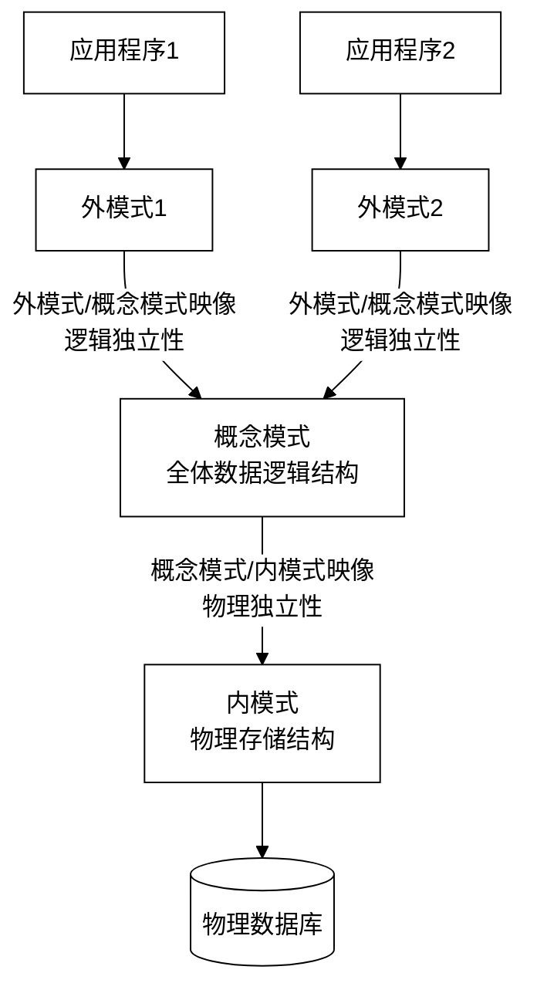
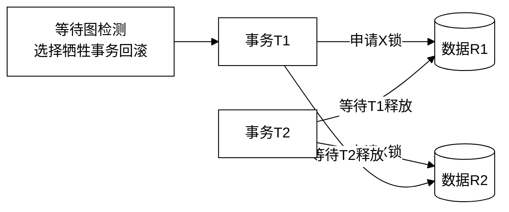
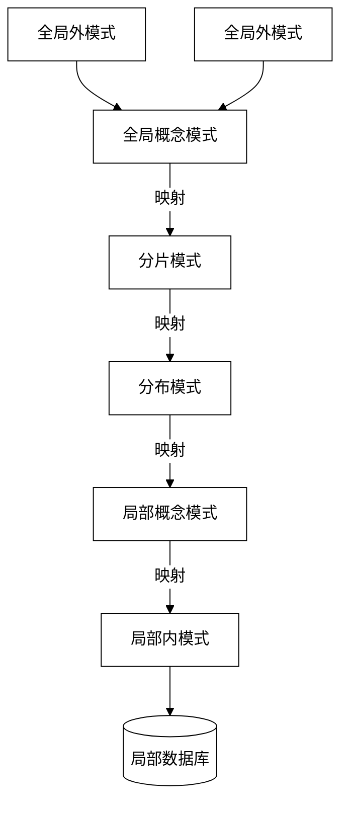

# 系统分析师｜第5章 数据库系统（备考讲义＋章节自测题）

> **教材依据**：《系统分析师教程（第2版）》第5章《数据库系统》（共8节：5.1 数据库管理系统｜5.2 关系数据库｜5.3 数据库控制功能｜5.4 数据库设计与建模｜5.5 分布式数据库系统｜5.6 数据仓库技术｜5.7 数据挖掘技术｜5.8 非关系数据库）。第1版同号章为《数据库系统》，**两版节号不同构**：第1版 5.1 数据库模式在第2版降为 5.1.2 三级划分法下的一个子主题，第1版 5.2 数据模型对应第2版 5.1.3 数据模型与 5.2 关系数据库，第1版 5.4 数据库的控制功能对应第2版 5.3（编号位移一节，且「数据库性能优化」由第1版 5.4.2 移为第2版 5.3.5）；第1版独有的 5.3 数据库访问接口、5.4.6 数据中心的建设、5.6.3 分布式数据库查询优化在第2版已删除；第2版 5.8 非关系数据库为新增节。教材外内容来源口径：本章正文以教材第2版原文为主；仅「事务隔离级别（四级）与幻读」两版教材均无原文、按2021年以后真题反复命题以【真题补充｜考频｜两版教材均无原文】补回并置于归口模块末尾「拓展阅读」；其余两版均无原文且考情不支持的内容一律不收录，逐项见「⚠️ 不包含」与表下说明；本章无第1版补充内容回补。
>
> **考纲定位说明**：2024版考纲科目一「系统分析师综合知识」第3条 数据库系统基础知识（3.1 数据库管理系统｜3.2 关系数据库｜3.3 数据库控制功能｜3.4 数据库设计与建模｜3.5 分布式数据库系统｜3.6 数据仓库技术｜3.7 数据挖掘技术｜3.8 非关系数据库），与教材第2版第5章 5.1～5.8 各节一一对应；考纲二级子项在教材本章均有对应小节或原文，无「考纲有、教材无」的空缺。
>
> **考试形式**：上午综合知识单选题（范式判定、候选键求解具计算性质，但均以单选题形式命题）；2021年以后真题近年频次窗（2024上～2026上，5场）约28道/5场，为同期科目一题量居前的章节，但无考点族5场全中（最高为范式判定、并发控制与封锁各4场，均中频）；案例分析科目「数据库」方向近年频次窗3题组（2024上试题四、2024下试题四、2025下试题二，均为选答），按累计口径（2021上～2026上，8场）为4题组（另含2023上试题四）；论文科目1题次（2024上试题三 多源数据集成，归教材5.6 数据仓库技术）。
>
> 标签：系统分析师、上午题、数据库、三级模式、关系代数、范式、候选键、事务、并发控制、封锁协议、备份恢复、分布式数据库、数据仓库、非关系数据库、备考

[TOC]

## 章节结构对照与来源标注

> 本讲义为《系统分析师教程（第2版）》第5章《数据库系统》的学习讲义，模块顺序与教材 5.1～5.8 保持一致；本章知识点几乎全部来自教材第2版，仅「事务隔离级别（四级）与幻读」一项为真题补充（教材未展开而考生材料中可能遇到的内容见「⚠️ 不包含」）。

| 讲义模块 | 对应教材第2版章节 | 内容性质 | 备考要求 |
|---|---|---|---|
| 模块1 数据库管理系统 | 5.1 数据库管理系统 | 教材 | 了解：DBMS概述与功能、三级划分法（三级模式与两级独立性）、数据模型（层次/网状/关系/面向对象） |
| 模块2 关系数据库 | 5.2 关系数据库 | 教材 | 掌握：关系运算（并/差/交/笛卡儿积/投影/选择/连接/除）与元组演算、范式判定与模式分解（含无损连接、保持函数依赖）；了解：关系的基本概念与完整性规则、函数依赖与候选键求解 |
| 模块3 数据库控制功能 | 5.3 数据库控制功能 | 教材＋真题补充 | 掌握：事务与ACID、数据不一致问题、封锁协议与死锁、数据库性能优化（含反规范化）；了解：完整性约束与触发器、安全性机制、备份与恢复技术；拓展：事务隔离级别（四级）与幻读 |
| 模块4 数据库设计与建模 | 5.4 数据库设计与建模 | 教材 | 了解：数据库设计五阶段、E-R模型三要素与联系类型、E-R图向关系模式的转换 |
| 模块5 分布式数据库系统 | 5.5 分布式数据库系统 | 教材 | 掌握：分布式数据库概述与体系结构、数据分片方式、分布式一致性与CAP理论 |
| 模块6 数据仓库技术 | 5.6 数据仓库技术 | 教材 | 了解：联机分析处理（数据立方体与多维分析）、数据仓库概述与ETL、数据仓库设计方法（自顶向下/自底向上/混合法） |
| 模块7 数据挖掘技术 | 5.7 数据挖掘技术 | 教材 | 了解：数据挖掘概述与流程、常用技术与分析方法、空间/多媒体/文本数据挖掘应用 |
| 模块8 非关系数据库 | 5.8 非关系数据库 | 教材 | 了解：非关系数据库概述与分类、BASE与分区/存储分布/查询模型、列数据库、文档数据库、键值数据库、图数据库 |

> 教材第2版第5章章节结构（按教材原文核读）：5.1 数据库管理系统（5.1.1 概述、5.1.2 三级划分法、5.1.3 数据模型）｜5.2 关系数据库（5.2.1 关系的基本概念、5.2.2 关系模型、5.2.3 规范化理论）｜5.3 数据库控制功能（5.3.1 并发控制、5.3.2 数据库的完整性、5.3.3 数据库的安全性、5.3.4 备份与恢复技术、5.3.5 数据库性能优化）｜5.4 数据库设计与建模（5.4.1 数据库设计阶段、5.4.2 实体联系模型）｜5.5 分布式数据库系统（5.5.1 分布式数据库概述、5.5.2 数据分片）｜5.6 数据仓库技术（5.6.1 联机分析处理、5.6.2 数据仓库概述、5.6.3 数据仓库的设计方法）｜5.7 数据挖掘技术（5.7.1 数据挖掘概述、5.7.2 常用技术与方法、5.7.3 数据挖掘技术的应用）｜5.8 非关系数据库（5.8.1 概述、5.8.2 相关理论基础、5.8.3 列数据库、5.8.4 文档数据库、5.8.5 键值数据库、5.8.6 图数据库）。

> ⚠️ 教材第2版第5章**不包含**（两源核查）：**源①**（对照第1版第5章《数据库系统》逐节核对）——①数据库访问接口（第1版 5.3：ODBC、JDBC、ADO 等访问接口层次与编程接口）：第2版整体删除，2021年以后真题无检出，不收录；②数据中心的建设（第1版 5.4.6：异地备份、数据中心选址与容灾等级）：第2版整体删除，2021年以后真题无检出，不收录；③分布式数据库查询优化（第1版 5.6.3：查询优化准则与半连接算法）：第2版整体删除，2021年以后真题无检出，不收录；④第1版 5.1 数据库模式作为**独立一级节**的编排（含模式/子模式概念与两级映像独立叙述）：第2版压缩为 5.1.2 三级划分法，属**降格而非删除**，内容本章已覆盖。**源②**（对照考纲3.1～3.8子项与教材5.1～5.8小节核对）——考纲全部二级子项在教材本章均有对应小节或原文，**无源②事项**，故讲义不存在「考纲有条目而教材无对应章节」的补回内容。

> 说明（三处易混入本章、实不属本章的内容）：①**数据属性分析**（固定值属性、固定个体变动属性、随机变动属性）虽常在「数据库设计」语境下命题（2025下第43题、2026上第5/72/73题），但其教材原文在第2版 **10.6.7 数据属性分析**、考纲条目为 **8.6.7**，已按归口改记第10章，本章不收录、不计入本章题量；②**两阶段提交**（2PC）两版教材第5章均无原文，2021年以后仅2021上第45题一次检出、近年频次窗未检出（0场），按「两版无原文且非反复命题」不收录；③**BI（商业智能）的体系结构与企业级报表平台**不归口本章，本章只收教材 5.6 数据仓库技术范围内的 OLAP、ETL 与设计方法。

---

## 模块1：数据库管理系统（教材5.1）【教材｜了解】

**前置说明**：本模块对应教材第2版第5章 **5.1 数据库管理系统**（5.1.1 概述、5.1.2 三级划分法、5.1.3 数据模型），对应考纲 **3.1 数据库管理系统**（3.1.1 概述、3.1.2 三级模式、3.1.3 数据模型）；全部为教材原文，适配上午综合选择题（概念辨析）。

**模块优先级**：🟢 了解为主 —— 近年频次窗内本模块各知识点均未独立命题（0场），按统一判据（0场＝未检出）判未检出；考纲3.1明确要求，故保留收录。

**考情分析**（2021年以后真题）：近年频次窗（2024上～2026上，5场）0道/0场（未检出）；**全量统计窗（2021上～2026上，8场）内亦无独立检出**——三级模式两级映像、数据模型分类在2021年以后八场综合知识中均未单独命题。核心考点仍须掌握：三级模式与两级映像、逻辑独立性与物理独立性、四类数据模型。

### 1.1 核心知识点精讲

#### 1.1.1 数据库管理系统概述（教材5.1.1）【教材｜了解】

- **DBMS**：操纵和管理数据库的大型软件，用于建立、使用和维护数据库，对数据库进行统一的管理和控制，以保证数据库的安全性和完整性。
- **主要功能**：数据定义（提供 DDL）、数据操纵（提供 DML）、数据存储与管理、数据维护、通信；支持多个应用程序和用户用不同方法在同时或不同时刻建立、修改和查询数据库。
- **使用者**：用户通过 DBMS 访问数据库中的数据，数据库管理员（DBA）也通过 DBMS 进行数据库维护工作。

#### 1.1.2 三级划分法：三级模式与两级独立性（教材5.1.2）【教材｜了解】

典型的结构划分是**三级划分法**：把数据库系统划分为三级模式，在三级模式之间提供两级映射，这两级映射保证了数据库中的数据具有较高的物理独立性和逻辑独立性。

**（1）三级模式**

| 模式 | 别称 | 含义 | 数量 |
|---|---|---|---|
| 外模式 | 子模式、用户模式 | 描述用户（程序员与终端用户）看到或使用的那部分数据的逻辑结构，是数据库用户的数据视图 | 一个数据库可有**多个**外模式；一个应用程序只能使用一个外模式 |
| 概念模式 | 模式、逻辑模式 | 数据库中全体数据的逻辑结构和特征的描述，是所有用户的公共数据视图 | 一个数据库**只有一个** |
| 内模式 | 存储模式 | 数据物理结构和存储方式的描述，是数据在数据库内部的表示方式；不同于物理层，它假定外存是无限的线性地址空间 | 一个数据库**只有一个** |

- 三者的依赖关系：**模式是数据库的中心与关键**；内模式依赖于模式，独立于外模式和存储设备；外模式面向具体应用，独立于内模式和存储设备；应用程序依赖于外模式，独立于模式和内模式。

**（2）两级独立性**

- **物理独立性**：用户的应用程序与存储在磁盘上的数据库中的数据相互独立；数据的物理存储改变时应用程序不需要改变。物理独立性存在于**概念模式和内模式之间的映射**转换。
- **逻辑独立性**：用户的应用程序与数据库中的逻辑结构相互独立；数据的逻辑结构改变时应用程序不需要改变。逻辑独立性存在于**外模式和概念模式之间的映射**转换。
- 教材提示：**逻辑独立性比物理独立性更难实现**。

> 记忆：外模式多个、概念模式与内模式各一个；「外—概念」映像管逻辑独立性，「概念—内」映像管物理独立性。

#### 1.1.3 数据模型（教材5.1.3）【教材｜了解】

- **数据模型**是现实世界数据特征的抽象，所描述的内容包括三部分：**数据结构、数据操作、数据约束**。数据结构是数据模型的基础，数据操作和数据约束都建立在数据结构上。
- 教材列举的四种基本数据模型：

| 数据模型 | 结构 | 要点 |
|---|---|---|
| 层次模型 | 树形结构 | 最早出现的数据模型；每个结点可以有多个孩子结点，但只能有一个双亲结点 |
| 网状模型 | 图（网络）结构 | 允许多个双亲结点，能表达更复杂的联系 |
| 关系模型 | 二维表 | 目前应用最广泛，有一套完整的理论支持（见模块2） |
| 面向对象模型 | 对象/类 | 可表达复杂对象与继承；目前主流方式是在关系模型数据库系统中增加对对象模型的支持 |

### 1.2 典型例题

本模块为【教材｜了解】级，近年频次窗未检出（0场），不配置例题。

### 1.3 课后习题

本模块为【教材｜了解】级，近年频次窗未检出（0场），不配置课后习题。

---

## 模块2：关系数据库（教材5.2）【教材｜掌握】

**前置说明**：本模块对应教材第2版第5章 **5.2 关系数据库**（5.2.1 关系的基本概念、5.2.2 关系模型、5.2.3 规范化理论），对应考纲 **3.2 关系数据库**（3.2.1 关系的基本概念、3.2.2 关系模型、3.2.3 规范化理论）；全部为教材原文，适配上午综合选择题（含范式判定、候选键求解等计算型选择题）。

**模块优先级**：🟡 中频 —— 模块内范式判定族近年频次窗 7道/4场、关系代数运算族 4道/3场，按统一判据（2～4场＝中频）判中频；是本章题量最集中的模块。

**考情分析**（2021年以后真题）：近年频次窗（2024上～2026上，5场）——范式判定 7道/4场（2024下第43题 范式的目的、2025上第25～26题 2NF/3NF 各消除什么、2025下第5～6题 关系模式最高满足第几范式、2026上第21题 2NF不满足3NF时仍存在什么、2026上第38题 给定主码与函数依赖判最高范式）、关系代数运算 4道/3场（2024上第32题 元组演算公式等价、2024上第33题 选择运算定义、2025下第9题 同时作用于行和列的运算、2026上第57题 按条件筛选元组）；候选码与函数依赖 1道/1场（2025下第25题，低频，随本族按了解级处理）。核心考点：八种关系代数运算的行/列语义、元组演算、函数依赖与候选键闭包、1NF～4NF 判定、无损连接与保持函数依赖。

### 2.1 核心知识点精讲

#### 2.1.1 关系的基本概念（教材5.2.1）【教材｜了解】

- **关系模型**由**关系数据结构、关系操作集合和关系完整性规则**三部分组成。
- **关系**：一个二维表；**元组**：表中的一行；**属性**：表中的一列；**域**：属性的取值范围。
- **关系模式**是对关系的描述，通常简记为 $R(A_1, A_2, \dots, A_n)$；关系模式是**型**、是静态稳定的，关系是它的**值**、是随时间不断变化的。
- **候选键（候选码）**：能唯一标识元组、且不含多余属性的属性集；一个关系可有**多个**候选键。
- **主键（主码）**：从候选键中选定的一个；**主属性**：包含在任一候选键中的属性；**非主属性（非键属性）**：不包含在任何候选键中的属性。
- **外键（外码）**：本关系中的属性组，它与另一关系的主键相对应；**全码**：关系模式的所有属性组共同组成候选键。

#### 2.1.2 关系模型·关系运算与元组演算（教材5.2.2）【教材｜掌握】

**（1）关系代数的基本运算（八种）**

| 运算 | 记号 | 语义 | 作用维度 |
|---|---|---|---|
| 并 | $R \cup S$ | 两关系（元/列数相同）的元组合并 | 行 |
| 差 | $R - S$ | 属于 $R$ 而不属于 $S$ 的元组 | 行 |
| 交 | $R \cap S$ | 同时属于 $R$ 与 $S$ 的元组 | 行 |
| 笛卡儿积 | $R \times S$ | $R$ 的每个元组与 $S$ 的每个元组拼接，元数为两者之和 | 行＋列 |
| 投影 | $\pi_A(R)$ | 从关系中抽取指明的属性 | **列** |
| 选择 | $\sigma_F(R)$ | 从关系中抽取满足给定限制条件 $F$ 的记录 | **行** |
| 连接 | $\Join$ | $\theta$连接／等值连接／自然连接三类 | 行＋列 |
| 除 | $R \div S$ | 商关系是 $R$ 在属性 $X$ 上投影的一个子集，该子集与 $S(Y)$ 的笛卡儿积包含于 $R$ | 行＋列 |

- **自然连接**是一种特殊的等值连接：要求两个关系中进行比较的分量必须是**相同的属性组**，并且在结果集中将**重复属性列去掉**。
- **除**的典型问法是「查询选修了**全部**课程的学生」——即求「包含全部…的…」。
- 教材明确：选择运算是从**元组（行）**的角度进行的运算；投影从**属性（列）**的角度进行。

> 记忆：选择$\sigma$「挑行」、投影$\pi$「抽列」、连接$\Join$「拼表」、除$\div$「找全部」。

**（2）关系演算**

- 关系演算以**谓词演算**为基础，按谓词变元不同分为**元组演算**（以元组为变量）与**域演算**（以域为变量）。
- 元组关系演算的典型形式是 $\{t \mid P(t)\}$，表示「所有使谓词 $P$ 为真的元组 $t$ 的集合」。2024上第32题即考查元组演算公式的**逻辑等价变形**（如 $P_1 \lor P_2$ 与 $\lnot(\lnot P_1 \land \lnot P_2)$ 等价）。
- 关系代数、元组演算、域演算三者在表达能力上等价。

#### 2.1.3 规范化理论·函数依赖与候选键（教材5.2.3）【教材｜了解】

- **函数依赖** $X \to Y$：关系 $R$ 中，$X$ 的每个值都对应唯一的 $Y$ 值，则称 $Y$ 函数依赖于 $X$。
- **完全函数依赖**：$X \to Y$，且 $X$ 的任何真子集都不能决定 $Y$。
- **部分函数依赖**：$X \to Y$，而 $X$ 的某个真子集就能决定 $Y$（非主属性只依赖候选键的一部分）。
- **传递函数依赖**：$X \to Y$、$Y \to Z$，且 $Y$ 不包含 $X$、$Y \not\to X$，则 $Z$ 传递函数依赖于 $X$。
- **候选键求解（属性闭包法）**：
  1. 求各属性（或属性组合）的**闭包**：由已知函数依赖集推导该属性集能决定的全部属性；
  2. 闭包等于全部属性、且其真子集均不满足该条件的属性集，即为候选键。

> 技巧：只出现在函数依赖**左边**而不出现在右边的属性必属于每个候选键；只出现在**右边**的属性不属于任何候选键。

- **Armstrong 公理系统**（2023上第42题考过其中一条的辨识）：自反律、增广律、传递律，以及由它们推出的合并规则（若 $X \to Y$、$X \to Z$，则 $X \to YZ$）、分解规则、伪传递规则。

#### 2.1.4 规范化理论·范式判定与模式分解（教材5.2.3）【教材｜掌握】

| 范式 | 判定条件 | 消除什么 |
|---|---|---|
| 1NF | 每个属性不可再分（原子性） | 非原子属性（重复组、多值单元格） |
| 2NF | 1NF 且每个**非键属性完全依赖**于候选键 | **部分函数依赖** |
| 3NF | 2NF 且非键属性**不传递依赖**于候选键 | **传递函数依赖** |
| BCNF | 3NF 且**主属性**也不部分/传递依赖于候选键（每个决定因素都含候选键） | 主属性对候选键的部分/传递依赖 |
| 4NF | BCNF 且无多值依赖 | **多值依赖** |

- **判定顺序**：先求候选键 → 看有无部分依赖（判2NF）→ 看有无传递依赖（判3NF）→ 看决定因素是否都含候选键（判BCNF）。
- **模式分解**的两个衡量标准：
  - **无损连接分解**：分解后能通过自然连接还原原关系、不丢失信息。两子模式 $R_1$、$R_2$ 时，判定条件是**交集能决定其中任一方**（$R_1 \cap R_2 \to R_1$ 或 $R_1 \cap R_2 \to R_2$）。
  - **保持函数依赖**：分解后原函数依赖集仍被各子模式的依赖集覆盖。

> 记忆：1NF原子 → 2NF消除部分依赖 → 3NF消除传递依赖 → BCNF主属性也不许部分/传递依赖 → 4NF消除多值依赖。3NF分解可同时满足无损连接与保持依赖；BCNF分解保证无损连接但不一定保持依赖。

#### 2.1.5 典型易错点（关系代数与范式判定）

1. 选择$\sigma$是对**行**操作、投影$\pi$是对**列**操作；「同时作用于行和列」的运算是**连接**（以及笛卡儿积、除），不是选择或投影【🟡中频】；
2. 自然连接会**去掉重复属性列**，等值连接不去掉【🟡中频】；
3. 判范式必须先求候选键：候选键判错，2NF/3NF 全盘皆错【🟡中频】；
4. 2NF 只管**非键属性**对候选键的部分依赖；BCNF 额外要求**主属性**也不部分/传递依赖、且每个决定因素都含候选键【🟡中频】；
5. 无损连接判定看**交集能否决定一方**，不要与「保持函数依赖」混为一谈【🟡中频】；
6. 「主属性」＝出现在任一候选键中的属性，不要误当成「主键的那一个属性」【🟡中频】。

### 2.2 典型例题

**例题1【关系代数运算辨识】**

从关系 $R$ 中抽取出满足给定限制条件的记录，该运算称为（ ）
A. 投影 B. 选择 C. 连接 D. 除

> 【解析】教材对选择运算的定义为「从关系 $R$ 中抽取出满足给定限制条件的记录」，记作 $\sigma_F(R)$，是从元组（行）角度进行的运算；投影是从关系中抽取指明的属性（列）。2024上第33题即此定义。
> 【答案】B

**例题2【同时作用于行与列的运算】**

下列关系代数运算中，同时作用于元组（行）与属性（列）的是（ ）
A. 选择 B. 投影 C. 自然连接 D. 并

> 【解析】选择只作用于行、投影只作用于列、并要求两关系元数相同故只作用于行；自然连接要按相同属性组做比较（涉及列）并把两关系的元组拼接（涉及行），同时作用于行与列。2025下第9题同型。
> 【答案】C

**例题3【范式判定】**

关系模式 $R(\text{学号}, \text{姓名}, \text{课程号}, \text{系别}, \text{系主任}, \text{课程成绩})$，主码为 $(\text{学号}, \text{课程号})$，存在函数依赖 学号$\to$姓名、学号$\to$系别、系别$\to$系主任。该关系模式最高满足（ ）
A. 1NF B. 2NF C. 3NF D. BCNF

> 【解析】候选键为 $(\text{学号}, \text{课程号})$。非主属性「姓名」「系别」只由候选键的一部分（学号）决定，存在**部分函数依赖**，故不满足 2NF；各属性均原子，满足 1NF。最高为 1NF。此为 2026上第38题题型。
> 【答案】A

**例题4【2NF 与 3NF 的分界】**

关系模式满足 2NF 但不满足 3NF 时，通常仍存在（ ）
A. 部分函数依赖 B. 传递函数依赖 C. 多值依赖 D. 非原子属性

> 【解析】2NF 已消除非主属性对候选键的部分函数依赖；仍不满足 3NF 说明非主属性对候选键存在传递函数依赖。2026上第21题即此考点。
> 【答案】B

**例题5【候选键求解】**

关系模式 $R(A, B, C, D, E)$，函数依赖集 $F = \{A \to B,\ B \to C,\ CD \to E\}$。$R$ 的候选键是（ ）
A. $A$ B. $CD$ C. $AD$ D. $AE$

> 【解析】只出现在左边而不出现在右边的属性为 $A$、$D$，必属于候选键。求闭包：$(AD)^+ = AD \to B$（$A \to B$）$\to C$（$B \to C$）$\to E$（$CD \to E$）$= ABCDE$，等于全部属性；且其真子集 $A$、$D$ 均不能决定全部属性。候选键为 $AD$。
> 【答案】C

**例题6【无损连接判定】**

关系模式 $R(A, B, C)$，函数依赖集 $F = \{A \to B,\ B \to C\}$，分解为 $R_1(A, B)$、$R_2(A, C)$。该分解（ ）
A. 是无损连接分解，且保持函数依赖 B. 是无损连接分解，但不保持函数依赖 C. 不是无损连接分解，但保持函数依赖 D. 既非无损连接也不保持函数依赖

> 【解析】两子模式交集为 $A$；判定 $A \to B$ 或 $A \to C$ 是否成立——由 $A \to B \to C$ 知 $A \to C$ 成立，故为无损连接分解。但分解后 $B \to C$ 中的 $B$、$C$ 分属不同子模式，该依赖在任一子模式上均无法直接体现，不保持函数依赖 $B \to C$。
> 【答案】B

### 2.3 课后习题

**习题1【除运算语义】**

查询「选修了全部课程的学生」最适合使用的关系代数运算是（ ）
A. 选择 B. 投影 C. 连接 D. 除

> 【解析】除运算用于求解「包含全部…的…」型查询，典型场景即「选修了全部课程的学生」。
> 【答案】D

**习题2【自然连接与等值连接】**

关于自然连接与等值连接，下列说法正确的是（ ）
A. 自然连接保留重复属性列 B. 等值连接要求比较分量是相同属性组 C. 自然连接是特殊的等值连接，会去掉重复属性列 D. 两者完全等价

> 【解析】自然连接是特殊的等值连接：要求比较的分量是相同属性组，并在结果集中去掉重复属性列；等值连接只要求分量相等，不要求同名、也不去重列。
> 【答案】C

**习题3【BCNF 判定】**

关系模式 $R(A, B, C)$，函数依赖集 $F = \{AB \to C\}$。$R$ 最高满足（ ）
A. 1NF B. 2NF C. 3NF D. BCNF

> 【解析】候选键为 $AB$（$A$、$B$ 单独都不能决定 $C$）。唯一非主属性 $C$ 完全依赖于候选键，无部分/传递依赖；决定因素 $AB$ 本身即候选键，主属性无不良依赖。满足 BCNF。
> 【答案】D

**习题4【传递依赖与3NF】**

关系模式 $R(A, B, C, D)$，候选键为 $A$，函数依赖 $A \to B$、$B \to C$、$C \to D$。$R$ 最高满足（ ）
A. 1NF B. 2NF C. 3NF D. BCNF

> 【解析】非主属性 $B$、$C$、$D$ 均完全依赖于候选键 $A$（单属性候选键不存在部分依赖），满足 2NF；但存在 $A \to B \to C \to D$ 的传递函数依赖，不满足 3NF。
> 【答案】B

---

## 模块3：数据库控制功能（教材5.3）【教材＋真题补充】

**前置说明**：本模块对应教材第2版第5章 **5.3 数据库控制功能**（5.3.1 并发控制、5.3.2 数据库的完整性、5.3.3 数据库的安全性、5.3.4 备份与恢复技术、5.3.5 数据库性能优化），对应考纲 **3.3 数据库控制功能**；教材原文为主；「事务隔离级别（四级）与幻读」两版教材均无原文、按2021年以后真题反复命题补回，置于本模块末尾「拓展阅读」并标注来源标签；适配上午综合选择题与案例简答背景。

**模块优先级**：🟡 中频 —— 模块内并发控制与封锁族近年频次窗 5道/4场、事务与ACID族 3道/3场、性能优化族 2道/2场，按统一判据（2～4场＝中频）判中频。

**考情分析**（2021年以后真题）：近年频次窗（2024上～2026上，5场）——并发控制与封锁 5道/4场（2024下第6题 死锁解决、2025上第21题 脏读、2025下第34题 隔离级别性能最高、2026上第44题 可避免三种读异常的隔离级别、2026上第47题 高并发防超卖的并发控制策略）、事务与ACID 3道/3场（2024上第4题 隔离性、2024下第5题 事务失败全部回滚、2025上第23题 原子性）、数据库性能优化 2道/2场（2024下第39题 反规范化的优点、2026上第37题 不适合直接使用缓存的场景）、数据库完整性与触发器 2道/1场（2024下第56题 触发器的作用、第59题 成交后写订单表用何种触发器，低频）、数据库备份与恢复 1道/1场（2026上第53题 时间点恢复所需条件，低频）；数据库安全性近年频次窗 **0道/0场（未检出）**，全量统计窗（2021上～2026上，8场）内 2022上第45题 1道/1场。核心考点：ACID 四特性、三类数据不一致问题、三级封锁协议与两段锁协议、死锁、备份方式与时间点恢复、反规范化。

### 3.1 核心知识点精讲

#### 3.1.1 并发控制·事务与ACID（教材5.3.1）【教材｜掌握】

- **事务**：用户定义的一个数据库操作序列，这些操作要么全做、要么全不做，是一个不可分割的工作单位，是 DBMS 运行的基本工作单位。

| 特性 | 含义 |
|---|---|
| 原子性 Atomicity | 事务是数据库的逻辑工作单位，其包含的一组更新操作原子不可分，不能部分地完成 |
| 一致性 Consistency | 使数据库从一个一致性状态变到另一个一致性状态（如转账中各账户金额必须平衡）；一致性在逻辑上不独立，由隔离性来表示 |
| 隔离性 Isolation | 一个事务的执行不能被其他事务干扰；即使多个事务并发执行，看上去每个事务也按串行调度执行。该性质也称**可串行性** |
| 持久性 Durability | 也称永久性；事务一旦提交，改变就是永久性的，无论发生何种故障都不应受影响 |

> 记忆：原子（全做或全不做）— 一致（状态守恒）— 隔离（互不干扰）— 持久（提交即永存）。真题常以「事务执行失败后其中操作全部回滚」考原子性、「一个事务的执行不被其他事务干扰」考隔离性。

#### 3.1.2 并发控制·数据不一致问题（教材5.3.1）【教材｜掌握】

数据库的并发操作会带来数据不一致问题，教材列举三类：

1. **丢失修改**：事务 A 与事务 B 从数据库中读入同一数据并修改，B 的提交结果破坏了 A 的提交结果，导致 A 的修改被丢失。
2. **读「脏数据」**：事务 A 修改某一数据并写回磁盘，事务 B 读取同一数据后，事务 A 因某种原因被撤销、已修改的数据恢复原值，B 读到的数据就与数据库中的数据不一致，称为「脏数据」。
3. **不可重复读**：事务 A 读取数据后，事务 B 执行了更新操作，事务 A 使用的仍是更新前的值（如两次求和结果不同），造成数据不一致性。

> 教材只列三类（丢失修改、读「脏数据」、不可重复读），**不含「幻读」**；幻读与四级隔离级别属两版教材均无原文的内容，见本模块「拓展阅读」。

#### 3.1.3 并发控制·封锁协议与死锁（教材5.3.1）【教材｜掌握】

**（1）两种封锁**

- **排他型封锁（X封锁）**：事务 T 对数据对象 A 实现 X 封锁后，只允许 T 读取和修改 A；其他事务要等 T 解除 X 封锁后才能对 A 实现任何类型的封锁。X 封锁只允许一个事务独锁某个数据，具有排他性。
- **共享型封锁（S封锁）**：事务 T 对数据对象 A 实现 S 封锁后，允许 T 读取 A 但不能修改 A；在所有 S 封锁解除之前，决不允许任何事务对 A 实现 X 封锁（即允许并发读、不允许修改）。

**（2）三级封锁协议与两段锁协议**

| 协议 | 内容 | 能保证 |
|---|---|---|
| 一级封锁协议 | 事务在修改数据之前必须先对其加 X 锁，直到事务结束才释放 | 防止丢失修改，保证事务可恢复；不保证可重复读和不读「脏数据」 |
| 二级封锁协议 | 一级封锁协议 ＋ 事务在读取数据之前先对其加 S 锁，读完后即可释放 | 防止丢失修改、防止读「脏数据」；不保证可重复读 |
| 三级封锁协议 | 一级封锁协议 ＋ 事务在读取数据之前先对其加 S 锁，直到事务结束才释放 | 防止丢失修改、读「脏数据」，且能保证可重复读 |
| 两段锁协议（2PL） | 所有事务分两个阶段加锁和解锁——**扩展阶段**（读写前申请并获得封锁）、**收缩阶段**（释放一个封锁后不能再申请任何其他封锁） | 若并发执行的所有事务均遵守两段锁协议，则对其任何并发调度策略都是**可串行化的**；遵守两段锁协议的事务仍**可能发生死锁** |

- **封锁粒度**：被封锁数据对象的大小（属性值、属性值集、元组、关系、索引项、整个数据库、物理页等）。粒度小则并发性高但开销大，粒度大则并发性低但开销小。

**（3）死锁**

- **死锁**：多个用户申请不同封锁，由于申请者均拥有一部分封锁权，又需等待其他用户拥有的部分封锁而引起的永无休止的等待。
- 解决思路：**预防**（一次封锁法、顺序封锁法）与**检测并解除**（超时法、等待图法检测，选择代价最小的事务回滚）。2024下第6题即考查「两个事务竞争资源出现死锁，合适的解决方案」。

#### 3.1.4 数据库的完整性（教材5.3.2）【教材｜了解】

- **完整性**指数据库中数据的**正确性和相容性**，由各种各样的完整性约束来保证；约束可通过 DBMS 或应用程序实现，基于 DBMS 的约束作为关系模式的一部分存入数据库中。
- **完整性约束条件**：作用对象可以是**关系、元组或属性**三种；分为**静态约束**（固有逻辑特性：静态属性级约束、静态元组约束、静态关系约束）与**动态约束**（数据变化应遵守的规则：动态属性级约束、动态元组约束、动态关系约束）。
- **三类完整性**：
  - **实体完整性**：要求主键中的任一属性不能为空（空值是「不知道」或「无意义」的值）。
  - **参照完整性**：若关系 $R$ 中含有与关系 $S$ 的主键 PK 相对应的属性组 FK（外键），则 $R$ 中每个元组在 FK 上的值必须是 $S$ 中某个元组的 PK 值，**或者为空值**。
  - **用户定义的完整性**：针对具体应用的语义约束（取值范围、格式等）。
- **触发器**：抽象含义是一个事件的发生必然触发（导致）另外一些事件的发生，前面称**触发事件**、后面称**结果事件**；触发事件一般即为完整性约束条件的否定，结果事件是一组消除不良影响的操作。数据库中事件一般表示为数据的**插入、修改、删除**等操作。触发器除完整性保护功能外，还有安全性保护功能。与「约束」的区别：约束只是给出必要提示以通知用户，触发器还会引起系统自动进行某些操作。

> 记忆：实体完整性管主键（非空），参照完整性管外键（要么为空、要么等于被引用主键值），用户定义完整性管业务规则。

#### 3.1.5 数据库的安全性（教材5.3.3）【教材｜了解】

- 数据库系统的安全性在技术上依赖于两种方式：一是 **DBMS 本身提供的用户身份识别、视图、使用权限控制和审计**等管理措施；二是靠**应用程序**来实现对数据库访问进行控制和管理。
- **用户标识和鉴别**：口令认证、强认证等。
- **数据授权**：通过 GRANT/REVOKE 授予与回收权限，遵循最小权限原则。
- **视图**：通过建立视图使用户只能看到部分数据，从而保护其他数据的安全性（2023上第40题即此考点）。
- **审计与跟踪**：审计作为一种安全检查措施，会将系统运行状况和用户访问数据库的行为以日志形式**记录并保存**下来，往往作为稽查用户行为的证据；而「跟踪」主要满足系统调试需要，捕捉到的用户行为记录往往只用于分析、并不长久保存。

#### 3.1.6 备份与恢复技术（教材5.3.4）【教材｜了解】

- **按实现方式分**：**物理备份**（操作系统层面上备份数据文件，分**冷备份／静态备份**——数据库正常关闭后复制文件，是最快最安全的方法；**热备份／动态备份**——数据库运行中利用备份软件备份）与**逻辑备份**（利用 DBMS 自带工具，如 Oracle 的 exp/imp、Sybase 的 dump/load database）。
- **按数据量分**：**完全备份**（整个数据库）、**增量备份**（备份上一次备份——含完全、增量、差异备份——后发生变化的数据）、**差异备份**（备份上一次**完全备份**后发生变化的所有数据）。
- **日志文件**：事务日志是针对数据库改变所做的记录，可记录针对数据库的任何操作，是故障恢复的核心依据。
- **时间点恢复**：冷备份的优点之一是「容易恢复到某个时间点上」（只需将文件复制回去）；热备份可达到秒级恢复，但若热备份不成功，所得结果**不可用于时间点的恢复**。2026上第53题考查「进行时间点恢复通常需要完整备份以及什么」——答案指向**日志文件（事务日志）**：仅有完整备份只能恢复到备份时点，要恢复到故障前某一时刻必须配合日志做前滚。

> 记忆：增量备份依赖「上一次任何备份」，差异备份依赖「上一次完全备份」；恢复耗时上，增量最长（需按链逐一回放）、差异居中、完全最短。

#### 3.1.7 数据库性能优化（教材5.3.5）【教材｜掌握】

集中式数据库的性能优化可从**硬件升级、数据库设计、索引优化策略、查询优化**四方面入手。

1. **硬件升级**：处理器（更高频率或改多处理器系统）、内存（扩充容量，减少磁盘 I/O）、磁盘子系统（高速磁盘、合理分布 I/O）、网络（带宽升级）。
2. **数据库设计**：
   - **反规范化（非规范化）**：规范化程度越高冗余越少，但关系模式不断被拆解、结构变复杂，使用数据时需频繁执行**连接操作**，而连接操作最耗时，是数据库性能的制约因素。**因此非规范化（反规范化）可以改善系统的性能**。常用措施：①将常用的计算属性（总计、最大值等）存储到数据库实体中；②重新定义实体以减少外部属性数据或行数据的开支；③将关系进行水平或垂直分割以提升并行访问度。
   - **物理设计准则**：属性数据类型取所需最小存储空间；将频繁使用的关系模式分割开置于两个单独的智能型磁盘控制器设备上；将文本或图像属性的数据存放在单独的物理设备上。
3. **索引优化策略**：选用经常作为查询、不常更新的属性建索引；索引过多会影响 UPDATE/INSERT/DELETE 性能；分析查询使用频率以定位需优化的索引；数据量很小的关系不必建索引。
4. **查询优化**（也称应用程序优化，是性能优化的最后一个也是最重要的环节）：建立物化视图或尽可能减少多表查询；以不相干子查询替代相干子查询；只检索需要的属性；用带 IN 的条件子句等价替换 OR 子句；经常提交（COMMIT）以尽早释放锁等。

> 记忆：反规范化＝用**冗余换连接**、以空间与时间一致性维护成本换取查询性能；这是教材原文明确给出的性能优化手段。

#### 3.1.8 典型易错点（事务、并发与备份恢复）

1. 原子性＝全做或全不做（失败则全部回滚）；隔离性＝并发事务互不干扰、看上去像串行调度，二者不要混淆【🟡中频】；
2. 教材三类不一致问题是**丢失修改、读「脏数据」、不可重复读**；「幻读」不在教材原文内【🟡中频】；
3. 一级到三级封锁协议逐级增强：一级只防丢失修改，二级加防读「脏数据」，三级再加防不可重复读；三级封锁协议要求读锁**直到事务结束才释放**【🟡中频】；
4. 两段锁协议保证**可串行化**，但**不能防止死锁**（遵守两段锁协议的事务可能发生死锁）【🟡中频】；
5. X 锁排他（只允许一个事务独锁），S 锁共享（允许并发读，且 S 锁未全部解除前不允许任何事务加 X 锁）【🟡中频】；
6. 增量备份依赖上一次**任何**备份，差异备份依赖上一次**完全**备份，二者不要互换【🟡中频】；
7. 实体完整性要求主键非空；参照完整性允许外键**为空**，但非空时必须等于被引用关系的主键值【🟡中频】。

### 3.2 典型例题

**例题1【事务特性辨识】**

事务执行失败后，事务中的操作会被全部回滚，这体现的事务特性是（ ）
A. 原子性 B. 一致性 C. 隔离性 D. 持久性

> 【解析】原子性保证事务包含的一组更新操作是原子不可分的，要么全做要么全不做，失败则全部回滚。2024下第5题即此考点。
> 【答案】A

**例题2【隔离性定义】**

一个事务的执行不能被其他事务干扰，即使有多个事务并行执行，看上去每个事务也按串行调度执行，这体现的是（ ）
A. 原子性 B. 一致性 C. 隔离性 D. 持久性

> 【解析】教材对隔离性的表述为「一个事务的执行不能被其他事务干扰……看上去每个事务是按串行调度执行一样，这一性质也称为可串行性」。2024上第4题即此定义。
> 【答案】C

**例题3【数据不一致问题】**

事务 T1 读取数据 A 后，事务 T2 修改并写回 A；随后 T2 被撤销、A 恢复原值，T1 读到的 A 与数据库中不一致。该现象是（ ）
A. 丢失修改 B. 读「脏数据」 C. 不可重复读 D. 幻读

> 【解析】读到的是被撤销事务写回过的、已恢复原值前的数据，属读「脏数据」。2025上第21题考查脏读的辨识。
> 【答案】B

**例题4【封锁协议】**

关于封锁协议，下列说法正确的是（ ）
A. 一级封锁协议可防止读「脏数据」 B. 二级封锁协议可保证可重复读 C. 三级封锁协议可防止丢失修改、读「脏数据」并保证可重复读 D. 两段锁协议可防止死锁

> 【解析】三级封锁协议（读锁保持到事务结束）同时防止丢失修改、读「脏数据」并保证可重复读；两段锁协议保证可串行化但**仍可能发生死锁**，D 错。
> 【答案】C

**例题5【死锁处理】**

两个事务竞争资源出现死锁，合适的解决方案是（ ）
A. 提高隔离级别 B. 回滚其中一个事务以打破等待环 C. 增大封锁粒度 D. 改为差异备份

> 【解析】死锁是互相等待对方持有的封锁；检测后选择合适的（代价最小的）事务回滚以打破等待环，是标准解除手段。2024下第6题即此考点。
> 【答案】B

**例题6【反规范化】**

数据库反规范化的优点是（ ）
A. 消除数据冗余 B. 提高查询性能 C. 保证数据一致性 D. 简化关系模式结构

> 【解析】教材原文：规范化使关系模式不断被拆解、使用时需频繁执行最耗时的连接操作，因此非规范化（反规范化）可以改善系统的性能。代价是引入冗余、增加一致性维护成本。2024下第39题即此考点。
> 【答案】B

**例题7【备份方式与时间点恢复】**

数据库进行时间点恢复时，通常需要完整备份以及（ ）
A. 差异备份 B. 事务日志 C. 索引文件 D. 视图定义

> 【解析】完整备份只能把数据库恢复到备份时点；要前滚到故障前某一时刻，必须依靠记录数据库每次改变的事务日志。2026上第53题即此考点。
> 【答案】B

### 3.3 课后习题

**习题1【封锁类型】**

事务 T 对数据对象 A 实现 S 封锁后，其他事务对 A（ ）
A. 可以再加 S 封锁并读取 B. 可以加 X 封锁并修改 C. 既不能加 S 锁也不能加 X 锁 D. 只能加 X 封锁

> 【解析】教材原文：S 封锁允许事务 T 读取 A 但不能修改 A，且在所有 S 封锁解除之前，决不允许任何事务对 A 实现 X 封锁；即允许并发读（可再加 S 锁）、不允许修改。
> 【答案】A

**习题2【触发器】**

触发器与一般完整性约束的主要区别是（ ）
A. 触发器只能用于安全性 B. 约束仅给出提示，触发器还会引起系统自动执行某些操作 C. 触发器不响应插入、修改、删除 D. 触发器不能用于完整性保护

> 【解析】教材原文：约束只是给出必要提示以通知用户；而触发器的功能不仅起到提示作用，还会引起系统自动进行某些操作，以消除违反完整性约束条件所引起的负面影响。
> 【答案】B

**习题3【备份策略】**

只备份上一次完全备份后发生变化的所有数据，该策略是（ ）
A. 完全备份 B. 增量备份 C. 差异备份 D. 冷备份

> 【解析】增量备份依赖上一次**任何**备份；差异备份依赖上一次**完全**备份，备份的是自该次完全备份以来变化的所有数据。
> 【答案】C

**习题4【物理备份】**

关于冷备份与热备份，下列说法正确的是（ ）
A. 冷备份在数据库运行中进行 B. 热备份必须关闭数据库 C. 冷备份是最快和最安全的备份方法，但实施期间数据库不能做其他工作 D. 热备份失败后仍可用于时间点恢复

> 【解析】冷备份（静态备份）在正常关闭数据库后复制文件，是最快最安全的方法，但备份全过程中数据库只能做备份；热备份（动态备份）在数据库运行中完成，但若热备份不成功，所得结果不可用于时间点的恢复。
> 【答案】C

### 拓展阅读：真题外延考点（两版教材均无原文）

> 收录依据：2021年以后真题反复外延命题（2025下第34题 事务隔离级别中性能最高的层级；2026上第44题 能够避免脏读、不可重复读和幻读的隔离级别），两版教材第5章均无「隔离级别」「幻读」原文。

#### 拓展·事务隔离级别与幻读【真题补充｜考频｜两版教材均无原文】

- **四类隔离级别**（由低到高）：**读未提交**（Read Uncommitted）→ **读已提交**（Read Committed）→ **可重复读**（Repeatable Read）→ **串行化**（Serializable）。级别越高，隔离性越强、并发度越低、性能越差；**性能最高的层级是读未提交**。
- **幻读**：同一事务两次按相同条件查询，因其他事务**插入或删除**了符合条件的行，导致两次结果集的**行数**不同。它与「不可重复读」的区别是：不可重复读针对**已有行的数据被修改**，幻读针对**结果集的行数增减**。
- **异常对照**：只有**串行化**能同时避免脏读、不可重复读与幻读；读已提交可避免脏读，可重复读可避免脏读与不可重复读。
- **并发控制策略**（2026上第47题）：库存扣减等高并发场景为避免超卖，最直接的并发控制策略是**悲观并发控制**（操作前先加锁，如 `SELECT ... FOR UPDATE`）；乐观并发控制（版本号/CAS）则适用于冲突较少的场景。

> 注意：以上内容两版教材均无原文，属真题外延，按了解处理；复习以教材 5.3.1 的封锁协议为主，遇到隔离级别题按上表作答即可。

---

## 模块4：数据库设计与建模（教材5.4）【教材｜了解】

**前置说明**：本模块对应教材第2版第5章 **5.4 数据库设计与建模**（5.4.1 数据库设计阶段、5.4.2 实体联系模型），对应考纲 **3.4 数据库设计与建模**（3.4.1 数据库设计阶段、3.4.2 实体联系模型）；全部为教材原文，适配上午综合选择题（概念辨析）与案例分析数据库方向的背景知识。

**模块优先级**：🟢 了解为主 —— 近年频次窗内本模块未检出（0场），按统一判据判未检出；全量统计窗（2021上～2026上，8场）内仅 2022上第40题 1道/1场（基本 E-R 图属于哪个阶段）；考纲3.4明确要求，故保留收录。

**考情分析**（2021年以后真题）：近年频次窗（2024上～2026上，5场）0道/0场（未检出）；全量统计窗内 2022上第40题 1道/1场（旧大纲期）。注意：常与本章混淆的「数据属性分析」4道/2场（2025下第43题、2026上第5/72/73题）教材原文在第2版 10.6.7、考纲条目为 8.6.7，已按归口改记第10章，**不计入本章**。核心考点：数据库设计五阶段及其产出、E-R 三要素与三类联系、E-R 图向关系模式的转换规则。

### 4.1 核心知识点精讲

#### 4.1.1 数据库设计阶段（教材5.4.1）【教材｜了解】

基于数据库系统生命周期的数据库设计分为 **5 个阶段：规划、需求分析、概念设计、逻辑设计和物理设计**。

| 阶段 | 主要任务 | 产出 |
|---|---|---|
| 规划 | 建立数据库的必要性及可行性分析，确定数据库在企业和信息系统中的地位，以及各数据库之间的联系（详见第10章） | 可行性结论、数据库系统定位 |
| 需求分析 | 了解用户的数据和处理要求，整理成需求说明书（数据名、属性及类型、主键属性、保密要求、完整性约束、更改要求、使用频率和数据量估计等，这些数据称为**元数据**）；大型数据库通常由**数据字典**管理元数据（详见第11章） | 需求说明书、数据字典 |
| 概念设计 | 在需求说明书基础上抽象为一个**不依赖于任何 DBMS** 的数据模型，即概念模型；可先设计各个应用的**视图**，再进行**视图集成**，形成单一的概念数据模型 | 概念模型（E-R 图） |
| 逻辑设计 | 将概念模型转化为某个特定 DBMS 上的逻辑模型：选定合适的逻辑模型（关系、网状、层次），转化为特定 DBMS 支持的逻辑模型并优化 | 关系模式（逻辑结构） |
| 物理设计 | 对给定逻辑模型选取最适合应用环境的物理结构（存储记录结构、数据存储安排、访问方法、完整性与安全性设计、数据库程序设计） | 存储结构与存取方法 |

> 记忆：规划→需求→概念→逻辑→物理；**概念设计产出 E-R 模型（与 DBMS 无关），逻辑设计产出关系模式**。

#### 4.1.2 实体联系模型（教材5.4.2）【教材｜了解】

- **E-R 图三要素**：
  - **实体**：用**矩形框**表示，框内标注实体名称。
  - **属性**：用**椭圆形**表示，并用连线与实体连接；**多值属性**在椭圆形虚线外面再套实线椭圆；**派生属性**用虚线椭圆表示（从基本属性计算出来的属性，如总成绩、平均成绩）。
  - **联系**：用**菱形框**表示，框内标注联系名称，并用连线将菱形框分别与有关实体相连，连线上注明联系类型。

- **三类联系**：
  - **一对一联系（1∶1）**：A 中每个实体至多与 B 中一个实体有联系，反之亦然。注意 1∶1 **不一定都是一一对应的关系，可能存在无对应**。
  - **一对多联系（1∶N）**：A 中一个实体可与 B 中多个实体有联系，而 B 中每个实体至多与 A 中一个实体有联系。
  - **多对多联系（M∶N）**：双方每个实体都可与对方多个实体有联系。

- **E-R 图向关系模式的转换**（常用规则）：
  1. **1∶1 联系**：联系可并入任一端实体所转换的关系中（在任一端加入对方主键）。
  2. **1∶N 联系**：在 **N 端**实体的关系中**加入 1 端实体的主键作为外键**，不独立建表。
  3. **M∶N 联系**：**联系必须转换为一个独立的关系**，其主键为两端实体主键的**组合**，联系自身的属性并入该关系。
  4. 特殊属性的处理：**多值属性**通常独立为一个关系模式；**BLOB 等大对象属性**与关系的主键独立为一个关系模式；**派生属性**（可由其他属性计算得到）通常**不转换**。

> 记忆：M∶N 必独立成表、主键为两端主键组合；1∶N 并到 N 端做外键；1∶1 并入任一端。

### 4.2 典型例题

本模块为【教材｜了解】级，近年频次窗未检出（0场），不配置例题。

### 4.3 课后习题

本模块为【教材｜了解】级，近年频次窗未检出（0场），不配置课后习题。

---

## 模块5：分布式数据库系统（教材5.5）【教材｜掌握】

**前置说明**：本模块对应教材第2版第5章 **5.5 分布式数据库系统**（5.5.1 分布式数据库概述、5.5.2 数据分片），对应考纲 **3.5 分布式数据库系统**（3.5.1 分布式数据库概述、3.5.2 数据分片）；本模块另收录教材 5.8.2 的 CAP 理论（考纲条目为 3.8.2），因2021年以后真题以「分布式系统一致性」角度命题而按真题归口置于本模块，模块8不再重复展开；适配上午综合选择题。

**模块优先级**：🟡 中频 —— 近年频次窗内分布式数据库族 2道/2场（2024上第5题 数据分片原则、2025上第22题 CAP 理论），按统一判据（2～4场＝中频）判中频；全量统计窗（2021上～2026上，8场）内 5道/5场。

**考情分析**（2021年以后真题）：近年频次窗（2024上～2026上，5场）——2024上第5题（数据分片原则不包括）、2025上第22题（CAP 理论中分布式系统无法同时满足的三项中的哪一项）；全量统计窗内另有 2021上第41题、2022上第41题、2023上第45题（分布式数据库的特点：场地自治/本地交易不依赖其他场地、副本与数据存储），全量5场均有检出。核心考点：分布式数据库的四个特点、分布透明性、数据分片四种方式及其重构运算、CAP 三选二。

### 5.1 核心知识点精讲

#### 5.1.1 分布式数据库概述（教材5.5.1）【教材｜掌握】

- **定义**：分布式数据库由一组数据组成，这组数据分布在计算机网络的不同计算机上；网络中每个节点具有**独立处理的能力（场地自治）**，可以执行**局部应用**，同时每个节点也能通过网络通信子系统执行**全局应用**。
- **四个特点**：
  1. **数据独立性**：除数据的逻辑独立性与物理独立性外，还有**数据分布独立性（分布透明性）**。
  2. **集中与自治共享结合的控制结构**：各局部 DBMS 可独立管理局部数据库、具有自治功能；同时系统设有集中控制机制协调各局部 DBMS、执行全局应用。
  3. **适当增加数据冗余度**：在不同场地存储同一数据的多个副本，可提高系统的可靠性、可用性与性能。
  4. **全局的一致性、可串行性和可恢复性**。
- **体系结构**（教材图5-5，自下而上共六层，其中下两层与集中式数据库相同）：

> 说明：图中「全局外模式—全局概念模式—分片模式—分布模式」四层为分布式数据库**新增**的部分，「局部概念模式—局部内模式」两层与集中式数据库完全一致。

#### 5.1.2 数据分片（教材5.5.2）【教材｜掌握】

- **数据分片**将数据库整体逻辑结构分解为合适的逻辑单位（片段），再由**分布模式**定义片段及其副本在各场地的物理分布；主要目的是**提高访问的局部性**，便于按用户需求组织数据分布、控制冗余度。
- **四种分片方式**：

| 方式 | 含义 | 重构全局关系 |
|---|---|---|
| 水平分片 | 将一个全局关系中的**元组**分裂成多个子集，分片条件由关系中的属性值表示 | 用**并**操作重构 |
| 垂直分片 | 将一个全局关系按**属性**分裂成多个子集，应满足**不相交性（关键字除外）** | 用**连接**运算重构 |
| 导出分片 | 又称导出水平分片：水平分片的条件不是本关系属性的条件，而是**其他关系属性的条件** | 同水平分片 |
| 混合分片 | 在分片中同时采用水平分片和垂直分片两种形式 | 先重构各级再合并 |

> 记忆：水平分片按行（元组）、用**并**还原；垂直分片按列（属性）、用**连接**还原；导出分片的「条件来自别的关系」。

#### 5.1.3 分布式一致性与CAP理论（教材5.8.2）【教材｜掌握】

- **CAP 理论**：对于一个分布式系统，**一致性（Consistency）、可用性（Availability）、分区容忍性（Partition tolerance）**三个特点**最多只能三选二**。
  - **一致性**：执行某些操作后系统仍处在一致的状态；所有结点在同一时刻有相同的数据。
  - **可用性**：对数据的所有操作都应有成功的返回；高可用性指系统升级或某些结点发生故障时仍可正常返回。
  - **分区容忍性**：网络发生故障、原本连通的网络分裂为若干分区时，若允许系统继续工作，则是分区可容忍的。
- **BASE**（Basic Availability, Soft-State, Eventual Consistency）是 ACID 的一种**弱一致性变种**，只要求**最终一致性**：基本可用、软状态（可理解为「无连接」）、最终一致性。
- **选型对应关系**：选择 **CP**（一致性＋分区容忍性）则考虑 **ACID**；选择 **AP**（可用性＋分区容忍性）则考虑 **BASE**；选择 **CA**（一致性＋可用性，如 BigTable）则网络发生分区时不能进行完整的操作。

> 记忆：CAP 三选二；CP→ACID、AP→BASE。2025上第22题即考查「三者最多只能满足其二」。

#### 5.1.4 典型易错点（分布式数据库与数据分片）

1. 分布式数据库除逻辑/物理独立性外，还有**分布透明性**（数据分布独立性）【🟡中频】；
2. 各局部场地具有**自治**能力（场地自治），同时系统又有**集中控制**——是「集中与自治结合」，不是纯集中也不是纯自治【🟡中频】；
3. 水平分片按**元组（行）**并用**并**重构，垂直分片按**属性（列）**并用**连接**重构，二者不要互换【🟡中频】；
4. 垂直分片应满足**不相交性（关键字除外）**，关键字可以重复出现在各子集中以便连接【🟡中频】；
5. CAP 是「**最多三选二**」，不是「三者可兼得」也不是「只能选一个」【🟡中频】。

### 5.2 典型例题

**例题1【数据分片原则】**

下列原则中，不属于数据分片原则的是（ ）
A. 完备性 B. 可重构性 C. 不相交性 D. 原子性

> 【解析】数据分片的基本要求是：完备性（所有数据都必须映射到某个片段）、可重构性（可由片段重构全局关系）、不相交性（水平分片各片段互不重叠）；「原子性」是事务 ACID 特性，不属于分片原则。2024上第5题即此型。
> 【答案】D

**例题2【CAP 理论】**

CAP 理论中，分布式系统无法同时满足的是（ ）
A. 一致性、可用性、分区容忍性三者同时满足 B. 一致性与可用性 C. 可用性与分区容忍性 D. 一致性与分区容忍性

> 【解析】CAP 理论的核心结论是三者**最多三选二**，无法同时满足一致性、可用性与分区容忍性。2025上第22题即此考点。
> 【答案】A

**例题3【分片方式与重构】**

将全局关系按属性分裂成多个子集，并要求关键字除外不相交，该分片方式及重构运算分别是（ ）
A. 水平分片；并 B. 垂直分片；连接 C. 导出分片；并 D. 混合分片；投影

> 【解析】按属性（列）分裂且满足不相交性（关键字除外）的是垂直分片，重构全局关系用连接运算。
> 【答案】B

**例题4【分布式数据库特点】**

某银行信息管理系统采用分布式数据库系统，使本地储户的存储业务能够在本地正常进行而不依赖其他场地的数据库，这体现了分布式数据库的（ ）
A. 场地自治 B. 增加冗余度 C. 分布透明性 D. 全局可串行性

> 【解析】本地业务可在本地独立完成、不依赖其他场地，体现各节点的独立处理能力，即**场地自治**。2021上第41题、2023上第45题为此型。
> 【答案】A

### 5.3 课后习题

**习题1【分布透明性】**

分布式数据库中「用户不必知道数据存放在哪个场地」，这属于（ ）
A. 逻辑独立性 B. 物理独立性 C. 分布透明性 D. 场地自治

> 【解析】教材把数据分布独立性称为分布透明性，是分布式数据库在数据的逻辑独立性与物理独立性之外新增的独立性。
> 【答案】C

**习题2【导出分片】**

导出分片与一般水平分片的主要区别是（ ）
A. 分片后不能重构 B. 分片条件来自其他关系的属性 C. 只能按属性分片 D. 必须配合垂直分片使用

> 【解析】导出分片又称导出水平分片，其特点是水平分片的条件不是本关系属性的条件，而是**其他关系属性的条件**。
> 【答案】B

**习题3【BASE】**

关于 BASE，下列说法正确的是（ ）
A. BASE 要求强一致性 B. BASE 是 ACID 的弱一致性变种，只要求最终一致性 C. BASE 对应 CAP 中的 CP 选择 D. BASE 与分区容忍性无关

> 【解析】教材原文：由于 CAP 理论的存在，为提高性能出现了 ACID 的变种 BASE（基本可用、软状态、最终一致性），是一个弱一致性理论，只要求最终一致性；选择 AP 时考虑 BASE。
> 【答案】B

---

## 模块6：数据仓库技术（教材5.6）【教材｜了解】

**前置说明**：本模块对应教材第2版第5章 **5.6 数据仓库技术**（5.6.1 联机分析处理、5.6.2 数据仓库概述、5.6.3 数据仓库的设计方法），对应考纲 **3.6 数据仓库技术**（3.6.1 联机分析处理、3.6.2 数据仓库概述、3.6.3 数据仓库的设计方法）；全部为教材原文，适配上午综合选择题（概念辨析），并为论文「多源数据集成/数据仓库」方向提供素材。

**模块优先级**：🟢 了解为主 —— 近年频次窗内本模块未检出（0场），按统一判据判未检出；全量统计窗（2021上～2026上，8场）内综合知识亦无独立检出；考纲3.6明确要求，且论文科目有1题次（2024上试题三 多源数据集成），故保留收录。

**考情分析**（2021年以后真题）：近年频次窗（2024上～2026上，5场）综合知识 0道/0场（未检出）；论文科目 1题次（2024上试题三 多源数据集成，归教材5.6 数据仓库技术）。核心考点：OLAP 与数据立方体、多维分析、ETL 过程、数据仓库设计三方法。

### 6.1 核心知识点精讲

#### 6.1.1 联机分析处理（教材5.6.1）【教材｜了解】

- **OLAP（联机分析处理）**是数据仓库最主要的应用方式，面向分析人员，支持对数据的**多维交互分析**。
- **数据立方体**：把数据按多个维度组织起来的多维数据结构，是 OLAP 的核心概念。
- **多维分析的基本操作**：**下钻**（由粗粒度到细粒度）、**上卷**（由细粒度到粗粒度汇总）、**切片**（固定某一维的取值）、**切块**（固定若干维的取值区间）、**旋转**（交换维度显示方向）。
- **实现方法**：按存储方式分为 ROLAP（基于关系数据库）、MOLAP（基于多维数据库）、HOLAP（混合型）。

> 区分：OLTP 面向日常业务事务处理、强调实时一致与高并发写入；OLAP 面向分析查询、数据量大、强调汇总与多维分析。

#### 6.1.2 数据仓库概述（教材5.6.2）【教材｜了解】

- **数据仓库**是一个**面向主题的、集成的、相对稳定的（非易失的）、反映历史变化**的数据集合，用于支持管理决策。
- **ETL 过程**：**抽取**（Extract）→ **转换**（Transform）→ **加载**（Load），是将业务系统数据送入数据仓库的必经环节。
- **数据仓库的分类**：企业级数据仓库、数据集市等；按建设方式又可分为自上而下与自下而上两类。
- **非结构化数据与数据仓库**：文本、图像、音视频等非结构化数据需先经抽取与结构化处理，才能纳入数据仓库分析。

#### 6.1.3 数据仓库的设计方法（教材5.6.3）【教材｜了解】

| 方法 | 要点 | 适用 |
|---|---|---|
| 自顶向下 | 先建立企业级数据仓库，再由其派生部门级数据集市；整体规划、数据一致性强 | 需求明确、企业层面统一规划 |
| 自底向上 | 先建设部门级数据集市，再逐步集成为企业级数据仓库；见效快、投资小 | 需求不清、希望快速见效 |
| 混合法 | 结合两者：企业级规划先行，同时允许数据集市并行建设 | 大型企业的现实折中方案 |

### 6.2 典型例题

本模块为【教材｜了解】级，近年频次窗未检出（0场），不配置例题。

### 6.3 课后习题

本模块为【教材｜了解】级，近年频次窗未检出（0场），不配置课后习题。

---

## 模块7：数据挖掘技术（教材5.7）【教材｜了解】

**前置说明**：本模块对应教材第2版第5章 **5.7 数据挖掘技术**（5.7.1 数据挖掘概述、5.7.2 常用技术与方法、5.7.3 数据挖掘技术的应用），对应考纲 **3.7 数据挖掘技术**（3.7.1 数据挖掘概述、3.7.2 常用技术与方法、3.7.3 数据挖掘技术的应用）；全部为教材原文，适配上午综合选择题（概念辨析）。

**模块优先级**：🟢 了解为主 —— 近年频次窗内本模块未检出（0场），按统一判据判未检出；全量统计窗（2021上～2026上，8场）内综合知识亦无独立检出；考纲3.7明确要求，故保留收录。

**考情分析**（2021年以后真题）：近年频次窗（2024上～2026上，5场）0道/0场（未检出）；全量统计窗内综合知识亦无独立检出。核心考点：数据挖掘与 OLAP 的区别、挖掘流程、常用技术（决策树、神经网络、关联规则、聚类等）与分析方法、三类应用场景。

### 7.1 核心知识点精讲

#### 7.1.1 数据挖掘概述（教材5.7.1）【教材｜了解】

- **数据挖掘**是从大量的、不完全的、有噪声的、模糊的、随机的实际应用数据中，提取隐含在其中的、人们事先不知道的、但又是潜在有用的信息和知识的过程。
- **与 OLAP 的区别**：OLAP 是**验证型**工具（分析人员先提出假设再查询验证），数据挖掘是**挖掘型/发现型**工具（由算法自动发现模式与规律）。
- **典型流程**：问题定义 → 数据选择与抽取 → 数据预处理（清洗、集成、变换、归约）→ 挖掘建模 → 模式评估 → 知识表示与应用。

#### 7.1.2 常用技术与方法（教材5.7.2）【教材｜了解】

- **常用技术**：决策树、人工神经网络、遗传算法、粗糙集、模糊集、支持向量机、统计方法等。
- **分析方法（挖掘任务）**：

| 方法 | 含义 | 典型问法 |
|---|---|---|
| 关联分析 | 发现数据项之间的关联规则（如购物篮分析） | 「买了 A 的顾客也常买 B」 |
| 分类 | 依据已知类别的训练集构造分类模型，预测新对象的类别 | 有监督学习 |
| 聚类 | 按「物以类聚」原则把对象划分为若干簇，簇内相似、簇间相异 | 无监督学习 |
| 预测（回归） | 依据历史数据建立模型预测未来趋势或数值 | 时序预测 |
| 序列模式挖掘 | 发现事件在时间上的先后关联模式 | 用户访问路径 |
| 异常检测（离群点分析） | 发现明显偏离正常模式的对象 | 欺诈识别 |

#### 7.1.3 数据挖掘技术的应用（教材5.7.3）【教材｜了解】

- **空间数据挖掘**：从空间数据库（地理信息、遥感影像等）中发现知识，用于城市规划、环境监测、交通分析等。
- **多媒体数据挖掘**：对图像、音频、视频等非结构化数据进行挖掘，涉及特征提取与相似性检索。
- **文本数据挖掘**：以文本为对象，教材自下而上给出四层——基本技术（文本信息抽取、文本分类、文本聚类、文本数据压缩、文本数据处理），最上层是两个主要应用领域：**信息访问**（信息检索、信息浏览、信息过滤、信息报告）与**知识发现**（数据分析、数据预测）。

### 7.2 典型例题

本模块为【教材｜了解】级，近年频次窗未检出（0场），不配置例题。

### 7.3 课后习题

本模块为【教材｜了解】级，近年频次窗未检出（0场），不配置课后习题。

---

## 模块8：非关系数据库（教材5.8）【教材｜了解】

**前置说明**：本模块对应教材第2版第5章 **5.8 非关系数据库**（5.8.1 概述、5.8.2 相关理论基础、5.8.3 列数据库、5.8.4 文档数据库、5.8.5 键值数据库、5.8.6 图数据库），对应考纲 **3.8 非关系数据库**（3.8.1 概述、3.8.2 相关理论基础、3.8.3～3.8.6 四类数据库）；全部为教材原文，适配上午综合选择题（概念辨析与选型）。考纲3.8.2 的 CAP 理论已按真题归口置于模块5.1.3，本模块不重复展开。

**模块优先级**：🟢 了解为主 —— 近年频次窗内本模块未检出（0场），按统一判据判未检出（考纲3.8.2 的 CAP 理论 2025上第22题已按真题归口计入模块5）；全量统计窗（2021上～2026上，8场）内亦无检出；考纲3.8明确要求，故保留收录。

**考情分析**（2021年以后真题）：近年频次窗（2024上～2026上，5场）0道/0场（未检出）；全量统计窗内综合知识亦无独立检出。核心考点：四类非关系数据库的分类与选型、BASE 与分区/存储分布/查询模型、各类代表产品与适用场景。

### 8.1 核心知识点精讲

#### 8.1.1 非关系数据库概述（教材5.8.1）【教材｜了解】

- **NoSQL** 是非关系数据存储的广义定义，打破了长久以来关系数据库与 ACID 理论大一统的局面；它**不需要固定的表结构**，通常也不存在连接操作，在大数据存取上具备关系数据库无法比拟的性能优势。
- 兴起背景：Web 2.0 网站特别是超大规模和高并发的 SNS 类型动态网站，传统关系数据库显得力不从心。
- 与关系数据库的对比取向：关系数据库强调 **ACID 与强一致、固定模式、表间连接**；非关系数据库强调 **高可用、水平扩展、灵活模式、最终一致**。

#### 8.1.2 相关理论基础·BASE与分区（教材5.8.2）【教材｜了解】

- **BASE**（Basic Availability、Soft-State、Eventual Consistency）：基本可用、软状态（可理解为「无连接」，与之相对的是面向连接的 Hard State）、最终一致性。CAP 理论见模块5.1.3。
- **分区**（教材列举的主要方法）：
  1. **内存缓存**：把使用频率最高的数据复制到缓存中加快传递速度、减轻数据库服务器负担；分布式缓存由很多带分配内存的进程组成，可置于不同机器，提供简单的键值存储 API，通过把键值哈希散列到缓存中来存储对象。
  2. **集群**：数据库服务器集群为用户提供服务时的**透明性**（用户感觉数据像在同一个数据库中），并实现负载分担、避免临界瓶颈。
  3. 由已存在的多个数据库系统**自下而上**构成分布式数据库，也是分区的现实动因之一。
- 此外，教材还讨论**存储分布**与**查询模型**两部分，核心是：按数据访问特征决定分片与副本策略，以及非关系数据库以「键值/文档/列族/图」四类查询模型替代通用 SQL。

#### 8.1.3 列数据库（教材5.8.3）【教材｜了解】

- 以**列族**为单位存储数据，同一列的数据连续存放，查询时只读取所需列，I/O 效率高。
- 特点：适合**海量数据的分析型查询**与稀疏表；擅长按列聚合，不擅长整行随机读写与复杂事务。
- 代表产品：HBase、Cassandra。

#### 8.1.4 文档数据库（教材5.8.4）【教材｜了解】

- 以**文档**（JSON/BSON 等半结构化文档）为基本存储单位，模式灵活（schema-free），文档内可嵌套结构。
- 特点：适合**内容管理、柔性模式**场景；单文档级别的原子性较好，跨文档事务能力弱。
- 代表产品：**MongoDB**。

#### 8.1.5 键值数据库（教材5.8.5）【教材｜了解】

- 以**键—值对**存储，通过键直接定位值，结构最简单、性能最高。
- 特点：适合**缓存、会话、计数器、简单查询**；不支持按值查询与复杂条件检索。
- 代表产品：**Redis**、Memcached。

#### 8.1.6 图数据库（教材5.8.6）【教材｜了解】

- 以**结点—边**模型存储实体及其关系，擅长**多跳关系查询**与图算法。
- 特点：适合**社交网络、推荐、风控关系网络、知识图谱**；关系的遍历代价远低于关系数据库的多表连接。
- 代表产品：Neo4j。

> 记忆：键值＝缓存/会话（Redis）；文档＝柔性模式内容管理（MongoDB）；列族＝海量分析（HBase/Cassandra）；图＝多跳关系（Neo4j）。

### 8.2 典型例题

本模块为【教材｜了解】级，近年频次窗未检出（0场），不配置例题。

### 8.3 课后习题

本模块为【教材｜了解】级，近年频次窗未检出（0场），不配置课后习题。

---

# 章节总复习综合模拟题

## 一、单项选择题（10题）

1. 【三级模式】数据库的概念模式改变而外模式不变、应用程序不必修改，这体现了（ ）
A. 物理独立性 B. 逻辑独立性 C. 分布透明性 D. 数据完整性
> 【解析】逻辑独立性存在于外模式和概念模式之间的映射转换，说明概念模式发生变化时应用程序的独立程度。
> 【答案】B

2. 【关系代数】下列运算中，只作用于属性（列）的是（ ）
A. 选择 B. 投影 C. 连接 D. 并
> 【解析】投影 $\pi$ 从关系中抽取指明的属性，只作用于列；选择只作用于行。
> 【答案】B

3. 【元组演算】与 $P_1 \lor P_2$ 逻辑等价的是（ ）
A. $\lnot P_1 \land \lnot P_2$ B. $\lnot(\lnot P_1 \land \lnot P_2)$ C. $P_1 \land P_2$ D. $\lnot P_1 \lor \lnot P_2$
> 【解析】由德摩根律，$\lnot(\lnot P_1 \land \lnot P_2) = P_1 \lor P_2$。2024上第32题考查元组演算公式的等价变形。
> 【答案】B

4. 【范式判定】关系模式 $R(A, B, C)$，函数依赖集 $F=\{A \to B,\ B \to C\}$，候选键为 $A$，$R$ 最高满足（ ）
A. 1NF B. 2NF C. 3NF D. BCNF
> 【解析】单属性候选键不存在部分函数依赖，满足 2NF；但 $A \to B \to C$ 使 $C$ 传递依赖于 $A$，不满足 3NF。
> 【答案】B

5. 【无损连接】关系模式 $R(A, B, C)$ 分解为 $R_1(A, B)$、$R_2(B, C)$，已知 $B \to C$，该分解（ ）
A. 不是无损连接分解 B. 是无损连接分解 C. 无法判定 D. 必然保持函数依赖
> 【解析】交集为 $B$，且 $B \to C$ 成立（交集能决定其中一方），故为无损连接分解。
> 【答案】B

6. 【事务与ACID】事务提交后，即使系统发生故障其结果也不应丢失，这体现的是（ ）
A. 原子性 B. 一致性 C. 隔离性 D. 持久性
> 【解析】教材原文：持久性也称永久性，是指事务一旦提交，改变就是永久性的，无论发生何种故障都不应该对其有任何影响。
> 【答案】D

7. 【封锁协议】两段锁协议能够保证的是（ ）
A. 不发生死锁 B. 并发调度可串行化 C. 不读「脏数据」 D. 不丢失修改
> 【解析】教材原文：若并发执行的所有事务均遵守两段锁协议，则对这些事务的任何并发调度策略都是可串行化的；遵守两段锁协议的事务**可能发生死锁**。
> 【答案】B

8. 【性能优化】关于反规范化，下列说法正确的是（ ）
A. 反规范化消除了所有数据冗余 B. 反规范化通过增加冗余减少连接操作，从而改善查询性能 C. 反规范化会提高规范化程度 D. 反规范化不需要应用层维护一致性
> 【解析】教材原文：规范化使关系模式不断被拆解、使用时频繁执行最耗时的连接操作，因此非规范化（反规范化）可以改善系统的性能；代价是引入冗余、需维护一致性。
> 【答案】B

9. 【备份与恢复】关于增量备份与差异备份，正确的是（ ）
A. 增量备份依赖上一次完全备份 B. 差异备份依赖上一次完全备份 C. 差异备份每次只备份上次备份后的变化 D. 增量备份恢复最快
> 【解析】增量备份是指备份上一次备份（含完全、增量、差异备份）后发生变化的数据；差异备份是指备份上一次**完全备份**后发生变化的所有数据。增量备份恢复需按链回放，耗时最长。
> 【答案】B

10. 【分布式数据库】下列关于数据分片的说法，错误的是（ ）
A. 水平分片按元组分裂，可用并操作重构 B. 垂直分片按属性分裂，可用连接运算重构 C. 导出分片的条件来自其他关系的属性 D. 水平分片要求各片段属性完全不相交
> 【解析】要求「不相交性（关键字除外）」的是**垂直分片**；水平分片按元组分裂、各片段可含相同属性。
> 【答案】D

## 二、计算题

1. 【候选键求解】关系模式 $R(A, B, C, D, E)$，函数依赖集 $F = \{A \to B,\ BC \to D,\ D \to E\}$。求 $R$ 的候选键并说明判定过程。
> 【解析】只出现在左边而不出现在右边的属性为 $A$、$C$，二者必属于候选键。求闭包：$(AC)^+ = AC \to B$（$A \to B$）$\to D$（$BC \to D$）$\to E$（$D \to E$）$= ABCDE$，等于全部属性。检查真子集：$A^+ = ABE$（$A \to B$，但无法得 $D$、$E$ 需先有 $D$，故 $A^+ = AB$）；$C^+ = C$，均不能决定全部属性，故 $(AC)$ 无冗余。
> 【答案】候选键为 $(A, C)$。

2. 【范式判定】关系模式 $R(\text{学号}, \text{姓名}, \text{系别}, \text{系主任}, \text{课程号}, \text{课程成绩})$，主码为 $(\text{学号}, \text{课程号})$，函数依赖为 学号$\to$姓名、学号$\to$系别、系别$\to$系主任、$(\text{学号}, \text{课程号}) \to \text{课程成绩}$。判断 $R$ 最高属于第几范式，并给出使其达到 3NF 的分解思路。
> 【解析】候选键为 $(\text{学号}, \text{课程号})$。非主属性「姓名」「系别」仅由候选键的一部分（学号）决定 → 存在**部分函数依赖**，不满足 2NF，最高为 **1NF**。分解思路：①拆出 学生(学号, 姓名, 系别)，候选键学号，非主属性完全依赖，但 学号$\to$系别$\to$系主任 尚存传递依赖；②继续拆出 系(系别, 系主任) 与 学生(学号, 姓名, 系别)；③保留 选课(学号, 课程号, 课程成绩)。三步分解后各关系均达 3NF，且分解无损并保持函数依赖。
> 【答案】最高属于 1NF；分解为 学生(学号, 姓名, 系别)、系(系别, 系主任)、选课(学号, 课程号, 课程成绩) 后达到 3NF。

3. 【无损连接判定】关系模式 $R(A, B, C, D)$，函数依赖集 $F = \{A \to B,\ A \to C,\ C \to D\}$，分解为 $R_1(A, B, C)$ 与 $R_2(A, D)$。判定该分解是否无损连接，并说明是否保持函数依赖。
> 【解析】两子模式交集为 $A$。判定 $A \to B$、$A \to C$、$A \to D$ 是否成立：由 $A \to B$、$A \to C$ 及 $A \to C \to D$ 得 $A^+ = ABCD$，故交集 $A$ 能决定 $R_2(A, D)$，分解**是**无损连接分解。保持函数依赖方面：$A \to B$、$A \to C$ 的属性集 $\{A, B, C\}$ 全在 $R_1$ 中，被保持；但 $C \to D$ 的 $C$ 在 $R_1$、$D$ 在 $R_2$，不在同一子模式中，该依赖**未被保持**。
> 【答案】是无损连接分解，但不保持函数依赖（$C \to D$ 未被保持）。

## 三、简答概念题

1. 简述数据库系统的三级模式与两级映像，并说明两级映像分别保证哪种数据独立性。
> 【解析】三级模式：外模式（子模式/用户模式，描述用户看到的数据逻辑结构，一个数据库可有多个）、概念模式（模式/逻辑模式，全体数据的逻辑结构，一个数据库只有一个）、内模式（数据物理结构和存储方式的描述，一个数据库只有一个）。两级映像与独立性：外模式/概念模式映像保证**逻辑独立性**（概念模式改变时外模式与应用程序不必改变）；概念模式/内模式映像保证**物理独立性**（存储结构改变时概念模式与应用程序不必改变）。教材提示逻辑独立性比物理独立性更难实现。
> 【答案】见上。

2. 简述事务的 ACID 特性，并说明三级封锁协议各自能防止哪些数据不一致问题。
> 【解析】ACID：原子性（操作要么全做要么全不做）、一致性（从一个一致状态变到另一个一致状态）、隔离性（事务执行不被其他事务干扰，并发看上去按串行调度执行，也称可串行性）、持久性（提交后改变永久保存）。三级封锁协议：一级（修改前加 X 锁至事务结束）防止丢失修改，不保证可重复读与不读「脏数据」；二级（再加读前 S 锁、读完即释放）防止丢失修改与读「脏数据」，不保证可重复读；三级（再加读前 S 锁并保持至事务结束）可防止丢失修改、读「脏数据」并保证可重复读。
> 【答案】见上。

---

> **备考提示**：本章为上午综合知识题量居前的章节之一，2021年以后真题近年频次窗（2024上～2026上，5场）约28道/5场，无考点族5场全中。重点掌握：①**范式判定与候选键求解**（7道/4场，本章第一考点族，须熟练闭包法与 1NF～BCNF 逐级判定）；②**并发控制与封锁**（5道/4场，ACID 四特性、三类数据不一致问题、三级封锁协议与两段锁协议、死锁处理）；③**关系代数运算**（4道/3场，选择/投影/连接/除的行列语义与元组演算等价变形）；④**分布式数据库与CAP**（2道/2场，四个特点、四种分片方式与重构运算、CAP 三选二）。其余内容（三级模式、数据库设计与E-R模型、数据仓库、数据挖掘、非关系数据库）近年频次窗未检出，以理解概念为主，不必死记；案例分析「数据库」方向近年窗3题组（2024上/2024下/2025下，均为选答），复习时把范式与反规范化、性能优化两条主线串起来即可。
