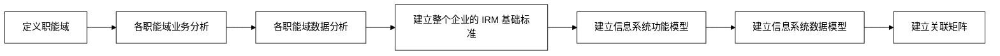
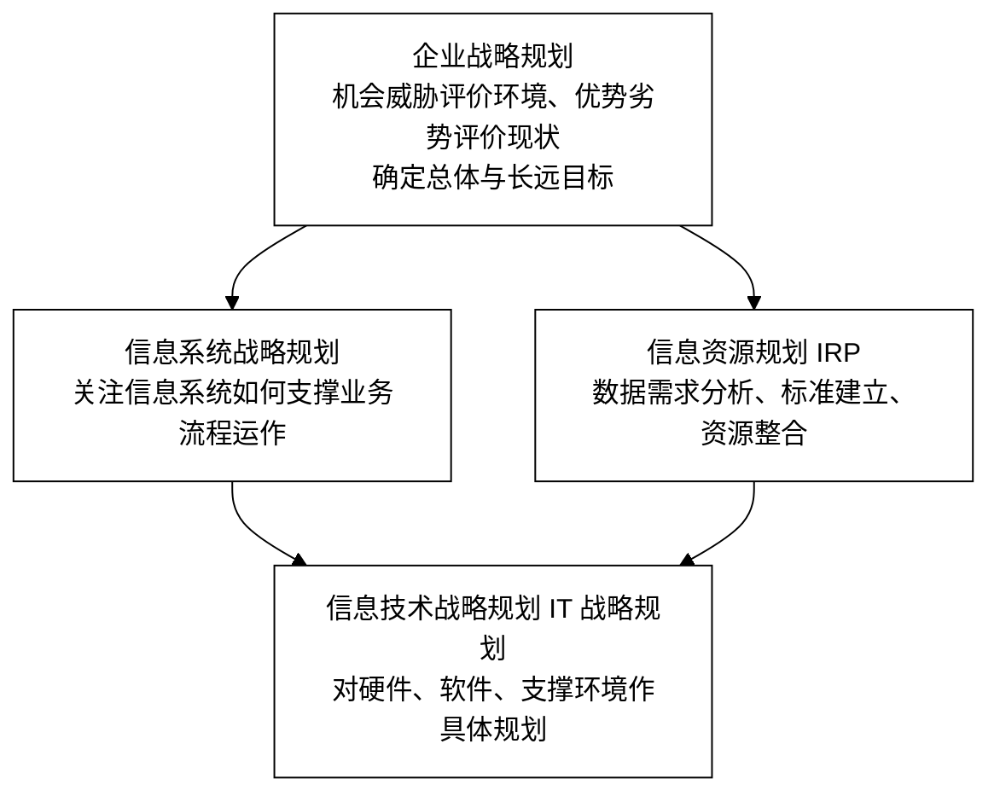
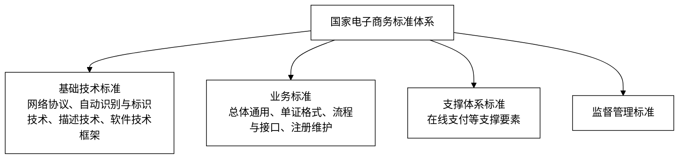

# 系统分析师｜第6章 企业信息化（备考讲义＋章节自测题）

> **教材依据**：《系统分析师教程（第2版）》第6章《企业信息化》（共8节：6.1 企业信息化概述｜6.2 信息资源管理｜6.3 企业信息化规划｜6.4 企业信息系统｜6.5 电子商务｜6.6 电子政务｜6.7 业务流程重组｜6.8 企业应用集成）。第1版对应章为《第7章 企业信息化战略与实施》，**两版节号不同构**：第1版 7.1 的企业信息化定义与方法说明在第2版 6.1 重构保留，国家信息化体系六要素则删除；第1版 7.3 信息系统开发方法、7.4 信息系统战略规划方法、7.5 企业资源规划和实施三个独立节，在第2版分别降为 6.4.9、6.3.3、6.3.4；第1版 7.6 信息资源管理对应第2版 6.2、第1版 7.7 企业信息系统对应第2版 6.4；第1版 7.7.8 电子商务脱离原节并拆分为第2版独立节 6.5 及其 6.5.1「电子商务的类型」、6.5.2「电子商务的标准」，是新设编号而非全新主题；第1版 7.8.1 政府职能、7.11 首席信息官在第2版删除。教材外内容仅「国家信息化体系六要素」一项以【第1版补充】补回，其余无教材外补充。
>
> **考纲定位说明**：2024版考纲科目一「系统分析师综合知识」第4条 企业信息化基础知识（4.1 企业信息化概述｜4.2 信息资源管理｜4.3 企业信息化规划｜4.4 企业信息系统｜4.5 电子商务｜4.6 电子政务｜4.7 业务流程重组｜4.8 企业应用集成），与教材第2版第6章 6.1～6.8 各节一一对应；考纲二级子项在教材本章均有对应小节或原文（含 6.3.3 末「规划方法的选择」、6.3.4「ERP 开发方法与实施方法」），无「考纲有、教材无」的空缺。
>
> **考试形式**：上午综合知识单选题（以概念辨析与层次识认为主，本章历年无数值计算题）；2021年以后真题近年频次窗（2024上～2026上，5场）约37道/5场，为同期科目一题量居前的章节，但无考点族5场全中（信息资源管理 IRM 6道/3场、企业信息化规划 7道/3场、ERP 4道/4场、CRM/SCM/PDM/PLM 4道/3场、知识管理 2道/2场、电子商务 3道/3场均属中频）；案例分析科目「企业应用集成」方向近年频次窗0题组，按累计口径（2021上～2026上，8场）为1题组（2021上试题四，选答）；论文无论文主题，非论文领域。
>
> 标签：系统分析师、上午题、企业信息化、信息资源管理、信息化规划、BSP、ERP、CRM、SCM、知识管理、商业智能、电子商务、电子政务、BPR、企业应用集成、备考

[TOC]

## 章节结构对照与来源标注

> 本讲义为《系统分析师教程（第2版）》第6章《企业信息化》的学习讲义，模块顺序与教材 6.1～6.8 保持一致；本章知识点几乎全部来自教材第2版，仅「国家信息化体系六要素」一项为第1版补充（第2版删除但2024上仍有命题，见「⚠️ 不包含」源①第①项）。

| 讲义模块 | 对应教材第2版章节 | 内容性质 | 备考要求 |
|---|---|---|---|
| 模块1 企业信息化概述 | 6.1 企业信息化概述 | 教材＋第1版补充 | 掌握：企业信息化的内涵与目标、五种常用企业信息化方法；了解：国家信息化体系六要素（第1版补充，低频降档，仅概念识记） |
| 模块2 信息资源管理 | 6.2 信息资源管理 | 教材 | 掌握：IRM 的内容与三主题、信息资源分类三维度、IRM 五大基础标准、IRP 七步骤与业务主线/数据主线；了解：信息资源网建设 |
| 模块3 企业信息化规划 | 6.3 企业信息化规划 | 教材 | 掌握：信息化规划四个层次与依赖关系、信息化规划与企业战略的三种关系、BITA 与 EITA、ISSP 三阶段八种方法、ERP 概念与作用/功能/开发/实施 |
| 模块4 企业信息系统 | 6.4 企业信息系统 | 教材 | 掌握：CRM、SCM、知识管理、商业智能 BI；了解：PDM、PLM、企业门户、决策支持系统、信息系统开发方法 |
| 模块5 电子商务 | 6.5 电子商务 | 教材 | 掌握：电子商务的类型、国家电子商务标准体系、电子商务技术五大类；了解：电子商务的特征与优势 |
| 模块6 电子政务 | 6.6 电子政务 | 教材 | 了解：电子政务业务模型三领域与三种信息流、四种应用模式、实施的过程模式 |
| 模块7 业务流程重组 | 6.7 业务流程重组 | 教材 | 了解：BPR 的四个核心内容与三项原则、BPR 的两种实施方法、基于 BPR 的信息系统规划五步骤 |
| 模块8 企业应用集成 | 6.8 企业应用集成 | 教材 | 了解：传统 EAI 的五个层次、事件驱动架构 EDA |

> 教材第2版第6章章节结构（按教材原文核读）：6.1 企业信息化概述（无子节，节下直接列出五种常用企业信息化方法）｜6.2 信息资源管理（6.2.1 信息资源管理概述、6.2.2 规范与标准、6.2.3 信息资源规划、6.2.4 信息资源网建设）｜6.3 企业信息化规划（6.3.1 信息化规划的内容、6.3.2 信息化规划与企业战略规划、6.3.3 信息系统战略规划方法、6.3.4 企业资源规划和实施）｜6.4 企业信息系统（6.4.1 客户关系管理、6.4.2 供应链管理、6.4.3 产品数据管理、6.4.4 产品生命周期管理、6.4.5 知识管理、6.4.6 商业智能、6.4.7 企业门户、6.4.8 决策支持系统、6.4.9 信息系统开发方法）｜6.5 电子商务（6.5.1 电子商务的类型、6.5.2 电子商务的标准、6.5.3 电子商务的特征、6.5.4 电子商务的优势、6.5.5 电子商务技术）｜6.6 电子政务（6.6.1 电子政务的模式、6.6.2 电子政务的实施）｜6.7 业务流程重组（6.7.1 BPR 概述、6.7.2 BPR 的实施、6.7.3 基于 BPR 的信息系统规划）｜6.8 企业应用集成（6.8.1 传统企业应用集成、6.8.2 事件驱动的企业应用集成）。

> ⚠️ 教材第2版第6章**不包含**（两源核查）：**源①**（对照第1版第7章《企业信息化战略与实施》逐节核对）——①国家信息化体系六要素（第1版 7.1：信息资源、信息网络、信息技术应用、信息产业、信息化人才、信息化政策与法规和标准规范）：第1版7.1的企业信息化定义与方法说明已在第2版6.1重构保留，六要素内容则删除；2024上第10题仍以「信息网络三网融合」命题，讲义以【第1版补充】在模块1补回并按低频降档处理；②电子政务的政府职能（第1版 7.8.1）：第2版删除，2021年以后真题无检出，不收录；③首席信息官（第1版 7.11：CIO 的职责、素质要求与地位）：第2版删除，2021年以后真题无检出，不收录。**源②**（对照本章考纲第4条 4.1～4.8 二级子项与教材第2版第6章全部小节）：无「考纲有子项、教材无对应小节或原文」的情形。

> 说明：第1版第7章与第2版第6章**节号不同构**，仅按编号对照会造成错位（例如第1版 7.6 信息资源管理对应第2版 6.2 而不是 6.6，第1版 7.4 信息系统战略规划方法对应第2版 6.3.3），复习时应当按标题内容而不是编号查阅；本讲义「对应教材第2版章节」列一律取第2版编号。

---

## 模块1：企业信息化概述（教材6.1）【教材＋第1版补充】

**前置说明**：本模块对应教材第2版第6章 **6.1 企业信息化概述**（该节无子节，节下直接列出五种常用企业信息化方法），对应考纲 **4.1 企业信息化概述**（4.1.1 企业信息化方法）；教材原文为主，「国家信息化体系六要素」为第2版删除、按2021年以后仍有命题补回的【第1版补充】内容；适配上午综合选择题（概念辨析与层次识认）。

**模块优先级**：🟡 中频 —— 近年频次窗内本节位置共 2道/2场（2024上第10题、2025上第29题），按统一判据（2～4场＝中频）判中频；其中【第1版补充】部分因近年频次窗内仅1场检出，按低频降档处理。

**考情分析**（2021年以后真题）：近年频次窗（2024上～2026上，5场）2道/2场——2024上第10题（信息网络三网融合所指的三类网络，源自第1版国家信息化体系六要素）、2025上第29题（常见的企业信息化方法包括哪些）。其中 2025上第29题在上游总览中登记于「企业信息化规划」族，本讲义按教材位置（企业信息化方法著于 6.1）归入本模块。核心考点：五种常用企业信息化方法的辨识、「企业信息化方法 ≠ 信息系统建设方法」的层次区分。

### 1.1 核心知识点精讲

#### 1.1.1 企业信息化的内涵与目标（教材6.1）【教材｜掌握】

- **企业信息化**：企业以**业务流程的优化和重构**为基础，在一定的深度和广度上利用计算机技术、网络技术和数据库技术，控制和管理企业生产经营活动中的各种信息，实现企业内、外部信息的共享和有效利用，以提高企业的经济效益和市场竞争力。
- **技术视角的本质**：企业运用信息技术，进行**隐含知识的挖掘和编码化**，进行业务流程的管理。
- **涉及范围**：企业信息化涉及对管理理念的创新、管理流程的优化、管理团队的重组和管理手段的革新等问题。
- **三个基本认识**（教材原文要点）：
  1. 是**系统工程**而不是单元技术的改造——它涉及企业所处的整个「生态系统」，个别部门或部分业务的信息化不能代表整个企业的信息化；
  2. 是**不断发展和完善的过程**——随管理理念和信息技术的发展而发展，是一个螺旋式上升的过程；
  3. **企业信息化方法 ≠ 信息系统建设方法**——后者是一个具体信息化项目的开发方法，前者是整个企业实现信息化的方法，**前者比后者层次要高、涉及面要广**。

> 记忆：信息化＝「流程重构＋技术三大件（计算机/网络/数据库）」；落到企业是系统工程、落到项目是建设方法，两者层次不同、范围不同。

#### 1.1.2 常用企业信息化方法（5种）（教材6.1）【教材｜掌握】

| 方法 | 要点 |
|---|---|
| **业务流程重组方法** | 企业必须重新审视生产经营过程，利用信息技术对组织结构与工作方法进行「彻底的、根本性的」重新设计；已成为企业信息化的重要方法 |
| **核心业务应用方法** | 企业必须有自己的核心业务，否则必被市场淘汰；围绕核心业务应用信息技术是很多企业信息化成功的秘诀 |
| **信息系统建设方法** | 对大多数企业，信息化的重点和关键是建设好信息系统，是最具普遍意义的企业信息化方法 |
| **主题数据库方法** | 主题数据库＝面向企业**业务主题**（核心业务）的数据库 |
| **资源管理方法** | 管理好企业资源是管理的永恒主题；资源规划与管理方法成为企业信息化的重要方法 |

> 记忆：五法＝「重组流程、抓住核心、建好系统、主题建库、管好资源」。考题常把「快速原型」「结构化方法」等**信息系统开发方法**混进来当干扰项——它们属于信息系统建设层面的方法，不在本五法之列。

#### 1.1.3 国家信息化体系六要素【第1版补充｜掌握】

> 收录依据：该内容为第1版 7.1 原著；第2版6.1保留了企业信息化定义与方法说明，但删除了国家信息化体系六要素。2021年以后真题仍有命题（2024上第10题考查信息网络所指的「三网融合」），故以【第1版补充】补回；近年频次窗内仅1场检出，按低频降档处理，仅要求概念识记。

- **六要素**：信息资源、信息网络、信息技术应用、信息产业、信息化人才、信息化政策与法规和标准规范。
- **信息网络**：信息资源开发利用的基础设施，包括**电信网、广播电视网和计算机网络**；三网功能有所交叉又互为补充，在国家信息化过程中将逐步实现**三网融合**，并最终做到三网合一。
- **信息资源**：其开发和利用是国家信息化的**核心任务**，是衡量国家信息化水平的重要标志。
- **信息技术应用**：把信息技术广泛应用于经济和社会各个领域，是信息化体系六要素中的**龙头**，是国家信息化建设的主阵地。
- **信息化人才**：人才是信息化的成功之本，合理的**人才结构**是信息化人才的核心与关键。

> 注意：本小节只需记住六要素的名称与「三网」的具体所指，其余要素在两版教材第6章均无进一步展开，不作深挖。

#### 1.1.4 典型易错点（企业信息化内涵与方法辨识）

1. 企业信息化以**业务流程的优化和重构**为基础，不是「先买设备再改流程」【🟡中频】；
2. **企业信息化方法与信息系统建设方法层次不同**：前者面向整个企业（层次高、涉及面广），后者面向具体项目（层次低、范围具体），二者不可互换【🟡中频】；
3. 五种信息化方法中，「主题数据库方法」的主题是**业务主题**（面向企业核心业务），不是面向某个应用系统【🟡中频】；
4. **信息化并非某个部门的事**：个别部门或部分业务的信息化不能代表整个企业的信息化【🟡中频】。

### 1.2 典型例题

**例题1【企业信息化方法辨识】**

下列方法中，不属于教材所列常用企业信息化方法的是（ ）
A. 业务流程重组方法 B. 核心业务应用方法 C. 主题数据库方法 D. 快速原型方法

> 【解析】教材列出的五种常用企业信息化方法是业务流程重组、核心业务应用、信息系统建设、主题数据库、资源管理；快速原型（原型化）属于**信息系统开发方法**，是具体信息化建设过程中的开发方法，不在企业信息化方法之列。二者的层次区别是本模块的固定考点。
> 【答案】D

**例题2【信息化方法 ≠ 信息系统建设方法】**

关于企业信息化方法与信息系统建设方法的关系，下列说法正确的是（ ）
A. 二者含义相同，只是称谓不同 B. 前者面向整个企业实现信息化，层次更高、涉及面更广 C. 后者包含前者，是前者的上位概念 D. 前者只适用于大型企业集团

> 【解析】教材原文明确指出：企业信息化方法并不等同于信息系统建设方法，后者是一个具体的信息化项目的开发方法，而前者是整个企业实现信息化的方法，前者比后者的层次要高、涉及面要广。A、C 颠倒了二者的关系，D 无教材依据。
> 【答案】B

### 1.3 课后习题

**习题1【五种信息化方法匹配】**

某企业把信息技术的应用重点放在其核心产品线的生产与销售上，逐步形成对手难以模仿的竞争力。这一做法主要体现的企业信息化方法是（ ）
A. 业务流程重组方法 B. 核心业务应用方法 C. 主题数据库方法 D. 资源管理方法

> 【解析】教材原文：任何一个企业要在市场竞争中生存并发展都必须有自己的核心业务，围绕核心业务应用信息技术是很多企业信息化成功的秘诀，对应「核心业务应用方法」。业务流程重组强调对组织结构与工作方法的彻底性重新设计，主题数据库强调按业务主题组织数据，资源管理强调对企业资源的规划与管理。
> 【答案】B

**习题2【企业信息化的系统性】**

关于企业信息化，下列说法正确的是（ ）
A. 个别部门或部分业务的信息化即可代表整个企业的信息化 B. 企业信息化建设是一项单元技术的改造 C. 企业信息化是一项系统工程，涉及企业所处的整个「生态系统」 D. 企业信息化方法等同于信息系统建设方法

> 【解析】教材原文要点：企业信息化建设是一项系统工程，而不是单元技术的改造，它涉及企业所处的整个「生态系统」，个别部门或部分业务的信息化并不能代表整个企业的信息化，故 A、B 错、C 对；企业信息化方法并不等同于信息系统建设方法，前者比后者层次要高、涉及面要广，故 D 错。
> 【答案】C

---

## 模块2：信息资源管理（教材6.2）【教材｜掌握】

**前置说明**：本模块对应教材第2版第6章 **6.2 信息资源管理**（6.2.1 信息资源管理概述、6.2.2 规范与标准、6.2.3 信息资源规划、6.2.4 信息资源网建设），对应考纲 **4.2 信息资源管理**（4.2.1～4.2.4）；全部为教材原文，适配上午综合选择题（概念辨识与归类判断）。

**模块优先级**：🟡 中频 —— 近年频次窗内本模块 6道/3场（2025上、2025下、2026上），按统一判据（2～4场＝中频）判中频，是本章近年命题最集中的一级节之一。

**考情分析**（2021年以后真题）：近年频次窗（2024上～2026上，5场）6道/3场（按上游总览登记的 IRM 族口径）——2025上第32～33题（数据元素标准、用户视图标准）、第34～36题（信息资源分类三维度）、2025下第45题（数据元素标准）、第46题（信息分类编码标准）、第47题（概念数据库标准）、2026上第49题（IRP 七步骤的顺序）；2026上第50题同样考 IRP（描述功能与数据关系的工具＝关联矩阵/C-U 矩阵），按上游口径计入「企业信息化规划」族，故未计入本模块数内。核心考点：IRM 五大基础标准的一一对位、信息资源分类三维度、IRP 七步骤与两条主线。

### 2.1 核心知识点精讲

#### 2.1.1 信息资源管理概述（教材6.2.1）【教材｜掌握】

- **三大战略资源**：信息和材料、能源共同构成国民经济和社会发展的三大战略资源；信息资源与另两者主要区别在于——可开发的材料和能源是有限的、不可再生的、不可共享的，开发利用会产生污染，而信息资源是**无限的、可再生的、可共享的**，其开发利用还会减少材料和能源的消耗。
- **IRM 的目的**：通过企业内外信息流的畅通和信息资源的有效利用，提高企业的效益和竞争力；IRM 是企业管理的必要环节，应该纳入企业管理的预算。
- **IRM 的两大内容**（高频对位题）：

| 内容 | 关注点 |
|---|---|
| **数据资源管理** | 强调对**数据的控制**（维护和安全） |
| **信息处理管理** | 关心企业管理人员**如何获取和处理信息**（流程和方法），强调企业中信息资源的重要性 |

- **数据管理 ≠ 数据库管理**：数据库管理仅仅负责物理数据库的设计、实现、安全性和维护工作；而**数据管理**在于确定数据规划、数据应用、数据标准、数据内容、数据范围等。**IRM 的基础是数据管理**。
- **IRM 基本内容的三个主题**：
  1. **资源管理的方向和控制**——要从整个企业管理的层面来分析资源的管理；指导方针是数据可共享、数据处理机构提出应用项目、资源的有效性；
  2. **建立企业信息资源指导委员会**——负责制定方针政策，控制和监督信息资源功能的实施；
  3. **建立信息资源的组织机构**——从事数据的计划和控制、数据获取以及数据的经营管理，并包括企业应用系统的开发；该机构应由企业的一位**副总经理**担任领导。
- **信息资源分类的三个维度**：

| 维度 | 要点 |
|---|---|
| **管理维度** | 一般有两种情况：一是**专门的业务部门**所采用的分类体系（如地震信息资源包括测震、前兆、强震动、应急等主要分类）；二是**综合部门**从信息资源登记和管理角度提出的分类（如部分地方政府信息化管理部门制定的政务信息资源分类方式） |
| **来源维度** | 按照信息资源提供部门来设置信息资源的**一级、二级乃至三级类目**；优势是极大简化分类赋值的工作量（一次设定可复用），且使用者不必学习特定分类体系，查找更简单直接 |
| **应用主题维度** | 最复杂。同一信息资源根据服务和应用的目标不同会有不同分类方式（如全国行政区划信息，基础测绘部门划分为基础性信息资源，宏观经济管理部门则可能划分为辅助性信息资源）；有多少不同的应用需求就有多少相应的分类方式 |

- **分类三原则与目录**：信息资源分类应遵循**简洁、独立和可操作**的原则；**IRM 的起点和基础是建立信息资源目录**。不同分类体系之间往往需要**相互转化和映射**，而不是重新进行分类赋值。

> 记忆：IRM＝「管数据（控制·维护·安全）＋管流程（获取·处理方法）」；三个主题＝「方向控制、指导委员会、组织机构」；分类三维＝「谁管（管理）、谁给（来源）、给谁用（应用主题）」。

#### 2.1.2 规范与标准（IRM 五大基础标准）（教材6.2.2）【教材｜掌握】

> IRM 基础标准是指那些决定信息系统质量、进行 IRM 的最基本的标准，制定基础标准是 IRM 的关键环节。

| 基础标准 | 定义与要点 |
|---|---|
| **数据元素标准** | 数据元素是最小的不可再分的信息单位，是一类数据的总称，是数据对象的抽象；细分为**命名标准、标识标准和一致性标准**。不重视数据元素标准化会导致系统中数据名称庞杂混乱（如「职工姓名／员工姓名／职员姓名」混用） |
| **信息分类编码标准** | 根据信息内容的属性或特征，将信息按一定的原则和方法进行区分和归类，并建立起一定的分类系统和排列顺序；是信息资源标准中**最基础的标准**。典型的 ABC 法：A 类＝系统中不单独设立编码表、反映基本表中的信息分类编码对象（身份证号、设备编码）；B 类＝系统中单独设立编码表（职称编码、设备配件编码）；C 类＝码表短小且使用频率很大、统一设在编码库管理（人的性别、文化程度） |
| **用户视图标准** | 用户视图是一些数据元素的集合，反映**最终用户**对数据实体的看法，是数据在系统外部而不是内部的表象，是系统的输入或输出的媒介或手段；主要包括企业管理的**表单、报表、屏幕数据格式**等；规范化管理包括用户视图名称、标识和组成的管理 |
| **概念数据库标准** | 概念数据库是最终用户对数据存储的看法，是对用户信息需求的综合概括；标准包括**数据库名称、标识、主关键字和数据内容列表**；概念数据＝主题数据库的概要信息，是经过 SDP（战略数据规划）工作之后完成的 |
| **逻辑数据库标准** | 逻辑数据库是系统分析与设计的基础，是对概念数据库的进一步分解和细化；一个逻辑主题数据库由一组规范化的**基本表**构成 |

> 记忆口诀（对位必背）：**数据元素＝命名/标识/一致性；分类编码＝ABC 三类码表；用户视图＝表单/报表/屏幕格式；概念库＝用户看法的概要（主题库概要）；逻辑库＝规范化基本表。**2025上与2025下连续以「标准→内容」的形式命题。

#### 2.1.3 信息资源规划 IRP（教材6.2.3）【教材｜掌握】

- **定义**：信息资源规划（Information Resource Planning, IRP）是信息化建设的基础工程，是指对企业生产经营活动所需要的信息，在**产生、获取、处理、存储、传输和利用**等方面进行全面的规划。
- **基本认识**：IRP 强调将**需求分析与系统建模**紧密结合起来——需求分析是系统建模的准备，系统建模是用户需求的定型和规范化表达。
- **IRP 七步骤**（顺序题高频）：

> 记忆：七步＝「定域→业分→数分→立标准→功能模→数据模→关联阵」。第三步**数据分析**之后紧接着的是**建立 IRM 基础标准**（2026上第49题考点），不要误记为「建立数据模型」。

- **两条主线**：
  - **业务主线**（前三个子主题）：①企业的**职能域模型**（职能域＝企业的主要业务活动领域，如工程、市场、科研、销售）；②**识别每个职能域的业务过程**（先命名定义，再找出与组织结构的联系，业务过程具有独立性）；③**列出每个业务过程的各项业务活动**（业务活动是功能分解后最基本的、不可再分解的最小功能单元，须具有可执行性、独立性和清晰的时空界限）；④**业务模型的复查与确认**——形成「**职能域—业务过程—业务活动**」三层结构。
  - **数据主线**：①**用户视图的采集、整理和分析**（数据需求分析：对用户视图分类、逐项登记其组成，并用 DFD 对所有数据流进行分析，完成登记与数据流量化分析）；②**建立基本表和主题数据库**（系统数据建模：以信息流程梳理为手段明确信息资源的分布，构建数据模型）。

#### 2.1.4 信息资源网建设（教材6.2.4）【教材｜了解】

- **演变脉络**：信息资源的开发和应用是一个从低级到高级、从局部到全局的过程；信息资源网之前的模式主要是**点对点的通信**和**信息通信网**（利用国家公用电信平台，主要是公用电话网、公用分组交换网和数字数据网等构筑的区域性或专业性通信网）。
- **功能差别**：信息通信网主要是将信息以某种媒体形式**进行传输**；信息资源网则包括了从**信息采集和加工，直至最终利用**的众多环节。
- **建设内容**：数据库和数据仓库的建设、信息资源网的数据分布、分布式数据库的建设。

#### 2.1.5 典型易错点（IRM 标准与 IRP 主线）

1. **IRM＝数据资源管理＋信息处理管理**：前者「强调对数据的控制（维护和安全）」，后者「关心管理人员如何获取和处理信息（流程和方法）」，两句话须一一对位【🟡中频】；
2. **数据元素标准 ≠ 信息分类编码标准**：前者管命名/标识/一致性，后者管分类方法与编码规则（ABC 法）【🟡中频】；
3. **用户视图是「最终用户对数据实体的看法」**，主要载体是表单、报表、屏幕数据格式，不要与数据库三级模式中的「外模式」混为一谈【🟡中频】；
4. **概念数据库＝最终用户看法的概要（主题库的概要信息）**，**逻辑数据库＝规范化基本表的集合**；前者综合概括、后者分解细化【🟡中频】；
5. **IRP 七步中「数据分析」之后是「建立 IRM 基础标准」**，不是直接建立数据模型；末位是「建立关联矩阵」【🟡中频】；
6. **IRM 的分类三原则是简洁、独立、可操作**；不同分类体系之间需要转化与映射，而不是重新赋值【🟡中频】。

### 2.2 典型例题

**例题1【IRM 基础标准·数据元素】**

信息资源管理的基础标准中，包含命名标准、标识标准和一致性标准的是（ ）
A. 数据元素标准 B. 信息分类编码标准 C. 用户视图标准 D. 概念数据库标准

> 【解析】教材原文：数据元素是最小的不可再分的信息单位，是一类数据的总称，是数据对象的抽象；数据元素标准又可分为命名标准、标识标准和一致性标准。信息分类编码标准以 ABC 法区分编码对象；用户视图标准主要包括企业管理的表单、报表、屏幕数据格式；概念数据库标准包括数据库名称、标识、主关键字和数据内容列表。2025上第32～33题、2025下第45题同型。
> 【答案】A

**例题2【用户视图标准】**

信息资源管理基础标准中，以企业管理的表单、报表、屏幕数据格式等为主要内容的是（ ）
A. 数据元素标准 B. 信息分类编码标准 C. 用户视图标准 D. 逻辑数据库标准

> 【解析】用户视图是一些数据元素的集合，反映最终用户对数据实体的看法，是数据在系统外部而不是内部的表象，是系统的输入或输出的媒介或手段；主要包括企业管理的表单、报表、屏幕数据格式等。逻辑数据库标准的内容是由概念数据库分解细化得到的规范化基本表。2025上第33题即此对位。
> 【答案】C

**例题3【信息资源分类维度】**

从信息资源提供部门出发，将信息资源设置一级、二级乃至三级类目的分类方式，属于（ ）
A. 管理维度 B. 来源维度 C. 应用主题维度 D. 技术维度

> 【解析】三维度定位：①管理维度＝从信息资源建立的最初目的、从业务管理角度分类（含专门业务部门分类体系与综合部门登记管理分类两种情况）；②**来源维度＝按信息资源提供部门设置一、二乃至三级类目**；③应用主题维度＝按服务与应用目标不同而不同，是最复杂的分类。2025上第34～36题同型。
> 【答案】B

**例题4【IRP 关键步骤顺序】**

信息资源规划过程中，在「各职能域数据分析」之后通常应进行的工作是（ ）
A. 定义职能域 B. 建立整个企业的 IRM 基础标准 C. 建立信息系统数据模型 D. 建立关联矩阵

> 【解析】IRP 七步骤依次为：定义职能域 → 各职能域业务分析 → **各职能域数据分析 → 建立整个企业的 IRM 基础标准** → 建立信息系统功能模型 → 建立信息系统数据模型 → 建立关联矩阵。第三步之后是第四步；逻辑上先确定全企业统一的数据标准，再做功能与数据建模。2026上第49题即此考点。
> 【答案】B

**例题5【概念数据库层级】**

信息资源管理中，从企业业务视角描述数据库的整体结构、不涉及具体技术实现的数据库层级是（ ）
A. 用户视图 B. 概念数据库 C. 逻辑数据库 D. 物理数据库

> 【解析】教材原文：概念数据库是最终用户对数据存储的看法，是对用户信息需求的综合概括，不经由具体技术实现表达；逻辑数据库是对概念数据库的进一步分解和细化，由一组规范化的基本表构成，已进入系统分析与设计的技术层面。2025下第47题即此考点。
> 【答案】B

### 2.3 课后习题

**习题1【IRM 两大内容】**

信息资源管理包括数据资源管理和信息处理管理，其中「强调对数据的控制（维护和安全）」的是（ ）
A. 数据资源管理 B. 信息处理管理 C. 两者都不是 D. 两者共同关注的内容

> 【解析】IRM 包括数据资源管理和信息处理管理，前者强调对数据的控制（维护和安全），后者关心企业管理人员如何获取和处理信息（流程和方法），并且强调企业中信息资源的重要性。
> 【答案】A

**习题2【信息资源分类】**

下列关于信息资源三个分类维度的说法，正确的是（ ）
A. 管理维度按信息资源的提供部门设置一至三级类目 B. 来源维度的最大优势是简化分类赋值工作量、便于复用 C. 应用主题维度最简单，通常只需采用一种分类方式 D. 三个维度彼此独立、不存在互相转化的需求

> 【解析】按提供部门设置一至三级类目是**来源维度**而不是管理维度，A 错；**应用主题维度最复杂**，同一信息资源按不同服务目标可有不同分类方式，C 错；不同信息资源分类体系之间往往需要相互**转化和映射**，D 错。来源维度的优势正在于简化分类赋值工作量、便于复用，使查找更加简单直接。
> 【答案】B

**习题3【IRP 数据主线】**

下列工作中，属于信息资源规划「数据主线」的是（ ）
A. 识别每个职能域的业务过程 B. 列出每个业务过程的业务活动 C. 用户视图的采集、整理和分析 D. 业务模型的复查与确认

> 【解析】A、B、D 均属**业务主线**（建立「职能域—业务过程—业务活动」三层结构的业务模型并复查确认）；数据主线的工作包括用户视图的采集、整理和分析（数据需求分析）与建立基本表和主题数据库（系统数据建模）。
> 【答案】C

---

## 模块3：企业信息化规划（教材6.3）【教材｜掌握】

**前置说明**：本模块对应教材第2版第6章 **6.3 企业信息化规划**（6.3.1 信息化规划的内容、6.3.2 信息化规划与企业战略规划、6.3.3 信息系统战略规划方法、6.3.4 企业资源规划和实施），对应考纲 **4.3 企业信息化规划**（4.3.1～4.3.4）；全部为教材原文，适配上午综合选择题与案例分析背景。

**模块优先级**：🟡 中频 —— 模块源出的各考点族（企业信息化规划 7道/3场、信息系统战略规划方法 3道/2场、ERP 4道/4场、信息化规划与企业战略集成 1道/1场）按统一判据均为中频，故模块整体判中频；合并四个子节后近年频次窗5场均有检出，是本章命题最密集的一级节。

**考情分析**（2021年以后真题）：近年频次窗（2024上～2026上，5场）约14道/5场——2024上第26题（BITA 的性质）、2024下第10题（ERP 核心管理模块）、第27～28题（BSP 的基础与目标）、2025上第31题（ERP 不包括的模块）、2025下第13～14题（定义数据类的实体法与功能法）、第55题（整合核心业务流程的系统＝ERP）、2026上第4题与第16题（信息化规划与企业战略的三种关系）、第15题与第48题（战略集合转化法）、第30题（信息系统战略规划的内容）、第50题（描述功能与数据关系的工具＝关联矩阵）、第78题（一体化计划管理＝ERP）。核心考点：四个规划层次的依赖关系、三种发展阶段的对应表现、BITA 与 EITA、ISSP 三阶段八种方法的核心要点、ERP 概念与管理范围。

### 3.1 核心知识点精讲

#### 3.1.1 信息化规划的内容（教材6.3.1）【教材｜掌握】

- **为什么必须总体规划**：缺乏总体规划会造成信息系统林立、数据资源分散、数据收集成本高而质量低、各种系统相互孤立互不连通，从而形成**信息孤岛**；事后要把信息孤岛集成起来难度超乎寻常，甚至造成返工、从头重建。
- **信息化规划的定义**：信息化规划是企业信息化建设的**纲领和向导**，是信息系统设计和实施的前提和依据；以整个企业的发展目标和战略、各部门的目标与功能为基础，结合行业信息化实践与信息技术发展趋势，制定企业信息化远景、目标和发展战略。
- **四个层次及其依赖关系**（必考点）：

- **企业战略规划**：用机会和威胁评价现在和未来的环境，用优势和劣势评价企业现状，进而选择和确定企业的总体和长远目标，制定和抉择实现目标的行动方案。
- **信息系统战略规划**：关注**如何通过信息系统来支撑业务流程的运作**，进而实现企业的关键业务目标；重点在于对信息系统远景、组成架构、各部分逻辑关系进行规划。
- **信息技术战略规划（IT 战略规划）**：在信息系统战略规划的基础上，对支撑信息系统运行的硬件、软件、支撑环境等进行具体的规划，更关心技术层面的问题；四步骤＝**业务分析 → 检查当前的 IT 架构和信息系统 → 识别机会 → 选择方案**。
- **信息资源规划**：在以上规划的基础上，为开展具体的信息化建设项目而进行的数据需求分析、信息资源标准建立、信息资源整合工作（内容见模块2）。
- **信息化规划的具体内容**：明确发展目标和实施重点、成立领导机构、做好企业业务信息化需求分析、确定企业信息化不同发展阶段的投资预算、制定必要的促进企业信息化建设的规章制度；还应明确信息化实施效果评估的方法、信息化方案优化等措施。
- **业务流程重组的作用**：在信息化规划过程中需要充分发挥业务流程重组与信息系统之间相互促进的作用——通过先进信息系统的支持完成业务流程优化；反过来，通过业务流程重组和信息资源规划进一步促进信息化规划进程、指导信息系统的设计与实施。

> 记忆：**企规→信规→技规**自上而下层层落地，IRP 穿插其中做数据与标准底座；考题常问「信息系统战略规划关注什么」——答案是「如何支撑业务流程运作从而实现关键业务目标」，不要答成「如何选型硬件」。

#### 3.1.2 信息化规划与企业战略规划（教材6.3.2）【教材｜掌握】

**1）信息化战略与企业战略的关系（双向）**

- 一方面，随着信息技术的发展与普及，企业战略的实现已离不开信息技术和信息系统；信息、信息技术和信息系统作为一种资源已不再仅仅起着支撑作用，而是在**某种程度上决定企业战略**；
- 另一方面，离开企业战略去规划信息系统犹如建设海市蜃楼；企业信息化规划的价值源泉在于企业价值的实现、在于经营战略和实际业务的需要，即**信息化战略接受企业战略的指导**；
- 二者分别独立运行、缺乏协调和统一，会导致企业战略缺乏信息系统支撑、信息系统因缺少战略指导而无效或低效，这也是造成「**IT 黑洞**」的主要原因之一。

**2）信息化规划与企业战略规划的三种关系（阶段—表现对应题）**

| 阶段 | 表现 | 形成的信息系统结构 |
|---|---|---|
| **初级阶段** | 业务部门根据现有业务流程或管理需要直接提出信息化需求，IT 部门按照需求**分别独立实施**（如财务电算化、库房管理） | 完全基于企业组织与业务流程的结构，各个信息系统分别对应于特定部门或特定业务流程 |
| **中级阶段** | 企业制定了整体战略规划，业务部门根据企业战略对现有业务流程和组织结构**进行改进**，然后由不同业务部门分别提出需求，IT 部门分别独立实施 | 与**优化后**的组织结构和业务流程相适应 |
| **高级阶段** | 企业根据整体战略规划，**通盘考虑**各业务部门的信息化需求，制定整体的信息化战略，**统一规划、分步实施** | 由企业信息化战略统一指导，并与优化后的组织结构和业务流程相适应 |

> 记忆：初＝部门提需求·分散实施；中＝先优化流程·再分散实施；高＝统一规划·分步实施。分水岭是「有没有整体战略」与「是否整体统一规划」。

**3）信息化战略与企业战略的集成方法**

| 方法 | 全称 | 性质与要点 | 适用企业 |
|---|---|---|---|
| **BITA** | Business-IT Alignment（**业务与 IT 整合**） | **一种以业务为导向的、全面的 IT 管理咨询实施方法论**；主要步骤：评估和分析企业当前业务和 IT 不一致的领域 → 整理出企业的业务远景和未来战略 → **建立业务模型** → 提出达到未来目标的转变过程建议和初步计划 → 执行计划 | 信息系统不能满足当前管理中的业务需要、业务和 IT 之间总是有不一致的地方的企业 |
| **EITA** | Enterprise IT Architecture（**企业 IT 架构**） | 分析企业战略，帮助企业制定 IT 战略并指导投资决策；在技术、信息系统、信息、IT 组织和 IT 流程方面，帮助企业建立 IT 的原则规范、模式和标准，指出需要改进的方面并制订行动计划 | 现有信息系统和 IT 基础架构不一致、不兼容和缺乏统一的整体管理的企业 |

> 注意：BITA 与 EITA 有相同之处、甚至在某些领域有重叠，实践中需要根据实际情况选择其中一种方法，或者结合使用；2024上第26题即以「以业务为导向的、全面的 IT 管理咨询实施方法论」的定义直接设问 BITA。

#### 3.1.3 信息系统战略规划方法（教材6.3.3）【教材｜掌握】

- **ISSP 定义**：信息系统战略规划（Information System Strategic Planning, ISSP）是从企业战略出发，构建企业基本的信息架构，对企业内、外信息资源进行统一规划、管理与应用，利用信息控制企业行为，辅助企业进行决策，帮助企业实现战略目标。
- **三阶段演化与八种方法**：

| 阶段 | 核心 | 方法 |
|---|---|---|
| 第一阶段 | 以**数据处理**为核心，围绕职能部门需求 | **企业系统规划法 BSP**、**关键成功因素法 CSF**、**战略集合转化法 SST** |
| 第二阶段 | 以**企业内部管理信息系统**为核心，围绕企业整体需求 | **战略数据规划法 SDP**、**信息工程法 IE**、**战略栅格法 SG** |
| 第三阶段 | 综合考虑企业内、外环境，以**集成**为核心，围绕企业战略需求 | **价值链分析法 VCA**、**战略一致性模型 SAM** |

**1）企业系统规划法 BSP**（IBM 公司于20世纪70年代提出，主要用于大型信息系统的开发）

- **地位**：BSP 方法是**企业战略数据规划法和信息工程法的基础**；其目标是提供一个**信息系统规划**，用以支持企业短期的和长期的信息需求。
- **五条原则**：①信息系统必须支持企业的战略目标（BSP 可看作把企业战略目标转化为信息系统战略目标的转化过程）；②信息系统的战略应当表达出企业各个管理层次（战略计划层、管理控制层、操作控制层）的需求；③信息系统应该向整个企业提供**一致的信息**；④信息系统应该适应企业组织结构和管理体制的改变；⑤信息系统战略规划应当由总体信息系统结构中的**子系统开始实现**（自上而下的系统规划、自下而上地分步实现）。
- **四个基本步骤**：**定义管理目标 → 定义管理功能 → 定义数据分类 → 定义信息结构**。
- **准备工作**：确定系统规划的范围并成立**系统规划组 SPG**（要有企业领导用全部时间参加并指导，一般设秘书一名、若干调查小组、一个协调组和若干顾问）→ 收集数据（企业一般情况与现有系统情况，形成业务文档、技术文档和系统文档并评审）→ 制订计划（画出 PERT 图和甘特图，准备调查表和调查提纲）→ 开好介绍会（由最高层领导主持）。
- **定义企业过程**（BSP 的**核心**）：企业过程是企业资源管理所需要的、逻辑相关的一组决策和活动，定义企业过程可以作为识别信息系统的基础；涉及三类资源——**战略计划与管理控制、产品/服务、支持性资源**（基本的支持性资源有**材料、资金、设备和人员**4类），各按生命周期四阶段（产生、获得、服务、归宿）识别过程。

- **定义数据类**：以企业资源为基础，通过数据的类型识别出数据类；数据类型与信息生命周期（需求、分配、经营管理、获取）有关，一般分为**存档类（库存类）、事务类、计划类和统计类（综合类）**。两种基本方法：
  - **实体法**：首先列出**企业资源**（一般要列出 7～15 类资源），再列出一个**资源/数据（Resource/Data, R/D）矩阵**；
  - **功能法**：以**已识别的企业过程**为基础，分析每个过程的**输入/输出数据类**，再与 R/D 矩阵参照调整；
  - 二者一般采用分别进行、**互相参照**的办法，最终归纳出数据类。

> 记忆：BSP＝IBM·七〇年代·大型系统；四步＝「目标→功能→数据分类→信息结构」；核心是**识别企业过程**（不是定义数据类）；定义数据类中，**实体法先看企业资源（R/D 矩阵）、功能法先看企业过程（输入输出数据类）**，此为 2025下第13～14题的考点。

**2）关键成功因素法 CSF**：分析找出使企业获得成功的关键因素，并围绕这些因素确定系统的需求与管理目标；与数据流程图衔接比较好，但一般最有利的只是在**确定管理目标**上。

**3）战略集合转化法 SST**：由 William King 于1978年提出；把整个组织看成由**使命、目标、战略和其他战略变量**（如管理水平、发展趋势、环境约束）组成的**信息集合**，再将其**转化为信息系统战略集合**。特点：反映各种人的要求并给出按这种要求的分层，能保证目标**比较全面、疏漏较少**，但在**突出重点方面不如 CSF 方法**。2026上第15题与第48题两次直问此法。

**4）战略数据规划法 SDP**：詹姆斯·马丁（James Martin）认为，企业要搞信息化，首要任务应该是在企业战略目标的指导下做好战略数据规划；核心规律是——**数据类和数据之间内在的联系是相对稳定的，而对数据的处理、业务流程和步骤是经常变化的**。工作由**核心设计小组 CDG** 领导；方法采用**自顶向下进行全局规划、自底向上进行详细设计**（全局规划一般应在6个月内完成）；一个大型企业大约可有 **30个职能和150～300个可执行的过程，每个过程包括5～30个活动**；企业中通常有 **3～6个关键成功因素**。核心产物是**主题数据库**，其特征为面向业务主题、信息共享（对各应用系统「自建自用」数据库的否定）、一次一处输入等。

**5）信息工程法 IE**：以数据为中心，把数据作为一种资源来管理，强调**总体数据规划**的先导作用；在用其与 SAM 作基准比较时，被归为「保证企业战略、业务流程和信息系统架构三者一致」的代表方法。

**6）战略栅格法 SG**：按信息系统对企业战略的影响，把信息系统划分为**战略型、转变型、工厂型、支持型**四类，据此配置资源；在保证企业战略与信息系统战略一致的方法之列。

**7）价值链分析法 VCA**：Michael E. Porter 于1989年提出的一种信息系统规划方法；视企业为一系列的输入、处理与输出的活动序列集合，每个活动都有可能相对于最终产品产生**增值行为**，从而增强企业的竞争地位；信息技术和关键业务流程的优化是实现企业战略的关键。

**8）战略一致性模型 SAM**：John Handerson 于1994年提出，也称为**战略对应模型**，帮助企业检查企业战略与信息基础架构之间的一致性；由**企业经营战略、组织与业务流程、信息系统战略、IT 基础架构**四大领域构成，并划分为外部领域（企业面临的外部竞争环境，如产品或 IT 市场）与内部领域（企业组织结构、整体信息架构和业务流程）两大部分。2021上第24题考过四大领域的构成。

**9）规划方法的选择**（三种一致性取向）：本节介绍的8种方法各有侧重面，都只能覆盖一部分的一致性目标，并且有相互重叠的地方。将 SAM 与其余7种方法进行基准比较，大致可将这7种方法分为三类：
- ①保证**业务流程与信息系统架构**之间的一致：**BSP 和 SDP**；
- ②保证**企业战略与信息系统战略**之间的一致：**SST、SG、CSF 和 VCA**；
- ③保证**企业战略、业务流程和信息系统架构三者**之间的一致：以 **IE 方法**为代表。

**10）CSB 方法**：在信息系统战略规划的实践中，往往把 CSF、SST 和 BSP 三种方法结合起来使用，统称为 CSB 方法——先用 **CSF 方法确定企业目标**，然后用 **SST 方法补充完善企业目标并将其转化为信息系统目标**，接着用 **BSP 方法校核两个目标并确定信息系统结构**。优点是这样补充了单个方法的不足；缺点是使整个方法过于复杂，削弱了单个方法的灵活性。

#### 3.1.4 企业资源规划和实施（教材6.3.4）【教材｜掌握】

- **企业资源**：支持企业业务活动和战略运营的事物，既包括常说的人、财和物，也包括**信息资源**；既包括企业内部资源，也包括企业的各种外部资源。可归纳为三个「流」：**物流、资金流和信息流**。
- **ERP 定义**：企业资源规划（Enterprise Resource Planning, ERP）是指建立在信息技术基础上，以系统化的管理思想为企业提供决策和运营手段的管理平台；ERP 系统是将企业所有资源进行集成整合，并进行全面、一体化管理的信息系统。

**理解 ERP 概念的三个角度**：

| 角度 | 要点 |
|---|---|
| **管理思想** | 最初是一种基于企业内部供应链的管理思想，在 **MRPⅡ** 的基础上扩展了管理范围；基本思想是把企业的业务流程看作一个紧密连接的供应链，把企业内部划分成财务、市场营销、生产制造、质量控制、售后服务、工程技术等相互协同作业的支持子系统 |
| **软件产品** | 演进路线：最初就是一个软件开发项目（费用高、耗时长、可控性差、成功率低）→ 发展为模块化（提高开发效率，但产品导向导致「削足适履」）→ 在模块化基础上把产品和服务进行集成（实现技术先进性与个性化设计的一体化解决方案） |
| **管理系统** | 是 ERP 的基础和依托；主要由六大功能目标组成：支持企业整体发展战略的经营系统、实现全球大市场营销战略与集成化市场营销、完善企业成本管理机制、研究开发管理系统、建立敏捷的后勤管理系统、实施准时生产方式 |

- **ERP 概念的管理范围**：「一种融合了企业最佳实践和先进信息技术的新型管理工具，它**扩充了 MIS（管理信息系统）和 MRP（制造资源计划）的管理范围**，将供应商和企业内部的采购、生产、销售以及客户紧密联系起来，可对**供应链上的所有环节**进行有效管理，实现对企业的动态控制和各种资源的集成和优化」。
- **ERP 的主要功能模块**：一般管理主要包括生产控制、物流管理和财务管理三个方面，这三大系统本身就是一个集成体；随着企业对人力资源管理的重视，已有越来越多的供应商把人力资源管理也纳入 ERP 系统。典型模块如下：

| 模块 | 内容 |
|---|---|
| **财会管理** | 会计核算、财务管理等模块 |
| **物流管理** | 分销管理、库存控制、采购管理等模块 |
| **生产控制管理** | 主生产计划、物料需求计划、能力需求计划、车间控制、制造标准等模块 |
| **人力资源管理** | 人力资源规划的辅助决策、招聘管理、工资核算、工时管理、差旅费核算等模块 |

> 注意：命题问「不属于 ERP 核心管理模块」时，**质量管理、办公自动化、决策支持、客户关系管理**常被当作干扰项——CRM 是与 ERP 集成的**前台**，其本身不是 ERP 的核心模块。

- **ERP 开发方法**（两种典型的开发模式）：

| 模式 | 优点 | 缺点 |
|---|---|---|
| **二次开发**（在 ERP 供应商的套装软件上二次开发） | 套装软件采用模块化结构、允许用户个性化设计；投资相对较少、建设期明显缩短；架构良好、性能稳定 | 套装软件采用行业先进管理理念，要求企业向标准靠拢，很难满足不同企业的个性化需求 |
| **定制开发** | 从企业的个性化需求出发进行系统定制，能够满足特定企业需求 | 难全面考虑扩展性、稳定性等架构因素，不能快速适应需求变化，周期长、效率不高、投资大、实施风险大 |

- **ERP 实施方法**：随着信息技术发展，套装软件在提高其开放程度、开放多种接口提供二次开发手段，定制开发也在出现大量经过封装的中间件和应用构件，二者有趋于统一的趋势。从**技术角度**，ERP 系统的规划、分析、设计、实现、维护过程与其他信息系统一样；从**管理角度**，从 ERP 软件安装、试运行开始到整个 ERP 项目的验收、实施人员撤离为止，ERP 的实施可分为**前期准备阶段、试运行阶段和交付收尾阶段**。

#### 3.1.5 典型易错点（规划层次、方法对位与 ERP）

1. **四个层次的先后与关注点**：信息系统战略规划关注「如何用信息系统支撑业务流程」，IT 战略规划关注「技术层面的硬件、软件、支撑环境」【🟡中频】；
2. **BSP 的核心是「识别企业过程」**，不是定义数据类；BSP 是 SDP 与 IE 的**基础**而不是相反【🟡中频】；
3. **SST 的考点线**：「把企业战略（使命、目标、战略等信息集合）转化为信息系统战略集合」＝**战略集合转化法 SST**，不要误选 CSF（确定关键因素）或 BSP（校核目标、确定系统结构）【🟡中频】；
4. **定义数据类**：实体法＝先列企业资源再建 R/D 矩阵；功能法＝先识别企业过程再看输入输出数据类【🟡中频】；
5. **三种一致性分类**：业务流程↔信息系统架构＝BSP、SDP；企业战略↔信息系统战略＝SST、SG、CSF、VCA；三者之间＝IE【🟡中频】；
6. **ERP 扩充的是 MIS 与 MRP（制造资源计划）的管理范围**，其核心是对**供应链所有环节**的有效管理，不要答成「ERP 取代 CRM 或 SCM」【🟡中频】；
7. **CRM 是 ERP 的前台并与 ERP 集成**，但 CRM 本身不是 ERP 的核心管理模块【🟡中频】。

### 3.2 典型例题

**例题1【BSP 的核心与原则】**

关于企业系统规划法（BSP），下列说法错误的是（ ）
A. 识别企业过程是 BSP 方法的核心 B. BSP 是战略数据规划法和信息工程法的基础 C. BSP 的基本步骤包括定义管理目标、定义管理功能、定义数据分类和定义信息结构 D. BSP 采用自下而上的规划、自上而下的实现

> 【解析】教材原文：对大型信息系统而言，BSP 采取的是**自上而下的系统规划、自下而上地分步实现**，D 项把方向写反；A、B、C 均为教材原文要点（BSP 的目标是提供一个信息系统规划，用以支持企业短期和长期的信息需求）。2024下第27～28题考查 BSP 的基础与目标。
> 【答案】D

**例题2【战略集合转化法】**

将企业战略看成由使命、目标、战略等组成的信息集合，再转化为信息系统战略集合的方法是（ ）
A. 战略集合转化法 B. 关键成功因素法 C. 企业系统规划法 D. 战略栅格法

> 【解析】SST 由 William King 于1978年提出，把组织看成由使命、目标、战略和其他战略变量组成的信息集合，再将该信息集合转化为信息系统战略集合；CSF 侧重识别关键成功因素以确定管理目标，BSP 侧重识别企业过程并校核目标、确定系统结构，SG 侧重按战略影响对系统分类。2026上第15题与第48题两次考查此法。
> 【答案】A

**例题3【定义数据类的方法】**

采用实体法定义数据类时，通常采用的工具是（ ）
A. 资源/数据（R/D）矩阵 B. 过程/组织矩阵 C. C-U 矩阵 D. PERT 图

> 【解析】实体法首先列出企业资源（一般要列出 7～15 类资源），再列出资源/数据（R/D）矩阵；功能法则以已识别的企业过程为基础，分析每个过程的输入/输出数据类，再与 R/D 矩阵互相参照归纳。C-U 矩阵用于描述过程与数据类的关系并据此识别子系统，PERT 图是准备阶段的进度工具。2025下第13～14题即此考点。
> 【答案】A

**例题4【信息化规划与企业战略的阶段关系】**

当企业信息化发展到高级阶段时，信息化规划与企业战略规划的关系通常表现为（ ）
A. 业务部门直接提出需求，IT 部门分别独立实施 B. 企业制定整体战略，业务部门各自提需求，IT 部门分别独立实施 C. 企业通盘考虑各部门需求，制定整体信息化战略，统一规划、分步实施 D. 信息化规划完全脱离企业战略规划独立进行

> 【解析】教材把二者关系按信息化阶段分为三种情况：初级＝业务部门按现有流程或管理需要提需求、IT 部门分别独立实施；中级＝业务部门据企业战略改进流程与组织结构后分别提需求、IT 部门分别实施；**高级＝企业根据整体战略规划通盘考虑各业务部门需求，制定整体信息化战略，统一规划、分步实施**。2026上第4题与第16题考查此对应。
> 【答案】C

**例题5【集成方法 BITA】**

下列说法中，属于 BITA（业务与 IT 整合）性质的是（ ）
A. 一种以业务为导向的、全面的 IT 管理咨询实施方法论 B. 一种只在技术层面统一 IT 基础架构标准的规范 C. 一种把 ERP 与 CRM 集成起来的中间件技术 D. 一种专门针对 IT 项目进度计划的编排方法

> 【解析】教材原文：BITA 是一种以业务为导向的、全面的 IT 管理咨询实施方法论，主要步骤为评估和分析当前业务与 IT 不一致的领域、整理业务远景与未来战略、建立业务模型、提出转变过程建议与初步计划、执行计划；B 项描述的是 EITA（企业 IT 架构）在技术、信息系统、信息、IT 组织和 IT 流程方面建立原则规范、模式和标准的职能。2024上第26题即此定义。
> 【答案】A

**例题6【ERP 的管理范围】**

关于 ERP 的管理范围，下列说法正确的是（ ）
A. ERP 扩充了 MIS 与制造资源计划（MRP）的管理范围 B. ERP 只能管理企业内部资源，不能涉及外部供应商 C. ERP 与供应链无关，只服务于财务部门 D. ERP 的实施只涉及软件安装，不存在管理变革

> 【解析】教材原文：ERP 扩充了 MIS 和制造资源计划（MRP）的管理范围，将**供应商**和企业内部的采购、生产、销售以及**客户**紧密联系起来，可对供应链上的所有环节进行有效管理，A 对、B、C 错；实施 ERP 是一场耗资大、周期长、涉及面广的系统工程，从管理角度分为前期准备、试运行和交付收尾三阶段，同时还要利用 Web Service 等技术降低开发成本和风险，D 错。
> 【答案】A

### 3.3 课后习题

**习题1【IT 战略规划的步骤】**

信息技术战略规划（IT 战略规划）的四个连续步骤依次是（ ）
A. 业务分析 → 检查当前 IT 架构和信息系统 → 识别机会 → 选择方案 B. 选择方案 → 识别机会 → 业务分析 → 检查当前架构 C. 检查当前架构 → 选择方案 → 业务分析 → 识别机会 D. 识别机会 → 业务分析 → 检查当前架构 → 选择方案

> 【解析】教材原文四步骤：①业务分析，主要是理解业务部门的现在与未来；②检查当前的 IT 架构和信息系统，重点是评估其支持业务部门的程度；③识别机会，重点是定义通过信息系统改进业务的机会；④选择方案，主要是寻找和确定一致的机会和方案。这些步骤作为一个连续统一体，实际上就是 IT 战略规划的过程。
> 【答案】A

**习题2【CSB 方法】**

在信息系统战略规划实践中把 CSF、SST 与 BSP 结合使用的 CSB 方法中，三种方法的正确运用顺序是（ ）
A. 先用 SST 确定目标，再用 CSF 完善，最后用 BSP 校核 B. 先用 CSF 确定企业目标，再用 SST 补充完善并转化为信息系统目标，最后用 BSP 校核并确定信息系统结构 C. 先用 BSP 确定结构，再用 CSF 确定目标，最后用 SST 转化 D. 三种方法各自独立使用，不能结合

> 【解析】教材原文：CSB 方法先用 CSF 方法确定企业目标，然后用 SST 方法补充完善企业目标，并将这些目标转化为信息系统目标，接着用 BSP 方法校核两个目标，并确定信息系统结构；这样补充了单个方法的不足，但也使整个方法过于复杂、削弱了单个方法的灵活性。
> 【答案】B

**习题3【BSP 的原则】**

下列关于 BSP 方法的表述中，不符合教材所列原则的是（ ）
A. 信息系统必须支持企业的战略目标 B. 信息系统的战略应当表达出企业各管理层次的需求 C. 信息系统只能向个别业务部门提供专门信息，不必追求一致性 D. 信息系统战略规划应当由总体信息系统结构中的子系统开始实现

> 【解析】教材明确提出「信息系统应该向整个企业提供**一致的信息**」，把数据作为一种企业资源加以确定，为使用户更有效使用这些数据，要对其进行统一规划、管理和控制，以确保数据的一致性；C 与该原则相反。A、B、D 分别对应五条原则中的第1、2、5条。
> 【答案】C

**习题4【ERP 功能模块】**

下列模块中，不属于典型 ERP 系统主要功能模块的是（ ）
A. 财会管理 B. 生产控制管理 C. 客户关系管理 D. 物流管理

> 【解析】典型 ERP 系统的主要功能模块为财会管理、物流管理、生产控制管理，以及被越来越多供应商纳入的人力资源管理；CRM 是企业管理的前台，其市场营销与客户服务信息必须及时传达到后台的财务、生产等部门，因此需要与 ERP 很好地集成，但 CRM 本身不是 ERP 的核心功能模块。2024下第10题、2025上第31题均考查此类辨析。
> 【答案】C

---

## 模块4：企业信息系统（教材6.4）【教材｜掌握】

**前置说明**：本模块对应教材第2版第6章 **6.4 企业信息系统**（6.4.1～6.4.9 共九个子节），对应考纲 **4.4 企业信息系统**（4.4.1～4.4.9）；全部为教材原文，适配上午综合选择题（系统辨识、结构组成与概念对位）。

**模块优先级**：🟡 中频 —— 近年频次窗内本模块 4场检出（2024下、2025上、2025下、2026上），其中 CRM/SCM/PDM/PLM 4道/3场、知识管理 2道/2场、商业智能 BI 1道/1场、决策支持系统 DSS 1道/1场、信息系统开发方法 1道/1场，按统一判据（2～4场＝中频）判中频。

**考情分析**（2021年以后真题）：近年频次窗（2024上～2026上，5场）约8道/4场——2024下第38题（DSS 描述辨析）、第45～46题（结构化方法与原型化方法的识别）、2025上第30题（CRM 的主要功能不包括）、2025下第17题（获取、生成并创新知识的技术＝知识生成工具）、第52～53题（CRM 与 SCM 的定位辨析）、2026上第32题（可记录在文档、手册或规范中的知识＝显性知识）、第35题（BI 的三大技术组成）、第77题（从原材料供应到最终客户的全过程分析＝供应链管理）。核心考点：各系统的英文简写与中文全称对位、CRM 两中心、SCM 五大内容、显性/隐性知识、BI 四阶段与三大组成。

### 4.1 核心知识点精讲

#### 4.1.1 客户关系管理 CRM（教材6.4.1）【教材｜掌握】

- **核心思想**：客户关系管理（Customer Relationship Management, CRM）将客户看作企业的一项**重要资产**；**客户关怀是 CRM 的中心**，其目的是与客户建立长期和有效的业务关系，在与客户的每一个「接触点」上都更加接近客户、了解客户，最大限度地增加利润。
- **核心业务**：CRM 的核心是**客户价值管理**，它将客户价值分为**既成价值、潜在价值和模型价值**，通过「一对一」营销原则满足不同价值客户的个性化需求，提高客户忠诚度和保有率。
- **CRM 的构成**（两中心，高频）：

| 构成 | 职能 |
|---|---|
| **触发中心** | 客户和 CRM 通过多种方式「触发」进行沟通；要求是**畅通有效的客户交流渠道** |
| **挖掘中心** | 对 CRM 所记录、交流、沟通的信息进行智能分析；采用**数据挖掘和商业智能**等技术 |

- **有效 CRM 解决方案的三要素**：①畅通有效的客户交流渠道（触发中心）；②对所获信息进行有效分析（挖掘中心）；③**CRM 必须能与 ERP 很好地集成**——作为企业管理的前台，CRM 的市场营销和客户服务的信息必须能及时传达到后台的财务、生产等部门，这是企业能否有效运营的关键。
- **CRM 实施过程的三个方面**：①**客户服务与支持**（通过控制服务品质赢得顾客忠诚度，如对客户快速准确的技术支持、对投诉的快速反应、为客户提供产品查询）；②**客户群维系**（通过与顾客的交流实现新的销售，如通过交流赢得失去的客户）；③**商机管理**（利用数据库开展销售，如用现有客户数据库做新产品推广测试、通过电话或电子邮件进行促销调查以确定目标客户群）。

> 记忆：CRM＝「资产是客户、中心是关怀、两中心是触发与挖掘、必须与 ERP 集成」；「一对一营销」与「客户价值三分（既成/潜在/模型）」是固定搭配。

#### 4.1.2 供应链管理 SCM（教材6.4.2）【教材｜掌握】

- **供应链**：由供应商、制造商、仓库、配送中心和渠道商等构成的物流网络；单个企业内部也同样存在一条供应链，只不过处在各个节点上的不是其他企业，而是该企业的各个部门。
- **SCM 定义**：供应链管理（Supply Chain Management, SCM）是一种集成的管理思想和方法，它执行供应链中**从供应商到最终用户的物流的计划和控制**等职能；从单一的企业角度来看，是指企业通过改善上、下游供应链关系，整合和优化供应链中的**信息流、物流和资金流**，以获得企业的竞争优势。
- **SCM 五大基本内容**：**计划、采购、制造、配送、退货**。

| 内容 | 要点 |
|---|---|
| **计划** | SCM 的策略性部分；企业需要有一个策略来管理所有的资源，以满足客户对产品的需求 |
| **采购** | 选择能为企业提供产品和服务的供应商，与供应商建立一套定价、配送和付款流程并进行监控 |
| **制造** | 安排生产、测试、打包和准备送货所需的活动，是供应链中**测量内容最多的部分** |
| **配送** | 也称物流；调整用户的订单收据、建立仓库网络、派递送人员提货并送货到顾客手中、建立货品计价系统、接收付款 |
| **退货** | 供应链中的问题处理部分；支持客户取回产品以及回收报废品 |

- **SCM 的关键问题**：配送网络的重构、配送战略问题、供应链集成与战略伙伴、库存控制问题、产品设计、信息技术和决策支持系统、顾客价值的衡量。
- **信息技术对供应链的支撑**（两个层面）：第一个层面是**基础技术**——标识代码技术、自动识别与数据采集技术、电子数据交换（EDI）技术、互联网技术等；第二个层面是**基于信息技术开发的支持企业生产的信息系统**——销售系统、订货系统、CAD/CAM、ERP、CRM、电子商务、决策支持系统等。

> 记忆：SCM 五内容＝「计、采、制、配、退」；整合优化的是「信息流、物流、资金流」；范围是**从供应商到最终用户**（2026上第77题即按此定位命题）。

#### 4.1.3 产品数据管理 PDM（教材6.4.3）【教材｜了解】

- **产生背景**：信息化带来数据爆炸和数据混乱，大量的数据文件由于缺少统一的管理和调度，本来是宝贵的信息资源却变成了「死数据」或「垃圾数据」。
- **PDM 定义**：产品数据管理（Product Data Management, PDM）是一门用来管理所有与产品相关信息（包括零件信息、配置、文档、CAD 文件、结构、权限信息等）和所有与产品相关过程（包括过程定义和管理）的技术；PDM 系统是一种**软件框架**，可帮助企业实现对与企业产品相关的数据、开发过程以及使用者进行集成与管理。
- **主要功能**：数据库和文档管理、产品结构与配置管理、生命周期管理和流程管理以及集成开发接口。

#### 4.1.4 产品生命周期管理 PLM（教材6.4.4）【教材｜了解】

- **产品生命周期五阶段**：**培育期（概念期）→ 成长期 → 成熟期 → 衰退期 → 结束期（报废期）**。
- **PLM 定义**：产品生命周期管理（Product Lifecycle Management, PLM）实施一整套业务解决方案，把**人、过程和信息**有效地集成在一起，作用于整个企业，遍历产品全生命周期，支持与产品相关的协作研发、管理、分发和使用产品定义信息。
- **构成**：基础技术和标准（如 XML、可视化技术、协作和企业应用集成等）、信息生成工具（如 CAD 和技术发布等）、核心功能（如数据仓库、文档和内容管理、工作流和程序管理等）、应用功能（如配置管理等），以及构建在其他系统上的业务解决方案。
- **主要功能三类**：①**总体功能**（构建完整的数字化产品数据模型和安全的产品信息库、实现产品开发过程自动化、对所有应用系统集成等）；②**核心创造、协作和控制功能**（创造＝获取并挖掘思想与知识财富并融入数字化产品；协作＝与产品开发价值链中的其他参与者高效沟通；控制＝确保协作者在不同阶段不断趋向一致）；③**细化功能**（文档管理、一体化搜索引擎和工作流管理）。
- **目标**：通过**培育期的研发成本最小化**和**成长期至结束期的企业利润最大化**来达到降低成本和增加利润的目标。

#### 4.1.5 知识管理（教材6.4.5）【教材｜掌握】

- **知识管理**：对有价值的信息进行管理，包括知识的识别、获取、分解、储存、传递、共享、价值评判和保护，以及知识的资本化和产品化。
- **知识经济背景**：早在20世纪80年代，罗默（Paul M. Romer）就提出了**经济增长四要素理论**，其核心思想是把知识作为经济增长最重要的要素；企业中最大的资产，就是继资本、劳动之后脱颖而出的**第三资源——知识资源**。
- **知识的分类**（高频）：

| 类型 | 定义与载体 |
|---|---|
| **显性知识**（Explicit Knowledge） | 凡是能以**文字与数字**来表达，并且以**资料、科学法则、特定规格及手册**等形式展现的知识；这种知识随时都可在个人之间相互传送 |
| **隐性知识**（Tacit Knowledge） | 相当个人化而富有弹性，因人而异，**很难用公式或文字来加以说明**，因而难以流传或与别人分享；深植于个人的**行动与经验**之中，同时也储藏在理想、价值或情怀之中。两个层面：技术层面（非正式的个人技巧或技艺）与认知层面（信念、理想、价值、心意与心智模式） |

- **显性与隐性知识的区别**：显性知识——规范、系统；背后有科学和实证基础；稳定、明确；**经过编码、格式化、结构化**；用公式、软件编制程序、规律、法则、原则和说明书等方式表述；运用者对所用显性知识有明确认识；易于储存、理解、沟通、分享、传递。隐性知识反之——尚未或难以规范、零星；背后的科学原理不甚明确；非正式、难以捉摸；尚未编码、尚未格式化、尚未结构化；用诀窍、习惯、信念、个人特技等形式呈现；运用者对其可能不甚了解；不易保存、不易传递、不易掌握。
- **知识管理工具三大类**：

| 工具 | 职能 |
|---|---|
| **知识生成工具** | 包括**知识获取、知识合成和知识创新**三大功能；可利用具有初步人工智能功能的搜索引擎和知识挖掘工具自动获取知识、组合分散的创新观点；目前实现知识创新还十分困难，只能实现辅助性的知识创新 |
| **知识编码工具** | 通过标准的形式表现知识，使知识能够方便地被共享和交流；作用在于将知识有效地存储并以简明的方式呈现给使用者 |
| **知识转移工具** | 最终要使知识能在企业内传播和分享；需克服**时间差异、空间差异和社会差异**三类障碍 |

> 记忆：显性＝可写在**文档/手册/规范**里；隐性＝装在**头脑/习惯/直觉**里。工具三件套＝「生成（获取·合成·创新）、编码、转移」。2026上第32题考「可记录在文档、手册或规范中」＝显性知识；2025下第17题考「获取知识、生成知识并进行知识创新」＝知识生成工具。

#### 4.1.6 商业智能 BI（教材6.4.6）【教材｜掌握】

- **BI 的功能**：商业智能（Business Intelligence, BI）一般面对大量的业务数据（订单、库存、交易账目、通话记录和客户资料等），其功能是**从业务数据中提取有用的信息，然后根据这些信息来采取明智的行动**。
- **BI 系统四大阶段**：**数据预处理 → 建立数据仓库 → 数据分析 → 数据展现**。
  - **数据预处理**：整合企业原始数据的第一步，包括数据的**抽取（Extraction）、转换（Transformation）和加载（Load）**三个过程，即 **ETL**；
  - **数据分析**：体现系统智能的关键，一般采用 **OLAP 和数据挖掘**两大技术。OLAP 不仅进行数据汇总与聚集，还提供**切片、切块、下钻、上卷和旋转**等多维分析功能；数据挖掘的目标是挖掘数据背后隐藏的知识，通过**关联分析、聚类和分类**等方法建立分析模型，预测企业未来发展趋势；
  - **数据展现**：保障系统分析结果的可视化。
- **BI 的三大组成部分**（高频）：**数据仓库、OLAP 和数据挖掘技术**。
- **BI 产品的形态**：数据仓库产品、数据抽取产品、OLAP 产品、展示产品，以及集成这几种产品的针对某个应用的整体解决方案。
- **BI 实施步骤**：需求分析 → 数据仓库建模 → 数据抽取 → 建立 BI 分析报表 → 用户培训和数据模拟测试 → 系统改进和完善。

> 记忆：BI＝「ETL 进仓、OLAP＋挖掘来分析、可视化展现」；三大组成＝「数据仓库＋OLAP＋数据挖掘」，**不包括 ERP**（2026上第35题）。

#### 4.1.7 企业门户 EP（教材6.4.7）【教材｜了解】

- **EP 四类**（按照实际应用领域划分）：**企业网站**（功能简单、注重信息单向传送，是 EP 发展的雏形）、**企业信息门户 EIP**（把各种应用系统、数据资源和互联网资源统一集成到 EP 之下，按用户角色形成个性化应用界面，提供单一访问入口）、**企业知识门户 EKP**（企业员工日常工作所涉及相关主题内容的「总店」，具有信息搜集、整理、提炼功能并建立企业知识库，使用对象是**企业员工**）、**企业应用门户 EAP**（对企业业务流程的集成，以业务流程和企业应用为核心，可看成**企业信息系统的集成界面**）。
- **EP 实施的五个关键问题**：①**单点登录**（唯一入口，一次身份认证即可对所有被授权的网络资源进行访问）；②**业务流程整合**（两个要素＝流程和人；三种过程＝流程-流程即**过程流**、流程-人和人-人即**工作流**）；③**个性化的配置**（针对不同对象定义不同业务流程，动态制定角色权限和商务规则）；④**与企业应用系统的集成**（**EAI 是 EP 的灵魂**）；⑤**知识转化**（隐性/显性两类型知识形成4种转化过程：隐性→隐性、隐性→显性、显性→显性、显性→隐性）。

#### 4.1.8 决策支持系统 DSS（教材6.4.8）【教材｜了解】

- **DSS 定义**：决策支持系统（Decision Support System, DSS）是辅助决策者通过**数据、模型和知识**，以人机交互方式进行**半结构化或非结构化决策**的计算机应用系统；它是 MIS 向更高一级发展而产生的先进信息系统，**但不可以代替决策者**。
- **决策的三类**：**结构化决策**（环境及规则能用确定的模型或语言描述，以适当的算法产生决策方案并能从多种方案中选择**最优解**）、**非结构化决策**（过程复杂，不可能用确定的模型和语言来描述决策过程，更无所谓最优解）、**半结构化决策**（介于两者之间，可以建立适当的算法产生决策方案、从决策方案中得到**较优的解**）。非结构化和半结构化决策一般用于企业中、高层管理。
- **DSS 基本结构的四个部分**：**数据库子系统**（存储、管理、提供与维护用于决策支持的数据，是支撑模型库子系统和方法库子系统的基础）＋ **模型库子系统**（构建和管理模型的子系统，是 DSS 中**最复杂和最难实现**的部分；**DSS 是由模型驱动的**，用户依靠模型库中的模型进行决策）＋ **推理部分**（由知识库（方法库）、知识库管理系统和推理机组成；方法库内存储的方法程序一般有排序算法、分类算法、最小生成树算法、最短路径算法、计划评审技术、线性规划、整数规划、动态规划、各种统计算法和组合算法等）＋ **用户接口子系统**（DSS 的人机交互界面）。

> 注意：DSS 基本结构的四部分中**没有独立的「方法库子系统」**——方法库存放在**推理部分**内，这是反复出现的易错点。

#### 4.1.9 信息系统开发方法（教材6.4.9）【教材｜了解】

| 方法 | 要点 |
|---|---|
| **结构化方法**（也称生命周期法） | 由**结构化分析 SA、结构化设计 SD 和结构化程序设计 SP** 三部分有机组合而成，其精髓是**自顶向下、逐步求精和模块化设计**；把系统生命周期划分为系统规划、系统分析、系统设计、系统实施、系统维护等阶段；开发过程一般是先把系统功能视为一个大的模块，再根据系统分析与设计的要求进一步分解或组合 |
| **面向对象方法** | 包括**OOA → OOD → OOP** 三个阶段；OOA 的任务是了解问题域所涉及的对象、对象间的关系和操作，然后构造问题的对象模型，**抽象是最本质和最重要的方法** |
| **面向服务方法** | **面向对象 → 基于构件 → 面向服务**是三个递进的抽象层次（构件＝将相关对象按业务功能分组，接口进一步解耦则催生服务）；满足快速响应需求与环境变化、提高可复用性、信息资源共享和系统之间互操作性的要求 |
| **原型化方法**（快速原型法） | 根据用户初步需求，利用系统开发工具快速地建立一个系统模型展示给用户，在此基础上与用户交流，最终实现用户需求。适用于**需求不明确**的情形——结构化方法与面向对象方法都要求在系统开发初期必须明确系统的功能要求、确定系统边界 |

> 注意：本节内容是第1版 7.3 独立节在第2版降级后的位置（第2版 6.4.9）；「敏捷」「净室」等其他开发方法不在本节教材原文之列。

#### 4.1.10 典型易错点（企业信息系统辨识）

1. **CRM 的两中心**：触发中心＝畅通有效的客户交流渠道，挖掘中心＝对记录信息的智能分析（数据挖掘和商业智能）【🟡中频】；
2. **CRM 是 ERP 的前台**，必须与 ERP 很好地集成；不要因为「集成」就把 CRM 当成 ERP 的核心模块【🟡中频】；
3. **SCM 五内容是计划、采购、制造、配送、退货**，范围是**从供应商到最终用户**【🟡中频】；
4. **显性知识＝可记录在文档、手册或规范中的知识**；隐性知识难以用公式或文字说明、深植于个人的行动与经验【🟡中频】；
5. **BI 三大组成＝数据仓库、OLAP 和数据挖掘**；BI 四阶段＝ETL→建立数据仓库→数据分析→数据展现【🟡中频】；
6. **DSS 是由模型驱动的**，其基本结构为「数据库子系统＋模型库子系统＋推理部分＋用户接口子系统」，**方法库归在推理部分内**【🟡中频】；
7. **PDM 管与产品相关的数据和过程，PLM 遍历产品全生命周期（人·过程·信息）**，二者都以数据一致性为目标，但 PLM 的范围大于 PDM【🟡中频】。

### 4.2 典型例题

**例题1【CRM 的构成】**

客户关系管理（CRM）一般由触发中心和挖掘中心构成，其中对 CRM 所记录的信息进行智能分析的是（ ）
A. 触发中心 B. 挖掘中心 C. 服务中心 D. 商机中心

> 【解析】触发中心指客户和 CRM 通过多种方式「触发」进行沟通，对应畅通有效的客户交流渠道；挖掘中心是指对 CRM 所记录、交流、沟通的信息进行智能分析，采用数据挖掘和商业智能等技术。2025上第30题考查「CRM 的功能不包括」型辨析，落点即这两中心的表述。
> 【答案】B

**例题2【SCM 的内容与范围】**

关于供应链管理，下列说法错误的是（ ）
A. 供应链管理是对供应链中从供应商到最终用户的物流进行计划和控制 B. 供应链管理整合和优化的是信息流、物流和资金流 C. 供应链管理包括计划、采购、制造、配送和退货五大基本内容 D. 供应链只存在于企业之间，单个企业内部不存在供应链

> 【解析】教材原文指出：单个企业内部也同样存在一条供应链，只不过处在各个节点上的不是其他企业，而是该企业的各个部门，故 D 错。A、B 是 SCM 的定义要点，C 是 SCM 的五大基本内容。2026上第77题即按「从原材料供应到最终客户的全过程」定位 SCM。
> 【答案】D

**例题3【知识管理·显性知识】**

可以记录在文档、手册或规范中、并随时可在个人之间相互传送的知识，通常属于（ ）
A. 显性知识 B. 隐性知识 C. 过程性知识 D. 元知识

> 【解析】教材原文：凡是能以文字与数字来表达，并且以资料、科学法则、特定规格及手册等形式展现的皆属显性知识，这种知识随时都可在个人之间相互传送；隐性知识相当个人化而富有弹性，很难用公式或文字加以说明，深植于个人的行动与经验之中。2026上第32题即此考点。
> 【答案】A

**例题4【BI 的三大组成】**

一般认为，商业智能（BI）的三大组成部分是（ ）
A. 数据仓库、OLAP、数据挖掘 B. 数据仓库、ERP、OLAP C. OLAP、CRM、数据挖掘 D. 数据仓库、OLAP、ETL

> 【解析】教材原文：「一般认为，数据仓库、OLAP 和数据挖掘技术是 BI 的三大组成部分」，三大组成不含 ERP、CRM；ETL 属于数据预处理阶段的数据抽取、转换和加载过程，不是三大组成之一。2026上第35题即此考点。
> 【答案】A

**例题5【知识管理工具】**

下列工具中，能够用于知识获取、知识合成与知识创新的是（ ）
A. 知识生成工具 B. 知识编码工具 C. 知识转移工具 D. 知识门户工具

> 【解析】知识生成工具包括知识获取、知识合成和知识创新三大功能；知识编码工具负责把知识以标准形式存储并简明呈现；知识转移工具用于克服时间差异、空间差异和社会差异三类障碍，使知识在企业内传播分享。2025下第17题以「获取知识、生成知识并进行知识创新的技术」直问知识生成工具。
> 【答案】A

### 4.3 课后习题

**习题1【CRM 与 ERP 的关系】**

在有效的 CRM 解决方案中，要求 CRM 能与 ERP 很好地集成，其主要原因是（ ）
A. CRM 作为企业管理的前台，其营销与服务信息必须及时传达到后台的财务、生产等部门 B. ERP 无法独立运行，必须依靠 CRM 提供数据 C. 两者由同一家软件厂商开发 D. CRM 是 ERP 的一个功能模块

> 【解析】教材把「CRM 必须能与 ERP 很好地集成」列为有效 CRM 解决方案的第三个要素，理由正是：作为企业管理的前台，CRM 的市场营销和客户服务的信息必须能及时传达到后台的财务、生产等部门，这是企业能否有效运营的关键。CRM 与 ERP 是相对独立的两类系统（前台/后台），不存在包含关系。
> 【答案】A

**习题2【隐性知识】**

下列关于隐性知识的说法，正确的是（ ）
A. 隐性知识是经过编码、格式化和结构化的知识 B. 隐性知识可以用公式、软件编制程序和说明书等方式表述 C. 隐性知识深植于个人的行动与经验之中，也包括信念、理想与心智模式等认知层面 D. 隐性知识易于储存、理解、沟通、分享和传递

> 【解析】A、B、D 描述的都是**显性知识**的特征；隐性知识尚未编码、尚未格式化、尚未结构化，难以规范、零星且非正式，深植于个人的行动与经验之中，其认知层面包括信念、理想、价值、心意与心智模式等隐藏在内心深处的东西，且不易保存、不易传递、不易掌握。
> 【答案】C

**习题3【BI 实施步骤】**

BI 项目的实施步骤中，紧接在「数据仓库建模」之后的是（ ）
A. 需求分析 B. 数据抽取 C. 建立 BI 分析报表 D. 用户培训和数据模拟测试

> 【解析】教材所列 BI 实施步骤依次为：需求分析 → 数据仓库建模 → **数据抽取** → 建立 BI 分析报表 → 用户培训和数据模拟测试 → 系统改进和完善。数据仓库建立后必须将数据从业务系统中抽取到数据仓库，并在抽取过程中进行转换和清洗以适应分析需要。
> 【答案】B

---

## 模块5：电子商务（教材6.5）【教材｜掌握】

**前置说明**：本模块对应教材第2版第6章 **6.5 电子商务**（6.5.1～6.5.5 共五个子节；第1版为非独立节 7.7.8），对应考纲 **4.5 电子商务**（4.5.1～4.5.5）；全部为教材原文，适配上午综合选择题（模式归类与概念辨识）。

**模块优先级**：🟡 中频 —— 近年频次窗内本模块 3场检出（2024上、2024下、2025上），其中电子商务模式 3道/3场、电子商务标准体系 1道/1场、电子商务安全 1道/1场，按统一判据（2～4场＝中频）判中频。

**考情分析**（2021年以后真题）：近年频次窗（2024上～2026上，5场）5道/3场——2024上第11题（不属于电子商务类型的是）、2024下第7～8题（我国电子商务标准体系：流程和接口属业务标准、在线支付属支撑体系标准）、第31题（个人咨询师对企业提供咨询服务＝C2B）、第55题（不属于保障电子商务安全的手段）、2025上第27题（电子商务技术的划分）。核心考点：按参与交易对象划分的类型（B2B/B2C/C2C 与三个非主流模式）、国家电子商务标准体系的四个分体系、电子商务技术五大类。

### 5.1 核心知识点精讲

#### 5.1.1 电子商务的类型（教材6.5.1）【教材｜掌握】

- **定义**：电子商务（Electronic Commerce, EC）是利用计算机技术、网络技术和远程通信技术，实现整个商务过程的**电子化、数字化和网络化**；要实现完整的电子商务会涉及很多方面，除了买家、卖家外，还要有银行或金融机构、政府机构、认证机构、配送中心等机构的加入。由于各方在物理上互不谋面，网上银行、在线电子支付等条件和数据加密、电子签名等技术不可或缺。
- **按参与交易的对象分类**（必背）：

| 模式 | 全称与要点 | 典型场景 |
|---|---|---|
| **B2C** | Business to Customer，企业对消费者 | 借助 Internet 开展**在线销售**活动，节省客户和企业双方的时间和空间、提高交易效率 |
| **B2B** | Business to Business，企业对企业 | 两个或若干个有业务联系的企业通过 B2B 模式彼此连接起来，形成网上的**虚拟企业圈**；具有很强的**实时商务处理能力**（向供应商采购、网络付款等） |
| **C2C** | Customer to Customer，消费者对消费者 | 平台为买卖双方提供**在线交易平台**，使卖方可以主动提供商品**上网拍卖**，买方可以自行选择商品**进行竞价** |
| **B2G** | Business to Government，企业对政府（非主流） | 政府采购企业的产品等 |
| **C2B** | Customer to Business，消费者对企业（非主流） | IT 行业中的**独立咨询师为企业提供咨询和顾问服务** |
| **C2G** | Customer to Government，消费者对政府（衍生非主流） | — |

- **另两种分类口径**：
  - 按**商业互动的运行方式**：分为**完全电子商务**和**非完全电子商务**；
  - 按**开展电子交易的范围**：大致分为**区域化电子商务、远程国内电子商务和全球电子商务**。

> 记忆：主导类型是 **B2B/B2C/C2C**，「按交易对象」出题一定落在这三类上；非主流的 B2G、C2B、C2G 常作为干扰项出现在「不属于电子商务类型」的题目中。另外要注意与**电子政务**的写法方向区别：电子商务的前半部是交易方（B/C），电子政务的前半部是政府（G）。

#### 5.1.2 电子商务的标准（教材6.5.2）【教材｜掌握】

- **国际层面**：ISO/IEC 成立了电子商务业务工作组，确定了电子商务急需建立标准的三个领域——
  1. **用户接口**：主要包括用户界面、图像、对话设计原则等；
  2. **基本功能**：主要包括交易协议、支付方式、安全机制、签名与鉴别、记录的核查与保留等；
  3. **数据及客体（包括组织机构、商品等）的定义与编码**：包括现有的信息技术标准、定义报文语义的技术、**EDI 本地化**、注册机构、电子商务中所需的值域等。
- **我国电子商务技术标准的现状**：包含4个方面的内容，即**数据交换标准、识别卡标准、通信网络标准和其他相关的标准**；现有的 EDI 标准及部分网络标准多从国际相应标准等同或等效转换而来，而我国自主制定的电子税务标准和在线支付标准等相对薄弱。
- **国家电子商务标准体系的四个分体系**（2024下第7～8题考点）：

> 记忆：四体系＝「基础技术、业务、支撑体系、监督管理」；**流程和接口属业务标准，在线支付属支撑体系标准**；基础技术标准的内容是网络协议、自动识别与标识技术、描述技术、软件技术框架。

#### 5.1.3 电子商务的特征（教材6.5.3）【教材｜了解】

- **普遍性**：作为一种新兴交易方式，将生产企业、流通企业、消费者和政府带入了一个网络经济、数字化生存的新天地；体现在**行业普遍性、地域普遍性、多种形式普遍性和社会普遍性**。
- **方便性**：人们不再受地域的限制，客户能以非常简捷的方式完成过去较为复杂的商务活动（如通过网络银行全天候存取账户资金、查询信息）；在线客服方便客户咨询和解决问题。
- **整体性**：电子商务能够规范事务处理的工作流程，将人工操作和电子信息处理集成为一个不可分割的整体，既提高人力和物力的利用率，也提高系统运行的严密性。
- **安全性**：要求网络能够提供一种**端到端的安全解决方案**，相关技术包括加密机制、签名机制、安全管理、存取控制、防火墙、防病毒保护等；同时需要保护消费者和商家的隐私信息、确保网站信息的完整性、防止数据被篡改。
- **协调性**：商务系统中的各个部分和环节之间能够有效地协调，包括**业务流程的协调、资源的协调、数据的协调以及合作伙伴的协调**。

#### 5.1.4 电子商务的优势（教材6.5.4）【教材｜了解】

- **五大优势**：**降低营销成本、提高销售效率、扩大销售渠道、提高服务质量、大数据分析**。
- **不可忽视的劣势**：搜索功能不够完善、网络自身的局限性（导致人们无法从网络上得到商品的全部信息）、交易的安全性得不到保障等。

#### 5.1.5 电子商务技术（教材6.5.5）【教材｜掌握】

- **五大类技术**（2025上第27题考点）：**网络数据通信技术、电子数据交换（EDI）技术、安全技术、电子支付技术、数据库技术**。

> 记忆：电商技术五虎＝「通信、EDI、安全、支付、数据库」。

#### 5.1.6 典型易错点（模式与标准体系）

1. **按参与交易对象划分的主导三类是 B2B、B2C、C2C**，B2G/C2B/C2G 是非主流衍生模式，命题常用来考查「不属于主流类型」【🟡中频】；
2. **电子商务写 `B2?`/`C2?`、电子政务写 `G2?`**：看到 G 在前一般是电子政务（G2G/G2B/G2C/G2E），看到 B 或 C 在前才是电子商务【🟡中频】；
3. **EDI 既属电子商务技术五大类之一，也属 ISO/IEC 标准「数据及客体的定义与编码」领域**，两个位置都会考【🟡中频】；
4. **流程和接口＝业务标准，在线支付＝支撑体系标准**；基础技术标准的内容是网络协议、自动识别与标识技术、描述技术、软件技术框架【🟡中频】；
5. 电子商务的安全性要求网络提供**端到端**的安全解决方案，不是「只要 Web 服务器安全即可」【🟡中频】。

### 5.2 典型例题

**例题1【电子商务类型】**

某 IT 咨询师以个人身份为企业提供咨询和顾问服务，该商务活动所属的电子商务模式是（ ）
A. B2C B. C2B C. B2G D. C2C

> 【解析】教材把个人对企业的一些商务活动简称为 C2B（Customer to Business, 消费者对企业），举例正是 IT 行业中的独立咨询师为企业提供咨询和顾问服务。B2C 是企业对个人销售，C2C 是平台撮合个人之间竞价拍卖，B2G 是企业对政府。2024下第31题即此场景。
> 【答案】B

**例题2【国家电子商务标准体系】**

按我国现阶段的国家电子商务标准体系，流程和接口属于（ ）标准，在线支付属于（ ）标准
A. 业务；支撑体系 B. 基础技术；业务 C. 监督管理；支撑体系 D. 业务；监督管理

> 【解析】四个分体系中，**业务标准**包含总体通用、单证格式、**流程与接口**、注册维护；**支撑体系标准**包含**在线支付**等支撑要素；基础技术标准包含网络协议、自动识别与标识技术、描述技术、软件技术框架。2024下第7～8题即此对位。
> 【答案】A

**例题3【电子商务技术】**

下列技术中，不属于教材所列电子商务技术五大类的是（ ）
A. 网络数据通信技术 B. 电子数据交换技术 C. 安全技术 D. 虚拟现实技术

> 【解析】教材把电子商务技术划分为五大类：网络数据通信技术、电子数据交换技术、安全技术、电子支付技术和数据库技术；虚拟现实技术不在其列。2025上第27题考查该划分。
> 【答案】D

**例题4【不属于电子商务类型】**

下列不属于按参与交易对象划分的电子商务主流类型的是（ ）
A. B2B B. B2C C. C2C D. G2E

> 【解析】G2E（政府对公务员）属于**电子政务**的应用模式；按参与交易对象划分的电子商务主流类型是 B2B、B2C、C2C（非主流延伸有 B2G、C2B、C2G）。2024上第11题以「不属于电子商务类型的是」命题，常用电子政务模式作干扰项。
> 【答案】D

### 5.3 课后习题

**习题1【B2B 的特征】**

关于 B2B 电子商务模式，下列说法正确的是（ ）
A. 主要借助 Internet 开展在线零售业务 B. 有业务联系的企业通过 B2B 连接形成网上虚拟企业圈，具有很强的实时商务处理能力 C. 由平台撮合个人之间竞价拍卖 D. 只适用于政府采购场景

> 【解析】B2B 是企业对企业，两个或若干个有业务联系的企业通过 B2B 模式彼此连接起来，形成网上的虚拟企业圈，具有很强的实时商务处理能力（如企业利用计算机网络向供应商采购、进行付款等）。A 描述的是 B2C，C 是 C2C，D 是 B2G。
> 【答案】B

**习题2【完全电子商务】**

下列关于电子商务分类口径的说法，正确的是（ ）
A. 按商业互动的运行方式可分为完全电子商务和非完全电子商务 B. 按参与交易的对象可分为区域化、远程国内和全球电子商务 C. 按开展电子交易的范围可分为 B2B、B2C 和 C2C D. 三种分类口径可以任意互换使用

> 【解析】教材给出三种分类口径：按参与交易的对象（B2B/B2C/C2C 等）、按**商业互动的运行方式（完全电子商务和非完全电子商务）**、按开展电子交易的范围（区域化、远程国内、全球）。B、C 把口径写反了，D 无教材依据。
> 【答案】A

---

## 模块6：电子政务（教材6.6）【教材｜了解】

**前置说明**：本模块对应教材第2版第6章 **6.6 电子政务**（6.6.1 电子政务的模式、6.6.2 电子政务的实施），对应考纲 **4.6 电子政务**（4.6.1～4.6.2）；全部为教材原文，适配上午综合选择题（模式辨识）。

**模块优先级**：🟢 了解为主 —— 近年频次窗内仅 2025上第28题 1道/1场检出，按统一判据（仅1场＝低频）判低频，按了解级处置。

**考情分析**（2021年以后真题）：近年频次窗（2024上～2026上，5场）1道/1场——2025上第28题（按参与交易的对象分类，电子政务不包括的模式）。核心考点：四种应用模式 G2G/G2B/G2C/G2E 的辨识、电子政务业务模型的三个应用领域与三种信息流。

### 6.1 核心知识点精讲

#### 6.1.1 电子政务的模式（教材6.6.1）【教材｜了解】

- **电子政务定义**：电子政务是政府机构应用现代信息和通信技术，将管理和服务通过网络技术进行集成，在网络上实现**政府组织结构和工作流程的优化重组**，超越时间、空间与部门分隔的限制，全方位地向社会提供优质、规范、透明、符合国际水准的管理和服务。
- **与传统政务的区别**：在办公手段、业务流程以及与公众沟通的方式上都存在很大的区别；**电子政务并不是要完全取代传统政务**，也不是简单地将传统政务原封不动搬到 Internet 上，而是要求政府部门运用网络和现代通信技术，对具体业务程序、工作方法、办公环境、组织和人员管理等进行**优化和重组**，打破传统政府的组织界限。
- **业务模型的三个应用领域**：
  1. **政务信息查询**——面向社会公众和企业组织，为其提供政策、法规、条例和流程的查询服务；
  2. **公共政务办公**——借助互联网实现政府机构的对外办公（如申请、申报等），提高政府运作效率、增加透明度；
  3. **政府办公自动化**——以信息化手段提高政府机构内部办公的效率（如公文报送、信息通知和信息查询等）。
- **三种信息流**：**政务办公信息流**（存在于政府机构内部办公的过程中）、**公共事务信息流**（存在于政府机构对外办公的过程中）、**政务咨询信息流**（存在于社会公众和企业查询相关信息的过程中）。
- **四种应用模式**（按服务对象划分）：

| 模式 | 全称 | 要点 |
|---|---|---|
| **G2G** | Government to Government，政府对政府 | 政府上下级之间、不同地区和不同职能部门之间实现的电子政务活动（国家和地方基础信息的采集处理和利用，各类业务流程所需采集处理的信息，政府之间的通信系统） |
| **G2B** | Government to Business，政府对企业 | 政府向企业提供的各种公共服务（方针、政策、法规和行政规定的发布；营业执照、许可证、合格证、质量认证等的颁发） |
| **G2C** | Government to Citizen，政府对公众 | 首先是**信息服务**（让公众知道政府的规定、办事程序、主管部门与公共安全有关的信息），还包括户口、各种证件的管理等服务 |
| **G2E** | Government to Employee，政府对公务员 | 也称**内部效率效能电子政务模式**；是 G2G、G2B 和 G2C 的**基础**，主要利用 Intranet 建立起有效的行政办公和员工管理体系 |

#### 6.1.2 电子政务的实施（教材6.6.2）【教材｜了解】

- **基本条件**：电子政务发展的基本条件是要有明确的目标，同时要落实相应的实施部门和所需的资源；其中特别重要的是明确地定义电子政务的目标，以及通过做哪些事情或完成哪些项目来达到这些目标，这就是**电子政务建设的过程模式**。
- **标准化依据**：市场监管总局办公厅、中共中央办公厅机要局、国务院办公厅电子政务办公室、中央网信办秘书局、国家发展改革办公厅、工业和信息化部办公厅等**六部门**联合印发《**国家电子政务标准体系建设指南**》，以指导我国电子政务的建设，促进其健康发展。

> 注意：第1版 7.8.1「政府职能」为第2版删除内容，2021年以后真题无检出，不收录（见「⚠️ 不包含」源①第②项）。

### 6.2 典型例题

本模块为【教材｜了解】级，近年频次窗仅 2025上 1场检出（低频），不配置例题。

### 6.3 课后习题

本模块为【教材｜了解】级，近年频次窗仅 2025上 1场检出（低频），不配置课后习题。

---

## 模块7：业务流程重组（教材6.7）【教材｜了解】

**前置说明**：本模块对应教材第2版第6章 **6.7 业务流程重组**（6.7.1 BPR 概述、6.7.2 BPR 的实施、6.7.3 基于 BPR 的信息系统规划），对应考纲 **4.7 业务流程重组**（4.7.1～4.7.3）；全部为教材原文，作为案例背景知识与概念题备考。

**模块优先级**：🟢 了解为主 —— 近年频次窗（2024上～2026上，5场）未检出（0场）；**全量统计窗（2021上～2026上，8场）内 2道/2场**（2021上第26题 BPR 遵循的原则、2023上第4题 BPR 的改造目标），均属旧大纲期，按统一判据判近年窗未检出。

**考情分析**（2021年以后真题）：近年频次窗（2024上～2026上，5场）0道/0场（未检出）；**全量统计窗（2021上～2026上，8场）内 2道/2场**——2021上第26题（BPR 遵循的原则不包括）、2023上第4题（BPR 以什么为改造目标）。考纲 4.7 明确要求且教材本章原生，故保留收录并按了解级处理。核心考点：BPR 的四个核心内容、三项原则、基于 BPR 的信息系统规划五步骤。

### 7.1 核心知识点精讲

#### 7.1.1 BPR 概述（教材6.7.1）【教材｜了解】

- **业务流程**：为了完成某一目标或任务而进行的一系列跨越时空的逻辑相关活动的有序集合；一般来说可分为**管理流程、操作流程和支持流程**三大类。
  - **操作流程**：直接与满足外部顾客的需求相关的活动；
  - **支持流程**：为保证操作流程的顺利执行，在资金、人力、设备管理和信息系统支撑方面的各种活动；
  - **管理流程**：企业整体目标和经营战略产生的流程，指导企业整体运营方向、确定企业的价值取向。
- **BPR 定义**（Michael Hammer 与 James Champy）：业务流程重组是对企业的**业务流程**（Process）进行**根本性**（Fundamental）的再思考和**彻底性**（Radical）的再设计，从而获得可以用诸如**成本、质量、服务和速度**等方面的业绩来衡量的**显著性**（Dramatic）的成就。
- **四个核心内容**：**根本性、彻底性、显著性、流程**。
- **三项原则**：**坚持以流程为中心的原则**、**团队式管理原则**（以人为本的原则）、**以顾客为导向的原则**。
- **追求目标**：BPR 在注重结果的同时更注重流程的实现，**并非以短期利润最大化为追求目标**，而是追求企业能够持续发展的能力。

#### 7.1.2 BPR 的实施（教材6.7.2）【教材｜了解】

- **两种实施方法**：①在研究和描述企业现有业务流程的基础上进行**重新设计**；②**从一张白纸开始**构建企业理想的业务流程，构建过程中可以参考相关企业的管理水准。一般情况下，人们都是将这两种方法结合使用。
- **失败教训**：根据统计数据，**70% 的 BPR 项目在5年后均归于失败**；主要原因在于缺乏高层管理人员的支持与参与、不切实际的实施范围与期望、企业对变革的抗拒、错误理解信息技术与 BPR 的关系或者忽视信息技术的作用、错误选择重组的时机与条件等。

#### 7.1.3 基于 BPR 的信息系统规划（教材6.7.3）【教材｜了解】

- **BPR 与信息系统规划的关系**（相辅相成）：一方面，**信息系统规划要以 BPR 为前提**，并且在系统规划的整个过程中以**业务流程为主线**；另一方面，**面向流程的信息系统规划驱动企业的 BPR**，打破企业传统的专业化分工，为设计新的业务流程或重组已有流程创造条件。
- **基于 BPR 的信息系统规划五步骤**：

| 步骤 | 内容 |
|---|---|
| ①**战略规划** | 明确企业的战略目标、认清发展方向、了解运营模式；进行业务流程调查，确定成功实施企业战略的因素，并在此基础上定义业务流程、制定信息系统战略规划 |
| ②**流程规划** | 数据规划与功能规划的基础；主要任务是选择核心业务流程并进行流程分析，识别出关键业务流程以及需要改进的业务流程，画出改进后的业务流程图 |
| ③**数据规划** | 识别由流程所产生、控制和使用的数据并进行分类：**首先定义数据类**，然后进行数据规划（按时间长短分为历史数据、年报数据、季报数据、月报数据、日报数据；按是否共享分为共享数据和内部专用数据；按用途分为系统数据、基础数据和综合数据） |
| ④**功能规划** | 建立数据类与过程的 **C-U 矩阵**，对它们的关系进行综合，并通过 C-U 矩阵识别子系统，进一步进行系统总体逻辑结构规划、识别功能模块 |
| ⑤**实施规划** | 包括确定系统开发顺序和制订项目开发计划；在资源有限时确定各信息系统开发的优先次序，保证最关键的信息系统优先开发 |

### 7.2 典型例题

本模块为【教材｜了解】级，近年频次窗未检出（0场），不配置例题。

### 7.3 课后习题

本模块为【教材｜了解】级，近年频次窗未检出（0场），不配置课后习题。

---

## 模块8：企业应用集成（教材6.8）【教材｜了解】

**前置说明**：本模块对应教材第2版第6章 **6.8 企业应用集成**（6.8.1 传统企业应用集成、6.8.2 事件驱动的企业应用集成），对应考纲 **4.8 企业应用集成**（4.8.1～4.8.2）；全部为教材原文，作为案例分析「企业应用集成」方向的背景知识与概念题备考。

**模块优先级**：🟢 了解为主 —— 综合知识近年频次窗（2024上～2026上，5场）未检出（0场）；**案例分析科目本方向近年频次窗亦为0题组**，按累计口径（2021上～2026上，8场）为1题组（2021上试题四，选答）。考纲 4.8 明确要求且教材本章原生，保留收录并按了解级处理。

**考情分析**（2021年以后真题）：近年频次窗（2024上～2026上，5场）0道/0场（未检出）；**全量统计窗（2021上～2026上，8场）内综合知识无检出**，案例分析本方向 1题组（2021上试题四，内容为信息孤岛成因与 EAI 集成层次）。核心考点：EAI 五个层次的集成点与黑盒/白盒属性。

### 8.1 核心知识点精讲

#### 8.1.1 传统企业应用集成（教材6.8.1）【教材｜了解】

- **信息孤岛**：由于缺乏统一规划和总体布局而往往形成多个信息孤岛；信息孤岛使数据的一致性无法得到保证、信息无法共享和反馈、需要重复多次的采集和输入；它的形成既有**技术因素**也有**管理因素**，还有**业务流程和标准方面**的因素。
- **EAI 定义**：企业应用集成（Enterprise Application Integration, EAI）技术可以消除信息孤岛，它将多个企业信息系统连接起来，实现无缝集成，使它们像一个整体一样；企业的价值取向是推动 EAI 技术发展的原动力，而 EAI 的实现反过来也驱动企业竞争优势的提升。
- **EAI 五个层次**（由浅到深）：

| 层次 | 集成点 | 属性 | 特点与技术 |
|---|---|---|---|
| **表示集成**（界面集成） | **用户界面** | **黑盒** | 把用户界面作为公共的集成点，把原有零散的系统界面集中在一个新的界面中；无须了解程序与数据库的内部构造；常用技术有屏幕截取和输入模拟技术；实现简单但很不彻底，只是做了一层「外装修」，额外的集成界面可能成为性能瓶颈 |
| **数据集成** | **数据与数据库** | **白盒** | 在集成之前必须首先对数据进行标识并编成目录，还要确定**元数据模型**，保证数据在数据库系统中分布和共享；中间件工具有批量文件传输、ODBC 标准接口、数据库访问中间件技术等；比表示集成灵活，但业务逻辑经常变化时会面临困难 |
| **控制集成**（功能集成／应用集成） | **程序代码（业务逻辑层）** | **黑盒** | 集成处可能只需简单使用公开的 API，也可能需要添加附加的代码；可借助远程过程调用或远程方法调用、面向消息的中间件、分布式对象技术和事务处理监控器实现；灵活性更高，但复杂度也更高，很多系统的业务逻辑并没有提供 API |
| **业务流程集成**（过程集成） | **跨应用的标准工作流** | — | 超越了数据和系统，由一系列基于标准的、统一数据格式的工作流组成；包括对应用集成、B2B 集成、自动化业务流程管理、人工流程管理、企业门户，以及对所有应用系统和流程的管理和监控 |
| **企业间应用集成** | **企业之间的应用与数据库** | — | 使客户和业务伙伴都可以通过集成供应链内的所有应用和数据库实现信息共享；典型场景：某些企业的 SCM 系统可能包含交易系统，EAI 技术先在交易双方之间创建连接再共享数据和业务过程 |

> 记忆：层次由浅到深＝「**表**（界面黑盒）→**数**（白盒：标识编目＋元数据）→**控**（代码黑盒：API 与中间件）→**流程**（工作流）→**企业间**」。

#### 8.1.2 事件驱动的企业应用集成（教材6.8.2）【教材｜了解】

- **EDA（事件驱动架构）**：一种设计和构建应用的方法，其中**事件触发消息在独立的、非耦合的模块之间**传递（它们之间不需要知道对方）；事件源通常发送消息到**中间件或消息代理**，订阅者订阅这个消息。
- **主要优势**：因为事件消息用**发布/订阅**方式通过消息代理传输，**一个事件可以传送给多个订阅者**；EDA 允许企业通过事件管理来标识和响应一个或多个系统中的事件。
- **适用性**：事件技术是一种非常适合用于**分布式异构系统之间松散耦合的协作技术**，基于事件驱动的 EAI 系统同样继承了这一优点。

### 8.2 典型例题

本模块为【教材｜了解】级，近年频次窗未检出（0场），不配置例题。

### 8.3 课后习题

本模块为【教材｜了解】级，近年频次窗未检出（0场），不配置课后习题。

---

# 章节总复习综合模拟题

## 一、单项选择题（12题）

1. 【企业信息化方法】下列方法中，属于教材所列常用企业信息化方法的是（ ）
A. 快速原型方法 B. 结构化方法 C. 核心业务应用方法 D. 敏捷开发方法
> 【解析】教材所列五种常用企业信息化方法为业务流程重组、核心业务应用、信息系统建设、主题数据库、资源管理；快速原型、结构化、敏捷均属信息系统开发方法，层次低于企业信息化方法。
> 【答案】C

2. 【IRM 基础标准】信息资源管理基础标准中，包含命名标准、标识标准和一致性标准的是（ ）
A. 数据元素标准 B. 信息分类编码标准 C. 用户视图标准 D. 逻辑数据库标准
> 【解析】数据元素是最小的不可再分的信息单位，是一类数据的总称，是数据对象的抽象；数据元素标准又可分为命名标准、标识标准和一致性标准。本题即 2025上第32～33题与 2025下第45题的原型。
> 【答案】A

3. 【IRP 步骤】在信息资源规划的七个步骤中，「建立关联矩阵」的前一步是（ ）
A. 建立信息系统功能模型 B. 建立信息系统数据模型 C. 建立 IRM 基础标准 D. 各职能域数据分析
> 【解析】七步骤顺序为：定义职能域 → 各职能域业务分析 → 各职能域数据分析 → 建立整个企业的 IRM 基础标准 → 建立信息系统功能模型 → 建立信息系统数据模型 → 建立关联矩阵。
> 【答案】B

4. 【规划层次】信息化规划中，关注「支撑信息系统运行的硬件、软件、支撑环境」的是（ ）
A. 企业战略规划 B. 信息系统战略规划 C. 信息技术战略规划 D. 信息资源规划
> 【解析】信息技术战略规划（IT 战略规划）是在信息系统战略规划的基础上，对支撑信息系统运行的硬件、软件、支撑环境等进行具体的规划，更关心技术层面的问题。
> 【答案】C

5. 【规划方法选择】能够保证企业战略、业务流程和信息系统架构三者之间一致的规划方法是（ ）
A. BSP B. SST C. IE D. CSF
> 【解析】按教材「规划方法的选择」：保证业务流程与信息系统架构之间一致的是 BSP 和 SDP；保证企业战略与信息系统战略之间一致的是 SST、SG、CSF 和 VCA；保证企业战略、业务流程和信息系统架构三者之间一致的以 IE（信息工程法）为代表。
> 【答案】C

6. 【BSP】企业系统规划法（BSP）的核心是（ ）
A. 定义数据类 B. 识别企业过程 C. 建立 C-U 矩阵 D. 确定信息结构
> 【解析】教材原文：定义企业过程可以作为识别信息系统的基础，识别企业过程是 BSP 方法的核心；定义数据类与 C-U 矩阵分析都是实现过程中的手段。
> 【答案】B

7. 【ERP】典型 ERP 系统的主要功能模块不包括（ ）
A. 财会管理 B. 生产控制管理 C. 客户关系管理 D. 物流管理
> 【解析】典型 ERP 系统的主要功能模块为财会管理、物流管理、生产控制管理，以及被越来越多供应商纳入的人力资源管理；CRM 是企业管理的前台，需要与 ERP 集成但不属于 ERP 的核心功能模块。
> 【答案】C

8. 【CRM】客户关系管理解决方案的核心价值是（ ）
A. 把客户看作企业的重要资产并进行客户价值管理 B. 用批处理替代前台服务 C. 替换 ERP 的后台账务系统 D. 以产品为中心组织生产
> 【解析】CRM 把客户看作企业的一项重要资产，客户关怀是 CRM 的中心，其核心是客户价值管理（既成价值、潜在价值、模型价值）；它作为前台必须与 ERP 集成，而不是替换 ERP。
> 【答案】A

9. 【SCM】供应链管理的五大基本内容不包括（ ）
A. 计划 B. 采购 C. 制造 D. 需求评审
> 【解析】SCM 包括计划、采购、制造、配送、退货五大基本内容；需求评审是软件需求工程的活动，与 SCM 五内容无关。
> 【答案】D

10. 【知识管理】知识管理的核心分类中，可用资料、科学法则、特定规格及手册等形式展现的是（ ）
A. 显性知识 B. 隐性知识 C. 过程性知识 D. 结构性知识
> 【解析】能以文字与数字表达，并以资料、科学法则、特定规格及手册等形式展现的皆属显性知识；隐性知识尚未编码格式化、难以捉摸。本题即 2026上第32题的原型。
> 【答案】A

11. 【电子商务】按我国国家电子商务标准体系，「流程与接口」属于（ ）
A. 基础技术标准 B. 业务标准 C. 支撑体系标准 D. 监督管理标准
> 【解析】我国国家电子商务标准体系由基础技术标准、业务标准、支撑体系标准和监督管理标准四个分体系构成，其中业务标准包含总体通用、单证格式、流程与接口、注册维护；在线支付属支撑体系标准。
> 【答案】B

12. 【电子政务】电子政务四种应用模式中，G2E 是指（ ）
A. 政府对政府 B. 政府对企业 C. 政府对公众 D. 政府对公务员
> 【解析】G2G 政府对政府、G2B 政府对企业、G2C 政府对公众、G2E 政府对公务员（也称内部效率效能电子政务模式，是 G2G、G2B 和 G2C 的基础）。
> 【答案】D

## 二、简答概念题

1. 简述信息化规划涉及的四个层次及其各自的关注点，并说明它们之间的依赖关系。
> 【解析】四个层次：①企业战略规划——用机会和威胁评价现在和未来的环境，用优势和劣势评价企业现状，进而选择和确定企业的总体和长远目标，制定和抉择实现目标的行动方案；②信息系统战略规划——关注如何通过信息系统来支撑业务流程的运作，进而实现企业的关键业务目标，重点在于对信息系统远景、组成架构、各部分逻辑关系进行规划；③信息技术战略规划（IT 战略规划）——在信息系统战略规划的基础上，对支撑信息系统运行的硬件、软件、支撑环境等进行具体的规划，步骤为业务分析、检查当前 IT 架构和信息系统、识别机会、选择方案；④信息资源规划——在以上规划的基础上，为开展具体的信息化建设项目而进行的数据需求分析、信息资源标准建立、信息资源整合工作。依赖关系：所有的规划都应该围绕企业关键目标的实现而展开，并为企业目标的实现提供支持和必需的服务；自「企规→信规→技规」层层落地，IRP 为整个链条提供数据与标准底座，业务流程重组与信息化规划之间相互促进。
> 【答案】见上。

2. 简述 IRM 五大基础标准的名称，并说明各自关注的内容。
> 【解析】①数据元素标准——数据元素是最小的不可再分的信息单位，是一类数据的总称，是数据对象的抽象；细分为命名标准、标识标准和一致性标准，用以解决数据名称庞杂混乱的问题；②信息分类编码标准——根据信息内容的属性或特征，将信息按一定的原则和方法进行区分和归类，并建立起一定的分类系统和排列顺序，是信息资源标准中最基础的标准，典型方法为 ABC 法；③用户视图标准——用户视图是一些数据元素的集合，反映最终用户对数据实体的看法，是数据在系统外部而不是内部的表象，主要包括企业管理的表单、报表、屏幕数据格式等，其规范化管理包括名称、标识和组成的管理；④概念数据库标准——概念数据库是最终用户对数据存储的看法，是对用户信息需求的综合概括，标准包括数据库名称、标识、主关键字和数据内容列表；⑤逻辑数据库标准——逻辑数据库是系统分析与设计的基础，是对概念数据库的进一步分解和细化，一个逻辑主题数据库由一组规范化的基本表构成。
> 【答案】见上。

3. 简述传统企业应用集成（EAI）的五个层次，并说明各层次的集成点与黑盒/白盒属性。
> 【解析】①表示集成（界面集成）——把用户界面作为公共的集成点，把原有零散的系统界面集中在一个新的界面中；**黑盒集成**，无须了解程序与数据库的内部构造，常用技术为屏幕截取和输入模拟技术；②数据集成——集成点在数据与数据库层，集成前必须对数据进行标识并编成目录、确定元数据模型，保证数据在数据库系统中分布和共享；**白盒集成**，中间件工具有批量文件传输、ODBC 标准接口、数据库访问中间件技术等；③控制集成（功能集成、应用集成）——集成点在业务逻辑层的程序代码中；**黑盒集成**，可借助远程过程调用或远程方法调用、面向消息的中间件、分布式对象技术和事务处理监控器实现；④业务流程集成（过程集成）——超越了数据和系统，由一系列基于标准的、统一数据格式的工作流组成，包括应用集成、B2B 集成、自动化业务流程管理、人工流程管理、企业门户等；⑤企业间应用集成——集成点在企业之间的应用和数据库，使客户和业务伙伴通过集成供应链内的所有应用和数据库实现信息共享。
> 【答案】见上。

---

> **备考提示**：本章为上午综合知识题量居前的章节之一，2021年以后真题近年频次窗（2024上～2026上，5场）约37道/5场，**无考点族5场全中**，本章不设高频模块。重点掌握：①**信息资源管理（6.2）**——IRM 五大基础标准的一一对位（数据元素/信息分类编码/用户视图/概念数据库/逻辑数据库）、信息资源分类三维度、IRP 七步骤与两条主线，是本章近年命题最密的节（6道/3场）；②**企业信息化规划（6.3）**——四个层次的依赖关系、信息化规划与企业战略的三阶段对应、BITA 与 EITA、ISSP 三阶段八种方法（BSP 的核心＝识别企业过程；SST＝把企业战略信息集合转化为信息系统战略集合）、ERP 概念与四大功能模块（约14道/5场，本章第一大节）；③**企业信息系统（6.4）**——CRM 两中心、SCM 五内容、显性/隐性知识、BI 四阶段与三大组成（约8道/4场）；④**电子商务（6.5）**——按参与交易对象划分的三类主流模式与国家电子商务标准体系四分类（5道/3场）。**电子政务（6.6）**低频、**业务流程重组（6.7）**与**企业应用集成（6.8）**近年频次窗未检出（0场），按了解级只需概念识记，不必深挖；但 6.8 的 EAI 五层次是案例分析「企业应用集成」方向的必备背景（该方向累计1题组，2021上试题四）。**论文无本章主题**，非论文领域。
