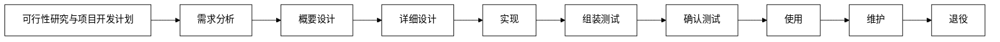
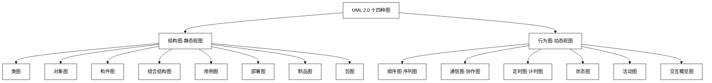

# 系统分析师｜第7章 软件工程（备考讲义＋章节自测题）

> **教材依据**：《系统分析师教程（第2版）》第7章 软件工程（共8节：7.1 软件生命周期｜7.2 软件开发方法与模型｜7.3 软件开发环境与工具｜7.4 软件过程管理｜7.5 软件重用和再工程｜7.6 软件产品线｜7.7 统一建模语言｜7.8 软件形式化方法）。第1版对应章为第8章《软件工程》，**两版节号不对应**：第1版 8.1 软件生命周期对应第2版 7.1；第1版 8.2 软件开发方法（8.2.1 形式化方法、8.2.2 逆向工程）拆分——形式化方法升格为第2版独立节 7.8，逆向工程并入 7.5.3，第1版 8.3 软件开发模型（8.3.1～8.3.4）对应第2版 7.2（7.2.1～7.2.4），第1版 8.4 软件开发环境与工具对应 7.3，8.5 软件过程管理对应 7.4；第2版新增 7.5 软件重用和再工程（其中 7.5.1、7.5.2、7.5.4 为新增，7.5.3 承自第1版 8.2.2）、7.6 软件产品线、7.7 统一建模语言，7.8 除净室软件工程外新增程序验证。教材外内容来源口径：「设计恢复／正向工程」等逆向工程相关概念第2版无原文，以【第1版补充｜掌握】按了解级降档补回；考纲第14条 开源软件开发与应用、第15条 标准化与知识产权教材第2版均无独立章节，按《第00章—考纲总纲》归口，以【真题补充｜考频｜两版教材均无原文】置于本章最后一个模块末尾「拓展阅读」；其余两版均无原文且考情不支持的内容一律不收录，逐项见「⚠️ 不包含」与表下说明。
>
> **考纲定位说明**：2024版考纲科目一「系统分析师综合知识」第5条 软件工程（5.1 软件生命周期｜5.2 软件开发方法与模型｜5.3 软件开发环境与工具｜5.4 软件过程管理｜5.5 软件重用和再工程｜5.6 软件产品线｜5.7 软件统一建模语言｜5.8 软件形式化方法），与教材第2版第7章 7.1～7.8 各节一一对应；考纲二级子项在教材本章均有对应小节或原文，无「考纲有、教材无」的空缺。
>
> **考试形式**：上午综合知识单选题；2021年以后真题近年频次窗（2024上～2026上，5场）约18道/5场——UML 图 6道/4场、软件生命周期模型 3道/3场、敏捷开发方法 3道/2场，均为中频；软件工程基本概念、统一过程 RUP、CMMI、软件逆向工程与再工程、净室工程、软件重用各 1道/1场，为低频；**无考点族5场全中，本章无高频模块**。案例分析科目无本章独立命题方向（0题组）；论文科目 3题次（2022上「论原型法与开发模型」、2023上「论敏捷开发」、2025上「论信息系统开发方法」），为开发方法类论题的方法论出处。
>
> 标签：系统分析师、上午题、软件工程、软件生命周期、软件开发模型、敏捷方法、RUP、CMMI、软件重用、逆向工程、软件产品线、UML、形式化方法、净室工程

[TOC]

## 章节结构对照与来源标注

> 本讲义为《系统分析师教程（第2版）》第7章 软件工程的学习讲义，模块顺序与教材 7.1～7.8 保持一致；除「设计恢复／正向工程」一项第1版补充、以及考纲第14/15条归口的两项拓展外，本章知识点均来自教材第2版原文。

| 讲义模块 | 对应教材第2版章节 | 内容性质 | 备考要求 |
|---|---|---|---|
| 模块1 软件生命周期 | 7.1 软件生命周期 | 教材 | 了解：软件生命周期过程（基本/支持/组织三类过程）、软件生命周期各阶段的任务（10阶段） |
| 模块2 软件开发方法与模型 | 7.2 软件开发方法与模型 | 教材 | 掌握：传统软件开发模型（瀑布/演化/螺旋/喷泉/变换/智能/V）、敏捷方法（敏捷宣言、特点、XP、DSDM、Scrum）；了解：快速应用开发（RAD）、统一过程模型（RUP 四阶段） |
| 模块3 软件开发环境与工具 | 7.3 软件开发环境与工具 | 教材 | 了解：软件开发环境的分类与集成机制、ICASE、软件工具的分类与选择 |
| 模块4 软件过程管理 | 7.4 软件过程管理 | 教材 | 了解：CMM 五级与关键过程域、CMMI 阶段式与连续式模型、软件过程评估五种模型与标准 |
| 模块5 软件重用和再工程 | 7.5 软件重用和再工程 | 教材＋第1版补充 | 了解：可重用的软件构件与重用三层次、软件重用过程与领域工程、软件逆向工程、软件再工程；了解级降档：重构／设计恢复／再工程／正向工程四概念辨析 |
| 模块6 软件产品线 | 7.6 软件产品线 | 教材 | 了解：产品线的过程模型（双生命周期/SEI/三生命周期）、产品线的四种建立方式 |
| 模块7 统一建模语言 | 7.7 统一建模语言 | 教材 | 掌握：UML 的结构（构造块/公共机制/规则与5个系统视图）、事物、关系、UML 2.0 十四种图 |
| 模块8 软件形式化方法 | 7.8 软件形式化方法 | 教材＋真题补充 | 了解：形式化方法概述、净室软件工程、程序验证（静态分析/符号执行/定理证明/模型检测）；拓展：开源软件开发与应用（考纲第14条归口）、标准化与知识产权（考纲第15条归口） |

> 教材第2版第7章章节结构（按教材原文核读）：7.1 软件生命周期（1 软件生命周期过程｜2 软件生命周期各阶段的任务）｜7.2 软件开发方法与模型（7.2.1 传统软件开发模型｜7.2.2 快速应用开发｜7.2.3 统一过程模型｜7.2.4 敏捷方法）｜7.3 软件开发环境与工具（7.3.1 软件开发环境｜7.3.2 软件开发工具）｜7.4 软件过程管理（7.4.1 软件能力成熟度模型｜7.4.2 软件过程评估）｜7.5 软件重用和再工程（7.5.1 可重用的软件构件｜7.5.2 软件重用过程｜7.5.3 软件逆向工程｜7.5.4 软件再工程）｜7.6 软件产品线（7.6.1 产品线的过程模型｜7.6.2 产品线的建立方式）｜7.7 统一建模语言（1 UML 的结构｜2 事物｜3 关系｜4 图）｜7.8 软件形式化方法（1 形式化方法概述｜2 净室软件工程｜3 程序验证）。

> ⚠️ 教材第2版第7章**不包含**（两源核查）：**源①**（对照第1版第8章《软件工程》逐节核对）——①软件开发方法按**性质**的分类（形式化方法与非形式化方法）与按**适应范围**的分类（整体性方法与局部性方法）（第1版 8.2 节首）：第2版 7.2 只保留「从开发风范上分为自顶向下与自底向上」，两个分类维度已删除，2021年以后真题无检出，不收录；②逆向工程的**完备性四抽象层次**（实现级、结构级、功能级、领域级）（第1版 8.2.2）：第2版 7.5.3 未保留该层次划分，2021年以后真题无检出，不收录；③第1版 8.2.1 形式化方法、8.2.2 逆向工程作为「软件开发方法」下的**二级节**编排：第2版分别升格为独立节 7.8、并入 7.5.3，属**结构重组而非删除**，内容本章已覆盖。**源②**（对照考纲5.1～5.8子项与教材7.1～7.8小节核对）——考纲全部二级子项在教材本章均有对应小节或原文，**无源②事项**，故除考纲第14/15条按总纲归口的拓展外，本章不存在「考纲有条目而教材无对应章节」的补回内容。

> 说明（四处易混入本章、实不属本章的内容）：①**COCOMO 软件规模估算**（2025下第40题「以 LoC 估算规模的方法」）教材原文在**第2版 8.4 预算与成本管理**，第7章全文无 COCOMO 原文，已按教材与素材层归口第8章项目管理，本章不收录；②**圈复杂度（McCabe）**属第14章软件实现与测试，**PERT／关键路径**属第8章项目管理，**内聚／耦合**属第13章系统设计，均不归本章——**教材第2版第7章无计算型考点，本章不出计算题**；③**用例模型中的包含／扩展关系、数据流图 DFD、需求获取方法**归第11章软件需求工程；④考纲第14条开源软件开发与应用、第15条标准化与知识产权教材第2版无独立章节，按《第00章—考纲总纲》归口置于本讲义最后一个模块末尾「拓展阅读」，不进入本章各模块例题、课后习题与综合模拟题（拓展小节自带的例题除外）。

---

## 模块1：软件生命周期（教材7.1）【教材｜了解】

**前置说明**：本模块对应教材第2版第7章 **7.1 软件生命周期**（1 软件生命周期过程、2 软件生命周期各阶段的任务），对应考纲 **5.1 软件生命周期**；全部为教材原文；适配上午综合选择题（概念辨析与阶段排序）。

**模块优先级**：🟢 了解为主 —— 本模块「软件工程基本概念」考点族近年频次窗内 1道/1场，按统一判据（1场＝低频）判低频。

**考情分析**（2021年以后真题）：近年频次窗（2024上～2026上，5场）1道/1场——2025上第38题（软件工程三要素不包括什么）；全量统计窗（2021上～2026上，8场）内同为 1道/1场。核心考点：软件工程三要素（方法、工具、过程）、软件生命周期三类过程（基本5／支持9／组织7）、10个阶段的名称与顺序。

### 1.1 核心知识点精讲

【前置基础｜教材】软件工程的定义与三要素（教材第7章章首引文，2025上第38题考点）：软件工程是指应用计算机科学、数学及管理科学等原理，以工程化的原则和方法来解决软件问题的工程，目的是提高软件生产率、提高软件质量、降低软件成本；**软件工程由方法、工具和过程三个部分组成**——方法是完成软件工程项目的技术手段，支持整个软件生命周期；工具是人们在开发软件活动中智力和体力的扩展与延伸；过程贯穿软件开发的各个环节，包括人员组织、计划跟踪与控制、成本估算、质量保证和配置管理等。

#### 1.1.1 软件生命周期过程（教材7.1）【教材｜了解】

- 软件产品从形成概念开始，经过开发、使用和维护，直到最后退役的全过程称为**软件生命周期（生存周期）**；以需求为出发点，从提出软件开发计划的那一刻开始，直到软件在实际应用中完全报废为止。
- 划分阶段的基本原则：**各阶段的任务应尽可能相对独立，同一阶段各项任务的性质应尽可能相同**。
- 依据国家标准《系统与软件工程 软件生存周期过程（GB/T 8566—2022）》，软件生存周期中可能执行的活动分为**5个基本过程、9个支持过程和7个组织过程**：

| 过程类 | 数量 | 包含的过程 |
|---|---|---|
| 基本过程 | 5 | 获取过程、供应过程、开发过程、运作过程、维护过程 |
| 支持过程 | 9 | 文档编制、配置管理、质量保证、验证、确认、联合评审、审核、问题解决、易用性 |
| 组织过程 | 7 | 管理过程、基础设施过程、改进过程、人力资源过程、资产管理过程、重用大纲管理过程、领域工程过程 |

> 记忆：基本5（获取/供应/开发/运作/维护，供主要参与方使用）、支持9（以文档编制开头、问题解决与易用性收尾）、组织7（含重用大纲管理与领域工程，与本章7.5/7.6呼应）。

#### 1.1.2 软件生命周期各阶段的任务（10阶段）（教材7.1）【教材｜了解】

| 阶段 | 主要任务 |
|---|---|
| 可行性研究与项目开发计划 | 分析用户提出的软件开发要求，确定性质、目标和规模，得出可行性研究报告；可行则制订详细的项目开发计划（两项活动实际常合并为同一阶段） |
| 需求分析 | 把软件功能和性能的总体概念描述为具体的软件需求规格说明，是生命周期中**重要且决定性**的一步 |
| 概要设计 | 根据需求规格说明建立总体结构和模块间关系，定义各功能模块接口，设计全局数据库或数据结构，规定设计约束，制定组装测试计划 |
| 详细设计 | 将各模块要实现的功能用相应的设计工具详细描述出来 |
| 实现 | 写出正确的、易理解的和易维护的程序模块；程序员根据详细设计文档完成编码并进行单元测试 |
| 组装测试（集成测试） | 将经过单元测试的模块逐步进行组装和测试 |
| 确认测试 | 测试系统是否达到系统需求，由用户（或在用户积极参与下）按规格说明书验收；必要时可再做现场测试或并行运行 |
| 使用 | 将软件安装在用户确定的运行环境中，测试通过后移交用户使用；收集发现的软件错误，撰写软件问题报告和软件修改报告 |
| 维护 | 通过各种必要的维护活动使系统持久地满足用户的需要 |
| 退役 | 终止对软件产品的支持，软件停止使用 |

> 记忆：可行性→需求→概要→详细→实现→组装测试→确认测试→使用→维护→退役。注意与瀑布模型的6阶段（软件计划、需求分析、软件设计、程序编码、软件测试、运行维护）区分——后者是**开发模型**的阶段划分，前者是**国家标准**的阶段划分。

### 1.2 典型例题

本模块为【教材｜了解】级，近年频次窗 1道/1场（低频），不配置例题。

### 1.3 课后习题

本模块为【教材｜了解】级，近年频次窗 1道/1场（低频），不配置课后习题。

---

## 模块2：软件开发方法与模型（教材7.2）【教材｜掌握】

**前置说明**：本模块对应教材第2版第7章 **7.2 软件开发方法与模型**（7.2.1 传统软件开发模型、7.2.2 快速应用开发、7.2.3 统一过程模型、7.2.4 敏捷方法），对应考纲 **5.2 软件开发方法与模型**；全部为教材原文；适配上午综合选择题，并为论文「开发方法与模型」类论题提供方法论出处。

**模块优先级**：🟡 中频 —— 模块内软件生命周期模型族近年频次窗 3道/3场、敏捷开发方法族 3道/2场，按统一判据（2～4场＝中频）判中频；统一过程 RUP 族 1道/1场（低频）、RAD 近年频次窗未检出（0场）。

**考情分析**（2021年以后真题）：近年频次窗（2024上～2026上，5场）——软件生命周期模型 3道/3场（2024上第12题 生命周期中时间最长的阶段、2024下第40～42题 严格区分阶段／原型基础上改进／描述面向对象开发过程、2025下第27题 逐步发布逐步交付适用的模型）、敏捷开发方法 3道/2场（2025下第28题 敏捷方法描述、2026上第14题与第40题 不符合／错误的敏捷说法）、统一过程 RUP 1道/1场（2026上第59题 设计体系结构、制订计划并消除高风险发生在哪个阶段）；快速应用开发（RAD）近年频次窗 **0道/0场（未检出）**，全量统计窗（2021上～2026上，8场）内亦无检出。核心考点：七种传统开发模型的适用场景与优缺点、敏捷宣言四句价值观与适用场合、XP／DSDM／Scrum 的核心实践、RUP 四阶段与各自任务。

### 2.1 核心知识点精讲

【前置基础｜教材】软件开发方法与软件开发模型的区别：软件开发方法是指软件开发过程所遵循的**办法和步骤**；软件开发模型则给出软件开发活动**各阶段之间的关系**，是软件开发过程的概括，为软件工程管理提供里程碑和进度表，为软件开发过程提供原则和方法。

#### 2.1.1 传统软件开发模型（教材7.2.1）【教材｜掌握】

软件开发模型大体上分为三种类型：①以软件需求完全确定为前提的**瀑布模型**；②在初始阶段只能提供基本需求时采用的**迭代式或渐进式开发模型**（喷泉模型、螺旋模型、统一开发过程、敏捷方法等）；③以形式化开发方法为基础的**变换模型**。

| 模型 | 核心特点 | 优点 | 缺点／局限 | 适用 |
|---|---|---|---|---|
| 瀑布模型 | 严格定义方法，分为软件计划、需求分析、软件设计、程序编码、软件测试、运行维护 6 个阶段，线性顺序 | 强调阶段性、早期计划与需求调查、产品测试；开发人员清楚每一步该做什么，利于项目管理 | 依赖早期需求调查，不能适应需求变化；单一流程，经验教训不能反馈；风险推迟到后期才暴露 | 需求明确稳定、能一次性完全确定的项目 |
| 演化模型 | 在快速开发一个**原型**的基础上，根据用户反馈不断改进原型，重复直到演化为最终产品 | 功能一经开发即进入测试，可引导出高质量的产品要求 | 不加控制地让用户接触尚未稳定的功能，对开发人员与用户都有负面影响 | 事先不能完整定义需求的软件开发 |
| 螺旋模型 | 瀑布模型与演化模型相结合，并加入**风险分析**；每次迭代含制订计划、风险分析、实施工程、客户评估 4 项工作 | 支持用户需求动态变化，为用户参与关键决策提供方便，提高适应能力，降低风险 | 需要开发人员具有丰富的风险评估经验和专门知识；迭代次数过多会增加成本、延迟提交 | 庞大、复杂且具有高风险的系统 |
| 喷泉模型 | 以用户需求为动力、以**对象**为驱动；各阶段相互重叠和多次反复，具有**无间隙性** | 分析和设计之间无明显边界，易实现活动的迭代与无间隙，提高开发效率、节省时间 | 对面向对象技术依赖强，非面向对象项目不适用 | 面向对象的软件开发过程 |
| 变换模型 | 基于形式化规格说明语言和程序变换，对形式化规格说明进行一系列自动或半自动程序变换，最后映射为软件系统 | 解决了代码结构经多次修改而变坏的问题，减少设计、编码、测试等中间步骤 | 需要严格的数学理论和一整套开发环境支持，局限性较大 | 有形式化开发基础支撑的项目 |
| 智能模型 | 也称为**基于知识的软件开发模型**，综合上述若干模型并把专家系统结合在一起；应用基于规则的系统，采用规约和推理机制，维护在**系统规格说明一级**进行 | 借助知识库（模型本身、软件工程知识、特定领域知识分别存入）支持开发 | 需要建立并维护知识库，实施门槛高 | 需要知识库与推理机制支撑的项目 |
| V 模型 | 在快速应用开发模型基础上演变而来，整个开发过程构造成 V 字形；明确标明测试的不同级别及其与开发阶段的对应关系 | 把软件实现和验证有机结合，在保证较高软件质量的情况下缩短开发周期，更清楚揭示开发过程的特性与本质 | 与瀑布模型一样对需求变更适应性弱 | 企业级软件开发 |

- **V 模型的四层测试对应关系**：单元测试（基于代码的测试，由开发人员执行，对应**编码**）→ 集成测试（验证两个以上单元之间的集成与详细设计所定义的接口，对应**详细设计**）→ 系统测试（以客户环境模拟系统运行，验证概要设计所定义的功能和性能，对应**概要设计**）→ 验收测试（由业务专家或用户进行，确保产品符合用户业务需要，对应**需求分析**）。

> 记忆：瀑布严格线性；演化靠原型反馈；螺旋加风险分析；喷泉面向对象无间隙；变换靠形式化；智能加专家系统；V 模型把测试级别与开发阶段左右对上。

#### 2.1.2 快速应用开发（教材7.2.2）【教材｜了解】

- **RAD（Rapid Application Development）**是一种比传统生命周期法快得多的开发方法，强调极短的开发周期；是**瀑布模型的一个高速变种**，通过使用基于构件的开发方法获得快速开发。
- **基本思想（4 条）**：①让用户更主动地参与到系统分析、设计和构造活动中来；②将项目开发组织成一系列**重点突出的研讨会**（投资方、用户、系统分析师、设计人员、开发人员一起参与）；③通过一种迭代的构造方法加速需求分析和设计阶段；④让用户提前看到一个可工作的系统。
- **开发阶段（5 步）**：业务建模（可用数据流图 DFD）→ 数据建模（可用 E-R 图）→ 过程建模（细化数据流图中的加工）→ 应用生成（用第四代语言 4GL 写出处理程序，复用已有构件或创建新构件）→ 测试与交付（大量复用故一般只做总体测试，新创建的构件仍需测试）。
- **局限性（3 条）**：①并非所有应用都适合 RAD，对**模块化要求较高**，某项功能不能模块化则构件有问题；高性能需通过调整接口适应构件时 RAD 可能失效；②开发者和客户必须在很短时间内完成一系列需求分析，任何一方配合不当都会导致失败；③**只能用于管理信息系统的开发**，不适合技术风险很高的情况（大量新技术、与现有系统高互操作性）。

> 注意：RAD 近年频次窗未检出（0场），全量统计窗内亦无检出，只作概念识记，不必做刷题训练。

#### 2.1.3 统一过程模型（教材7.2.3）【教材｜了解】

- **UP（Unified Process）**是一个通用过程框架，可用于广泛的软件系统、应用领域、组织类型、性能水平和项目规模；UP 是**基于构件的**，建模时使用 UML。
- **三大显著特点**：**用例驱动**、**以架构为中心**、**迭代和增量**。
- **RUP（Rational Unified Process）**在时间上把软件过程分解为 4 个顺序阶段，每阶段结束时安排一次技术评审，评审通过才允许进入下一阶段；一次经过 4 个阶段即产生一代软件，产品通过重复这 4 个阶段演化为下一代。

| 阶段 | 主要任务 | 阶段技术评审要点 |
|---|---|---|
| 初始阶段 | 为系统建立业务模型并确定项目边界；识别所有与系统交互的外部实体，定义交互特性；关注业务与需求方面的主要风险 | 规模定义、成本与进度估算是否适中、估算根据是否可靠、需求是否正确、双方理解是否一致、风险是否都有规避策略 |
| 细化阶段 | 分析问题领域，建立完善的架构，淘汰项目中最高风险的元素；确定架构、制订构建阶段计划、建立支持环境、选择构件 | 详细的系统目标和范围、架构的选择、主要风险的解决方案 |
| 构建阶段 | 开发所有剩余的构件和应用程序功能，集成为产品并进行详细测试；重点在管理资源、控制运作以优化成本、进度和质量 | 产品是否可以在 β 测试环境中进行安装和运行 |
| 移交阶段 | 确保软件对最终用户可用；进行 β 测试、制作发布版本、定稿用户支持文档、培训用户和维护人员、获得反馈并调整产品 | 目标是否实现、是否应开始演化过程、用户对交付产品是否满意 |

> 记忆：**初始定边界、细化建架构、构建做集成、移交给用户**；「设计体系结构、制订计划并消除最高风险元素」发生在**细化阶段**（2026上第59题）。教材评价：RUP 过于庞大复杂，相对轻量级敏捷方法显得死板、难以快速适应需求变化。

#### 2.1.4 敏捷方法（教材7.2.4）【教材｜掌握】

- 敏捷方法是20世纪90年代起引起广泛关注的一类新型软件开发方法，用以应对快速变化的需求；更强调开发团队与用户之间的紧密协作、面对面的沟通、频繁交付新的软件版本、紧凑而自我组织型的团队，也更注重**人的作用**。
- **敏捷宣言（2001年）四句价值观**：**个体和交互**胜过过程和工具；**可工作的软件**胜过大量的文档；**客户合作**胜过合同谈判；**响应变化**胜过遵循计划。
- 敏捷方法强调：让客户满意和软件尽早增量发布；小而高度自主的项目团队；非正式的方法；最小化软件工程工作产品以及整体精简开发。原因：提前预测哪些需求稳定、哪些会变化非常困难；设计与实现是交错的；分析、设计、实现和测试并不容易预测；可执行原型和部分实现的可运行系统是了解需求与反馈的有效媒介。
- **主要敏捷方法**：极限编程 XP、自适应软件开发 ASD、水晶方法 Crystal、特性驱动开发 FDD、动态系统开发方法 DSDM、测试驱动开发 TDD、Scrum、敏捷数据库技术 AD、精益软件开发。共同原则包括客户参与、增量式移交、简单性、接受变更、强调开发人员的作用和及时反馈。
- **敏捷方法的特点**：以人为核心、迭代、循序渐进；软件项目被切分成多个子项目，各子项目成果都经过测试、具备集成和可运行特征。
  - 开发者视角关注：短平快的会议、小版本发布、较少的文档、合作为重、客户直接参与、自动化测试、适应性计划调整、结对编程。
  - 管理者视角关注：测试驱动开发、持续集成和重构。
- **实施中的四类典型困难**：①客户参与依赖于客户意愿与代表性；②团队成员性格可能不适合激烈投入；③对变更做优先级排序可能极端困难；④维护简洁性需额外工作，但时间表压力下往往没有时间。
- **适用场合**：①团队人数不能太多，适合**规模较小**的项目；②项目经常发生变更（需求萌动且快速改变；若系统有较高的关键性、可靠性、安全性要求，则可能不完全适合）；③高风险项目的实施；④组织文化、人员、沟通性决定其是否适用（关键成功因素：组织文化支持谈判、人员彼此信任、人少而精干、开发人员的决定得到认可、环境设施满足快速沟通）。
- **极限编程 XP**：轻量、高效、低风险、柔性、可预测、科学且充满乐趣的软件开发方式，适用于**小型或中型团队、客户需求模糊或多变**的场景。由价值观、原则、实践和行为 4 个部分组成；**四大价值观＝沟通、简单、反馈、勇气**；**5 个原则＝快速反馈、简单性假设、逐步修改、提倡更改、优质工作**；贯彻「小步快走」，通常采用**测试先行**的编码方式。
- **动态系统开发方法 DSDM**：倡导以**业务为核心**、快速而有效地进行系统开发，可看作一种控制框架。基本观点：任何事情都不可能一次性圆满完成，应该用 **20% 的时间完成 80% 的有用功能**，以适合商业目的为准；在**时间进度和可用资源预先固定**的情况下力争最大化满足业务需求（传统方法一般是需求固定、时间和资源可变）。基本原则包括用户必须参与、必须授权团队决策、注重频繁交付产品、以是否符合业务目的为可接受标准、循环和增量开发、开发期间所有更改可逆、在高层次上制定需求基线、整个生命周期集成测试、所有参与者协作合作。
- **Scrum**：用于开发和维护复杂产品的框架，是增量的、迭代的开发过程；整个开发过程由若干个短迭代周期组成，一个短迭代周期称为一个 **Sprint**，建议长度 **2～4 周**。用**产品 Backlog** 管理需求（按商业价值排序的需求列表，条目通常体现为用户故事），团队先开发对客户价值较高的需求；在 Sprint 计划会议上经讨论、分析和估算得到任务列表 **Sprint Backlog**；每个迭代结束时递交潜在可交付的产品增量。

> 记忆：宣言四句「个体交互／可工作软件／客户合作／响应变化」；XP 四价值观「沟通简单反馈勇气」；DSDM「20% 时间做 80% 功能、时间与资源固定」；Scrum「Sprint 2～4 周、产品 Backlog／Sprint Backlog」。

#### 2.1.5 典型易错点（传统开发模型与敏捷方法辨析）

1. 「事先不能完整定义需求、在快速开发原型基础上按反馈改进」是**演化模型**，不是螺旋模型；螺旋模型的关键词是**风险分析**【🟡中频】；
2. 「主要用于描述面向对象的软件开发过程、各阶段相互重叠具有无间隙性」是**喷泉模型**；「以形式化规格说明为基础」是**变换模型**；「基于知识的、把专家系统结合进来」是**智能模型**【🟡中频】；
3. V 模型中**系统测试**对应**概要设计**、**集成测试**对应**详细设计**、**验收测试**对应**需求分析**，不要与单元测试（对应编码）串位【🟡中频】；
4. RUP 四阶段中「设计体系结构、制订计划并消除最高风险元素」属**细化阶段**；初始阶段只做业务模型与项目边界、构建阶段做集成与详细测试、移交阶段做 β 测试【🟡中频】；
5. 敏捷宣言是「**胜过**」而不是「取代/不要」——右侧各项（过程与工具、文档、合同谈判、遵循计划）仍有价值，只是左侧优先【🟡中频】；
6. RAD **只能用于管理信息系统**，不适合技术风险高的情况；RAD 是瀑布模型的高速变种而非敏捷方法的一种【🟡中频】。

### 2.2 典型例题

**例题1【演化模型辨识】**

软件开发模型中，针对事先不能完整定义需求的软件开发，在快速开发一个原型的基础上，根据用户在调用原型的过程中提出的反馈意见和建议对原型进行改进，获得原型的新版本，重复这一过程直到形成最终软件产品。该模型是（ ）
A. 瀑布模型 B. 演化模型 C. 螺旋模型 D. 喷泉模型

> 【解析】教材原文：演化模型主要针对事先不能完整定义需求的软件开发，是在快速开发一个原型的基础上，根据用户在调用原型的过程中提出的反馈意见和建议，对原型进行改进，获得原型的新版本，重复这一过程，直到演化成最终的软件产品。2023上第38题与2024下第41题均为此定义。
> 【答案】B

**例题2【面向对象开发过程模型】**

主要用于描述面向对象的软件开发过程，认为各阶段相互重叠和多次反复、具有无间隙性的模型是（ ）
A. 喷泉模型 B. 螺旋模型 C. 变换模型 D. V 模型

> 【解析】教材原文：喷泉模型是一种以用户需求为动力、以对象为驱动的模型，主要用于描述面向对象的软件开发过程；各开发阶段没有特定次序要求、可交互进行，各活动之间无明显边界，这种特性称为无间隙性。2024下第42题考点。
> 【答案】A

**例题3【螺旋模型的独特性】**

下列关于螺旋模型的说法中，正确的是（ ）
A. 螺旋模型不支持用户需求的动态变化 B. 螺旋模型在瀑布模型与演化模型基础上加入了风险分析 C. 螺旋模型不需要开发人员具备风险评估经验 D. 螺旋模型适用于需求明确稳定的小型项目

> 【解析】教材原文：螺旋模型是瀑布模型与演化模型相结合，并加入两者所忽略的风险分析所建立的一种软件开发模型；每次迭代包括制订计划、风险分析、实施工程和客户评估 4 个方面的工作。它支持用户需求的动态变化，但要求开发人员具有相当丰富的风险评估经验和专门知识，特别适用于庞大、复杂并具有高风险的系统。
> 【答案】B

**例题4【敏捷宣言】**

下列关于敏捷方法的说法中，不符合敏捷宣言的是（ ）
A. 个体和交互胜过过程和工具 B. 可工作的软件胜过大量的文档 C. 客户合作胜过合同谈判 D. 遵循计划胜过响应变化

> 【解析】敏捷宣言的四句价值观为：个体和交互胜过过程和工具；可工作的软件胜过大量的文档；客户合作胜过合同谈判；**响应变化胜过遵循计划**。D 项把最后一句的方向写反了。2026上第14题、第40题均为「找出不符合/错误的敏捷说法」型命题。
> 【答案】D

**例题5【敏捷方法的适用场合】**

下列关于敏捷方法适用场合的说法中，错误的是（ ）
A. 项目团队人数不能太多，适合规模较小的项目 B. 适用于需求萌动并且快速改变的情况 C. 系统有很高的关键性、可靠性、安全性要求时同样完全适用 D. 可用于高风险项目的实施

> 【解析】教材原文列举的适用场合包括：团队人数不能太多、适合规模较小的项目；项目经常发生变更（需求萌动并且快速改变的情况，**如果系统有比较高的关键性、可靠性、安全性方面的要求，则可能不完全适合**）；高风险项目的实施；组织结构的文化、人员、沟通性决定是否适用。C 项与教材原文相反。
> 【答案】C

**例题6【RUP 阶段任务】**

在 RUP 中，设计体系结构、制订计划并消除项目中最高风险的元素，主要发生在（ ）
A. 初始阶段 B. 细化阶段 C. 构建阶段 D. 移交阶段

> 【解析】教材原文：细化阶段的任务是分析问题领域，建立完善的架构，淘汰项目中最高风险的元素；必须在理解整个系统的基础上对架构做出决策，包括范围、主要功能和性能等非功能需求，同时为项目建立支持环境。初始阶段只建立业务模型并确定项目边界。2026上第59题。
> 【答案】B

### 2.3 课后习题

**习题1【瀑布模型特点】**

关于瀑布模型，下列说法错误的是（ ）
A. 是一种严格定义方法，将开发分为软件计划、需求分析、软件设计、程序编码、软件测试和运行维护 6 个阶段 B. 强调开发的阶段性、早期计划和需求调查以及产品测试 C. 能够很好地适应需求的动态变化 D. 需求或设计中的错误往往只有到项目后期才能够被发现

> 【解析】教材原文明确指出瀑布模型依赖早期的需求调查，**不能适应需求的变化**；由于是单一流程，风险往往推迟至后期才显露。A、B、D 均为教材原文的正面或负面描述。
> 【答案】C

**习题2【V 模型的测试对应】**

在 V 模型中，以客户环境模拟系统运行、验证系统是否达到概要设计所定义的功能和性能的测试级别是（ ）
A. 单元测试 B. 集成测试 C. 系统测试 D. 验收测试

> 【解析】教材原文：在所有单元测试和集成测试完成后，系统测试开始以客户环境模拟系统的运行，验证系统是否达到了在概要设计中所定义的功能和性能；最后由业务专家或用户进行验收测试。系统测试对应概要设计。
> 【答案】C

**习题3【Scrum 基本概念】**

下列关于 Scrum 的说法中，正确的是（ ）
A. Sprint 的建议长度是 2～4 个月 B. 产品 Backlog 是按商业价值排序的需求列表，条目通常体现为用户故事 C. Sprint Backlog 由用户在迭代结束时评审产生 D. Scrum 只适用于软件开发项目，不适用于其他创新性项目

> 【解析】教材原文：一个短的迭代周期称为一个 Sprint，建议长度是 2～4 **周**；使用产品 Backlog 管理产品需求，它是按商业价值排序的需求列表，条目通常体现为用户故事；在 Sprint 计划会议上经讨论、分析和估算得到任务列表 Sprint Backlog；Scrum 起源于软件开发项目，但适用于任何复杂的或创新性的项目。
> 【答案】B

**习题4【DSDM 基本观点】**

动态系统开发方法（DSDM）的核心观点是（ ）
A. 需求固定、时间和资源可变 B. 用 20% 的时间完成 80% 的有用功能，以适合商业目的为准 C. 必须由开发人员独立完成决策 D. 开发期间的更改不可逆转

> 【解析】教材原文：DSDM 认为任何事情都不可能一次性圆满完成，应该用 20% 的时间完成 80% 的有用功能，以适合商业目的为准；实施的思路是在时间进度和可用资源预先固定的情况下力争最大化满足业务需求（传统方法一般是需求固定、时间和资源可变）。基本原则还包括必须授权 DSDM 团队进行决策、开发期间的所有更改都是**可逆**的。
> 【答案】B

---

## 模块3：软件开发环境与工具（教材7.3）【教材｜了解】

**前置说明**：本模块对应教材第2版第7章 **7.3 软件开发环境与工具**（7.3.1 软件开发环境、7.3.2 软件开发工具），对应考纲 **5.3 软件开发环境与工具**；全部为教材原文；适配上午综合选择题（概念识记）。

**模块优先级**：🟢 了解为主 —— 近年频次窗（2024上～2026上，5场）内本模块各知识点均未独立命题（0场），按统一判据（0场＝未检出）判未检出；考纲5.3明确要求，故保留收录。

**考情分析**（2021年以后真题）：近年频次窗（2024上～2026上，5场）0道/0场（未检出）；**全量统计窗（2021上～2026上，8场）内亦无独立检出**——软件开发环境的分类与集成机制、ICASE、软件工具的分类与选择在2021年以后八场综合知识中均未单独命题。核心考点仍须掌握：SDE 的两大组成、五种集成机制、软件工具的三类划分。

### 3.1 核心知识点精讲

#### 3.1.1 软件开发环境（教材7.3.1）【教材｜了解】

- **软件开发环境（SDE）**：支持软件的工程化开发和维护而使用的一组软件，由**软件工具集**和**环境集成机制**构成。软件工具是指 CASE 工具，用以支持软件开发的相关过程、活动和任务；环境集成机制为工具集成和软件开发、维护及管理提供统一的支持。
- 通过环境集成机制，各工具用统一的数据接口规范存储或访问环境信息库，采用统一的界面形式保证界面一致性，并为各工具或开发活动之间的通信、切换、调度和协同工作提供支持。
- **应支持的集成机制（5 种）**：平台集成、数据集成、界面集成、控制集成和过程集成。
- 软件开发环境应支持小组工作方式并为其提供配置管理；环境的服务可用于支持各种软件开发活动，包括分析、设计、编程、调试和文档等。
- **集成计算机辅助软件工程（ICASE）**：在 CASE 的信息库中不仅定义了面向对象的数据库管理系统、提供数据—数据集成机制，还建立了可被环境中所有工具访问的数据模型、提供数据—工具集成机制，并实现配置管理功能。ICASE 的最终目标是实现应用软件的**全自动开发**——开发人员只要写好需求规格说明书，ICASE 就能自动生成供用户直接使用的软件和有关文档。ICASE 的进一步发展是与软件开发方法的结合以及智能化。

#### 3.1.2 软件开发工具（教材7.3.2）【教材｜了解】

- 软件开发环境中的工具可包括：支持特定过程模型和开发方法的工具（支持瀑布模型及数据流方法的工具、支持面向对象方法的工具等）、独立于模型和方法的工具（界面辅助生成工具、文档出版工具等）、管理类工具、针对特定领域的应用类工具；也可按作用范围分为贯穿整个开发过程的工具（如项目管理工具）和解决软件生命周期中某一阶段问题的工具（如软件估算工具）。
- **软件工具的三类划分**：

| 类别 | 作用 | 典型工具 |
|---|---|---|
| 软件开发工具 | 辅助开发人员进行软件开发活动 | 需求分析工具、设计工具、编码与排错工具 |
| 软件维护工具 | 辅助维护人员对软件代码及其文档进行各种维护活动 | 版本管理工具、文档分析工具、开发信息库工具、逆向工程工具和再工程工具 |
| 软件管理和支持工具 | 辅助管理人员和软件支持人员的管理活动和支持活动，确保软件高质量完成 | 项目管理工具、配置管理工具、软件评价工具 |

- **开发工具的选择**：主要决定于两个因素——所开发系统的**最终用户**和**开发人员**。最终用户需求是一切软件的来源和归宿，也是影响开发工具的决定性因素；开发人员的爱好、习惯和经验也影响选择。评价与选择要从功能、易用性、稳健性、硬件要求和性能，以及服务和支持等方面衡量；**开发工具的比较没有绝对标准**，评价一种开发工具更重要的是针对具体的使用环境、开发方法、软件架构、开发人员和最终用户来判断其适宜程度。
- **快速开发工具**：RAD 方法中的工具主要有数据库编程语言、界面生成器和报告生成器等，主要使用**可视化技术**（通过集成细粒度可复用构件来构造软件，用图形工具和可复用构件交互地编制程序）。

> 注意：工具只能起到辅助作用（教材7.3.2末句），严格的软件工程管理和开发人员的技术水平才是软件开发成功的关键；本模块近年频次窗未检出，只作概念识记。

### 3.2 典型例题

本模块为【教材｜了解】级，近年频次窗未检出（0场），不配置例题。

### 3.3 课后习题

本模块为【教材｜了解】级，近年频次窗未检出（0场），不配置课后习题。

---

## 模块4：软件过程管理（教材7.4）【教材｜了解】

**前置说明**：本模块对应教材第2版第7章 **7.4 软件过程管理**（7.4.1 软件能力成熟度模型、7.4.2 软件过程评估），对应考纲 **5.4 软件过程管理**；全部为教材原文；适配上午综合选择题（等级与模型辨识）。

**模块优先级**：🟢 了解为主 —— 本模块 CMMI 考点族近年频次窗内 1道/1场，按统一判据（1场＝低频）判低频。

**考情分析**（2021年以后真题）：近年频次窗（2024上～2026上，5场）1道/1场——2025下第10题（CMM 中「定量分析与持续优化」属于哪一个成熟度等级）；全量统计窗（2021上～2026上，8场）内 2道/2场（另含2023上第39题）。核心考点：CMM 五个成熟度等级的名称与特征、CMMI 阶段式与连续式模型的区别、SJ/T 11234—2001 的 6 个过程能力等级。

### 4.1 核心知识点精讲

【前置基础｜教材】软件过程是软件生命周期中的一系列相关活动，即用于开发和维护软件及相关产品的一系列活动；**软件产品的质量取决于软件过程**，具有良好软件过程的组织能够开发出高质量的软件产品。建立衡量标准一方面可评价开发方的质量保证能力，另一方面也是软件组织加强质量管理和提高产品质量的依据。

#### 4.1.1 软件能力成熟度模型（教材7.4.1）【教材｜了解】

- **CMM（Capability Maturity Model）**是一个概念模型，模型框架和表示是刚性的、不能随意改变，但模型的解释和实现有一定弹性；它把软件过程改进的步骤组织成 **5 个成熟度等级**。

| 等级 | 名称 | 特征 |
|---|---|---|
| 1 | 初始级 | 未加定义的随意过程，无秩序甚至混乱，成功依赖于极个别人的努力和机遇 |
| 2 | 可重复级 | 规则化和纪律化的过程，已建立基本的项目管理流程，可对成本、进度和功能特性进行跟踪，类似项目有章可循并能重复以往成功 |
| 3 | 已定义级 | 标准化和一致化的过程，管理和工程活动的软件过程均已文档化、标准化，形成整个组织的标准软件过程 |
| 4 | 可管理级（已管理级） | 可预测的过程，软件过程和产品质量有详细的度量标准，得到**定量的**认识和控制 |
| 5 | 优化级 | 持续改进的过程，通过对过程、新概念和新技术等各方面有用信息的**定量分析**，不断持续地改进过程 |

- **关键过程域（KPA）**：除初始级外，CMM 每个级别的实现都定义成可操作的，每一级包含实现该级目标的若干 KPA；每个 KPA 由关键实施活动（KP）组成，其执行表明该 KPA 在组织内部得到实现。
- **CMMI（能力成熟度模型集成）**融合了多种模型，形成组织范围内过程改进的单一集成模型，主要目的是消除不同模型之间的不一致和重复、降低基于模型进行改进的成本；继承了 CMM 的**阶段表示法**和 EIA/TS 731 的**连续式表示法**，两者均采用统一的 **24 个过程域**，在逻辑上等价。
  - **阶段式模型**：基本沿袭 CMM 框架，仍保持 5 个成熟度等级，但关键过程域做了调整和扩充；当组织通过了某一等级过程域中的全部过程，即意味着该组织成熟度达到这一等级。概念清晰、易于理解、便于操作。
  - **连续式模型**：没有与组织成熟度相关的几个阶段，将 24 个过程域按功能划分为**过程管理、项目管理、工程和支持** 4 个过程组；每个过程域的能力均分为 5 级，所有过程域共同的能力等级决定组织的能力等级；允许对过程域进行裁剪，也允许对不同过程域采用不同的能力等级，评估结果用**能力特征图**表示。
  - 两种模型/两种方法评价的结论应基本一致。

> 记忆：CMM 五级＝初始、可重复、已定义、可管理、优化；**第4级（可管理级）开始有「定量」的认识和控制，第5级（优化级）用定量分析做持续改进**——2025下第10题「定量分析与持续优化」即指向最高两级。

#### 4.1.2 软件过程评估（教材7.4.2）【教材｜了解】

- **软件过程评估**是根据过程模型或其他模型对组织的软件过程所进行的规范的评估，由接受过培训的专业软件人员组成的小组对组织当前软件过程进行评估，以确定其状态、确定与软件过程相关事务的优先级，并从组织中获得对软件过程改进的支持。
- **基于 CMM 的评估方法 6 个步骤**：①成立评估小组（成员应接受过 CMM 基本概念和评估方法的专门培训）→ ②参评单位代表填写成熟度问卷表并回答有关问题 → ③评估小组分析调查问卷 → ④现场访问、召开座谈会、审核过程文档，判断 KPA 的实践活动是否达到预定目标并记入文档 → ⑤整理调查结果、撰写调查报告，指明软件过程的强项和弱项 → ⑥绘制 **KPA 剖面图**，显示是否达到 KPA 目标，并提交评估的结论性意见。
- **主要评估模型与标准**：

| 模型/标准 | 要点 |
|---|---|
| CMM 模型 | 通过「建立过程→评估→改进→再评估」的反复循环，使软件过程能力趋于更加成熟；评估分 6 步、以 KPA 剖面图呈现结论 |
| Trillum 模型 | 主要用于**嵌入式**软件开发和支持的能力评估模型，以 CMM 为基础又有发展；架构建立在路线图基础上，不仅适用于软件也适用于硬件，强调以用户为关注的焦点，包括技术成熟度、主要面向通信产品 |
| Bootstrap 方法 | 参考 ISO 9000-3 和 ESA PSS-05 等标准，设计了非常详细的**过程质量属性结构（17 个属性）**，改进了 CMM 的问卷表和成熟度计算方法，可用于过程的每一个质量属性，得到过程质量剖面；在欧洲有很大影响力 |
| ISO/IEC 15504 标准 | 分为 9 个部分（第一部分资料、第二三部分标准、其余参考性）；第二部分定义了用于过程评估的**二维参考模型（过程维和能力维）**；能力等级针对每个过程定义 **6 级**过程性能：不完善的过程、已实施的过程、已计划与已跟踪的过程、已建立的过程、可预测的过程、优化的过程 |
| SJ/T 11234—2001 | 我国行业标准《软件过程能力评估模型》，与 CMMI 连续式模型基本相同；有 **22 个过程域**，分为过程管理、项目管理、工程和支持四大类；每个过程能力划分为 **6 个评估等级**：不完整级、已执行级、受管理级、已定义级、定量管理级和持续优化级 |

> 注意：SJ/T 11234—2001 的 6 个能力等级与 ISO/IEC 15504 的 6 级过程性能、CMMI 连续式的 5 级能力等级是三套不同标准，不要混记；本模块近年频次窗 1道/1场，只作概念识记与等级辨识。

### 4.2 典型例题

本模块为【教材｜了解】级，近年频次窗 1道/1场（低频），不配置例题。

### 4.3 课后习题

本模块为【教材｜了解】级，近年频次窗 1道/1场（低频），不配置课后习题。

---

## 模块5：软件重用和再工程（教材7.5）【教材＋第1版补充】

**前置说明**：本模块对应教材第2版第7章 **7.5 软件重用和再工程**（7.5.1 可重用的软件构件、7.5.2 软件重用过程、7.5.3 软件逆向工程、7.5.4 软件再工程），对应考纲 **5.5 软件重用和再工程**；教材原文为主，「重构／设计恢复／再工程／正向工程」四概念辨析第2版无原文、承自第1版 8.2.2，以【第1版补充｜掌握】按了解级降档补回并置于 5.1.3 内；适配上午综合选择题。

**模块优先级**：🟢 了解为主 —— 模块内软件逆向工程与再工程族、软件重用族近年频次窗各 1道/1场，按统一判据（1场＝低频）判低频。

**考情分析**（2021年以后真题）：近年频次窗（2024上～2026上，5场）——软件逆向工程与再工程 1道/1场（2025下第12题 再工程与逆向工程的说法辨析）、软件重用 1道/1场（2025上第51题 实现代码重用的方式）；全量统计窗（2021上～2026上，8场）内软件逆向工程与再工程 3道/3场（另含2021上第38～39题、2022上第38～39题，均考「设计恢复」与「正向工程」的定义辨析）、软件重用 1道/1场。核心考点：软件重用的三个层次、领域工程的三项活动、逆向工程只分析不修改目标系统、再工程的三阶段与成本层次。

### 5.1 核心知识点精讲

#### 5.1.1 可重用的软件构件（教材7.5.1）【教材｜了解】

- **软件重用**是在两次或多次不同的软件开发过程中重复使用相同或相似软件元素的过程；这些软件元素（通常称为**软件构件**）包括应用领域知识、开发经验、设计经验、体系结构、需求分析文档、设计文档、程序代码及测试用例等。
- 采用重用软件构件较从头开发更加容易；软件重用的目的是**能更快、更好、成本更低地生产软件产品**。
- **软件重用的三个层次**：①**知识重用**；②**方法和标准的重用**；③**软件成分的重用**。可重用的软构件越大，重用的粒度越大。

#### 5.1.2 软件重用过程（教材7.5.2）【教材｜了解】

- 一般过程：先分析软件的功能需求，根据需求开发可重用的软件构件，对其进行**标识、构造、分类和存储**；开发软件时根据需要**检索**构件，进行补充、修改、组装，再进行系统测试与调试。
- **三种软件重用过程模型**：
  - **组装模型**：把以往项目中建立的构件存入构件库 → 查询并提取可重用构件 → 做适应性修改并建造新构件（也可存入构件库）→ 组装成新系统。
  - **类重用模型**：利用面向对象技术，类是比较理想的可重用构件（类构件）。三种重用方式——**实例重用**（创建类的实例并发送消息）、**继承重用**（子类继承父类的数据与操作，宜设计合理深度的类层次结构以降低接口复杂性）、**多态重用**（按接收消息的对象类型由多态性机制启动正确方法）。
  - **软件重用过程模型**：强调**领域工程与软件工程同时进行**——领域工程创建应用领域模型、设计软件体系结构模型、开发可重用软件成分并建立构件库；基于构件的软件工程参照领域模型做系统分析与结构设计，从构件库查找构件、鉴定与调整、构造新构件，再组合开发应用软件。
- **领域工程**（开发可重用软件构件的过程）：「领域」指具有相似或相近软件需求的应用系统所覆盖的一组功能区域；目的是**标识、构造、分类和传播**软件构件。三项主要活动：
  1. **分析过程**——标识可重用构件的六个指南：构件功能在未来工作中是否需要、功能通用性是否强、是否依赖于硬件、设计是否足够优化、重用时是否需做大的修改、能否把不可重用构件分解为一组可重用构件；
  2. **开发可重用的软件构件**——应考虑标准的数据结构、标准的接口协议（模块内接口、外部接口、人机界面三个层次）、程序模板（如报警系统模板含人机交互界面、安全范围设置、与监控传感器通信的管理机制、响应机制、控制机制）；
  3. **传播软件构件**——让用户能在成千上万构件中找到所需构件，需很好地描述构件的**功能、使用条件、接口、如何实现**（只有准备修改构件的人需要知道如何实现）。
- **构件分类的三种典型模式**：枚举分类、刻面分类、属性值分类。
- **软件构件重用环境应包含的四个元素**：①软件构件库（存放构件及检索所需的分类信息）；②软件构件库管理系统（管理对构件库的访问）；③软件构件库检索系统；④CASE 工具（帮助把重用的构件集成到新的设计中）。

#### 5.1.3 软件逆向工程（教材7.5.3）【教材｜了解】

- **逆向工程（Reverse Engineering）**是一种产品设计技术的再现过程：对目标产品进行逆向分析及研究，演绎并得出其处理流程、组织结构、功能特性及技术规格等设计要素；简单说就是**根据已有的产品反向推出产品设计数据的过程**，即「从产品到设计」的过程。
- 软件的逆向工程是**分析程序**、力图在比源代码更高的抽象层次上建立程序表示的过程；它不仅是设计的恢复过程，还可借助工具从已存在的程序中抽取数据结构、体系结构和程序设计信息；可被视为「开发周期的逆行」，类似逆行传统瀑布模型中的开发步骤。
- **关键边界**：软件逆向工程**仅仅是一种检测或分析的过程，它并不会更改目标系统**；可以使用净室技术来避免侵犯版权；在集成电路领域可用逆向工程技术寻找侵犯知识产权的证据，反而可能保护知识产权所有者。
- **三种实现方法**：①**分析信息交换过程**（最常用于协议逆向工程，用总线分析器和数据包嗅探器截取并分析通信数据，特别适用于设备驱动程序的逆向工程）；②**反汇编**（用反汇编器把原始机器码翻译成便于阅读的汇编代码，工具如 OllyDebug、IDA）；③**反编译**（用反编译器尝试从机器码或字节码重现高级语言形式的源代码）。
- 逆向工程的目的：研究和学习先进的技术（特别是缺少文档资料又很需要实现某软件功能时）；正因如此，很多软件在安装前会要求用户同意不去逆向研究。

【前置基础｜第1版补充】与逆向工程相关的四个概念（第2版无原文，承自第1版 8.2.2；2021上第38～39题、2022上第38～39题考点，近年频次窗未检出、按了解级降档）：
- **重构（restructuring）**：在**同一抽象级别**上转换系统描述形式；
- **设计恢复（design recovery）**：借助工具从已有程序中抽象出有关**数据设计、总体结构设计和过程设计**等方面的信息；
- **再工程（re-engineering）**：在逆向工程所获得信息的基础上修改或重构已有系统，产生系统的一个新版本，包括**逆向工程、新需求的考虑过程和正向工程**三个步骤；
- **正向工程（Forward Engineering）**：不仅从现有系统中恢复设计信息，而且**使用该信息去改变或重构现有系统**，以改善其整体质量。

> 注意：区分要点是「是否使用恢复出的信息去改变现有系统」——设计恢复只抽取信息、再工程与正向工程都要改变系统；重构只是同一抽象级别的**形式转换**，抽象级别不变。

#### 5.1.4 软件再工程（教材7.5.4）【教材｜了解】

- **软件再工程**是软件逆向工程的扩充：软件逆向工程提取需要的信息后，软件再工程基于对原系统的理解和转换，在**不变更整个系统功能**的前提下产生新的软件源代码；是以软件工程方法学为指导，对既有对象系统进行调查并将其重构为新形式代码的开发过程，分为**再分析、再编码、再测试**三个阶段。
- 从软件重用方法学看，如何开发可重用软件和如何构造采用可重用软件的系统体系结构是两个最关键的问题；对再工程来说，前者很大一部分内容是对既有系统中**非可重用构件的改造**，可使用 CASE 工具（逆向工程和再工程工具）帮助理解原有设计。
- **成本层次**（取决于重做工程的难度，由低到高）：源代码转换 → 程序结构重构 → 程序和数据重构 → 体系结构迁移。尽管如此，软件再工程与重新开发软件相比**成本和风险还是更小**，原因是软件工程的起点不同；各阶段软件的可重用程度决定着再工程的工作量。

> 记忆：逆向工程＝只分析不改（检测过程）；再工程＝分析之后改（再分析/再编码/再测试，不改变系统功能）；正向工程＝恢复信息并用于改造系统；重构＝同级别换形式。

### 5.2 典型例题

本模块为【教材｜了解】级（含按了解级降档处理的【第1版补充｜掌握】内容），近年频次窗 2道/2场但分属两个低频考点族，不配置例题。

### 5.3 课后习题

本模块为【教材｜了解】级（含按了解级降档处理的【第1版补充｜掌握】内容），近年频次窗 2道/2场但分属两个低频考点族，不配置课后习题。

---

## 模块6：软件产品线（教材7.6）【教材｜了解】

**前置说明**：本模块对应教材第2版第7章 **7.6 软件产品线**（7.6.1 产品线的过程模型、7.6.2 产品线的建立方式），对应考纲 **5.6 软件产品线**；全部为教材原文；适配上午综合选择题（概念识记）。

**模块优先级**：🟢 了解为主 —— 近年频次窗（2024上～2026上，5场）内本模块各知识点均未独立命题（0场），按统一判据（0场＝未检出）判未检出；考纲5.6明确要求，故保留收录。

**考情分析**（2021年以后真题）：近年频次窗（2024上～2026上，5场）0道/0场（未检出）；全量统计窗（2021上～2026上，8场）内 1道/1场——2023上第34题（软件产品线的两大组成部分中，「核心资源」的定义）。核心考点：产品线的两大组成部分、三种过程模型、四种建立方式的划分依据。

### 6.1 核心知识点精讲

#### 6.1.1 产品线的过程模型（教材7.6.1）【教材｜了解】

- **软件产品线（Software Product Line）**是一个产品集合，这些产品共享一个**公共的、可管理的特征集**，该特征集能满足特定领域的特定需求；是十分适合专业开发组织的软件开发方法，能有效提高软件生产率和质量、缩短开发时间、降低总开发成本。
- **两大组成部分**：①**核心资源**——领域工程的所有结果的集合，是产品线中产品构造的基础（必定包含产品线中所有产品共享的产品线架构、新设计开发或经再工程得到且需在整个产品线系统化复用的构件、相关测试计划与测试实例及设计文档、需求说明书、领域模型、领域范围定义，以及采用的 COTS 构件）；②**产品集合**。
- **双生命周期模型**：分成两个重叠的生命周期——**领域工程**（领域分析：利用现有系统的设计、架构和需求建立领域模型；领域设计：确定共性和可变性、为产品线设计架构；领域实现：基于领域架构开发构件、文档、代码生成器等可复用资源）与**应用工程**（需求分析：把系统需求划分为领域公共需求与独特需求；系统设计：在领域架构基础上结合独特需求设计应用架构；系统实现：用领域可复用资源实现公共需求、用定制构件满足独特需求）。应用工程将不能满足的需求返回领域工程，形成**产品线的演化**。
- **SEI 模型**：基本活动分为**核心资源开发（领域工程）、产品开发（应用工程）和管理**三部分；三个活动交错连接、可以任何次序发生且高度重叠；核心资源库与产品开发之间存在**强的反馈环**——新产品的构建以核心资源库为基础，核心资源也可从已存在的系统中抽取，核心资源的价值通过使用它们的产品开发来体现。
- **三生命周期模型**：对双生命周期模型的改进，主要针对**有多个产品线的大型企业**；增加**企业工程（Enterprise Engineering）**流程以便在企业范围内规划资源的创建、设计和复用；在领域工程中增加**产品线确认**作为起始阶段，并为领域分析增加**市场分析**任务；为应用工程增加业务/市场分析与计划；在领域工程与应用工程之间增加**核心资源管理**作为桥梁，支持与交互是双向的。

#### 6.1.2 产品线的建立方式（教材7.6.2）【教材｜了解】

- 采用产品线方式开发软件时，开发人员可划分为**负责核心资源的小组**与**负责产品的小组**——这是产品线开发与独立系统开发的主要区别。
- **4 种建立方式**，划分依据有两个：①企业采用**演化方式（evolutionary）**还是**革命方式（revolutionary）**引入产品线开发过程；②企业基于**现有产品**开发还是开发**全新产品线**。

| 划分维度 | 演化方式 | 革命方式 |
|---|---|---|
| 基于现有产品 | ①将现有产品演化为产品线：基于现有产品架构设计产品线架构，把特定产品的构件逐步转化为共用构件，实施风险最小，但总周期与总投资较大 | ②用软件产品线替代现有产品集：基本停止现有产品开发，直接开发核心资源；总周期与总投资较少，但初始投资报废风险加大、第一个产品面世时间推后 |
| 全新产品线 | ③全新软件产品线的演化：把每个新产品的需求与核心资源协调；先期投资少、风险小、第一个产品面世早，但核心资源会影响新产品的需求协调、使成本加大 | ④全新软件产品线的开发：先得到产品线所有可能的需求（需求超集），据此设计开发核心资源；核心资源完成后新产品开发速度非常快、总成本减少，但新领域需求难以全面和正确 |

- 补充决策依据：现有产品集中**软硬件结合的紧密程度**与不同产品在硬件需求上的差异，也是采用演化还是革命方式的决策依据——软硬件结合密切且硬件需求差异大的现有产品集，只能采用**革命方式**替代现有产品集。
- **产品线的发展过程三阶段**：开发阶段、配置分发阶段和演化阶段。引起产品线架构演化的原因：产品线与技术变化的协调、现有问题的改正、新功能的增加、对现有功能的重组以允许更多变化等；产品线的演化包括**核心资源的演化、产品的演化和产品的版本升级**。

> 记忆：两维度叉出四格——现有×演化＝慢慢转、现有×革命＝直接替、全新×演化＝边做边协调、全新×革命＝先建超集再快出产品。

### 6.2 典型例题

本模块为【教材｜了解】级，近年频次窗未检出（0场），不配置例题。

### 6.3 课后习题

本模块为【教材｜了解】级，近年频次窗未检出（0场），不配置课后习题。

---

## 模块7：统一建模语言（教材7.7）【教材｜掌握】

**前置说明**：本模块对应教材第2版第7章 **7.7 统一建模语言**（1 UML 的结构、2 事物、3 关系、4 图），对应考纲 **5.7 软件统一建模语言**；全部为教材原文；适配上午综合选择题（图形辨识为本章最主要考法）。

**模块优先级**：🟡 中频 —— UML 图考点族近年频次窗 6道/4场，按统一判据（2～4场＝中频）判中频，为本章题量最高的模块。

**考情分析**（2021年以后真题）：近年频次窗（2024上～2026上，5场）6道/4场——2024下第47～48题（类图与对象图的描述）、2025上第37题（用于描述系统动态行为的 UML 图）、2025下第29题（由模型本身分解而成的组织单元＝包图）、2025下第30题（结合顺序图的时间顺序与活动图的流程控制＝交互概览图）、2026上第74题（按时间顺序描述对象之间交互＝顺序图）、2026上第75题（描述构件在硬件节点上的物理部署关系＝部署图）；全量统计窗（2021上～2026上，8场）内 7道/5场（另含2022上第5题）。核心考点：UML 结构三组成部分与5个系统视图、四类事物、四种关系、14 种图的名称与各自语义（尤其静态图与动态图的区分）。

### 7.1 核心知识点精讲

#### 7.1.1 UML 的结构（教材7.7）【教材｜掌握】

- **UML（Unified Modeling Language）**是一种定义良好、易于表达、功能强大且普遍适用的建模语言；作用域不限于支持面向对象分析和面向对象设计，还支持**从需求分析开始的软件开发的全过程**。
- **结构三组成部分**：
  1. **构造块**——三种基本构造块：**事物（thing）**、**关系（relationship）**、**图（diagram）**。事物是 UML 的重要组成部分，关系把事物紧密联系在一起，图是多个相互关联的事物的集合。
  2. **公共机制**——达到特定目标的公共 UML 方法，包括**规格说明**（事物语义的细节描述，是模型真正的核心）、**修饰**、**公共分类**（类与对象：类表示概念、对象表示具体实体；接口与实现：接口定义契约、实现是具体内容）、**扩展机制**（约束、构造型、标记值）4 种。
  3. **规则**——构造块如何放在一起的规定：命名、范围、可见性、完整性、执行。
- **UML 对系统架构的定义**：系统的组织结构，包括系统分解的组成部分及其关联性、交互机制和指导原则等；具体指 **5 个系统视图**：

| 视图 | 含义 |
|---|---|
| 逻辑视图（设计视图） | 表示设计模型中在架构方面具有重要意义的部分，即类、子系统、包和用例实现的子集 |
| 进程视图 | 可执行线程和进程作为活动类的建模，是逻辑视图的一次执行实例，描述并发与同步结构 |
| 实现视图 | 对组成基于系统的物理代码的文件和构件进行建模 |
| 部署视图 | 把构件部署到一组物理节点上，表示软件到硬件的映射和分布结构 |
| 用例视图 | 最基本的需求分析模型 |

- UML 允许在一定阶段隐藏模型的某些元素、遗漏某些元素，以及不保证模型的完整性，但模型要逐步达到完整和一致。

#### 7.1.2 事物（教材7.7）【教材｜掌握】

UML 中的事物也称建模元素，是 UML 模型中最基本的面向对象构造块，分为四类：

| 类别 | 说明 | 包含 |
|---|---|---|
| 结构事物 | 模型中**最静态**的部分，代表概念上或物理上的元素；共 **7 种** | 类、接口、协作、用例、活动类、构件、节点 |
| 行为事物 | 模型中的**动态**部分，代表时间和空间上的动作；共 **2 种** | **交互**（内部活动：一组对象在特定上下文中为达到特定目的而进行的一系列消息交换，含消息、动作次序、连接）、**状态机**（由一系列对象的状态组成） |
| 分组事物 | 模型中组织的部分，可看成模型在其中进行分解的盒子；**只有 1 种** | **包**（一种将有组织的元素分组的机制；**纯粹是概念上的事物，只存在于开发阶段**，而构件可存在于系统运行阶段） |
| 注释事物 | UML 模型的解释部分 | 注释 |

- 7 种结构事物的要点：**类**＝具有相同属性、方法、关系和语义的对象的集合，实现一个或多数个接口；**接口**＝类或构件提供特定服务的一组操作的集合，描述对外的可见动作；**协作**＝定义了交互的操作，是一些角色和其他事物一起工作提供合作动作（这些动作比事物总和更大）；**用例**＝描述一系列的动作并产生有价值的结果，通常用来组织行为事物，通过协作来实现；**活动类**＝其对象有一个或多个进程或线程，对象代表的事物的行为与其他事物同时存在；**构件**＝物理上或可替换的系统部分，实现了一个接口集合；**节点**＝运行时存在的物理元素，代表可计算的资源，通常占用内存并具有处理能力。

#### 7.1.3 关系（教材7.7）【教材｜掌握】

UML 用关系把事物结合在一起，主要有 **4 种**：

| 关系 | 语义 |
|---|---|
| 依赖（dependency） | 两个事物之间的语义关系，其中一个事物发生变化会影响另一个事物的语义 |
| 关联（association） | 描述一组对象之间连接的结构关系 |
| 泛化（generalization） | 一般化和特殊化的关系，描述特殊元素的对象可替换一般元素的对象 |
| 实现（realization） | 类之间的语义关系，其中一个类指定了由另一个类保证执行的契约 |

#### 7.1.4 图（14种）（教材7.7）【教材｜掌握】

**UML 2.0 包括 14 种图**，按静态/动态可归纳如下：

| 图 | 说明 | 静/动 |
|---|---|---|
| 类图 Class Diagram | 描述一组类、接口、协作和它们之间的关系；OO 建模中最常见的图，给出系统的**静态设计视图**，活动类类图给出静态进程视图 | 静态 |
| 对象图 Object Diagram | 描述一组对象及它们之间的关系，是类图中所建立事物实例的**静态快照**，从真实案例或原型案例角度建立 | 静态 |
| 构件图 Component Diagram | 描述一个封装的类及其接口、端口，以及由内嵌的构件和连接件构成的内部结构；表示静态设计实现视图，是**类图的变体** | 静态 |
| 组合结构图 Composite Structure Diagram | 描述结构化类（构件或类）的内部结构，包括其与系统其余部分的交互点 | 静态 |
| 用例图 Use Case Diagram | 描述一组用例、参与者及它们之间的关系，给出静态用例视图 | 静态 |
| 部署图 Deployment Diagram | 描述对运行时的处理节点及在其中生存的构件的配置，给出架构的**静态部署视图**，通常一个节点包含一个或多个构件 | 静态 |
| 制品图 Artifact Diagram | 描述计算机中一个系统的物理结构，制品包括文件、数据库和类似的物理比特集合；通常与部署图一起使用 | 静态 |
| 包图 Package Diagram | 描述**由模型本身分解而成的组织单元**及其之间的依赖关系 | 静态 |
| 顺序图 Sequence Diagram（序列图） | 一种交互图，由一组对象或参与者及其可能发送的消息构成；**强调消息的时间次序** | 动态 |
| 通信图 Communication Diagram | 一种交互图，强调收发消息的对象或参与者的**组织结构**（UML 1.x 中称为协作图） | 动态 |
| 定时图 Timing Diagram（计时图） | 一种交互图，强调消息跨越不同对象或参与者的**实际时间**，而不只关心相对顺序 | 动态 |
| 状态图 State Diagram | 描述一个状态机（状态、转移、事件和活动），给出对象的动态视图，对反应式系统建模尤为重要 | 动态 |
| 活动图 Activity Diagram | 把进程或其他计算结构展示为计算内部的**控制流和数据流**，对功能建模和业务流程建模特别重要 | 动态 |
| 交互概览图 Interaction Overview Diagram | **活动图和顺序图的混合物**（兼具顺序图的时间顺序与活动图的流程控制） | 动态 |

> 记忆：静态八张（类、对象、构件、组合结构、用例、部署、制品、包），动态六张（顺序、通信、定时、状态、活动、交互概览）。**包图**＝模型本身分解出的组织单元；**部署图**＝构件到硬件节点；**顺序图**＝时间次序；**交互概览图**＝活动图＋顺序图。

#### 7.1.5 典型易错点（UML 图形与事物辨析）

1. **包图**是「由模型本身分解而成的组织单元及其依赖关系」，不要误答为构件图或类图（2025下第29题）【🟡中频】；
2. **交互概览图**是活动图和顺序图的混合物，兼具时间顺序与流程控制（2025下第30题）；**通信图**强调对象的组织结构，旧称协作图【🟡中频】；
3. **部署图**描述处理节点与其中生存的构件的配置（软件到硬件的映射），**制品图**描述系统的物理结构（文件、数据库等物理比特集合），两者常一起使用但语义不同（2026上第75题）【🟡中频】；
4. **顺序图强调时间次序、通信图强调对象组织结构、定时图强调实际时间**（不只是相对顺序），三者都是交互图但侧重点不同【🟡中频】；
5. **对象图是类图实例的静态快照**，从真实或原型案例角度建立；**构件图是类图的变体**【🟡中频】；
6. 分组事物只有**包**一种，且包**只存在于开发阶段**，构件可存在于运行阶段——不要把包当成运行期实体【🟡中频】；
7. UML 四种关系是**依赖、关联、泛化、实现**，不要把「聚合/组合」当成独立于关联之外的第五种基本关系【🟡中频】。

### 7.2 典型例题

**例题1【动态图辨识】**

UML 图中，用于描述系统动态行为的是（ ）
A. 类图 B. 用例图 C. 顺序图 D. 构件图

> 【解析】顺序图是交互图的一种，展现一组对象或参与者之间可能发送的消息，强调消息的时间次序，专注于系统的动态视图；类图、用例图、构件图给出的都是系统的静态视图。2025上第37题。
> 【答案】C

**例题2【顺序图】**

在 UML 中，用于按时间顺序描述对象之间交互的是（ ）
A. 通信图 B. 顺序图 C. 活动图 D. 状态图

> 【解析】教材原文：顺序图（也称为序列图）是一种交互图，是强调消息的时间次序的交互图；通信图强调收发消息的对象或参与者的组织结构；活动图强调控制流与数据流；状态图描述状态机。2026上第74题。
> 【答案】B

**例题3【部署图】**

在 UML 中，用于描述软件构件在硬件节点上的物理部署关系的是（ ）
A. 构件图 B. 部署图 C. 制品图 D. 包图

> 【解析】教材原文：部署图描述对运行时的处理节点及在其中生存的构件的配置，给出架构的静态部署视图；构件图描述封装的类及其接口、端口与内部结构；制品图描述计算机中系统的物理结构；包图描述由模型本身分解而成的组织单元。2026上第75题。
> 【答案】B

**例题4【包图】**

在 UML 建模中，「由系统模型本身分解而成，用于组织相关元素（如类、用例）的单元」对应的图是（ ）
A. 包图 B. 构件图 C. 组合结构图 D. 对象图

> 【解析】教材原文：包图描述由模型本身分解而成的组织单元，以及它们之间的依赖关系；包也是一种将有组织的元素分组的机制。2025下第29题。
> 【答案】A

**例题5【UML 结构】**

下列关于 UML 结构的说法中，错误的是（ ）
A. UML 的三种基本构造块是事物、关系和图 B. 公共机制包括规格说明、修饰、公共分类和扩展机制 C. UML 的 5 个系统视图是逻辑视图、进程视图、实现视图、部署视图和用例视图 D. 分组事物有包、子系统和框架三种

> 【解析】教材原文：分组事物是 UML 模型中组织的部分，**UML 只有一种分组事物，称为包**；A、B、C 均为教材原文（构造块、公共机制四要素、5 个系统视图）。
> 【答案】D

### 7.3 课后习题

**习题1【交互概览图】**

在 UML 建模中，「结合了顺序图的时间顺序和活动图的流程控制，用于描述复杂交互流程」的图是（ ）
A. 定时图 B. 交互概览图 C. 通信图 D. 状态图

> 【解析】教材原文：交互概览图是活动图和顺序图的混合物；定时图强调消息跨越不同对象或参与者的实际时间；通信图强调对象的组织结构；状态图描述状态机。2025下第30题。
> 【答案】B

**习题2【类图与对象图】**

关于类图与对象图，下列说法正确的是（ ）
A. 类图描述一组对象及它们之间的关系，是类图实例的静态快照 B. 对象图描述一组类、接口、协作和它们之间的关系 C. 对象图描述了在类图中所建立的事物实例的静态快照，从真实案例或原型案例角度建立 D. 类图与对象图都给出系统的动态视图

> 【解析】教材原文：类图描述一组类、接口、协作和它们之间的关系，给出系统的静态设计视图；对象图描述一组对象及它们之间的关系，描述了在类图中所建立的事物实例的静态快照，从真实案例或原型案例的角度建立。两者给出的都是静态视图。2024下第47～48题考点。
> 【答案】C

**习题3【事物分类】**

下列关于 UML 事物的说法中，正确的是（ ）
A. 结构事物有 7 种，分别是类、接口、协作、用例、活动类、构件和节点 B. 行为事物包括交互和包两种 C. 分组事物有包、构件和节点三种 D. 注释事物属于结构事物的一种

> 【解析】教材原文：结构事物共 7 种（类、接口、协作、用例、活动类、构件、节点）；行为事物有两种（交互、状态机）；分组事物只有包一种；注释事物是 UML 模型的解释部分，自成一类和结构事物并列。
> 【答案】A

**习题4【关系】**

UML 中用关系把事物结合在一起，下列关系中表示「一般化和特殊化，特殊元素的对象可替换一般元素的对象」的是（ ）
A. 依赖 B. 关联 C. 泛化 D. 实现

> 【解析】教材原文：泛化是一般化和特殊化的关系，描述特殊元素的对象可替换一般元素的对象；依赖是一个事物变化影响另一个事物的语义；关联描述一组对象之间连接的结构关系；实现是类之间的语义关系，其中一个类指定了由另一个类保证执行的契约。
> 【答案】C

---

## 模块8：软件形式化方法（教材7.8）【教材＋真题补充】

**前置说明**：本模块对应教材第2版第7章 **7.8 软件形式化方法**（1 形式化方法概述、2 净室软件工程、3 程序验证），对应考纲 **5.8 软件形式化方法**；教材原文为主；本模块末尾「拓展阅读」承载考纲第14条 开源软件开发与应用、第15条 标准化与知识产权两项**教材第2版无对应章节**的归口内容（以【真题补充｜考频｜两版教材均无原文】标注并注明收录依据）；适配上午综合选择题。

**模块优先级**：🟢 了解为主 —— 本模块净室工程考点族近年频次窗内 1道/1场，按统一判据（1场＝低频）判低频；形式化方法族近年频次窗未检出（0场）。

**考情分析**（2021年以后真题）：近年频次窗（2024上～2026上，5场）——净室工程 1道/1场（2026上第68题 净室软件工程的核心技术）；形式化方法族 **0道/0场（未检出）**，全量统计窗（2021上～2026上，8场）内 1道/1场（2022上第26题 基于模型的系统工程）。核心考点：形式化方法的广义/狭义定义与两条实用性改善途径、净室软件工程的技术手段四项与盒结构三视图、程序验证的动静两类方法与四种静态方法。

### 8.1 核心知识点精讲

#### 8.1.1 形式化方法概述（教材7.8）【教材｜了解】

- 提高软件可靠性的一种重要技术是**形式化方法**：建立在严格数学基础上、具有精确数学语义的开发方法。**广义**的形式化方法是指软件开发过程中分析、设计和实现的系统工程方法；**狭义**的形式化方法是指软件规格和验证的方法。
- 需求分析中的形式化思想：利用形式化规格说明语言严格定义用户需求，并采用数学推演的方法证明需求定义的性质；对复杂问题虽无法验证整个需求定义的完整性，仍可为避免某些要点疏漏而建立数学断言并予以形式证明或反驳。
- **主要优越性**：能够数学地表述和研究应用问题及其软件实现。**主要缺陷**：要求开发人员具备良好的数学基础；用形式化语言书写的大型应用问题的规格说明往往过于细节化、难于理解，故目前实践中未得到普遍应用。
- **两条实用性改善途径**：①形式化方法与**图形语言机制**相结合（为图形语言赋予形式化的语法和语义，兼具直观简洁与严谨精确）；②用 **CASE 工具**支持形式化软件开发（不仅简化描述，还可利用自动证明技术帮助验证软件的数学性质）。

#### 8.1.2 净室软件工程（教材7.8）【教材｜了解】

- **净室软件工程（Cleanroom Software Engineering, CSE）**是软件开发的一种形式化方法，可以开发较高质量的软件；使用**盒结构归约**进行分析和建模，将**正确性验证**作为发现和排除错误的主要机制，使用**统计测试**来获取认证软件可靠性所需要的信息。
- CSE 强调规约和设计上的严格性，以及使用基于数学的正确性证明对设计模型的每个元素进行形式化验证；还强调**统计质量控制技术**，包括基于客户对软件的预期使用的测试。
- **理论基础**：函数理论和抽样理论。**技术手段 4 个方面**：①统计过程控制下的**增量式开发**；②基于函数的规范与设计（按函数理论定义三种抽象层次——**行为视图（黑盒）→ 状态机视图（状态盒）→ 过程视图（明盒）**；盒结构基于对象并支持信息隐藏、接口与实现分离）；③**正确性验证**（CSE 的核心，正是由于采用这一技术，软件质量才有了极大的提高）；④**统计测试和软件认证**（当总体太大时必须抽样：先确定使用模型代表系统所有可能使用的总体，再由使用模型产生测试用例，作为总体的随机样本可得到系统预期操作性能的有效统计推导）。

> 记忆：净室＝盒结构归约＋正确性验证（核心）＋统计测试；三盒＝黑盒（行为）→状态盒（状态机）→明盒（过程）。2026上第68题考「核心技术」，答**正确性验证**。

#### 8.1.3 程序验证（教材7.8）【教材｜了解】

- 确保程序正确性的手段大体分为两类：**动态方法**（需编译为可执行文件再运行，通过特定输入考察运行结果；最广泛的是软件测试，有手动测试、自动化测试等。效率高、错误定位准确，但要求有可运行环境，且**不能覆盖所有输入和全部执行路径**，只能证明被测试覆盖的部分没有问题）；**静态方法**（基于程序源代码分析，无须编译运行，应用场景更广泛，应用门槛较高，一般用于对程序正确性要求较高的场景）。
- **四种常用静态方法**：

| 方法 | 要点 | 局限 | 典型工具 |
|---|---|---|---|
| 静态分析 Static Analysis | 比较轻量级，适用于大规模代码 | 较高比例的**误报**，结果需逐一人工排查 | Coverity |
| 符号执行 Symbolic Execution | 用符号值静态执行程序、积累路径条件并对路径条件做约束求解以判断目标位置可达性，可看作更准确的测试方法 | 需要约束求解且**对循环不友好**，难以大规模应用 | KLEE（已加入 LLVM 官方项目列表） |
| 定理证明 Theorem Proving | 用高阶逻辑（HOL）对程序及其需满足的性质建模描述，再用机器辅助证明一步一步证明 | **自动化程度较低**，需大量专业人力编写证明代码，对快速迭代不友好 | Coq（2014年获 ACM 软件系统奖）、CompCert（2021年获 ACM 软件系统奖） |
| 模型检测 Model Checking | 构造软件系统的抽象模型来检测其是否满足要求的性质 | 建模需领域专家参与、抽象层次难把握（过分抽象导致属性无法证明，抽象不足导致状态爆炸） | NuSMV、SPIN（2002年获 ACM 软件系统奖）；基于模型驱动开发的 B 方法及工具链 Event B |

### 8.2 典型例题

本模块教材部分为【教材｜了解】级，近年频次窗 1道/1场（低频）、形式化方法族未检出，不配置例题；考纲归口「拓展阅读」小节自带的选择题例题见该小节内。

### 8.3 课后习题

本模块教材部分为【教材｜了解】级，近年频次窗 1道/1场（低频）、形式化方法族未检出，不配置课后习题；考纲归口「拓展阅读」内容不设课后习题。

### 拓展阅读：考纲归口补充（教材第2版无对应章节）

> 收录依据：以下两项内容按《第00章—考纲总纲》归口——考纲第14条 开源软件开发与应用、第15条 标准化与知识产权，**教材第2版无独立章节**，按总纲归口置于本章最后一个模块末尾「拓展阅读」。

#### 拓展·开源软件开发与应用【真题补充｜考频｜两版教材均无原文】

> 收录依据：考纲第14条（总纲归口本章），非真题考频判定。考情：开源许可协议 2024上～2026上 5道/3场（中频），以 GPL/BSD/MIT/Apache 等许可协议辨析为主要考法（2025下第2题、2026上第8/63/64题）。

- **开源软件**：源代码公开、允许自由使用、修改、分发的软件。

| 协议 | 特点 | 传染性 |
|---|---|---|
| GPL | 修改/衍生作品必须开源 | 强传染 |
| LGPL | 库可被闭源商用，修改库本身需开源 | 中（库级） |
| MIT | 宽松，保留版权声明即可闭源商用 | 无 |
| Apache 2.0 | 宽松＋专利授权条款 | 无 |
| BSD | 宽松，需保留版权声明 | 无 |

- **开源软件选型评估维度**：许可证合规、社区活跃度、版本生命周期、安全漏洞情况、技术适配、商业支持、维护成本。
- **引入风险管控**：许可证审查、漏洞监控、版本锁定、商业兜底支持。

> 记忆：GPL 强传染、LGPL 库级、MIT/Apache/BSD 宽松；选型看许可、活跃度、漏洞、支持。

**例题【开源许可协议】**

某企业使用开源代码开发商业软件时，必须公开全部源代码的许可协议是（ ）
A. GPL B. MIT C. Apache 2.0 D. BSD

> 【解析】GPL 具有强传染性，修改或衍生作品必须同样开源；LGPL 为库级传染（库可被闭源商用，修改库本身需开源）；MIT、Apache 2.0、BSD 均为宽松协议，保留版权声明即可闭源商用。2025下第2题、2026上第8/63/64题为同型命题。
> 【答案】A

#### 拓展·标准化与知识产权【真题补充｜考频｜两版教材均无原文】

> 收录依据：考纲第15条（总纲归口本章），非真题考频判定。考情：软件著作权 2024上～2026上 7道/4场（中频，题量居前）；知识产权、商标权、标准化低频。

- **标准**：为重复性事物制定的统一规范。**分级由高到低**：
  1. **国际标准**：ISO、IEC、ITU 等；
  2. **国家标准**：GB（强制）、GB/T（推荐）；
  3. **行业标准**：行业主管部门发布；
  4. **地方标准**；
  5. **企业标准**。
- 软件开发相关标准：GB/T 8567（计算机软件文档编制规范）、GB/T 8566（软件生存周期过程）、ISO/IEC 12207（软件生存周期过程国际标准）。
- **软件知识产权四分**：
  1. **著作权（版权）**：源代码、文档创作完成即自动获得，无需登记；**保护表达形式，不保护思想、算法、思路、业务逻辑**；职务作品著作权一般归单位；
  2. **专利权**：保护技术方案（发明/实用新型/外观设计），须申请授权后生效；软件算法本身不能直接申请专利，但结合硬件的嵌入式方案可申请发明专利；
  3. **商标权**：保护标识（名称/logo），区分商品来源，需注册；
  4. **商业秘密**：未公开的技术、客户资料、源码，靠保密协议保护，无法定保护期限，一旦公开即不再受保护。

> 记忆：国际→国家→行业→地方→企业；著作权保护代码表达、专利保护技术方案、商标区分来源、商业秘密靠保密。

**例题【软件著作权】**

根据《计算机软件保护条例》，下列不属于软件著作权保护内容的是（ ）
A. 源代码 B. 设计文档 C. 算法思想 D. 目标代码

> 【解析】著作权保护的是**表达形式**而不保护思想、算法、思路、业务逻辑；源代码、目标代码与设计文档均为可被感知的表达，属保护范围；算法思想不受著作权保护（若要保护技术方案须申请专利）。2025下第13题、2024下第57～58题为同型命题。
> 【答案】C

---

# 章节总复习综合模拟题

## 一、单项选择题（12题）

1. 【软件工程三要素】软件工程由方法、工具和过程三个部分组成。下列属于软件工程三要素的是（ ）
A. 方法、工具、过程 B. 需求、设计、编码 C. 人员、资金、设备 D. 质量、进度、成本
> 【解析】教材第7章章首引文：软件工程由方法、工具和过程三个部分组成——方法是完成软件工程项目的技术手段，工具是智力和体力的扩展与延伸，过程贯穿软件开发各环节。2025上第38题为「三要素不包括」型命题。
> 【答案】A

2. 【瀑布模型】关于瀑布模型，下列说法正确的是（ ）
A. 能够很好地适应需求的动态变化 B. 将软件开发分为软件计划、需求分析、软件设计、程序编码、软件测试和运行维护 6 个阶段 C. 各阶段相互重叠、具有无间隙性 D. 以对象为驱动
> 【解析】教材原文：瀑布模型是一种严格定义方法，将软件开发过程分为上述 6 个阶段，形如瀑布流水；它依赖早期需求调查、不能适应需求变化。各阶段相互重叠、以对象为驱动描述的是喷泉模型。
> 【答案】B

3. 【螺旋模型】螺旋模型每次迭代都包括制订计划、风险分析、实施工程和（ ）四个方面的工作
A. 客户评估 B. 代码重构 C. 形式化验证 D. 需求冻结
> 【解析】教材原文：螺旋模型沿着螺旋线进行若干次迭代，每次迭代都包括制订计划、风险分析、实施工程和客户评估 4 个方面的工作；它特别适用于庞大、复杂并具有高风险的系统。
> 【答案】A

4. 【敏捷方法】下列敏捷方法中，以「用 20% 的时间完成 80% 的有用功能、以适合商业目的为准」为基本观点的是（ ）
A. 极限编程 XP B. 动态系统开发方法 DSDM C. 水晶方法 Crystal D. 特性驱动开发 FDD
> 【解析】教材原文：DSDM 认为任何事情都不可能一次性圆满完成，应该用 20% 的时间完成 80% 的有用功能，以适合商业目的为准；在时间进度和可用资源预先固定的情况下力争最大化满足业务需求。XP 的四大价值观是沟通、简单、反馈、勇气。
> 【答案】B

5. 【RUP 四阶段】在 RUP 中，进行 β 测试、制作产品发布版本、培训用户和维护人员，主要发生在（ ）
A. 初始阶段 B. 细化阶段 C. 构建阶段 D. 移交阶段
> 【解析】教材原文：移交阶段的重点是确保软件对最终用户是可用的，主要任务是进行 β 测试、制作产品发布版本、对最终用户支持文档定稿、按用户需求确认新系统、培训用户和维护人员、获得反馈并调整产品。构建阶段末的评审内容是产品是否可在 β 测试环境中安装运行。
> 【答案】D

6. 【软件开发环境】下列不属于软件开发环境应支持的集成机制的是（ ）
A. 平台集成 B. 数据集成 C. 界面集成 D. 人员集成
> 【解析】教材原文：软件开发环境应支持多种集成机制，例如平台集成、数据集成、界面集成、控制集成和过程集成等；「人员集成」不在其中。
> 【答案】D

7. 【CMM 等级】在 CMM 的 5 个成熟度等级中，软件过程和产品质量有详细的度量标准、得到定量认识和控制的等级是（ ）
A. 已定义级 B. 可管理级 C. 优化级 D. 可重复级
> 【解析】教材原文：可管理级（已管理级）是可预测的过程，软件过程和产品质量有详细的度量标准，得到了定量的认识和控制；优化级是在此基础上通过对各种有用信息的定量分析不断改进过程。2025下第10题考查「定量分析与持续优化」的归级。
> 【答案】B

8. 【软件重用】下列关于软件重用的说法中，错误的是（ ）
A. 软件重用的目的是更快、更好、成本更低地生产软件产品 B. 软件重用分为知识重用、方法和标准的重用、软件成分的重用三个层次 C. 软件逆向工程会更改目标系统 D. 领域工程的目的是标识、构造、分类和传播软件构件
> 【解析】教材原文明确：软件逆向工程仅仅是一种检测或分析的过程，**它并不会更改目标系统**；改变系统的是再工程与正向工程。A、B、D 均为教材原文。
> 【答案】C

9. 【软件产品线】软件产品线主要由两部分组成，其中「领域工程的所有结果的集合、是产品线中产品构造的基础」的是（ ）
A. 产品集合 B. 核心资源 C. 领域模型 D. 构件库
> 【解析】教材原文：软件产品线主要由核心资源和产品集合两部分组成；核心资源是领域工程的所有结果的集合，是产品线中产品构造的基础，必定包含产品线中所有产品共享的产品线架构等。2023上第34题考点。
> 【答案】B

10. 【UML 结构】下列关于 UML 5 个系统视图的说法中，正确的是（ ）
A. 进程视图是最基本的需求分析模型 B. 用例视图描述并发与同步结构 C. 部署视图表示软件到硬件的映射和分布结构 D. 实现视图表示设计模型中架构方面有意义的部分
> 【解析】教材原文：用例视图是最基本的需求分析模型；进程视图是逻辑视图的一次执行实例，描述并发与同步结构；部署视图把构件部署到一组物理节点上，表示软件到硬件的映射和分布结构；逻辑视图（设计视图）表示设计模型中在架构方面具有重要意义的部分；实现视图对组成系统的物理代码的文件和构件进行建模。
> 【答案】C

11. 【UML 图】下列关于 UML 图的说法中，正确的是（ ）
A. 部署图描述软件构件在硬件节点上的物理部署关系 B. 制品图描述由模型本身分解而成的组织单元 C. 包图描述对运行时处理节点及其中构件的配置 D. 构件图是活动图和顺序图的混合物
> 【解析】教材原文：部署图描述对运行时的处理节点及在其中生存的构件的配置；制品图描述计算机中一个系统的物理结构；包图描述由模型本身分解而成的组织单元及其依赖关系；交互概览图是活动图和顺序图的混合物。2026上第75题考点。
> 【答案】A

12. 【净室软件工程】净室软件工程（CSE）的核心技术是（ ）
A. 统计测试 B. 正确性验证 C. 盒结构归约 D. 增量式开发
> 【解析】教材原文：CSE 的技术手段包括统计过程控制下的增量式开发、基于函数的规范与设计、正确性验证、统计测试和软件认证四个方面；其中「正确性验证是 CSE 的核心，正是由于采用了这一技术，软件质量才有了极大的提高」。2026上第68题。
> 【答案】B

## 二、简答概念题

1. 简述依据 GB/T 8566—2022 的软件生命周期 10 个阶段及其各自的主要任务。
> 【解析】10 个阶段依次为：可行性研究与项目开发计划（确定性质、目标与规模，得出可行性研究报告并制订项目开发计划）、需求分析（把功能和性能的总体概念描述为具体的软件需求规格说明，是决定性的一步）、概要设计（建立总体结构和模块间关系、定义模块接口、设计全局数据库或数据结构、制定组装测试计划）、详细设计（把各模块要实现的功能用设计工具详细描述）、实现（写出正确、易理解、易维护的程序模块并完成单元测试）、组装测试即集成测试（把经单元测试的模块逐步组装和测试）、确认测试（测试系统是否达到系统需求，由用户验收）、使用（安装到运行环境并移交使用，收集错误并撰写问题报告与修改报告）、维护（通过必要的维护活动使系统持久满足用户需要）、退役（终止对软件产品的支持）。划分阶段的基本原则是各阶段任务尽可能相对独立、同一阶段各项任务性质尽可能相同。
> 【答案】见上。

2. 比较瀑布模型、演化模型与螺旋模型的核心特点、主要优缺点与适用场景。
> 【解析】瀑布模型：严格定义方法，分为软件计划、需求分析、软件设计、程序编码、软件测试、运行维护 6 个阶段，线性顺序；优点是强调阶段性、早期计划与需求调查以及产品测试，利于项目管理；缺点是依赖早期需求调查、不能适应需求变化，风险推迟到后期才暴露；适用于需求明确稳定的项目。演化模型：针对事先不能完整定义需求的开发，在快速开发原型基础上按用户反馈不断改进直至演化为最终产品；优点是任何功能一经开发即进入测试、可引导出高质量的产品要求；缺点是让用户接触尚未稳定的功能会产生负面影响；适用于需求无法完整定义的软件开发。螺旋模型：瀑布模型与演化模型相结合并加入风险分析，每次迭代含制订计划、风险分析、实施工程、客户评估 4 项工作；优点是支持需求动态变化、提高适应能力、降低风险；缺点是要求开发人员具备丰富的风险评估经验与专门知识，迭代过多会增加成本、延迟提交；适用于庞大、复杂且具有高风险的系统。
> 【答案】见上。

---

> **备考提示**：本章为上午综合知识的中频章节，2021年以后真题近年频次窗（2024上～2026上，5场）约18道/5场，无考点族5场全中、无高频模块。重点掌握：①**统一建模语言 UML**（6道/4场，本章第一考点族，14 种图的名称与语义、静态八图与动态六图的区分、四类事物与四种关系、5 个系统视图）；②**传统软件开发模型**（软件生命周期模型族 3道/3场，瀑布／演化／螺旋／喷泉／变换／智能／V 七种模型的适用与优缺点，V 模型四层测试与开发阶段的对应）；③**敏捷方法**（3道/2场，敏捷宣言四句价值观、XP 四价值观与五原则、DSDM 的 20%/80% 观点、Scrum 的 Sprint 与 Backlog）。其余内容近年频次窗为低频或未检出——软件工程基本概念、RUP（各1道/1场，RUP 四阶段任务仍须识记）、CMMI（1道/1场，五级与两种表示法）、软件逆向工程与再工程、净室工程、软件重用（各1道/1场），软件开发环境与工具、软件产品线、形式化方法则为近年频次窗未检出（0场），以理解概念为主，不必死记。案例分析科目无本章独立方向（0题组）；论文科目3题次（2022上「论原型法与开发模型」、2023上「论敏捷开发」、2025上「论信息系统开发方法」），写作时可直接引用本模块的模型对比与敏捷实践素材。教材第2版第7章无计算型考点，**本章不出计算题**——COCOMO 规模估算归第8章项目管理，圈复杂度归第14章软件实现与测试，内聚耦合归第13章系统设计。
