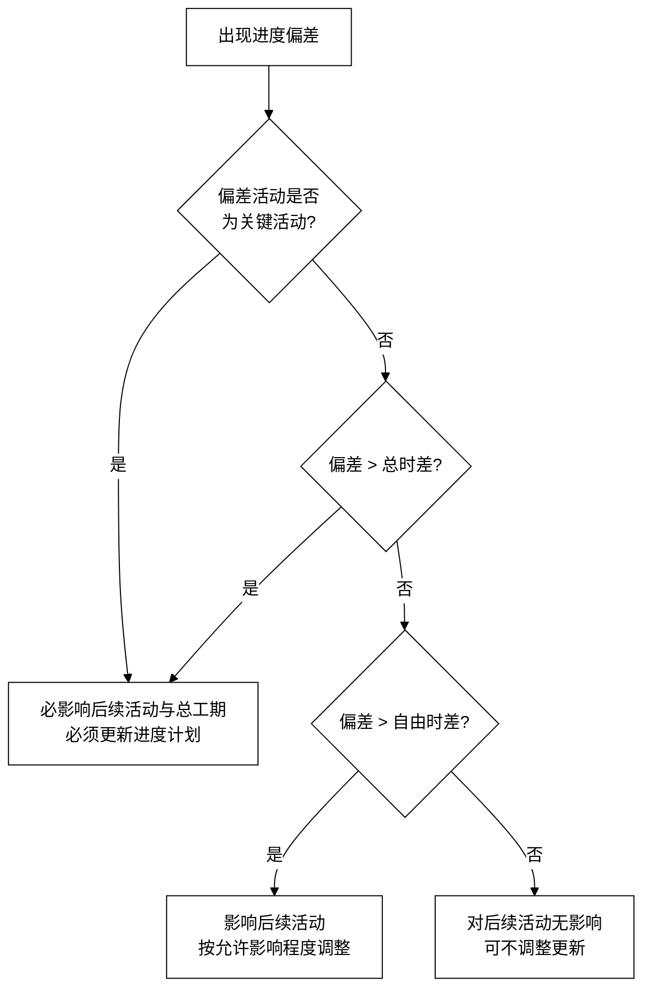

# 系统分析师｜第8章 项目管理（备考讲义＋章节自测题）

> **教材依据**：《系统分析师教程（第2版）》第8章《项目管理》（共9节：8.1 项目管理概述｜8.2 范围管理｜8.3 进度管理｜8.4 预算与成本管理｜8.5 配置管理｜8.6 质量管理｜8.7 人力资源管理｜8.8 风险管理｜8.9 信息（文档）管理）；顺带对照《系统分析师教程（第1版）》第20章《项目管理》（20.1～20.9）。两版**节号整体对应**（20.2→8.2、20.3→8.3、20.4→8.4、20.5→8.5、20.6→8.6、20.7→8.7、20.8→8.8、20.9→8.9），差异有三类：①第1版 **20.1 项目开发计划**（20.1.1 概述、20.1.2 项目开发计划的编制）在第2版整节删除，第2版 8.1 只保留概述；②第1版 20.5 配置管理下另有 20.5.4 版本控制 等子节，第2版压缩为 8.5.1／8.5.2 两节（版本控制与发行管理并入 8.5.1）；③第1版 20.8.2 风险的主要类型、20.9.4 软件测试计划、20.9.5 软件测试报告在第2版删除；20.9.1《软件文档概述》的引言内容则保留于第2版8.9节导言，其余章节结构由8.9.1～8.9.4展开，并非该项全部删除。教材外内容来源口径：本章正文以教材第2版原文为主；仅「项目资源管理过程」「赶工与时间-成本平衡」「项目组织结构类型」「已知风险与未知风险」四项两版教材均无原文、按2021年以后真题有检出以【真题补充｜考频｜两版教材均无原文】补回并置于归口模块末尾「拓展阅读」；其余两版均无原文且考情不支持的内容（PMBOK 的整体管理／采购管理／干系人管理、质量成本 COQ、七大质量工具、概率影响矩阵、期望货币价值 EMV 公式、沟通渠道 n(n−1)/2、塔克曼模型、冲突管理、激励理论、挣值分析 EVM 公式等）一律不收录，逐项见「⚠️ 不包含」与表下说明；本章无第1版补充内容回补。
>
> **考纲定位说明**：2024版考纲科目一第6条「项目管理」（6.1 项目管理概述｜6.2 范围管理｜6.3 进度管理｜6.4 预算与成本管理｜6.5 配置管理｜6.6 质量管理｜6.7 人力资源管理｜6.8 风险管理｜6.9 信息（文档）管理），与教材第2版第8章 8.1～8.9 各节**逐节一一对应**；唯一缺口为考纲 6.6.2 含「PDCA 循环」而教材第2版 8.6.2 无该原文（第1版 20.6.2 有），按「考纲有、第2版教材无原文且2021年以后无检出」不收录，仅在模块6 前置说明中注明。
>
> **考试形式**：综合知识（科目一）选择题（关键路径与工期、时差、规模估算具计算性质，但均以单选题形式命题）；案例分析（科目二）2024上～2026上 **0题组**，按累计口径（2021上～2026上，8场）亦 **0题组**——工期计算／网络计划类题只出现在上午综合知识；论文（科目三）2021上～2026上 **0题次**。近年频次窗（2024上～2026上，5场）**约12道/3场**——关键路径与工期计算 3道/3场、WBS 2道/2场（中频）；软件项目规模估算 2道/1场（低频，含按教材原文归口由第2章移入的德尔菲法）；项目管理过程、网络计划与赶工优化、质量管理与质量模型、沟通与人力资源管理、风险管理各1道/1场（低频）；配置管理、信息（文档）管理近年窗与全量统计窗均0检出（未检出）。全量统计窗（2021上～2026上，8场）约15道/6场。**无考点族5场全中**，故本章无 🔴 高频模块。
>
> 标签：系统分析师、上午题、项目管理、范围管理、WBS、进度管理、关键路径、活动排序、COCOMO、配置管理、基线、软件质量模型、风险管理、软件文档、备考

[TOC]

## 章节结构对照与来源标注

> 本讲义为《系统分析师教程（第2版）》第8章《项目管理》的学习讲义，模块顺序与教材 8.1～8.9 保持一致；本章知识点几乎全部来自教材第2版，仅四项为真题补充（教材未展开而真题有命题的内容），见各模块末尾「拓展阅读」；教材外且无考情支撑的内容一律不收录，见「⚠️ 不包含」。

| 讲义模块 | 对应教材第2版章节 | 内容性质 | 备考要求 |
|---|---|---|---|
| 模块1 项目管理概述 | 8.1 项目管理概述 | 教材＋真题补充 | 了解：项目与项目管理的定义、软件项目管理的对象与人员／产品／过程／项目四要素；拓展：项目资源管理过程 |
| 模块2 范围管理 | 8.2 范围管理 | 教材 | 掌握：范围管理计划与范围计划的区分、WBS 分解与工作包／里程碑、范围确认六项检查内容、范围控制「决不让步，除非交换」原则 |
| 模块3 进度管理 | 8.3 进度管理 | 教材＋真题补充 | 掌握：PDM／ADM 与四种依赖关系、三类依赖关系、LOC／德尔菲三点估算／类比估算／功能点／COCOMO 规模估算、进度偏差三级判定与计划调整；拓展：赶工与时间-成本平衡 |
| 模块4 预算与成本管理 | 8.4 预算与成本管理 | 教材 | 了解：三类成本估算方法、直接成本与间接成本、管理储备与零基准预算、挣值分析方法（教材只列方法名、无公式） |
| 模块5 配置管理 | 8.5 配置管理 | 教材 | 了解：配置与软件配置管理的定义、配置管理六过程与配置管理计划、三种基线、三类配置库 |
| 模块6 质量管理 | 8.6 质量管理 | 教材 | 了解：使用质量模型5特性、产品质量模型8特性与子特性、McCall 三维、质量特性度量、质量保证与质量控制的区分 |
| 模块7 人力资源管理 | 8.7 人力资源管理 | 教材＋真题补充 | 了解：组织结构图与 OBS／RAM、团队建设四时期、资源负荷与资源平衡、正式与非正式沟通；拓展：项目组织结构类型 |
| 模块8 风险管理 | 8.8 风险管理 | 教材＋真题补充 | 了解：风险的两个基本属性、风险管理六过程、风险成本构成、蒙特卡罗方法、防范策略与响应策略；拓展：已知风险与未知风险 |
| 模块9 信息（文档）管理 | 8.9 信息（文档）管理 | 教材 | 了解：GB/T 8567—2006 与25种文档、数据需求说明、技术报告、项目开发总结报告的章节构成 |

> 教材第2版第8章章节结构（按教材原文核读）：8.1 项目管理概述（**无子节**，节下依次叙述项目定义、项目管理定义、软件项目管理的对象与要素）｜8.2 范围管理（8.2.1 范围计划的编制、8.2.2 创建工作分解结构、8.2.3 范围确认和控制）｜8.3 进度管理（8.3.1 活动排序、8.3.2 活动资源估算、8.3.3 活动历时估算、8.3.4 进度控制）｜8.4 预算与成本管理（8.4.1 成本估算、8.4.2 成本预算、8.4.3 成本控制）｜8.5 配置管理（8.5.1 配置管理概述、8.5.2 配置标识）｜8.6 质量管理（8.6.1 软件质量模型、8.6.2 质量管理计划、8.6.3 质量保证与质量控制）｜8.7 人力资源管理（8.7.1 编制人力资源计划、8.7.2 组建项目团队、8.7.3 项目团队建设、8.7.4 管理项目团队、8.7.5 沟通管理）｜8.8 风险管理（8.8.1 风险管理的概念、8.8.2 风险管理的过程）｜8.9 信息（文档）管理（8.9.1 软件文档标准、8.9.2 数据需求说明、8.9.3 技术报告、8.9.4 项目开发总结报告）。
>
> ⚠️ 教材第2版第8章**不包含**（两源核查）：**源①**（对照第1版第20章《项目管理》逐节核对）——①项目开发计划（第1版 20.1：概述与编制方法、项目开发计划的内容）：第2版整节删除，2021年以后真题无检出，不收录；②风险的主要类型（第1版 20.8.2）：第2版删除，2021年以后真题无检出，不收录；③第1版 20.9.1《软件文档概述》的引言内容已保留在第2版8.9节导言，旧版原有层级结构未沿用；软件测试计划（20.9.4）、软件测试报告（20.9.5）第2版删除（后两者归口第14章软件实现与测试），2021年以后真题在本章无检出，不收录；④第1版 20.5.4 版本控制 等配置管理子节的**独立节编排**：第2版压缩并入 8.5.1，属**结构重组而非删除**，内容本章已覆盖。**源②**（对照考纲6.1～6.9子项与教材8.1～8.9小节核对）——仅一处：考纲 6.6.2 列有「PDCA 循环」，教材第2版 8.6.2 无该原文（第1版 20.6.2 有），2021年以后真题在本章无检出，按不收录处理。
>
> 说明（四处易混入本章、实不属本章或两版均无原文的内容）：①**挣值分析（EVM）的 EV／PV／AC、CV／SV、CPI／SPI、EAC 公式**——教材第2版 8.4.3 只出现「挣值分析方法」这一方法名与其定义（「通过测量和计算已完成工作的预算费用、已完成工作的实际费用和计划工作的预算费用，得到有关计划实施的进度和费用偏差」），**没有任何指标符号与计算公式**（第1版 20.4.3 有完整公式），且2021年以后真题近年窗与全量统计窗**均0检出**，故本章不收录 EVM 计算，只按教材原文记「挣值分析＝偏差分析法」；②**沟通渠道数 n(n−1)/2**、**期望货币价值 EMV**、**PERT 与甘特图**、**组织结构类型（职能型／项目型／矩阵型）**、**项目资源管理过程**——前四项两版教材均无原文、2021年以后真题亦无检出（EMV 归口第2章数学与工程基础·2.3，其教材原文亦仅列名称无公式），一律不收录；**组织结构类型**与**项目资源管理过程**因2026上甲套分别以第66题、第3题命题（各1道/1场，低频），按真题补充补回并置于归口模块拓展阅读；③**范围蔓延／镀金、质量成本 COQ、七大质量工具、概率影响矩阵、残余风险与次生风险、干系人权力利益方格、采购管理与合同类型、塔克曼团队五阶段、冲突管理五种策略、激励理论**——均为 PMBOK 体系内容，**两版教材第8章均无原文且2021年以后真题无检出**，一律移除，不另作「拓展阅读」收录（与四项真题补充的区别在于：后者有真题检出，前者无）；④**可行性研究**（2025下第21～22题、第30题）虽与项目管理相邻，但其教材原文在第2版 10.2、考纲条目为 8.2，归口第10章系统规划与分析，本章不收录。

---

## 模块1：项目管理概述（教材8.1）【教材｜了解】

**前置说明**：本模块对应教材第2版第8章 **8.1 项目管理概述**（无子节），对应考纲 **6.1 项目管理概述**（项目管理的定义、对象和目的）；正文为教材原文，适配上午综合选择题（概念辨析）。模块末尾「拓展阅读」为两版教材均无原文的真题补充项。

**模块优先级**：🟢 了解为主 —— 对应考点族「项目管理过程」近年频次窗 1道/1场（低频，2026上甲套第3题）；教材 8.1 原文（项目定义、软件项目管理四要素）近年频次窗内未单独命题（0场）。按统一判据（1场＝低频）判低频，不配置例题与习题、不设易错点。

**考情分析**（2021年以后真题）：近年频次窗（2024上～2026上，5场）1道/1场——2026上第3题（不属于项目资源管理过程的是）。核心考点：项目的定义与「一次性任务」属性、软件项目管理的对象（软件工程项目、覆盖整个软件工程过程）、人员／产品／过程／项目四要素；拓展考点：项目资源管理过程的构成。

### 1.1 核心知识点精讲

#### 1.1.1 项目与项目管理（教材8.1）【教材｜了解】

- **项目的定义**：项目是在特定条件下，具有特定目标的**一次性任务**，是在一定时间内，满足一系列特定目标的多项相关工作的总称。从项目的基本定义出发，人们日常进行的所有活动都可定义或分解为项目。
- **项目管理的定义**：项目管理是管理学的一个分支学科，是指在项目活动中运用专门的**知识、技能、工具和方法**，使项目能够在**有限资源限定条件**下，实现或超过设定的需求和期望的过程；是对一些成功达成一系列目标相关活动（譬如任务）的整体监测和管控，包括策划、进度计划和维护组成项目的活动的进展。

#### 1.1.2 软件项目管理的对象与要素（教材8.1）【教材｜了解】

- **管理对象**：软件项目管理的对象是**软件工程项目**，它所涉及的范围**覆盖了整个软件工程过程**。
- **七个「心中有数」的关键问题**：软件项目的工作范围、可能风险、需要资源（人、硬件／软件）、要实现的任务、经历的里程碑、花费工作量（成本）、进度安排。
- **管理的时间边界**：这种管理在**技术工作开始之前**开始，在软件从概念到实现的过程中继续进行，当软件工程过程最后结束时才终止。
- **四要素**：软件项目管理是为了使软件项目能够按照预定的**成本、进度、质量**顺利完成，而对 **人员（People）、产品（Product）、过程（Process）和项目（Project）** 等进行分析和管理的活动。

> 记忆：项目＝一次性任务；项目管理＝知识/技能/工具/方法 ＋ 有限资源约束；软件项目管理＝成本、进度、质量三目标 ＋ 人员/产品/过程/项目四要素。

### 拓展阅读：真题外延考点（两版教材均无原文）

> 收录依据：2026上甲套第3题（下列活动中，不属于项目资源管理过程的是）命题；两版教材第8章均无「项目管理过程组」「知识域」「资源管理过程」原文（教材 8.1 只叙述项目定义与人员／产品／过程／项目四要素），属 PMBOK 体系外延内容，按近年窗1场判低频。

#### 拓展·项目资源管理过程【真题补充｜考频｜两版教材均无原文】

- **项目资源管理**的典型过程构成：**规划资源管理 → 估算活动资源 → 获取资源 → 建设团队 → 管理团队 → 控制资源**。
- 辨析要点：「估算活动资源」与教材 8.3.2 活动资源估算对应；「获取／建设／管理团队」与教材 8.7.2～8.7.4 对应；而「规划质量管理」「估算成本」「制定进度计划」等属**其他知识域**，不属于资源管理过程，是此类题最常见的干扰项设置。

**例题（自带）【项目资源管理过程】**

下列活动中，不属于项目资源管理过程的是（ ）
A. 估算活动资源 B. 获取资源 C. 制定进度计划 D. 控制资源

> 【解析】2026上甲套第3题。项目资源管理围绕「人」与「物」两类资源展开，典型过程为规划资源管理、估算活动资源、获取资源、建设团队、管理团队、控制资源。制定进度计划属**项目进度管理**知识域（对应教材 8.3 进度管理），不属于资源管理过程。
> 【答案】C

---

## 模块2：范围管理（教材8.2）【教材｜掌握】

**前置说明**：本模块对应教材第2版第8章 **8.2 范围管理**（8.2.1 范围计划的编制、8.2.2 创建工作分解结构、8.2.3 范围确认和控制），对应考纲 **6.2 范围管理**；全部为教材原文，适配上午综合选择题（概念辨析＋原则判定）。

**模块优先级**：🟡 掌握为主 —— 对应考点族「WBS」近年频次窗 2道/2场（中频，2025下第26题(L1-01)／第35题(L1-03)、2026上甲套第51题）；按统一判据（2～4场＝中频）判中频，配置例题与习题并设易错点。

**考情分析**（2021年以后真题）：近年频次窗（2024上～2026上，5场）2道/2场——2025下第26题（L1-01）／第35题（L1-03）（WBS 的核心原则）、2026上第51题（项目计划过程的中心、是制定进度计划与资源需求及成本预算基础的是 WBS）。核心考点：范围计划与范围管理计划的区分、WBS 的分解对象与工作包／里程碑的区分、范围确认的六项检查内容、范围控制的「决不让步，除非交换」原则。

### 2.1 核心知识点精讲

#### 2.1.1 范围计划的编制（教材8.2.1）【教材｜掌握】

- **范围的含义**：范围是项目目标的更具体的表达。**需求无序扩张是项目失败最常见的原因之一**——无论是在项目启动、计划、执行还是收尾时不断加入新功能，都会使项目在时间、资源和质量上受到严重影响。
- **范围管理的目的**：确定项目的边界，即确定哪些工作是本次项目应该做的、哪些不应该包括在本次项目中；确保项目干系人对作为项目结果的产品（或服务）以及开发这些产品所确定的过程有**共同的理解**。
- **两组后果**：范围**不明确** → 范围蔓延，项目永远也做不到头；对范围的**理解不一致** → 项目组的工作无法得到其他干系人的认可。
- **范围计划 ≠ 范围管理计划**：范围计划编制的成果是范围管理计划。

| 对比项 | 范围计划 | 范围管理计划 |
|---|---|---|
| 描述对象 | 项目的**边界** | 项目组将**如何进行**项目的范围管理 |
| 内容 | 项目应做与不应做的工作 | 如何进行项目范围定义、如何制订 WBS、如何进行范围核实和控制 |
| 稳定性评估 | — | 对项目范围预期的稳定性（怎样变化、变化频率、变化了多少）充分评估 |

#### 2.1.2 创建工作分解结构（教材8.2.2）【教材｜掌握】

- **WBS 的分解过程**：把项目整体或者主要的可交付成果分解成容易管理、方便控制的若干个子项目，子项目继续分解为**工作包**；持续这一过程，直到整个项目都分解为可管理的工作包，**这些工作包的总和就是项目的所有工作范围**。
- **创建 WBS 的目的**：详细规定项目的范围，建立**范围基准**。
- **WBS 的性质**：面向**可交付物**的项目元素的层次分解，它组织并定义了整个项目范围。
- **确认与共识**：WBS 分解完成后，项目相关人员应对完成的 WBS 给予确认并达成共识，**然后才能据此进行时间和成本的估算**——这是 WBS 成为后续计划基础的直接依据。
- **可交付成果与里程碑**（易混辨析）：

| 对比项 | 可交付成果 | 里程碑 |
|---|---|---|
| 是什么 | 报告、原型、成果、最终系统等**产物** | 标志着某个可交付成果或者阶段**正式完成**的事件 |
| 关注点 | 关注「产出什么」 | 关注「是否完成」，例如正式的用户认可文件 |

- **工作包**：最底层的工作单元称为工作包，应便于完整地分派给不同的人或组织，要求明确各工作单元之间的界面；工作包是基层任务或工作的指派，同时具有检测和报告工作的作用。工作包大小的取舍：太大则难以管理和控制，太小则 WBS 本身要消耗大量时间和精力。
- **工具**：创建 WBS 没有所谓「正确的」方式，既可用白板、草图，也可用专门的项目管理软件。

#### 2.1.3 范围确认和控制（教材8.2.3）【教材｜掌握】

**（1）范围确认**——确认项目的可交付成果是否满足项目干系人的要求；把可交付成果列表提交给项目干系人，同时展示项目的进度安排。检查内容共六项：

1. 可交付成果是否是**确定的、可核实的**；
2. 每个可交付成果是否有明确的**里程碑**，里程碑是否有明确的、可辨别的事件（例如客户的书面认可）；
3. 是否有明确的**质量标准**，可交付成果和其标准之间是否有明确的联系；
4. **审核和承诺**是否有清晰的表达（项目投资人必须正式同意项目边界、完成的产品及相关可交付成果）；
5. 项目范围是否覆盖了需要完成的产品（或服务）进行的**所有活动**，有没有遗漏或者错误；
6. 项目范围的**风险是否太高**，管理层是否能够降低可预见的风险发生时的冲击。

> 发现遗漏或错误时须向项目组明确指出并给出修正意见；范围确认过程中也可能出现范围变更请求，经批准后同样要修改相关文档。

**（2）范围控制**——变更的常见诱因：项目外部环境变化（法律、对手的新产品等）、范围计划不周有错误或遗漏、出现新技术手段和方案、项目实施组织发生变化、客户要求发生变化。

- **核心原则**：「**决不让步，除非交换**」——尽可能减少范围蔓延的可能性，所有的范围变更必须在项目的**工期、费用或者质量要求**上得到相应的变更。
- **控制要求**：所有变更必须记载；对造成范围变更的因素施加影响，估算对项目资金、进度和风险的影响；判断范围变更是否发生并管理之。
- **控制依据**：**WBS、项目进展报告、变更请求和范围管理计划**；有合同的项目，范围变更还必须遵守合同相关条款。

#### 2.1.4 典型易错点【WBS 与范围控制】

1. **范围计划 ≠ 范围管理计划**：前者描述项目边界，后者描述如何管理范围；题干问「成果是」时应答范围管理计划。
2. **WBS 面向可交付物、不是面向活动**：教材原文为「面向可交付物的项目元素的层次分解」，凡选项写成「面向任务的分解」均错。
3. **先确认 WBS、后估算时间与成本**：教材明写「才能据此进行时间和成本的估算」，顺序不可颠倒。
4. **里程碑 ≠ 可交付成果**：里程碑是「完成」这一事件（如正式的用户认可文件），可交付成果是产物本身。
5. **工作包是最底层单元**：子项目之下才是工作包，不要把「子项目」当最底层。
6. **范围蔓延的对策是「交换」而非「拒绝」**：教材原则为「决不让步，除非交换」，即变更必须换来工期／费用／质量的相应变更。
7. **范围变更依据四件**：WBS、项目进展报告、变更请求、范围管理计划（有合同项目再加合同条款）。
8. **需求无序扩张是项目失败最常见原因之一**——这是教材原文，常作为选项干扰或正确表述出现。

### 2.2 典型例题

**例题1【WBS 的核心原则】**

关于 WBS（Work Breakdown Structure，工作分解结构）的原则，下列说法正确的是（ ）
A. WBS 面向项目活动进行层次分解 B. WBS 分解完成后应先进行时间与成本估算，再交由干系人确认 C. 工作包是最底层的工作单元，其总和构成项目的全部工作范围 D. 工作包划分越细越好，越细越便于管理

> 【解析】2025下第26题（L1-01）／第35题（L1-03）。教材原文：WBS 是**面向可交付物**的项目元素的层次分解，故 A 错；WBS 分解完成后应**先由相关人员确认并达成共识，然后才能据此进行时间和成本的估算**，故 B 顺序颠倒；工作包是最底层的工作单元，所有工作包的总和就是项目的所有工作范围，故 C 正确；工作包太小则 WBS 本身要消耗大量时间和精力，并非越细越好，故 D 错。
> 【答案】C

**例题2【WBS 在计划体系中的定位】**

项目计划过程的中心，是制定进度计划、资源需求和成本预算基础的是（ ）
A. 范围管理计划 B. 工作分解结构 C. 项目章程 D. 里程碑清单

> 【解析】2026上甲套第51题。教材原文：创建 WBS 的目的是详细规定项目的范围、建立范围基准；WBS 分解完成并经确认后，**才能据此进行时间和成本的估算**。因此 WBS 既是范围基准，又是进度计划、资源需求与成本预算的共同基础，处于项目计划过程的中心位置。范围管理计划是「如何管理范围」的指南而非计划基础本身；项目章程与里程碑清单均非教材第2版第8章内容。
> 【答案】B

**例题3【范围控制原则】**

在项目实施过程中客户不断提出新的功能要求，项目组最恰当的做法是（ ）
A. 一律拒绝，严格按原范围执行 B. 先接纳需求，后期通过加班消化 C. 坚持「决不让步，除非交换」，使变更在工期、费用或质量要求上得到相应变更 D. 交由项目经理自行决定并记录备案

> 【解析】教材原文：对于用户不断提出的新要求和建议，项目组应该坚持「**决不让步，除非交换**」的原则，尽可能减少范围蔓延的可能性，**所有的范围变更必须在项目的工期、费用或者质量要求上得到相应的变更**；同时所有变更必须记载，并以 WBS、项目进展报告、变更请求和范围管理计划为依据。A 过于绝对（变更本身可以发生，关键是有对价），B 属盲目赶工，D 缺少依据与对价机制。
> 【答案】C

### 2.3 课后习题

**习题1【范围确认的检查内容】**

项目干系人进行范围确认时，下列不属于其检查内容的是（ ）
A. 可交付成果是否是确定的、可核实的 B. 每个可交付成果是否有明确的里程碑 C. 项目团队的人员技能是否满足要求 D. 项目范围的风险是否太高

> 【解析】教材列举范围确认的六项检查内容：可交付成果确定可核实、有明确里程碑、有明确质量标准、审核和承诺清晰表达、覆盖所有活动无遗漏、范围风险是否太高。人员技能属人力资源管理（教材 8.7）范畴，不在范围确认检查之列。
> 【答案】C

**习题2【里程碑与可交付成果】**

关于里程碑与可交付成果的关系，下列说法正确的是（ ）
A. 里程碑就是可交付成果的另一种说法 B. 可交付成果关注是否完成，里程碑关注产出什么 C. 里程碑标志着某个可交付成果或者阶段的正式完成，例如正式的用户认可文件 D. 一个 WBS 分解单元中只能存在里程碑，不能存在可交付成果

> 【解析】教材原文：在每个分解单元中，都存在可交付成果和里程碑；里程碑标志着某个可交付成果或者阶段的正式完成；「里程碑和可交付成果紧密联系在一起，但并不是一个事物」。可交付成果可能包括报告、原型、成果和最终系统，而里程碑则关注是否完成，例如正式的用户认可文件。故 A、B 均颠倒或等同化，D 与原文相悖。
> 【答案】C

**习题3【范围蔓延与变更依据】**

对项目范围变更进行控制时，其依据不包括（ ）
A. WBS B. 项目进展报告 C. 变更请求 D. 项目组织结构图

> 【解析】教材原文：对范围变更进行控制时，要以 **WBS、项目进展报告、变更请求和范围管理计划**为依据；对于有合同的项目，还必须遵守项目合同的相关条款。项目组织结构图属人力资源管理（教材 8.7.1）工具，不作为范围变更控制的依据。
> 【答案】D

---

## 模块3：进度管理（教材8.3）【教材｜掌握】

**前置说明**：本模块对应教材第2版第8章 **8.3 进度管理**（8.3.1 活动排序、8.3.2 活动资源估算、8.3.3 活动历时估算、8.3.4 进度控制），对应考纲 **6.3 进度管理**；正文为教材原文，适配上午综合选择题（网络图识别＋关键路径／时差计算＋规模估算方法辨识）。模块末尾「拓展阅读」为两版教材均无原文的真题补充项。

**模块优先级**：🟡 掌握为主 —— 本模块含多个考点族：关键路径与工期计算 3道/3场（中频）、网络计划与赶工优化 1道/1场（低频）、软件项目规模估算 2道/1场（低频）；按「模块随所属考点族同判、取最高档」判中频，配置例题与习题并设易错点。

**考情分析**（2021年以后真题）：近年频次窗（2024上～2026上，5场）6道/3场——2024下第62～63题（12个作业 A～L 的关键路径与工期／时差）、2025下第7题（L1-01）／第12题（L1-03）（以节点表示活动、线条表示依赖关系的进度计划工具＝前导图）、第8题（L1-01）／第15题（L1-03）（双代号网络图工期压缩的赶工成本）、**第32题（L1-01）／第43题（L1-03）（德尔菲法：专家之间不讨论、反馈不署名）**、第40题（L1-01）／第42题（L1-03）（以代码行数评估项目规模的方法＝代码行法）、2026上第52题（决定项目最短工期的是关键路径）。核心考点：PDM 与 ADM 的图形识别、四种依赖关系、三类依赖关系、关键路径与总时差／自由时差的三级偏差判定、规模估算五法（LOC／德尔菲／类比／功能点／COCOMO）的辨识与公式。**归口说明**：德尔菲法教材第2版**第2章「德尔菲」0 命中**、原文全文在**8.3.3**，2026-10-12 按**教材原文归口**由第2章「预测与决策」族移入本章（不再两侧归因并存），本章题量据此按「约12道/3场」统计。

### 3.1 核心知识点精讲

#### 3.1.1 活动排序（教材8.3.1）【教材｜掌握】

- **活动排序的含义**：一个活动的执行可能需要依赖于另外一些活动的完成；依赖关系的确定应**首先分析活动之间本身存在的逻辑关系**，在此基础上再加以充分分析以确定各活动之间的**组织关系**。

**（1）前导图法 PDM（Precedence Diagramming Method）**

- 用**方格或矩形（节点）表示活动**，用**箭线表示依赖关系**。每项活动有唯一的活动号并注明预计工期。
- 每个节点活动有四个时间参数：**最早开始时间 ES、最迟开始时间 LS、最早结束时间 EF、最迟结束时间 LF**。
- **四种依赖关系（先后关系）**：

| 关系 | 记号 | 含义 | 使用频度 |
|---|---|---|---|
| 完成对开始 | FS | 后一活动的开始要等到前一活动的完成 | **最常用** |
| 完成对完成 | FF | 后一活动的完成要等到前一活动的完成 | 常用 |
| 开始对开始 | SS | 后一活动的开始要等到前一活动的开始 | 常用 |
| 开始对完成 | SF | 后一活动的完成要等到前一活动的开始 | **很少用** |

- **绘图规则**：必须正确表达逻辑关系、**图中不能出现回路**；不能出现双向箭头或无箭头的连线，不能出现无箭尾节点或无箭头节点的箭线；**只能有一个起始节点和一个终止节点**（出现多项无内向／无外向箭线的活动时，应设**虚活动**——不占用任何资源、只表示逻辑关系——作为起始或终止节点）。

**（2）箭线图法 ADM（Arrow Diagramming Method）**

- 用**节点表示事件**，用**箭线表示活动**，在节点处连接起来表示依赖关系；给每个**事件**（而非每项活动）指定唯一号码。
- 活动的开始（箭尾）事件叫**紧前事件**，结束（箭头）事件叫**紧后事件**。
- **三个基本原则**：每一个事件必须有唯一的代号（不会重复）；任何两项活动的紧前事件和紧后事件代号至少有一个不相同，节点序号沿箭线方向越来越大；流入（流出）同一事件的活动均有共同的后继活动（或先行活动）。
- ADM **只使用 FS 关系**，因此可能需要用**虚活动**（虚箭线）才能正确定义所有逻辑关系。

> 辨析口诀：**PDM＝节点活动＋箭线依赖（单代号）；ADM＝节点事件＋箭线活动（双代号）**。考「节点表示活动、线条表示依赖关系」者选 PDM／前导图（2025下第12题）。

**（3）三种依赖关系（用于活动排序）**

| 类型 | 别称 | 含义 |
|---|---|---|
| 强制性依赖关系 | 硬逻辑关系、工艺关系 | 活动**固有**的、本身存在且无法改变的逻辑关系 |
| 可自由处理的依赖关系 | 软逻辑关系、组织关系、首选／优先逻辑关系 | 人为确定的一种先后关系 |
| 外部依赖关系 | — | 涉及项目与**非项目活动**之间的关系 |

**（4）逻辑关系的三种表达形式**

- **平行关系（并行关系）**：两项活动同时开始。
- **顺序关系**：相邻两项活动先后进行。前一活动完成后后一活动马上开始为**紧连顺序关系**，隔一段时间才开始为**间隔顺序关系**。在顺序关系中，若一项活动只有在另一项活动完成之后才能开始且中间不插入其他活动，则另一项活动为该项活动的**紧前活动**，反之为**紧后活动**。
- **搭接关系**：两项活动只有一段时间是平行进行的。

#### 3.1.2 活动资源估算（教材8.3.2）【教材｜掌握】

- **内容**：决定需要什么资源（人员、工具、设备等）和资源的数量，以及何时使用资源来有效地执行项目活动；**必须和成本估算相结合**。
- **前提**：必须对资源的**可用性**进行评价（考虑资源地理位置的改变，以及资源数量和级别在项目进行过程中可能改变——例如前期需要系统分析师、编码阶段需要程序员）。
- **五种方法**：

| 方法 | 要点 |
|---|---|
| 专家判断法 | 由项目成本管理专家根据以往类似项目经验与对本项目的判断进行合理预测；专家可以是任何具有专门知识或经过特别培训的组织和个人 |
| 替换方案的确定 | 若某项活动存在替代方案或资源有替代支持可能，需要**明确声明** |
| 公开的估算数据 | 公司定期公开的生产率或人工费率数据（劳动力交易、材料和设备信息）可作参考 |
| 估算软件 | 依靠软件定义资源可用性、费率以及不同的资源日历 |
| 自下而上的估算 | 把复杂活动分解为更小的工作，逐项估算后汇总 |

#### 3.1.3 活动历时估算（教材8.3.3）【教材｜掌握】

**（1）软件项目的工作量**

- 软件项目的工作量和工期估算比较复杂：软件本身的复杂性、历史经验的缺乏、估算工具的缺乏以及一些人为错误，导致**规模估算往往和实际情况相差甚远**；**估算错误是软件项目失败的主要原因之一**。
- **LOC（Line of Code，代码行）**：软件项目通常用代码行衡量项目规模。LOC 指**所有可执行的源代码行数**，包括可交付的工作控制语言语句、数据定义、数据类型声明、等价声明、输入输出格式声明等。
- **教材示例（单行代码价值与人·月代码行数）**：某公司每一万行 Java 源代码形成的源文件约 250 kB；某系统源文件 3.75 MB → 估计源代码约 **15万行**；累计投入工作量 **240 人·月**，每人·月费用 10 000 元 →

  - 该项目中 1 LOC 的价值 ＝（240 × 10 000）／150 000 ＝ **16 元／LOC**
  - 该项目的人·月平均代码行数 ＝ 150 000／240 ＝ **625 LOC／人·月**

**（2）德尔菲法（Delphi）**

- **定位**：当前比较流行的**专家评估技术**，结合了**专家判断法和三点估算法**，在**没有历史数据**的情况下对项目进行估算；对减少数据中人为的偏见、防止任何人对结果不适当地产生过大的影响尤其有用。
- **实施步骤**：①发规格说明书（略去名称和单位）与估算表格请专家估算；②专家提出三个规模估算值并**无记名**填表（填写过程中**专家互相不进行讨论**，但可向组织者提问）；③组织者整理数据、计算各位专家的估算期望值并综合期望中值 E（**三点估算法**）；④汇总列成图表对比后再分发，专家修改判断，差异很大时查找原因；⑤上述过程可**重复多次**，最终获得多数专家共识的规模（**过程中不得进行小组讨论**；反馈时只给出各种意见，**不说明发表意见的专家姓名**）；⑥与历史资料类比推算每行源代码所需成本，再乘以源代码行数得到成本估算值。
- **三点估算公式**：\(E=\dfrac{a+4m+b}{6}\)（a 为最小规模、m 为最可能规模、b 为最大规模）。
- **与专家会议法的比较**：德尔菲法能发挥专家会议法集思广益、准确性高的优点，又能避免其缺点（权威人士影响他人、碍于情面不愿发表不同意见、出于自尊不愿修改不全面意见）。
- **主要缺点**：过程比较复杂、花费时间较长；人们无法利用其他参加者的估算值调整自己的估算值。**宽带德尔菲法**克服此缺点——在专家正式填表前由组织者召集小组会议讨论，专家无记名填表后再召集会议对变动很大的估算值讨论并重填，适当重复几次。

**（3）类比估算法**

- **适用**：与历史项目在应用领域、环境和复杂度等方面**相似**的项目；**前提条件**是企业建立起较好的**项目后评价与分析机制**，历史项目数据可信赖。
- **基本步骤**：①整理出项目功能列表和实现每个功能的代码行；②标识出每个功能列表与历史项目的相同点和不同点（特别注意历史项目做得不够的地方）；③得出各个功能的估计值；④产生规模估计。
- **可复用代码的等价代码行公式**：

  \[\text{等价 LOC}=\frac{\text{重新设计}\%+\text{重新编码}\%+\text{重新测试}\%}{3}\times\text{已有 LOC}\]

  教材示例：有 10 000 LOC，30% 需重新设计、50% 需重新编码、70% 需重新测试 → 等价 LOC ＝ [(30%＋50%＋70%)/3] × 10 000 ＝ **5 000 LOC**，即复用这 10 000 LOC 相当于编写 5 000 LOC 的工作量。

**（4）功能点估算法（FP）**

- **定位**：在**需求分析阶段**基于系统功能的一种规模估计方法；通过研究初始应用需求确定各种**输入、输出、数据文件、查询和外部接口**以及一些复杂度调整值。
- **步骤**：①计算输入、输出、查询、数据文件与接口的数目；②将这些数据进行**加权乘**；③根据对复杂度的判断，总数可用**复杂性调节因子**进行调整。
- **特点**：对项目**早期的规模估计**很有帮助；与**程序设计语言无关**；但涉及的主观因素比较多（例如各种权值函数的取值）。

**（5）COCOMO 模型**

- **定位**：COCOMO（Constructive Cost Model）是一种**结构型估算模型**，精确、易于使用。考虑开发环境，软件开发项目的**总体类型**分为三种：**组织型、嵌入型、半独立型**；按其详细程度分成三级：**基本、中间、详细**。

**基本 COCOMO 模型**（静态单变量模型，以已估算出的源代码行数为自变量；kLOC ＝ 1 000 LOC；M 为开发工作量，单位人·月；T 为开发进度，单位月）：

| 总体类型 | 工作量 M | 进度 T |
|---|---|---|
| 组织型 | M ＝ 2.4 × kLOC^1.05 | T ＝ 2.5 × M^0.38 |
| 半独立型 | M ＝ 3.0 × kLOC^1.12 | T ＝ 2.5 × M^0.35 |
| 嵌入型 | M ＝ 3.6 × kLOC^1.20 | T ＝ 2.5 × M^0.32 |

**中间 COCOMO 模型**（以 LOC 为自变量的函数计算**名义工作量**，再用涉及产品、硬件、人员、项目等方面属性的影响因素调整；**EAF 为调整因子，取值范围 0.9～1.4**）：

| 总体类型 | 工作量 M | 进度 T |
|---|---|---|
| 组织型 | M ＝ 3.2 × kLOC^1.05 × EAF | T ＝ 2.5 × M^0.38 |
| 半独立型 | M ＝ 3.0 × kLOC^1.12 × EAF | T ＝ 2.5 × M^0.35 |
| 嵌入型 | M ＝ 2.8 × kLOC^1.20 × EAF | T ＝ 2.5 × M^0.32 |

**详细 COCOMO 模型**：包括中间 COCOMO 模型的所有特性，但用各种影响因素调整工作量估算时还要考虑对软件工程过程中**每一步骤（例如分析、设计等）**的影响；名义工作量公式与进度公式与中间模型相同，**分层、分阶段给出工作量因素分级表**——针对每一个影响因素，按**模块层、子系统层、系统层**有三张不同的工作量因素分级表。

> 记忆：三种总体类型的工作量系数／指数——组织型 2.4／1.05、半独立型 3.0／1.12、嵌入型 3.6／1.20（基本模型）；指数随「组织型 → 嵌入型」递增，反映难度越高、规模收益越低。进度指数则随难度递减（0.38 → 0.32）。

#### 3.1.4 进度控制（教材8.3.4）【教材｜掌握】

- **进度控制的含义**：将实际进度与计划进度进行比较并分析结果，以保持项目工期不变、保证项目质量和所耗费用最少为目标，做出有效对策，进行项目进度更新。
- **进度更新两方面工作**：**分析进度偏差的影响** ＋ **进行项目进度计划的调整**；两方面都以**关键路径及相关参数**为基础，可能要使用挣值分析的结果。

**（1）分析进度偏差的影响（三级判定，教材原文顺序）**

1. **是否为关键活动**：若出现偏差的活动是**关键活动**，则无论其偏差大小，对后续活动及总工期都会产生影响，**必须**进行进度计划更新；若为非关键活动，则需根据偏差值与**总时差**和**自由时差**（本活动总时差 − 紧后活动总时差的最小值）的大小关系确定影响程度。
2. **进度偏差是否大于总时差**：大于总时差 → 必将影响后续活动和总工期，应采取调整措施；小于或等于总时差 → 对**总工期无影响**，但对后续活动的影响需再与自由时差比较。
3. **进度偏差是否大于自由时差**：大于自由时差 → 会对后续活动产生影响，如何调整应根据后续活动允许影响的程度而定；小于或等于自由时差 → 对后续活动无影响，进度计划可不调整更新。

**（2）项目进度计划的调整（四种情形）**

- **关键活动的调整**（进度更新的重点，因关键路径上任一活动持续时间的缩短或延长都会影响整个项目工期）：
  - **提前时**：若仅要求按计划工期执行，可利用机会降低资源强度及费用——选择后续关键活动中**资源消耗量大或直接费用高**的予以适当延长，延长时间不应超过已完成关键活动提前的量；若要求缩短工期，则将计划的未完成部分作为新计划重新计算与调整。
  - **落后时**：目标是采取措施把耽误的时间补回来，主要方法是**缩短后续关键活动的持续时间**（在原计划基础上采取组织措施或技术措施）。
  - 教材提示：不得不延长工期的情况非常普遍，项目总计划中要充分考虑适当的**时间冗余**；预计拖延时**应第一时间给项目干系人通报并征求项目业主（建设单位）意见**，这也是进度控制的重要工作内容。
- **非关键活动的调整**：持续时间延长但**不超过时差范围**时不影响工期，计划不必调整；为充分利用资源、降低成本，必要时可对非关键活动的时差适当调整，但**不得超出总时差**，且每次调整均需进行时间参数计算。三种方法：在总时差范围内延长持续时间、缩短工作的持续时间、调整工作的开始或完成时间。**超出总时差范围时必然影响整个项目工期，关键路径就会转移**，此时按「关键活动的调整」方法处理。
- **增减工作项目**：因编制计划考虑不周或其他原因需增加／取消某些工作时，应重新调整网络计划并计算网络参数；**增减工作项目不应影响原计划总的逻辑关系**，只能改变局部的逻辑关系。增加只对原遗漏或不具体的逻辑关系进行补充，减少只是消除提前完成或原不应设置的工作项目；调整后应重新计算网络时间参数以判断是否影响原计划工期。
- **资源调整**：资源供应发生异常（满足不了需要，例如资源强度降低或中断）时进行；前提是**保证工期不变或使工期更加合理**；方法是进行**资源优化**，提高资源利用率。

> **Brooks 法则（教材原文）**：在软件项目中必须处理好进度与质量的关系；在进度压力下赶任务，其成果往往是以**牺牲产品的质量**为代价的。因此当进度有可能延期时应分析原因加以补救，**不应该盲目地投入新的人员或推迟预定完成日期**——Brooks 曾指出：**为延期的软件项目增加人员将可能使其进度更慢**。

#### 3.1.5 典型易错点【进度管理与规模估算】

1. **PDM 与 ADM 的图形要素**：PDM 节点＝活动、箭线＝依赖；ADM 节点＝事件、箭线＝活动。题干「节点表示活动、线条表示依赖关系」→ PDM（单代号／前导图）。
2. **ADM 只用 FS**：ADM 只使用完成—开始关系，因此常需虚活动；PDM 有 FS／FF／SS／SF 四种，**SF 很少用、FS 最常用**。
3. **回路与起止节点**：PDM 图中不能出现回路，只能有一个起始节点和一个终止节点；多起点／多终点时用虚活动补齐。
4. **硬逻辑 vs 软逻辑**：强制性＝硬逻辑关系＝工艺关系（不可改变）；可自由处理＝软逻辑关系＝组织关系（人为确定）。
5. **偏差判定的顺序**：先判是否为关键活动 → 再与总时差比（判总工期）→ 最后与自由时差比（判后续活动）。**自由时差＝本活动总时差 − 紧后活动总时差的最小值**。
6. **非关键活动超出总时差 → 关键路径转移**：这是最常考的推论。
7. **LOC 的口径**：包括可交付的工作控制语言语句、数据定义、数据类型声明、等价声明、输入输出格式声明等，不是「注释行」或「物理行数」。
8. **德尔菲法的两端**：①专家之间**不进行讨论**、反馈**不署名**；②宽带德尔菲法才引入小组会议讨论。题干说「专家集体讨论后达成一致」是典型错项。
9. **等价 LOC 公式的三个百分比取平均**：[(重新设计%＋重新编码%＋重新测试%)/3] × 已有 LOC，不要直接相加。
10. **功能点与语言无关**：功能点估算法与程序设计语言无关，但主观因素多（权值函数取值）。
11. **COCOMO 三类型指数递增**：组织型 1.05 ＜ 半独立型 1.12 ＜ 嵌入型 1.20；中间模型才乘 EAF（0.9～1.4），基本模型不乘。
12. **Brooks 法则**：延期项目加人会更慢；赶工往往以牺牲质量为代价。

### 3.2 典型例题

**例题1【前导图与箭线图的识别】**

在项目进度管理中，通过「节点表示活动、线条表示活动依赖关系」来反映进度计划的工具是（ ）
A. 箭线图法（ADM） B. 前导图法（PDM） C. 甘特图 D. 里程碑图

> 【解析】2025下第12题（L1-03）／第7题（L1-01）。教材原文：前导图法（PDM）用**方格或矩形（节点）表示活动**，用**箭线表示依赖关系**；箭线图法（ADM）则相反——用节点表示**事件**、用箭线表示**活动**。甘特图与里程碑图均非教材第2版第8章内容（本章不收录）。
> 【答案】B

**例题2【关键路径与最短工期】**

在项目网络计划中，决定项目最短工期的是（ ）
A. 耗时最长的路径 B. 活动数量最多的路径 C. 时差最大的路径 D. 资源消耗最多的路径

> 【解析】2026上甲套第52题。关键路径是网络计划中**总持续时间最长的路径**，它决定了项目的**最短工期**（任何一条非关键路径上的活动都有一定的机动时间，而关键路径上活动总时差为零，其任一活动持续时间的缩短或延长都会对整个项目工期产生影响）。「活动数量最多」「资源消耗最多」都不是判定依据；「时差最大」恰与关键路径（时差最小）相反。
> 【答案】A

**例题3【规模估算方法的辨识】**

在软件项目规模估算中，「简单通过统计源代码行数（LOC）来评估项目规模」的方法属于（ ）
A. 代码行法 B. 功能点估算法 C. COCOMO 模型 D. 德尔菲法

> 【解析】2025下第40题（L1-01）／第42题（L1-03）。教材 8.3.3：软件项目通常用**代码行（LOC）**衡量项目规模，LOC 指所有可执行的源代码行数；**功能点**基于系统功能（输入／输出／查询／数据文件／接口），**COCOMO** 是以源代码行数为自变量的**结构型估算模型**（需再经工作量公式计算），**德尔菲法**是结合专家判断与三点估算的**专家评估技术**。题干强调「简单通过统计源代码行数」→ 代码行法。
> 【答案】A

**例题4【三点估算与等价代码行】**

某软件规模估算中，专家给出最小规模 40 kLOC、最可能规模 60 kLOC、最大规模 110 kLOC；另有一批 12 000 LOC 的既有代码，其中 20% 需重新设计、50% 需重新编码、80% 需重新测试。求三点估算期望值与这批代码的等价 LOC。（ ）
A. 期望值 60 kLOC，等价 LOC 6 000 B. 期望值 65 kLOC，等价 LOC 6 000 C. 期望值 65 kLOC，等价 LOC 4 000 D. 期望值 70 kLOC，等价 LOC 7 200

> 【解析】三点估算 \(E=(a+4m+b)/6=(40+4\times60+110)/6=390/6=65\) kLOC。等价 LOC ＝ [(20%＋50%＋80%)/3] × 12 000 ＝ 50% × 12 000 ＝ **6 000 LOC**。
> 【答案】B

### 3.3 课后习题

**习题1【关键路径与总时差】**

某项目含 12 个作业，各作业的紧前作业与持续时间如下表（单位：天）。

| 作业 | A | B | C | D | E | F | G | H | I | J | K | L |
|---|---|---|---|---|---|---|---|---|---|---|---|---|
| 紧前作业 | — | A | A | B | B、C | C | D、E | E、F | G | H、I | I | J、K |
| 持续时间 | 3 | 4 | 5 | 6 | 4 | 7 | 5 | 8 | 6 | 4 | 3 | 5 |

推演该项目的关键路径与最短工期。

> 【解析】正向计算最早开始／最早结束：A(0—3)；B(3—7)、C(3—8)；D 需 B(7) → 7—13；E 需 max(B=7, C=8)＝8 → 8—12；F 需 C(8) → 8—15；G 需 max(D=13, E=12)＝13 → 13—18；H 需 max(E=12, F=15)＝15 → 15—23；I 需 G(13) → 13—19；J 需 max(H=23, I=19)＝23 → 23—27；K 需 I(19) → 19—22；L 需 max(J=27, K=22)＝27 → 27—32。终点取最大最早结束时间 → 最短工期 **32 天**；逆推其紧前链：L←J←H←F←C←A。
> 【答案】关键路径为 **A—C—F—H—J—L**（3＋5＋7＋8＋4＋5＝32 天），最短工期 **32 天**。

**习题2【进度偏差的三级判定】**

某非关键活动的进度偏差为 6 天，该活动的总时差为 8 天、自由时差为 2 天。据此可以得出的结论是（ ）
A. 必将影响总工期 B. 对总工期无影响，但会影响后续活动 C. 对总工期与后续活动均无影响 D. 关键路径将发生转移

> 【解析】按教材 8.3.4 三级判定：该活动为非关键活动 → 进入第二级，偏差 6 天 **不大于总时差 8 天** → 对**总工期无影响**；进入第三级，偏差 6 天 **大于自由时差 2 天** → 会**对后续活动产生影响**，如何调整应根据后续活动允许影响的程度而定。偏差未超出总时差，故关键路径不会转移。
> 【答案】B

**习题3【进度与资源的关系】**

关于项目进度与资源的关系，下列说法不正确的是（ ）
A. 为延期的软件项目增加人员将可能使其进度更慢 B. 资源供应发生异常时应进行资源调整，前提是保证工期不变或使工期更加合理 C. 非关键活动的时差可以随意调整，不受总时差限制 D. 在进度压力下赶任务，其成果往往以牺牲产品质量为代价

> 【解析】C 与教材原文相悖——教材明写「必要时可对非关键活动的时差做适当调整，但**不得超出总时差**，且每次调整均需进行时间参数计算」；超出总时差必然影响整个项目工期并使关键路径转移。A、D 为教材 Brooks 法则与赶工代价的原文，B 为资源调整的前提原文。
> 【答案】C

### 拓展阅读：真题外延考点（两版教材均无原文）

> 收录依据：2025下第8题（L1-01）／第15题（L1-03）以双代号网络图的**赶工（时间-成本平衡）**命题；两版教材第8章均无「赶工」「工期压缩」「进度压缩」「快速跟进」原文（教材 8.3.4 只讲关键活动与非关键活动的持续时间调整，未给出赶工费用优化方法），按近年窗1场判低频。

#### 拓展·赶工与时间-成本平衡【真题补充｜考频｜两版教材均无原文】

- **赶工（Crashing）**：在**关键路径**上投入更多资源以缩短关键活动的持续时间，从而压缩总工期；每压缩一天需付出额外的**赶工费用**。
- **基本判定步骤**：①求出关键路径与总工期；②列出关键活动的**可压缩天数**与**单位压缩成本**；③优先压缩**单位成本最低**的关键活动；④压缩后若出现**多条关键路径**，后续压缩须在各关键路径上**同时**进行（否则总工期不变）；⑤压缩量受活动**可压缩上限**限制，且不得把非关键活动压成关键路径后继续单压。
- **易错点**：只压非关键路径无效；忽略「压缩后关键路径转移／并行」会导致答案偏小；忽略可压缩上限会导致方案不可行。

**例题（自带）【工期压缩的最小成本】**

某项目需将工期缩短 2 天。关键路径上活动 A、E 各压缩 1 天的追加成本为 1 万元，另一条次长路径上活动 B 压缩 1 天的追加成本为 2 万元；压缩 A 一天后该次长路径将变为关键路径。最少需增加成本（ ）
A. 2 万元 B. 3 万元 C. 4 万元 D. 6 万元

> 【解析】2025下第8题（L1-01）／第15题（L1-03）型。单位压缩成本最低的是 A 与 E（各 1 万元/天），优先压缩；压 A 一天后工期缩短 1 天，但次长路径随之成为关键路径，因此第二天必须在两条关键路径上**同时**压缩，由 B 承担其所在路径的压缩，成本 2 万元。合计 1 ＋ 2 ＝ **3 万元**。
> 【答案】B

---

## 模块4：预算与成本管理（教材8.4）【教材｜了解】

**前置说明**：本模块对应教材第2版第8章 **8.4 预算与成本管理**（8.4.1 成本估算、8.4.2 成本预算、8.4.3 成本控制），对应考纲 **6.4 预算与成本管理**；全部为教材原文。

**模块优先级**：🟢 了解为主 —— 近年频次窗内本模块各知识点均未独立命题（0场），按统一判据（0场＝未检出）判未检出；**全量统计窗（2021上～2026上，8场）内亦无独立检出**。考纲6.4明确要求，故保留收录；不配置例题与习题、不设易错点。

**考情分析**（2021年以后真题）：近年频次窗（2024上～2026上，5场）0道/0场（未检出）。注意两点边界：①教材 8.3.3 的**规模估算**（LOC／功能点／COCOMO）常被泛称为「成本估算」，但其教材原文在 8.3.3、归模块3，本章按教材坐标归口；②**挣值分析（EVM）的指标公式**两版教材本章均无完整公式（第1版 20.4.3 有，第2版 8.4.3 只保留方法名），且2021年以后真题无检出，本章只记教材原文的方法名与定义。核心考点仍须掌握：三类成本估算方法、六项间接成本因素、管理储备与成本基线的关系、零基准预算。

### 4.1 核心知识点精讲

#### 4.1.1 成本估算（教材8.4.1）【教材｜了解】

- **项目成本**：为完成项目目标而付出的费用和耗费的资源。影响因素非常多且变化大，其中**质量、进度和范围**对项目成本的影响非常突出且关联性很强；**价格和管理水平**也具有重要影响。
- **三个过程**：成本**估算**（对完成项目所需成本的估计和计划）→ 成本**预算**（把估算的总成本分配到各个工作包，建立成本基准计划以衡量项目绩效）→ 成本**控制**（保证各项工作在各自的预算范围内进行）。
- **成本估算的资料**：资源的类型和数量、每种资源的单价、每项资源占有的时间；因此**成本估算和活动资源估算往往结合在一起**。
- **三类基本估算方法**：

| 方法 | 主要思想 | 优点／缺点 |
|---|---|---|
| 自顶向下估算 | 从项目整体出发进行类推——根据以前已完成项目所消耗的总成本（或总工作量）推算将要开发软件的总成本，再按比例分配到各开发任务单元 | 快；对细节把握弱 |
| 自底向上估算 | 把系统细分到每一个子任务都已明确所需开发工作量，然后加总得到系统开发的总工作量 | **常见**；要求分解充分 |
| 差别估算法 | 把项目与过去已完成项目类比，从各子任务中区分出**类似部分**（按实际量计算）与**不同部分**（采用相应方法如德尔菲法估算） | 准确度较高；**不容易明确「类似」的界限** |

#### 4.1.2 成本预算（教材8.4.2）【教材｜了解】

- **基本步骤**：①分摊项目总成本到 **WBS 的各个工作包**，为每个工作包建立总预算成本（**所有工作包的预算成本相加不能超过项目总预算成本**）；②将每个工作包分配到的成本再**二次分配**到工作包所包含的各项活动上；③确定各项成本预算支出的**时间计划**以及每个时间点对应的**累积预算成本**，编制项目成本预算计划。

**（1）直接成本与间接成本**——除直接成本外还应考虑：

1. **非直接成本**：租金、保险和其他管理费用。
2. **隐没成本（沉没成本）**：**已经付出且不可收回**的成本。
3. **学习曲线**：采用项目组成员未使用过的技术和方法时，初期有学习过程，尝试与试验会增加成本；**项目组从未从事的项目比原有项目的升级成本更高**（须学习新行业的术语、原理和流程）。
4. **项目完成的时限**：时限越短成本越高；过于压缩进度不仅要支付加班费用，还可能导致设计和测试投入减少、**项目风险提高**。
5. **质量要求**：成本估算要根据产品质量要求的不同而不同。
6. **保留**：为风险和未预料的情况而准备的预留成本。

**（2）管理储备**：为范围和成本的潜在变化而预留的预算，它们是**未知的**，项目经理在使用之前**必须得到批准**；**管理储备不是项目成本基线的一部分**，但包含在项目的预算中；它们未被作为预算进行分配，**因此不是挣值分析的一部分**。

**（3）零基准预算**：不以过去相似项目的成本作为基准再按规模、性质、质量要求、工期要求等调节，而是**项目以零作为基准，估计所有工作任务的成本**。

#### 4.1.3 成本控制（教材8.4.3）【教材｜了解】

- **含义**：按照事先确定的**成本基准计划**，运用多种恰当方法对项目实施过程中所消耗费用的使用情况进行管理和控制，确保实际成本限制在项目成本预算范围内。
- **控制要点**：识别可能引起项目成本基准计划发生变动的因素并对其施加影响；监督费用实施情况，**发现实际费用和成本计划的偏差并找出偏差的原因**；阻止不正确、不合理和未经批准的费用变更。
- **挣值分析方法**（教材只给出方法名与原理，无指标符号与公式）：项目成本控制中主要采用**挣值分析**，它是一种**进度和成本测量技术**，可用来估计和确定变更的程度和范围，因此也称为**偏差分析法**；其原理是「通过测量和计算**已完成工作的预算费用、已完成工作的实际费用**和**计划工作的预算费用**，得到有关计划实施的进度和费用偏差，达到判断项目预算和进度计划执行情况的目的」。

---

## 模块5：配置管理（教材8.5）【教材｜了解】

**前置说明**：本模块对应教材第2版第8章 **8.5 配置管理**（8.5.1 配置管理概述、8.5.2 配置标识），对应考纲 **6.5 配置管理**；全部为教材原文。

**模块优先级**：🟢 了解为主 —— 近年频次窗 0道/0场（未检出），**全量统计窗（2021上～2026上，8场）内亦0检出**；考纲6.5明确要求，故保留收录；不配置例题与习题、不设易错点。

**考情分析**（2021年以后真题）：近年频次窗（2024上～2026上，5场）0道/0场（未检出），全量统计窗内亦无检出。素材层考点族表中本章**无「配置管理」族**（配置项、基线、配置库三类在2021年以后八场综合知识中均未单独命题），但作为考纲明确条目仍须掌握辨识级内容。核心考点：配置与软件配置管理的定义、配置管理六项过程活动、三种基线、三类配置库及其对应的系统形态。

### 5.1 核心知识点精讲

#### 5.1.1 配置管理概述（教材8.5.1）【教材｜了解】

- **配置**：在技术文档中明确说明并最终组成软件产品的**功能或物理属性**，包括即将受控的所有产品特性，其内容及相关文档、软件版本、变更文档、软件运行的支持数据，以及其他一切保证软件一致性的组成要素。
- **软件配置管理（SCM）**：通过执行**版本控制、变更控制的规程**，以及使用合适的配置管理工具，来**保证所有配置项的完整性和可跟踪性**；配置管理是对工作成果的一种有效保护。
- **国家标准定义（GB/T 11457—2006）**：配置管理是**标识和确定系统中配置项的过程**，是在系统整个生存期内控制这些配置项的投放和更动，记录并报告配置的状态和变动要求，验证配置项的完整性和正确性，并对相关工作进行技术和行动指导与监督的一套规范。其内容包括：①对配置项的功能特性和物理特性进行标识和文件编制；②控制这些特性的变动情况；③记录并报告这些变动进行的处理和实现的状态。
- **配置管理的目的**：运用**配置标识、配置控制、配置状态和配置审计**，建立和维护工作产品的完整性。
- **两项参照框架**：**CMMI** 把配置管理分为九大部分——制订配置管理计划、识别配置项、建立配置管理系统、创建或发行基线、跟踪变更、控制变更、建立配置管理记录、执行配置审核、版本控制；**GB/T 8566—2022** 规定的软件配置管理过程活动为——编制配置管理计划、配置标识、变更管理和配置控制、配置状态说明、配置审核、版本控制和发行管理。

**（1）配置管理过程（六项）**

| 序号 | 活动 | 要点 |
|---|---|---|
| 1 | 编制软件配置管理计划 | 项目启动时项目经理先制订整个项目的开发计划，**配置管理计划是项目开发计划的一部分** |
| 2 | 配置标识 | 确定哪些内容应进入配置管理、形成配置项，并确定配置项如何命名、用哪些信息描述；是配置管理的**基础性工作、前提** |
| 3 | 变更管理和配置控制 | 配置管理**最重要的任务**；目的是防止复杂而无形的软件在多次变更下失控、出现混乱 |
| 4 | 配置状态说明（配置状态报告） | 有效地记录、报告管理配置所需要的信息，及时准确地给出配置项的当前状况 |
| 5 | 配置审核 | 验证**配置项对配置标识的一致性**；体现配置管理的最根本要求——不允许出现任何混乱现象 |
| 6 | 版本控制和发行管理 | 版本包括配置项的版本和配置的版本；**配置项的版本应体现其版本的继承关系**（主要在开发人员内部区分），纳入基线的配置项版本应做标识 |

**（2）配置管理计划（GB/T 8567—2006，共12部分）**：引言、引用文件、管理、SCM 活动、工具技术和方法、对供货单位的控制、记录的收集维护和保存、配置项和基线、备份、日程表、注解、附录。其中 SCM 活动描述**配置标识、配置控制、配置状态记录与报告、配置检查与评审**四个方面。

#### 5.1.2 配置标识（教材8.5.2）【教材｜了解】

- **配置项**：开发、运行、维护过程中得到的阶段性成果以及需要用到的工具软件或配置等信息项，是配置管理的对象。**每个配置项的主要属性**：名称、标识符、状态、版本、作者、日期。
- **配置项与配置的关系**：配置项是一个**独立存在的信息项**，可看成一个元素；随工作进展出于不同要求将这些元素进行不同组合，这个组合称为**配置**——配置是信息系统产品在生存期各个阶段的不同形式（记录特定信息的不同媒体）和不同版本的程序、文档及相关数据的集合，或者说**是配置项的集合**，具有完整的意义。

**（1）确定配置项**

- **判定标准**：除临时性文档外，软件项目中形成的技术性文档和管理性文档一般都应进行配置管理；具体标准是**此文档是否有多个人需要使用**——这类文档在开发过程中不断修正和扩展，要保证每个使用者都使用同一版本，就必须纳入配置管理成为受控的配置项。
- **可能成为配置项的工作产品**：过程描述、需求、设计、测试计划和规程、测试结果、代码／模块、工具、接口描述等。**Rogers Pressman 认为至少以下文档应成为配置项**：系统规格说明书、项目计划、需求规格说明书、用户手册、设计规格说明、源代码、测试规格说明、操作和安装手册、可执行程序、数据库描述、联机用户手册、维护文档、软件工程标准和规程。
- **命名**：必须满足**唯一性和可追溯性**；典型做法是采用**层次式命名规则**反映树状结构（节点间存在层次继承关系）。
- **描述**：每个配置项用一组特征信息（**名字、描述、一组资源、实现**）唯一标识；配置项间的关系有整体—部分关系、层次关系，也有关联关系，可用 **MIL（Module Interconnection Language，模块内连接语言）** 表示——MIL 描述配置项间的相互依赖关系，可自动构造系统的任何版本。

**（2）基线（Baseline）**

- **定义**：基线是项目生存期各开发阶段末尾的**特定点**，也称为**里程碑**；在这些特定点上阶段工作已结束，并且已经形成了**正式的（通过了正式的技术评审）阶段产品**。
- **作用**：把各开发阶段的工作划分得更加明确，有利于检验和肯定阶段成果，同时有利于进行变更控制；有了基线的规定就可以**禁止跨越里程碑去修改另一开发阶段的工作成果**，认为建立了里程碑，有些完成的阶段成果已被冻结。

| 基线 | 形成时点 | 内容 |
|---|---|---|
| **功能基线** | 系统分析与软件定义阶段结束时 | 经正式评审和批准的**系统设计规格说明书**中对待开发系统的规格说明；或经项目业主和承建单位双方签字同意的协议书／合同中所规定的规格说明；或由上级下达的项目任务书中所规定的规格说明。**是最初批准的功能配置标志** |
| **指派基线（分配基线）** | 软件需求分析阶段结束时 | 经正式评审和批准的 **SRS**。**是最初批准的指派配置标志** |
| **产品基线** | 软件组装与系统测试阶段结束时 | 经正式评审和批准的有关所开发软件产品的**全部配置项的规格说明**。**是最初批准的产品配置标志** |

- **另两类基线**：交付给项目组所在企业**外部客户**的基线称为**发行基线**，企业内部使用的基线称为**构造基线**。
- **释放与交付**：**释放（Release）** 指在软件生存周期各个阶段结束时由该阶段向下一阶段提交该阶段产品的过程，也指将系统测试阶段结束时所获得的最终产品向用户提交的过程；**后面这个过程也称为交付（Delivery）**。
- **基线与变更控制的张力**：提出基线本是为了更好地实现变更控制，但若把每个基线都当成一个整体看待会造成麻烦——一个变更很可能只涉及基线的很小一部分（例如大型软件中一个模块修改，若当作整个产品基线的变更就很不方便）。

**（3）建立配置管理系统**（主要步骤）：建立适用于**多控制等级**配置管理的管理机制（生存周期不同时间、不同系统类型所需控制等级不同）→ 存储和检索配置项 → 共享和转换配置项 → 存储和复原配置项的归档版本 → 存储、更新和检索配置管理记录 → 创建配置管理报告 → **保护配置管理系统的内容**（主要功能为文档的备份与恢复、文档的建档、从配置管理的差错状态下复原）→ **权限分配**（配置管理员为每个项目成员分配对配置库的操作权限；**配置管理员权限最高**，一般项目成员可拥有添加、检入／检出（Check In／Check Out）、下载的权限，但**不能拥有删除的权限**）。

**（4）配置库（三类，与配置管理系统三种形态对应）**

---

## 模块6：质量管理（教材8.6）【教材｜了解】

**前置说明**：本模块对应教材第2版第8章 **8.6 质量管理**（8.6.1 软件质量模型、8.6.2 质量管理计划、8.6.3 质量保证与质量控制），对应考纲 **6.6 质量管理**；全部为教材原文。**考纲 6.6.2 列有「PDCA 循环」，教材第2版 8.6.2 无该原文**（第1版 20.6.2 有），2021年以后真题在本章无检出，按不收录处理，本模块不展开。

**模块优先级**：🟢 了解为主 —— 对应考点族「质量管理与质量模型」近年频次窗 1道/1场（低频，2025下第44题(L1-01)／第63题(L1-03)）；按统一判据（1场＝低频）判低频，不配置例题与习题、不设易错点。

**考情分析**（2021年以后真题）：近年频次窗（2024上～2026上，5场）1道/1场——2025下第44题（L1-01）／第63题（L1-03）（软件质量模型中「互操作性」所属的质量特性＝兼容性）。全量统计窗另含2021上第59～60题。核心考点：使用质量模型5特性、产品质量模型8特性与子特性归属（互操作性属兼容性）、McCall 三维、质量特性度量的两类与两种、验证／确认／测量的区分、质量保证与质量控制的区分。

### 6.1 核心知识点精讲

#### 6.1.1 软件质量模型（教材8.6.1）【教材｜了解】

- **软件或系统的质量**：该软件或系统满足其不同利益相关方所**明确的或隐含的要求**的程度，并由此提供相应的价值。
- **标准与框架**：ISO/IEC 25000 系列标准把产品质量分为一些特性，并在某些情况下进一步分解为子特性（某些子特性又分解为子子特性），通过层次化分解提供便利的产品质量分级；可测量的、与质量相关的属性称为质量测度相关的质量属性，从而形成**质量特性 → 质量子特性 → 质量属性**的层级关系。**质量模型**是定义的特征集以及它们之间的关系集，为规约质量需求以及评价质量提供框架。
- **GB/T 25000.10—2016** 定义了**使用质量模型**和**产品质量模型**。

**（1）使用质量模型（5个特性）**：**有效性、效率、满意度、抗风险、周境覆盖**。系统的使用质量描述产品（系统或软件产品）对利益相关方造成的影响，由软件、硬件、运行环境的质量以及用户、任务和社会环境的特性所决定；该模型可应用于整个人机系统。子特性示例：有用性、可信性、愉悦性、舒适性、经济风险缓解性、健康和安全风险缓解性、环境风险缓解性、周境完备性、灵活性。

**（2）产品质量模型（8个特性）**：**功能性、性能效率、兼容性、易用性、可靠性、信息安全性、维护性、可移植性**。每个特性由一组相关子特性组成，关系到软件的静态性质和计算机系统的动态性质。

| 特性 | 主要子特性（教材图8-5） |
|---|---|
| 功能性 | 功能完备性、功能正确性、功能适合性、功能性的依从性 |
| 性能效率 | 时间特性、资源利用性、容量、性能效率的依从性 |
| **兼容性** | **共存性、互操作性**、兼容性的依从性 |
| 易用性 | 可辨识性、易学性、易操作性、用户差错防御性、用户界面舒适性、易访问性、易用性的依从性 |
| 可靠性 | 成熟性、可用性、容错性、易恢复性、可靠性的依从性 |
| 信息安全性 | 保密性、完整性、抗抵赖性、可核查性、真实性、信息安全性的依从性 |
| 维护性 | 模块化、可重用性、易分析性、易修改性、易测试性、维护性的依从性 |
| 可移植性 | 适应性、易安装性、易替换性、可移植性的依从性 |

> **互操作性**属**兼容性**的子特性（2025下第44题／第63题考点）；**共存性**亦属兼容性——两者常成对出现作干扰项。

**（3）McCall 质量模型**：从**软件运行、软件修改、软件转移**三个方面来考查软件的质量。

**（4）质量特性度量**

- **两类度量**：**预测度量**（利用定量或定性方法估算软件质量的评价值，得到比较精确的估算值）与**验收度量**（在软件开发各阶段的检查点对软件的要求质量进行确认性检查的具体评价值，是对开发过程中的预测进行评价）。
- **预测度量的两种**：**尺度度量**（**定量**度量，适用于能够直接度量的特性，例如出错率定义为「（错误数／kLOC）／单位时间」）与**二元度量**（**定性**度量，适用于只能间接度量的特性，例如可使用性、灵活性等）。
- **子特性间的相关性**：有些子特性**正相关**（例如可靠性与可用性互相促进），有些**负相关**（例如安全性与效率是一对矛盾体）；系统设计过程中应根据具体情况折中，以便得到总体上使用户满意的质量标准。

**（5）三个相关概念**：**验证**——通过检查和提供客观的证据来证实**规定需求**已经得到满足；**确认**——通过检查和提供客观的证据来证实**针对某一特定预期用途的需求**已经得到满足；**测量**——一组操作，其目的是确定某个测度的值。

#### 6.1.2 质量管理计划（教材8.6.2）【教材｜了解】

- **基本准则**：现代质量管理的一项基本准则是「**质量是计划出来的，而不是检查出来的**」，这是在项目质量管理工作中必须牢牢把握的。
- **编制要点**：编制一份清晰的质量管理计划是实施项目质量管理的第一步；一个清晰的质量管理计划首先需要明确两点——**一是明确将采用的质量标准，二是明确质量目标**。
- **约束来源**：**质量政策**和**质量标准**往往是编制质量管理计划的**约束条件**，并**来自于项目组织之外**——质量政策可能来自项目执行组织高层的战略规划，质量标准可能来自强制性的行业标准或国家标准。但项目团队也可在一定程度上施加影响（例如通过**功能分析和价值分析**对质量政策和质量标准进行权衡）；质量管理计划的编制必须结合信息系统项目的具体特征和企业自身的实际情况。

#### 6.1.3 质量保证与质量控制（教材8.6.3）【教材｜了解】

- **质量保证**：**定期**评估项目总体绩效，建立项目能达到相关质量标准的信心；对项目的**最终结果**负责，而且还要对**整个项目过程**承担质量责任。
- **质量控制**：**监测**项目的总体结果，判断它们是否符合相关质量标准，并找出消除不合格绩效的方法。
- **软件质量保证（SQA）**：为保证软件系统或软件产品充分满足用户要求的质量而进行的有计划、有组织的活动，这些活动**贯穿软件生产的各个阶段，即整个生命周期**；参与者有两种人——**软件开发人员**（负责技术工作，通过采用可靠的技术方法和措施、进行正式的技术评审、执行软件测试来保证产品质量）与**质量保证人员**（负责质量保证的计划、实施、记录、分析及报告工作，辅助开发人员得到高质量的最终产品）。
- **质量控制的范围**：项目结果既包括**产品结果**（可交付成果），也包括**项目管理结果**（成本与进度绩效）；因此质量控制主要从**项目产品／服务的质量控制**与**项目管理过程的质量控制**两方面进行，其中项目管理过程的质量控制是通过**项目审计**来进行的——项目审计是将管理过程的任务与成功实践的标准进行比较所做的详细检查。
- **两者关系**：质量保证一般**每隔一定时间**（例如每个阶段末）进行，主要通过系统的**质量审计和过程分析**保证质量；质量控制是**实时监控**项目的具体结果以判断是否符合标准并制定有效方案消除产生质量问题的原因。**一定时间内质量控制的结果也是质量保证的质量审计对象**，质量保证的成果又可以指导下一阶段的质量工作（包括质量控制和质量改进）。

---

## 模块7：人力资源管理（教材8.7）【教材｜了解】

**前置说明**：本模块对应教材第2版第8章 **8.7 人力资源管理**（8.7.1 编制人力资源计划、8.7.2 组建项目团队、8.7.3 项目团队建设、8.7.4 管理项目团队、8.7.5 沟通管理），对应考纲 **6.7 人力资源管理**；正文为教材原文，模块末尾「拓展阅读」为两版教材均无原文的真题补充项。

**模块优先级**：🟢 了解为主 —— 对应考点族「沟通与人力资源管理」近年频次窗 1道/1场（低频，2026上甲套第66题）；按统一判据（1场＝低频）判低频，不配置例题与习题、不设易错点。

**考情分析**（2021年以后真题）：近年频次窗（2024上～2026上，5场）1道/1场——2026上第66题（下列组织结构中项目经理权力通常最大的是项目型）。教材原文部分（组织结构图、OBS／RAM、团队四时期、资源负荷与资源平衡、正式与非正式沟通）近年窗内未单独命题。核心考点：OBS 与 RAM 的作用、团队建设四时期、资源负荷与资源平衡的定义、正式沟通与非正式沟通的优缺点。

### 7.1 核心知识点精讲

#### 7.1.1 编制人力资源计划（教材8.7.1）【教材｜了解】

- **内容**：人力资源计划涉及决定、记录和分配项目**角色、职责及报告关系**的过程。
- **描述角色和职责的三种工具**：**层次结构图**、**矩阵图**、**文本格式的角色描述**（详细描述团队成员职责，提供的信息主要有**职责、权力、能力和资格**）。
- **组织结构图**：通常描述为一个层次结构；在生成项目组织结构图之前，高层管理者和项目经理必须明白什么类型的人是真正保证项目的关键人物、他们需要什么样的技能（例如需要优秀的系统分析师，或一流的项目经理和受人尊敬的团队领导，人力资源计划就要重点描述）。
- **OBS（Organizational Breakdown Structure，组织分解结构）**：项目工作一旦分解成可管理的元素，项目经理就可以给组织单元分配任务，主要基于「**适合优先**」的原则；OBS **类似于 WBS**，是一种用于表示**组织单元负责哪些工作内容**的特定的组织图形，可先借用通用组织图形，再针对特定部门的单元逐步细分。
- **RAM（Responsibility Assignment Matrix，责任分配矩阵）**：为项目工作（用 **WBS** 表示）和负责完成工作的人（用 **OBS** 表示）建立一个**映射关系**；除用于具体工作任务分配外，还可用于定义角色和职责间的关系——此时 RAM 包括项目干系人，标明其是负责人（A）、参与者（P）、为项目过程提供输入（I）、评审（R）还是签字确认者（S）。
- **RACI 形式的 RAM**：**R** 代表对任务负责任，**A** 代表负责执行任务，**C** 代表提供信息辅助执行任务，**I** 代表拥有既定特权、应及时得到通知。

#### 7.1.2 组建项目团队（教材8.7.2）【教材｜了解】

- **主要任务**：根据项目开发计划，获取完成项目工作所需的**人力资源**；能否组建一个满足项目需要的团队，是项目能否获得成功的基本条件和关键所在。
- **做法**：项目经理从各种来源物色团队成员，将符合要求的人员纳入项目团队，将计划编制阶段确定的**角色连同责任**分配给各个成员，并明确他们之间的**配合、汇报和从属关系**；团队成员既可来自企业内部，也可来自企业外部。
- **动态性**：项目团队的组建是一个**动态的过程**——随着项目进展，对人员的需求动态变化（例如项目前期需要更多系统分析师，后期需要更多程序员）。项目经理必须监控这种变化，在人员技能与项目需求不一致时，及时与企业高层、人力资源经理等沟通。

#### 7.1.3 项目团队建设（教材8.7.3）【教材｜了解】

- **主要任务**：①提高项目团队成员的**个人技能**，以提高完成项目活动的能力，同时**降低成本、缩短工期、改进质量并提高绩效**；②提高成员之间的**信任感和凝聚力**，以提高士气、降低冲突、促进团队合作；③创建动态的、团结合作的**团队文化**，促进个人与团队的生产率、团队精神和团队协作，鼓励成员之间**交叉培训和切磋**以共享经验和知识。
- **建设措施**（按团队规模、成员素质、组建时间长短等不同而不同）：**培训、集中办公、团队建设活动、恰当的奖励与表彰措施**等。
- **团队发展的四个时期**：**形成期 → 震荡期 → 正规期 → 表现期**。
  - **形成期**：大家被召集到一起，是一个短暂的时期；
  - **震荡期**：成员之间互相还不了解，时常感到困惑，有时甚至会产生敌对心理；
  - **正规期**：在强有力的领导下，团队的工作方式得以统一；
  - **表现期**：团队以最大成效开展工作，直至项目结束、团队解散。

#### 7.1.4 管理项目团队（教材8.7.4）【教材｜了解】

- **含义**：跟踪个人和团队的绩效，提供反馈，解决问题和协调变更，以提高项目的绩效；项目经理必须观察团队的行为、管理冲突、解决问题和评估团队成员的绩效。
- **两种最有效使用团队成员的方法**：

| 概念 | 定义 |
|---|---|
| **资源负荷** | 在特定的时间内，现有的进度计划所需要的各种资源的数量。若在特定的时间内分配给某项工作的资源**超出了项目的可用资源**，则称为**资源超负荷**——它本身就是一种**资源冲突**现象 |
| **资源平衡** | 为消除超负荷，项目经理可以修改进度表，尽量使资源得到充分利用或充分利用项目活动的**时差**；这是一种**延迟项目任务来解决资源冲突**的方法，是一种**网络分析法**，以资源管理因素为主进行项目进度决策。主要目的是更加合理地分配使用的资源，使项目资源达到最有效的利用 |

#### 7.1.5 沟通管理（教材8.7.5）【教材｜了解】

- **目标**：及时而适当地**创建、收集、发送、储存和处理**项目的信息。项目经理的大部分时间花在沟通上，包括内部沟通和外部沟通；作为技术骨干的系统分析师对内需与项目团队和睦相处、协助项目经理做好技术管理工作，对外需与用户良好沟通以正确快捷地获取用户需求。
- **正式沟通与非正式沟通**：

| 类型 | 定义 | 优点 | 缺点 |
|---|---|---|---|
| **正式沟通** | 通过项目组织**明文规定的渠道**进行信息传递和交流 | 沟通效果好，有较强的**约束力** | 沟通**速度慢** |
| **非正式沟通** | 在正式沟通**渠道之外**进行的信息传递和交流 | 沟通方便、**速度快**，且能提供一些正式沟通中难以获得的信息 | 容易**失真** |

- **会议**：会议是项目沟通的一种重要形式；一个成功的会议能成为鼓励项目团队建立和加强对项目的期望、任务、关系和责任的工具，失败的会议会对项目产生负面影响。

### 拓展阅读：真题外延考点（两版教材均无原文）

> 收录依据：2026上甲套第66题（下列组织结构中，项目经理权力通常最大的是）命题；两版教材第8章均无「职能型／项目型／矩阵型」组织结构分类原文（教材 8.7.1 只讲项目组织结构图与 OBS／RAM），按近年窗1场判低频。

#### 拓展·项目组织结构类型【真题补充｜考频｜两版教材均无原文】

| 类型 | 项目经理权力 | 全职项目人员比例 | 主要特征 |
|---|---|---|---|
| **职能型** | 很小／没有 | 几乎没有 | 按职能（开发、测试、市场等）分组，项目由职能经理分管，跨部门协调成本高 |
| **矩阵型**（弱／平衡／强） | 小 → 中 → 中高 | 0～100% 递增 | 职能与项目双重汇报，资源可在项目间共享；权力随矩阵强度递增 |
| **项目型** | **很大／几乎全权** | 85%～100% | 团队成员集中办公、全职投入项目，项目经理对项目资源与预算控制力最强 |

> 记忆：**项目经理权力由小到大**：职能型 ＜ 弱矩阵 ＜ 平衡矩阵 ＜ 强矩阵 ＜ 项目型；**全职人员比例**同步递增。与教材原文的衔接：教材 8.7.1 的「组织结构图／OBS／RAM」描述的是**在具体组织结构下如何落实角色与职责**，本拓展补充的是**组织结构类型本身**。

**例题（自带）【组织结构类型】**

下列组织结构中，项目经理权力通常最大的是（ ）
A. 职能型 B. 弱矩阵型 C. 平衡矩阵型 D. 项目型

> 【解析】2026上甲套第66题。项目经理权力随组织结构中项目化程度提高而增大：职能型组织中项目经理权力很小甚至没有，弱矩阵／平衡矩阵／强矩阵依次递增，**项目型**组织中团队成员全职投入项目，项目经理对项目资源与预算的控制力最强、权力最大。
> 【答案】D

---

## 模块8：风险管理（教材8.8）【教材｜了解】

**前置说明**：本模块对应教材第2版第8章 **8.8 风险管理**（8.8.1 风险管理的概念、8.8.2 风险管理的过程），对应考纲 **6.8 风险管理**；正文为教材原文，模块末尾「拓展阅读」为两版教材均无原文的真题补充项。

**模块优先级**：🟢 了解为主 —— 对应考点族「风险管理」近年频次窗 1道/1场（低频，2026上甲套第54题）；按统一判据（1场＝低频）判低频，不配置例题与习题、不设易错点。

**考情分析**（2021年以后真题）：近年频次窗（2024上～2026上，5场）1道/1场——2026上第54题（已知存在且可以进行分析和规划的风险属于已知风险）。教材原文部分（风险的两个基本属性、风险管理六过程、风险成本、蒙特卡罗）近年窗内未单独命题。核心考点：风险的随机性与相对性、风险管理六过程的顺序、风险成本的三类构成、风险定量分析的四种技术与蒙特卡罗的适用边界、防范策略与响应策略的区分、消极风险与正向风险的应对策略。

### 8.1 核心知识点精讲

#### 8.1.1 风险管理的概念（教材8.8.1）【教材｜了解】

- **风险管理的目的**：对项目风险进行认真的分析和科学的管理，以避开不利条件、少受损失、取得预期结果并实现项目目标，争取**避免风险发生或尽量减小风险发生后的影响**；但**完全避开或消除风险，或者只享受权益而不承担风险是不可能的**。
- **项目风险管理**：项目管理人员通过**风险识别、风险估计和评价**，并以此为基础合理地使用多种管理方法、技术和手段，对项目活动涉及的风险实行有效的控制，采取主动行动、创造条件，可靠地实现项目的总体目标。
- **风险的两层理解**：风险表达了一种**概率**，具有**偶发性**；对于项目中的风险可以简单地理解为项目中的**不确定因素**。从**广义**角度说，不确定因素一旦确定了，既可能产生积极影响也可能产生消极影响——**风险发生后既可能给项目带来问题，也可能给项目带来机会**。
- **风险的两个基本属性**：**随机性**（风险事件的发生及其后果都具有偶然性）与**相对性**（风险总是相对项目活动主体而言的，同样的风险对于不同的主体有不同的影响）。

#### 8.1.2 风险管理的过程（教材8.8.2）【教材｜了解】

**（1）风险成本**：指风险事件造成的损失或减少的收益，以及为防止发生风险事件采取预防措施而支付的费用。分为：

| 类别 | 构成 |
|---|---|
| **有形成本** | **直接损失**（财产损毁和人员伤亡的价值）＋ **间接损失**（直接损失以外的其他损失） |
| **无形成本** | 由于风险所具有的不确定性而使项目主体在风险事件发生之前或发生之后付出的代价，表现为：①风险损失或减少了机会；②风险阻碍了生产率的提高；③风险造成资源分配不当 |
| **预防与控制风险的费用** | 为预防和控制风险而支付的费用 |

- **风险管理的基本过程（六个）**：**风险管理计划编制 → 风险识别 → 风险定性分析 → 风险定量分析 → 风险应对计划编制 → 风险监控**。

**（2）风险管理计划编制**：描述如何安排与实施项目风险管理，是**项目开发计划的从属计划**；主要包括角色与职责、预算、风险类别、风险概率和影响的定义、汇报格式、风险跟踪等内容。**应急计划**是指当一项可能的风险事件实际发生时项目团队将采取的**预先确定的措施**；**应急储备**是指根据项目发起人的规定，如果项目范围或者质量发生变更，这一部分资金可以减少成本或进度风险。

**（3）风险识别**：采用系统化的方法，识别出项目中**已知的和可预测的风险**；是一项**反复的过程**，项目团队应参与其中以便形成应对措施并保持责任感。内容包括确定风险的来源、风险产生的条件、描述风险特征和确定哪些风险事件有可能影响整个项目；**应当在项目的生命周期自始至终定期进行**。可分三步：**收集资料 → 估计项目风险形势 → 根据直接或间接的症状将潜在的风险识别出来**。

**（4）风险定性分析**：对已识别风险进行**优先级排序**，主要包括：①**风险可能性与影响分析**（确定每个风险发生的可能性并记录下来；影响分析应全面，包括对时间、成本、范围等各方面的影响）；②**确定风险优先级**（优先级是综合指标，反映风险对项目的综合影响——高优先级的风险最可能对项目造成严重影响；它与风险可能性和影响既有联系又不完全相同）；③**确定风险类型**。

**（5）风险定量分析**：在不确定的情况下进行决策的一种**量化方法**，主要采用**灵敏度分析、期望货币价值分析、决策树分析、蒙特卡罗模拟**等技术。教材只详细介绍**蒙特卡罗方法**：作为一种**统计模拟方法**在各行业被广泛运用；它将一个多元函数的取值范围问题分解为若干个主要参数的概率问题，然后用统计方法处理，得到该多元函数的综合概率，在此基础上分析其取值范围可能性；关键是找一组**随机数**作为统计模拟之用，精度在于随机数的**均匀性与独立性**。就风险分析而言，它主要通过分析各种不确定因素来灵活模拟真实情况下某系统中各主要因素变化对风险结果的影响。**由于计算过程极其繁复，蒙特卡罗方法不适合简单（单变量）模型，而对于复杂（有多种不确定因素）模型则是一种很好的方法**。具体步骤：**选取变量 → 分析各变量的概率分布 → 选取各变量的样本 → 模拟价值结果 → 分析结果**。

**（6）风险应对计划编制**：通常可把风险应对策略分为两种类型——

| 类型 | 定义 | 特点 |
|---|---|---|
| **防范策略** | 在风险**发生前**，项目团队采取一定措施对风险进行防范 | **无论风险是否发生**，都需要体现在项目计划中，在项目过程中需要有人来执行 |
| **响应策略** | 在风险**发生后**采取相应措施以降低风险带来的损失 | 是**事件触发**的——直到风险发生后才会被执行；若始终没有发生该风险，则始终不会被安排到项目活动中 |

- **消极风险（负面风险、威胁）的防范策略**（最常用）：目的是**降低风险发生的概率或减轻风险带来的损失**，例如**避免策略、转移策略和减轻策略**等。
- **正向风险（机会）的应对策略**有三种：**开拓、分享和强大（提高）**。

**（7）风险监控**：跟踪已识别的风险，**监测残余风险和识别新的风险**，保证风险计划的执行，并评价这些计划对减轻风险的有效性。

### 拓展阅读：真题外延考点（两版教材均无原文）

> 收录依据：2026上甲套第54题（已知存在且可以进行分析和规划的风险属于）命题；两版教材第8章均无「已知风险／未知风险」分类原文（教材 8.8.1 只给出风险的随机性与相对性两个基本属性），按近年窗1场判低频。

#### 拓展·已知风险与未知风险【真题补充｜考频｜两版教材均无原文】

- **已知风险（Known Risks）**：**已经被识别出、可以进行分析并加以规划**的风险，其发生概率与影响能够被估计，通常纳入风险登记册并编制应对措施（对应教材的应急计划与应急储备）。
- **可预测（已知-未知）风险**：可依据历史经验**预见到其可能发生**，但**发生的时点或具体影响尚不确定**。
- **未知风险（Unknown Risks）**：**无法事先识别、也无法事先规划**的风险，只能通过**管理储备**加以应对。

**例题（自带）【风险分类】**

已知存在且可以进行分析和规划的风险属于（ ）
A. 已知风险 B. 未知风险 C. 残余风险 D. 次生风险

> 【解析】2026上甲套第54题。题干「已知存在」＋「可以进行分析和规划」是**已知风险**的定义特征——已被识别、发生概率与影响可估计，因而可以编制应对计划并安排应急储备。未知风险无法事先识别与规划；残余风险是实施应对措施后仍然保留的风险；次生风险是因实施某一风险应对措施而**新产生**的风险。后两者均非教材第2版第8章内容，也不符合题干描述。
> 【答案】A

---

## 模块9：信息（文档）管理（教材8.9）【教材｜了解】

**前置说明**：本模块对应教材第2版第8章 **8.9 信息（文档）管理**（8.9.1 软件文档标准、8.9.2 数据需求说明、8.9.3 技术报告、8.9.4 项目开发总结报告），对应考纲 **6.9 信息（文档）管理**；全部为教材原文。

**模块优先级**：🟢 了解为主 —— 近年频次窗 0道/0场（未检出），**全量统计窗（2021上～2026上，8场）内亦0检出**；考纲6.9明确要求，故保留收录；不配置例题与习题、不设易错点。

**考情分析**（2021年以后真题）：近年频次窗（2024上～2026上，5场）0道/0场（未检出），素材层考点族表中本章**无「文档管理」族**。核心考点仍须掌握：GB/T 8567—2006 的适用范围与25种文档、面向对象软件另编的10种图文档、四类文档的章节构成（数据需求说明6部分、技术报告8部分、项目开发总结报告8部分）。

### 9.1 核心知识点精讲

#### 9.1.1 软件文档标准（教材8.9.1）【教材｜了解】

- **软件文档的作用**：软件文档是软件产品的重要组成部分，对开发人员、管理人员以及用户都是十分重要的辅助工件；定义清晰、维护及时的文档能帮助开发人员理解需求、顺畅沟通，帮助管理人员了解进度、加强管理，帮助用户更好地使用和维护软件。对系统分析师而言，**必须掌握软件文档编制的技能**。
- **GB/T 8567—2006《计算机软件文档编制规范》**：主要对软件的**开发过程和管理过程**应编制的**主要文档及其编制的内容、格式**规定了基本要求；原则上适用于**所有类型的软件产品**的开发过程和管理过程。该标准规定了文档过程，包括软件标准的类型（含产品标准和过程标准）、源材料的准备、文档计划、文档开发、评审、文档编制要求、文档编制格式。
- **25种文档**：可行性分析（研究）报告、软件开发计划、软件测试计划、软件安装计划、软件移交计划、运行概念说明、系统／子系统需求规格说明、接口需求规格说明、系统／子系统设计（结构设计）说明、接口设计说明、软件需求规格说明、数据需求说明、软件（结构）设计说明、数据库（顶层）设计说明、软件测试说明、软件测试报告、软件配置管理计划、软件质量保证计划、开发进度月报、项目开发总结报告、软件产品规格说明、软件版本说明、软件用户手册、计算机操作手册、计算机编程手册。这25种文档可分别适用于管理人员、开发人员、维护人员和用户；使用者可根据实际情况适当剪裁。
- **面向对象软件应另编的文档（10种）**：总体说明文档、用例图文档、类图文档、顺序图文档、协作图（通信图）文档、状态图文档、活动图文档、构件图文档、部署图文档、包图文档。

#### 9.1.2 数据需求说明（教材8.9.2）【教材｜了解】

- **适用情形**：项目中有大量的各种数据需要处理，而这些数据的采集、加工对系统有十分重要的作用，或者是有大量的原始数据需要导入新系统。
- **编制目的**：向整个开发时期提供关于**被处理数据的描述和数据采集要求**的技术信息。
- **内容（6部分）**：①引言（标识、系统概述、文档概述）；②引用文件；③**数据的逻辑描述**——数据按逻辑属性分为**静态数据**（运行过程中主要作为参考的数据，很长一段时间内不会发生变化，一般不随运行而改变）与**动态数据**（所有在运行中要发生变化的数据，以及在运行时要输入、输出的数据）；④数据的采集（要求和范围、数据输入的承担者、预处理、影响）；⑤注解；⑥附录。

#### 9.1.3 技术报告（教材8.9.3）【教材｜了解】

- **编制主体与目的**：作为项目的主要技术骨干，系统分析师经常需要编制各种体裁和用途的技术报告；技术报告本身是总结经验、共享技术研究成果、实现团队知识共享的有效手段，也常成为项目向上级主管部门申报成果的有效途径。编制技术报告的主要目的是将项目开发中的技术研究工作做一个**总结性的汇报**，以文档化的结果将其中的成果保存起来。
- **内容（8部分）**：①引言（编写目的、项目背景、术语与缩略语词汇表）；②项目解决的技术问题（**重要技术成果**的规范化描述 ＋ **主要技术指标**的说明与如何达到）；③系统的主要功能描述；④**在项目研发过程中遇到的技术问题和解决方法**（**技术研究报告中最重要、最有价值的部分**——每个技术问题作为一个单独小节，描述现象、影响、发生环境，然后充分分析并尽量写出导出解决方法的思路）；⑤系统目前达到的水平、现状、存在的问题及解决方案（在第④部分基础上提升，并说明现有系统未能有效解决问题的原因与限制）；⑥项目总结；⑦注解；⑧附录。

#### 9.1.4 项目开发总结报告（教材8.9.4）【教材｜了解】

- **编制目的**：总结项目开发工作的经验，说明实际取得的开发结果，以及对整个开发工作各方面的评价。
- **内容（8部分）**：①引言；②引用文件；③**实际开发结果**（产品、主要功能和性能、基本流程、进度、费用等）；④**开发工作评价**（对生产效率的评价、对产品质量的评价、对技术方法使用情况的评价、出错原因分析、风险管理等）；⑤**缺陷与处理**（分别列出在需求评审阶段、设计评审阶段、代码测试阶段、系统测试阶段和验收测试阶段发生的缺陷及处理情况）；⑥**经验与教训**（**项目开发总结报告中最有价值的部分**——列出从本次开发中获得的主要经验与教训，以及对今后项目开发工作的建议）；⑦注解；⑧附录。

---

# 章节总复习综合模拟题

> 覆盖模块1～9，题型与上午综合知识一致（单选＋计算＋简答），含完整答案与解析。

## 一、单项选择题（12题）

1. 下列关于项目与项目管理的说法，正确的是（ ）
A. 项目是可重复性的例行工作 B. 项目管理是在有限资源限定条件下实现或超过设定需求和期望的过程 C. 软件项目管理的对象仅是编码阶段的工作 D. 软件项目管理只需关注成本与进度两项

> 【解析】教材原文：项目是在特定条件下具有特定目标的**一次性任务**（A 错）；项目管理是运用知识、技能、工具和方法使项目在**有限资源限定条件**下实现或超过设定的需求和期望的过程（B 正确）；软件项目管理的对象是**软件工程项目，范围覆盖整个软件工程过程**（C 错）；目标是按预定的**成本、进度、质量**顺利完成（D 漏质量，错）。
> 【答案】B

2. 软件项目管理所分析和管理的四个要素是（ ）
A. 范围、时间、成本、质量 B. 人员、产品、过程、项目 C. 计划、执行、监控、收尾 D. 需求、设计、编码、测试

> 【解析】教材原文：软件项目管理是对**人员（People）、产品（Product）、过程（Process）和项目（Project）** 等进行分析和管理的活动。A 是项目管理的约束／目标维度，C 是过程组，D 是软件工程阶段，均非教材所述四要素。
> 【答案】B

3. 关于范围计划与范围管理计划，下列说法正确的是（ ）
A. 范围计划描述项目组将如何进行范围管理 B. 范围管理计划描述项目的边界 C. 范围计划编制的成果是范围管理计划 D. 两者是同一文档的不同称谓

> 【解析】教材明确区分：范围计划**描述项目的边界**，范围管理计划**描述项目组将如何进行项目的范围管理**；范围计划编制的成果就是范围管理计划。故 A、B 互相颠倒，D 错。
> 【答案】C

4. 关于 WBS 与工作包，下列说法不正确的是（ ）
A. WBS 是面向可交付物的项目元素的层次分解 B. 工作包是最底层的工作单元，其总和构成项目的全部工作范围 C. 创建 WBS 的目的是详细规定项目范围、建立范围基准 D. WBS 分解完成后即可直接进行时间与成本估算，无需干系人确认

> 【解析】教材原文：WBS 分解完成后，项目相关人员对完成的 WBS 应给予确认并达成共识，**然后才能据此进行时间和成本的估算**。故 D 的「无需确认」违反原文。
> 【答案】D

5. 在箭线图法（ADM）中，下列说法正确的是（ ）
A. 节点表示活动，箭线表示依赖关系 B. 节点表示事件，箭线表示活动 C. 可以使用 FS、FF、SS、SF 四种依赖关系 D. 不需要使用虚活动

> 【解析】ADM 用**节点表示事件、箭线表示活动**（A 是 PDM 的描述）；ADM **只使用 FS 关系**，因此常需**虚活动**来正确定义逻辑关系。故 B 正确，C、D 错。
> 【答案】B

6. 活动之间「活动本身存在、无法改变的逻辑关系」属于（ ）
A. 强制性依赖关系 B. 可自由处理的依赖关系 C. 外部依赖关系 D. 搭接关系

> 【解析】教材原文：强制性依赖关系也称为**硬逻辑关系、工艺关系**，是活动固有的、本身存在且无法改变的逻辑关系。可自由处理的依赖关系又称软逻辑关系／组织关系，是人为确定的；外部依赖关系涉及项目与非项目活动之间；搭接关系是逻辑关系的表达形式而非依赖类型。
> 【答案】A

7. 某非关键活动的进度偏差为 10 天，总时差为 8 天。据此可知（ ）
A. 对总工期无影响 B. 必将影响后续活动和总工期，应采取调整措施 C. 关键路径保持不变 D. 仅需调整该活动的开始时间即可

> 【解析】教材原文：若活动的进度偏差**大于总时差**，则必将影响后续活动和总工期，应采取相应的调整措施；当非关键路径上某些工作的持续时间延长而**超出总时差范围**时，必然影响整个项目工期，**关键路径就会转移**。
> 【答案】B

8. 关于德尔菲法，下列说法正确的是（ ）
A. 专家在填写估算表格时应进行充分讨论以达成一致 B. 该方法结合了专家判断法和三点估算法 C. 反馈时应当说明各位发表意见专家的姓名以示负责 D. 它适用于已有大量历史数据的项目

> 【解析】教材原文：德尔菲法**结合了专家判断法和三点估算法**，在**没有历史数据**的情况下对项目进行估算（D 错）；填表过程中**专家互相不进行讨论**（A 错）；反馈时只给出各种意见，**并不说明发表各种意见的专家的具体姓名**（C 错）。
> 【答案】B

9. 关于 COCOMO 模型，下列说法正确的是（ ）
A. 基本模型需要乘以调整因子 EAF B. 三种总体类型为组织型、半独立型、嵌入型 C. 详细模型的名义工作量公式与中间模型不同 D. 功能点估算法与程序设计语言相关

> 【解析】教材原文：COCOMO 的总体类型分**组织型、嵌入型、半独立型**三种（B 正确）；**中间与详细**模型才乘 EAF，基本模型不乘（A 错）；详细模型的名义工作量公式和进度公式**与中间模型相同**（C 错）；功能点估算法**与程序设计语言无关**（D 错）。
> 【答案】B

10. 关于管理储备，下列说法正确的是（ ）
A. 管理储备是项目成本基线的一部分 B. 管理储备属于挣值分析的一部分 C. 管理储备为范围和成本的潜在变化而预留，使用前必须得到批准 D. 管理储备即为零基准预算

> 【解析】教材原文：管理储备是为**范围和成本的潜在变化而预留**的预算，它们是**未知的**，项目经理在使用之前**必须得到批准**；管理储备**不是项目成本基线的一部分**，但**包含在项目的预算中**；它们未被作为预算进行分配，**因此不是挣值分析的一部分**。零基准预算是另一种预算编制方式，与管理储备无关。
> 【答案】C

11. 软件配置管理中，配置审核的任务是（ ）
A. 确定哪些内容应进入配置管理并形成配置项 B. 验证配置项对配置标识的一致性 C. 记录并报告配置项的当前状况 D. 对配置项的版本进行继承关系标识

> 【解析】教材原文：配置审核的任务是**验证配置项对配置标识的一致性**；A 是配置标识的任务，C 是配置状态说明的任务，D 是版本控制中的内容。
> 【答案】B

12. 在 GB/T 25000.10—2016 的产品质量模型中，「互操作性」属于（ ）
A. 功能性 B. 兼容性 C. 可靠性 D. 可移植性

> 【解析】2025下第44题（L1-01）／第63题（L1-03）。产品质量模型8特性中，**兼容性**的子特性为**共存性、互操作性**、兼容性的依从性。
> 【答案】B

## 二、计算题（3道）

### 计算题1【关键路径与最早开始时间】

某项目网络计划如下（单位：天）：活动 A（3，无紧前）；B（4，紧前 A）；C（5，紧前 A）；D（6，紧前 B）；E（4，紧前 B、C）；F（7，紧前 C）；G（5，紧前 D、E）；H（8，紧前 E、F）。求关键路径、最短工期，并求活动 E 的最早开始时间。

> 【解析】正推：A：ES＝0，EF＝3。B：ES＝3，EF＝7。C：ES＝3，EF＝8。D：ES＝max(B)＝7，EF＝13。E：ES＝max(B=7, C=8)＝**8**，EF＝12。F：ES＝8，EF＝15。G：ES＝max(D=13, E=12)＝13，EF＝18。H：ES＝max(E=12, F=15)＝**15**，EF＝23。
> 终点取最大 EF＝23 → 最短工期 **23 天**。逆推关键路径：H 的 ES 来自 F（15）→ F 的 ES 来自 C（8）→ C 的 ES 来自 A（3）→ A 无紧前。故关键路径为 **A—C—F—H**，长度 3＋5＋7＋8＝23 天。
> 【答案】关键路径 A—C—F—H；最短工期 23 天；活动 E 的最早开始时间 ES＝8。

### 计算题2【等价代码行与三点估算】

某复用代码库有 9 000 LOC，经评估需重新设计 30%、重新编码 60%、重新测试 90%。另用德尔菲法估算新开发部分：最小规模 50 kLOC、最可能规模 70 kLOC、最大规模 110 kLOC。求：（1）复用部分的等价 LOC；（2）新开发部分的三点估算期望值。

> 【解析】（1）等价 LOC ＝ [(30%＋60%＋90%)/3] × 9 000 ＝ 60% × 9 000 ＝ **5 400 LOC**。（2）\(E=(a+4m+b)/6=(50+4\times70+110)/6=(50+280+110)/6=440/6\approx\) **73.3 kLOC**。
> 【答案】（1）5 400 LOC；（2）约 73.3 kLOC。

### 计算题3【COCOMO 工作量与进度】

某嵌入式软件项目估算规模为 32 kLOC，采用**基本** COCOMO 模型估算（嵌入型）。求开发工作量 M（人·月）与开发进度 T（月）。（已知 \(32^{1.20}\approx 64.0\)，\(\lg 230.4\approx 2.362\)，\(10^{0.756}\approx 5.70\)）

> 【解析】基本 COCOMO 嵌入型：M ＝ 3.6 × kLOC^1.20 ＝ 3.6 × 32^1.20 ＝ 3.6 × 64.0 ＝ **230.4 人·月**。T ＝ 2.5 × M^0.32 ＝ 2.5 × (230.4)^0.32；由 \(\lg 230.4\approx 2.362\)，0.32 × 2.362 ≈ 0.756，10^0.756 ≈ 5.70 → T ＝ 2.5 × 5.70 ≈ **14.3 月**。
> 【答案】M ≈ 230.4 人·月；T ≈ 14.3 月。

## 三、简答概念题（2道）

1. 简述进度控制中「分析进度偏差的影响」的三级判定方法，并说明非关键活动超出总时差时会发生什么。

> 【答案要点】①**是否为关键活动**——若为关键活动，则无论偏差大小都会影响后续活动及总工期，必须更新进度计划；若为非关键活动，则继续与总时差、自由时差比较。②**偏差是否大于总时差**——大于总时差则必将影响后续活动和总工期，应采取调整措施；小于或等于总时差则对总工期无影响，但对后续活动的影响需再看自由时差。③**偏差是否大于自由时差**——大于自由时差则会影响后续活动，如何调整应依后续活动允许影响的程度而定；小于或等于自由时差则对后续活动无影响，进度计划可不调整更新。④非关键活动的持续时间延长**超出总时差范围时，必然影响整个项目工期，关键路径就会转移**，此时的调整方法与「关键活动的调整」方法相同。

2. 简述风险管理六个基本过程的名称与顺序，并说明风险应对中「防范策略」与「响应策略」的区别。

> 【答案要点】①六个过程：**风险管理计划编制 → 风险识别 → 风险定性分析 → 风险定量分析 → 风险应对计划编制 → 风险监控**。②防范策略是在风险**发生前**采取的措施，**无论风险是否发生**都要体现在项目计划中并在项目过程中有人执行；响应策略是风险**发生后**采取的措施，属**事件触发**——直到风险发生后才被执行，若该风险始终未发生，则始终不会被安排到项目活动中。③消极风险（威胁）的防范策略有避免、转移、减轻；正向风险（机会）的应对策略有开拓、分享、强大（提高）。

---

> **备考提示**：①本章是「计算题不出案例」的典型章节——工期计算、网络计划、规模估算只出现在上午综合知识，案例分析科目 2021上～2026上累计 0题组、论文 0题次，**不要把复习重心放在案例与论文上**。②复习重心按教材节序落在**模块2（WBS，中频）与模块3（进度管理，中频）**，其中「PDM／ADM 图形识别」「关键路径与总时差／自由时差的三级偏差判定」「规模估算五法（LOC／德尔菲三点估算／类比等价 LOC／功能点／COCOMO）」是稳定的命题点。③**规模估算的教材坐标在 8.3.3 活动历时估算**（不在 8.4），这是最易被各类辅导材料写错的一处。④**EVM 挣值分析的指标公式、沟通渠道 n(n−1)/2、EMV 期望货币价值**在教材第2版第8章均无公式原文、2021年以后真题亦无检出，不必投入计算训练；若遇相关选项，按教材原文「挣值分析＝偏差分析法」作定性判断即可。⑤两版教材均无原文且**无真题支撑**的 PMBOK 内容（整体管理、采购管理、干系人管理、质量成本、七大质量工具、概率影响矩阵、塔克曼五阶段、冲突管理、激励理论等）**已从本讲义移除**，复习时不必回补；四项**有真题支撑**的补充（项目资源管理过程、赶工、组织结构类型、已知风险）已置于对应模块末尾「拓展阅读」，按低频了解即可。⑥配置管理与信息（文档）管理近年窗与全量窗均 0 检出，按考纲要求只作**辨识级**准备：三种基线（功能／指派／产品）、三类配置库（开发库／受控库／产品库）、GB/T 8567—2006 的 25 种文档。
