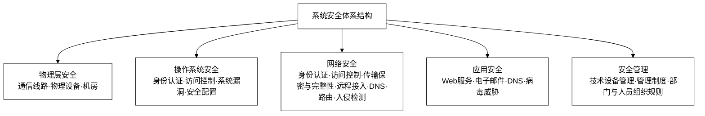

# 系统分析师｜第9章 信息安全（备考讲义＋章节自测题）

> **教材依据**：《系统分析师教程（第2版）》第9章 信息安全（共9节：9.1 信息系统安全体系｜9.2 数据安全与保密｜9.3 通信与网络安全技术｜9.4 系统访问控制技术｜9.5 容灾与业务持续｜9.6 安全管理措施｜9.7 系统可靠性｜9.8 冗余技术｜9.9 软件容错技术）；顺带对照《系统分析师教程（第1版）》第18章《系统安全性分析与设计》与第19章《系统可靠性分析与设计》。两版**节号错位一节**且本章尾部为移入重组：第1版 18.1～18.3 对应第2版 9.1～9.3；第1版 **18.4 病毒防治与防闯入（18.4.1 病毒防护技术｜18.4.2 入侵检测技术｜18.4.3 入侵防护技术｜18.4.4 网络攻击及预防｜18.4.5 计算机犯罪与防范）在第2版整节删除**；第1版 18.5～18.7 依次前移为第2版 9.4～9.6；第2版 **9.7 系统可靠性、9.8 冗余技术、9.9 软件容错技术为第1版第18章所无，系由第1版第19章《系统可靠性分析与设计》移入重组**：第1版第19章共6节（19.1 系统可靠性概述｜19.2 系统可靠性分析｜19.3 冗余技术｜19.4 软件容错技术｜19.5 双机容错技术｜19.6 集群技术），其中 19.1.1～19.1.3／19.2／19.3／19.4 依次对应第2版 9.7.1～9.7.3／9.7.4／9.8／9.9，**19.5 双机容错技术、19.6 集群技术在第2版整章删除**（不在 v2 第9章，亦未作为其他章核心节保留；两版教材无原文且2021年以后真题无检出，故讲义不收录）。教材外内容来源口径：正文以教材第2版原文为主；第1版删除但2021年以后真题仍有检出的「网络攻击识别（DoS／DDoS、扫描类攻击）」以【第1版补充｜掌握】按低频降档补回；「常用对称／非对称算法的真题外延（AES、国密 SM2／SM3／SM4）」「IPSec 的 AH／ESP 构成」两项两版教材均无原文，按考纲 7.2.1／7.3.3 明确要求并配合真题检出，以【真题补充｜考频｜两版教材均无原文】置于归口模块末尾「拓展阅读」；其余两版均无原文且考情不支持的内容（等级保护2.0、零信任、风险评估定量公式、数据脱敏、云安全共享责任模型、ABAC、WAF 等）一律不收录，逐项见「⚠️ 不包含」与表下说明。
>
> **考纲定位说明**：2024版考纲科目一「系统分析师综合知识」第7条 信息安全（7.1 信息系统安全体系｜7.2 数据安全与保密｜7.3 通信与网络安全技术｜7.4 系统访问控制技术｜7.5 容灾与业务持续｜7.6 安全管理措施｜7.7 系统可靠性｜7.8 冗余技术｜7.9 软件容错技术），与教材第2版第9章 9.1～9.9 各节**逐节一一对应**，二级子项亦逐项对应（两处命名差异：考纲 7.2.3「密钥管理机制」＝教材 9.2.3「密钥管理体制」；考纲 7.6.3 子项「私有信息泄露」在教材 9.6.3「私有信息保护」节内展开）。**无「考纲有条目、教材本章无对应章节」的空白区**，故不设考纲归口型补回；教材 9.3.3 对 IPSec 只述其目标与端对端安全模式、未展开 AH／ESP 两个协议头，按考纲 7.3.3 以【真题补充｜考频｜两版教材均无原文】在模块3末尾「拓展阅读」补入。
>
> **考试形式**：综合知识（科目一）单选题，个别具计算性质（系统可靠度串并联、可用性）亦以单选形式命题；近年频次窗（2024上～2026上，5场）约22道/5场——网络安全协议 7道/4场、对称／非对称加密 3道/3场、防火墙 3道/3场、访问控制模型 2道/2场，均中频；数字签名与证书、PKI与密钥管理、网络攻击识别、安全审计、系统可靠性指标、软件容错、信息安全运营分类各 1道/1场，低频；信息安全基本属性、信息系统安全体系、身份认证技术、安全保证近年窗**未检出（0场）**，全量统计窗（2021上～2026上，8场）内各有 1道（均仅旧大纲期检出）。本章按章内最高题量（网络安全协议 7道）属上游第一梯队，但**无考点族5场全中，故本章无 🔴 高频模块**。案例分析（科目二）2026上新增「信息安全容灾」**1题组**（选答：冷备／热备／双活选型、同步与异步复制、RTO／RPO），为该方向的唯一题组；论文（科目三）**1题次**（2026上试题四 信息安全保障体系：数据安全／密码技术／容灾与业务连续性）。
>
> 标签：系统分析师、上午题、信息安全、密码学、对称加密、非对称加密、数字签名、PKI、防火墙、VPN、安全协议、单点登录、访问控制、容灾、RTO/RPO、系统可靠性、冗余技术、软件容错、备考

[TOC]

## 章节结构对照与来源标注

> 本讲义为《系统分析师教程（第2版）》第9章 信息安全的学习讲义，模块顺序与教材 9.1～9.9 保持一致；知识点除「网络攻击识别」一项第1版补充、以及「AES／国密算法」「IPSec 的 AH／ESP」两项真题补充外，均来自教材第2版原文。

| 讲义模块 | 对应教材第2版章节 | 内容性质 | 备考要求 |
|---|---|---|---|
| 模块1 信息系统安全体系 | 9.1 信息系统安全体系 | 教材 | 了解：信息安全威胁三方面、系统安全四类划分、五层安全体系结构、GB 17859—1999 五级安全保护等级、系统安全保障四个体系 |
| 模块2 数据安全与保密 | 9.2 数据安全与保密 | 教材＋真题补充 | 掌握：对称加密算法（分组／序列、IDEA／DES）、非对称加密算法（RSA）；了解：数字签名三保证、杂凑／MD5／SHA、X.509 数字证书与 CRL、三种身份认证方式、KMI／PKI／SPK 三种密钥管理体制；拓展：AES 与国密 SM2／SM3／SM4 |
| 模块3 通信与网络安全技术 | 9.3 通信与网络安全技术 | 教材＋真题补充 | 掌握：防火墙的功能／分类／三种体系结构／局限性、SSL／HTTPS／PGP／IPSec 四种安全协议；了解：VPN 五项关键技术与 PPP 会话过程、单点登录概念与 SSO 特征、Kerberos 与外壳脚本机制；拓展：IPSec 的 AH／ESP |
| 模块4 系统访问控制技术 | 9.4 系统访问控制技术 | 教材 | 掌握：访问控制三要素与五类策略、BLP／Lattice／Biba 三个模型、DAC／MAC／RBAC／TBAC／OBAC 五类访问控制 |
| 模块5 容灾与业务持续 | 9.5 容灾与业务持续 | 教材 | 了解：RPO 与 RTO、GB/T 20988—2007 六个灾难恢复等级、数据容灾与应用容灾、灾难恢复规划四环节、实施 BCP 的八个阶段与 BCP 主体框架 |
| 模块6 安全管理措施 | 9.6 安全管理措施 | 教材＋第1版补充 | 了解：安全管理四项内容（密码／网络／设备／人员管理）、安全审计概念与四要素、CC 标准安全审计功能六部分、私有信息保护；了解级降档：网络攻击识别（第1版 18.4.4） |
| 模块7 系统可靠性 | 9.7 系统可靠性 | 教材 | 了解：可靠性四子特性、四级故障模型、MTTF／MTTR／MTBF／可用性指标、时间／故障植入／数据三类可靠性模型、串联／并联／模冗余分析 |
| 模块8 冗余技术 | 9.8 冗余技术 | 教材 | 了解：避错与容错、结构冗余（静态／动态／混合）／信息冗余／时间冗余／冗余附加、冗余系统故障处理十步骤 |
| 模块9 软件容错技术 | 9.9 软件容错技术 | 教材 | 了解：N 版本程序设计、恢复块方法、防卫式程序设计（错误检测／破坏估计／错误恢复） |

> 教材第2版第9章章节结构（按教材原文核读）：9.1 信息系统安全体系（**无 X.X.X 子节**，节下依次为信息安全威胁三方面、1 系统安全分类、2 系统安全体系结构、3 安全保护等级、4 系统安全保障系统）｜9.2 数据安全与保密（9.2.1 数据加密技术＝1 对称加密算法、2 非对称加密算法；9.2.2 认证技术＝1 数字签名、2 数字签名算法、3 数字证书、4 身份认证；9.2.3 密钥管理体制＝1 KMI 机制、2 PKI 机制、3 SPK 机制）｜9.3 通信与网络安全技术（9.3.1 防火墙＝1 防火墙的功能、2 防火墙的分类、3 防火墙的体系结构、4 防火墙的局限性；9.3.2 虚拟专用网＝1 VPN 的关键技术、2 PPP 会话过程；9.3.3 安全协议＝1 SSL、2 HTTPS、3 PGP、4 IPSec；9.3.4 单点登录技术＝1 单点登录系统的概念、2 SSO 系统的特征与功能、3 Kerberos 机制、4 外壳脚本机制）｜9.4 系统访问控制技术（9.4.1 访问控制概述＝1 访问控制的要素、2 访问控制的策略；9.4.2 访问控制模型＝1 Bell-LaPadula 模型、2 Lattice 模型、3 Biba 模型；9.4.3 访问控制分类＝1 自主访问控制、2 强制访问控制、3 基于角色的访问控制、4 基于任务的访问控制、5 基于对象的访问控制）｜9.5 容灾与业务持续（9.5.1 灾难恢复技术＝1 灾难恢复的技术指标、2 灾难恢复等级、3 容灾技术的分类；9.5.2 灾难恢复规划＝1 灾难恢复需求的确定、2 灾难恢复策略的制定、3 灾难恢复策略的实现、4 灾难恢复预案的制定、落实和管理；9.5.3 业务持续性规划＝1 实施 BCP 的阶段、2 BCP 主体框架）｜9.6 安全管理措施（9.6.1 安全管理的内容＝1 密码管理、2 网络管理、3 设备管理、4 人员管理；9.6.2 安全审计＝1 安全审计的基本要素、2 CC 标准；9.6.3 私有信息保护）｜9.7 系统可靠性（9.7.1 系统故障模型＝1 逻辑级的故障、2 数据结构级的故障、3 软件故障和软件差错、4 系统级的故障；9.7.2 系统可靠性指标＝1 平均无故障时间、2 平均故障修复时间、3 平均故障间隔时间、4 系统可用性；9.7.3 系统可靠性模型＝1 时间模型、2 故障植入模型、3 数据模型；9.7.4 系统可靠性分析＝1 串联系统、2 并联系统、3 模冗余系统）｜9.8 冗余技术（9.8.1 冗余技术的分类＝1 结构冗余、2 信息冗余、3 时间冗余、4 冗余附加；9.8.2 冗余系统）｜9.9 软件容错技术（9.9.1 N 版本程序设计＝1 与通常软件开发过程的区别、2 其他需要注意的问题；9.9.2 恢复块方法＝1 验证测试、2 与 N 版本程序设计的比较；9.9.3 防卫式程序设计＝1 错误检测、2 破坏估计、3 错误恢复）。
>
> ⚠️ 教材第2版第9章**不包含**（两源核查）：**源①**（对照第1版第18章《系统安全性分析与设计》（→9.1～9.6）与第1版第19章《系统可靠性分析与设计》（→9.7～9.9）逐节核对）——①**18.4 病毒防治与防闯入整节**（18.4.1 病毒防护技术：反病毒技术、病毒攻击的防范；18.4.2 入侵检测技术：IDS 基本原理、IDS 分类；18.4.3 入侵防护技术：IPS 工作原理、IPS 技术特征；18.4.4 网络攻击及预防：常见的网络攻击手段、特洛伊木马、拒绝服务攻击、端口扫描、漏洞扫描；18.4.5 计算机犯罪与防范：刑法规定、防范对策）：**第2版整节删除，第2版全书无对应章承载**。其中仅「拒绝服务攻击与扫描类攻击」的**辨识**在2021年以后真题仍有检出（2021上第68题 弱口令扫描、2025上第13题 DDoS 应对措施），以【第1版补充｜掌握】在模块6补回并按低频降档处理；其余（反病毒技术、IDS／IPS 原理与分类、特洛伊木马、计算机犯罪与刑法规定）2021年以后真题无检出，一律不收录；②第1版 18.2.2「2. 杂凑算法」在第2版改为 9.2.2「2. 数字签名算法」，杂凑算法降为该子节的第（1）项，属**结构重组而非删除**，内容本章已覆盖。③第1版第19章《系统可靠性分析与设计》（19.1～19.4 已整体移入重组为第2版 9.7～9.9，子节逐一对应、教材第2版已完整覆盖，讲义模块7～模块9 据此设立）中，**19.5 双机容错技术、19.6 集群技术（19.6.1 集群技术概述／19.6.2 高性能计算集群／19.6.3 负载均衡集群／19.6.4 高可用性集群／19.6.5 负载均衡技术／19.6.6 进程迁移技术）在第2版整章删除**（第2版第9章「双机」「负载均衡」「进程迁移」「高性能计算」「集群」均 0 命中，仅 9.5.1 容灾等级表 incidental 提及「远程集群支持」），考纲 7.7～7.9 亦无对应子项，2021年以后真题无检出，依来源标签规则一律不收录：不进正文、不配例题习题、不进备考提示。
>
> **源②**（对照考纲 7.1～7.9 子项与教材 9.1～9.9 小节核对）——考纲全部二级子项在教材本章均有对应小节或原文，**无源②事项**；教材 9.3.3 未展开的 AH／ESP 已按考纲 7.3.3 在模块3末尾「拓展阅读」补入。
>
> 说明（四处易混入本章、实不属本章或无考情支撑的内容）：①**等级保护2.0（GB/T 22239—2019）、零信任、风险评估定量公式（风险＝资产价值×威胁概率×脆弱性）、数据脱敏、云安全共享责任模型、ABAC（基于属性的访问控制）、WAF（Web 应用防火墙）**——两版教材第9章均**无原文**（教材 9.1 只给出 GB 17859—1999 的五级安全保护能力划分；访问控制分类只有 DAC／MAC／RBAC／TBAC／OBAC 五类，无 ABAC），2021年以后真题亦**无检出**，一律移除，不另作「拓展阅读」收录；②**病毒／木马／蠕虫三者辨析、IDS 与 IPS 的部署差异**——第1版 18.4 专有内容，第2版删除且2021年以后真题无检出，不收录；③**考纲 7.7「系统可靠性」不是跨章补回项**——它是教材第2版 9.7 的**原生内容**（连同 9.8 冗余技术＝考纲 7.8、9.9 软件容错技术＝考纲 7.9），本讲义按教材节序设为模块7～模块9，不再作为文末「拓展阅读·系统可靠性与容错」承载；其中**系统可用性公式 $A=\dfrac{MTTF}{MTTR+MTTF}$ 与 MTBF／MTTR 的运维口径计算**与第15章系统运行与维护存在重叠，第15章按运维指标族承载其计算训练，本章只讲定义与模型；④**上游将 2024下第44题（认证与加密的防御边界）与 2025下第45题（SSO）计入「访问控制模型」族（近年窗 2道/2场，中频）**，但两项的教材原文分别在 9.2.2 与 9.3.4，本讲义按「教材原文归口」在模块2、模块3承载，**族计数与模块优先级仍按上游口径不变**（模块4 判 🟡 中频），两题作为概念题进入本章综合模拟题。

---

## 模块1：信息系统安全体系（教材9.1）【教材｜了解】

**前置说明**：本模块对应教材第2版第9章 **9.1 信息系统安全体系**（无 X.X.X 子节，节下依次为信息安全威胁三方面与 1～4 四个条目），对应考纲 **7.1 信息系统安全体系**（系统安全分类｜系统安全体系结构｜安全保护等级｜系统安全保障系统）；全部为教材原文，适配上午综合选择题（分类归属与等级辨识）。

**模块优先级**：🟢 了解为主 —— 本模块含「信息安全运营分类」1道/1场（低频，2024下第36～37题）、「信息安全基本属性」「信息系统安全体系」近年窗各未检出（0场，全量统计窗内各 1道·仅旧大纲期）；按统一判据（1场＝低频、0场＝未检出）取最高档为低频，不配置例题与习题、不设易错点。

**考情分析**（2021年以后真题）：近年频次窗（2024上～2026上，5场）内仅 1道/1场——2024下第36～37题（信息系统按安全运营分类：审计跟踪属**运行安全**、访问控制属**信息安全**）；「信息安全基本属性」2022上第9题（确保机密性的方法不包括**备份**）、「信息系统安全体系」2022上第61～62题（系统安全分类辨析）近年窗未检出（0场），全量统计窗内各 1道，均为旧大纲期。核心考点：实体／运行／信息／人员四类划分、五层安全体系结构、GB 17859—1999 五个等级的名称与适用对象、安全保障四个体系。

### 1.1 核心知识点精讲

#### 1.1.1 信息安全威胁的三个方面（教材9.1）【教材｜了解】

- **对系统稳定性和可靠性的破坏行为**：包括从外部网络针对内部网络的攻击入侵行为和病毒破坏等。
- **大量信息设备的使用、维护和管理问题**：包括违反规定的计算机、打印机和其他信息基础设施滥用，以及信息系统违规使用软件和硬件的行为。
- **信息存储、使用和传输的保密性、完整性、可靠性威胁**：针对知识产权和内部机密材料等，其中**尤其以信息的保密性存在威胁的可能性最大**。

> 记忆：威胁三面向——**破坏稳定**（攻击入侵／病毒）、**滥用设备**（违规使用）、**危及信息**（保密性风险最大）。

#### 1.1.2 系统安全分类（教材9.1）【教材｜了解】

信息系统安全是复杂的综合体，主要包括**实体安全、运行安全、信息安全、人员安全**四个部分：

- **实体安全**：计算机及相关设备、设施（含网络）统称为系统的**实体**；实体安全是指保护计算机设备、设施和其他媒体免遭地震、水灾、火灾、有害气体和其他环境事故（例如，**电磁辐射**等）破坏的措施和过程，又可分为**环境安全、设备安全和媒体安全**三个方面。
- **运行安全**：包括**系统风险管理、审计跟踪、备份与恢复、应急**等 4 个方面的内容；其实质是保证系统的正常运行，不因偶然的或恶意的侵扰而遭到破坏，使系统可靠、连续地运行，**服务不受中断**。
- **信息安全**：防止系统中的信息被故意或偶然的**非法授权访问、更改、破坏**，或使信息被非法系统识别和控制等，即确保信息的**保密性、完整性、可用性和可控性**；针对信息存在的形式和特点，可分为**操作系统安全、数据库安全、网络安全、病毒防护、访问控制、数据加密和认证（鉴别）** 7 个方面。
- **人员安全**：主要包括计算机使用人员的**安全意识、法律意识和安全技能**等。

> 记忆：实体管设备（环境／设备／媒体）、运行管连续（风险／审计／备份／应急）、信息管内容（七方面）、人员管意识。
> 易记提示：**审计跟踪与备份与恢复属「运行安全」、访问控制与数据加密属「信息安全」**——2024下第36～37题即考此项归属。

#### 1.1.3 系统安全体系结构（教材9.1）【教材｜了解】

安全防范体系是分层次的，按网络的应用现状和结构划分为**物理层安全、操作系统安全、网络安全、应用安全和安全管理**五个层次：

- **物理层安全**：通信线路、物理设备和机房的安全；体现在通信线路的可靠性、软硬件设备的安全性、设备的备份、防灾害能力、防干扰能力、设备的运行环境和**不间断电源保障**等。
- **操作系统安全**：来自计算机网络内使用的操作系统的安全，表现在 3 个方面——①操作系统本身的缺陷带来的不安全因素，主要包括**身份认证、访问控制和系统漏洞**等；②操作系统的**安全配置**问题；③**病毒**对操作系统的威胁。
- **网络安全**：网络层身份认证、网络资源的访问控制、数据传输的保密与完整性、远程接入的安全、域名系统的安全、路由系统的安全、入侵检测的手段和网络设施防病毒等。
- **应用安全**：由提供服务所采用的应用软件和数据的安全性产生，包括 **Web 服务、电子邮件系统和 DNS** 等，此外还包括病毒对系统的威胁。
- **安全管理**：包括安全技术和设备的管理、安全管理制度、部门与人员的组织规则等；**管理的制度化极大程度地影响着整个网络的安全**。

#### 1.1.4 安全保护等级（教材9.1）【教材｜了解】

《计算机信息系统安全保护等级划分准则》（**GB 17859—1999**）规定计算机系统安全保护能力的 **5 个等级**，系统安全保护能力随等级提高逐渐增强：

| 等级 | 名称 | 关键特征 | 适用对象（教材原文） |
|---|---|---|---|
| 第一级 | 用户自主保护级 | 通过隔离用户与数据实现，使用户具备自主安全保护能力，对用户实施访问控制 | 普通内联网用户 |
| 第二级 | 系统审计保护级 | 粒度更细的自主访问控制，通过登录规程、审计与安全性相关事件和隔离资源，使用户对自己的行为负责 | 通过内联网或互联网进行商务活动、需要保密的非重要单位 |
| 第三级 | 安全标记保护级 | 具备第二级全部功能，另提供安全策略模型、**数据标记**以及主体对客体**强制访问控制**的非形式化描述，具有准确标记输出信息的能力 | 地方各级国家机关、金融机构、邮电通信、能源与水源供给部门、交通运输、大型工商与信息技术企业、重点工程建设单位 |
| 第四级 | 结构化保护级 | 建立于**明确定义的形式化安全策略模型**之上，自主和强制访问控制扩展到所有主体与客体，需**考虑隐蔽通道**，系统结构化为关键与非关键保护元素 | 中央级国家机关、广播电视部门、重要物资储备单位、社会应急服务部门、尖端科技企业集团、国家重点科研机构和国防建设部门 |
| 第五级 | 访问验证保护级 | 满足**访问监控器**需求——仲裁主体对客体的全部访问，本身抗篡改且足够小、能分析和测试；排除非必要代码；扩充审计机制并提供系统恢复机制 | 国防关键部门和依法需要对计算机信息系统实施特殊隔离的单位 |

> 记忆：一**自主**、二**审计**、三**标记**、四**结构**、五**验证**；三级起出现强制访问控制与标记，四级起出现形式化模型与隐蔽通道，五级出现访问监控器。

#### 1.1.5 系统安全保障系统（教材9.1）【教材｜了解】

针对复杂、技术手段各异的系统安全威胁，完整的系统安全保障体系应包含 4 个方面：

1. **建立统一的身份认证体系**：身份认证是信息交换最基础的要素；其含义广泛，泛指一切实体的身份，包括**人、计算机、设备和应用程序**等。
2. **建立统一的安全管理体系**：对所有计算机、输出端口、存储设备、网络、应用程序和其他设备进行**有效的集中管理**，主要集中于技术性系统的建立，同时建立相应的管理制度。
3. **建立规范的安全保密体系**：不仅提供完善的技术解决方案，也应建立相应的**信息保密管理制度**。
4. **建立完善的网络边界防护体系**：在内部信息网络与 Internet 之间存在**网络边界**，须使内网既能与外网交流，又能防止从外网发起的对内网的攻击。

> 此外，从国家角度还应：加快信息系统安全立法、建立信息安全法制体系；建立国家信息安全组织管理体系；建立高效能、职责分工明确的行政管理和业务组织体系；建立信息系统安全标准和评估体系；建立国家信息安全技术保障体系。

---

## 模块2：数据安全与保密（教材9.2）【教材＋真题补充】

**前置说明**：本模块对应教材第2版第9章 **9.2 数据安全与保密**（9.2.1 数据加密技术｜9.2.2 认证技术｜9.2.3 密钥管理体制），对应考纲 **7.2 数据安全与保密**（7.2.1 数据加密技术｜7.2.2 认证技术｜7.2.3 密钥管理机制）；正文为教材原文，模块末尾「拓展阅读」为两版教材均无原文的真题补充项，适配上午综合选择题（算法辨识、流程与用途辨析）。

**模块优先级**：🟡 中频 —— 本模块「对称／非对称加密算法」考点族近年频次窗 **3道/3场**（2024上第14题、2025下第18题(L1-01)／第27题(L1-03)、2026上甲套第1题），按统一判据（2～4场＝中频）判中频，为本章题量最高的模块之一；族内另含「数字签名与证书」1道/1场、「PKI与密钥管理」1道/1场（低频）、「身份认证技术」近年窗未检出（0场，全量统计窗内 2022上第7题 1道）；按多族取最高档判 🟡。

**考情分析**（2021年以后真题）：近年频次窗（2024上～2026上，5场）内 **5道**——对称／非对称加密 3道/3场（2024上第14题 IDEA 的分组与密钥长度、2025下第18题 非对称加密的加解密密钥用法、2026上甲套第1题 适合大批量数据加密的对称算法）；数字签名与证书 1道/1场（2025下第20题 数字签名不能直接保证**保密性**）；PKI与密钥管理 1道/1场（2024上第29题 适用于封闭网的密钥管理机制＝KMI）。核心考点：对称与非对称的密钥关系与速度对比、IDEA／DES／RSA 特征、数字签名的三保证、Hash 与消息摘要位数、X.509 证书内容与 CRL、KMI／PKI／SPK 的适用网络。

### 2.1 核心知识点精讲

#### 2.1.1 对称加密算法（教材9.2.1）【教材｜掌握】

- **加密与相关概念**：加密是指对**数据**进行编码变换，使其看起来毫无含义、同时仍可保持其可恢复形式的过程；被变换的数据称为**明文**，变换后的数据称为**密文**。加密机制有助于保护信息的**机密性和完整性**，有助于**识别信息的来源**，是最广泛使用的安全机制。
- **传统加密算法**：主要包括**代换加密**（构造密文字母表，用密文字母表中的字母或字母组代替明文，各字母或字母组相对位置不变、本身改变）与**置换加密**（将明文中的字母重新排列，字母本身不变、位置改变）两种；其设计简单，但**算法和密钥密切相关**，攻击者可利用字母的统计和语言学知识破译。
- **对称加密算法**（也称为**私钥加密算法**）：**加密密钥和解密密钥相同**，或者虽不同但从其中一个可容易地推导出另一个。
  - 优点：**具有很高的保密强度**；缺点：**密钥的传输需要经过安全可靠的途径**。
  - 两种基本类型：**分组密码**——在明文分组和密文分组上进行运算；**序列密码**——对明文和密文数据流按位或字节进行运算。
  - 常见算法：瑞士的**国际数据加密算法**（International Data Encryption Algorithm, **IDEA**）与美国的**数据加密标准**（Data Encryption Standard, **DES**）。

> 记忆：对称＝**一把钥匙**（加密与解密同钥，或可互推）；两类实现＝**分组密码**、**序列密码**；教材举例＝**IDEA／DES**。
> 真题落点：2024上第14题考「明文和密文都是 64 位、密钥长度 128 位」的对称算法——**IDEA**（DES 为 64 位分组／56 位密钥）。

#### 2.1.2 非对称加密算法（教材9.2.1）【教材｜掌握】

- **非对称加密算法**（也称为**公钥加密算法**）：**加密密钥和解密密钥完全不同**，其中一个为**公钥**，另一个为**私钥**，并且**不可能从任何一个推导出另一个**。
- 优点：可以适应**开放性的使用环境**，可以**实现数字签名与验证**。
- 最常见的非对称加密算法是 **RSA**：密钥长度为 **512 位**，保密性取决于数学上将一个数**分解为两个素数**的问题的难度，破解很难；但加解密时要进行**大指数模运算**，因此**速度很慢，主要用在数字签名中**。

| 对比项 | 对称加密（私钥） | 非对称加密（公钥） |
|---|---|---|
| 密钥关系 | 加解密密钥相同或可互推 | 公钥／私钥成对，不可互推 |
| 保密强度与速度 | 保密强度高、**速度快** | 加解密**速度慢**（大指数模运算） |
| 主要用途 | 大量数据加密 | 数字签名与验证、密钥交换 |
| 关键难点 | **密钥传输**须经安全途径 | 适应开放环境，密钥管理容易 |
| 教材举例 | IDEA、DES | RSA |

> 记忆：**对称快、密钥分发难**；**非对称慢、可签名**。RSA 慢在「大指数模运算」，故「主要用在数字签名中」。

#### 2.1.3 数字签名（教材9.2.2）【教材｜了解】

- **数字签名**是附加在数据单元上的一些数据，或是对数据单元所作的密码变换；它允许接收者确认数据单元的**来源和完整性**并保护数据，防止被人（例如接收者）伪造。
- 基于对称与非对称算法都可获得数字签名，但目前主要使用**基于非对称加密算法**的数字签名，包括**普通数字签名**与**特殊数字签名**：
  - 普通数字签名算法：**RSA、ElGamal、Fiat-Shamir、DES/DSA、椭圆曲线数字签名算法和有限自动机数字签名算法**等。
  - 特殊数字签名算法：**盲签名、代理签名、群签名、不可否认签名、公平盲签名、门限签名和具有消息恢复功能的签名**等，与具体应用场景密切相关。
- **主要功能**：保证信息传输的**完整性**、发送者的**身份认证**、防止交易中的**抵赖**发生。无论使用哪种算法，数字签名必须保证三点：
  1. 接收者能够核实发送者对数据的签名——称为**鉴别**；
  2. 发送者事后不能抵赖对数据的签名——称为**不可否认**；
  3. 接收者不能伪造对数据的签名——称为**数据的完整性**。

> 易记提示：数字签名**直接保证**完整性、身份认证、不可否认三项；**不直接保证保密性**（2025下第20题考点）。加密保机密、签名证身份。

#### 2.1.4 数字签名算法：杂凑算法、MD5 与 SHA（教材9.2.2）【教材｜了解】

- **杂凑算法**是主要的数字签名算法，利用**散列（Hash）函数**（哈希函数、杂凑函数）进行数据的加密。**单向 Hash 函数**输入一个长度不固定的字符串，返回一串**定长**的字符串，称为**消息摘要**（Message Digest, MD），也称 Hash 值或散列值。它主要解决两个问题：①在某一特定时间内，**无法查找**经 Hash 操作后生成特定 Hash 值的原消息；②**无法查找**两个经 Hash 操作后生成相同 Hash 值的不同消息。由此在数字签名中解决**验证签名、用户身份验证和不可抵赖性**的问题。
- **消息摘要算法 MD5**（Message Digest algorithm 5）：用于确保信息传输**完整一致**，经 MD2、MD3 和 MD4 发展而来；把大容量信息在用数字签名软件签署私人密钥前「压缩」成保密格式，即把任意长度的字符串变换成一个定长的大整数。MD2／MD4／MD5 均产生 **128 位**的消息摘要；MD5 以 **512 位**分组处理输入信息，每个分组划分为 **16 个 32 位**子分组，输出由 **4 个 32 位**分组级联而成，生成 **128 位**散列值。
- **安全散列算法 SHA**（Secure Hash Algorithm）：对长度不超过 $2^{64}$ 位的消息产生 **160 位**的消息摘要；之所以称为「安全」，基于两点——由消息摘要**反推原输入信息**在计算理论上很困难；找到**两组不同信息对应到相同消息摘要**在计算理论上很困难。SHA 家族 5 个算法分别为 **SHA-1、SHA-224、SHA-256、SHA-384、SHA-512**（后四者统称 **SHA-2**），由美国国家安全设计、NIST 发布，是美国的政府标准；SHA-1 广用于 **TLS／SSL、PGP、SSH、S/MIME、IPSec** 等，曾被视为 MD5 的后继者。

> 记忆：**MD5 出 128 位、SHA 出 160 位**；MD5 以 512 位分组、16×32 位子分组。Hash 只用于**完整性／摘要**，不可逆、不能当加密用。

#### 2.1.5 数字证书（教材9.2.2）【教材｜了解】

- **数字证书**又称数字标识，是由**认证中心**（Certificate Authority, **CA**）签发的对**用户公钥**的认证；内容应包括 **CA 的信息、用户信息、用户公钥、CA 签发时间和有效期**等。目前国际上证书的格式和认证方法遵从 **X.509** 体系标准。
- **X.509 证书通常包括**：版本号、序列号（CA 下发的每个证书序列号唯一）、签名算法标识符、发行者名称、有效期、主体名称、主体的公钥信息、发行者唯一识别符、主体唯一识别符、扩充域、**发行者签名**（CA 用自己的私钥对上述数据数字签名的结果，即 CA 对用户证书的签名）。
- **使用与吊销**：任何用户只要得到 **CA 的公钥**，就可以得到 CA 为该用户签署的数字证书；证书**不可伪造**，因此存放证书的目录无须特别保护。两个用户使用**不同 CA** 发放的证书时无法直接使用，但若两个 CA 之间已安全交换公开密钥，则可用**证书链**完成通信。需吊销证书的情形包括：证书过有效期、用户私钥泄露、用户放弃使用原 CA 服务、CA 私钥泄露，此时 CA 维护**证书撤销列表**（Certificate Revocation List, **CRL**）供用户查询。

#### 2.1.6 身份认证（教材9.2.2）【教材｜了解】

用户身份认证是许多应用系统的**第一道防线**，目的在于识别用户的合法性、阻止非法用户访问系统。常用方式有三种：

1. **口令认证**：用户名／密码是最简单也最常用的方式，密码由用户自己设定。缺点是密码是**静态数据**、每次验证传输的信息相同，易被驻留内存的**木马程序或网络监听设备截获**；从安全性上讲是一种**极不安全**的身份认证方式。
2. **动态口令认证**：让用户密码按**时间或使用次数**不断变化、**每个密码只能使用一次**；采用**动态令牌**专用硬件（内置电源、密码生成芯片和显示屏），认证服务器采用相同算法计算当前有效密码。采用**一次一密**方法，安全性高；缺点是客户端与服务器端的**时间或次数必须保持同步**（否则合法用户无法登录），且每次需输入长串无规律密码，使用不便。
3. **生物特征识别**：通过可测量的身体或行为等生物特征进行认证。
   - **身体特征**：指纹、掌型、视网膜、虹膜、人体气味、脸型、手的血管、DNA 等；
   - **行为特征**：签名、语音、行走步态等；
   - 分层归类：**高级**生物识别技术（视网膜、虹膜、指纹识别）、**次级**（掌型、脸型、语音、签名识别）、**深奥**（血管纹理、人体气味、DNA 识别）。

> 真题落点：2022上第7题问「不属于基于生物特征的认证技术」——**口令**（属「所知」因素，非生物特征）。

#### 2.1.7 密钥管理体制：KMI、PKI 与 SPK（教材9.2.3）【教材｜了解】

- **密钥的重要性**：密钥是加密算法中的**可变部分**，采用加密技术保护的信息系统，其安全性取决于**密钥的保护**，而不是对算法或硬件的保护；密码机制可以公开、密码设备可能丢失，但**密钥一旦丢失或出错**，不但合法用户不能提取信息，还可能为非法用户窃取信息提供机会。
- **密钥管理**是指处理密钥**自产生到销毁**整个过程中的有关问题，包括系统的初始化、密钥的产生、存储、备份／恢复、装入、分配、保护、更新、控制、丢失、吊销和销毁等。
- **三种主要密钥管理体制**：

| 体制 | 全称 | 适用网络 | 要点 |
|---|---|---|---|
| **KMI** | 密钥管理基础设施（Key Management Infrastructure） | **封闭网**，以传统的密钥管理中心为代表 | 设定**密钥分发中心 KDC** 负责发放密钥；**静态分发**＝预配置技术，**动态分发**＝「请求、分发」机制（与物理分发对应的电子分发），一般用于建立实时通信中的**会话密钥**；无论静态或动态均基于**秘密信道（物理通道）**进行 |
| **PKI** | 公钥基础设施（Public Key Infrastructure） | **开放网** | 遵循既定标准的**密钥管理平台**，为所有网络应用提供**加密和数字签名**服务及必需的密钥与证书管理体系；**解决了分发密钥依赖秘密信道的问题** |
| **SPK** | 种子化公钥（Seeded public-Key） | **规模化专用网** | 两种实现：**LPK 多重公钥**（用 RSA 实现，缺点为种子私钥以原码分发、层次越多运算时间越长）与 **CPK 组合公钥**（用 DLP 或 ECC 实现，克服 LPK 两个缺点，私钥经组合后不暴露种子、公钥运算几乎不占时间） |

- **PKI 的基本构成**：**CA、数字证书库、密钥备份及恢复系统、证书作废系统和应用接口**。
- **PKI 的基础技术**：加密、数字签名、数据完整性机制、**数字信封**、双重数字签名。其中**数字信封**的流程为：发送方用**对称密钥**加密信息内容，再将该对称密钥用**接收方的公钥**加密（这部分称为数字信封），连同加密后的信息一起发送；接收方先用**自己的私钥**打开数字信封取得对称密钥，再用对称密钥解开加密信息。
- **PKI 与 KMI 的比较**（教材表9-2）：

| 比较项目 | PKI | KMI |
|---|---|---|
| 作用特性 | 良好的扩展性，适于**开放业务** | 很好的封闭性，适于**专用业务** |
| 服务功能 | 只提供**数字签名服务** | 提供**数据加密和数字签名**功能 |
| 信任逻辑 | **第三方**管理模式 | **集中式的主管方**管理模式 |
| 负责性 | **个人负责**的技术体系 | **单位负责制** |
| 应用角度 | **主外** | **主内** |

> 记忆：**封闭网→KMI（KDC＋秘密信道）**、**开放网→PKI（CA＋证书，主外，只签名）**、**规模化专用网→SPK（LPK／CPK）**。对称加密分发最简单有效、能为鉴别提供可靠参数，但**不能提供不可否认服务**；有数字签名要求时须用非对称加密实现。
> 真题落点：2024上第29题考「适用于封闭网、以传统的密钥管理中心为代表的机制」——**KMI**。

#### 2.1.8 典型易错点（对称／非对称加密、签名与摘要）

1. 对称加密是「**加解密密钥相同或可互推**」，非对称是「**公钥／私钥不可互推**」；前者快、后者慢且主要用于数字签名。【🟡中频】
2. 教材举例的对称算法是 **IDEA 与 DES**，非对称是 **RSA**；不要按通用教材把 AES／3DES 当作教材原文（见「拓展阅读」）。【🟡中频】
3. **数字签名直接保证完整性、身份认证、不可否认**，但**不直接保证保密性**（保密性由加密提供）。【🟡中频】
4. **Hash／杂凑是摘要不是加密**：单向不可逆、定长输出（MD5 128 位、SHA 160 位），只能用于完整性校验与签名的输入。【🟡中频】
5. **数字信封**＝「对称密钥加密正文 ＋ 接收方公钥加密该对称密钥」，是混合加密；与「数字签名」（发送方私钥加密摘要）方向相反，勿混。【🟡中频】

### 2.2 典型例题

**例题1【对称加密算法辨识】**

对称加密算法中，明文和密文都是 64 位、密钥长度为 128 位的是（ ）
A. RSA B. DES C. 3DES D. IDEA

> 【解析】2024上第14题。IDEA 的分组长度为 64 位、密钥长度 128 位；DES 为 64 位分组、56 位密钥；RSA 属非对称算法，不以「分组／密钥位」描述。
> 【答案】D

**例题2【非对称加密的密钥用法】**

下列关于非对称加密的说法正确的是（ ）
A. 甲用乙的公钥进行加密，乙用乙的私钥进行解密 B. 甲用甲的私钥进行加密，乙用甲的公钥进行解密 C. 甲用乙的公钥进行加密，乙用甲的私钥进行解密 D. 甲用乙的私钥进行加密，乙用乙的公钥进行解密

> 【解析】2025下第18题（L1-01）／第27题（L1-03）。非对称加密中**加密用接收方的公钥、解密用接收方自己的私钥**，故 A 正确；B 描述的是**数字签名**（发送方私钥签名、接收方用发送方公钥验证），C、D 把公私密钥配错（私钥不对外分发）。
> 【答案】A

**例题3【公钥加密算法辨识】**

下列算法中属于公钥加密算法的是（ ）
A. AES B. RSA C. MD5 D. DES

> 【解析】2022上第8题。RSA 是教材所述最常见的非对称（公钥）加密算法；DES 属对称加密，MD5 是消息摘要（杂凑）算法而非加密算法，AES 为对称算法（教材无原文，见拓展阅读）。
> 【答案】B

### 2.3 课后习题

**习题1【对称与非对称对比】**

关于对称加密算法与非对称加密算法的比较，下列说法不正确的是（ ）
A. 对称加密算法具有很高的保密强度，但密钥传输需经安全可靠的途径 B. 非对称加密算法可适应开放性的使用环境，可实现数字签名与验证 C. 非对称加密算法加解密速度很快，适合大批量数据加密 D. 对称加密算法有分组密码与序列密码两种基本类型

> 【解析】教材原文：RSA 加解密时要进行**大指数模运算**，因此**速度很慢，主要用在数字签名中**，故 C 错；A、B、D 均为教材原文。
> 【答案】C

**习题2【RSA 的特征】**

关于 RSA 算法，下列说法正确的是（ ）
A. 其保密性取决于大数分解为两个素数的困难性 B. 加解密速度快，适合大批量数据加密 C. 既是对称加密算法，也可用于密钥交换 D. 密钥长度与保密性无关，可任意取短

> 【解析】教材原文：RSA 的密钥长度为 512 位，**保密性取决于数学上将一个数分解为两个素数的问题的难度**；加解密要进行大指数模运算，**速度很慢，主要用在数字签名中**。故只有 A 正确。
> 【答案】A

### 拓展阅读：真题外延考点（两版教材均无原文）

> 收录依据：2026上甲套第1题、2021上第67题（AES 的特征与用途）、2023上第7题（SM3 属摘要算法）、2023上第20题（国密 SSL 证书采用 SM2 公钥算法体系）命题；两版教材第9章的对称算法只列 **IDEA 与 DES**、非对称只列 **RSA**，**无 AES／3DES／国密算法原文**；该类「算法辨识」在近年窗与全量统计窗多次出现（近年窗 1场、全量窗 3场），按考纲 7.2.1 数据加密技术明确要求补入，按了解级处理。

#### 拓展·常用算法的真题外延：AES 与国密 SM2／SM3／SM4【真题补充｜考频｜两版教材均无原文】

- **AES**（Advanced Encryption Standard）：**对称**分组加密算法，分组长度 128 位，密钥长度可为 128／192／256 位；速度快，**适合大批量数据加密**（文件加密、数据传输加密）。与 DES／IDEA 同属教材「分组密码」一类，只是教材未列名。
- **国密算法体系**（商用密码）：
  - **SM2**——**公钥（非对称）算法**，用于数字签名与密钥交换，对应教材非对称加密的位置；
  - **SM3**——**摘要（杂凑）算法**，输出 256 位摘要，对标 SHA-256；
  - **SM4**——**对称**分组加密算法（分组与密钥均 128 位），对标 DES／AES，适合数据加密。
  - 记忆：**SM2 签名／SM3 摘要／SM4 加密**；三者可与教材的「非对称／杂凑／对称」三类一一对应。

**例题（自带）【国密算法辨识】**

在我国商用密码算法体系中，属于摘要算法的是（ ）
A. SM2 B. SM3 C. SM4 D. SM9

> 【解析】2023上第7题。SM2 为公钥算法、SM3 为摘要算法、SM4 为对称分组算法，故选 SM3。
> 【答案】B

**例题（自带）【对称算法选型】**

适合大批量数据加密的对称加密算法是（ ）
A. DEA/DES B. AES C. ECC D. RSA

> 【解析】2026上甲套第1题。AES 为对称分组算法、速度快，适合大批量数据加密；ECC 与 RSA 属非对称算法（速度慢，主要用于签名与密钥交换）。
> 【答案】B

---

## 模块3：通信与网络安全技术（教材9.3）【教材＋真题补充】

**前置说明**：本模块对应教材第2版第9章 **9.3 通信与网络安全技术**（9.3.1 防火墙｜9.3.2 虚拟专用网｜9.3.3 安全协议｜9.3.4 单点登录技术），对应考纲 **7.3 通信与网络安全技术**；正文为教材原文，模块末尾「拓展阅读」为考纲 7.3.3 明确要求而教材未展开的真题补充项，适配上午综合选择题（设备与协议辨识、体系结构辨识、端口与层次）。

**模块优先级**：🟡 中频 —— 本模块「网络安全协议」考点族近年频次窗 **7道/4场**（2024上第16题、2024下第21题、2025下第1题(L1-01)／第1题(L1-03)、2026上甲套第23／24／29／69题）、「防火墙」族 **3道/3场**（2025上第42题、2025下第35题(L1-01)／第52题(L1-03)、2026上甲套第60题），按统一判据（2～4场＝中频）判中频，为本章题量最高的模块。

**考情分析**（2021年以后真题）：近年频次窗（2024上～2026上，5场）内 **10道**——网络安全协议 7道/4场（IPSec 特性、IPSec 防嗅探的技术、S/MIME 邮箱安全协议、SSH 安全远程登录、HTTPS 安全通信协议，以及 IPSec 的 AH／ESP 构成）、防火墙 3道/3场（状态检测型防火墙、包过滤防火墙工作层次、防火墙的基本作用）。核心考点：防火墙三类体系结构与四类局限性、包过滤／状态检测／应用网关的分类、SSL 与 HTTPS 的端口与层次、PGP 的数字信封流程、IPSec 的端对端安全模式与 IPv4／IPv6、SSO 与 Kerberos。

### 3.1 核心知识点精讲

#### 3.1.1 防火墙的功能（教材9.3.1）【教材｜掌握】

- **防火墙**（firewall）是一种**隔离控制技术**，在不同网域之间设置屏障，阻止对信息资源的非法访问，也可以阻止重要信息从内部网络中非法输出。
- 防火墙是位于**两个或多个网络之间**、**执行访问控制策略的一个或一组系统**，是一类防范措施的总称；通常放置在外部网络和内部网络的中间，执行**网络边界的过滤封锁机制**。某些情况下以专门硬件形式出现，但本质上是**软件在进行控制**。
- **木桶原理**：若没有防火墙，整个内部网络的安全性就完全依赖于每台计算机，整个网络的安全水平由**安全水平最低的那台计算机**决定；网络规模越大，越不容易统一安全水平。
- 采用防火墙后，内部网络中的计算机不再直接暴露给来自 Internet 的攻击，安全管理**变成防火墙的安全管理**，更方便、更易控制。
- **一般具有的功能**：访问控制、内容控制、全面的日志功能、集中管理功能、自身的安全和可用性、流量控制、网络地址转换（NAT）、虚拟专用网（VPN）。

#### 3.1.2 防火墙的分类（教材9.3.1）【教材｜掌握】

- **总体分为两类**：
  - **网络级防火墙**：用来防止整个网络出现外来非法的入侵，例如**分组过滤和授权服务器**——前者检查所有流入本网络的信息并拒绝不符合准则的数据，后者检查用户的登录是否合法。
  - **应用级防火墙**：由应用程序进行接入控制，通常使用**应用网关或代理服务器**来区分各种应用（例如只允许 WWW 应用而阻止 FTP 应用）。
- **实际应用中更细的六类划分**：**包过滤型防火墙、电路级网关型防火墙、应用网关型防火墙、代理服务型防火墙、状态检测型防火墙、自适应代理型防火墙**。

> 真题落点：2025上第42题「根据连接状态过滤数据包」→**状态检测型防火墙**；2025下第35题（L1-01）／第52题（L1-03）「包过滤防火墙工作在哪一层」→**网络层**（教材所述分组过滤按 IP 地址、协议号、端口等过滤）。

#### 3.1.3 防火墙的体系结构（教材9.3.1）【教材｜掌握】

1. **双宿/多宿主机模式**：拥有两个或多个连接到不同网络上的网络接口的防火墙，通常用一台装有两块或多块网卡的**堡垒主机**做防火墙，各网卡分别与内网和外网相连；一般采用**代理服务**的办法，**必须禁止网络层的路由功能**。
2. **屏蔽主机模式**：由**包过滤路由器和堡垒主机**组成；堡垒主机安装在**内部网络**上，通常在路由器上设立过滤规则，并使该堡垒主机成为**从外部网络唯一可直接到达的主机**。实现了**网络层和应用层**的安全，比单独的包过滤或应用网关代理更安全；**过滤路由器是否配置正确是防火墙安全与否的关键**。
3. **屏蔽子网模式**：采用**两个包过滤路由器和一个堡垒主机**，在内外网络之间建立一个被隔离的子网，称为**非军事区**（Demilitarized Zone, **DMZ**）或边界网络（Perimeter Network）。堡垒主机、Web 服务器、Mail 服务器等**公用服务器放在 DMZ 中**；内部网络和外部网络均可访问屏蔽子网，但**禁止它们穿过屏蔽子网通信**；即使堡垒主机被入侵者控制，内部网仍能受到**内部包过滤路由器**的保护。

> 记忆：三种模式＝**双宿/多宿主机**（多网卡堡垒主机、禁路由）、**屏蔽主机**（路由器＋堡垒主机，堡垒主机是外网唯一可达）、**屏蔽子网**（两路由器夹 DMZ，公用服务器放 DMZ）。

#### 3.1.4 防火墙的局限性（教材9.3.1）【教材｜掌握】

防火墙的**作用**：对企业内部网实现集中的安全管理、强化安全策略、防止非授权用户进入内部网络、方便地监视网络的安全性并报警、作为部署 **NAT** 的地点（缓解地址短缺、隐藏内部网结构）、是审计和记录网络访问与使用的最佳措施。

防火墙的**局限性**共 5 条：

1. 为提高安全性需**限制或关闭**一些有用但存在安全缺陷的网络服务，给用户带来不便。
2. 对来自**网络内部**的攻击无能为力；作为**被动的防护手段**，不能阻止不断出现的新威胁和攻击，不能有效防范**数据驱动式攻击**。
3. 不能防范**不经过防火墙**的攻击，例如内部网用户通过 **SLIP** 或 **PPP** 直接进入 Internet。
4. 对用户**不完全透明**，可能带来**传输延迟、瓶颈和单点失效**等问题。
5. **不能完全防止受病毒感染**的文件或软件的传输（逐条检查病毒代码会使效率降低到不能忍受的程度）。

> 总之，防火墙只是整个网络安全防护的一个部分，需要与**密码技术、访问控制、权限管理和病毒防治**等配合使用，才能提供一体化的解决方案。

#### 3.1.5 虚拟专用网 VPN（教材9.3.2）【教材｜了解】

- **虚拟专用网**（Virtual Private Network, VPN）是企业网在 Internet 等公共网络上的延伸，通过一个**私有的通道**在公共网络上创建一个安全的私有连接；本质上 VPN 是一个**虚信道**，可用来连接两个专用网，通过可靠的**加密技术**保证安全性，并作为公共网络的一部分存在。
- **VPN 主要采用 5 项技术保证安全**：
  1. **隧道技术**——VPN 的基本技术，类似于点对点连接技术，在公用网建立一条数据通道（隧道），让数据包通过隧道传输；
  2. **加解密技术**——数据通信中较成熟的技术，VPN 可直接利用现有技术；
  3. **密钥管理技术**——主要任务是如何在公用数据网上安全地传递密钥而不被窃取；
  4. **身份认证技术**——通常使用名称与密码或卡片式认证等方式；
  5. **访问控制技术**——由 VPN 服务的提供者根据在各种预定义的组中的用户身份标识，限制用户对网络信息或资源的访问。

#### 3.1.6 PPP 会话过程（教材9.3.2）【教材｜了解】

- PPP 拨号会话过程分成 **4 个阶段**：**创建 PPP 链路 → 用户验证 → PPP 回叫控制 → 调用网络层协议**。
- 在**用户验证**阶段，客户 PC 将用户的身份发送给**网络接入服务器**（Network Access Server, **NAS**）；该阶段使用安全认证方式，以避免第三方窃取数据或冒充远程客户接管与客户端的连接。大多数 PPP 方案只提供有限的认证方式，包括**口令认证协议**（Password Authentication Protocol, **PAP**）和**挑战握手认证协议**（Challenge Handshake Authentication Protocol, **CHAP**）。

#### 3.1.7 SSL（教材9.3.3）【教材｜掌握】

- **SSL** 是一个**传输层**的安全协议，用于在 Internet 上传送机密文件；由**握手协议、记录协议和警报协议**组成。
  - **握手协议**：在传输应用层数据之前建立安全机制——双方先在版本号、密钥交换算法、数据加密算法和 Hash 算法上达成一致，互相验证身份，再产生只有双方知道的秘密信息，各自据以产生数据加密算法和 Hash 算法参数。
  - **记录协议**：根据握手协议协商的参数，对应用层送来的数据进行**加密、压缩和计算消息鉴别码**，再经传输层发送。
  - **警报协议**：在客户和服务器之间传递 SSL 出错信息。
- **SSL 主要提供三方面的服务**：①用户和服务器的**合法性认证**；②**加密数据**以隐藏被传送的数据；③**保护数据的完整性**。
- **实现过程六阶段**：接通阶段 → 密码交换阶段（一般选用 RSA，也有的选用 Diffie-Hellman 和 Fortezza-KEA）→ 会谈密码阶段 → 检验阶段 → 客户认证阶段 → 结束阶段。
- **混合加密**：发送时**信息用对称密钥加密，对称密钥用非对称算法加密**，再把两个包绑在一起传送；接收过程相反——先打开有对称密钥的加密包，再用对称密钥解密。SSL 协议也可用于**安全电子邮件**。

#### 3.1.8 HTTPS（教材9.3.3）【教材｜掌握】

- **HTTPS** 是以安全为目标的 HTTP 通道，简单说是 **HTTP 的安全版**；**SSL 极难窃听**，可对**中间人攻击**提供一定的合理保护。
- HTTPS 是一个**统一资源标识符**（URI）语法体系，句法类同 HTTP 体系，用于安全的 HTTP 数据传输；实际上**应用了 SSL 作为 HTTP 应用层的子层**。
- **端口**：HTTPS 使用端口 **443**（也可指定其他 TCP 端口），而 HTTP 使用端口 **80**。
- HTTPS 和 SSL 支持使用 **X.509 数字认证**，需要时用户可确认发送者是谁。
- **两个主要作用**：①建立一个**信息安全通道**，保证数据传输的安全；②**确认网站的真实性**。

#### 3.1.9 PGP（教材9.3.3）【教材｜掌握】

- **PGP** 是一个**基于 RSA 的邮件加密软件**，可对邮件保密以防止非授权者阅读，还能对邮件**加上数字签名**使收信人确信发送者；也可用于**文件存储的加密**。
- **基本原理（数字信封）**：先用**对称密钥**加密传送的信息，再将该对称加密密钥以**接收方的公钥**加密，组成**数字信封**，并将此密钥交给公正的第三方保管；然后将数字信封传送给接收方。接收方先以**自己的私钥**将数字信封拆封以获得对称解密密钥，再用该对称密钥解出真正的信息——**兼顾了方便与效率**。
- **PGP 承认两种不同的证书格式**：PGP 证书和 X.509 证书。一份 **PGP 证书**包括：版本号、证书持有者的公钥、证书持有者的信息（姓名、用户 ID、照片等）、证书拥有者的数字签名、证书的有效期和密钥首选的对称加密算法。

#### 3.1.10 IPSec（教材9.3.3）【教材｜掌握】

- **IPSec** 是一个**工业标准网络安全协议**，为 IP 网络通信提供**透明的安全服务**，保护 TCP/IP 通信免遭**窃听和篡改**，可有效抵御网络攻击，同时保持易用性。
- **两个基本目标**：①保护 **IP 数据包**安全；②为抵御网络攻击提供**防护措施**。通过结合**密码保护服务、安全协议组和动态密钥管理**三者实现。
- **适用范围**：IPSec 是**针对 IPv4 和 IPv6 的**（不是仅针对 IPv4），主要特征是支持 **IP 级所有流量的加密和／或认证**，增强所有分布式应用的安全性；它在 **IP 层**提供安全服务，使系统可选择所需的安全协议、确定算法并提供加密密钥。
- **端对端安全模式**：假定数据通信的传输媒介是**不安全的**，通信数据必须经过加密，掌握加解密方法的**只有数据的发送端和接收端**，网络中只负责转发数据的**路由器或计算机无须支持 IPSec**。

> 真题落点：2024上第16题问「说法不正确的是」——**IPSec 仅针对 IPv4**（错，它同时针对 IPv4 与 IPv6）；2024下第21题问「哪项技术可防止 sniffer 嗅探」——**封装安全有效负载**（ESP，见拓展阅读）；2022上第6题问「属于网络层安全协议」——**IPSec**（HTTPS 属应用层、SSH 属应用层／传输层之上、Socks 为代理协议）。

#### 3.1.11 单点登录系统的概念（教材9.3.4）【教材｜了解】

- **背景**：用户需登录多个系统（邮件、数据库、各种应用服务器），每个系统各有安全策略，出错与被截获破坏的可能性增大、安全性降低；各系统各建认证系统会造成资源浪费、管理成本上升、无法统一认证与授权、无法统一分析用户应用行为。
- **单点登录**（Single Sign-On, **SSO**）技术是通过用户的**一次性认证登录**，即可获得需要访问系统和应用软件的**授权**；在此条件下管理员不需要修改或干涉用户登录，就能方便地实现希望得到的安全控制。
- **实现要点**：采用**基于数字证书的加密和数字签名技术**，基于统一策略的用户身份认证和授权控制功能，对用户实行集中统一的管理和身份认证，作为各应用系统的**统一登录入口**，并为通过身份认证的合法用户签发针对各个应用系统的**登录票据**（ticket），实现「**一点登录，多点漫游**」；必要时能与统一权限管理系统无缝结合，签发合法用户的**权限票据**。

#### 3.1.12 SSO 系统的特征与功能（教材9.3.4）【教材｜了解】

单点登录可由 **Kerberos 机制和外壳脚本机制**实现，也可采用通用的安全服务 API 和分布式计算环境。一个理想的 SSO 产品应具备 7 项特征与功能：

1. **常规特征**：支持多种系统、设备和接口；
2. **终端用户管理灵活性**：账号创建、口令管理（口令维护、历史记录、文法规则）和用户识别，支持各类令牌设备和生物学设备；
3. **应用管理灵活性**：设备场景管理保证相关会话自动更新，能监控特定信息的使用，可将各种应用绑定在一起保证一致性；
4. **移动用户管理**：保证用户在不同地点访问信息资源；
5. **加密和认证**：加密保证信息在终端用户与安全服务器之间传输的安全，认证保证用户的真实性；
6. **访问控制**：保证只有用户被授权访问的应用可以提供给用户；
7. **可靠性和性能**：SSO 与其他访问控制程序之间接口的可靠性、性能与复杂度。

#### 3.1.13 Kerberos 机制（教材9.3.4）【教材｜了解】

- **Kerberos** 是一种**网络身份认证协议**，基础是**基于信任第三方**，提供在开放型网络中进行身份认证的方法；认证实体可以是用户也可以是用户服务。
- 特点：不依赖宿主机的操作系统或计算机的 IP 地址，不需要保证网络上所有计算机的物理安全性，并且**假定数据包在传输中可被随机窃取和篡改**。
- 安全机制：先对发出请求的用户进行**身份验证**确认其合法性，再审核该用户是否有权对其所请求的服务或计算机进行访问；从加密算法上讲，其验证**建立在对称加密的基础上**，**KDC 保存与所有密钥持有者通信的保密密钥**，认证过程颇为复杂。

#### 3.1.14 外壳脚本机制（教材9.3.4）【教材｜了解】

- 外壳脚本机制通过**原始认证进入系统外壳**，然后外壳激发各种**专用平台的脚本**，来激活目标平台的账号和资源的访问。
- 优点：简化了用户的登录；**缺点**：**没有提供同步的口令字以及其他管理方法**。

#### 3.1.15 典型易错点（防火墙、安全协议与单点登录）

1. 防火墙的本质是「**执行访问控制策略的一个或一组系统**」，**不只是物理硬件**（教材：本质上是软件在进行控制）。【🟡中频】
2. **包过滤防火墙工作在网络层**，按源／目的 IP 地址、端口、协议号过滤；**不能依据负载（数据）内容过滤**。【🟡中频】
3. **状态检测型**依据连接状态过滤；**应用网关／代理服务型**由应用程序做接入控制；**电路级网关**工作在会话层。【🟡中频】
4. **IPSec 同时针对 IPv4 和 IPv6**，工作在网络层，采用**端对端安全模式**（路由器无须支持 IPSec）。【🟡中频】
5. **HTTPS 端口 443、HTTP 端口 80**，HTTPS 是把 SSL 作为 HTTP 应用层的子层。【🟡中频】
6. **PGP 与 SSL 都用数字信封**：对称密钥加密正文、接收方公钥加密该对称密钥；不要与「发送方私钥签名」混淆。【🟡中频】

### 3.2 典型例题

**例题1【IPSec 特性辨析】**

以下有关 IPSec 协议的说法中，不正确的是（ ）
A. IPSec 在 IP 层提供安全服务 B. IPSec 是一种基于端对端的安全模式 C. IPSec 是一个工业标准网络安全协议 D. IPSec 仅针对 IPv4

> 【解析】2024上第16题。教材原文：IPSec **是针对 IPv4 和 IPv6 的**，并支持 IP 级所有流量的加密和／或认证，故 D 错；A、B、C 均为教材原文表述。
> 【答案】D

**例题2【防火墙的基本作用】**

关于防火墙的说法，正确的是（ ）
A. 防火墙的基本作用是在网络之间执行访问控制策略 B. 防火墙只能是物理硬件设备 C. 防火墙的主要职责是清除所有病毒 D. 防火墙只能在离线环境中使用

> 【解析】2026上甲套第60题。教材原文：防火墙是位于两个或多个网络之间、**执行访问控制策略的一个或一组系统**，某些情况下以专门硬件形式出现但本质上是软件在进行控制，故 B 错；教材明确列出「不能完全防止受病毒感染的文件或软件的传输」，故 C 错；D 无教材依据。
> 【答案】A

**例题3【防火墙分类与层次】**

某公司防火墙根据连接状态过滤数据包，这种防火墙属于（ ）
A. 代理服务器 B. 应用网关防火墙 C. 状态检测防火墙 D. 包过滤防火墙

> 【解析】2025上第42题。教材细分六类中，**状态检测型防火墙**依据连接（会话）状态进行过滤；包过滤型按地址／端口／协议号过滤，应用网关与代理服务型由应用程序做接入控制。
> 【答案】C

### 3.3 课后习题

**习题1【防火墙的过滤依据】**

数据包通过防火墙时，不能依据（ ）进行过滤。
A. 源和目的 IP 地址 B. 源和目的端口 C. IP 协议号 D. 负载内容

> 【解析】2021上第66题。包过滤在**网络层**依据 IP 地址、端口与协议号等头部字段过滤，**不检查负载（数据）内容**；检查负载内容属应用级（内容控制／深度检测）能力，不在包过滤范围内。
> 【答案】D

**习题2【HTTPS 与 SSL】**

关于 HTTPS，下列说法正确的是（ ）
A. HTTPS 使用端口 80 与 TCP/IP 通信 B. HTTPS 实际是应用了 SSL 作为 HTTP 应用层的子层 C. HTTPS 不支持 X.509 数字认证，无法确认网站真实性 D. HTTPS 与 HTTP 的安全强度相同，只是名称不同

> 【解析】教材原文：HTTPS 使用端口 **443**（也可指定其他 TCP 端口），而非 HTTP 的 80，故 A 错；HTTPS **实际应用了 SSL 作为 HTTP 应用层的子层**，B 正确；HTTPS 和 SSL **支持使用 X.509 数字认证**，可确认发送者身份与网站真实性，C 错；D 与「HTTP 的安全版」矛盾。
> 【答案】B

### 拓展阅读：考纲明确而教材未展开的协议构成（两版教材均无原文）

> 收录依据：考纲 **7.3.3 安全协议**明确列出 IPSec，教材 9.3.3 只述其目标与端对端安全模式、**未展开 AH／ESP**；2024下第21题（哪项技术可防止 sniffer 监测）、2026上甲套第23题（提供数据源认证和完整性但不提供加密）、第24题（提供加密、完整性校验和认证）连续以该构成命题（近年窗 2场）。

#### 拓展·IPSec 的 AH 与 ESP【真题补充｜考频｜两版教材均无原文】

- **AH**（认证头）：提供**数据源认证**与**完整性**保护，**不提供加密**；对应 2024下第21题所述「双向认证和共享密钥」类能力。
- **ESP**（封装安全有效负载）：提供**加密**、完整性校验与认证等**更完整**的安全能力；教材 9.3.3 所述「保护 TCP/IP 通信免遭窃听和篡改」即由 ESP 实现，故 2024下第21题「防止 sniffer（嗅探器）监测」应选**封装安全有效负载**。
- 记忆：**AH＝只认证不加密；ESP＝加密＋认证**；两者均为 IPSec 的安全协议头，可单独或组合使用。

**例题（自带）【IPSec 协议头辨识】**

在 IPSec 中，可提供加密、完整性校验和认证等更完整安全能力的是（ ）
A. AH B. ESP C. FTP D. SNMP

> 【解析】2026上甲套第24题。ESP（封装安全有效负载）提供加密、完整性校验与认证；AH 只提供数据源认证与完整性、不加密；FTP、SNMP 非 IPSec 协议头。
> 【答案】B

---

## 模块4：系统访问控制技术（教材9.4）【教材｜掌握】

**前置说明**：本模块对应教材第2版第9章 **9.4 系统访问控制技术**（9.4.1 访问控制概述｜9.4.2 访问控制模型｜9.4.3 访问控制分类），对应考纲 **7.4 系统访问控制技术**；全部为教材原文，适配上午综合选择题（要素与策略辨识、三个模型的规则方向、五类访问控制的辨析）。

**模块优先级**：🟡 中频 —— 对应考点族「访问控制模型」近年频次窗 **2道/2场**（2024下第44题「不属于访问认证能防范的是」、2025下第45题(L1-01)／第64题(L1-03) SSO 说法不正确），按统一判据（2～4场＝中频）判中频。

**考情分析**（2021年以后真题）：近年频次窗（2024上～2026上，5场）内 2道/2场。上游将两项均计入「访问控制模型」族，但按其教材原文：2024下第44题（**认证能防范冒充、篡改、重放，不能防范窃听**）的原文在 **9.2.2 认证技术**，2025下 SSO 题的原文在 **9.3.4 单点登录技术**，故两题按「教材原文归口」分别在模块2、模块3承载，并作为概念题进入本章综合模拟题；本模块（9.4）正文近年窗未检出独立命题、全量统计窗内亦无检出，但按族档位判 🟡。核心考点：主体／客体／控制策略三要素、五类访问控制策略、BLP「上读下写」与 Biba「下读上写」的方向差异、RBAC 的四种模型与优越性、TBAC 的四组成与 OBAC 的复用继承派生。

### 4.1 核心知识点精讲

#### 4.1.1 访问控制的要素（教材9.4.1）【教材｜掌握】

- **访问控制**是**策略**（policy）和**机制**（mechanism）的集合，允许对限定资源的**授权访问**；也可以保护资源、防止无权访问资源的用户的恶意访问。它是系统安全保障机制的**核心内容**，是实现数据**保密性和完整性**机制的主要手段，也是计算机系统中最重要和最基础的安全机制。
- **访问控制技术的主要任务**：保证系统资源不被非法使用和访问；它规定**主体对客体访问的限制**，并在**身份识别**的基础上，根据身份对提出资源访问的请求加以控制。
- **三个要素**：
  1. **主体**：可以对其他实体施加动作的**主动实体**，有时也称为用户或访问者（被授权使用计算机的人员）；可以是用户所在的组织、用户本身、用户使用的计算机终端和手持终端（无线终端），甚至可以是应用服务程序或进程。
  2. **客体**：接受其他实体访问的**被动实体**；凡是可以被操作的信息、资源和对象都可以认为是客体，可以是信息、文件和记录等的集合体，也可以是网络上的硬件设施和无线通信中的终端等。
  3. **控制策略**：主体对客体的**操作行为集合约束条件集**（访问规则集），直接定义了主体对客体的作用行为和客体对主体的条件约束；体现了一种**授权行为**，即客体对主体的权限允许，这种允许不超越规则集。

#### 4.1.2 访问控制的策略（教材9.4.1）【教材｜掌握】

访问控制策略包括**登录访问控制、操作权限控制、目录安全控制、属性安全控制和服务器安全控制**五个方面：

1. **登录访问控制策略**：为系统访问提供**第一层**访问控制，控制哪些用户能够登录系统并获取资源、控制准许用户登录时间和具体工作站；分三个步骤——**用户名的识别与验证 → 用户口令的识别与验证 → 用户账号的默认限制检查**，三道关卡只要有一关未过，用户便不能登录。
2. **操作权限控制策略**：针对可能出现的非法操作采取的安全保护措施；用户和用户组被赋予一定的操作权限，系统管理员可指定其可访问的服务器与计算机、可操作的程序、可访问的目录／子目录／文件和其他资源；还可根据访问权限将用户分为**特殊用户、普通用户和审计用户**。
3. **目录安全控制策略**：允许管理员控制用户对目录、文件和设备的操作；目录一级的操作对目录中的**所有文件和子目录都有效**，用户还可自行设置对子目录和文件的权限。
4. **属性安全控制策略**：允许将设定的访问属性与服务器的文件、目录和设备联系起来；系统资源预先标出一组**安全属性**，用户对资源的操作权限对应一张**访问控制表**，且**属性安全控制级别高于用户操作权限设置级别**。
5. **服务器安全控制策略**：允许在服务器控制台上执行加载和卸载系统模块、安装和删除软件等操作；系统应提供服务器登录限制、非法访问者检测等功能。

#### 4.1.3 Bell-LaPadula 模型（教材9.4.2）【教材｜掌握】

- **BLP**（Bell-LaPadula）模型是**第一个正式的安全模型**，基于**强制访问控制**（MAC）系统，是典型的信息**保密性多级安全模型**，主要应用于军事系统中。
- 数据和用户安全等级划分为 **公开、受限、秘密、机密和高密** 5 个等级。
- **两条规则**：
  - **上读**（不可读高）：主体**不可读取安全级别高于它**的数据；
  - **下写**（不可写低）：主体**不可写入安全级别低于它**的数据。
- 教材示例：安全级别为「高密」的用户访问「秘密」级文件——**能够成功读取，但不能写入**；安全级别为「秘密」的用户访问「高密」级文件——**读取失败，但能够写入**。

> 记忆：**BLP 管保密性**——**不上读、不下写**（低不能读高、高不能写低），防止高密信息流向低密主体。

#### 4.1.4 Lattice 模型（教材9.4.2）【教材｜掌握】

- 在 **Lattice 模型**中，每个资源和用户都服从于一个**安全类别**；该模型通过划分**安全边界**对 BLP 模型进行了扩充，将用户和资源进行分类并允许它们之间交换信息，是**多边安全体系**的基础。
- 执行访问控制功能时，Lattice 模型**本质上与 BLP 模型相同**，但更注重形成「**安全集束**」：BLP 的上读和下写原则在此仍然适用，**前提条件必须是各对象位于相同的安全集束中**；**主体和客体位于不同的安全集束时，不具有可比性，它们之间没有信息可以流通**。

#### 4.1.5 Biba 模型（教材9.4.2）【教材｜掌握】

- **Biba** 访问控制模型对数据提供了**分级别的完整性保证**，类似于 BLP 保密性模型，也使用 **MAC** 系统。BLP 只解决保密问题、在完整性定义方面存在缺陷（没有有效措施制约对信息的非授权修改），Biba 模型模仿 BLP 的保密性级别定义了**信息完整性级别**。
- **信息流向约束**：**不允许从级别低的进程流向级别高的进程**，即用户只能**向比自己安全级别低的客体写入**信息，从而防止非法用户创建安全级别高的客体信息，避免越权和篡改等行为。Biba 模型可同时针对**有层次的安全级别和无层次的安全种类**。
- **两条规则**：**下读**（不能读取安全级别低于它的数据）、**上写**（不能写入安全级别高于它的数据）。**与 BLP 的两个属性正好相反**——BLP 提供保密性，Biba 提供完整性保障。

> 记忆：**BLP＝不上读、不下写（保保密）**；**Biba＝不下读、不上写（保完整）**；两模型规则方向相反，是本章最经典的对比题。

#### 4.1.6 自主访问控制与强制访问控制（教材9.4.3）【教材｜掌握】

- **自主访问控制**（Discretionary Access Control, **DAC**）：目前计算机系统中**实现最多**的访问控制机制，是在确认主体身份及其所属组的基础上对访问进行限定的方法；最早出现在 20 世纪 70 年代初期的分时系统中，是多用户环境下最常用的访问控制技术，在 **UNIX 类操作系统**中普遍采用。基本思想是**允许某个主体显式地指定**其他主体对该主体所拥有的资源是否可以访问以及可执行的访问类型。
- **强制访问控制**（**MAC**）：最早出现在 **Multics** 系统中，在**可信计算机系统评估标准**（TCSEC）中被用作 **B 级安全系统**的主要评价标准之一。基本思想是每个**主体和客体都有既定的安全属性**，主体对客体能否执行特定操作**取决于两者安全属性之间的关系**；通常要求主体对客体的访问满足 **BLP 模型的两个基本特性**。
- **授权变动的负担**：用户自主地把自己拥有的客体访问权限授予其他用户，优点显而易见；但当企业的组织结构或安全需求处于变化中时，需要进行**大量烦琐的授权变动**，系统管理员工作繁重并易造成安全漏洞——由此产生新的机制（RBAC）。

#### 4.1.7 基于角色的访问控制（教材9.4.3）【教材｜掌握】

- **RBAC** 由于引入**角色和层次化管理**，特别适用于**用户数量庞大、系统功能不断扩展的大型系统**；在用户和访问许可权之间引入**角色**的概念——**用户与特定的一个或多个角色相联系，角色与一个或多个访问许可权相联系**。
- **已发展 4 种 RBAC 模型**：
  - **RBAC0 基本模型**：指明用户、角色、访问权和会话之间的关系；
  - **RBAC1 层次模型**：偏序的，**上层角色可继承下层角色的访问权**；
  - **RBAC2 约束模型**：含 RBAC0 所有基本特性，另增加对所有元素的**约束检查**，只有拥有有效值的元素才可被接受；
  - **RBAC3 层次约束模型**：兼有 RBAC1 与 RBAC2 的特点。
- **优越性**：与 DAC 和 MAC 相比，RBAC 具有**策略无关的特性**，几乎可以描述任何安全策略，**甚至 DAC 和 MAC 也可以用 RBAC 来描述**；是实施面向企业的安全策略的一种有效访问控制方式，具有**灵活性、方便性和安全性**等特点，目前在大型 DBMS 的权限管理中得到普遍应用。

#### 4.1.8 基于任务的访问控制与基于对象的访问控制（教材9.4.3）【教材｜掌握】

- **基于任务的访问控制**（Task-Based Access Control, **TBAC**）：从**应用和企业层**角度解决安全问题，采用面向任务的观点，从任务的角度建立安全模型和实现安全机制，在任务处理过程中提供**动态实时**的安全管理。在 TBAC 中，对象的访问权限控制**并不是静止不变的**，而是随着执行任务的**上下文环境**发生变化，因此 TBAC 是一种**动态安全模型**。
  - 模型由 **工作流、授权结构体、授权步和许可集** 4 个部分组成：一个工作流的业务流程由多个任务构成，一个任务对应一个授权结构体，每个授权结构体由特定的授权步组成，授权结构体之间和授权步之间通过**依赖关系**联系在一起；一个授权步的处理可以决定后续授权步对处理对象的操作许可。
  - 通过授权步的动态权限管理支持**最小特权原则和最小泄露原则**：执行任务时只给用户分配所需的权限，未执行任务或任务终止后用户不再拥有所分配的权限，执行过程中某权限不再使用时授权步**自动回收**该权限。适用于工作流、分布式处理、多点访问控制的信息处理和事务管理系统，最显著的应用是**安全工作流管理系统**。
- **基于对象的访问控制**（Object-Based Access Control, **OBAC**）：核心是**控制策略和控制规则**；将 **ACL 与受控对象及其属性相关联**，并将访问控制选项设计成为**用户、组或角色及其对应权限的集合**，同时允许对策略和规则进行**复用、继承和派生**操作。这样不仅可对受控对象本身进行访问控制，**受控对象的属性也可以进行访问控制**，且**派生对象可以继承父对象的访问控制设置**，对信息量巨大、信息内容更新变化频繁的管理信息系统非常有益，可减轻信息资源的派生、演化和重组带来的分配与设定角色权限的工作量。

#### 4.1.9 典型易错点（访问控制模型与分类）

1. **BLP＝不上读、不下写（保密性）；Biba＝不下读、不上写（完整性）**——两模型规则方向相反，最易记反。【🟡中频】
2. **Lattice** 与 BLP 本质相同，但要求**主体与客体位于同一安全集束**才可比；不同集束间无信息流通。【🟡中频】
3. **DAC 由资源所有者自主授权**（UNIX 普遍采用）；**MAC 由系统按安全属性强制**（TCSEC 的 B 级标准）；**RBAC 引入角色**，可描述 DAC 与 MAC。【🟡中频】
4. **TBAC 是动态模型**（随任务上下文变化、支持最小特权与权限自动回收）；**OBAC 强调与受控对象及其属性关联，支持策略的复用／继承／派生**。【🟡中频】

### 4.2 典型例题

**例题1【BLP 与 Biba 的规则方向】**

下列关于访问控制模型的说法，正确的是（ ）
A. BLP 模型保障完整性，规则为不下读、不上写 B. BLP 模型保障保密性，规则为不上读、不下写 C. Biba 模型保障保密性，规则为不上读、不下写 D. Biba 模型与 BLP 模型规则完全相同

> 【解析】教材原文：BLP 是典型的**信息保密性多级安全模型**，基于**上读和下写**两条规则（主体不可读高于自己的数据、不可写低于自己的数据）；Biba 模型提供**分级别的完整性保证**，基于**下读和上写**两条规则，并明确指出「Biba 模型与 BLP 模型的两个属性是相反的」。故 B 正确。
> 【答案】B

**例题2【RBAC 的核心思想】**

基于角色的访问控制（RBAC）的核心思想是（ ）
A. 由资源所有者自主指定其他主体的访问权限 B. 在用户与访问许可权之间引入角色，用户与角色相联系、角色与访问许可权相联系 C. 由系统按主体与客体的安全属性关系强制决定访问 D. 把访问控制列表与受控对象的属性相关联并支持继承派生

> 【解析】教材原文：RBAC 在用户和访问许可权之间引入**角色**的概念，用户与特定的一个或多个角色相联系，角色与一个或多个访问许可权相联系。A 为 DAC、C 为 MAC、D 为 OBAC 的描述。
> 【答案】B

### 4.3 课后习题

**习题1【DAC 与 MAC 辨析】**

某系统按主体与客体既定的安全属性关系决定能否执行特定操作，用户不能自主更改，该控制方式属于（ ）
A. 自主访问控制 DAC B. 强制访问控制 MAC C. 基于角色的访问控制 RBAC D. 基于任务的访问控制 TBAC

> 【解析】教材原文：MAC 的基本思想是每个主体和客体都有既定的安全属性，主体对客体是否能执行特定的操作**取决于两者安全属性之间的关系**；DAC 是主体显式指定其他主体对自己资源的访问，RBAC 引入角色，TBAC 随任务上下文动态变化。
> 【答案】B

**习题2【访问控制要素】**

访问控制的三要素是（ ）
A. 用户、权限、角色 B. 主体、客体、控制策略 C. 认证、授权、审计 D. 保密性、完整性、可用性

> 【解析】教材原文：访问控制包括三个要素，分别是**主体**（主动实体）、**客体**（被动实体）和**控制策略**（主体对客体的操作行为集合约束条件集）。C 是安全体系中的三个环节，D 是信息安全属性。
> 【答案】B

---

## 模块5：容灾与业务持续（教材9.5）【教材｜了解】

**前置说明**：本模块对应教材第2版第9章 **9.5 容灾与业务持续**（9.5.1 灾难恢复技术｜9.5.2 灾难恢复规划｜9.5.3 业务持续性规划），对应考纲 **7.5 容灾与业务持续**；全部为教材原文，适配上午综合选择题（指标与等级辨识、流程阶段排序），并作为案例分析「信息安全容灾」方向的背景知识。

**模块优先级**：🟢 了解为主 —— 近年频次窗（2024上～2026上，5场）内本模块各知识点在**综合知识科目均未独立命题（0场/0道）**，**全量统计窗（2021上～2026上，8场）内亦无检出**，按统一判据（0场＝未检出）判未检出；考纲 7.5 明确要求，故保留收录。但**案例分析科目 2026上新增「信息安全容灾」1题组**（选答：冷备／热备／双活选型、同步与异步复制、RTO／RPO 指标），为本方向的唯一题组，复习时须能按教材的 RTO／RPO 与容灾等级作答；不配置例题与习题、不设易错点。

**考情分析**（2021年以后真题）：综合知识近年窗与全量窗均 **0道**；案例分析 2026上新增 1题组（冷备／热备／双活、同步与异步复制、成本／运维复杂度／演练必要性三角度选型），素材落点在教材 9.5.1 的 RPO／RTO 与容灾技术分类、9.5.2 的灾难恢复规划四环节。核心考点：**RPO＝能容忍的最大数据丢失量、RTO＝能容忍的恢复时间**；GB/T 20988—2007 六个灾难恢复等级；数据容灾与应用容灾的区别；灾难恢复策略的 7 个资源要素；BCP 八个实施阶段与 DRP／BRP／CMP／CA 四部分主体框架。

### 5.1 核心知识点精讲

#### 5.1.1 灾难与灾难恢复的概念（教材9.5）【教材｜了解】

- **灾难**：由于人为或自然的原因，造成信息系统严重故障或瘫痪，使信息系统支持的业务功能停顿或服务水平不可接受、达到特定时间的**突发性事件**。
- **容灾系统**（异地灾难备份系统）：当应用系统的一个完整环境因灾难性事件遭到破坏时，为了迅速恢复应用系统的**数据和环境**、使应用系统恢复运行而建立。
- **灾难备份**：为灾难恢复而对**数据、数据处理系统、网络系统、基础设施、技术支持能力和运行管理能力**进行备份的过程。
- **与普通数据备份的区别**：灾难备份**不仅备份系统中的数据，还备份系统中安装的应用程序、数据库系统、用户设置、系统参数等信息**，以便在需要时迅速恢复整个系统。
- **灾难恢复**：为将信息系统从灾难造成的故障或瘫痪状态恢复到**可正常运行状态**，并将其支持的业务功能从灾难造成的不正常状态恢复到**可接受状态**，而设计的**活动和流程**；灾难恢复措施在整个备份制度中占有相当重要的地位。

#### 5.1.2 灾难恢复的技术指标：RPO 与 RTO（教材9.5.1）【教材｜了解】

- **并非所有应用和数据都需要相同级别的可用性**，灾难恢复的指标主要与容灾系统的**数据恢复能力**有关。
- **RPO**（Recovery Point Objective，**恢复点目标**）：灾难发生后，容灾系统能将数据恢复到**灾难发生前时间点**的数据——它是衡量企业在灾难发生后**会丢失多少数据**的指标，可简单描述为**企业能容忍的最大数据丢失量**。
- **RTO**（Recovery Time Objective，**恢复时间目标**）：从**系统宕机导致业务停顿时刻**开始，到系统恢复至可以支持业务部门运作、业务恢复运营之时，此两点之间的时间——可简单描述为**企业能容忍的恢复时间**。
- **理想状态**：希望 RTO 为 0、RPO 为 0，即灾难不发生生产停顿、不丢数据，但这显然不现实；企业要做的是**尽量减少灾难造成的损失**，并在构建容灾备份系统时首先找到适合的 **RTO 目标**——在该目标定义下，用于灾难备份的**投入应不大于对应的业务损失**。

> 记忆：**RPO 管「丢多少」（数据）、RTO 管「多久恢复」（时间）**；投入决策原则＝**备份投入 ≤ 对应业务损失**。

#### 5.1.3 灾难恢复等级（教材9.5.1）【教材｜了解】

《信息安全技术 信息系统灾难恢复规范》（**GB/T 20988—2007**）将灾难恢复划分为 **6 个等级**：

| 等级 | 名称 |
|---|---|
| 第 1 级 | 基本支持 |
| 第 2 级 | 备用场地支持 |
| 第 3 级 | 电子传输和部分设备支持 |
| 第 4 级 | 电子传输及完整设备支持 |
| 第 5 级 | 实时数据传输及完整设备支持 |
| 第 6 级 | 数据零丢失和远程集群支持 |

> 该规范同时对**灾难恢复能力等级评定原则**和**灾难备份中心的等级**等作了规范要求。

#### 5.1.4 容灾技术的分类（教材9.5.1）【教材｜了解】

- 容灾系统的归类由其**最终达到的效果**决定；从对系统的保护程度分，可分为**数据容灾和应用容灾**，它们的高可用性级别逐渐提高。
- **数据容灾**：关注点在于**数据**——灾难发生后确保用户原有的数据不会丢失或遭到破坏。较低级别方案仅需利用磁带库和管理软件实现数据异地备份；较高级别方案依靠**数据复制工具**（例如卷复制软件，或存储系统的硬件控制器）实现数据的远程复制。数据容灾是保障数据可用的**最后底线**；**数据备份属于数据容灾的范畴**。特点是**花费较低、构建简单，但灾难恢复时间较长**，且**应用会被中断、用户业务被迫停止**。
- **应用容灾**：在数据容灾的基础上**再将执行应用处理能力复制一份**，即在备份站点同样构建一套应用系统；能提供**不间断的应用服务**，让用户感受不到灾难发生，保证信息系统提供的服务完整、可靠和安全。一般需要通过**更多软件**实现，可使企业的多种应用在灾难发生时**快速切换**，确保业务的连续性。适用于业务应用繁多、系统需保持 **7×24 h** 连续运行的企业。

#### 5.1.5 灾难恢复需求的确定（教材9.5.2）【教材｜了解】

确定灾难恢复需求时主要进行**风险分析、业务影响评估和确定灾难恢复目标**三方面工作：

1. **风险分析**：标识信息系统的**资产价值**，识别面临的自然的和人为的**威胁**；识别信息系统的**脆弱性**，分析各种威胁发生的可能性，并**定量或定性描述可能造成的损失**；通过技术和管理手段防范或控制风险，依据防范控制风险的**可行性和残余风险的可接受程度**确定防范与控制措施。
2. **业务影响评估**：①分析业务功能和相关资源配置——对企业的各项业务功能及其之间的相关性进行分析，确定支持各种业务功能的相应信息系统资源和其他资源，明确相关信息的**保密性、完整性和可用性要求**；②评估中断影响——采用**定量和定性**方法，对各种业务功能的中断造成的影响进行评估。
3. **确定灾难恢复目标**：根据风险分析和业务影响分析的结果确定，包括**关键业务功能及恢复的优先顺序**、灾难恢复时间范围，即 **RTO 和 RPO 的范围**。

#### 5.1.6 灾难恢复策略的制定（教材9.5.2）【教材｜了解】

- 支持灾难恢复各个等级所需的资源包括 **7 个要素**：**数据备份系统、备用数据处理系统、备用网络系统、备用基础设施、技术支持能力、运行维护管理能力和灾难恢复预案**。
- 按「**灾难恢复资源的成本与风险可能造成的损失之间取得平衡**」的原则，确定每项关键业务功能的灾难恢复策略；**不同的业务功能可采用不同的灾难恢复策略**。
- 灾难恢复策略包括**灾难恢复资源的获取方式**和**灾难恢复等级各要素的具体要求**。

#### 5.1.7 灾难恢复策略的实现（教材9.5.2）【教材｜了解】

包括 5 项内容：

1. **灾难备份系统技术方案的实现**：包含数据备份系统、备用数据处理系统和备用的网络系统；技术方案所涉系统应获得与主系统**相当的安全保护**且具有**可扩展性**；须由相关部门对技术方案进行确认和验证并记录结果；按确认的方案制订各阶段的系统安装及测试计划，并组织最终用户共同测试。
2. **灾难备份中心的选择和建设**：应根据风险分析结果**避免灾难备份中心与主中心同时遭受同类风险**；还应具有方便灾难恢复人员或设备到达的**交通条件**，以及数据备份和灾难恢复所需的**通信与电力**等资源；按**资源共享、平战结合**原则合理布局；计算机机房应符合国家标准要求。
3. **技术支持能力的实现**：根据灾难恢复策略获取对灾难备份系统的技术支持能力；建立相应的技术支持组织并定期对技术支持人员进行技能培训。
4. **运行维护管理能力的实现**：建立各种操作和管理制度，保证数据备份的**及时性和有效性**、备用数据处理系统与备用网络系统处于正常状态并与主系统参数保持一致、具备有效的**应急响应和处理能力**。
5. **灾难恢复预案的实现**：灾难恢复的每个等级均应按 **GB/T 20988—2007** 的具体要求制定相应的灾难恢复预案，并进行落实和管理。

#### 5.1.8 灾难恢复预案的制定、落实和管理（教材9.5.2）【教材｜了解】

制定过程 5 步：

1. **起草**：参照 GB/T 20988—2007 附录 B 的灾难恢复预案框架，按风险分析和业务影响分析所确定的灾难恢复内容、根据灾难恢复等级要求，结合企业其他相关应急预案撰写出初稿。
2. **评审**：对初稿的**完整性、易用性、明确性、有效性和兼容性**进行严格评审，评审应有相应的流程保证。
3. **测试**：预先制订测试计划并说明测试案例；测试应包含**基本单元测试、关联测试和整体测试**，全过程有详细记录并形成测试报告。
4. **修订**：根据评审和测试结果修订，纠正在评审与测试中发现的问题和缺陷，形成预案的**报批稿**。
5. **审核和批准**：由**灾难恢复领导小组**对报批稿审核和批准，确定为预案的**执行稿**。

> 为使相关人员了解信息系统灾难恢复的目标和流程、熟悉灾难恢复的操作规程，企业应组织灾难恢复预案的**教育、培训和演练**。

#### 5.1.9 实施 BCP 的阶段（教材9.5.3）【教材｜了解】

- **业务持续性规划**（Business Continuity Planning, **BCP**）是在**非计划的业务中断**情况下，使业务继续或恢复其关键功能的一系列**预定义的过程**；可帮助企业确认影响业务发展的**关键性因素及其可能面临的威胁**，由此拟定的一系列计划与步骤可确保这些关键因素的作用**正常而持续地发挥**。笼统地说，BCP 的目标就是**确定并减少风险可能带来的损失，有效地保障业务的连续性**。
- 每个企业的 BCP 都应有企业或行业独有的特色，但推动 BCP 大致需经过 **8 个主要阶段**：**项目启动 → 风险评估与消减 → 业务影响分析 → 业务持续性策略 → 开发 BCP → 人员培训与训练 → 测试与演练 → BCP 的持续维护及变更管理**。

#### 5.1.10 BCP 主体框架（教材9.5.3）【教材｜了解】

- BCP 本身也应看作是一个**流程**；企业范围内的 BCP 流程主体框架主要由 **4 个部分**组成：
  1. **灾难恢复规划**（Disaster Recovery Planning, **DRP**）；
  2. **业务恢复规划**（Business Resumption Planning, **BRP**）；
  3. **危机管理规划**（Crisis Management Planning, **CMP**）；
  4. **持续可用性**（Continuous Availability, **CA**）。
- **BCP 平衡计分卡**可用于衡量 BCP 流程，内容包括**价值综述、价值计划、BCP 风险度量标准、执行协议和有效方法**；企业需先确定 BCP 流程的**远景目标**（须与企业管理及 BCP 流程基础设施的发展相协调），再据此勾画出 BCP 流程改进中的**关键成功因素**——包括增长及改革、顾客满意度、员工情况、流程质量和财政情况等。

> 记忆：BCP 四部分＝**DRP（灾难恢复）＋BRP（业务恢复）＋CMP（危机管理）＋CA（持续可用）**；八阶段＝启动→风险评估与消减→业务影响分析→策略→开发→培训→演练→持续维护与变更管理。

---

## 模块6：安全管理措施（教材9.6）【教材＋第1版补充】

**前置说明**：本模块对应教材第2版第9章 **9.6 安全管理措施**（9.6.1 安全管理的内容｜9.6.2 安全审计｜9.6.3 私有信息保护），对应考纲 **7.6 安全管理措施**；正文为教材原文，另含一项第1版补充（网络攻击识别，第1版 18.4.4 原著、第2版整节删除）按了解级降档处理，适配上午综合选择题（审计要素与 CC 功能辨识、攻击类型辨识）。

**模块优先级**：🟢 了解为主 —— 本模块含「网络攻击识别」1道/1场（低频，2025上第13题 DDoS 应对；全量统计窗内另有 2021上第68题 弱口令扫描）、「安全审计」1道/1场（低频，2025上第41题 审计日志目的）、「安全保证」近年窗未检出（0场，全量统计窗内 2022上第2题 1道）；按统一判据取最高档为低频，不配置例题与习题、不设易错点。

**考情分析**（2021年以后真题）：近年频次窗（2024上～2026上，5场）内 2道/2场——2025上第13题（银行系统遭 DDoS 攻击后应尽量不影响现有业务地采取措施＝**启动流量清洗服务**）、2025上第41题（安全审计日志的主要目的＝**记录操作痕迹以便追溯和取证**）；2022上第2题（检查系统是否安全运行的一组活动＝**安全保证**）为旧大纲期检出，近年窗未检出。核心考点：安全管理四项内容、安全审计四要素、CC 标准安全审计功能六部分、私有信息保护、DoS／DDoS 与扫描类攻击的辨识。

### 6.1 核心知识点精讲

#### 6.1.1 安全管理的内容：密码管理、网络管理、设备管理、人员管理（教材9.6.1）【教材｜了解】

- **安全管理**是保护国家、组织和个人等各个层面上信息安全的重要基础；只有以有效的**安全管理体系**为基础，完善安全管理结构，综合应用**安全管理策略和安全技术产品**，才有可能建立起真正意义上的安全防护体系。安全管理应当涉及系统安全的各个方面，包括制定安全策略、**风险评估**、控制目标与方式选择、制定规范的操作流程、对人员进行**安全培训**等一系列工作。
- **安全管理体系**是企业在整体或特定范围内建立的系统安全**方针和目标**，以及完善这些目标所采用的**方法和手段**所构成的体系，是安全管理活动的直接结果，可表示为**策略、原则、目标、方法、程序和资源**等的总体集合。
- **密码管理**：使用基于**密码机制**的安全系统来保护敏感信息是行之有效的方法；被保护信息的**机密性和完整性**等安全特性由相应**密码模块**的功能来实现，因此将密码模块置于系统中及相应的密码管理尤为重要。
- **网络管理**：从功能上一般包括**配置管理、性能管理、安全管理、计费管理和故障管理**等；网络安全管理逐渐成为网络管理中的一个重要分支。目前防火墙、VPN、IDS、防病毒、身份认证、数据加密、安全审计等安全防护和管理系统广泛应用，但**功能分散、各自为战，形成相互没有关联的「安全孤岛」**；比较理想的网络管理需要建立**整体网络安全管理解决方案**，实现集中监控、统一策略管理、智能审计和多种安全功能模块之间的互动。
- **设备管理**：设备安全管理包括设备的**选型、检测、安装、登记、使用、维护和存储管理**等方面；设备管理的不安全可能带来灾难性后果。为保障物理安全，系统所在环境的安全保护应遵守相关国家标准（例如电子计算机机房设计规范、计算站场地技术条件、计算站场地安全要求等）；网络设备、设施应配备防盗、防毁和防电磁干扰等安全保障措施并定期检查。
- **人员管理**：影响信息系统安全的因素，除少数难以预知和不可抗力的自然因素外，**绝大多数的安全威胁来自于人类自己**（黑客、计算机病毒、操作失误等），因此**人始终是影响信息系统安全的最大因素，人员管理也就成为信息系统安全管理的关键**；人员管理的核心是确保有关业务人员的**思想素质、职业道德和业务技能**。许多安全事件都是由**内部人员**引起的。

> 记忆：四项内容＝**密码（密码模块）、网络（整体方案破「安全孤岛」）、设备（选型→存储全过程）、人员（最大因素）**。

#### 6.1.2 安全审计（教材9.6.2）【教材｜了解】

- **安全审计**是指由专业审计人员根据有关的法律法规、财产所有者的委托和管理当局的授权，对计算机网络环境下的有关活动或行为进行**系统的、独立的检查验证**，并作出相应评价；它对**主体访问和使用客体**的情况进行**记录和审查**，以保证安全规则被正确执行，并帮助分析安全事故产生的原因。
- 安全审计是**落实系统安全策略的重要机制和手段**；通过安全审计可**识别与防止系统内的攻击行为、追查系统内的泄密行为**，是系统安全保障系统中的一个重要组成部分。审计人员必须具有较强的专业技术知识与技能。
- **4 个基本要素**：
  1. **控制目标**——企业根据具体的计算机应用，结合单位实际制定出的安全控制要求；
  2. **安全漏洞**——系统的安全薄弱环节，容易被干扰或破坏的地方；
  3. **控制措施**——企业为实现其安全控制目标所制定的安全控制技术、配置方法及各种规范制度；
  4. **控制测试**——将企业的各种安全控制措施与预定的安全标准进行**一致性比较**，确定各项控制措施是否存在、是否得到执行、对漏洞的防范是否有效，评价企业安全措施的可依赖程度。

> 真题落点：2025上第41题考「安全审计日志的主要目的」——**记录操作痕迹以便追溯和取证**（对应教材「记录和审查」「帮助分析安全事故产生的原因」）。

#### 6.1.3 CC 标准：安全审计功能的六个部分（教材9.6.2）【教材｜了解】

由 ISO 提出的**通用准则**（Common Criteria, **CC**）将安全审计功能分为 **6 个部分**：

1. **安全审计自动响应**：定义在被测事件指示出一个潜在的安全攻击时做出的响应，包括**报警或行动**。
2. **安全审计数据生成**：记录与安全相关的事件的出现，包括鉴别审计层次、列举可被审计的事件类型，以及鉴别由各种审计记录类型提供的相关审计信息的**最小集合**。
3. **安全审计分析**：分析系统活动和审计数据来寻找可能的或真正的安全违规操作，可用于**入侵检测**或对安全违规的自动响应；分为**潜在攻击分析、基于模板的异常检测、简单攻击试探和复杂攻击试探**等类型。
4. **安全审计浏览**：使授权的用户有效地浏览审计数据，包括**审计浏览、有限审计浏览和可选审计浏览**。
5. **安全审计事件选择**：系统管理员能够维护、检查或修改审计事件的集合，能够选择对哪些安全属性进行审计（例如与目标标识、用户标识、主体标识、主机标识或事件类型有关的属性）。
6. **安全审计事件存储**：提供控制措施防止由于资源的不可用**丢失审计数据**；能够创造、维护、访问它所保护的对象的**审计踪迹**，并保护其**不被修改、非授权访问或破坏**。

> 记忆：CC 审计六功能＝**响应、生成、分析、浏览、选择、存储**。

#### 6.1.4 私有信息保护（教材9.6.3）【教材｜了解】

- **私有信息是个人隐私的一部分**，应征得信息主体的**同意**，才可在**限定的目的和范围内**使用；我国相关保护意识一度薄弱，私有信息曾被不合理地公开甚至滥用（例如 Internet 上的「人肉搜索」）。
- 随着国际交流与业务增多，**私有信息保护已成为国际业务交流中一项重要的制衡条件**；私有信息的不当使用、滥用造成的隐患日益严重。
- 在信息社会，私有信息的**收集、处理、利用及传递**大多离不开信息技术，因此私有信息的保护还应当考虑**通过技术措施**（例如**加密技术**等）得以实现；另外，人们在使用网络时也需要进行相应的设置，防止私有信息的**暴露和被非法使用**。

#### 6.1.5 网络攻击识别【第1版补充｜掌握】

> 收录依据：该内容为第1版 **18.4.4 网络攻击及预防**原著，第2版整节删除（第2版全书无对应章承载）；2021年以后真题仍有命题——2021上第68题（日志中出现大量含「USER」「PASS」负载的数据＝**弱口令扫描**）、2025上第13题（银行系统遭 DDoS 攻击后应尽量不影响现有业务地采取措施＝**启动流量清洗服务**）。近年频次窗内 1场检出，按低频降档处理，仅要求概念辨识，不配例题与习题、不设易错点。

- **网络攻击的分层分布**（第1版按 TCP/IP 协议层分析）：数据链路层（MAC 地址欺骗、ARP 欺骗）、网络层（IP 地址欺骗、泪滴攻击、ICMP 攻击、RIP 路由欺骗）、传输层（TCP 初始化序号预测、TCP 端口扫描、Land 攻击、TCP 会话劫持）、应用层（电子邮件攻击、DNS 欺骗、缓冲区溢出攻击）。
- **拒绝服务攻击**（Denial of Service, **DoS**）：广义上可指任何导致服务器不能正常提供服务的攻击；确切地说是指故意攻击网络协议实现的缺陷或直接通过**各种手段耗尽被攻击对象的资源**，目的是让目标计算机或网络**无法提供正常的服务**。基本原理是使被攻击服务器充斥大量要求回复的信息，**消耗网络带宽或系统资源**，或迫使服务器的缓冲区满而不接收新的请求。**DDoS** 的攻击策略侧重于通过很多「**僵尸机**」（被攻击者入侵过或可间接利用的计算机）向受害计算机发送大量看似合法的网络包，造成网络阻塞或服务器资源耗尽——**DDoS 是由黑客集中控制发动的一组 DoS 攻击的集合**。
- **端口扫描**：入侵者攻击前通常先了解目标系统信息，扫描到相应端口即可知道目标计算机上运行着什么服务，进而针对这些服务进行攻击（例如扫描到 23 号端口即可利用口令攻击）。
- **漏洞扫描**：建立在端口扫描技术基础之上，通过**模拟黑客的攻击手法**对目标系统进行攻击性的安全漏洞扫描（例如**测试弱口令**）；若模拟攻击成功，则表明目标系统存在安全漏洞。系统管理员也需利用扫描技术获取系统中的安全漏洞。

> 记忆：**DoS＝耗尽资源使服务不可用；DDoS＝大量僵尸机集中发动的一组 DoS**；**端口扫描探服务、漏洞扫描（含弱口令测试）探漏洞**。

---

## 模块7：系统可靠性（教材9.7）【教材｜了解】

**前置说明**：本模块对应教材第2版第9章 **9.7 系统可靠性**（9.7.1 系统故障模型｜9.7.2 系统可靠性指标｜9.7.3 系统可靠性模型｜9.7.4 系统可靠性分析），对应考纲 **7.7 系统可靠性**（7.7.1 系统故障模型｜7.7.2 系统可靠性指标｜7.7.3 系统可靠性模型｜7.7.4 系统可靠性分析），**是本模块的教材原生内容，不是跨章补回项**；全部为教材原文，适配上午综合选择题（指标定义与串并联／模冗余模型的识别级计算）。

**模块优先级**：🟢 了解为主 —— 对应考点族「系统可靠性指标」近年频次窗 **1道/1场**（低频，2024下第34题 衡量一定时间内正确执行系统功能数量的指标＝可靠率），按统一判据（1场＝低频）判低频；全量统计窗内另有 2023上第17题（可用性计算）、2023上第59～60题（可靠性与性能指标辨析）共 2道。不配置例题与习题、不设易错点。

**考情分析**（2021年以后真题）：近年频次窗（2024上～2026上，5场）内 1道/1场；**串并联与模冗余的数值计算在近年窗与全量窗均未在综合知识科目检出**，属「教材有公式、真题仅作识别」的考点，复习到**指标定义与模型公式识别**即可。核心考点：**MTBF＝MTTR＋MTTF**、**可用性＝MTTF/(MTTR＋MTTF)×100%**、串联 $R=\prod R_i$ 与并联 $R=1-\prod(1-R_i)$、模冗余的多数表决、可靠性四子特性（成熟性／容错性／易恢复性／可靠性的依从性）。

### 7.1 核心知识点精讲

#### 7.1.1 系统可靠性与四个子特性（教材9.7）【教材｜了解】

- **系统可靠性**是系统在**规定的时间内及规定的环境条件**下，**完成规定功能的能力**，也就是系统**无故障运行的概率**。
- 根据国家标准《系统与软件工程 系统与软件质量要求和评价（SQuaRE）第10部分：系统与软件质量模型》（**GB/T 25000.10—2016**）的规定，系统可靠性包括 **4 个子特性**：

| 子特性 | 含义 |
|---|---|
| **成熟性** | 系统**避免因错误的发生而导致失效**的能力 |
| **容错性** | 在系统发生故障或违反指定接口的情况下，系统**维持规定的性能级别**的能力 |
| **易恢复性** | 在系统发生失效的情况下，**重建规定的性能级别并恢复受直接影响的数据**的能力 |
| **可靠性的依从性** | 系统**依附于与可靠性相关的标准、约定或规定**的能力 |

> 真题落点：2021上第59～60题即考「避免因错误发生而导致失效＝**成熟性**」「依附于与可靠性相关的标准、约定或规定＝**可靠性的依从性**」。

#### 7.1.2 系统故障模型（教材9.7.1）【教材｜了解】

- **系统故障**是指由于部件的失效、环境的物理干扰、操作错误或不正确的设计所引起的硬件或软件中的**错误（或差错）状态**，其中**错误是指故障在系统中的具体位置**。
- **故障或错误的三种表现形式**：
  - **永久性**——连续稳定的失效、故障或错误；在计算机硬件中反映了**不可恢复的物理改变**；
  - **间歇性**——由于不稳定的硬件或软件状态所引起的、**仅仅是偶然出现**的故障或错误；
  - **瞬时性**——由于**暂时的环境条件**而引起的故障或错误。
- **成因与可修复性**：永久性失效会导致永久性故障；间歇性故障可能由不稳定、临界稳定或不正确的设计引起；环境条件变化会造成瞬时性故障。**由暂时的环境条件所引起的故障是不能修复的**（硬件本身实际未损坏）；**瞬时和间歇故障已成为系统中的一个主要错误源**。
- **故障模型**可以在系统的**各个级别**上建立：**级别越低，进行故障处理的代价越低，但覆盖的故障也越少**。四个级别：

1. **逻辑级的故障**：硬件逻辑上出现的故障，一般指电路中元器件的输入或输出**固定为 0（或 1）**（例如某线接地、电源短路或元件失效）；可分为**短路故障**（输出线逻辑值恒等于输入线逻辑值）、**开路故障**（输出线悬空，逻辑值由具体电路决定）、**桥接故障**（两条不应相连的线连接在一起）。
2. **数据结构级的故障**：故障在数据结构上的表现称为**差错**，常见三种——**独立差错**（使一个二进制位发生改变）、**算术差错**（使一个数据的值增加或减少 $2^i$）、**单向差错**（使一个二进制向量中的某些位朝一个方向（0 或 1）改变）。
3. **软件故障和软件差错**：软件故障是指软件设计过程造成的与**设计说明的不一致**，其在数据结构或程序输出中的表现称为**软件差错**；与硬件不同，**软件不会因环境应力而疲劳，也不会因时间的推移而衰老，因此软件故障只与设计有关**。常见软件差错 6 种：**非法转移、误转移、死循环、空间溢出、数据执行、无理数据**。
4. **系统级的故障**：故障在系统级上表现为**功能错误**，即系统输出与系统设计说明的不一致；若系统输出无故障保护机构，则会造成**系统失效**。

#### 7.1.3 系统可靠性指标（教材9.7.2）【教材｜了解】

- **可靠度与 MTTF**：产品在规定条件下和规定时间内完成规定功能的能力称为**可靠性**，其概率度量叫**可靠度**，用 $R(t)$ 表示。**平均无故障时间**（Mean Time To Failure, **MTTF**）定义为从 $t=0$ 时到故障发生时系统的持续运行时间的**期望值**：

$$\mathrm{MTTF}=\int_0^\infty R(t)\,\mathrm{d}t$$

若 $R(t)=e^{-\lambda t}$，则 $\mathrm{MTTF}=1/\lambda$；其中 **$\lambda$ 为失效率**，指系统在单位时间内发生失效的预期次数，此处假设为常数。
  - **教材示例**：同一型号的 1000 台计算机在规定条件下工作 1000 h，其中有 10 台出现故障；每台计算机千小时的可靠度 $R(t)=(1000-10)/1000=0.99$，失效率 $\lambda=10/(1000\times1000)=1\times10^{-5}$，则 $\mathrm{MTTF}=1/(1\times10^{-5})=10^5$ h。

- **MTTR**：**平均故障修复时间**（Mean Time To Repair, **MTTR**）用类似求 MTTF 的方法求得；设修复率 $\mu(t)=\mu$（常数，指单位时间内可修复系统的平均次数），则 $\mathrm{MTTR}=1/\mu$。

- **MTBF**：因为两次故障之间必然有修复行为，**平均故障间隔时间**（Mean Time Between Failures, **MTBF**）中应包含 MTTR；对可靠度服从指数分布的系统（从任意时刻到故障的期望时间都相等）有：

$$\mathrm{MTBF}=\mathrm{MTTR}+\mathrm{MTTF}$$

实际应用中 MTTR 的值一般很小，所以通常认为 $\mathrm{MTBF}\approx\mathrm{MTTF}$。

- **系统可用性**：在某个给定时间点上系统能够按照需求执行的概率：

$$\text{系统可用性}=\frac{\mathrm{MTTF}}{\mathrm{MTTR}+\mathrm{MTTF}}\times100\%=\frac{\mathrm{MTTF}}{\mathrm{MTBF}}\times100\%$$

> 记忆：**MTBF ＝ MTTR ＋ MTTF**（实际中 MTBF≈MTTF）；**可用性 ＝ MTTF ÷ (MTTR＋MTTF) ＝ MTTF ÷ MTBF**。
> 说明：教材该节的并联系统失效率公式在扫描文本中残缺，本讲义只保留可靠度公式与上述指标定义；本章不重复刷 MTBF／MTTR 的运维口径计算（该训练归第15章系统运行与维护）。

#### 7.1.4 系统可靠性模型（教材9.7.3）【教材｜了解】

- **时间模型**：假设系统中的故障数目在 $t=0$ 时是常数，随着故障被纠正，故障数目逐渐减少；系统经一段时间调试后**剩余故障数**可估计为 $E_r(T)=\dfrac{E_0}{I}\bigl(I-E_c(T)\bigr)$，其中 $E_0$ 为 $t=0$ 时系统中的故障数、$E_c(T)$ 为 $[0,T]$ 内纠正的故障数、$I$ 为系统中的指令数；风险函数 $Z(t)=C\,E_r(T)$（$C$ 为比例常数），可靠度 $R(t)=e^{-C\int_0^t E_r(\tau)\,\mathrm{d}\tau}$。该模型的困难在于**调试前系统中的故障数目难以确定**。
- **故障植入模型**：面向**错误数**的数学模型，以系统中的错误数作为衡量可靠性的标准；基本假设为——①系统中的固有错误数是一个未知的常数；②人为错误数按**均匀分布随机植入**；③固有错误数和人为错误被检测到的**概率相同**；④检测到的错误**立即改正**。设固有错误数为 $N$、植入错误数为 $n$、检测到的植入错误数为 $k$，用**最大似然法**可得固有错误数的点估计。考虑到植入错误的困难，又提出**两步查错法**：由两组测试人员独立测试（检测到的错误立即改正），用两组发现的错误数与其中相同的错误数估计系统固有错误数。
- **数据模型**：对一个预先确定的输入环境，系统的可靠度定义为在 $n$ 次连续运行中系统**完成指定任务的概率**；基本方法是——设 SRS 规定的功能为 $F$、系统实现的功能为 $F'$，预先确定的输入集为 $E$，导致系统差错的所有输入集合为 $E_e$，则系统运行一次出现差错的概率为 $P_1=|E_e|/|E|$（各输入等概率时），一次运行正常的概率为 $R_1=1-P_1$；若各输入概率不等（$e_i$ 的概率为 $P(e_i)$），则按概率加权求和。于是系统的可靠度（$n$ 次运行不出现差错的概率）为 $R(n)=R_1^{\,n}=(1-P_1)^n$。

#### 7.1.5 系统可靠性分析：串联、并联与模冗余（教材9.7.4）【教材｜了解】

- **组合模型**是分析系统可靠性最常用的方法；只要满足 4 个条件即可用组合模型计算可靠性：①系统只有**运行状态和失效状态**两种状态；②系统可划分成若干个**不重叠的子系统（部件）**，每个子系统也只有运行和失效两种状态；③**子系统的失效是独立的**；④系统的状态**只依赖于子系统的状态**——当且仅当系统中的剩余资源不满足系统运行的最低资源要求时系统失效。

- **串联系统**：当且仅当**所有子系统都能正常工作**时系统才能正常工作。

$$R=R_1\times R_2\times\cdots\times R_n$$

若各子系统的失效率分别为 $\lambda_1,\lambda_2,\dots,\lambda_n$，则系统的失效率为 $\lambda=\lambda_1+\lambda_2+\cdots+\lambda_n$（该式为**近似公式**，当各子系统失效率很低、接近 0 时才正确）；已知可靠度 $R$ 时可由 $\lambda=1-R$ 求得系统失效率。

- **并联系统**：只要**有一个子系统能够正常工作**，系统就能正常工作。

$$R=1-(1-R_1)\times(1-R_2)\times\cdots\times(1-R_n)$$

在并联系统中**只有一个子系统是真正需要的**，其余 $n-1$ 个称为**冗余子系统**；随着冗余子系统数量的增加，系统的**平均无故障时间也就增加了**。

- **模冗余系统**：由 $m$（$m=2n+1$，$n>1$）个相同的子系统和**一个表决器**组成，经表决器表决后，占**多数相同结果**的输出作为系统输出；在 $m$ 个子系统中，只有 $n+1$ 个或 $n+1$ 个以上子系统能正常工作时系统就能正常工作。假设**表决器完全可靠**、每个子系统的可靠性为 $R_0$，则 $m$ 模冗余系统的可靠度为：

$$R=\sum_{j=n+1}^{m}\binom{m}{j}R_0^{\,j}\,(1-R_0)^{\,m-j}$$

常用的**三模冗余**（$m=3,n=1$，即 3 个模块中至少 2 个正常）为：

$$R=3R_0^2(1-R_0)+R_0^3$$

- **混联系统**：实际信息系统往往是多种结构的混联系统，可**先计算各并联子系统的可靠度，再按串联公式求整体可靠度**（教材图9-8 示例：3 个部件并联为 $1-(1-R)^3$，2 个部件并联为 $1-(1-R)^2$，再与其他部件串联相乘）。

> 记忆：**串联越串越差（$R$ 连乘、$\lambda$ 相加）**；**并联越并越好（$R=1-\prod(1-R_i)$）**；**模冗余＝多数表决**（三模冗余＝「恰 2 个正常」＋「3 个全正常」）。

---

## 模块8：冗余技术（教材9.8）【教材｜了解】

**前置说明**：本模块对应教材第2版第9章 **9.8 冗余技术**（9.8.1 冗余技术的分类｜9.8.2 冗余系统），对应考纲 **7.8 冗余技术**；全部为教材原文，适配上午综合选择题（冗余类型辨识与容错概念）。

**模块优先级**：🟢 了解为主 —— 近年频次窗（2024上～2026上，5场）内本模块各知识点**均未独立命题（0场/0道）**，**全量统计窗（2021上～2026上，8场）内亦无检出**，按统一判据（0场＝未检出）判未检出；考纲 7.8 明确要求，故保留收录；不配置例题与习题、不设易错点。

**考情分析**（2021年以后真题）：综合知识近年窗与全量窗均 **0道**；本模块与模块9（软件容错）的内容在真题中以**概念辨识**形式零星出现（软件容错族近年窗 1道/1场，见模块9）。核心考点：避错与容错的区别、结构冗余的静态／动态／混合三种方式、信息冗余（检错码与纠错码）、时间冗余（复执）、冗余系统故障处理十步骤中的前几步。

### 8.1 核心知识点精讲

#### 8.1.1 避错与容错、冗余的概念（教材9.8）【教材｜了解】

- **避错（排错）技术**：通过**技术评审、系统测试和正确性证明**等技术，在系统**正式运行之前**避免、发现和改正错误。随着系统规模越来越大、结构越来越复杂，以及避错技术自身的复杂性和局限性，避错已远远不能保证系统的可靠性。
- **容错**：系统在运行过程中发生一定的**硬件故障或软件错误**时，**仍能保持正常工作而不影响正确结果**的一种性能或措施；容错成为提高系统可靠性的重要手段。
- **冗余**：在**正常系统运行所需的基础上**加上一定数量的资源，包括**信息、时间、硬件和软件**；冗余是**容错技术的基础**，通过冗余资源的加入可以使系统的可靠性得到较大的提高。

> 记忆：**避错＝运行前发现改正（评审／测试／正确性证明）**；**容错＝运行中仍能正确工作（靠冗余）**。

#### 8.1.2 冗余技术的分类（教材9.8.1）【教材｜了解】

主要的冗余技术有**结构冗余（硬件冗余和软件冗余）、信息冗余、时间冗余和冗余附加** 4 种：

- **结构冗余**：常用的冗余技术，按工作方式分为三种：
  1. **静态冗余**——又称**屏蔽冗余或被动冗余**，常用的有**三模冗余和多模冗余**；通过**表决和比较**来屏蔽系统中出现的错误。
  2. **动态冗余**——又称**主动冗余**，通过**故障检测、故障定位及故障恢复**等手段达到容错目的；主要方式是**多重模块待机储备**，当检测到某工作模块出现错误时，用一个**备用模块顶替它并重新运行**；各备用模块待机时可与主模块一样工作，也可不工作。
  3. **混合冗余**——将静态与动态冗余结合，**先使用静态冗余的故障屏蔽技术**使系统免受可屏蔽故障的影响，对无法屏蔽的故障再采用主动冗余的检测、定位与恢复技术并可重新配置；效果大大优于前两者，但**附加硬件开销相当大、成本很高，仅在对可靠性要求极高的场合采用**。
- **信息冗余**：在实现正常功能所需要的信息外，**再添加一些信息**以保证运行结果正确性的方法；例如**检错码和纠错码**。按预定规则添加冗余信息后形成的字称为**码字**，带冗余信息但不符合规则的字称为**非码字**；系统故障时可能将码字变成非码字，译码时即可检出故障（检错码），纠错码还能把非码字纠正成正确的码字。编码技术中应用最广泛的是**奇偶校验码、海明校验码和循环冗余校验码**。
- **时间冗余**：以**时间（即降低系统运行速度）**为代价来减少硬件冗余和信息冗余的开销，达到提高可靠性的目的；适用于硬件与信息冗余的成本、体积、功耗、重量等开销过高而时间并不太重要的场合。基本概念是**重复多次进行相同的计算**，称为**重复执行（复执）**，以达到**故障检测**的目的。
- **冗余附加**：指为实现上述冗余技术所需的**资源和技术**，包括程序、指令、数据，以及存放和调用它们的空间等。

> 记忆：四类冗余＝**结构（静态屏蔽／动态待机储备／混合）、信息（检错码与纠错码）、时间（复执，牺牲速度）、冗余附加（配套资源与技术）**。

#### 8.1.3 冗余系统（教材9.8.2）【教材｜了解】

各种冗余技术经常结合使用，融合在一个系统中即称为**冗余系统**。一个较为完整的冗余系统在处理运行中出现的故障时，大致有 **10 个步骤**：

1. **故障检测**：分为**联机检测**（实时检测，与正常工作同时进行）与**脱机检测**（检测时系统必须停止正常工作）两类。
2. **故障屏蔽**：不把故障检测出来，而是把出现的故障**屏蔽起来**，使系统不受故障影响。
3. **故障限制**：限制故障影响的范围，防止已发生的故障影响到系统的其他部分。
4. **复执**：检测**瞬时性故障**的有效措施，可提高系统抗瞬时性故障干扰的能力。
5. **故障诊断**：在故障检测的基础上对故障进行**定位**，对以后的修复、重配置等过程有重要意义。
6. **系统重配置**：故障被检出并定位后，系统应有能力将故障子系统**替换下来或隔离**；替换后系统仍能保持正常运行，只是运行速度下降、功能减弱，这一现象称为**系统降级使用**。
7. **系统恢复**：检测出故障（必要时先重配置）后消除故障引发的差错，系统应能返回到**出现故障断点前的环境**继续运行；恢复策略有**前向恢复和后向恢复**两种。
8. **系统重新启动**：当出现过多故障造成大量错误、破坏许多信息无法恢复时，必须重新启动；分为**热启动**（部分信息遭破坏但还有一部分可利用）与**冷启动**（几乎所有信息均遭破坏）。
9. **修复**：已确定有故障的子系统必须进行修复；分为**脱机修复**（卸下后对系统影响不大，或修复时系统必定停机）与**联机修复**（自动启用备份子系统替代故障子系统并保持系统继续运行，再修复切换下来的故障子系统）。
10. **系统重组合**：上述各步骤完成后，系统必须重新组合，以便完全恢复正常运行。

---

## 模块9：软件容错技术（教材9.9）【教材｜了解】

**前置说明**：本模块对应教材第2版第9章 **9.9 软件容错技术**（9.9.1 N 版本程序设计｜9.9.2 恢复块方法｜9.9.3 防卫式程序设计），对应考纲 **7.9 软件容错技术**；全部为教材原文，适配上午综合选择题（三种容错方法的特征与对比）。

**模块优先级**：🟢 了解为主 —— 对应考点族「软件容错」近年频次窗 **1道/1场**（低频，2025下第50题(L1-01)／第38题(L1-03)：恢复块的工作原理＝**主功能模块出现故障时自动切换到备用块继续执行**），按统一判据（1场＝低频）判低频；不配置例题与习题、不设易错点。

**考情分析**（2021年以后真题）：近年频次窗（2024上～2026上，5场）内 1道/1场（2025下，恢复块工作原理）。核心考点：**N 版本＝静态故障屏蔽＋前向恢复＋多机＋表决**；**恢复块＝动态故障屏蔽＋后向恢复＋单机＋验证测试**；防卫式程序设计的错误检测（状态断言）、破坏估计与错误恢复三策略。

> 术语说明：教材扫描件中 9.9.3 题名作「防11式程序设计」（扫描残缺），考纲 7.9.3 作「**防卫式程序设计**」，本讲义以考纲为准，全文统一称「防卫式程序设计」。

### 9.1 核心知识点精讲

#### 9.1.1 N 版本程序设计（教材9.9.1）【教材｜了解】

- **软件容错的基本思想**是从硬件容错引申而来，利用**软件设计的冗余和多样化**来达到屏蔽错误的影响、提高系统可靠性的目的；主要方法是提供足够的**冗余信息和算法程序**，使系统在实际运行时能够及时发现程序设计错误、采取补救措施。
- **N 版本程序设计**是一种**静态的故障屏蔽技术**，采用**前向恢复**的策略；其设计思想是**用 $N$ 个具有相同功能的程序同时执行一项计算，结果通过多数表决来选择**。其中 $N$ 个版本的程序必须由**不同的人（小组）独立设计**，使用**不同的方法、不同的设计语言、不同的开发环境和工具**来实现，目的是**减少 $N$ 个版本在表决点上相关错误的概率**。
- **与通常软件开发过程相比新增的三个阶段**：
  1. **相异成分规范评审**——每个版本的工作组均收到一份相同的 SRS；为保证相异性，工作组之间**不允许进行任何形式的交流**，有关 SRS 的问题只能通过**问题单**在工作组与项目管理人员之间交换；由 SRS 评审委员会研究每个问题单，若是理解不正确则向有关工作组解释，若是 SRS 本身的问题则修改 SRS 并通知所有工作组。
  2. **相异性确认**——在相异成分详细设计后进行，目的是对相异性进行评估。
  3. **背对背测试**——使用同样的测试数据对 N 版本程序进行测试，将 $N$ 个版本程序的运行结果进行比较，用以发现版本中的软件故障。
- **其他需要注意的问题**：①**N 版本程序的同步**（帧同步与事件同步机制，需引入**超时处理**解决失步问题）；②**版本之间的通信**（需把各版本内部数据表示转换为统一的数据表示）；③**表决算法**（**全等表决**适用于布尔量、**非精确表决**允许设置偏差适用于数值量、**Cosmetic 表决**适用于字符串）；④**一致比较问题**（有限精度运算下比较结果可能全然不同，可对需比较的计算量先作一次交叉表决，缺点是降低相异性并使实时性变差）；⑤**数据相异性**（软件故障往往仅在数据空间的个别点发生，可选用适当的数据重新表示算法，计算出与原输入逻辑等效的输入后再计算，从而得到正确输出）。

#### 9.1.2 恢复块方法（教材9.9.2）【教材｜了解】

- **恢复块方法**是一种**动态的故障屏蔽技术**，采用**后向恢复**策略；它提供具有相同功能的**主块和几个后备块**，一个块就是一个执行完整的程序段。
- **执行过程**：**主块首先投入运行，结束后进行验证测试**；若未通过验证测试，系统经**现场恢复**后由**后备块1**运行；后备块1 结束后也进行验证测试，未通过则现场恢复后由后备块2 运行；重复这一过程，直到**耗尽所有后备块**，或某个程序故障行为超出预料而导致**不可恢复的后果**。
- 程序设计时应保证**主块与后备块之间的独立性**，避免相关错误的产生，使二者之间的**共性错误降到最低程度**。
- **验证测试**是恢复块方法依赖的裁决者（可接受测试），由它决定同一算法不同实现的计算结果是否正确。带有恢复块的系统被分成故障可恢复的块，整个系统由这些容错块组成；每一块包含**至少一个一级模块、一个二级模块和一个例外处理模块，以及一个验证测试模块**。验证测试模块完成**故障检测**功能，它本身的故障对恢复块方法而言是**共性的**，因此**必须确保它的正确性**；同时它必须**尽可能简单**。
- **与 N 版本程序设计的比较**（教材表9-3）：

| 比较项目 | 恢复块方法 | N 版本程序设计 |
|---|---|---|
| 硬件运行环境 | **单机** | **多机** |
| 错误检测方法 | **验证测试程序** | **表决** |
| 恢复策略 | **后向恢复** | **前向恢复** |
| 实时性 | **差** | **好** |

> 记忆：**N 版本＝多机＋表决＋前向恢复＋实时性好**；**恢复块＝单机＋验证测试＋后向恢复＋实时性差**。
> 真题落点：2025下第50题考「恢复块的工作原理」——**主功能模块出现故障时，自动切换到备用块继续执行**（B 项「重复调用多次比较结果」与 D 项「主备并行再选优」分别是复执与 N 版本表决的描述）。

#### 9.1.3 防卫式程序设计（教材9.9.3）【教材｜了解】

- N 版本程序设计与恢复块方法都是基于**设计冗余**的思想，给程序员和处理机增加了许多工作，其结构本身又带来相关问题（多版本的相关性错误、验证测试的设计等）。
- **防卫式程序设计**是一种**不采用任何传统的容错技术**就能实现软件容错的方法：对于程序中存在的错误和不一致性，其基本思想是通过在程序中包含**错误检查代码和错误恢复代码**，使得一旦发生错误，程序就能**撤销错误状态，恢复到一个已知的正确状态**中去。实现策略包括**错误检测、破坏估计和错误恢复**三个方面。
  1. **错误检测**：在程序中插入**状态断言**（包含状态变量的逻辑谓词），可插入到重要的赋值语句之前，使可能导致错误的赋值在变量状态发生变化之前被检测出来；插入断言法主要适用于**抽象数据类型**（断言检查代码只需定义一次）。普遍采用状态断言检查将占用大量空间，**折中的办法是在重要操作处进行检查**。
  2. **破坏估计**：在变量可能已经遭到破坏的情况下，判断**破坏是否已发生**，以及**状态空间的哪些部分受到了错误的影响**（例如在抽象数据类型中设置**破坏指示器**）。
  3. **错误恢复**：既可使用前向恢复策略，也可使用后向恢复策略，其中**后向恢复更易于实现**——保持一个安全状态的细节，发生错误时再对该状态进行恢复。通常有两种处理办法：①**数据状态的变换先不写入**，等处理全部完毕而没有出现错误时才写入（多用于数据库系统）；②在一定的时间间隔的**检查点制作安全状态的备份**，发生错误时恢复最近检查点的状态。
- **评价**：防卫式程序设计较易实现、比较灵活，尤其适用于**小程序或局部程序**的容错；**不能处理算法中存在的逻辑错误**，但对运行过程中出现的**硬件故障或偶然事件**引起的错误能起到屏蔽作用；执行效率高、占用空间小、易于设计和实现，是对恢复块方法和多版本程序设计技术的**一个补充**。

---

# 章节总复习综合模拟题

> 覆盖模块1～9，题型与上午综合知识一致（单选＋简答），含完整答案与解析。本章的可靠性串并联与可用性计算属了解级考点，故只在单选与「二、计算题」中各保留最基本的识别型一题，不堆量；两处「拓展阅读」的知识点（AES／国密算法、IPSec 的 AH／ESP）按规范不进入本卷，其练习见各自带的例题。

## 一、单项选择题（19题）

1. 下列措施中，不能用于确保计算机系统机密性的是（ ）
A. 加密 B. 认证 C. 授权 D. 备份

> 【解析】2022上第9题。教材 9.1 明确信息安全确保**保密性、完整性、可用性和可控性**；加密、认证、授权均服务于保密与访问控制，而**备份**属运行安全（备份与恢复）的措施，用于保证可用性与可恢复性，不用于确保机密性。
> 【答案】D

2. 信息系统按安全运营分类时，审计跟踪与访问控制分别属于（ ）
A. 运行安全；信息安全 B. 信息安全；运行安全 C. 实体安全；人员安全 D. 人员安全；实体安全

> 【解析】2024下第36～37题。教材原文：**运行安全包括系统风险管理、审计跟踪、备份与恢复、应急 4 个方面**；**信息安全**可分为操作系统安全、数据库安全、网络安全、病毒防护、**访问控制**、数据加密和认证（鉴别）7 个方面。
> 【答案】A

3. 在 GB 17859—1999 中，具备安全策略模型、数据标记以及主体对客体强制访问控制，适用于地方各级国家机关与金融机构的等级是（ ）
A. 第二级 系统审计保护级 B. 第三级 安全标记保护级 C. 第四级 结构化保护级 D. 第五级 访问验证保护级

> 【解析】教材原文：第三级安全标记保护级提供有关安全策略模型、数据标记以及主体对客体**强制访问控制**的非形式化描述，并具有准确标记输出信息的能力，适用于**地方各级国家机关、金融机构、邮电通信、能源与水源供给部门、交通运输、大型工商与信息技术企业、重点工程建设单位**。
> 【答案】B

4. 关于对称加密算法，下列说法正确的是（ ）
A. 加密密钥与解密密钥完全不同 B. 加解密速度慢，主要用于数字签名 C. 保密强度高，但密钥传输需经安全可靠的途径 D. 只有序列密码一种类型

> 【解析】教材原文：对称（私钥）加密算法的加解密密钥**相同或可互推**，具有很高的保密强度，但**密钥的传输需经过安全可靠的途径**；有**分组密码与序列密码**两种基本类型；「速度慢、主要用于数字签名」说的是 RSA。
> 【答案】C

5. 适用于封闭网、以传统的密钥管理中心为代表的密钥管理机制是（ ）
A. CPK B. PKI C. LPK D. KMI

> 【解析】2024上第29题。教材原文：三种密钥管理体制分别为适用于**封闭网**、以传统的密钥管理中心为代表的 **KMI** 机制，适用于开放网的 **PKI** 机制，适用于规模化专用网的 **SPK** 机制（LPK／CPK 是 SPK 的两种实现）。
> 【答案】D

6. 数字签名技术不能直接保证的是（ ）
A. 数据完整性 B. 数据保密性 C. 发送方身份 D. 发送方不可抵赖性

> 【解析】2025下第20题（L1-01）／第29题（L1-03）。教材原文：数字签名必须保证三点——接收者能够核实发送者的签名（**鉴别**）、发送者事后不能抵赖（**不可否认**）、接收者不能伪造签名（**数据的完整性**）；**保密性由加密提供**，不是数字签名直接保证的内容。
> 【答案】B

7. 认证技术可以防范下列哪一类攻击之外的攻击（ ）
A. 冒充 B. 篡改 C. 重放 D. 窃听

> 【解析】2024下第44题。教材 9.2.2 原文：**加密**用于确保数据的保密性，阻止非法者的**被动攻击**（截取和窃听等）；**认证**用于确保数据发送者和接收者的真实性和消息的完整性，阻止非法者的**主动攻击**（冒充、篡改和重放等）。故认证不能防范窃听。
> 【答案】D

8. 下列身份认证方式中，不属于基于生物特征的认证技术的是（ ）
A. 指纹识别 B. 人脸识别 C. 口令 D. 虹膜识别

> 【解析】2022上第7题。教材把生物特征分为身体特征（指纹、掌型、视网膜、虹膜、人体气味、脸型、手的血管、DNA）与行为特征（签名、语音、行走步态）；**口令**属「所知」因素，不是生物特征。
> 【答案】C

9. 某公司防火墙根据连接状态过滤数据包，这种防火墙属于（ ）
A. 包过滤型 B. 电路级网关型 C. 状态检测型 D. 自适应代理型

> 【解析】2025上第42题。教材细分六类中，**状态检测型防火墙**依据连接（会话）状态进行过滤；包过滤型按地址与端口过滤，电路级网关型工作在会话层，自适应代理型是代理服务的演进形态。
> 【答案】C

10. 数据包通过防火墙时，不能依据（ ）进行过滤。
A. 源和目的 IP 地址 B. 源和目的端口 C. IP 协议号 D. 负载内容

> 【解析】2021上第66题。包过滤在**网络层**依据 IP 地址、端口与协议号等头部字段过滤，**不检查负载（数据）内容**。
> 【答案】D

11. HTTPS 相对于 HTTP 的下列描述中，正确的是（ ）
A. 使用端口 80 与 TCP/IP 通信 B. 实际是应用了 SSL 作为 HTTP 应用层的子层 C. 不支持 X.509 数字认证 D. 只能用于文件传输，不能用于 Web 访问

> 【解析】教材原文：HTTPS 使用端口 **443**（也可指定其他 TCP 端口），HTTP 使用端口 80，故 A 错；HTTPS **实际应用了 SSL 作为 HTTP 应用层的子层**，B 正确；HTTPS 和 SSL **支持使用 X.509 数字认证**，C 错；D 无依据。
> 【答案】B

12. 数字证书被吊销时，用于供用户查询的列表是（ ）
A. CRL B. ACL C. KDC D. SRS

> 【解析】教材原文：证书过有效期、用户私钥泄露、用户放弃使用原 CA 服务、CA 私钥泄露等情形都需要吊销证书，此时 CA 会维护一个**证书撤销列表**（Certificate Revocation List, **CRL**）供用户查询。ACL 是访问控制列表，KDC 是密钥分发中心，SRS 是软件需求规格说明。
> 【答案】A

13. 关于单点登录（SSO）的说法中，不正确的是（ ）
A. 必须将登录凭证放在 Cookie 中 B. 多个应用只需登录一次 C. 结合统一认证技术可以更安全 D. 可以减少多次重复认证带来的用户体验问题

> 【解析】2025下第45题（L1-01）／第64题（L1-03）。教材所述 SSO 采用**基于数字证书的加密和数字签名技术**，通过签发**登录票据（ticket）**实现一点登录、多点漫游，并不要求「**必须**将登录凭证放在 Cookie 中」，故 A 错。
> 【答案】A

14. Bell-LaPadula（BLP）模型保障的是（ ），其规则可概括为（ ）
A. 完整性；不下读、不上写 B. 保密性；不上读、不下写 C. 保密性；下读、上写 D. 完整性；不上读、不下写

> 【解析】教材原文：BLP 是典型的信息**保密性**多级安全模型，基于**上读**（不可读高于自己的数据）与**下写**（不可写低于自己的数据）两条规则；Biba 才是不下读、不上写并保障完整性。
> 【答案】B

15. Biba 访问控制模型保障的是（ ）
A. 保密性 B. 完整性 C. 可用性 D. 可控性

> 【解析】教材原文：Biba 模型对数据提供了**分级别的完整性保证**，模仿 BLP 的保密性级别定义信息完整性级别，规则为**下读和上写**，与 BLP 的两个属性相反。
> 【答案】B

16. 在用户与访问许可权之间引入角色，并可用于描述 DAC 与 MAC 的访问控制方式是（ ）
A. DAC B. MAC C. RBAC D. OBAC

> 【解析】教材原文：RBAC 在用户和访问许可权之间引入**角色**的概念；且因其**策略无关的特性**，几乎可以描述任何安全策略，**甚至 DAC 和 MAC 也可以用 RBAC 来描述**，目前在大型 DBMS 的权限管理中普遍应用。
> 【答案】C

17. 某银行系统遭受 DDoS 攻击后，在尽量不影响现有业务条件下首先应采取的措施是（ ）
A. 通知客户暂停服务 B. 检查内部系统漏洞 C. 启动流量清洗服务 D. 立即关闭所有服务器

> 【解析】2025上第13题。DDoS 通过大量「僵尸机」发送看似合法的网络包造成网络阻塞或服务器资源耗尽；在**尽量不影响现有业务**的前提下，应先对攻击流量进行**清洗**（过滤掉攻击流量、保留正常业务流量），而不是停服或关机。
> 【答案】C

18. 安全审计日志的主要目的是（ ）
A. 简化系统配置 B. 提高系统性能 C. 优化存储空间 D. 记录操作痕迹以便追溯和取证

> 【解析】2025上第41题。教材原文：安全审计对**主体访问和使用客体**的情况进行**记录和审查**，以保证安全规则被正确执行，并帮助分析安全事故产生的原因；可**识别与防止系统内的攻击行为、追查系统内的泄密行为**。
> 【答案】D

19. 关于恢复块方法工作原理的描述中，正确的是（ ）
A. 多个版本程序并行运行并由表决器择多输出 B. 主功能模块出现故障时自动切换到备用块继续执行 C. 重复调用同一模块并比较多次结果 D. 主模块与备用模块同时运行、择优输出

> 【解析】2025下第50题（L1-01）／第38题（L1-03）。教材 9.9.2 原文：恢复块方法在**主功能模块出现故障时**，自动切换到**备用块**继续执行（属**后向恢复**、单机环境、以**验证测试程序**做错误检测）；A 是 **N 版本程序设计**（多机＋表决＋前向恢复），C 是**复执**（时间冗余），D 非教材表述。
> 【答案】B

## 二、计算题（2道）

1. 【系统可靠性指标】某系统的平均无故障时间 MTTF＝1000 h，平均故障修复时间 MTTR＝4 h，则该系统的平均故障间隔时间 MTBF 与系统可用性分别约为（ ）
A. 1000 h、99.6% B. 1004 h、99.6% C. 1004 h、96.0% D. 996 h、99.2%

> 【解析】教材 9.7.2 原文：$\mathrm{MTBF}=\mathrm{MTTR}+\mathrm{MTTF}=4+1000=1004$ h；系统可用性 $=\dfrac{\mathrm{MTTF}}{\mathrm{MTTR}+\mathrm{MTTF}}\times100\%=\dfrac{1000}{1004}\times100\%\approx99.6\%$。A 项把 MTBF 直接当成 MTTF（教材指出实际中 MTTR 很小、常近似 MTBF≈MTTF，但本题数据已给足须按定义计算），C、D 数值不符。（说明：MTBF 在运维口径下另有「总运行时间÷故障次数」的算法，该训练归第15章系统运行与维护，本章不重复刷。）
> 【答案】B

2. 【并联系统可靠度】两个可靠度均为 0.9 的部件并联，系统的可靠度为（ ）
A. 0.81 B. 0.90 C. 0.99 D. 0.999

> 【解析】并联系统 $R=1-(1-R_1)(1-R_2)=1-(1-0.9)(1-0.9)=1-0.01=0.99$。若误用串联公式则得 $0.81$，须先判明结构。
> 【答案】C

## 三、简答概念题（3道）

1. 简述教材所述系统安全防范体系的五个层次及其各自要点。

> 【答案要点】①**物理层安全**——通信线路、物理设备和机房的安全，体现在通信线路可靠性、软硬件设备安全性、设备备份、防灾害与防干扰能力、运行环境和不间断电源保障。②**操作系统安全**——操作系统本身缺陷带来的不安全因素（身份认证、访问控制、系统漏洞）、操作系统的安全配置问题、病毒对操作系统的威胁。③**网络安全**——网络层身份认证、网络资源访问控制、数据传输的保密与完整性、远程接入安全、DNS 安全、路由系统安全、入侵检测手段与网络设施防病毒。④**应用安全**——由提供服务的应用软件和数据的安全性产生，包括 Web 服务、电子邮件系统和 DNS，以及病毒威胁。⑤**安全管理**——安全技术与设备的管理、安全管理制度、部门与人员的组织规则；管理的制度化极大程度地影响整个网络的安全。

2. 简述对称加密、非对称加密与数字签名三者的区别，并说明「数字信封」的做法。

> 【答案要点】①**对称加密**（私钥算法）：加解密密钥相同或可互推，保密强度高、速度快，但**密钥传输需经安全途径**；基本类型为分组密码与序列密码，教材举例 IDEA、DES。②**非对称加密**（公钥算法）：公钥与私钥成对且不可互推，适应开放环境、可实现数字签名与验证；RSA 密钥 512 位，保密性基于大数分解的困难性，但加解密要做大指数模运算，**速度慢，主要用于数字签名**。③**数字签名**：用发送方的**私钥**对消息摘要加密，接收方用发送方公钥验证，保证**完整性、身份认证、不可否认**三项，**不直接保证保密性**。④**数字信封**：发送方用**对称密钥**加密正文，再用**接收方公钥**加密该对称密钥（即信封），两者一起发送；接收方先用**自己的私钥**打开信封取得对称密钥，再解密正文——兼顾方便与效率（PGP 即采用此流程）。

3. 简述灾难恢复规划的四项主要内容，以及 RPO 与 RTO 的含义。

> 【答案要点】①灾难恢复规划是**周而复始、持续改进**的过程，包含**灾难恢复需求的确定**（风险分析、业务影响评估、确定灾难恢复目标）、**灾难恢复策略的制定**（按数据备份系统、备用数据处理系统、备用网络系统、备用基础设施、技术支持能力、运行维护管理能力、灾难恢复预案 7 个资源要素，在成本与风险损失之间取得平衡）、**灾难恢复策略的实现**（技术方案实现、备份中心选择与建设、技术支持能力实现、运行维护管理能力实现、预案实现）、**灾难恢复预案的制定、落实和管理**（起草→评审→测试→修订→审核批准，并组织教育、培训和演练）。②**RPO（恢复点目标）**：灾难发生后容灾系统能把数据恢复到灾难发生前的时间点，衡量**会丢失多少数据**，即企业能容忍的**最大数据丢失量**。③**RTO（恢复时间目标）**：从系统宕机导致业务停顿开始，到系统恢复至可支持业务运作之时为止的时间，即企业能容忍的**恢复时间**。构建容灾系统时应先找到适合的 RTO 目标——在该目标下，用于灾难备份的投入应不大于对应的业务损失。

---

> **备考提示**：①本章近年频次窗（2024上～2026上，5场）约22道/5场，按章内最高题量（网络安全协议 7道）属上游第一梯队，但**无考点族5场全中**，故复习重心应落在三个中频模块：**模块2 数据安全与保密（加密 3道/3场）、模块3 通信与网络安全技术（安全协议 7道/4场、防火墙 3道/3场）、模块4 系统访问控制技术（访问控制模型 2道/2场）**，三模块合计约占近年窗题量的七成。②**加密一族的稳定命题点**是「对称／非对称的密钥关系与速度对比」「算法辨识（IDEA／DES／RSA）」「数字签名不保证保密性」「Hash 只做摘要不做加密」；教材只列 IDEA、DES、RSA，**AES 与国密 SM2／SM3／SM4 属真题外延**，已在模块2末尾「拓展阅读」补入，按了解级记忆即可。③**防火墙与 IPSec** 是本章第二题源：防火墙考「分类（包过滤／状态检测／应用网关）＋体系结构（双宿主机／屏蔽主机／屏蔽子网 DMZ）＋局限性（不防内部攻击、不防绕过防火墙的攻击、不能完全防病毒）」；IPSec 考「网络层、针对 IPv4 与 IPv6、端对端安全模式」，其 **AH（只认证不加密）／ESP（加密＋认证）** 属教材未展开内容，已按考纲 7.3.3 补入模块3末尾「拓展阅读」。④**模块5 容灾与业务持续**在综合知识科目近年窗与全量窗均 0 检出，但**案例分析科目 2026上新增「信息安全容灾」1题组**（冷备／热备／双活选型、同步与异步复制、成本／运维复杂度／演练必要性三角度），是本方向唯一题组，复习时须能用 **RPO（丢多少）／RTO（多久恢复）** 与「数据容灾／应用容灾」的取舍作答。⑤**系统可靠性、冗余技术与软件容错（模块7～9）不是跨章补回内容，而是教材第2版 9.7～9.9 的原生章节**（由第1版第19章移入），近年窗各低频或未检出，复习只到「指标定义与公式识别」——MTBF＝MTTR＋MTTF、可用性＝MTTF/(MTTR＋MTTF)、串联连乘、并联 $1-\prod(1-R_i)$、三模冗余 $3R^2(1-R)+R^3$；**MTBF／MTTR 的运维口径计算训练归第15章**，本章不重复刷题。⑥**两版教材均无原文且无真题支撑的内容已全部移除**——等级保护2.0、零信任、风险评估定量公式、数据脱敏、云安全共享责任模型、ABAC、WAF、病毒／木马／蠕虫辨析、IDS／IPS 原理与分类、计算机犯罪与刑法规定，复习时不必回补；第1版 18.4 中**唯一有真题支撑**的「网络攻击识别（DoS／DDoS、扫描类攻击）」已按【第1版补充】在模块6补回并按低频降档处理。
