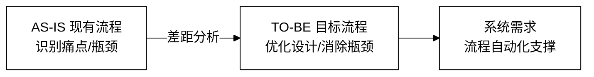
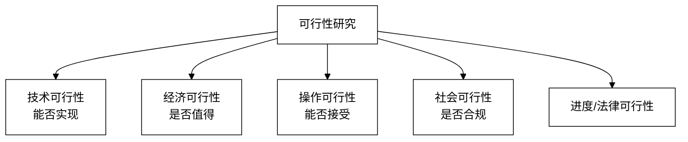

# 系统分析师｜第10章 系统规划与分析（备考讲义＋章节自测题）

> **教材依据**：《系统分析师教程（第2版）》第10章 系统规划与分析（共9节：10.1 系统规划概述｜10.2 项目的提出与选择｜10.3 系统分析概述｜10.4 问题分析｜10.5 业务流程分析｜10.6 数据与数据流程分析｜10.7 系统可行性分析｜10.8 成本效益分析｜10.9 系统方案建议）。第2版将第1版第9章「系统规划」与第10章「系统分析」合并重组为本章，节号重新归并；合并中亦有删减——第1版 10.2 详细调查（含原则/内容/方法）、10.4 组织结构分析（含组织结构图/组织结构调查）、10.5 系统功能分析、10.8 系统需求规格说明（GB/T 8567 模板）在第2版均未保留；第1版 9.3 初步调查并入 10.1、10.3 现有系统分析并入 10.3。教材外内容：考纲第16条经济管理相关知识（成本效益分析／NPV／ROI）归口本章10.8 经济可行性，已在模块8以【教材｜掌握】承载。

> **考纲定位说明**：2024版考纲科目一「系统分析师综合知识」第8条 系统规划与分析（涵盖系统规划、系统分析、可行性研究、业务流程与数据流程分析、成本效益分析、系统方案建议；与教材第2版第10章各节一一对应）。另考纲第16条经济管理相关知识（成本效益／NPV／ROI）归口本章10.8。

> **考试形式**：上午综合知识单选题（含可行性／成本效益计算）；2024上～2026上约12道/2场（业务流程5道、可行性3道、数据属性分析4道，均中频），属第二梯队章节；案例分析2024上～2026上仅2026上1题组（必答·因果分析鱼骨图），论文2025下试题四成本效益低频。

> 标签：系统分析师、上午题、系统规划、系统分析、可行性研究、业务流程分析、数据属性分析、成本效益、NPV、加权评分

[TOC]

## 章节结构对照与来源标注

> 本讲义为《系统分析师教程（第2版）》第10章 系统规划与分析的学习讲义。本章按教材原生9节组织模块；第1版拆分为「系统规划」（第9章）与「系统分析」（第10章）两章，第2版合并重组；合并时删除了详细调查、组织结构分析、系统功能分析、系统需求规格说明等小节，其余内容随编号归并入本章各节。

| 讲义模块 | 对应教材第2版章节 | 内容性质 | 备考要求 |
|---|---|---|---|
| 模块1 系统规划概述 | 10.1 系统规划概述 | 教材 | 了解 |
| 模块2 项目的提出与选择 | 10.2 项目的提出与选择 | 教材 | 了解 |
| 模块3 系统分析概述 | 10.3 系统分析概述 | 教材 | 了解 |
| 模块4 问题分析 | 10.4 问题分析 | 教材 | 了解 |
| 模块5 业务流程分析 | 10.5 业务流程分析 | 教材 | 掌握：业务流程图、AS-IS/TO-BE、业务活动图、痛点分析工具 |
| 模块6 数据与数据流程分析 | 10.6 数据与数据流程分析 | 教材 | 了解：10.6.1～10.6.6；掌握：10.6.7 数据属性分析 |
| 模块7 系统可行性分析 | 10.7 系统可行性分析 | 教材 | 掌握：可行性四维度、评价准则、可行性研究报告 |
| 模块8 成本效益分析 | 10.8 成本效益分析 | 教材 | 掌握：成本与收益、NPV、静态/动态回收期、ROI |
| 模块9 系统方案建议 | 10.9 系统方案建议 | 教材 | 了解：候选方案矩阵、可行性分析矩阵（加权评分） |

> （按教材原文核读）教材第2版第10章章节结构：10.1 系统规划概述｜10.2 项目的提出与选择（10.2.1 项目的立项目标和动机、10.2.2 项目立项的价值判断）｜10.3 系统分析概述｜10.4 问题分析（10.4.1 研究问题的领域、10.4.2 分析问题和机会、10.4.3 制定系统改进目标、10.4.4 汇报调查结果和建议）｜10.5 业务流程分析（10.5.1 业务流程分析概述、10.5.2 业务流程图、10.5.3 业务活动图）｜10.6 数据与数据流程分析（10.6.1 数据流的内涵、10.6.2 逻辑数据流与规则、10.6.3 数据流的守恒、10.6.4 数据流图、10.6.5 物理数据流图、10.6.6 数据汇总分析、10.6.7 数据属性分析）｜10.7 系统可行性分析（10.7.1 可行性评价准则、10.7.2 可行性研究的步骤、10.7.3 可行性研究报告）｜10.8 成本效益分析（10.8.1 成本和收益、10.8.2 净现值分析、10.8.3 投资回收期与投资回报率）｜10.9 系统方案建议（10.9.1 候选方案的可行性评价、10.9.2 系统建议方案报告）。

> ⚠️ 教材第2版第10章**不包含**：① 第1版将「系统规划」（第9章）与「系统分析」（第10章）分为两章，第2版合并为第10章；合并中删除了第1版 10.2 详细调查、10.4 组织结构分析、10.5 系统功能分析、10.8 系统需求规格说明等小节，其余内容随编号归并。考生持第1版教材时须按第2版编号回溯映射（如第1版9.2 项目的提出与选择→第2版10.2、第1版10.6 业务流程分析→第2版10.5、第1版10.7 数据汇总/属性分析→第2版10.6.6/10.6.7），勿按第1版单章复习。② 第1版 10.4「组织结构分析」（组织结构图）在第2版第10章未保留为独立小节，组织结构图仅在 10.5 业务流程分析中作为背景性 incidental 提及，不展开。③ 考纲第16条经济管理相关知识中的「IT审计」部分不在本章（属系统运行与维护范畴），本章仅承载成本效益分析／NPV／ROI（10.8）。

> 说明：本章数据流图（DFD）虽在教材10.6.4 出现，但综合知识 DFD 考情归口第11章软件需求工程（DFD 3道/3场中频）；本章10.6 数据流/DFD 相关内容按教材原生了解级处理，不重复刷 DFD 题。

---

## 模块1：系统规划概述（教材10.1）【教材｜了解】

**前置说明**：本模块对应教材第2版第10章 10.1 系统规划概述，位于信息系统生命周期最前端；适配上午综合选择题，属规划铺垫内容。

**模块优先级**：🟢 了解为主（近年频次窗未检出，全量统计窗内有检出）

**考情分析**（2021年以后真题）：近年频次窗（2024上～2026上）未检出（0场），全量统计窗内曾有概念题；核心考点：系统规划定位、规划意义、系统规划主要步骤。

### 1.1 核心知识点精讲

#### 1.1.1 系统规划定位（教材10.1）【教材｜了解】

- **系统规划**：信息系统生命周期的**第一个阶段**，任务是对企业环境、目标及现有系统进行初步调查，根据企业战略确定信息系统发展战略，对新系统需求做分析与预测，研究建设必要性与可能性，提出备选方案并做可行性分析。
- 系统规划可减少盲目性，使系统具有良好整体性、较高适应性、明确阶段性，缩短开发周期、节约费用。
- 与软件开发区别：系统规划面向**顶层战略**（做什么、为什么做、值不值得做）；软件开发面向「怎么做」。

> 记忆：规划在最前端，回答「做不做、值不值」；开发回答「怎么做」。

#### 1.1.2 系统规划的主要步骤（教材10.1）【教材｜了解】

按系统规划主要任务，步骤如下：

1. **初步调查**：从类似企业与企业内部收集信息，站在管理层高度观察现状。
2. **分析和确定系统目标**：包括服务质量与范围、政策、组织与人员。
3. **分析子系统组成和基本功能**：自顶向下划分，说明各子系统功能。
4. **拟定系统实施方案**：设定子系统优先级，确定开发顺序。
5. **可行性研究**：编写可行性研究报告，召开可行性论证会。
6. **制定系统建设方案**：分析比较技术指标，落实前提条件，编写**系统设计任务书**；经上级主管部门批准后作为系统建设依据。

> 易错：系统设计任务书是规划阶段最终交付、需上级批准，是开发依据，不是需求规格说明书。

#### 1.1.3 系统规划原则（教材10.1）【教材｜了解】

教材强调系统规划应使系统具备：整体性、较高适应性、明确阶段性；实践中系统规划失败常见原因——高层支持不足、业务目标与企业战略不匹配、标准规范混乱导致信息孤岛。

> 记忆：整体·适应·阶段，三层到位；高层支持是规划成败关键。

---

## 模块2：项目的提出与选择（教材10.2）【教材｜了解】

**前置说明**：本模块对应教材第2版第10章 10.2 项目的提出与选择，说明信息系统项目立项目标、动机与价值判断；适配上午综合选择题。

**模块优先级**：🟢 了解为主（近年频次窗未检出，全量统计窗内有检出）

**考情分析**（2021年以后真题）：近年频次窗（2024上～2026上）未检出（0场），全量统计窗内有检出；核心考点：立项目标四种模式、立项价值判断、项目选择与系统设计任务书。

### 2.1 核心知识点精讲

#### 2.1.1 项目的立项目标和动机（教材10.2.1）【教材｜了解】

信息系统项目立项通常可归结为4种模式：

1. **基础研究**：大学/科研院所提出，长期战略投资，探索性，无具体产品发布目标。
2. **应用研发**：企业立项开发产品并销售，有明确研发目标、严格时间与预算。
3. **提供技术服务**：以系统集成商/咨询商等角色，面向特定行业提供综合性技术服务。
4. **产品的使用者**：最终用户通过采购或定制开发获得系统使用价值。

#### 2.1.2 项目立项的价值判断（教材10.2.2）【教材｜了解】

- 基础研究导向：高度技术研究导向。
- 应用产品研发导向：关注技术在具体领域应用与推广。
- 技术服务导向：高度客户业务/客户满意导向。
- 产品使用者导向：关注系统的使用、影响与代价等应用性问题。

> 易错：四类动机价值观不矛盾，只是使用信息技术程度与关注视角不同，决定系统分析师在项目全过程的侧重点。

#### 2.1.3 项目选择与立项依据（教材10.2、10.1）【教材｜了解】

- 系统分析师应根据目标确定工作范围、提出系统选择方案并给出选择结果。
- 规划阶段产出**系统设计任务书**（经上级批准）作为建设依据；立项需经评审与批准。

---

## 模块3：系统分析概述（教材10.3）【教材｜了解】

**前置说明**：本模块对应教材第2版第10章 10.3 系统分析概述，界定系统分析阶段（逻辑设计阶段）的任务与成果；适配上午综合选择题。

**模块优先级**：🟢 了解为主（近年频次窗未检出，全量统计窗内有检出）

**考情分析**（2021年以后真题）：近年频次窗（2024上～2026上）未检出（0场），全量统计窗内有检出；核心考点：系统分析阶段定位、逻辑模型、系统需求规格说明书。

### 3.1 核心知识点精讲

#### 3.1.1 系统分析阶段定位（教材10.3）【教材｜了解】

- 系统分析阶段也称**逻辑设计阶段**，任务：根据系统设计任务书确定范围，详细调查现有系统，描述现有业务流程，指出现有系统局限与不足，确定新系统基本目标与逻辑功能要求，即提出新系统**逻辑模型**。
- 系统分析师与用户一起将初始需求具体化、明确化，转换为新系统「做什么」的逻辑模型。
- 工作成果：**系统需求规格说明书**——系统建设必备文件、系统设计依据、将来验收依据。

> 易错：系统分析解决「做什么」（逻辑模型），系统设计解决「怎么做」；系统需求规格说明书是分析阶段成果，非设计任务书。

#### 3.1.2 系统分析的重要性（教材10.3）【教材｜了解】

系统分析是系统开发中最重要、最困难的阶段，是信息系统建设与一般工程项目的重要区别；需求具体化、明确化是分析核心。

---

## 模块4：问题分析（教材10.4）【教材｜了解】

**前置说明**：本模块对应教材第2版第10章 10.4 问题分析，覆盖现状调查与问题识别的四个环节；适配上午综合选择题与案例分析（因果分析铺垫）。

**模块优先级**：🟢 了解为主（近年频次窗未检出，全量统计窗内有检出；鱼骨图因果分析在2026上案例必答题组中出现）

**考情分析**（2021年以后真题）：近年频次窗（2024上～2026上）未单独检出（0场），全量统计窗内有检出；核心考点：研究问题领域、分析问题和机会、制定改进目标、汇报调查结果。

### 4.1 核心知识点精讲

#### 4.1.1 研究问题的领域（教材10.4.1）【教材｜了解】

明确调查范围与边界，识别企业战略、内外部环境对系统的影响，界定待研究问题的业务领域。

#### 4.1.2 分析问题和机会（教材10.4.2）【教材｜了解】

通过详细调查识别现有系统的问题与业务机会；常用工具：鱼骨图（因果图，找根因）、帕累托分析（定关键少数）。

> 易错：鱼骨图找根因、帕累托定优先级；2026上案例分析首次必答「因果分析·鱼骨图」，故鱼骨图虽归了解级仍须能识图运用。

#### 4.1.3 制定系统改进目标（教材10.4.3）【教材｜了解】

在分析问题和机会基础上，制定可度量、可达成的新系统改进目标。

#### 4.1.4 汇报调查结果和建议（教材10.4.4）【教材｜了解】

形成调查汇报材料，向管理层汇报现状、问题、机会与初步改进建议，支撑立项与可行性研究。

---

## 模块5：业务流程分析（教材10.5）【教材｜掌握】

**前置说明**：本模块对应教材第2版第10章 10.5 业务流程分析，是综合知识中频考点族与案例分析业务建模基础；适配上午综合选择题与案例题。

**模块优先级**：🟡 中频（近年频次窗2场检出）

**考情分析**（2021年以后真题）：2024上～2026上业务流程分析5道/2场（中频）；核心考点：业务流程图 BFD、AS-IS/TO-BE 流程建模、业务活动图、业务问题与机会分析（鱼骨图/帕累托）。

### 5.1 核心知识点精讲

#### 5.1.1 业务流程分析概述（教材10.5.1）【教材｜掌握】

- 业务流程分析描述业务如何流转，识别瓶颈与重复环节，为系统需求与方案设计提供依据。
- 分析重点：梳理业务流程、识别业务痛点、明确业务目标，输出业务现状描述、问题清单与改进机会。

#### 5.1.2 AS-IS 与 TO-BE 流程建模（教材10.5 范畴）【教材｜掌握】

- **AS-IS 现有业务流程**：描述当前流程（现状），识别问题与瓶颈。
- **TO-BE 目标业务流程**：设计优化后流程（目标），消除痛点、提升效率。
- 分析路径：AS-IS 找问题 → 设计 TO-BE → 明确差距（Gap）→ 支撑系统需求。

> 记忆：AS-IS 看现状找问题，TO-BE 看目标做优化。

#### 5.1.3 业务流程图 BFD（教材10.5.2）【教材｜掌握】

- 业务流程图描述业务处理的流转与节点，表现业务各部门的逻辑关联。
- 要素：业务处理单位、业务处理、单据/报表、数据存储、信息传递。

#### 5.1.4 业务活动图（教材10.5.3）【教材｜掌握】

- 业务活动图细化业务活动中各角色的动作与顺序，描述业务活动的执行过程。
- 与业务流程图区别：活动图聚焦「角色动作序列」，流程图聚焦「业务流转节点」。

#### 5.1.5 业务问题与机会分析工具（教材10.4～10.5 范畴）【教材｜掌握】

- **鱼骨图（因果图）**：分析问题根因，分类罗列人、机、料、法、环等维度。
- **帕累托分析**：按二八法则识别关键少数问题（80/20），定改进优先级。

> 易错：鱼骨图找根因、帕累托定优先级，两者配合用于业务痛点分析；2026上案例必答因果分析·鱼骨图。

### 5.2 典型例题

**例题1【业务流程图与 AS-IS/TO-BE】**

在业务流程优化中，描述当前业务运行状态、用于识别问题与瓶颈的模型是（）
A. TO-BE 模型 B. AS-IS 模型 C. 技术架构 D. 数据模型

> 【解析】AS-IS 描述现状、识别问题与瓶颈；TO-BE 描述目标流程。
> 【答案】B

**例题2【业务分析工具】**

分析业务流程问题根本原因，适合使用（）
A. 帕累托图 B. 鱼骨图 C. 甘特图 D. 网络图

> 【解析】鱼骨图（因果图）用于分析问题根因。
> 【答案】B

**例题3【业务活动图】**

下列描述最符合「业务活动图」特点的是（）
A. 聚焦业务流转节点 B. 聚焦角色动作序列 C. 描述数据流向 D. 描述系统部署

> 【解析】业务活动图细化各角色动作与执行顺序；业务流程图聚焦流转节点。
> 【答案】B

### 5.3 课后习题

**习题1**

「通过信息系统提升订单处理效率30%」这一业务目标，最适合在流程分析中作为（）的输入
A. AS-IS 模型 B. TO-BE 模型 C. 数据流图 D. 组织结构图

> 【解析】效率提升目标用于设计优化后的目标流程（TO-BE）。
> 【答案】B

**习题2**

识别「少数关键问题贡献大部分业务损失」应使用（）
A. 鱼骨图 B. 帕累托分析 C. 业务流程图 D. 用例图

> 【解析】帕累托分析体现二八法则，定位关键少数。
> 【答案】B

**习题3**

业务流程图（BFD）主要表现的是（）
A. 角色动作序列 B. 业务处理单位间逻辑关联与流转 C. 数据存取 D. 系统模块调用

> 【解析】业务流程图描述业务处理流转与节点、部门逻辑关联。
> 【答案】B

#### 5.1.6 典型易错点（业务流程分析）

1. AS-IS 现状、TO-BE 目标，中间做差距分析【🟡中频】；
2. 业务流程图描述流转节点、业务活动图描述角色动作序列【🟡中频】；
3. 鱼骨图找根因、帕累托定优先级【🟡中频】；
4. 业务流程分析是案例分析业务建模基础，须能识图运用【🟡中频】。

---

## 模块6：数据与数据流程分析（教材10.6）【教材｜掌握】

**前置说明**：本模块对应教材第2版第10章 10.6 数据与数据流程分析；其中 10.6.7 数据属性分析为综合知识中频考点族，10.6.1～10.6.6 为教材原生了解级内容（数据流图 DFD 考情归口第11章）。

**模块优先级**：🟡 中频（含 10.6.7 数据属性分析近年窗2场检出）

**考情分析**（2021年以后真题）：2024上～2026上数据属性分析4道/2场（中频）；10.6.1～10.6.6 数据流/DFD/数据汇总为教材原生了解级（DFD 综合知识考情归第11章需求工程，不重复计次）；核心考点：数据属性静态/动态分析、数据流守恒、CU 矩阵。

### 6.1 核心知识点精讲

#### 6.1.1 数据流的内涵（教材10.6.1）【教材｜了解】

- 数据流表示到一个过程的数据输入，或来自一个过程的数据/信息输出；所有过程至少有一个输入数据流与一个输出数据流。
- 数据流由具体数据属性（数据结构）构成，或由其他数据流组合而成。

#### 6.1.2 逻辑数据流与规则（教材10.6.2）【教材｜了解】

- 逻辑数据流描述数据在系统中的输入、处理、转换与输出等逻辑路径与逻辑关系。
- 规则用于验证数据合法性与正确性，保证处理按要求进行。

#### 6.1.3 数据流的守恒（教材10.6.3）【教材｜了解】

- 数据流守恒：数据在流动过程中总量保持不变。
- 描述：输入等于输出；处理后等于输入加增量（更新类）；处理前等于处理后加丢失量（删除类）。

#### 6.1.4 数据流图 DFD（教材10.6.4）【教材｜了解】

DFD 由4种符号组成：

1. **数据流**：箭头，表示数据在功能模块间流动。
2. **进程（加工）**：圆角矩形，表示功能模块或处理过程。
3. **数据存储**：长方形，表示文件、数据库等存储设备。
4. **外部实体**：矩形，表示系统外部的人、设备、其他系统。

> 说明：DFD 综合知识考情归口第11章软件需求工程（DFD 3道/3场中频）；本章按教材原生了解级处理，重点掌握四符号含义。

#### 6.1.5 物理数据流图（教材10.6.5）【教材｜了解】

- 物理 DFD 描述实现的技术与人为设计决策（当前/目标系统的物理与逻辑 DFD、软件元素结构图）。
- 逻辑 DFD 描述「做什么」，物理 DFD 描述「怎么做」。

#### 6.1.6 数据汇总分析与 CU 矩阵（教材10.6.6）【教材｜了解】

- 数据汇总步骤：按业务流程分类编码→自顶向下整理数据项→列出原始数据与最终输出数据→确定字长精度。
- 借助 BSP 的 **CU 矩阵**（Create-Use，过程/数据矩阵）做数据分析（聚类），并做正确性检验（完备性、一致性、无冗余性）。

#### 6.1.7 数据属性分析（教材10.6.7）【教材｜掌握】

数据属性分析包括**静态分析**与**动态分析**：

- **静态分析**：
  - 类型与长度：字符型/数值型/时间型/多媒体型，整数位与小数位。
  - 取值范围：最大值、最小值（输入校对审核必需）。
  - 发生的业务量：频率、峰值数据量与峰值时间、存储保留周期。
- **动态分析**：数据被使用的时间、频率、生命周期等动态特性。

> 记忆：静态看类型/范围/业务量，动态看时效与频率；数据属性分析是数据库设计基础。

### 6.2 典型例题

**例题1【数据属性分析】**

确定某数据项「类型、长度、取值范围」属于数据属性分析的（）
A. 静态分析 B. 动态分析 C. 数据流守恒 D. CU 矩阵

> 【解析】类型/长度/取值范围属静态分析内容。
> 【答案】A

**例题2【数据流守恒】**

「处理后输出 = 输入 + 更新增量」描述的数据流守恒情形适用于（）
A. 含更新/修改数据的系统 B. 含删除数据的系统 C. 纯查询系统 D. 外部实体

> 【解析】处理后等于输入加增量，对应含更新或修改数据的系统。
> 【答案】A

### 6.3 课后习题

**习题1**

用于过程/数据聚类分析、检验数据完备性一致性的工具是（）
A. 鱼骨图 B. CU 矩阵 C. 业务流程图 D. 候选系统方案矩阵

> 【解析】CU 矩阵（BSP）用于数据分析聚类与正确性检验。
> 【答案】B

**习题2**

数据属性动态分析主要关注（）
A. 类型与长度 B. 取值范围 C. 数据被使用的时效与频率 D. 峰值数据量

> 【解析】动态分析关注数据使用的时间、频率、生命周期等动态特性；A/B/D 属静态分析。
> 【答案】C

#### 6.1.8 典型易错点（数据与数据流程分析）

1. 数据属性静态分析看类型/范围/业务量，动态分析看时效频率【🟡中频】；
2. 数据流守恒三式：输入=输出、处理后=输入+增量、处理前=处理后+丢失量【🟡中频】；
3. DFD 四符号：数据流(箭头)/进程(圆角矩形)/数据存储(长方形)/外部实体(矩形)——其综合知识考情归第11章【🟡中频】；
4. CU 矩阵用于数据聚类与正确性检验，源自 BSP【🟡中频】。

---

## 模块7：系统可行性分析（教材10.7）【教材｜掌握】

**前置说明**：本模块对应教材第2版第10章 10.7 系统可行性分析，是综合知识中频考点族（可行性研究）的载体；适配上午综合选择题与案例题。

**模块优先级**：🟡 中频（近年频次窗2场检出）

**考情分析**（2021年以后真题）：2024上～2026上可行性研究3道/2场（中频）；核心考点：可行性四维度（技术/经济/操作/社会）、评价准则、可行性研究步骤、可行性研究报告结论。

### 7.1 核心知识点精讲

#### 7.1.1 可行性评价准则（教材10.7.1）【教材｜掌握】

系统可行性通常从多维度评价：

1. **技术可行性**：现有技术能否实现、团队技术能力是否具备。
2. **经济可行性**：成本收益分析，是否值得投资（详见模块8）。
3. **操作可行性**：用户与组织能否接受、流程能否落地。
4. **社会可行性**：法律、政策、伦理、社会影响是否合规。
5. **进度可行性**：时间进度是否可接受。
6. **法律可行性**：知识产权、合同等法律约束。

> 记忆：技术行不行、经济值不值、操作认不认、社会合不合规。

#### 7.1.2 可行性研究的步骤（教材10.7.2）【教材｜掌握】

教材可行性研究步骤（第5步衔接系统方案）：初步调查→确定目标与范围→建立逻辑模型→分析研究现行系统→研究新系统→提出并评价候选方案→编写可行性研究报告→形成系统设计任务书。

#### 7.1.3 可行性研究报告与结论（教材10.7.3）【教材｜掌握】

可行性研究报告结论类型：

- **立即开发**：条件具备，尽快启动。
- **暂缓开发**：条件成熟后再开发。
- **修改方案后开发**：调整方案重新评估。
- **不可行（放弃）**：技术上或经济上不可行。

> 易错：经济不可行 → 项目不可行，结论为暂缓或放弃，不能无条件开发。

### 7.2 典型例题

**例题1【可行性维度】**

「系统上线后用户是否能适应新流程」属于（）
A. 技术可行性 B. 经济可行性 C. 操作可行性 D. 社会可行性

> 【解析】用户接受度与流程落地 → 操作可行性。
> 【答案】C

**例题2【可行性结论】**

经评估，某系统技术上可实现、经济上不划算，可行性研究报告结论应为（）
A. 立即开发 B. 暂缓开发或放弃 C. 无条件开发 D. 仅做技术方案

> 【解析】经济不可行 → 不可行，结论为暂缓或放弃。
> 【答案】B

### 7.3 课后习题

**习题1**

「现有技术团队是否具备开发能力」属于（）
A. 技术可行性 B. 经济可行性 C. 操作可行性 D. 社会可行性

> 【解析】团队技术能力与实现条件 → 技术可行性。
> 【答案】A

**习题2**

可行性研究报告结论不包括（）
A. 立即开发 B. 暂缓开发 C. 修改方案后开发 D. 立即运维

> 【解析】结论四类为立即/暂缓/修改后/不可行；「立即运维」非可行性结论。
> 【答案】D

#### 7.1.4 典型易错点（系统可行性分析）

1. 四维度：技术/经济/操作/社会（另含进度、法律）【🟡中频】；
2. 经济可行性随可行性研究选择题考查，NPV/ROI 为考纲第16条计算要求【🟡中频】；
3. 可行性结论四类：立即/暂缓/修改后/不可行【🟡中频】；
4. 经济不可行 → 项目不可行，不能无条件开发【🟡中频】。

---

## 模块8：成本效益分析（教材10.8）【教材｜掌握】

**前置说明**：本模块对应教材第2版第10章 10.8 成本效益分析，承载考纲第16条经济管理相关要求（NPV/ROI）；适配上午综合选择题与计算题。

**模块优先级**：🟡 中频（经济可行性随可行性研究选择题考查；NPV/回收期/ROI 为考纲第16条计算要求）

**考情分析**（2021年以后真题）：2024上～2026上经济可行性（NPV/回收期/ROI）随可行性研究选择题考查（中频关联）；成本效益分析案例分析科目不涉及，仅综合知识与论文2025下试题四（低频）出现；核心考点：成本与收益分类、净现值 NPV、净现值率 NPVR、静态/动态投资回收期、投资回报率 ROI。

### 8.1 核心知识点精讲

#### 8.1.1 成本与收益（教材10.8.1）【教材｜掌握】

- **成本**：一次性成本（设备购置、软件开发）、经常性成本（运维、人员）。
- **收益**：有形收益（可量化，如成本节约、收入增加）、无形收益（难以量化，如满意度提升、形象改善）。

#### 8.1.2 净现值分析 NPV（教材10.8.2）【教材｜掌握】

净现值：未来各期净现金流按贴现率折现、扣除初始投资的现值之和。

$$ \text{NPV} = \sum_{t=1}^{n} \dfrac{(CI - CO)_t}{(1 + i)^t} - P_0 $$

- $\text{NPV} > 0$：项目可行；$\text{NPV} < 0$：不可行。
- **净现值率 NPVR**：$\text{NPVR} = \dfrac{\text{NPV}}{P}$（$P$ 为投资总额现值），用于多方案资金效率比较；单一方案下 NPV 与 NPVR 等效。

> 易错：NPV 考虑资金时间价值（贴现）；静态指标不考虑。NPV 越大不一定资金效率越高（需结合 NPVR）。

#### 8.1.3 投资回收期与投资回报率（教材10.8.3）【教材｜掌握】

- **静态投资回收期**（不考虑资金时间价值）：

$$ T = \text{累计净现金流量首次为正值的年份} - 1 + \dfrac{\text{上年累计净现金流绝对值}}{\text{当年净现金流量}} $$

- **动态投资回收期**：考虑贴现，公式同上但以折现现金流累计转正为准。
- **投资回收率**：$\text{投资回收率} = \dfrac{1}{\text{动态投资回收期}} \times 100\%$。
- **投资收益率 ROI**：$\text{ROI} = \dfrac{\text{投资收益}}{\text{投资成本}} \times 100\%$（又称投资利润率）；当收益率远低于净资产收益率时投资失败，远高于时存操纵利润嫌疑。

> 易错：静态回收期不考虑贴现；动态回收期考虑。ROI 是比率指标，NPV 是绝对值指标。

### 8.2 典型例题

**例题1【NPV 判断】**

某项目初始投资100万，第1年净现金流40万、第2年60万，贴现率10%。NPV 约为（）
A. 100万 B. −13.2万 C. 13.2万 D. 0

> 【解析】NPV = 40/1.1 + 60/1.1² − 100 = 36.36 + 49.59 − 100 ≈ −13.95万，接近 −13.2万。
> 【答案】B

**例题2【投资回收期】**

项目初始投资150万，各年净现金流：第1年30万、第2年50万、第3年60万、第4年60万，静态投资回收期为（）
A. 2年 B. 2.5年 C. 3.17年 D. 4年

> 【解析】累计：第1年30、第2年80、第3年140、第4年200；第3年末差10万，第4年60万；T = 3 + 10/60 ≈ 3.17年。
> 【答案】C

**例题3【ROI】**

项目总投资100万，年均净收益25万，ROI 为（）
A. 25% B. 4% C. 250% D. 10%

> 【解析】ROI = 25/100 × 100% = 25%。
> 【答案】A

### 8.3 课后习题

**习题1**

下列指标中考虑资金时间价值的是（）
A. 静态投资回收期 B. 净现值 NPV C. 投资收益率（静态） D. 回报年限（未贴现）

> 【解析】NPV 考虑贴现；静态回收期/静态收益率不考虑。
> 【答案】B

**习题2**

净现值率 NPVR 用于（）
A. 单方案绝对可行性 B. 多方案资金效率比较 C. 替代 ROI D. 计算回收期

> 【解析】NPVR 是效率型指标，用于投资受限时多方案资金效率比较。
> 【答案】B

#### 8.1.4 典型易错点（成本效益分析）

1. NPV > 0 可行，考虑时间价值；静态回收期不考虑【🟡中频】；
2. 静态回收期公式：T = 正值年份 − 1 + 上年累计绝对值/当年净现金流【🟡中频】；
3. NPVR 用于多方案资金效率比较，单一方案与 NPV 等效【🟡中频】；
4. ROI = 投资收益/投资成本 × 100%，是比率指标、非绝对值【🟡中频】。

---

## 模块9：系统方案建议（教材10.9）【教材｜了解】

**前置说明**：本模块对应教材第2版第10章 10.9 系统方案建议，给出候选方案评价工具与系统建议方案报告；加权评分（可行性分析矩阵）为计算题范围经典但近年频次窗未单独检出。

**模块优先级**：🟢 了解为主（近年频次窗未检出，全量统计窗内加权评分等方案选型计算有检出）

**考情分析**（2021年以后真题）：近年频次窗（2024上～2026上）未检出（0场），全量统计窗内候选方案评价/加权评分计算有检出；核心考点：候选系统方案矩阵、可行性分析矩阵（权重系数加权评分）、系统建议方案报告。

### 9.1 核心知识点精讲

#### 9.1.1 候选方案的可行性评价（教材10.9.1）【教材｜了解】

对候选方案进行可行性评价，可使用两种工具：

- **候选系统方案矩阵**：行=方案特征（系统架构、处理部分、服务器/工作站、开发工具、应用软件、输入输出设备、数据存储、处理方法、处理环境），列=候选方案；至少含一个现有系统方案作基准。
- **可行性分析矩阵**：在候选系统方案矩阵基础上，按可行性评价准则给各方案**加权评分**（含权重系数），用于方案比选。

> 说明：加权评分法（权重×得分求和、权重合计为1或100%、选最高分）属计算题范围经典方法，全量统计窗有检出；近年频次窗未单独列中频，故按了解级处理，综合模拟题保留1道加权评分计算题。

#### 9.1.2 系统建议方案报告（教材10.9.2）【教材｜了解】

- 系统建议方案报告汇总候选方案比选结果，给出推荐方案及理由（成本、风险、收益平衡）。
- 与可行性研究报告、系统设计任务书衔接，作为立项与开发依据。

> 易错：系统建议方案报告在可行性研究之后、系统设计任务书之前，是规划成果落地的承上启下文档。

---

# 章节总复习综合模拟题

> 说明：题型贴合系统分析师上午真题风格，覆盖模块1～9核心考点；中频掌握模块（5/6.7/7/8）配例题级题量与计算题，了解级模块（1/2/3/4/9）按规范各至多1道概念题。

## 一、单项选择题（15题）

1. 系统规划处于信息系统生命周期的（）
A. 最前端 B. 中间 C. 最后端 D. 编码阶段
> 【解析】系统规划是生命周期第一个阶段，回答做不做、值不值。
> 【答案】A

2. 系统规划主要步骤的最后一步是（）
A. 可行性研究 B. 制定系统建设方案并编写系统设计任务书 C. 初步调查 D. 拟定实施方案
> 【解析】步骤第6步：制定系统建设方案→系统设计任务书，经上级批准。
> 【答案】B

3. 信息系统项目立项四种模式不包括（）
A. 基础研究 B. 应用研发 C. 提供技术服务 D. 设备采购招标
> 【解析】四种模式：基础研究、应用研发、提供技术服务、产品的使用者；设备采购招标非动机模式。
> 【答案】D

4. 系统分析阶段的工作成果是（）
A. 系统设计任务书 B. 系统需求规格说明书 C. 可行性研究报告 D. 项目章程
> 【解析】系统分析产出系统需求规格说明书（逻辑模型）。
> 【答案】B

5. 描述当前业务流程、识别问题与瓶颈的模型是（）
A. TO-BE B. AS-IS C. 用例图 D. 架构图
> 【解析】AS-IS 描述现状、识别问题。
> 【答案】B

6. 分析业务问题根本原因应使用（）
A. 帕累托图 B. 鱼骨图 C. 甘特图 D. 网络图
> 【解析】鱼骨图（因果图）找根因。
> 【答案】B

7. 数据流图 DFD 中「加工/处理」的符号是（）
A. 箭头 B. 圆角矩形 C. 长方形 D. 矩形
> 【解析】进程（加工）用圆角矩形；箭头=数据流、长方形=数据存储、矩形=外部实体。
> 【答案】B

8. 数据属性分析中确定「类型、长度、取值范围」属于（）
A. 静态分析 B. 动态分析 C. 数据流守恒 D. CU 矩阵
> 【解析】类型/长度/取值范围属静态分析。
> 【答案】A

9. 「法律政策是否允许系统上线」属于（）
A. 技术可行性 B. 经济可行性 C. 操作可行性 D. 社会可行性
> 【解析】法律政策合规 → 社会可行性。
> 【答案】D

10. 可行性研究报告结论不包括（）
A. 立即开发 B. 暂缓开发 C. 修改方案后开发 D. 立即运维
> 【解析】结论四类：立即/暂缓/修改后/不可行。
> 【答案】D

11. 净现值 NPV > 0 表示项目（）
A. 不可行 B. 可行 C. 需暂缓 D. 无法判断
> 【解析】NPV > 0 项目可行。
> 【答案】B

12. 项目初始投资100万，第1年净现金流50万、第2年50万，静态回收期为（）
A. 1年 B. 2年 C. 2.5年 D. 3年
> 【解析】累计第2年达100万，正好2年回收。
> 【答案】B

13. 加权评分法中各准则权重之和应为（）
A. 0 B. 1（或100%） C. 10 D. 无限制
> 【解析】权重合计应为1或100%。
> 【答案】B

14. 候选系统方案矩阵中通常至少有一个（）
A. 全新方案 B. 现有系统方案作基准 C. 外包方案 D. 云方案
> 【解析】至少含一个现有系统方案作为其他候选的基准。
> 【答案】B

15. 可行性研究四维度不包括（）
A. 技术可行性 B. 经济可行性 C. 操作可行性 D. 编码可行性
> 【解析】四维度为技术/经济/操作/社会，无编码可行性。
> 【答案】D

## 二、计算题（3道）

### 计算题1【净现值 NPV】

项目初始投资200万元，第1～3年净现金流量分别为80万、90万、100万，贴现率10%。求 NPV 并判断项目是否可行。
> 【解析】
> NPV = 80/1.1 + 90/1.1² + 100/1.1³ − 200
> = 72.73 + 74.38 + 75.13 − 200 ≈ 22.24万元。
> NPV = 22.24 > 0，项目可行。
> 【答案】NPV ≈ 22.24万 > 0，可行

### 计算题2【静态投资回收期】

某项目初始投资150万元，各年净现金流量：第1年30万、第2年50万、第3年60万、第4年60万。求静态投资回收期。
> 【解析】
> 累计：第1年30、第2年80、第3年140、第4年200。
> 第3年末还差 150 − 140 = 10万；第4年净现金流60万。
> 回收期 = 3 + 10/60 ≈ 3.17年。
> 【答案】约3.17年

### 计算题3【加权评分选型】（了解级经典计算，全量统计窗有检出）

三个候选方案在准则（功能、性能、成本、扩展性）得分如下表，权重分别为0.4、0.2、0.3、0.1。选最优方案。

| 方案 | 功能 | 性能 | 成本 | 扩展性 |
| ---- | ---- | ---- | ---- | ---- |
| A | 9 | 8 | 6 | 7 |
| B | 7 | 9 | 8 | 6 |
| C | 8 | 7 | 9 | 8 |

> 【解析】
> A = 0.4×9 + 0.2×8 + 0.3×6 + 0.1×7 = 3.6 + 1.6 + 1.8 + 0.7 = 7.7
> B = 0.4×7 + 0.2×9 + 0.3×8 + 0.1×6 = 2.8 + 1.8 + 2.4 + 0.6 = 7.6
> C = 0.4×8 + 0.2×7 + 0.3×9 + 0.1×8 = 3.2 + 1.4 + 2.7 + 0.8 = 8.1
> C 方案总分最高。
> 【答案】选方案C（总分8.1）

## 三、简答概念题（3道）

1. 简述可行性研究的四个主要维度及其含义
> 【解析】技术可行性：现有技术能否实现、团队能力；经济可行性：成本收益分析，NPV/回收期/ROI 判断是否值得；操作可行性：用户与组织能否接受、流程能否落地；社会可行性：法律、政策、伦理、社会影响是否合规。四维度全部通过方可进入详细可研与立项。

2. 简述 AS-IS 与 TO-BE 在业务流程分析中的作用
> 【解析】AS-IS 现有业务流程模型描述当前运行状态，识别流程瓶颈、重复环节与信息孤岛；TO-BE 目标业务流程模型设计优化后流程，消除痛点、提升效率。两者通过差距分析（Gap Analysis）连接：AS-IS 找问题、设计 TO-BE、明确差距，为系统需求与方案设计提供依据。

3. 简述数据属性分析的内容
> 【解析】数据属性分析包括静态分析与动态分析。静态分析：类型与长度（字符/数值/时间/多媒体，整数位小数位）、取值范围（最大最小，输入校对必需）、发生的业务量（频率、峰值数据量与时间、存储保留周期）；动态分析：数据被使用的时效、频率与生命周期等动态特性。它是数据库设计确定基本表与输出指标的基础。

---

> **备考提示**：本章2024上～2026上约12道/2场（业务流程5道、可行性3道、数据属性分析4道，均中频），属第二梯队。重点掌握：①业务流程分析（业务流程图、AS-IS/TO-BE、业务活动图、鱼骨图/帕累托）；②系统可行性四维度与可行性研究报告结论；③数据属性静态/动态分析（10.6.7）；④成本效益计算（NPV、静态/动态回收期、ROI、NPVR，考纲第16条要求）。其余模块（系统规划概述、项目提出与选择、系统分析概述、问题分析、数据与数据流程分析其余小节、系统方案建议）以了解为主，不必死记；加权评分为全量窗经典计算点、近年窗未单独检出，综合模拟题保留1道即可。
