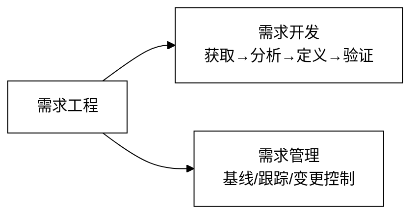
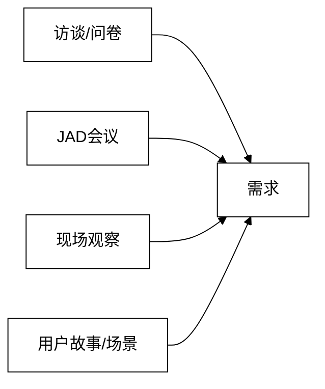
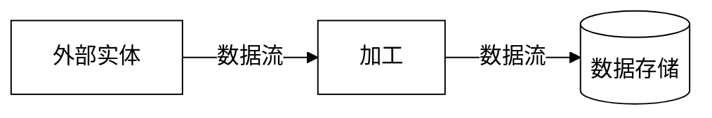
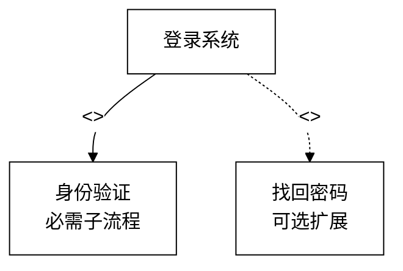
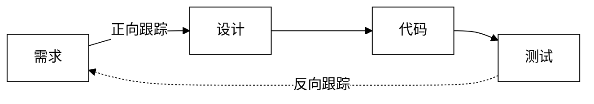

# 系统分析师｜第11章 软件需求工程（备考讲义＋章节自测题）

> **教材依据**：《系统分析师教程（第2版）》第11章 软件需求工程（共8节：11.1 软件需求｜11.2 需求获取｜11.3 需求分析｜11.4 结构化分析方法｜11.5 面向对象分析方法｜11.6 需求定义｜11.7 需求验证｜11.8 需求管理）。第2版强化用户故事／任务卡片／Volere白卡等敏捷需求记录技术（v2 11.2）。第1版10.2.3详细调查方法体系未在第2版保留为独立内容，其中访谈、问卷、采样等在第2版需求获取的11.2.1～11.2.3部分承接；本讲义将观察、JAD联合应用开发、头脑风暴、文档考古等方法作为第1版补充（模块2）。第1版11.8.3需求风险管理在第2版删除，未并入11.8；需求蔓延／镀金等风险现象与风险应对内容按【第1版补充】补回（模块8）。

> **考纲定位说明**：2024版考纲科目一「系统分析师综合知识」第9条 软件需求工程（需求获取｜需求分析｜需求定义｜需求验证｜需求管理｜需求跟踪，与教材第2版第11章各节一一对应）。

> **考试形式**：上午综合知识单选题；2024上～2026上约14道/4场（DFD 3道/3场、需求获取3道/2场、需求定义3道/2场，均中频；用例模型、需求管理各1道/1场，低频），属第二梯队；案例分析需求工程方向累计13题组（2024上～2026上8题组，案例第一大方向），UML／DFD／用例连年轮换；论文软件需求相关（需求工程／变更管理）偶有素材。

> 标签：系统分析师、上午题、软件需求工程、需求获取、需求分析、DFD、用例图、SRS、需求管理、需求跟踪

[TOC]

## 章节结构对照与来源标注

> 本讲义为《系统分析师教程（第2版）》第11章 软件需求工程的学习讲义。本章按教材原生8节组织模块；需求获取与需求管理的方法细节部分源自第1版补充。

| 讲义模块 | 对应教材第2版章节 | 内容性质 | 备考要求 |
|---|---|---|---|
| 模块1 软件需求 | 11.1 软件需求 | 教材 | 了解：需求层次、需求分类、需求质量特性、需求工程框架 |
| 模块2 需求获取 | 11.2 需求获取 | 教材＋第1版补充 | 掌握：教材所述获取方法与需求记录技术、涉众识别；第1版补充未被逐一列述的方法细节 |
| 模块3 需求分析 | 11.3 需求分析 | 教材 | 了解：分析任务、分析方法 |
| 模块4 结构化分析方法 | 11.4 结构化分析方法 | 教材 | 掌握：DFD、状态转换图、数据字典 |
| 模块5 面向对象分析方法 | 11.5 面向对象分析方法 | 教材 | 了解：用例模型、分析模型 |
| 模块6 需求定义 | 11.6 需求定义 | 教材 | 掌握：严格定义／原型方法、SRS |
| 模块7 需求验证 | 11.7 需求验证 | 教材 | 了解：需求评审、需求测试 |
| 模块8 需求管理 | 11.8 需求管理 | 教材＋第1版补充 | 了解：教材11.8.1所述需求变更、需求基线与需求跟踪；需求风险管理及应对作为第1版补充 |

> 教材第2版第11章章节结构：11.1 软件需求｜11.2 需求获取｜11.3 需求分析（11.3.1 需求分析的任务／11.3.2 需求分析的方法）｜11.4 结构化分析方法（11.4.1 数据流图／11.4.2 状态转换图／11.4.3 数据字典）｜11.5 面向对象分析方法（11.5.1 用例模型／11.5.2 分析模型）｜11.6 需求定义（11.6.1 需求定义的方法／11.6.2 软件需求规格说明书）｜11.7 需求验证（11.7.1 需求评审／11.7.2 需求测试）｜11.8 需求管理（11.8.1 需求变更，含需求基线与需求跟踪矩阵）。

> ⚠️ 教材第2版第11章**不包含**：① 第1版10.2.3详细调查方法体系未保留为独立内容；其中访谈、问卷、采样等在第2版11.2.1～11.2.3部分承接，本讲义对观察／JAD联合应用开发／头脑风暴／文档考古等方法按【第1版补充】处理（模块2）；② 第1版 11.8.3 需求风险管理及「风险应对措施表」相关内容在第2版删除，未并入11.8；需求蔓延／镀金等现象及风险管理细节按【第1版补充】补回（模块8）。

> 说明：本章（11.5.1 用例模型）从需求建模角度讲解用例元素与关系，不展开 UML 其他图（类图／时序图等）的语法细节；综合知识 DFD 考情归口本章（11.4.1），用例图整体考情与第7章统一建模语言合并统计。

---

## 模块1：软件需求（教材11.1）【教材｜了解】

**前置说明**：本模块对应教材第2版第11章 11.1 软件需求，界定需求层次、分类与质量特性，并给出需求工程＝需求开发＋需求管理的整体框架；适配上午综合选择题。

**模块优先级**：🟢 了解为主（近年频次窗未检出，全量统计窗内作为基础概念有检出）

**考情分析**（2021年以后真题）：近年频次窗（2024上～2026上）未检出（0场），全量统计窗内需求层次／分类／质量特性作为基础概念偶有考查；核心考点：业务／用户／系统需求三层、功能／非功能／约束分类、需求八项质量特性。

### 1.1 核心知识点精讲

#### 1.1.1 软件需求的层次（教材11.1）【教材｜了解】

- **业务需求**：组织层面的目标与动机（为什么要做）。
- **用户需求**：用户完成任务的具体描述（用户要什么）。
- **系统需求**：系统的功能与非功能规格（系统做什么）。

> 记忆：业务管动机、用户管任务、系统管规格。

#### 1.1.2 软件需求的分类（教材11.1）【教材｜了解】

- **功能需求**：系统必须提供的功能行为。
- **非功能需求**：性能、安全性、可用性、可维护性、兼容性、可移植性等质量属性。
- **约束需求**：业务约束（流程限制）、技术约束（平台要求）、法规约束（合规要求）。

> 易错：非功能需求是质量属性，约束是限制条件，二者不同。

#### 1.1.3 需求的质量特性（教材11.1）【教材｜了解】

好的需求应具备八项特性：**无二义性**、**完整性**、**一致性**、**可测试性**、**确定性**、**可跟踪性**、**正确性**、**必要性**。

> 记忆：无二义、完整、一致、可测、确定、可跟踪、正确、必要。

#### 1.1.4 需求工程框架：需求开发＋需求管理（教材11.1）【教材｜了解】

- **需求开发**：需求获取 → 需求分析 → 需求定义（规格说明） → 需求验证，产出经过验证的需求规格说明书。
- **需求管理**：需求基线、需求跟踪、需求变更控制、需求状态管理，保障需求在整个生命周期中清晰、受控、可追溯。

> 记忆：需求开发「造需求」、需求管理「管需求」。

---

## 模块2：需求获取（教材11.2）【教材｜掌握】

**前置说明**：本模块对应教材第2版第11章 11.2 需求获取，覆盖需求获取的任务与目标、获取方法与记录技术、涉众识别；适配上午综合选择题与案例分析（需求工程案例基础）。

**模块优先级**：🟡 中频（近年频次窗2场检出，需求获取方法综合知识3道/2场）

**考情分析**（2021年以后真题）：2024上～2026上需求获取方法3道/2场（中频）；核心考点：获取方法辨析（访谈／JAD／观察等）、需求记录技术（场景／用户故事／任务卡片）、涉众识别、获取难点。

### 2.1 核心知识点精讲

#### 2.1.1 需求获取的任务与目标（教材11.2）【教材｜掌握】

需求获取阶段的任务是把用户对新系统的期望和要求收集起来；获取到的需求往往是杂乱、重复甚至矛盾的，不能直接作为设计基础，须进入需求分析环节整理。

> 易错：获取阶段产出「用户需求」，还不是「软件需求规格」。

#### 2.1.2 需求获取方法（教材11.2 未逐一列述）【第1版补充｜掌握】

- **访谈**：与干系人一对一／小组交流（最常用）。
- **问卷调查**：大批量收集意见，适合分散用户。
- **现场观察**：观察实际工作流程，发现隐性需求。
- **JAD 联合应用开发**：干系人集中会议，高效达成共识。
- **头脑风暴**：激发创意，收集发散想法。
- **文档考古**：分析现有系统／文档资料，提取需求。
- **原型法**：快速构建原型，用户直观反馈（亦见 11.6.1 需求定义方法）。

> 记忆：访谈最常用、JAD最高效、原型最直观、观察挖隐性。

#### 2.1.3 需求记录技术（教材11.2）【教材｜掌握】

- **任务卡片**：记录任务、子任务、任务变体（如开通课程场景）。
- **场景说明**：对用户工作场景与过程的详细描述，用于编写测试用例与用户培训手册。
- **用户故事**：描述对用户有价值的功能，含书面描述、交谈、测试用例三方面；传统形式「作为<角色>，我想要<功能>，以便<价值>」，具独立性、可协商性、有价值、可预测性、短小精悍、可测试性六属性。
- **Volere白卡**：结构化需求记录模板（需求编号／类型／描述／理由／来源／验收标准等）。

#### 2.1.4 涉众识别（教材11.2 干系人）【第1版补充｜掌握】

- **高层管理者**：关注战略与投资回报。
- **业务操作员**：关注易用与效率。
- **运维人员**：关注可维护与稳定。
- **最终客户**：关注功能价值。

> 易错：不同涉众关注点不同，需求获取须综合权衡，不能只听一方。

### 2.2 典型例题

**例题1【需求获取方法】**

组织项目干系人集中召开会议，在短时间内收集需求并达成共识，属于（）

A. 访谈 B. JAD联合应用开发 C. 问卷调查 D. 文档考古

> 【解析】JAD（联合应用开发）通过干系人集中会议高效达成共识。
> 【答案】B

**例题2【需求记录技术】**

通过描述用户工作场景与过程来整理需求、并用于编写测试用例和用户培训手册的技术是（）

A. 用户故事 B. 场景说明 C. Volere白卡 D. 任务卡片

> 【解析】场景说明是对用户工作场景和过程的详细描述，将在编写测试用例和用户培训手册中再次用到。
> 【答案】B

### 2.3 课后习题

**习题1**

需求获取中最大的困难通常是（）

A. 技术无法实现 B. 用户不清楚自己的需求 C. 预算不足 D. 设备落后

> 【解析】用户认知模糊（不知道自己想要什么）是需求获取最大难点。
> 【答案】B

**习题2**

用户故事描述的传统形式包括书面描述、交谈和（）

A. 测试用例 B. 设计文档 C. 源代码 D. 界面原型

> 【解析】用户故事包含书面描述、交谈（细化故事）、测试用例（验证故事实现）三方面。
> 【答案】A

#### 2.1.5 典型易错点（需求获取）

1. 访谈最常用、JAD最高效、原型最直观、观察挖隐性【🟡中频】；
2. 场景说明整理用户场景过程、用户故事描述有价值功能、Volere白卡为需求记录模板【🟡中频】；
3. 认知模糊是需求获取最大难点【🟡中频】；
4. 涉众需求须综合权衡，不能只听一方【🟡中频】。

---

## 模块3：需求分析（教材11.3）【教材｜了解】

**前置说明**：本模块对应教材第2版第11章 11.3 需求分析，说明把杂乱用户要求转化为规范软件需求描述规约的任务与方法；适配上午综合选择题。

**模块优先级**：🟢 了解为主（近年频次窗未检出，全量统计窗内作为分析方法概念有检出）

**考情分析**（2021年以后真题）：近年频次窗（2024上～2026上）未检出（0场），全量统计窗内有检出；核心考点：需求分析目标、结构化分析 SA／面向对象分析 OOA／面向问题域分析 PDOA。

### 3.1 核心知识点精讲

#### 3.1.1 需求分析的任务（教材11.3.1）【教材｜了解】

需求分析的目标是把用户提出的「要求」或「需要」分析与整理，确认后形成描述完整、清晰与规范的文档，确定软件要实现哪些功能；软件的非功能性需求（性能、可靠性、响应时间、可扩展性等）、设计约束条件、与其他软件的关系也是分析目标。

#### 3.1.2 需求分析的方法（教材11.3.2）【教材｜了解】

- **结构化分析 SA**：面向数据流，使用 DFD、数据字典、状态转换图（见模块4）。
- **面向对象分析 OOA**：使用用例模型、分析类、交互图（见模块5）。
- **面向问题域分析 PDOA**：直接针对问题域建模。
- 形式化方法（如维也纳设计方法 VDM）仅作了解。

> 易错：分析阶段产出「软件需求描述规约」，解决「需求是什么」，区别于设计阶段的「怎么做」。

---

## 模块4：结构化分析方法（教材11.4）【教材｜掌握】

**前置说明**：本模块对应教材第2版第11章 11.4 结构化分析方法，是综合知识中频考点族（DFD）的载体；适配上午综合选择题。

**模块优先级**：🟡 中频（近年频次窗3场检出，DFD 3道/3场）

**考情分析**（2021年以后真题）：2024上～2026上 DFD 3道/3场（中频）；核心考点：DFD 四符号、分层数据流图、数据字典、状态转换图。

### 4.1 核心知识点精讲

#### 4.1.1 数据流图 DFD（教材11.4.1）【教材｜掌握】

DFD 由4种符号组成：

1. **数据流**：箭头，表示数据在功能模块间流动。
2. **加工（进程）**：圆角矩形，表示功能模块或处理过程。
3. **数据存储**：长方形，表示文件、数据库等存储设备。
4. **外部实体**：矩形，表示系统外部的人、设备、其他系统。

- **分层 DFD**：顶层图（Context，单一加工代表整个系统）→ 0层图 → 逐层细化；父图与子图平衡（输入／输出数据流一致）。

> 易错：数据流是「数据的流动」，加工是「处理」，数据存储是「保存」，外部实体是「系统外」。

#### 4.1.2 状态转换图 STD（教材11.4.2）【教材｜掌握】

- 描述系统状态及状态间迁移（事件驱动）。
- 要素：状态（系统行为模式）、事件（触发迁移）、迁移（状态间箭头）。

#### 4.1.3 数据字典 DD（教材11.4.3）【教材｜掌握】

- 定义数据元素、数据流、数据存储的精确含义与结构。
- 与 DFD 配合：DFD 表达数据流动，数据字典定义数据内容。

### 4.2 典型例题

**例题1【DFD 符号】**

数据流图 DFD 中「加工／处理」的符号是（）

A. 箭头 B. 圆角矩形 C. 长方形 D. 矩形

> 【解析】加工（进程）用圆角矩形；箭头＝数据流、长方形＝数据存储、矩形＝外部实体。
> 【答案】B

**例题2【DFD 分层】**

顶层数据流图（Context 图）中，代表整个系统的是一个（）

A. 外部实体 B. 单一加工 C. 数据存储 D. 数据流

> 【解析】顶层图用单一加工表示整个系统，仅保留与外部实体的接口。
> 【答案】B

### 4.3 课后习题

**习题1**

描述系统状态及状态间迁移（事件驱动）的模型是（）

A. DFD B. STD状态转换图 C. 数据字典 D. 甘特图

> 【解析】STD 描述状态及迁移，事件驱动。
> 【答案】B

**习题2**

数据流图与数据字典的关系是（）

A. DFD 定义数据内容、数据字典表达流动 B. DFD 表达数据流动、数据字典定义数据内容 C. 二者无关 D. 数据字典取代 DFD

> 【解析】DFD 表达数据流动，数据字典定义数据内容，二者配合。
> 【答案】B

#### 4.1.4 典型易错点（结构化分析方法）

1. DFD 四符号：数据流(箭头)／加工(圆角矩形)／数据存储(长方形)／外部实体(矩形)【🟡中频】；
2. 顶层图用单一加工代表整个系统，父图子图须平衡【🟡中频】；
3. STD 描述状态迁移（事件驱动）、数据字典定义数据内容【🟡中频】；
4. DFD 表达流动、数据字典定义内容，二者互补【🟡中频】。

---

## 模块5：面向对象分析方法（教材11.5）【教材｜了解】

**前置说明**：本模块对应教材第2版第11章 11.5 面向对象分析方法，从需求建模角度讲解用例模型与分析模型；适配上午综合选择题与案例分析（用例图连年轮换）。

**模块优先级**：🟢 了解为主（近年频次窗1场检出，用例模型低频；案例为高频方向）

**考情分析**（2021年以后真题）：2024上～2026上用例模型1道/1场（低频）；核心考点：用例图元素（参与者／用例／关系）、包含与扩展关系辨析。

### 5.1 核心知识点精讲

#### 5.1.1 用例模型（教材11.5.1）【教材｜了解】

- **参与者（Actor）**：与系统交互的外部角色（人／其他系统）。
- **用例（Use Case）**：系统提供的一个功能单元。
- **关系辨析**：
  - **包含 <<include>>**：基础用例总是调用被包含用例（必需子流程）。
  - **扩展 <<extend>>**：扩展用例在特定条件下附加到基础用例（可选分支）。
  - **泛化**：用例／参与者之间的继承关系（子继承父）。

> 易错：include 是「必须包含」、extend 是「可选扩展」、泛化是继承。

#### 5.1.2 分析模型（教材11.5.2）【教材｜了解】

- 面向对象分析模型由用例模型、分析类（实体类／边界类／控制类）、交互图等组成。
- 用例派生出的测试用例可使干系人更清楚系统行为。

> 易错：分析模型描述「做什么」，设计模型才描述「怎么做」。

---

## 模块6：需求定义（教材11.6）【教材｜掌握】

**前置说明**：本模块对应教材第2版第11章 11.6 需求定义，覆盖需求定义方法与软件需求规格说明书 SRS；适配上午综合选择题（SRS 中频考点）。

**模块优先级**：🟡 中频（近年频次窗2场检出，需求定义与 SRS 3道/2场）

**考情分析**（2021年以后真题）：2024上～2026上需求定义与 SRS 3道/2场（中频）；核心考点：严格定义／原型方法、SRS 内容与质量标准。

### 6.1 核心知识点精讲

#### 6.1.1 需求定义的方法（教材11.6.1）【教材｜掌握】

- **严格定义方法**：预先严格定义全部需求，再进入设计与开发；适合需求稳定、明确的项目。
- **原型方法**：从满足基本需求的原型系统开始，开发人员与用户反复交流、逐步明确需求；原型分**抛弃型**（验证后丢弃）与**演化型**（逐步演化为最终系统）。

> 记忆：严格定义「先定再做」、原型「先做再定」；抛弃型验证完就扔、演化型变产品。

#### 6.1.2 软件需求规格说明书 SRS（教材11.6.2）【教材｜掌握】

- **SRS 内容**：引言（目的、范围、术语）、总体描述（产品视角、用户特征、运行环境）、功能需求、非功能需求、接口需求、约束与假设、验收标准。
- **SRS 质量标准（IEEE）**：无歧义、完整、一致、可验证、可修改、可追溯。

> 记忆：SRS 是需求开发的核心产出物，开发与验收的依据；质量六条呼应需求质量特性。

### 6.2 典型例题

**例题1【原型方法】**

为快速验证界面交互效果，构建原型并在验证后直接丢弃，属于（）

A. 演化型原型 B. 抛弃型原型 C. 增量型原型 D. 螺旋型原型

> 【解析】验证后丢弃 → 抛弃型原型。
> 【答案】B

**例题2【SRS 内容】**

下列不属于 SRS 软件需求规格说明书内容的是（）

A. 功能需求 B. 非功能需求 C. 验收标准 D. 源代码

> 【解析】SRS 含功能／非功能／接口／约束／验收标准；源代码是编码产物。
> 【答案】D

### 6.3 课后习题

**习题1**

「每条需求只有一种理解」体现 SRS 的（）

A. 完整性 B. 无歧义性 C. 可修改性 D. 可追溯性

> 【解析】无歧义＝每条需求只有一种理解。
> 【答案】B

**习题2**

严格定义方法适用于（）

A. 需求极不明确、易变的项目 B. 需求稳定明确的项目 C. 仅用于嵌入式系统 D. 仅用于敏捷项目

> 【解析】严格定义预先定全需求，适合需求稳定明确的项目；需求易变宜用原型。
> 【答案】B

#### 6.1.3 典型易错点（需求定义）

1. 严格定义「先定再做」、原型「先做再定」【🟡中频】；
2. 抛弃型验证后丢弃、演化型演化为产品【🟡中频】；
3. SRS 含功能／非功能／接口／约束／验收标准，不含源代码【🟡中频】；
4. SRS 质量六条：无歧义、完整、一致、可验证、可修改、可追溯【🟡中频】。

---

## 模块7：需求验证（教材11.7）【教材｜了解】

**前置说明**：本模块对应教材第2版第11章 11.7 需求验证，区分需求评审与需求测试；适配上午综合选择题。

**模块优先级**：🟢 了解为主（近年频次窗未检出，全量统计窗内作为验证概念有检出）

**考情分析**（2021年以后真题）：近年频次窗（2024上～2026上）未检出（0场），全量统计窗内有检出；核心考点：需求评审类型（审查／走查）、需求验证与评审的区别、概念测试用例。

### 7.1 核心知识点精讲

#### 7.1.1 需求评审（教材11.7.1）【教材｜了解】

- **评审类型**：非正式评审、审查（Inspection）、走查（Walkthrough）、轮查。
- 审查是最正式、流程最严格的评审类型；评审目的：尽早发现需求缺陷，降低修复成本。

> 易错：需求缺陷越早发现修复成本越低，评审是性价比最高的质量活动。

#### 7.1.2 需求验证与需求测试（教材11.7.2）【教材｜了解】

- **需求验证**：确认需求是否满足用户真实目标（价值确认），手段含原型演示、验收测试用例推演、场景走查。
- **需求测试**：从需求导出概念测试用例，验证需求可测试。
- 区别：评审管「文档对不对」，验证管「需求值不值、对不对用户胃口」。

> 易错：原型演示是最直观的验证手段。

---

## 模块8：需求管理（教材11.8）【教材｜了解】

**前置说明**：本模块对应教材第2版第11章 11.8 需求管理，覆盖需求基线、变更控制与需求跟踪；需求风险管理是第1版补充（第2版未保留），适配上午综合选择题与案例分析（变更／跟踪为案例常考）。

**模块优先级**：🟢 了解为主（近年频次窗1场检出，需求管理与变更低频；案例为高频方向）

**考情分析**（2021年以后真题）：2024上～2026上需求管理与变更1道/1场（低频）；核心考点：需求基线、变更控制流程（CCB）、正向／反向跟踪、需求跟踪矩阵；需求风险现象属第1版补充。

### 8.1 核心知识点精讲

#### 8.1.1 需求基线（教材11.8）【教材｜了解】

- **需求基线**：最终文档经评审批准后正式冻结的版本，作为后续设计、开发、测试的基准。
- 基线后的变更必须遵循变更控制过程。

> 记忆：基线＝冻结版本，变更受控。

#### 8.1.2 需求变更控制（教材11.8.1）【教材｜了解】

**变更流程**：变更申请（提交变更请求） → 影响分析（评估范围、成本、进度、风险） → CCB 评审（变更控制委员会审批） → 批准／拒绝 → 实施变更（更新需求、设计、代码、测试） → 验证并更新基线。

> 易错：变更必须走完整流程，不能「先改后批」；CCB 是最终审批机构。

#### 8.1.3 需求跟踪（教材11.8）【教材｜了解】

- **正向跟踪**：从需求 → 设计 → 代码 → 测试，验证需求是否全部实现（防遗漏）。
- **反向跟踪**：从测试／代码 → 设计 → 需求，验证工作产物是否都来自需求（防镀金）。
- **需求跟踪矩阵 RTM**：建立需求与设计、代码、测试用例之间的对应关系表。

> 记忆：正向查「需求做了没」，反向查「做的是不是需求要的」。

#### 8.1.4 需求风险现象（教材11.8 未单列）【第1版补充｜了解】

- **需求蔓延**：范围非受控扩大（外部需求失控）。
- **需求镀金**：团队自行添加未要求功能（内部画蛇添足）。
- **需求歧义**：同一需求多种理解。
- **需求遗漏**：重要需求未被识别。

> 易错：蔓延外部、镀金内部；歧义需无歧义化处理、遗漏需补充获取。

---

# 章节总复习综合模拟题

> 说明：题型贴合系统分析师上午真题风格，覆盖模块1～8核心考点；中频掌握模块（2／4／6）配足题量，了解级模块（1／3／5／7／8）按规范各至多1道概念题。

## 一、单项选择题（15题）

1. 下列属于需求管理活动的是（）

A. 需求获取 B. 需求分析 C. 需求基线管理 D. 需求验证

> 【解析】需求管理＝基线、跟踪、变更控制、状态管理；获取／分析／验证属于需求开发。
> 【答案】C

2. 「系统支持1000并发用户」属于（）

A. 功能需求 B. 非功能需求 C. 业务约束 D. 技术约束

> 【解析】并发性能属非功能需求（质量属性）。
> 【答案】B

3. 需求必须无二义性、完整、一致，描述的是需求的（）

A. 层次 B. 质量特性 C. 分类 D. 来源

> 【解析】无二义性、完整、一致等是需求质量特性。
> 【答案】B

4. 组织干系人集中会议快速收集需求的方法是（）

A. 访谈 B. JAD联合应用开发 C. 问卷调查 D. 现场观察

> 【解析】JAD：干系人集中会议，高效达成共识。
> 【答案】B

5. 需求获取中最大的难点通常是（）

A. 技术实现 B. 用户不清楚自己的需求 C. 预算不足 D. 设备落后

> 【解析】用户认知模糊（不知道自己想要什么）是需求获取最大难点。
> 【答案】B

6. 「登录」用例总是调用「身份验证」用例，后者属于（）

A. <<extend>> B. <<include>> C. 泛化 D. 依赖

> 【解析】身份验证是登录的必需子流程 → <<include>> 包含关系。
> 【答案】B

7. 特定条件下可选附加到基础用例的关系是（）

A. <<include>> B. <<extend>> C. 泛化 D. 聚合

> 【解析】特定条件下可选附加 → <<extend>> 扩展关系。
> 【答案】B

8. 快速验证需求后丢弃、不进入最终系统的原型属于（）

A. 演化型原型 B. 抛弃型原型 C. 增量型原型 D. 螺旋原型

> 【解析】验证后丢弃 → 抛弃型原型。
> 【答案】B

9. 下列不属于 SRS 内容的是（）

A. 功能需求 B. 非功能需求 C. 验收标准 D. 测试报告

> 【解析】SRS 含功能／非功能／接口／约束／验收标准；测试报告是测试产物。
> 【答案】D

10. 「每条需求只有一种理解」体现 SRS 的（）

A. 完整性 B. 无歧义性 C. 可修改性 D. 一致性

> 【解析】无歧义＝每条需求只有一种理解。
> 【答案】B

11. 从需求出发跟踪到设计、代码、测试，属于（）

A. 反向跟踪 B. 正向跟踪 C. 横向跟踪 D. 深度跟踪

> 【解析】正向跟踪：需求→设计→代码→测试。
> 【答案】B

12. 需求变更流程的正确顺序是（）

A. 评审→申请→实施 B. 申请→影响分析→CCB评审→实施 C. 实施→申请→评审 D. 影响分析→申请→实施

> 【解析】申请→影响分析→CCB评审→实施→验证并更新基线。
> 【答案】B

13. 开发团队自行添加客户未要求的功能，属于（）

A. 需求蔓延 B. 需求镀金 C. 需求歧义 D. 需求遗漏

> 【解析】团队内部主动加功能 → 需求镀金。
> 【答案】B

14. 描述系统状态及状态间迁移（事件驱动）的模型是（）

A. DFD B. STD状态转换图 C. 数据字典 D. 甘特图

> 【解析】STD 描述状态及迁移，事件驱动。
> 【答案】B

15. 数据流图 DFD 中「加工／处理」的符号是（）

A. 箭头 B. 圆角矩形 C. 长方形 D. 矩形

> 【解析】加工用圆角矩形。
> 【答案】B

## 二、分析／计算题（3道）

### 计算题1【需求追溯链路分析】

某需求 R1 对应设计模块 D1、代码 C1 和测试用例 T1、T2；另有代码模块 C2 无对应需求。请分析：正向跟踪验证什么？反向跟踪会发现什么问题？

> 【解析】
> 正向跟踪（R1→D1→C1→T1/T2）：验证需求 R1 是否被完整实现并有测试覆盖。
> 反向跟踪（C2→无需求）：发现 C2 是「镀金」代码（无需求来源），应删除或补充需求说明。
> 【答案】正向验证需求实现完整性；反向发现无需求来源的镀金代码 C2

### 计算题2【原型选型判断】

场景A：需求极不明确，需快速与用户确认界面与交互；场景B：需求基本明确但需持续迭代完善。分别应选择何种原型策略？

> 【解析】
> 场景A：需求不明确 → 抛弃型原型，快速验证后丢弃，明确需求。
> 场景B：需求基本明确需迭代 → 演化型原型，逐步演化为最终系统。
> 【答案】A 用抛弃型原型；B 用演化型原型

### 计算题3【需求变更影响评估】

需求「增加导出 Excel 功能」变更会影响：界面（新增按钮）、功能（新增导出逻辑）、性能（大数据量导出）、测试（新增用例）。请按影响范围列出需要更新的工作产物。

> 【解析】
> 影响分析应覆盖：需求规格说明书（新增功能需求）、界面设计（按钮）、详细设计（导出模块）、编码（导出逻辑）、测试用例（新增导出测试）、用户文档（操作说明）。
> 变更需经 CCB 评审批准后实施，并更新基线。
> 【答案】需求文档／设计／代码／测试用例／用户文档均需更新，走变更控制流程

## 三、简答概念题（3道）

1. 简述需求获取的主要方法及其适用场景

> 【解析】主要方法：访谈（最常用，一对一／小组）、问卷调查（分散用户批量收集）、现场观察（发现隐性需求）、JAD 联合应用开发（干系人集中会议高效共识）、头脑风暴（发散创意）、文档考古（分析现有系统提取）、原型法（直观反馈）。适用：分散用户用问卷、需共识用 JAD、需求不明用原型、挖隐性用观察。

2. 简述正向需求跟踪与反向需求跟踪的区别及作用

> 【解析】正向跟踪：从需求→设计→代码→测试，验证每条需求是否被完整实现并有测试覆盖，防止需求遗漏；反向跟踪：从测试／代码→设计→需求，验证每个工作产物是否都来自需求，防止镀金（无需求来源的功能）。两者结合形成需求跟踪矩阵，保障需求与实现的双向可追溯。

3. 简述需求变更管理的基本流程

> 【解析】变更申请（提交变更请求并说明理由）→ 影响分析（评估对范围、成本、进度、风险的影响）→ CCB 变更控制委员会评审（批准或拒绝）→ 批准后实施变更（更新需求文档、设计、代码、测试）→ 验证变更结果并更新需求基线。核心原则：所有变更必须走统一受控流程，不能绕过评审直接实施。

---

> **备考提示**：本章2024上～2026上约14道/4场，属第二梯队；综合知识重点掌握三类中频考点——①需求获取方法（访谈／JAD／观察／用户故事，模块2）；②结构化分析 DFD 四符号与分层（模块4）；③需求定义与 SRS（严格定义／原型、SRS 内容与质量六条，模块6）。用例模型、需求管理虽综合知识仅低频（各1道/1场），但**是案例分析需求工程方向（累计13题组、连年轮换）的核心素材**，须能识图运用（用例图、DFD、跟踪矩阵）。其余模块（软件需求层次／分类／质量特性、需求分析任务方法、需求验证）以了解为主，不必死记；需求质量特性八项与 SRS 质量六条可合并记忆。
