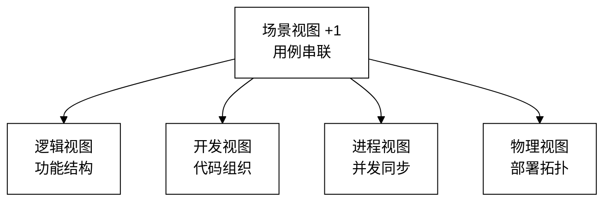
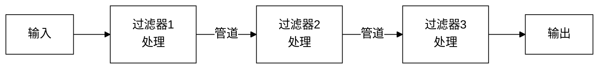
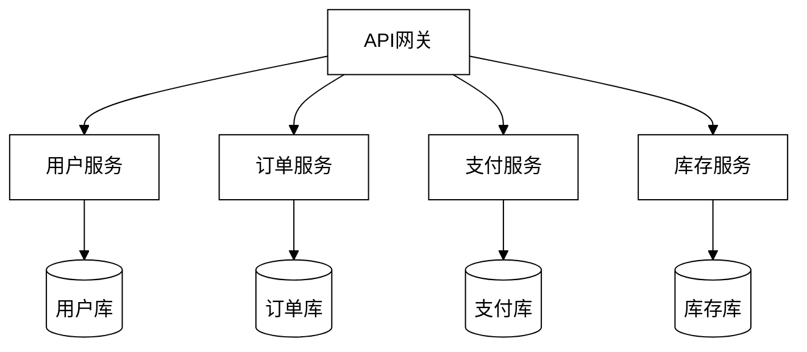

# 系统分析师｜第12章 软件架构设计（备考讲义＋章节自测题）

> **教材依据**：《系统分析师教程（第2版）》第12章 软件架构设计（共6节：12.1 软件架构概述｜12.2 软件架构建模｜12.3 软件架构风格｜12.4 软件架构标准｜12.5 软件架构实现｜12.6 软件架构质量属性）。第2版较第1版重组为上述6节：第1版含构件获取与管理（12.1.2/12.1.3）、富互联网应用 RIA（12.4.3）等小节，第2版未单列；第1版 12.7 软件产品线已跨章移入第2版第7章 7.6（不在本章）；架构评估方法 ATAM/SAAM 第1版 12.6.1 有专述、第2版仅概述架构评估未展开具体方法；微服务架构第2版第12章未单列，本张按【第1版补充｜掌握】在 12.3.7 面向服务风格节末简要补回。

> **考纲定位说明**：2024版考纲科目一「系统分析师综合知识」第10条 软件架构设计（软件架构概念｜软件架构建模（4+1视图）｜软件架构风格｜软件架构标准（IEEE 1471）｜软件架构实现（体系结构需求/设计/文档化/复审/实现/演化）｜软件架构质量属性与评估，与教材第2版第12章各节一一对应）。

> **考试形式**：上午综合知识单选题；2024上～2026上约7道/4场（架构风格3道/3场、质量属性1道/1场、架构评估 ATAM/SAAM 1道/1场，均中频/低频；4+1视图、架构标准、架构实现等作为基础概念近年窗未单列检出），第二梯队；案例分析无独立架构方向题组；论文架构类累计3题次（软件架构与模型驱动2、架构风格1，中频非高频）。

> 标签：系统分析师、上午题、软件架构、架构风格、4+1视图、质量属性、ATAM、ABSD、软件架构设计

[TOC]

## 章节结构对照与来源标注

> 本讲义为《系统分析师教程（第2版）》第12章 软件架构设计的学习讲义。本章按教材原生6节组织模块；架构评估方法（ATAM/SAAM）第2版仅概述，按【第1版补充｜掌握】补回；微服务架构按【第1版补充｜掌握】在架构风格节末简要补回。

| 讲义模块 | 对应教材第2版章节 | 内容性质 | 备考要求 |
|---|---|---|---|
| 模块1 软件架构概述 | 12.1 软件架构概述 | 教材 | 了解：架构定义、架构意义、架构发展史 |
| 模块2 软件架构建模 | 12.2 软件架构建模 | 教材 | 了解：5种架构模型、4+1视图模型 |
| 模块3 软件架构风格 | 12.3 软件架构风格 | 教材＋第1版补充 | 掌握：六类架构风格与面向服务风格、微服务补回 |
| 模块4 软件架构标准 | 12.4 软件架构标准 | 教材 | 了解：IEEE 1471-2000、ISO/IEC/IEEE 42010 架构要素 |
| 模块5 软件架构实现 | 12.5 软件架构实现 | 教材 | 了解：ABSDM 六过程、需求/设计/文档化/复审/实现/演化 |
| 模块6 软件架构质量属性 | 12.6 软件架构质量属性 | 教材＋第1版补充 | 了解：质量属性概念、六类质量属性、质量属性场景；拓展：架构评估 ATAM/SAAM（第1版补充，低频降档） |

> 教材第2版第12章章节结构（按教材原文核读）：12.1 软件架构概述｜12.2 软件架构建模（4+1视图模型）｜12.3 软件架构风格（12.3.1 软件架构风格概述／12.3.2 数据流体系结构风格／12.3.3 调用/返回体系结构风格／12.3.4 以数据为中心的体系结构风格／12.3.5 虚拟机体系结构风格／12.3.6 独立构件体系结构风格／12.3.7 面向服务的架构风格）｜12.4 软件架构标准（IEEE 1471-2000、ISO/IEC/IEEE 42010）｜12.5 软件架构实现（12.5.1 体系结构需求／12.5.2 体系结构设计／12.5.3 体系结构文档化／12.5.4 体系结构复审／12.5.5 体系结构实现／12.5.6 体系结构的演化）｜12.6 软件架构质量属性（12.6.1 质量属性概念／12.6.2 面向架构评估的质量属性／12.6.3 质量属性场景描述）。

> ⚠️ 教材第2版第12章**不包含**：① 第1版 12.1.2 构件获取与管理、12.1.3 构件复用的方法——第2版第12章无独立小节（构件在 12.5 体系结构实现中提及），2021年以后无单独考频，不收录；② 第1版 12.4.3 富互联网应用（RIA）——第2版无，近年窗无考频，不收录；③ 第1版 12.7 软件产品线（过程模型/建立方式）——已跨章移入第2版第7章 7.6（不在本章），本章不重复收录；④ 架构评估具体方法 ATAM/SAAM——第2版仅概述架构评估、未展开方法（第1版 12.6.1 有专述），按【第1版补充｜掌握】补回（模块6 拓展阅读）；⑤ 微服务架构——第2版第12章未单列，按【第1版补充｜掌握】在模块3 节末简要补回。

---

## 模块1：软件架构概述（教材12.1）【教材｜了解】

**前置说明**：本模块对应教材第2版第12章 12.1 软件架构概述，界定软件架构的定义、意义与发展脉络；适配上午综合选择题。

**模块优先级**：🟢 了解为主（近年频次窗未检出，全量统计窗内作为基础概念有检出）

**考情分析**（2021年以后真题）：近年频次窗（2024上～2026上）未检出（0场），全量统计窗内软件架构定义与意义作为基础概念偶有考查；核心考点：架构＝构件＋连接件＋约束、架构制约质量属性。

### 1.1 核心知识点精讲

#### 1.1.1 软件架构的定义（教材12.1）【教材｜了解】

软件架构为软件系统提供了一个结构、行为和属性的高级抽象，由**构件（Component）的描述**、构件的相互作用（**连接件 Connector**）、指导构件集成的**模式**以及这些模式的**约束**组成。

- 架构指定了系统的组织结构和拓扑结构，并显示系统需求和构件之间的对应关系。
- 架构研究的主要内容：软件架构描述、软件架构风格、软件架构评估、软件架构的形式化方法。

> 记忆：架构＝构件（做什么）＋连接件（怎么交互）＋约束（受什么限制）＋模式。

#### 1.1.2 软件架构的意义（教材12.1）【教材｜了解】

教材列举架构的若干意义（择核心）：

- **架构是项目干系人进行交流的手段**：代表系统高层抽象，不同干系人（用户/开发/运维）据此沟通。
- **架构是早期设计决策的体现**：体现系统最早的一组设计决策，对系统生命周期影响最大。
- **架构制约着系统的质量属性**：大型系统中质量属性更多由系统结构实现，而非算法或数据结构；可用架构评估预测未来质量属性。
- **架构有助于循序渐进的原型设计**与**可传递、可复用的模型**。

#### 1.1.3 软件架构的发展史（教材12.1）【教材｜了解】

- **无架构设计阶段**：汇编语言小规模开发，很少考虑系统结构。
- **萌芽阶段**：出现程序结构设计主题，以控制流图和数据流图构成软件结构。
- **基于构件的软件开发阶段**（20世纪90年代以后）：以过程为中心，强调构件化与架构技术，软件架构成为明确文档与中间产品，并发展为独立学科分支。

---

## 模块2：软件架构建模（教材12.2）【教材｜了解】

**前置说明**：本模块对应教材第2版第12章 12.2 软件架构建模，讲解架构的5种模型与「4+1」视图模型；适配上午综合选择题。

**模块优先级**：🟢 了解为主（近年频次窗未检出，全量统计窗内作为架构建模基础概念有检出）

**考情分析**（2021年以后真题）：近年频次窗（2024上～2026上）未检出（0场），全量统计窗内 4+1 视图作为基础概念偶有考查；核心考点：4+1 五个视图的名称与职责。

### 2.1 核心知识点精讲

#### 2.1.1 软件架构的5种模型（教材12.2）【教材｜了解】

根据建模侧重点不同，软件架构模型分为5种：

- **结构模型**：最直观普遍，以构件、连接件和其他概念刻画架构，核心是架构描述语言（ADL）。
- **框架模型**：结构模型的特化，侧重于整体结构。
- **动态模型**：补充系统行为、过程、交互的刻画。
- **过程模型**：侧重构建系统的步骤（如设计过程）。
- **功能模型**：系统由一组功能构件按层次组成，下层向上层提供服务。

> 说明：5种模型各有侧重，实践中以「4+1」视图模型将多种视角统一在一起刻画架构。

#### 2.1.2 4+1 视图模型（教材12.2）【教材｜了解】

Kruchten 于1995年提出「4+1」视图模型，从5个不同视角描述软件架构：

- **逻辑视图**：支持功能需求，系统分解为功能抽象（对象模型/类图描述）；风格为面向对象。
- **开发视图**（模块视图/实现视图）：侧重软件模块的组织与管理，关注开发容易性、复用、通用性。
- **进程视图**：侧重运行特性（性能、可用性、并发、分布、容错），定义逻辑视图中各类操作在哪个线程执行。
- **物理视图**（部署视图）：考虑软件到硬件的映射（部署拓扑）。
- **场景视图（+1）**：用用例把4个视图有机联系起来，是最重要的需求抽象（对应 UML 用例视图）。

> 记忆：逻辑管功能、开发管代码、进程管并发、物理管部署、场景管串联；逻辑视图与开发视图描述静态结构，进程视图与物理视图描述动态结构。

---

## 模块3：软件架构风格（教材12.3）【教材＋第1版补充｜掌握】

**前置说明**：本模块对应教材第2版第12章 12.3 软件架构风格，覆盖六类体系结构风格与面向服务的架构风格；微服务架构第2版第12章未单列，按【第1版补充｜掌握】在 12.3.7 节末简要补回；适配上午综合选择题（架构风格为近年窗中频考点）。

**模块优先级**：🟡 中频（掌握）——2024上～2026上 架构风格 3道/3场（中频）

**考情分析**（2021年以后真题）：2024上～2026上 架构风格 3道/3场（中频）；核心考点：管道-过滤器、仓库/黑板、分层、C/S 与 B/S、事件系统、面向服务（SOA）与微服务。

### 3.1 核心知识点精讲

#### 3.1.1 软件架构风格概述（教材12.3.1）【教材｜掌握】

软件体系结构风格是描述某一特定应用领域中系统组织方式的惯用模式，定义一个系统家族（词汇表＋一组约束）。对风格的研究促进设计重用——例如描述为「客户/服务器」模式即可立刻明白系统组织方式。

#### 3.1.2 数据流体系结构风格（教材12.3.2）【教材｜掌握】

- **批处理风格**：每个处理步骤是独立程序，前一步结束后才能开始下一步，数据须完整以整体方式传递。
- **管道-过滤器风格**：系统分解为若干序贯处理步骤，步骤间通过数据流连接；基本构件是**过滤器（Filter）**，连接件是**管道（Pipe）**。每个过滤器从管道读取输入流、内部处理、产生输出流写入管道。

> 特点：高内聚低耦合、可复用、可并行；不适合交互式应用。典型：Unix 命令管道（`ls | grep`）、编译器词法/语法分析。

#### 3.1.3 调用/返回体系结构风格（教材12.3.3）【教材｜掌握】

采用调用与返回机制（分而治之），主要包括：

- **主程序/子程序风格**：单线程控制，问题划分为处理步骤，构件为主程序与子程序，过程调用充当连接件，调用具层次性。
- **面向对象体系结构风格**：建立在数据抽象与面向对象基础上，构件是对象（抽象数据类型实例），数据表示与操作封装于对象内。
- **层次型体系结构风格**：系统组成层次结构，每层为上层服务、作为下层客户，层间交互受协议约束（仅相邻层可见）。
- **客户端/服务器体系结构风格**：
  - **二层 C/S**：客户应用程序与数据库服务器分别运行在不同计算机，胖客户机、瘦服务器。
  - **三层 C/S**：增加应用服务器，分为表示层/功能层/数据层；中间件是最重要的构件。
  - **B/S 架构**：三层 C/S 的一种实现（浏览器/Web服务器/数据库服务器），「零客户端」、易维护，但动态页面支持与安全性较弱、查询响应速度通常低于 C/S。

#### 3.1.4 以数据为中心的体系结构风格（教材12.3.4）【教材｜掌握】

- **仓库体系结构风格**：中央数据结构（当前数据状态）＋一组独立构件，连接件为仓库与构件间交互。
- **黑板体系结构风格**：仓库的子类，适用于复杂非结构化问题（信号处理、语音识别、模式识别）；多个知识源通过共享知识库协作，分级结构组织解空间。传统应用：信号处理、语音识别。

> 记忆：仓库＝共享数据中心；黑板＝仓库＋多专家知识源协作（AI 专家系统典型）。

#### 3.1.5 虚拟机体系结构风格（教材12.3.5）【教材｜掌握】

人为构建运行环境以解析与运行自定义语言，提升灵活性：

- **解释器体系结构风格**：含解释引擎、被解释代码存储区、当前状态数据结构、进度数据结构；可仿真硬件执行过程（典型：专家系统、规则引擎）。
- **规则系统体系结构风格**：包括规则集、规则解释器、规则/数据选择器及工作内存。

#### 3.1.6 独立构件体系结构风格（教材12.3.6）【教材｜掌握】

强调每个构件相对独立、不直接通信，降低耦合、提升灵活性：

- **进程通信体系结构风格**：构件是独立过程，连接件是消息传递。
- **事件系统体系结构风格**（隐式调用）：构件通过发布/订阅事件通信，高度解耦、易扩展，但事件顺序难保证、调试困难（典型：GUI 消息机制、消息中间件）。

#### 3.1.7 面向服务的架构风格与微服务（教材12.3.7＋第1版补充）【教材｜掌握】

- **面向服务的架构风格（SOA）**：以服务为基本构件，企业服务总线（**ESB**）作为服务体系的基础设施，提供灵活的、服务导向的应用组合，提高复用率、降低总体成本。
- **【第1版补充｜掌握】微服务架构**：把系统拆分为一组独立部署的小服务，服务间通过轻量通信（HTTP/RPC）协作。优点：独立部署、技术异构、弹性伸缩、故障隔离；缺点：分布式复杂（网络/事务/一致性）、运维成本高、调试困难；适用于大型复杂系统、频繁迭代、团队规模大。（微服务在第2版第12章未单列，此处依考情简要补回。）

#### 3.1.8 典型易错点（架构风格辨析）【🟡中频】

1. 管道-过滤器高内聚低耦合、数据流式处理；批处理须前一步结束且数据完整。
2. 黑板是仓库子类，多专家知识源共享知识库协作（AI 专家系统）；仓库重在集中数据共享。
3. 分层风格关注点分离、层间单向依赖（仅相邻层可见）；层次型属调用/返回风格。
4. 事件系统（隐式调用）通过发布/订阅解耦；进程通信通过消息传递，二者均属独立构件风格。
5. C/S 与 B/S：B/S 是三层 C/S 的实现，零客户端、易维护，但响应速度与安全性通常弱于 C/S。
6. SOA 以 ESB 为服务总线；微服务是独立部署的小服务集合，二者均面向服务但粒度与治理不同。

### 3.2 典型例题

**例题1【管道-过滤器风格】**

Unix 命令管道（如 `ls | grep`）采用的软件架构风格是（）
A. 仓库风格 B. 管道-过滤器风格 C. 黑板风格 D. 分层风格

> 【解析】数据经管道在过滤器间流转，属管道-过滤器风格。
> 【答案】B

**例题2【黑板风格】**

多个专家组件通过共享知识库协作解决复杂非结构化问题的风格是（）
A. 仓库风格 B. 黑板风格 C. 分层风格 D. 解释器风格

> 【解析】黑板是仓库子类，多专家知识源共享知识库协作，典型用于语音识别、模式识别。
> 【答案】B

**例题3【架构风格识别】**

系统按表示层、功能层、数据层划分，每层只与相邻层交互，属于（）
A. 管道-过滤器 B. 分层架构 C. 黑板风格 D. 事件驱动

> 【解析】分层风格关注点分离，层间单向依赖、仅相邻层可见。
> 【答案】B

**例题4【微服务架构】**

下列关于微服务架构说法错误的是（）
A. 服务可独立部署 B. 技术栈可异构 C. 运维成本低 D. 故障可隔离

> 【解析】微服务独立部署、技术异构、故障隔离，但分布式复杂、运维成本高。
> 【答案】C

### 3.3 课后习题

**习题1【事件系统风格】**

组件通过发布/订阅事件进行通信、高度解耦的风格是（）
A. 主程序-子程序 B. 事件系统 C. 仓库 D. 解释器

> 【解析】事件系统（隐式调用）通过事件发布/订阅解耦，属独立构件风格。
> 【答案】B

**习题2【面向服务风格】**

以企业服务总线（ESB）为基础、由已开发测试过的服务组合而成应用，体现的风格是（）
A. 面向服务（SOA） B. 管道-过滤器 C. 层次型 D. 虚拟机

> 【解析】SOA 以 ESB 为服务体系基础设施，支持服务组合与复用。
> 【答案】A

---

## 模块4：软件架构标准（教材12.4）【教材｜了解】

**前置说明**：本模块对应教材第2版第12章 12.4 软件架构标准，讲解 IEEE 1471-2000 与 ISO/IEC/IEEE 42010 的架构要素；适配上午综合选择题。

**模块优先级**：🟢 了解为主（近年频次窗未检出，全量统计窗内作为标准概念有检出）

**考情分析**（2021年以后真题）：近年频次窗（2024上～2026上）未检出（0场），全量统计窗内架构标准概念偶有考查；核心考点：IEEE 1471-2000 是首个软件架构描述正式标准、ISO/IEC/IEEE 42010:2022 为现行标准。

### 4.1 核心知识点精讲

#### 4.1.1 软件架构标准概述（教材12.4）【教材｜了解】

软件架构概念起源于1968年 Dijkstra 的研究，1990年广泛使用；**IEEE 1471-2000** 是软件架构领域第一个针对「软件密集型系统架构描述的推荐实现」的正式标准。

- 该标准定义软件架构标准要素之间的关系，分为5个层次：任务（Mission）、环境/系统/架构（Environment/System/Architecture）、利益相关者/架构说明/原理（Stakeholder/Architecture Description/Rationale）、关注/关注点/视图（Concern/Viewpoint/View）、关注点库/模型（Library Viewpoint/Model）。
- 核心要求：架构必须存在一个或多个视图以反映利益相关者关注点；须根据每个关键架构的原理演示权衡取舍。

#### 4.1.2 ISO/IEC/IEEE 42010:2022（教材12.4）【教材｜了解】

2006年 ISO 采纳 IEEE 1471-2000 为内部标准，经 IEEE 与 ISO 联合修订，最终发布 **ISO/IEC/IEEE 42010:2022 — Software, Systems and Enterprise Architecture Description**，为目前公认的软件架构标准。

> 记忆：IEEE 1471-2000 是首个架构描述标准；ISO/IEC/IEEE 42010:2022 是现行标准；视图与关注点一一对应。

---

## 模块5：软件架构实现（教材12.5）【教材｜了解】

**前置说明**：本模块对应教材第2版第12章 12.5 软件架构实现，讲解基于架构的软件开发模型（ABSDM）及其六过程；适配上午综合选择题。

**模块优先级**：🟢 了解为主（近年频次窗未检出，全量统计窗内作为实现过程概念有检出）

**考情分析**（2021年以后真题）：近年频次窗（2024上～2026上）未检出（0场），全量统计窗内 ABSDM/体系结构演化概念偶有考查；核心考点：ABSDM 六过程、体系结构演化步骤。

### 5.1 核心知识点精讲

#### 5.1.1 基于架构的软件开发模型 ABSDM（教材12.5）【教材｜了解】

传统的软件开发模型效率不高、不支持软件重用；**基于架构的软件开发模型（ABSDM）**把整个基于体系结构的软件过程划分为6个子过程：体系结构**需求、设计、文档化、复审、实现、演化**。

#### 5.1.2 体系结构需求（教材12.5.1）【教材｜了解】

需求来自系统质量目标、商业目标、开发人员商业目标。过程：需求获取 → 标识构件（生成类图 → 对类分组 → 打包成构件） → 架构需求评审（分析/客户/设计/测试人员审查）。

#### 5.1.3 体系结构设计（教材12.5.2）【教材｜了解】

体系结构设计是迭代过程：提出体系结构模型（先选合适架构风格） → 映射构件 → 分析构件间相互作用 → 产生体系结构 → 设计评审（邀请外部人员评审）。

#### 5.1.4 体系结构文档化（教材12.5.3）【教材｜了解】

体系结构须文档化，主要输出：体系结构规格说明、测试体系结构需求的质量设计说明书。文档须从使用者角度编写、分发给所有开发人员并保证最新。

#### 5.1.5 体系结构复审（教材12.5.4）【教材｜了解】

设计、文档化、复审是迭代过程；安排外部人员（用户代表、领域专家）参加复审，标识潜在风险、及早发现缺陷（是否满足需求、质量需求是否体现、层次是否清晰、构件划分是否合理）。

#### 5.1.6 体系结构实现（教材12.5.5）【教材｜了解】

以复审后文档化的体系结构说明书为基础，从构件库查找符合接口约束的构件（必要时开发新构件），经组装支持工具组装，最后测试（单构件功能测试＋整体功能性能测试）。

#### 5.1.7 体系结构的演化（教材12.5.6）【教材｜了解】

需求变动时修改软件体系结构以适应新需求，主要包括6步：需求变化归类 → 制订体系结构演化计划 → 修改/增加/删除构件 → 更新构件相互作用 → 构件组装与测试 → 技术评审。

> 记忆：ABSDM 六过程＝需求→设计→文档化→复审→实现→演化；演化六步以「需求变化归类」始、「技术评审」终。

---

## 模块6：软件架构质量属性（教材12.6）【教材＋第1版补充｜了解】

**前置说明**：本模块对应教材第2版第12章 12.6 软件架构质量属性，讲解质量属性概念、面向架构评估的质量属性与质量属性场景；架构评估方法 ATAM/SAAM 第2版仅概述，按【第1版补充｜掌握】低频降档，置于本模块末尾拓展阅读；适配上午综合选择题。

**模块优先级**：🟢 了解为主（质量属性 2024上～2026上 1道/1场，低频；架构评估 ATAM/SAAM 1道/1场，低频降档）

**考情分析**（2021年以后真题）：2024上～2026上 质量属性 1道/1场（低频）、架构评估 ATAM/SAAM 1道/1场（低频）；核心考点：质量属性场景六要素、性能/可用性/安全性等质量属性、ATAM 的敏感点/权衡点。

### 6.1 核心知识点精讲

#### 6.1.1 质量属性概念（教材12.6.1）【教材｜了解】

基于生命周期，软件质量属性分为两部分：

- **开发期质量属性**（6项）：易理解性、可扩展性、可重用性、可测试性、可维护性、可移植性。
- **运行期质量属性**（7项）：性能、安全性、可伸缩性、互操作性、可靠性、可用性、健壮性（鲁棒性/容错性）。

#### 6.1.2 面向架构评估的质量属性（教材12.6.2）【教材｜了解】

架构评估普遍关注的质量属性：

- **性能**：响应能力（响应时间/吞吐量）。
- **可靠性**：错误/意外面前维持功能的能力，常用 MTTF、MTBF 衡量；含容错与健壮性。
- **可用性**：系统正常运行时间比例，常用两次故障间隔或恢复速度表示。
- **安全性**：向合法用户服务并阻止非授权使用，含机密性/完整性/不可否认性/可控性。
- **可修改性**：快速高性价比变更的能力，含可维护性、可扩展性、结构重组、可移植性。
- **功能性**：完成期望工作的能力。
- **可变性**：架构经扩充/变更成为新架构的能力（软件产品线基础）。
- **互操作性**：与其他系统交换数据/相互调用服务的能力。

> 记忆：评估关注八属性——性能、可靠、可用、安全、可改、功能、可变、互操作。

#### 6.1.3 质量属性场景描述（教材12.6.3）【教材｜了解】

质量属性场景是具体的质量属性需求，由**六要素**组成：

1. **刺激源（Source）**：生成刺激的实体（人/系统）。
2. **刺激（Stimulus）**：刺激到达系统时考虑的条件。
3. **制品（Artifact）**：被激励的对象（整个系统或一部分）。
4. **环境（Environment）**：刺激发生的条件（正常/过载）。
5. **响应（Response）**：刺激到达后采取的行动。
6. **响应度量（Measurement）**：对响应进行度量的指标。

质量属性场景重点关注可用性、可修改性、性能、可测试性、易用性、安全性六类。

> 记忆：刺激源→刺激→制品→环境→响应→响应度量（六要素）。

#### 拓展·架构评估方法 ATAM/SAAM（教材12.6 仅概述；第1版 12.6.1 有专述）【第1版补充｜掌握】

> 收录依据：考纲科目一第10条 软件架构设计含「软件架构质量属性与评估」；第2版第12章仅概述架构评估、未展开 ATAM/SAAM 具体方法（第1版 12.6.1 架构评估概述有专述），且 2024上～2026上 架构评估 1道/1场（低频），按【第1版补充｜掌握】低频降档补回。

- **ATAM（架构权衡分析方法）**：基于质量属性场景的架构评估，核心是权衡质量属性。评估产出：
  - **风险**：可能导致问题的架构决策。
  - **非风险**：不会导致问题的架构决策。
  - **敏感点**：对**单个**质量属性影响大的架构决策。
  - **权衡点**：影响**多个**质量属性、需要取舍的决策。
- **SAAM（软件架构分析方法）**：侧重评估**可修改性**，通过场景对架构评估；与 ATAM 区别：SAAM 早期方法、侧重可修改，ATAM 更全面、侧重权衡。

> 记忆：风险＝有问题；敏感点＝影响单个属性；权衡点＝影响多个属性需取舍；SAAM 侧重可修改性、ATAM 侧重权衡。

---

# 章节总复习综合模拟题

> 说明：题型贴合系统分析师上午综合知识真题风格，覆盖模块1～6 核心考点；架构风格（中频）占比偏高，质量属性与架构评估（低频）各配少量概念题。

## 一、单项选择题（15题）

1. 描述系统运行时进程与线程并发同步关系的视图是（）
A. 逻辑视图 B. 开发视图 C. 进程视图 D. 物理视图
> 【解析】进程视图关注运行特性（并发、分布、容错）。
> 【答案】C

2. 把逻辑、开发、进程、物理视图用用例串联起来的视图是（）
A. 场景视图 B. 数据视图 C. 安全视图 D. 性能视图
> 【解析】场景视图（+1）用用例把四视图串联。
> 【答案】A

3. 软件架构的核心要素不包括（）
A. 构件 B. 连接件 C. 约束 D. 源代码注释
> 【解析】架构要素为构件、连接件、模式与约束。
> 【答案】D

4. Unix 命令管道（`ls | grep`）采用的架构风格是（）
A. 仓库 B. 管道-过滤器 C. 黑板 D. 分层
> 【解析】数据经管道在过滤器间流转，属管道-过滤器。
> 【答案】B

5. 多个专家组件通过共享知识库协作解决复杂问题的风格是（）
A. 黑板风格 B. 管道-过滤器 C. 主程序-子程序 D. 解释器
> 【解析】黑板是仓库子类，多专家知识源共享知识库协作。
> 【答案】A

6. 系统按表示层、功能层、数据层划分，每层只与相邻层交互，属于（）
A. 管道-过滤器 B. 分层架构 C. 黑板风格 D. 事件系统
> 【解析】分层风格关注点分离，层间单向依赖。
> 【答案】B

7. 组件通过发布/订阅事件通信、高度解耦的风格是（）
A. 主程序-子程序 B. 事件系统 C. 仓库 D. 解释器
> 【解析】事件系统（隐式调用）通过事件发布/订阅解耦。
> 【答案】B

8. B/S 架构与二层 C/S 架构相比，其突出优点是（）
A. 响应速度更高 B. 零客户端、易维护 C. 数据安全性更强 D. 动态页面支持更强
> 【解析】B/S 是三层 C/S 实现，安装修改维护全在服务器端，易维护、「零客户端」。
> 【答案】B

9. 以企业服务总线（ESB）为基础组合已测试服务，体现的风格是（）
A. 面向服务（SOA） B. 虚拟机 C. 层次型 D. 数据流
> 【解析】SOA 以 ESB 为服务体系基础设施，支持服务组合与复用。
> 【答案】A

10. 下列关于微服务架构说法错误的是（）
A. 服务可独立部署 B. 技术栈可异构 C. 运维成本低 D. 故障可隔离
> 【解析】微服务分布式复杂、运维成本高。
> 【答案】C

11. 软件架构领域第一个针对架构描述的正式标准是（）
A. IEEE 1471-2000 B. ISO 9001 C. CMMI D. IEEE 802.3
> 【解析】IEEE 1471-2000 是首个软件架构描述正式标准，现行为 ISO/IEC/IEEE 42010:2022。
> 【答案】A

12. 基于架构的软件开发模型（ABSDM）把软件过程划分为六个子过程，不包括（）
A. 体系结构需求 B. 体系结构设计 C. 体系结构演化 D. 体系结构编译
> 【解析】ABSDM 六过程：需求、设计、文档化、复审、实现、演化。
> 【答案】D

13. 质量属性场景中，「用户在高负载下点击查询」中的「高负载」属于（）
A. 刺激源 B. 刺激 C. 环境 D. 响应
> 【解析】高负载是刺激发生的条件，属环境。
> 【答案】C

14. ATAM 评估中，对多个质量属性影响大、需权衡取舍的决策称为（）
A. 风险 B. 敏感点 C. 权衡点 D. 非风险
> 【解析】权衡点影响多个质量属性、需取舍；敏感点只影响单个属性。
> 【答案】C

15. 系统故障后快速恢复能力体现的质量属性是（）
A. 性能 B. 可用性 C. 安全性 D. 易用性
> 【解析】故障恢复能力属可用性。
> 【答案】B

## 二、简答概念题（3道）

1. 简述「4+1」视图模型及其作用。
> 【解析】4+1 视图：逻辑视图（功能结构）、开发视图（代码组织/模块）、进程视图（并发同步）、物理视图（部署拓扑），场景视图（+1）用用例把四视图串联。作用：从不同干系人视角全面描述系统架构——逻辑视图给业务与设计、开发视图给开发、进程视图给并发设计、物理视图给运维，场景视图验证各视图一致性。

2. 简述软件架构风格的分类（六类）及各举一例。
> 【解析】①数据流体系结构风格（管道-过滤器，如 Unix 管道）；②调用/返回体系结构风格（主程序-子程序、层次型、C/S、B/S）；③以数据为中心的体系结构风格（仓库、黑板）；④虚拟机体系结构风格（解释器、规则系统）；⑤独立构件体系结构风格（进程通信、事件系统）；⑥面向服务的架构风格（SOA/ESB，微服务为其演进）。

3. 简述 ATAM 架构评估方法的核心思想与主要产出。
> 【解析】ATAM 以质量属性场景为核心，把架构决策与质量属性关联，识别决策对质量属性的影响并进行权衡。主要产出：风险（可能导致问题的决策）、非风险（无问题的决策）、敏感点（对单一质量属性影响大的决策）、权衡点（对多个质量属性影响大需取舍的决策）。SAAM 则侧重可修改性评估。

---

> **备考提示**：本章 2024上～2026上约7道/4场，属第二梯队，上午单选题为主、无独立案例方向、论文架构类为中频非高频。重点掌握：① 软件架构风格（中频，六类风格及典型适用场景，管道-过滤器/仓库-黑板/分层/C-S-B-S/事件系统/SOA 为高频辨析点）；② 4+1 视图五视图职责；③ 质量属性场景六要素与 ATAM 的敏感点/权衡点（低频但年年可能出概念题）。其余内容（架构概述、架构标准 IEEE 1471、ABSDM 六过程、质量属性八项）以理解为主，不必死记。
