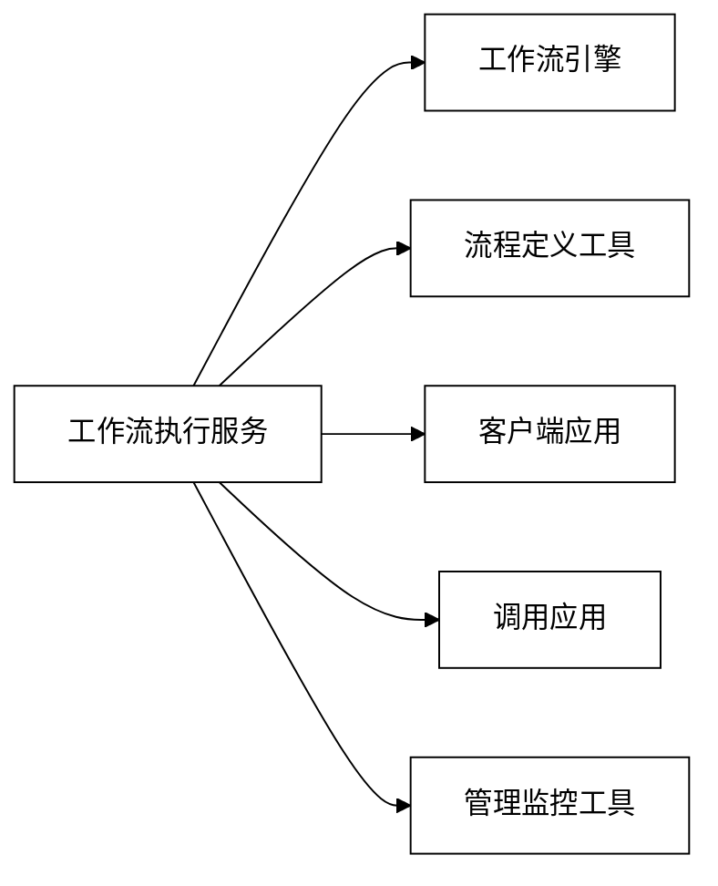
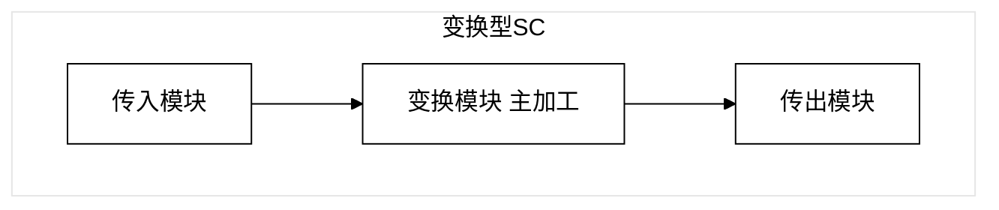
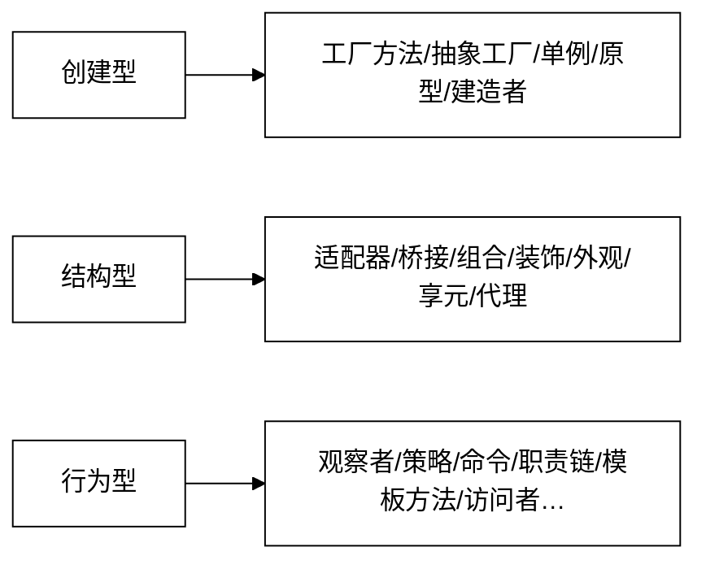

# 系统分析师｜第13章 系统设计（备考讲义＋章节自测题）

> **教材依据**：《系统分析师教程（第2版）》第13章 系统设计（共7节：13.1 系统设计概述｜13.2 处理流程设计｜13.3 结构化设计｜13.4 面向对象设计｜13.5 设计模式｜13.6 输入/输出原型设计｜13.7 人机交互设计）。第2版相对第1版：将 v1 内嵌于「13.1 概述」中的「输入输出设计／用户界面设计」提升为独立两节 13.6 输入/输出原型设计、13.7 人机交互设计（并新增「用户体验五层模型」等内容）；13.1～13.5 两版结构基本一致，无大删减；无教材外补充。

> **考纲定位说明**：2024版考纲科目一「系统分析师综合知识」第11条 系统设计（与教材第2版第13章各节一一对应）。

> **考试形式**：上午综合知识单选题；2024上～2026上约17道/5场（设计模式6道/4场、耦合与内聚3道/3场、面向对象设计原则3道/3场、面向对象设计2道/2场，均中频；系统结构图、工作流、人机交互低频）；属第一梯队，上午题权重较高章节之一；案例分析无独立系统设计方向题组，论文2题次（面向对象设计·2022上、软件设计模式·2025下试题三）。

> 标签：系统分析师、上午题、系统设计、结构化设计、耦合内聚、设计模式、面向对象设计、人机交互、备考

[TOC]

## 章节结构对照与来源标注

> 本讲义为《系统分析师教程（第2版）》第13章 系统设计的备考讲义。说明本章哪些是教材内容、哪些是教材之外的补充。

| 讲义模块 | 对应教材第2版章节 | 内容性质 | 备考要求 |
|---|---|---|---|
| 模块1 系统设计概述 | 13.1 系统设计概述 | 教材 | 了解：设计目标、概要/详细设计区分、详细设计子类型 |
| 模块2 处理流程设计 | 13.2 处理流程设计（13.2.1 流程设计概述｜13.2.2 工作流管理系统｜13.2.3 流程设计工具） | 教材 | 了解：流程/工作流、WFMS、流程设计工具 |
| 模块3 结构化设计 | 13.3 结构化设计（13.3.1 模块结构｜13.3.2 系统结构图） | 教材 | 掌握：耦合与内聚、扇入扇出；了解：模块结构图、变换/事务型 SC |
| 模块4 面向对象设计 | 13.4 面向对象设计（13.4.1 设计软件类｜13.4.2 对象持久化与数据库｜13.4.3 面向对象设计的原则） | 教材 | 掌握：实体/控制/边界类、OOD 六原则；了解：对象持久化 |
| 模块5 设计模式 | 13.5 设计模式（13.5.1 设计模式概述｜13.5.2 设计模式分类） | 教材 | 掌握：创建型/结构型/行为型模式分类与典型模式；了解：模式概述 |
| 模块6 输入/输出原型设计 | 13.6 输入/输出原型设计（13.6.1 输入设计｜13.6.2 输出设计） | 教材 | 了解：输入/输出设计要点与原则 |
| 模块7 人机交互设计 | 13.7 人机交互设计（13.7.1 设计目标｜13.7.2 用户体验五层模型｜13.7.3 如何设计良好的人机交互） | 教材 | 了解：设计目标、五层模型、设计方法 |

> 教材第2版第13章章节结构（按教材原文核读）：13.1 系统设计概述｜13.2 处理流程设计（13.2.1 流程设计概述、13.2.2 工作流管理系统、13.2.3 流程设计工具）｜13.3 结构化设计（13.3.1 模块结构、13.3.2 系统结构图）｜13.4 面向对象设计（13.4.1 设计软件类、13.4.2 对象持久化与数据库、13.4.3 面向对象设计的原则）｜13.5 设计模式（13.5.1 设计模式概述、13.5.2 设计模式分类）｜13.6 输入/输出原型设计（13.6.1 输入设计、13.6.2 输出设计）｜13.7 人机交互设计（13.7.1 设计目标、13.7.2 用户体验五层模型、13.7.3 如何设计良好的人机交互）。

> ⚠️ 教材第2版第13章**不包含**：① 数据设计（概念/逻辑/物理数据模型、ER 图转关系模式、数据完整性）——v2 第13章仅于「13.1 概述」中提及「数据存储设计」一笔带过、未展开，本讲义不收录；② 设计评审/设计优化——v2 第13章未单列，属软件工程通用知识或跨章范畴，本讲义不收录；③ 接口设计（内部模块接口/外部系统接口/接口要素）——v2 第13章未单列「接口设计」节，人机界面已归 13.7，本讲义不收录独立的接口设计模块。

## 模块1：系统设计概述（教材13.1）【教材｜了解】

**前置说明**：本模块对应教材第2版第13章 13.1 系统设计概述，覆盖系统设计的目标与任务、概要设计与详细设计的区分及详细设计子类型；适配上午综合选择题。

**模块优先级**：🟢 了解为主（了解）—— 概述性内容，近年频次窗未单列检出；属设计总论，为后续各模块铺垫。

**考情分析**（2021年以后真题）：近年频次窗内未单列检出（0场）；核心考点为「概要设计 vs 详细设计」概念区分，偶尔作为选项陪跑。

### 1.1 核心知识点精讲

#### 1.1.1 系统设计的目标与任务（教材13.1）【教材｜了解】

- 系统设计是系统分析的延伸与拓展：系统分析解决「做什么」，系统设计解决「怎么做」，并为系统实施（编码）奠定基础。
- 系统设计阶段又称**物理设计阶段**：根据系统规格说明书（SRS）规定的功能要求，考虑实际条件，设计实现逻辑模型的技术方案，即设计新系统的物理模型。
- 主要任务：完成系统的构建过程，绘制系统蓝图，权衡各种技术与实现方法的利弊，合理分配资源，构建详细设计方案与相关模型，指导系统实施。

#### 1.1.2 概要设计与详细设计（教材13.1）【教材｜了解】

- **概要设计**（总体结构设计）：将系统的功能需求分配给软件模块，确定每个模块的功能与调用关系，形成软件的模块结构图（即系统结构图）。重点解决「系统总体结构」。
- **详细设计**：为每个具体任务选择适当的技术手段与处理方法，设计模块内部逻辑。按任务不同可分为多种子类型（见 1.1.3）。

> 记忆：概要定模块结构与接口，详细定模块内部逻辑与算法。

#### 1.1.3 详细设计的子类型（教材13.1）【教材｜了解】

教材将详细设计进一步分为多种子类型，包括：网络设计、代码设计、输入/输出设计、处理流程设计、数据存储设计、用户界面设计、安全性和可靠性设计等。其中「输入/输出设计」「处理流程设计」「用户界面设计」在本章后续 13.2、13.6、13.7 各节分别展开。

> 说明：代码设计中常用「线分类法」与「面分类法」两种分类方法；线分类法是目前手工处理下最常用的层次化分类方法。

## 模块2：处理流程设计（教材13.2）【教材｜了解】

**前置说明**：本模块对应教材第2版第13章 13.2 处理流程设计（13.2.1 流程设计概述、13.2.2 工作流管理系统、13.2.3 流程设计工具），覆盖流程/工作流概念、WFMS 与工作流参考模型、常用流程设计工具；适配上午综合选择题。

**模块优先级**：🟢 了解为主（了解）—— 工作流近年频次窗低频（1场），属理解性内容。

**考情分析**（2021年以后真题）：近年频次窗约1场（低频）；核心考点为工作流定义、WFMS 组成（6模块/5接口）与流程设计工具分类。

### 2.1 核心知识点精讲

#### 2.1.1 流程与业务流程（教材13.2.1）【教材｜了解】

- 业务流程（ISO 9000）：一组将输入转化为输出的相互关联或相互作用的活动。流程具有目标性、内在性、整体性、动态性、层次性和结构性等特点。
- 流程包括 6 个基本要素：输入资源、活动、活动的相互作用（结构）、输出结果、用户、价值。
- 流程概念包括**流程定义**（业务过程的形式化表示）与**流程实例**（流程定义的运行实例，即一次具体流程操作）。

#### 2.1.2 工作流（教材13.2.1）【教材｜了解】

- 工作流（WFMC 定义）：一类能够完全或部分自动执行的业务过程，根据一系列过程规则、文档、信息或任务，在不同的执行者之间传递和执行；即一系列相互衔接、自动进行的业务活动或任务。
- 活动是流程定义的基本要素，可由人或系统自动完成；**活动的所有者**是有权决定该活动是否结束、并整体控制流程实例执行过程的参与者（通常为流程发起人）。
- **工作项**：流程实例中活动的参与者将要执行的工作（如一张课程申请单即一个工作项）。

#### 2.1.3 工作流管理系统 WFMS（教材13.2.2）【教材｜了解】

- WFMS 通过软件定义、创建工作流并管理其执行，运行在一个或多个**工作流引擎**上。
- **工作流参考模型（WRM）**包含 6 个基本模块：工作流执行服务、工作流引擎、流程定义工具、客户端应用、调用应用、管理监控工具。
- 6 个模块通过 5 个接口交互：接口一（工作流定义交换）、接口二（客户端应用）、接口三（调用应用）、接口四（WMFS 互操作）、接口五（系统管理和监控）。

#### 2.1.4 流程设计工具（教材13.2.3）【教材｜了解】

处理流程设计工具分三类：

- **图形工具**：程序流程图（PFD）、IPO 图、N-S 图（盒图）、问题分析图（PAD）、判定树。
- **表格工具**：判定表。
- **语言工具**：过程设计语言（PDL，又称伪代码）。

> 易错：程序流程图箭头可任意转移控制，结构化程度弱；N-S 图无箭头、强制结构化；PAD 树形、可递归细化；判定表/判定树适合多条件多动作的逻辑判断。

## 模块3：结构化设计（教材13.3）【教材｜掌握】

**前置说明**：本模块对应教材第2版第13章 13.3 结构化设计（13.3.1 模块结构、13.3.2 系统结构图），覆盖模块结构、耦合与内聚、扇入扇出、系统结构图与变换/事务型映射；适配上午综合选择题，案例题亦常涉及模块结构图绘制。

**模块优先级**：🟡 中频（中等）—— 耦合与内聚 2024上～2026上 3道/3场，为上午题稳定考点。

**考情分析**（2021年以后真题）：近年频次窗 3道/3场（中频）；核心考点为耦合七型、内聚七型、扇入扇出、系统结构图与变换/事务型 SC 的区分。

### 3.1 核心知识点精讲

#### 3.1.1 模块结构基本概念（教材13.3.1）【教材｜掌握】

- 结构化设计（SD）是面向数据流的方法，以 SRS 和 SA 阶段产生的数据流图、数据字典为基础，自顶向下、逐步求精、模块化。
- 模块是实现功能的基本单位，具有功能、逻辑、状态三个基本属性；按外部特性（模块名、参数表）与内部特性（程序代码、内部数据）分别描述。
- 模块大小适中：一般实现代码约 50～200 行、1～2 页纸为宜；过大需再分，过小则调用频繁、降低独立性。
- 深度（层数）与宽度（同层模块总数最大值）适当，宽度主要受扇出影响。

#### 3.1.2 扇入与扇出（教材13.3.1）【教材｜掌握】

- **扇出**：一个模块直接调用的下级模块个数。扇出过大表示复杂度高、缺乏中间层次，应增加中间控制模块；扇出过小可合并到上级模块。
- **扇入**：直接调用该模块的上级模块个数。扇入大表示复用程度高。
- 系统平均扇入、扇出系数一般为 3 或 4，不应超过 7；良好结构通常顶层扇出较大、底层扇入较大。

> 记忆：扇入越大越好（复用高），扇出适中（3～4），超过 7 出错概率增大。

#### 3.1.3 耦合类型（教材13.3.1）【教材｜掌握】

耦合表示模块之间联系的程度，按耦合度从低到高分为 7 种：

| 耦合类型（由低到高） | 含义 |
|---|---|
| 非直接耦合 | 两模块无直接关系，联系完全通过主模块控制与调用实现 |
| 数据耦合 | 通过参数表传递简单数据 |
| 标记耦合 | 通过参数表传递记录信息（数据结构） |
| 控制耦合 | 传递的信息中包含用于控制模块内部逻辑的信息 |
| 外部耦合 | 都访问同一全局简单变量（非全局数据结构），不通过参数表传递 |
| 公共耦合 | 都访问同一个公共数据环境（全局数据结构、共享通信区、内存公共覆盖区等） |
| 内容耦合 | 直接访问另一模块内部数据、非正常入口转入、程序代码重叠、多个入口 |

> 记忆：耦合越低越好，理想为数据耦合；内容耦合最差，应避免。

#### 3.1.4 内聚类型（教材13.3.1）【教材｜掌握】

内聚表示模块内部各成分之间的联系程度，按内聚度从高到低分为 7 种：

| 内聚类型（由高到低） | 含义 |
|---|---|
| 功能内聚 | 完成单一功能，各部分协同工作缺一不可 |
| 顺序内聚 | 处理元素相关且必须顺序执行 |
| 通信内聚 | 所有处理元素集中在一个数据结构区域上 |
| 过程内聚 | 处理元素相关且必须按特定次序执行 |
| 瞬时内聚（时间内聚） | 任务必须在同一时间间隔内执行 |
| 逻辑内聚 | 完成逻辑上相关的一组任务 |
| 偶然内聚（巧合内聚） | 完成一组无关系或松散关系的任务 |

> 记忆：内聚越高越好；高内聚、低耦合是模块分解的基本原则（内聚高通常耦合低，但非绝对）。

#### 3.1.5 系统结构图 SC（教材13.3.2）【教材｜了解】

- 系统结构图（SC，又称模块结构图）是软件概要设计阶段的工具，反映功能实现与模块间联系、通信及层次结构。
- SC 组成：模块（矩形框，已开发模块用双纵边矩形框）、模块间调用关系（上下布局以箭头相连）、模块间通信（调用箭头旁短箭头表示传递的数据/控制信息）、辅助控制符号（条件调用标菱形、循环调用加弧形箭头）。
- SC 中底层不可再分模块称**原子模块**；存在 4 种模块类型：传入模块、传出模块、变换模块（加工模块）、协调模块。

#### 3.1.6 变换型、事务型与混合型 SC（教材13.3.2）【教材｜了解】

- **变换型 SC**：信息沿输入通道进入，经变换中心（主加工）处理，再沿输出通道离开（变换流）。明显分为输入、变换、输出三大部分。
- **事务型 SC**：信息到达事务中心，按事务类型在若干活动流中选择一个执行（事务流）。一般由事务层、操作层、细节层三层组成，各事务处理模块并列。
- **混合型 SC**：规模较大系统的 DFD 常为变换型与事务型混合，可把变换分析和事务分析应用于同一 DFD 的不同部分（以变换分析为主、事务分析为辅）。

### 3.2 典型例题

**例题1【耦合与内聚】**

某模块内部各个处理元素必须顺序执行且集中在一个数据结构区域上，该模块的内聚类型属于（）

A. 顺序内聚 B. 通信内聚 C. 过程内聚 D. 逻辑内聚

> 【解析】处理元素集中在一个数据结构区域上 → 通信内聚；顺序内聚强调必须顺序执行，通信内聚强调同一数据结构区域。题干同时给出「集中在一个数据结构区域」，更符合通信内聚。
> 【答案】B

**例题2【扇入扇出】**

某模块被 6 个上层模块直接调用，且直接调用 4 个下层模块，则该模块的扇入、扇出分别为（）

A. 扇入6、扇出4 B. 扇入4、扇出6 C. 扇入6、扇出6 D. 扇入4、扇出4

> 【解析】被 6 个上层调用 → 扇入6；调用 4 个下层 → 扇出4；均处于建议范围 3～4 附近（扇出4 合理，扇入大表示复用度高）。
> 【答案】A

**例题3【系统结构图】**

针对事务型数据流，从 DFD 导出初始系统结构图时应采用（）

A. 变换分析 B. 事务分析 C. 数据字典 D. 判定表

> 【解析】事务型数据流（事务流）对应事务中心，按事务类型分派处理 → 事务分析；变换型数据流采用变换分析。
> 【答案】B

### 3.3 课后习题

**习题1【耦合类型】**

一个模块直接访问另一个模块的内部数据，这种耦合属于（）

A. 公共耦合 B. 内容耦合 C. 控制耦合 D. 标记耦合

> 【解析】直接访问另一模块内部数据属内容耦合（还包括非正常入口转入、代码重叠、多个入口）。
> 【答案】B

**习题2【内聚类型】**

一个模块完成「输入校验、格式转换、业务计算」若干逻辑上相关但彼此独立的任务，该模块的内聚最可能属于（）

A. 功能内聚 B. 逻辑内聚 C. 顺序内聚 D. 通信内聚

> 【解析】完成逻辑上相关的一组任务（非单一功能）→ 逻辑内聚；应进一步拆分以提高内聚。
> 【答案】B

#### 3.1.7 典型易错点（3.1.1～3.1.6）

1. 耦合七型按「低→高」排序、内聚七型按「高→低」排序，两者方向不同，易记反——耦合低好、内聚高好。【🟡中频】
2. 扇入 = 被调用次数（上级模块数），扇出 = 调用次数（下级模块数），常把二者弄反。【🟡中频】
3. 数据耦合（传简单数据）与标记耦合（传记录/数据结构）易混淆；控制耦合传递的是「控制信息」而非数据。【🟡中频】
4. 变换型 SC 以「变换中心/主加工」为核心分输入/变换/输出三部分；事务型 SC 以「事务中心」辐射分派——两者映射策略不同。【🟡中频】

## 模块4：面向对象设计（教材13.4）【教材｜掌握】

**前置说明**：本模块对应教材第2版第13章 13.4 面向对象设计（13.4.1 设计软件类、13.4.2 对象持久化与数据库、13.4.3 面向对象设计的原则），覆盖实体/控制/边界类划分、对象持久化、OOD 六原则；适配上午综合选择题。

**模块优先级**：🟡 中频（中等）—— 面向对象设计 2道/2场、面向对象设计原则 3道/3场，均中频。

**考情分析**（2021年以后真题）：近年频次窗 5道/5场（面向对象设计原则 3道/3场、面向对象设计 2道/2场，均中频）；核心考点为实体/控制/边界类、OOD 六原则（开闭、里氏替换、依赖倒置、组合聚合复用、接口隔离、最少知识）。

### 4.1 核心知识点精讲

#### 4.1.1 设计软件类（教材13.4.1）【教材｜掌握】

OOD 是 OOA 的延续，基本思想包括抽象、封装、可扩展性（通过继承与多态实现）。在系统设计中，类分为三种类型：

- **实体类**：映射需求中的每个实体，保存需永久存储的信息（如学员类、课程类）；通常对应数据库表，一定有属性、不一定有操作。
- **控制类**：控制用例工作的类，由动宾结构短语转化而来（如「身份验证器」）；封装用例特有控制行为，一般无属性、一定有方法。
- **边界类**：封装用例内外流动的信息/数据流，位于系统与外界交接处（窗体、报表、打印机接口、与其他系统的接口）；使外部变更不影响系统其他部分，可有属性也有方法。

> 记忆：实体管数据、控制管流程、边界管接口。

#### 4.1.2 对象持久化与数据库（教材13.4.2）【教材｜了解】

- 对象持久化：把内存中的对象保存到数据库或永久存储设备中；多层设计中引入**持久层**解耦数据处理层内部业务逻辑与数据逻辑。
- 对象与关系数据需通过 **ORM（对象/关系映射）** 互转；主流持久化框架包括 CMP（EJB 容器管理）、Hibernate、iBatis、JDO 等。
- 继承关系、多对多关联在关系数据库中无法直接表达，需借助映射技术。

#### 4.1.3 面向对象设计的原则（教材13.4.3）【教材｜掌握】

常用 OOD 原则（面向复用、提高可维护性与可复用性）共 6 条：

| 原则 | 核心含义 |
|---|---|
| 开闭原则 | 对扩展开放、对修改关闭；通过增加抽象层（接口/抽象类）实现，是其他原则的基础 |
| 里氏替换原则 | 基类适用的地方子类必适用；尽量使用基类编程，需扩展时增加子类而非修改调用代码 |
| 依赖倒置原则 | 针对接口编程，而非针对实现；抽象不依赖细节，细节依赖抽象 |
| 组合/聚合复用原则 | 尽量使用组合/聚合（Has-A）而非继承（Is-A），降低耦合（黑盒复用优于白盒复用） |
| 接口隔离原则 | 使用多个专门的接口，而非单一总接口；每个接口承担相对独立的角色 |
| 最少知识原则（迪米特法则） | 一个软件实体应尽可能少地与其他实体相互作用，限制通信宽度与深度 |

> 记忆：开闭是目标、依赖倒置是主要机制；优先组合聚合、少用继承。

### 4.2 典型例题

**例题1【设计软件类】**

在用例「身份验证」中用于封装特有控制行为、通常没有属性只有方法的类，属于（）

A. 实体类 B. 控制类 C. 边界类 D. 持久类

> 【解析】由动宾短语转化、封装用例控制行为、一般无属性只有方法 → 控制类。
> 【答案】B

**例题2【OOD 原则】**

「软件实体应对扩展开放、对修改关闭，尽量在不修改原有代码的情况下扩展」，这描述的是（）

A. 里氏替换原则 B. 依赖倒置原则 C. 开闭原则 D. 接口隔离原则

> 【解析】对扩展开放、对修改关闭 → 开闭原则，是其他 OOD 原则的基础。
> 【答案】C

**例题3【OOD 原则】**

「针对接口编程，而不是针对实现编程；传递参数时尽量引用抽象层类」，这体现的是（）

A. 组合/聚合复用原则 B. 依赖倒置原则 C. 最少知识原则 D. 开闭原则

> 【解析】针对接口/抽象编程、细节依赖抽象 → 依赖倒置原则。
> 【答案】B

### 4.3 课后习题

**习题1【OOD 原则】**

「尽量使用组合或聚合关系来复用已有对象，少用继承」，这体现的是（）

A. 接口隔离原则 B. 组合/聚合复用原则 C. 最少知识原则 D. 里氏替换原则

> 【解析】优先组合/聚合、少用继承，降低耦合 → 组合/聚合复用原则（合成复用原则）。
> 【答案】B

**习题2【设计软件类】**

位于系统与外界交接处、将系统与外部环境的变更分隔开、使变更不影响系统其他部分的类，属于（）

A. 实体类 B. 控制类 C. 边界类 D. 持久类

> 【解析】系统与外界交接、隔离外部变更 → 边界类。
> 【答案】C

#### 4.1.4 典型易错点（4.1.1～4.1.3）

1. 实体类一定有属性不一定有操作；控制类一般无属性只有方法；边界类可有属性也有方法——三者职责易混。【🟡中频】
2. 组合/聚合复用（Has-A）与继承（Is-A）的取舍：优先组合聚合以降低耦合。【🟡中频】
3. 开闭原则是 OOD 目标，依赖倒置原则是实现开闭的主要机制，二者关系易错。【🟡中频】
4. 最少知识原则即迪米特法则，强调限制实体间通信宽度与深度，非「不通信」。【🟡中频】

## 模块5：设计模式（教材13.5）【教材｜掌握】

**前置说明**：本模块对应教材第2版第13章 13.5 设计模式（13.5.1 设计模式概述、13.5.2 设计模式分类），覆盖设计模式起源、关键元素与创建型/结构型/行为型三大分类及典型模式；适配上午综合选择题，本章最高频考点。

**模块优先级**：🟡 中频（中等）—— 设计模式 2024上～2026上 6道/4场，为第13章频次最高考点。

**考情分析**（2021年以后真题）：近年频次窗 6道/4场（中频，题量居本章之首）；核心考点为创建型/结构型/行为型模式分类与典型模式（工厂方法、单例、适配器、装饰、外观、观察者、策略等）的适用场景辨析。

### 5.1 核心知识点精讲

#### 5.1.1 设计模式概述（教材13.5.1）【教材｜了解】

- 模式起源于建筑业（Christopher Alexander）；软件模式由 GoF（Erich Gamma 等四人组）于 1994 年归纳发表 23 种设计模式。
- 软件模式包括设计模式、架构模式、分析模式、过程模式等；设计模式是一套被反复使用、多数人知晓、分类编目的代码设计经验总结。
- 设计模式关键元素：模式名称、问题、解决方案、效果（优点与代价权衡）。

#### 5.1.2 设计模式分类（教材13.5.2）【教材｜掌握】

按目的和用途分三类：

- **创建型（Creational）**：主要用于创建对象，隐藏创建与组合过程。包括工厂方法、抽象工厂、原型、单例、建造者。
- **结构型（Structural）**：描述类或对象如何组合成更大结构。包括适配器、桥接、组合、装饰、外观、享元、代理。
- **行为型（Behavioral）**：描述类或对象的交互及职责分配。包括职责链、命令、解释器、迭代器、中介者、备忘录、观察者、状态、策略、模板方法、访问者。

按处理范围分：类模式（继承，编译期确定）与对象模式（对象间关系，运行期动态）。

> 记忆：创建管对象诞生、结构管对象组合、行为管对象交互；每种模式都是对 OOD 原则的体现。

### 5.2 典型例题

**例题1【设计模式分类】**

「确保某一个类只有一个实例，并自行实例化向整个系统提供这个实例」描述的是（）

A. 工厂方法模式 B. 单例模式 C. 适配器模式 D. 观察者模式

> 【解析】唯一实例、自行实例化并提供全局访问 → 单例（Singleton）模式，属创建型。
> 【答案】B

**例题2【设计模式分类】**

将一个接口转换成客户希望的另一个接口，使接口不兼容的类可以一起工作，这描述的是（）

A. 装饰模式 B. 适配器模式 C. 外观模式 D. 代理模式

> 【解析】接口转换、兼容不兼容类 → 适配器（Adapter）模式，属结构型。
> 【答案】B

**例题3【设计模式分类】**

「定义对象间一对多的依赖关系，当一个对象状态改变时其相关依赖对象都得到通知并自动更新」，这描述的是（）

A. 策略模式 B. 观察者模式 C. 命令模式 D. 模板方法模式

> 【解析】一对多依赖、状态变更自动通知更新 → 观察者（Observer）模式，属行为型（发布-订阅）。
> 【答案】B

### 5.3 课后习题

**习题1【设计模式分类】**

「为子系统中的一组接口提供一个一致的界面，使子系统更容易使用」，这描述的是（）

A. 外观模式 B. 组合模式 C. 桥接模式 D. 享元模式

> 【解析】为子系统提供统一高层接口 → 外观（Facade）模式，属结构型。
> 【答案】A

**习题2【设计模式分类】**

「定义一系列算法并封装起来使之可相互替换，使算法独立于使用它的客户而变化」，这描述的是（）

A. 状态模式 B. 策略模式 C. 职责链模式 D. 中介者模式

> 【解析】算法封装、可替换、独立于客户 → 策略（Strategy）模式，属行为型。
> 【答案】B

#### 5.1.3 典型易错点（5.1.1～5.1.2）

1. 创建型/结构型/行为型三类目的不同：创建管「对象诞生」、结构管「对象组合」、行为管「对象交互与职责」。【🟡中频】
2. 适配器（接口转换、兼容）与外观（统一子系统接口、简化使用）易混淆——前者解决不兼容，后者解决复杂度。【🟡中频】
3. 观察者（一对多通知）与策略（算法替换）与命令（请求封装）同属行为型，但职责不同，案例题常考场景辨析。【🟡中频】
4. 单例属创建型；装饰、代理、外观属结构型；模板方法、访问者属行为型（类/对象模式区分亦可能考）。【🟡中频】

## 模块6：输入/输出原型设计（教材13.6）【教材｜了解】

**前置说明**：本模块对应教材第2版第13章 13.6 输入/输出原型设计（13.6.1 输入设计、13.6.2 输出设计），覆盖输入/输出设计要点与原则；适配上午综合选择题。

**模块优先级**：🟢 了解为主（了解）—— 输入/输出设计近年频次窗低频（1场），属理解性内容。

**考情分析**（2021年以后真题）：近年频次窗约1场（低频）；核心考点为输入验证机制、输入/输出设计原则。

### 6.1 核心知识点精讲

#### 6.1.1 输入设计（教材13.6.1）【教材｜了解】

输入设计需考虑：输入数据类型与格式、输入来源、输入界面、输入验证机制、输入处理流程、输入存储方案、输入安全机制。

- **输入验证**：数据类型验证、数据格式验证、数据范围验证（如价格必须为数字、名称不超过字符上限）。
- 设计原则：确定输入数据类型与格式、确定来源、设计良好输入界面（布局/控件/提示/错误提示）、设计验证机制、设计处理流程、设计存储方案、设计安全机制（防 SQL 注入等）。

> 易错：输入校验区分类型/范围/格式/逻辑——如「结束日期晚于开始日期」属逻辑校验而非范围校验。

#### 6.1.2 输出设计（教材13.6.2）【教材｜了解】

输出设计主要包括：确定输出内容（文字/图形/表格、数据结构与一致性）、选择输出设备与介质（显示终端/打印机/磁带/光盘等）、确定输出格式（报表/图形，清晰美观易读）。

- 输出设计 7 条原则：简洁性、一致性、可用性、可访问性、可维护性、安全性、可扩展性。
- 业务人员适合报表形式，企业高层领导/综合管理部门适合图形、图表呈现趋势。

## 模块7：人机交互设计（教材13.7）【教材｜了解】

**前置说明**：本模块对应教材第2版第13章 13.7 人机交互设计（13.7.1 设计目标、13.7.2 用户体验五层模型、13.7.3 如何设计良好的人机交互），覆盖交互设计目标、五层模型与设计方法；适配上午综合选择题。

**模块优先级**：🟢 了解为主（了解）—— 人机交互近年频次窗低频（1场），v2 新增「用户体验五层模型」内容。

**考情分析**（2021年以后真题）：近年频次窗约1场（低频）；核心考点为人机交互设计目标、用户体验五层模型（战略/范围/结构/框架/表现层）。

### 7.1 核心知识点精讲

#### 7.1.1 人机交互设计目标（教材13.7.1）【教材｜了解】

- 切实满足用户需求（有用性，用户体验基础）。
- 易用性（降低用户使用成本，易操作、易理解、易学习）。
- 降低用户错误率与学习成本。

#### 7.1.2 用户体验五层模型（教材13.7.2）【教材｜了解】

由 Jesse James Garrett 在《用户体验要素》提出，自下而上五层：

- **战略层**：用户需求与产品目标（确定目标用户）。
- **范围层**：将用户需求与产品目标转化为应提供的内容与功能（工具型/内容型）。
- **结构层**：创建功能与内容间关系，含交互设计（可能的用户行为）与信息架构（分类与导航）。
- **框架层**：确定交互元素位置，含界面设计、导航设计、信息设计。
- **表现层**：用户可见的一切（字体、颜色、整体感觉），内容/功能/美学汇集。

#### 7.1.3 如何设计良好的人机交互（教材13.7.3）【教材｜了解】

- 了解用户：用户群体划分、需求调研（问卷/访谈/焦点小组）、使用场景分析、竞品分析。
- 设计交互界面：采用简单自然的操作方式（如滑动、轻扫等符合习惯的手势），界面元素排布有逻辑、字体颜色合理搭配、界面简洁、元素易于识别操作。

---

# 章节总复习综合模拟题

> 说明：题型贴合系统分析师上午真题风格，覆盖模块1～7 核心考点；可直接作为章节自测。

## 一、单项选择题（15题）

1. 系统设计阶段解决的核心问题是（）

A. 做什么 B. 怎么做 C. 测试什么 D. 运维什么

> 【解析】系统分析解决「做什么」，系统设计解决「怎么做」，为系统实施奠基。
> 【答案】B

2. 将系统功能需求分配给软件模块、确定模块功能与调用关系，形成模块结构图，这属于（）

A. 详细设计 B. 概要设计 C. 需求分析 D. 编码实现

> 【解析】概要设计（总体结构设计）确定模块划分、接口与调用关系，形成系统结构图。
> 【答案】B

3. 某模块被 5 个上层模块直接调用，且直接调用 3 个下层模块，其扇入、扇出分别为（）

A. 扇入5、扇出3 B. 扇入3、扇出5 C. 扇入5、扇出5 D. 扇入3、扇出3

> 【解析】被 5 个上层调用 → 扇入5；调用 3 个下层 → 扇出3。
> 【答案】A

4. 下列耦合类型中耦合度最低的是（）

A. 公共耦合 B. 数据耦合 C. 控制耦合 D. 内容耦合

> 【解析】耦合由低到高：非直接耦合 < 数据耦合 < 标记耦合 < 控制耦合 < 外部耦合 < 公共耦合 < 内容耦合；数据耦合最低（选项中）。
> 【答案】B

5. 一个模块完成单一功能、各部分协同工作缺一不可，其内聚类型属于（）

A. 顺序内聚 B. 功能内聚 C. 通信内聚 D. 逻辑内聚

> 【解析】完成单一功能、缺一不可 → 功能内聚（内聚最高）。
> 【答案】B

6. 针对事务型数据流从 DFD 导出系统结构图，应采用（）

A. 变换分析 B. 事务分析 C. 数据字典 D. 判定表

> 【解析】事务型数据流（事务流）→ 事务分析；变换型 → 变换分析。
> 【答案】B

7. 在用例「身份验证」中封装特有控制行为、一般无属性只有方法的类，属于（）

A. 实体类 B. 控制类 C. 边界类 D. 持久类

> 【解析】封装用例控制行为、动宾短语转化、无属性只有方法 → 控制类。
> 【答案】B

8. 「针对接口编程，而非针对实现编程」体现的 OOD 原则是（）

A. 开闭原则 B. 依赖倒置原则 C. 组合/聚合复用原则 D. 接口隔离原则

> 【解析】针对接口/抽象编程、细节依赖抽象 → 依赖倒置原则。
> 【答案】B

9. 「尽量使用组合或聚合关系复用已有对象，少用继承」体现的是（）

A. 最少知识原则 B. 组合/聚合复用原则 C. 里氏替换原则 D. 开闭原则

> 【解析】优先组合/聚合、少用继承 → 组合/聚合复用原则。
> 【答案】B

10. 确保某一个类只有一个实例并向整个系统提供该实例，这描述的是（）

A. 工厂方法模式 B. 单例模式 C. 原型模式 D. 建造者模式

> 【解析】唯一实例、全局访问 → 单例（Singleton）模式。
> 【答案】B

11. 将一个接口转换成客户希望的另一个接口，使接口不兼容的类可以一起工作，这描述的是（）

A. 装饰模式 B. 适配器模式 C. 代理模式 D. 外观模式

> 【解析】接口转换、兼容 → 适配器（Adapter）模式。
> 【答案】B

12. 定义对象间一对多依赖、状态变更自动通知并更新依赖对象，这描述的是（）

A. 策略模式 B. 观察者模式 C. 命令模式 D. 模板方法模式

> 【解析】一对多依赖、自动通知更新 → 观察者（Observer）模式。
> 【答案】B

13. 校验「结束日期必须晚于开始日期」属于（）

A. 类型校验 B. 范围校验 C. 格式校验 D. 逻辑校验

> 【解析】业务规则关系校验 → 逻辑校验。
> 【答案】D

14. 用户体验五层模型中，确定「产品应提供给用户怎样的功能与特性」的是（）

A. 战略层 B. 范围层 C. 结构层 D. 表现层

> 【解析】范围层将用户需求与产品目标转化为应提供的内容与功能。
> 【答案】B

15. 工作流参考模型（WRM）中，为流程实例提供运行环境并解释执行流程实例的模块是（）

A. 工作流执行服务 B. 工作流引擎 C. 流程定义工具 D. 客户端应用

> 【解析】工作流引擎是提供运行环境、解释执行流程实例的软件模块。
> 【答案】B

## 二、简答题（3道）

1. 简述耦合与内聚的含义及二者关系。

> 【解析】耦合表示模块之间联系程度，内聚表示模块内部各成分联系程度；模块分解应遵循「高内聚、低耦合」原则——内聚越高模块越易理解维护，耦合越低模块越可独立开发与维护。一般内聚高则耦合低，但非绝对。

2. 简述面向对象设计的六条原则。

> 【解析】开闭原则（对扩展开放、对修改关闭）、里氏替换原则（基类适用的地方子类必适用）、依赖倒置原则（针对接口编程）、组合/聚合复用原则（优先组合聚合少用继承）、接口隔离原则（使用多个专门接口而非总接口）、最少知识原则（迪米特法则，限制实体间通信宽度与深度）。

3. 简述设计模式的三大类及其目的。

> 【解析】创建型（创建对象、隐藏创建组合过程，如工厂方法/单例）、结构型（类或对象组合成更大结构，如适配器/装饰/外观）、行为型（类或对象交互与职责分配，如观察者/策略/命令）；另按范围分有类模式与对象模式。

---

> **备考提示**：本章 2024上～2026上约17道/5场，属第一梯队。重点掌握：① 结构化设计的耦合七型与内聚七型排序、扇入扇出（模块3）；② 面向对象设计的实体/控制/边界类划分与 OOD 六原则（模块4）；③ 设计模式三大分类及典型模式适用场景（模块5，本章最高频）。其余处理流程设计（工作流/WFMS）、输入/输出原型设计、人机交互（五层模型）以理解为主，低频了解即可。数据设计、设计评审、接口设计等内容不属 v2 第13章，本讲义不收录；相关主题请按各自知识领域讲义复习。
