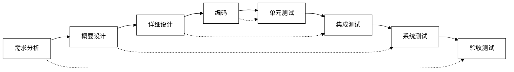
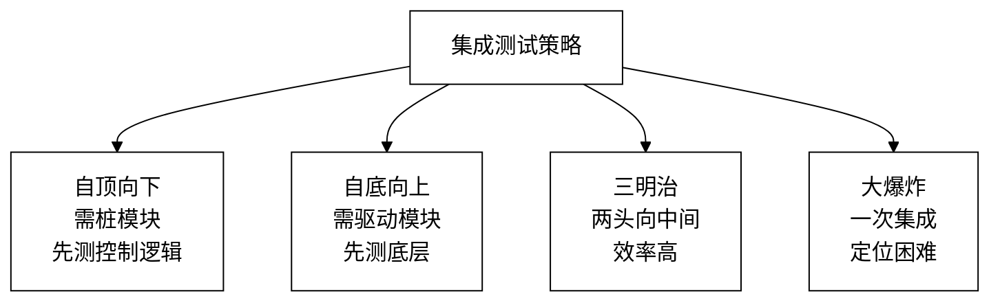

# 系统分析师｜第14章 软件实现与测试（备考讲义＋章节自测题）

> **教材依据**：《系统分析师教程（第2版）》第14章 软件实现与测试（共6节：14.1 软件实现概述｜14.2 软件测试概述｜14.3 软件测试方法｜14.4 软件测试类型｜14.5 软件测试的组织｜14.6 软件部署）。第2版较第1版重组：v1 第14章「系统实现与测试」为 14.1 实现（方法/语言风格）、14.2 测试自动化/软件调试、14.3 静态/白盒/黑盒测试、14.4 单元/集成/系统/其他测试、14.5 面向对象系统的单元/集成测试；v2 改六节结构，新增 14.1.4 代码生成、14.1.5 代码重用、14.4.3 按被测软件划分、14.4.4 回归/冒烟、14.6 软件部署，并将集成测试策略（自顶向下/自底向上/三明治/大爆炸）及桩/驱动模块从 v1 14.4.2 移出；V/W/H 模型、McCabe 圈复杂度、缺陷生命周期状态机、测试度量公式两版教材均无原文，按【真题补充｜考频｜两版教材均无原文】补回；集成策略与桩/驱动模块按【第1版补充｜掌握】补回；软件调试按【第1版补充｜掌握】补回（v1 14.2.2 有「软件调试」节）。

> **考纲定位说明**：2024版考纲科目一「系统分析师综合知识」第12条 软件实现与测试（程序设计方法｜程序设计语言与编码风格｜编码规范｜软件测试概念与原则｜软件测试方法｜软件测试类型｜软件测试过程与组织｜软件调试，与教材第2版第14章各节一一对应）。

> **考试形式**：上午综合知识单选题＋计算题；2021年以后真题（2024上～2026上）约17道/4场（测试类型与阶段11道/4场，题量居前；黑盒测试3道/2场、白盒测试2道/2场，均中频；黑盒与白盒综合、软件测试原则低频）；本章属第一梯队；论文软件测试最高频（5题次：2021上/2024上/2024下/2025上/2025下），案例无独立测试方向。

> 标签：系统分析师、上午题、软件实现、软件测试、白盒测试、黑盒测试、测试类型、测试阶段、V 模型、McCabe、等价类、边界值、缺陷管理

[TOC]

## 章节结构对照与来源标注

> 本讲义为教材第2版第14章的学习讲义。说明本章哪些是教材内容、哪些是教材之外的补充。

| 讲义模块 | 对应教材第2版章节 | 内容性质 | 备考要求 |
|---|---|---|---|
| 模块1 软件实现概述 | 14.1.1～14.1.5 | 教材 | 了解：程序设计方法、语言与风格、编码规范、代码生成、代码重用 |
| 模块2 软件测试概述 | 14.2.1～14.2.4 | 教材＋真题补充 | 了解：测试概念/基本问题/对象目的/原则；拓展：V、W、H 模型（真题补充，中频） |
| 模块3 软件测试方法 | 14.3.1～14.3.3 | 教材＋真题补充 | 掌握：黑盒/白盒/灰盒、静态/动态、逻辑覆盖、黑盒测试·用例设计方法；拓展：McCabe 圈复杂度（真题补充，中频） |
| 模块4 软件测试类型 | 14.4.1～14.4.4 | 教材＋第1版补充 | 掌握：功能/性能/安全等7类、单元/集成/系统/验收、App/Web 等、回归/冒烟；拓展：集成测试策略（自顶向下、自底向上、三明治、大爆炸）与桩/驱动模块（第1版补充，中频） |
| 模块5 软件测试的组织 | 14.5.1～14.5.2 | 教材＋真题补充 | 了解：测试过程、配置/过程/缺陷/风险管理；拓展：缺陷生命周期、测试度量（真题补充，低频降档） |
| 模块6 软件部署 | 14.6.1～14.6.2 | 教材 | 了解：部署目标、部署步骤 |

> 教材第2版第14章章节结构（按教材原文核读）：14.1 软件实现概述（14.1.1 程序设计方法、14.1.2 程序设计语言与风格、14.1.3 编码规范、14.1.4 代码生成、14.1.5 代码重用）；14.2 软件测试概述（14.2.1 软件测试的概念、14.2.2 软件测试的基本问题、14.2.3 软件测试的对象及目的、14.2.4 软件测试的原则）；14.3 软件测试方法（14.3.1 按被测程序是否可见分类、14.3.2 按是否需要执行被测程序分类、14.3.3 自动化测试）；14.4 软件测试类型（14.4.1 按测试对象划分、14.4.2 按测试阶段划分、14.4.3 按被测软件划分、14.4.4 其他分类）；14.5 软件测试的组织（14.5.1 测试过程、14.5.2 测试管理）；14.6 软件部署（14.6.1 部署目标、14.6.2 部署步骤）。

> ⚠️ 教材第2版第14章**不包含**：① 软件测试模型（V 模型/W 模型/H 模型）——两版教材均无原文，考纲有测试模型要求且真题反复命题，本讲义以【真题补充｜考频｜两版教材均无原文】在模块2 拓展阅读补回；② McCabe 圈复杂度（含基本路径法公式 V(G)=E−N+2）——两版教材均无原文，真题中频，以【真题补充｜考频｜两版教材均无原文】在模块3 拓展阅读补回；③ 集成测试策略（自顶向下/自底向上/三明治/大爆炸）及桩模块/驱动模块——v1 14.4.2 有、v2 已移出，以【第1版补充｜掌握】在模块4 集成测试节末补回；④ 缺陷生命周期状态机（New→Open→Fixed→Closed→Reopen/Rejected）——两版教材均无原文，以【真题补充｜考频｜两版教材均无原文】在模块5 拓展阅读补回（低频降档）；⑤ 测试度量（缺陷密度=缺陷数/KLOC、缺陷清除率 DRE、覆盖率公式）——两版教材均无系统讲述，以【真题补充｜考频｜两版教材均无原文】在模块5 拓展阅读补回（低频降档）；⑥ 软件调试/排错方法——v2 无专节、v1 14.2.2 有「软件调试」节，以【第1版补充｜掌握】在模块2 拓展阅读补回。

> 说明：代码审查/走查在 v2 14.3.2 静态测试内作为「代码检查」的子项提及，不单列独立知识点；代码重构属通用软件工程知识，v2 第14章未设专节，本章不单列。

---

## 模块1：软件实现概述（教材14.1）【教材｜了解】

**前置说明**：本模块对应教材第2版第14章 14.1 软件实现概述（14.1.1～14.1.5），考纲第12条软件实现子项；以教材原文为主，适配上午综合选择题。

**模块优先级**：🟢 了解为主（近年频次窗未单列实现族检出，归了解级）

**考情分析**（2021年以后真题）：实现类考点（程序设计方法、语言风格、编码规范）近年窗零星出现，归低频了解；重点记忆结构化/面向对象/可视化三类程序设计方法、良好程序设计风格四性与编码规范四方面。

### 1.1 核心知识点精讲

#### 1.1.1 程序设计方法（教材14.1.1）【教材｜了解】

- **结构化程序设计**：自顶向下、逐步求精；单入口单出口控制结构。三种基本控制结构——顺序、IF-THEN-ELSE 分支、DO-WHILE 循环（经典结构化）；扩展结构化允许 DO-CASE 多分支、DO-UNTIL 循环；修正结构化再加 LEAVE/BREAK。
- **面向对象程序设计（OOP）**：用 OOP 语言把 OOD 模型各成分书写下来，支持类/对象/继承/多态/消息通信，提高可靠性、可维护性、可复用性。
- **可视化程序设计（VP）**：事件驱动，基本概念含表单、部件、属性、事件、方法。

> 记忆：结构化重控制结构、面向对象重封装继承多态、可视化重事件驱动。

#### 1.1.2 程序设计语言与风格（教材14.1.2）【教材｜了解】

- **语言选择**：考虑模块化机制、可读性控制结构、编译查错能力、独立编译机制，以及用户要求/可移植性/应用领域等实用限制。
- **良好程序设计风格四性**：可理解性（有意义标识符、详细注解、视觉组织）、可复用性（提高内聚、减少规模、接口与实现分开、不用全局变量、利用继承）、可扩展性（封装实现策略、用多态、避免多分支、设计公有服务）、健壮性（预防错误操作、检查参数合法性、先测试后优化）。

#### 1.1.3 编码规范（教材14.1.3）【教材｜了解】

- 编码规范从四方面制定：命名规范、注释原则、编程风格规则、版本管理规则。
- 常见规范：命名规范、格式化规范、注释规范、函数长度规范、错误处理规范、冗余代码规范、通用开发模式规范。

#### 1.1.4 代码生成（教材14.1.4）【教材｜了解】

- 用代码生成器自动生成重复结构代码（如认证、权限模块），步骤：准备模板→准备数据→定义合成机制（数据置换占位符）→遍历数据并加载模板→模板+数据=生成代码。

#### 1.1.5 代码重用（教材14.1.5）【教材｜了解】

- 软件重用三层次：代码重用、设计结果重用、分析结果重用。
- 代码重用方法：使用函数、使用对象、使用模块、使用类（继承多态）、利用算法（解构分解组合）。

---

## 模块2：软件测试概述（教材14.2）【教材＋真题补充】

**前置说明**：本模块对应教材第2版第14章 14.2 软件测试概述（14.2.1～14.2.4），考纲第12条软件测试概念与原则子项；含【真题补充｜考频｜两版教材均无原文】V/W/H 模型与【第1版补充｜掌握】软件调试补回，适配上午综合选择题。

**模块优先级**：🟡 中频（含 V/W/H 模型真题中频补回；测试原则/概念近年窗低频）

**考情分析**（2021年以后真题）：测试原则、测试概念近年窗低频（约1场）；V/W/H 模型及测试与开发对应关系是真题反复命题点（属模块补回中频内容），须重点掌握 V 模型阶段对应。

### 2.1 核心知识点精讲

#### 2.1.1 软件测试的概念（教材14.2.1）【教材｜了解】

- 测试应**寻找缺陷与漏洞**，而非证明无错；逆向、发散思维，假设程序存在隐藏错误。
- IEEE 定义：使用人工或自动手段运行或测量软件系统的过程，检验是否满足规定需求、找出与预期结果差异。
- 趋势：测试工作前移（含需求/设计测试）、开发/测试/质量角色融合、独立测试部门、测试外包。

#### 2.1.2 软件测试的基本问题（教材14.2.2）【教材｜了解】

- 基本问题：验证功能实现与可用性、检查程序错误，以较少人力物力时间找出潜在错误缺陷，提高质量、回避发布后隐患。

#### 2.1.3 软件测试的对象及目的（教材14.2.3）【教材｜了解】

- 对象：源程序/目标代码、各开发阶段文档、配置数据。
- 目的（三视角）：用户角度——发现隐藏错误考虑是否接受；开发者角度——表明无错、验证满足要求；测试人员角度——发现/预测错误、评价可靠性。

#### 2.1.4 软件测试的原则（教材14.2.4）【教材｜了解】

十项原则要点：① 用例必要部分是预期输出定义；② 程序员应避免测自己程序；③ 组织不应测自己软件（需独立第三方）；④ 耐心检查每一结果；⑤ 用例应含无效/意外输入；⑥ 避免重新设计用例（保留复用）；⑦ 不默认假定无错；⑧ 测试不穷举；⑨ 尽早执行并贯穿生命周期；⑩ 追溯到需求。

> 记忆：有预期、避自测、独立测、查无效、不穷举、尽早贯全程、溯需求。

#### 2.1.5 拓展·软件测试模型（V、W、H 模型）【真题补充｜考频｜两版教材均无原文】

> 收录依据：考纲第12条含软件测试模型要求，且真题反复命题（V 模型阶段对应几乎每年必考）；两版教材均无原文，归本模块拓展阅读。

- **V 模型**：开发阶段（需求→概要设计→详细设计→编码）与测试阶段（验收←系统←集成←单元）一一对应；左侧每个开发阶段右侧对应一个测试阶段，强调测试与开发阶段对应、尽早测试。
- **W 模型**（双 V）：开发与测试并行，测试伴随需求/设计阶段即介入，贯穿各阶段。
- **H 模型**：测试活动独立于开发，形成可随时启动的测试流程。

> 易错：V 模型强调「测试与开发阶段对应、左侧开发对应右侧测试」；W 模型强调「开发与测试并行、更早介入」；H 模型强调「测试活动独立成流程」。

#### 2.1.6 拓展·软件调试（排错）方法【第1版补充｜掌握】

> 收录依据：v1 14.2.2 有「软件调试」节，v2 已移出，考纲第12条含软件调试子项。

- 调试与测试区别：测试目标是发现错误，调试目标是**定位并改正**已发现的错误。
- 常用调试方法：蛮干法（强行搜索）、回溯法（沿控制流反向追踪）、原因排除法（二分/归纳/演绎）。

### 2.2 典型例题

**例题1【V 模型阶段对应】**

V 模型中，与「详细设计」对应的测试层次是（）

A. 单元测试 B. 集成测试 C. 系统测试 D. 验收测试

> 【解析】V 模型详细设计对应集成测试（概要设计对应系统测试，需求对应验收测试，编码对应单元测试）。
> 【答案】B

**例题2【测试原则】**

「缺陷往往集中在少数模块中」体现的原则近似（）

A. 尽早测试 B. 缺陷群集 C. 杀虫剂悖论 D. 穷举不可能

> 【解析】题干为经典缺陷群集（二八定律）表述；本题意在辨析测试原则，注意「程序员避免测自己程序」「独立第三方测试」也是 v2 14.2.4 明确原则。
> 【答案】B

### 2.3 课后习题

**习题1【测试概念】**

软件测试的正确目标是（）

A. 证明软件不存在错误 B. 寻找并发现尽可能多的缺陷 C. 仅验证正向功能 D. 表明开发完成

> 【解析】测试应寻找缺陷与漏洞，逆向思维，而非证明无错。
> 【答案】B

**习题2【调试与测试】**

下列活动中，目标是「定位并改正已发现错误」的是（）

A. 软件测试 B. 软件调试 C. 代码评审 D. 需求分析

> 【解析】调试（排错）目标是定位并改正错误，测试目标是发现错误。
> 【答案】B

---

## 模块3：软件测试方法（教材14.3）【教材｜掌握】

**前置说明**：本模块对应教材第2版第14章 14.3 软件测试方法（14.3.1～14.3.3），考纲第12条软件测试方法子项；含【真题补充｜考频｜两版教材均无原文】McCabe 圈复杂度补回，适配上午综合选择题＋计算题。

**模块优先级**：🟡 中频（黑盒测试3道/2场、白盒测试2道/2场，近年窗均中频）

**考情分析**（2021年以后真题）：黑盒测试3道/2场、白盒测试2道/2场，均中频；核心考点——逻辑覆盖六标准强弱、黑盒用例设计法（等价类/边界值）、McCabe 圈复杂度（补回中频）。

### 3.1 核心知识点精讲

#### 3.1.1 按照被测程序是否可见分类（教材14.3.1）【教材｜掌握】

- **黑盒测试**（功能测试）：把程序看作黑盒，仅按需求规格说明书检查功能，不考虑内部逻辑；用于单元/集成/系统/验收各阶段，系统测试与确认测试中作用无可替代。黑盒用例设计法：等价类划分、边界值分析、错误推测、因果图、判定表驱动、正交试验设计、功能图、场景法。
- **白盒测试**（结构测试）：清楚内部逻辑，对所有逻辑路径覆盖；方法有代码检查、静态结构分析、逻辑覆盖、基本路径测试、域测试、符号测试、路径覆盖、程序变异。
- **灰盒测试**：介于黑白之间，多用于集成测试，既关注输入输出也关注内部情况。

#### 3.1.2 逻辑覆盖六标准（教材14.3.1）【教材｜掌握】

1. **语句覆盖**：每条语句至少执行一次（最弱）。
2. **判定覆盖（分支覆盖）**：每个判定的真/假分支各至少一次。
3. **条件覆盖**：每个判定中每个条件取各种可能值。
4. **判定/条件覆盖**：同时满足判定覆盖与条件覆盖。
5. **条件组合覆盖**：每个判定中各条件每种组合至少一次。
6. **修改条件判断覆盖（MC/DC）**：每个判断结果、每个条件结果、进入点与结束点均执行过，且每个条件可独立影响判断结果。

> 记忆：语句<判定<条件组合，覆盖能力由弱到强；路径覆盖最强但不绝对强于组合覆盖，二者独立。

#### 3.1.3 黑盒测试·用例设计方法（教材14.3.1）【教材｜掌握】

- **等价类划分**：输入域划为等价类，有效类（满足需求）可合并覆盖，无效类（不满足）每个单独一个用例防止缺陷掩盖。
- **边界值分析**：缺陷多集中于边界，取边界值及两侧值（上点、内点、离点）。
- **因果图/判定表**：因果图分析输入输出逻辑关系，判定表表达多条件组合。
- **正交试验**：大量组合中选有代表性组合，控制组合爆炸。
- **错误推测/场景法/功能图**：凭经验猜错、按基本流/备选流设计、功能图法。

#### 3.1.4 按照是否需要执行被测程序分类（教材14.3.2）【教材｜掌握】

- **静态测试**：不运行程序，分析语法/结构/过程/接口；含代码检查（代码走查、桌面检查、代码审查）、静态结构分析、代码质量度量；可人工或工具，发现缺陷早、效率高。
- **动态测试**：运行程序，比较结果与预期，分析效率/正确性/健壮性；由构造用例、执行程序、分析结果三部分组成。

#### 3.1.5 自动化测试（教材14.3.3）【教材｜了解】

- 将人为驱动转为机器执行；常见：单元自动化、接口自动化、UI 自动化。

#### 3.1.6 拓展·McCabe 圈复杂度（基本路径法）【真题补充｜考频｜两版教材均无原文】

> 收录依据：考纲/真题反复命题（白盒测试计算题主力），两版教材均无原文（v2 14.3.1 仅提逻辑覆盖与基本路径法名称，无 V(G) 公式），归本模块拓展阅读。

- 圈复杂度 V(G) 三公式：① V(G)=E−N+2（E 边数、N 节点数）；② V(G)=判定节点数+1；③ V(G)=区域数。
- 意义：衡量程序复杂度，等于独立路径数，决定基本路径测试用例数下限。

> 易错：两公式应一致；若不一致多为存在复合条件（AND/OR），应将复合条件拆为独立判定节点后重算。

### 3.2 典型例题

**例题1【逻辑覆盖】**

为满足条件覆盖（if A and B then X else Y），至少需用例（）

A. 1个 B. 2个 C. 3个 D. 4个

> 【解析】条件覆盖要求 A 真/A 假、B 真/B 假均出现，2 个用例（A 真 B 假、A 假 B 真）即可。
> 【答案】B

**例题2【McCabe 圈复杂度】**

控制流图节点数 N=8、边数 E=10，圈复杂度为（）

A. 2 B. 3 C. 4 D. 5

> 【解析】V(G)=E−N+2=10−8+2=4；亦可用判定节点数+1 核验。
> 【答案】C

**例题3【边界值分析】**

输入范围 [1,100]，边界值分析应选取（）

A. 1、100 B. 0、1、100、101 C. 50 D. 1、50、100

> 【解析】边界值+两侧：上点1、100，离点0、101，内点50；标准取 0、1、100、101。
> 【答案】B

### 3.3 课后习题

**习题1【等价类】**

输入成绩 0～100，下列属无效等价类的是（）

A. 60 B. 100 C. -5 D. 50

> 【解析】-5 超出范围，属无效等价类；有效类须每个单独用例，无效类合并会掩盖缺陷。
> 【答案】C

**习题2【覆盖标准强弱】**

最弱的逻辑覆盖标准是（）

A. 语句覆盖 B. 判定覆盖 C. 条件组合覆盖 D. 路径覆盖

> 【解析】语句覆盖最弱，条件组合与路径覆盖最强且二者独立。
> 【答案】A

#### 3.1.7 典型易错点（模块3 范围）

1. **逻辑覆盖强弱**：语句<判定<条件组合，路径覆盖与条件组合覆盖独立最强，勿混淆包含关系【🟡中频】。
2. **等价类用例规则**：有效类可合并、无效类必须单独，否则缺陷被掩盖【🟡中频】。
3. **McCabe 两公式一致性**：E−N+2 与判定节点数+1 应一致，复合条件需先拆分【🟡中频】。
4. **黑盒 vs 白盒**：黑盒不看内部、依需求；白盒看内部、覆逻辑路径【🟡中频】。

---

## 模块4：软件测试类型（教材14.4）【教材｜掌握】

**前置说明**：本模块对应教材第2版第14章 14.4 软件测试类型（14.4.1～14.4.4），考纲第12条软件测试类型子项；含【第1版补充｜掌握】集成测试策略与桩/驱动模块补回，适配上午综合选择题，本章题量居前（11道/4场）。

**模块优先级**：🟡 中频（测试类型与阶段 11道/4场，近年窗题量居前）

**考情分析**（2021年以后真题）：测试类型与阶段 11道/4场（中频，题量居前）；核心考点——7类测试对象区分、四阶段对应、集成测试策略（补回中频）、α/β 验收策略。

### 4.1 核心知识点精讲

#### 4.1.1 按测试对象划分（教材14.4.1）【教材｜掌握】

- **功能测试**：验证特征与可操作行为满足设计需求（数据驱动）。
- **性能测试**：含负载测试（达瓶颈后继续运行）、压力测试（不断加压至瓶颈/崩溃）、并发测试（负载+压力结合）、容量测试（极限值如最大并发用户数）、可靠性测试。
- **安全测试**：验证保护机制抗非法侵入，含渗透/SQL 注入等。
- **兼容性测试**：操作系统/版本/向前向后/相关软件/数据兼容。
- **界面测试（UI）**：布局/风格/控件/文字。
- **易用性测试**：用户体验，按易用性检查表排查。
- **稳定性测试**：长时间运行是否出问题。

> 记忆：功能+性能（负载/压力/并发/容量/可靠）+安全+兼容+界面+易用+稳定。

#### 4.1.2 按测试阶段划分（教材14.4.2）【教材｜掌握】

- **单元测试**：最小单元（函数/类/窗口），白盒为主，开发人员完成；内容含模块接口、局部数据、路径、错误处理、边界。
- **集成测试**：模块/子系统/系统三层集成，测模块间接口与交互；黑盒+白盒+灰盒。
- **系统测试**：整个系统（软硬件），黑盒为主；含恢复/安全/压力等，含回归测试与冒烟测试。
- **验收测试**：部署前最后操作，黑盒；策略含正式验收、非正式验收或 Alpha 测试、Beta 测试（Beta 由最终用户在实际环境、开发者通常不在场）。

#### 4.1.3 按被测软件划分（教材14.4.3）【教材｜了解】

- App 测试、Web 测试、物联网测试、车联网测试、大数据测试、AI 测试、小程序测试等专项测试。

#### 4.1.4 其他分类（教材14.4.4）【教材｜了解】

- **回归测试**：修改旧代码后重测，确认未引入新错；策略含再测试全部用例、基于风险、基于操作剖面、再测试修改部分。
- **冒烟测试**：新编译版本交付前预测试，确认更改按预期且不破坏版本稳定性；执行者为版本编译人员。

#### 4.1.5 集成测试策略（自顶向下、自底向上、三明治、大爆炸）【第1版补充｜掌握】

> 收录依据：v1 14.4.2 集成测试有专述（自顶向下9次、自底向上8次、三明治1次、桩模块8次、驱动模块9次），v2 14.4.2 仅讲集成层次未讲策略，真题中频，按【第1版补充｜掌握】补回。

- **自顶向下**：从顶层逐层向下集成，需**桩模块**模拟未就绪下层，先测控制逻辑、底层接口晚测。
- **自底向上**：从底层模块向上集成，需**驱动模块**调用被测，底层先验证、顶层控制逻辑晚测。
- **三明治**：自顶向下+自底向上结合（两头向中间），效率高。
- **大爆炸**：一次性全部集成，简单但缺陷定位困难。

> 记忆：顶向下用桩、底向上用驱动、三明治结合、大爆炸难定位。

### 4.2 典型例题

**例题1【测试类型辨析】**

不断加大负载直至系统崩溃以确定极限，属于（）

A. 负载测试 B. 压力测试 C. 容量测试 D. 并发测试

> 【解析】压力测试是不断加压至崩溃点；负载测试是达瓶颈后继续运行；容量测试测极限值。
> 【答案】B

**例题2【集成策略】**

自顶向下集成测试需要（）

A. 驱动模块 B. 桩模块 C. 用户参与 D. 测试报告

> 【解析】自顶向下先测上层，下层未就绪用桩模块模拟；自底向上才需驱动模块。
> 【答案】B

**例题3【验收测试】**

在真实使用环境、由用户独立进行的验收测试是（）

A. 正式验收 B. Alpha 测试 C. Beta 测试 D. 单元测试

> 【解析】Beta 测试由最终用户在实际环境独立进行；Alpha 在开发环境有指导。
> 【答案】C

### 4.3 课后习题

**习题1【阶段对应】**

与「概要设计」对应的测试层次是（）

A. 单元测试 B. 集成测试 C. 系统测试 D. 验收测试

> 【解析】V 模型概要设计对应系统测试（详细设计对应集成测试，需求对应验收测试）。
> 【答案】C

**习题2【回归测试】**

修改旧代码后重新测试以确认未引入新错，属于（）

A. 单元测试 B. 回归测试 C. 验收测试 D. 冒烟测试

> 【解析】回归测试在修改后重跑相关用例验证未引入新缺陷。
> 【答案】B

#### 4.1.6 典型易错点（模块4 范围）

1. **性能测试四子类**：负载（达瓶颈续跑）、压力（加压至崩溃）、并发（负载+压力）、容量（极限值）【🟡中频】。
2. **四阶段对应**：单元↔编码、集成↔详细设计、系统↔概要设计、验收↔需求（V 模型）【🟡中频】。
3. **桩 vs 驱动**：自顶向下用桩（模拟下层）、自底向上用驱动（调用被测）【🟡中频】。
4. **α vs β**：α在开发环境有指导、β在真实环境独立【🟡中频】。

---

## 模块5：软件测试的组织（教材14.5）【教材｜了解】

**前置说明**：本模块对应教材第2版第14章 14.5 软件测试的组织（14.5.1～14.5.2），考纲第12条软件测试过程与组织子项；含【真题补充｜考频｜两版教材均无原文】缺陷生命周期、测试度量补回（低频降档），适配上午综合选择题。

**模块优先级**：🟢 了解为主（测试过程/管理近年窗低频；缺陷状态机与度量按真题补充低频降档）

**考情分析**（2021年以后真题）：测试过程/配置/过程/风险管理近年窗低频；缺陷分类（严重/一般/次要/建议）v2 原生归了解；缺陷状态机与测试度量为真题补充低频内容，综合模拟题至多1道概念题。

### 5.1 核心知识点精讲

#### 5.1.1 测试过程（教材14.5.1）【教材｜了解】

六阶段：项目需求分析→制订测试计划→设计测试文档（写用例）→搭建测试环境→执行测试（单元/集成/系统/验收/回归）→缺陷管理。

#### 5.1.2 测试管理（教材14.5.2）【教材｜了解】

- **配置管理**：目标含控制和审计变更、建立基线、记录跟踪变更请求、标识控制配置项。
- **过程管理**：启动→计划→设计→执行→结果审查分析五阶段。
- **缺陷管理（分类）**：按种类（界面/功能/性能/安全/兼容）、按严重程度（严重/一般/次要/建议）、按优先级（立即解决/高/正常排队/低）、按发生阶段（需求/构架/设计/编码/测试）。
- **风险管理**：识别→评估→应对（规避/转移/减轻/接受）→上报。

#### 5.1.3 拓展·缺陷生命周期状态机【真题补充｜考频｜两版教材均无原文】

> 收录依据：缺陷管理为测试管理核心，真题常考状态流转；两版教材均未给出 New→Open→Fixed→Closed 状态机，归本模块拓展阅读（低频降档，不配例题）。

- 典型状态流转：New（新建）→Open（确认打开）→Fixed（已修复待验证）→Closed（关闭）；验证不通过可 Reopen；确认非缺陷可 Rejected。

#### 5.1.4 拓展·测试度量【真题补充｜考频｜两版教材均无原文】

> 收录依据：测试度量（缺陷密度/DRE/覆盖率）为测试管理常用量化指标，两版教材均无系统讲述，归本模块拓展阅读（低频降档）。

- **缺陷密度**=缺陷数/千行代码（KLOC）。
- **缺陷清除率 DRE**=发布前发现缺陷/(发布前+发布后)。
- **测试覆盖率**=已测代码/总代码（语句/分支覆盖率）。

---

## 模块6：软件部署（教材14.6）【教材｜了解】

**前置说明**：本模块对应教材第2版第14章 14.6 软件部署（14.6.1～14.6.2），考纲第12条未单列部署子项；真题几乎不考，归了解级，适配上午综合选择题。

**模块优先级**：🟢 了解为主（近年频次窗未检出，归了解级）

**考情分析**（2021年以后真题）：部署内容近年窗未检出（0场），归了解；记忆部署目标与步骤要点即可。

### 6.1 核心知识点精讲

#### 6.1.1 部署目标（教材14.6.1）【教材｜了解】

- 保障系统正常运行与功能实现；简化部署操作、提高效率；满足功能与非功能个性化需求；支持软件运行、满足用户需求使其可直接使用。

#### 6.1.2 部署步骤（教材14.6.2）【教材｜了解】

- 环境准备（装依赖与运行环境如操作系统/数据库/网络配置）、收集打包、安装配置、发布等；含配置文件、用户手册、帮助文档。

---

# 章节总复习综合模拟题

## 一、单项选择题（15题）

1. 软件测试的正确目标是（）

A. 证明软件不存在错误 B. 寻找并发现尽可能多的缺陷 C. 仅验证正向功能 D. 表明开发完成

> 【解析】测试应寻找缺陷与漏洞，逆向思维，而非证明无错。
> 【答案】B

2. V 模型中与「详细设计」对应的测试层次是（）

A. 单元测试 B. 集成测试 C. 系统测试 D. 验收测试

> 【解析】详细设计对应集成测试。
> 【答案】B

3. 为满足条件覆盖（if A or B），至少需用例（）

A. 1 B. 2 C. 3 D. 4

> 【解析】A 真/A 假、B 真/B 假各出现，2 个用例即可。
> 【答案】B

4. 控制流图 N=10、E=13，圈复杂度为（）

A. 3 B. 4 C. 5 D. 6

> 【解析】V(G)=E−N+2=13−10+2=5。
> 【答案】C

5. 输入范围 [10,20]，边界值分析应选取（）

A. 10、20 B. 9、10、20、21 C. 15 D. 10、15、20

> 【解析】上点10、20，离点9、21，内点15；标准取 9、10、20、21。
> 【答案】B

6. 无效等价类设计用例时应（）

A. 多个合并一个用例 B. 每个单独一个用例 C. 不设计 D. 只测有效类

> 【解析】无效类必须每个单独用例，防缺陷掩盖。
> 【答案】B

7. 不断加大负载直至崩溃以确定极限，属于（）

A. 负载测试 B. 压力测试 C. 容量测试 D. 并发测试

> 【解析】压力测试加压至崩溃点。
> 【答案】B

8. 自底向上集成测试需要（）

A. 桩模块 B. 驱动模块 C. 用户参与 D. 测试报告

> 【解析】自底向上需驱动模块调用被测。
> 【答案】B

9. 在真实环境由用户独立进行的验收测试是（）

A. 正式验收 B. Alpha 测试 C. Beta 测试 D. 冒烟测试

> 【解析】Beta 测试由最终用户在实际环境独立进行。
> 【答案】C

10. 修改旧代码后重测以确认未引入新错，属于（）

A. 单元测试 B. 回归测试 C. 验收测试 D. 冒烟测试

> 【解析】回归测试在修改后重跑相关用例。
> 【答案】B

11. 最弱的逻辑覆盖标准是（）

A. 语句覆盖 B. 判定覆盖 C. 条件组合覆盖 D. 路径覆盖

> 【解析】语句覆盖最弱。
> 【答案】A

12. 多条件组合爆炸时宜采用（）

A. 边界值 B. 正交试验 C. 错误推测 D. 场景法

> 【解析】正交试验选代表性组合控制爆炸。
> 【答案】B

13. 「程序员应避免测试自己编写的程序」出自（）

A. 测试原则 B. 编码规范 C. 部署步骤 D. 程序设计方法

> 【解析】v2 14.2.4 测试原则明确程序员应避免测自己程序。
> 【答案】A

14. 缺陷按严重程度可分为（）

A. 新建/打开/修复/关闭 B. 严重/一般/次要/建议 C. 立即/高/正常/低 D. 功能/性能/安全/兼容

> 【解析】按严重程度分严重/一般/次要/建议（状态机/优先级/种类为其他维度）。
> 【答案】B

15. 目标定位并改正已发现错误的活动是（）

A. 软件测试 B. 软件调试 C. 代码审查 D. 需求分析

> 【解析】调试（排错）目标是定位并改正错误。
> 【答案】B

## 二、计算题（2道）

### 计算题1【McCabe 圈复杂度】

某程序控制流图有 8 个节点、11 条边，另含 3 个判定节点。请分别用边-节点公式与判定节点公式计算圈复杂度，并说明含义。

> 【解析】V(G)=E−N+2=11−8+2=5；V(G)=判定节点数+1=3+1=4。两公式应一致，本例不一致说明存在复合条件（AND/OR），应拆分复合条件为独立判定节点后重算；真题中通常两法一致。圈复杂度=独立路径数，决定基本路径测试用例数下限。
> 【答案】边-节点公式得 5、判定节点公式得 4（不一致，提示复合条件需拆分）；独立路径数约 4～5

### 计算题2【等价类划分】

某登录功能：用户名 3～8 位字母，密码 6～12 位任意字符。请划分有效/无效等价类并设计最少测试用例。

> 【解析】用户名有效类：3～8 位字母（1 个）；无效：长度<3、长度>8、含非字母字符（3 个）。密码有效类：6～12 位任意字符（1 个）；无效：长度<6、长度>12（2 个）。有效类 1 个用例，无效类每个单独 1 个，共 1+3+2=6 个。
> 【答案】有效类 2 个、无效类 5 个；最少用例 6 个（有效 1＋无效 5）

## 三、简答概念题（3道）

1. 简述黑盒测试与白盒测试的区别。

> 【解析】黑盒测试（功能测试）把程序当黑盒，仅按需求规格验证功能，不考虑内部结构，用于各阶段尤其系统/验收测试；白盒测试（结构测试）清楚内部逻辑，对所有逻辑路径覆盖，多用于高可靠软件。黑盒重功能验证、白盒重结构覆盖；单元测试多用白盒，系统/验收多用黑盒。

2. 简述四种集成测试策略及桩/驱动模块区别。

> 【解析】自顶向下：从顶层逐层向下集成，需桩模块模拟未就绪下层，先测控制逻辑；自底向上：从底层向上集成，需驱动模块调用被测，底层先验证；三明治：两者结合两头向中间，效率高；大爆炸：一次性全部集成，简单但定位难。桩模块模拟被调下层，驱动模块调用被测模块。

3. 简述 V 模型的核心思想及与软件测试阶段对应关系。

> 【解析】V 模型将开发阶段（需求→概要设计→详细设计→编码）与测试阶段（验收←系统←集成←单元）一一对应，左侧每个开发阶段右侧对应一个测试阶段，强调测试与开发阶段对应、尽早测试。对应：编码↔单元测试、详细设计↔集成测试、概要设计↔系统测试、需求↔验收测试。

---

> **备考提示**：本章 2024上～2026上约17道/4场，属第一梯队，题量居前。重点掌握：① 测试类型与阶段（功能/性能四子类/安全/兼容等7类对象＋单元/集成/系统/验收四阶段对应，11道/4场）；② 软件测试方法（黑盒3道/2场、白盒2道/2场，逻辑覆盖六标准强弱、等价类/边界值、McCabe 圈复杂度补回）；③ V/W/H 模型与集成测试策略（自顶向下/自底向上/三明治，桩与驱动区分）；④ 缺陷分类与状态机、测试度量（补回了解）。论文软件测试最高频（5题次），案例无独立测试方向，但测试方法是案例答题常用术语基础。
