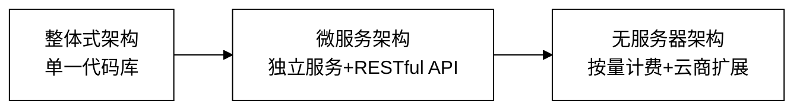
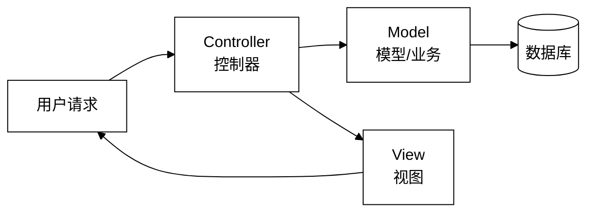
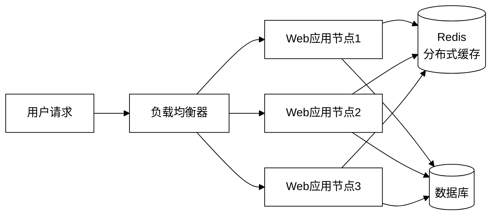
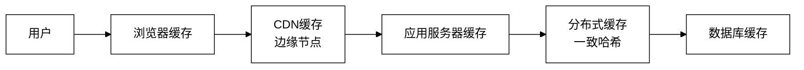

# 系统分析师｜第16章 Web应用系统分析与设计（备考讲义＋章节自测题）

> **教材依据**：《系统分析师教程（第2版）》第16章 Web应用系统分析与设计（共5节：16.1 Web应用系统简介｜16.2 Web应用架构设计｜16.3 Web应用开发框架｜16.4 Web应用系统开发｜16.5 Web应用系统测试）。第1版第16章为「新技术应用」，与第2版第16章不同构；第2版重构后Web应用内容独立成章，原第1版中 J2EE与.NET（保留为16.3.2／16.3.3）、P2P（保留为16.2.3架构模式）并入本章；第1版12.4.3富互联网应用中的Flash/Flex部分在第2版16.3.4承接。第1版中间件、云计算、SaaS、多核等内容移至第2版其他章（多核至17.1、云计算/SaaS至4.8）或整体删除；教材外内容来源口径：本章知识点几乎全部来自教材第2版，无教材外补充（Web应用安全防护 XSS／CSRF／HTTPS／JWT／OAuth 及 SQL注入防护属第9章信息安全，不纳入本章；v2仅16.5.5安全性测试一笔带过 SQL注入等漏洞测试）。

> **考纲定位说明**：2024版考纲科目二「系统分析师案例分析」案例专题「Web应用系统分析与设计」（对应第16章，综合应用）；按2024版考纲该章不再单列科目一独立模块（依第00章总纲 line 63 注②），其相关知识点（负载均衡、缓存、云计算等）可少量低频出现在上午综合知识（2024上～2026上仅Web应用架构中频2道/2场）。

> **考试形式**：上午综合知识单选题；2024上～2026上仅Web应用架构中频（2道/2场），Web客户端技术／Web服务器未检出（0场，全量统计窗内仅旧大纲期检出）；本章属科目二案例分析专题，案例分析Web方向2024上～2026上连年出现（4题组：2024上／2025上／2025下／2026上），为案例重要素材；论文仅Web客户端技术1题次（2021上）。计算题范围（教材维度）：QPS／并发、缓存命中、负载均衡。

> 标签：系统分析师、Web应用、架构设计、B/S、MVC、微服务、负载均衡、缓存、CDN、灰度发布、案例分析

[TOC]

## 章节结构对照与来源标注

> 本讲义为《系统分析师教程（第2版）》第16章 Web应用系统分析与设计的学习讲义。说明本章哪些是教材内容、哪些是教材之外的补充。

| 讲义模块 | 对应教材第2版章节 | 内容性质 | 备考要求 |
|---|---|---|---|
| 模块1 Web应用系统简介 | 16.1 Web应用系统简介（16.1.1 Web应用程序｜16.1.2 Web应用特征） | 教材 | 了解：Web应用概念与特征 |
| 模块2 Web应用架构设计 | 16.2 Web应用架构设计（16.2.1 设计原则｜16.2.2 架构分类｜16.2.3 架构模式） | 教材 | 掌握：架构原则／分类／模式 |
| 模块3 Web应用开发框架 | 16.3 Web应用开发框架（16.3.1 简介｜16.3.2 Java EE｜16.3.3 .NET｜16.3.4 Web层） | 教材 | 了解：主流框架选型 |
| 模块4 Web应用系统开发 | 16.4 Web应用系统开发（16.4.1 Web应用系统通信协议｜16.4.2 Web应用系统数据存储｜16.4.3 Web应用系统客户端技术｜16.4.4 Web应用系统服务器端技术｜16.4.5 Web应用系统部署） | 教材 | 掌握：数据存储（负载均衡／缓存／CDN）／部署（灰度发布）；了解：通信协议／客户端／服务器端技术 |
| 模块5 Web应用系统测试 | 16.5 Web应用系统测试（16.5.1 概述｜16.5.2 过程｜16.5.3 功能测试｜16.5.4 性能测试｜16.5.5 安全性测试｜16.5.6 Web服务测试） | 教材 | 了解：测试类型与过程 |

> （按教材原文核读）教材第2版第16章章节结构：16.1 Web应用系统简介（16.1.1 Web应用程序、16.1.2 Web应用特征）；16.2 Web应用架构设计（16.2.1 Web应用架构设计原则、16.2.2 Web应用架构分类、16.2.3 Web应用架构模式）；16.3 Web应用开发框架（16.3.1 开发框架简介、16.3.2 Java EE开发框架、16.3.3 .NET开发框架、16.3.4 Web层开发框架）；16.4 Web应用系统开发（16.4.1 Web应用系统通信协议、16.4.2 Web应用系统数据存储、16.4.3 Web应用系统客户端技术、16.4.4 Web应用系统服务器端技术、16.4.5 Web应用系统部署）；16.5 Web应用系统测试（16.5.1 Web应用测试概述、16.5.2 Web应用测试过程、16.5.3 Web应用功能测试、16.5.4 Web应用性能测试、16.5.5 Web应用安全性测试、16.5.6 Web服务测试）。

> ⚠️ 教材第2版第16章**不包含**（对照第1版第16章「新技术应用」及考纲边界，逐项列出）：
> - 第1版16.1 中间件（概述／主要中间件／中间件与构件的关系）：第2版移入第4章 4.6.2《中间件》（第1版二级节降为第2版三级节，内容收编）；v2另于16.4.2数据存储以「消息队列」形式保留中间件概念的一部分。
> - 第1版16.2 J2EE与.NET平台（J2EE核心技术／Java企业应用框架／.NET平台概述／比较分析）：第2版保留为16.3.2 Java EE开发框架与16.3.3 .NET开发框架（同名主题，编号与归属调整；节本体作为容器不再单列，子节分别落定）。
> - 第1版16.3.1 P2P计算：第2版保留为16.2.3架构模式（P2P架构）（同名主题）。
> - 第1版第12章12.4.3富互联网应用（RIA）：Flash/Flex部分在第2版16.3.4《Web层开发框架》中承接，未形成同名专节。
> - 第1版16.3.2 云计算：第2版移入第4章（分布式／云计算），v2仅于16.4.2数据存储以「云存储」形式保留一部分。
> - 第1版16.3.3 软件即服务（SaaS）：第2版移入第4章 4.8《云计算》（SaaS 内容收编）。
> - 第1版16.3.5 普适计算：第2版整体删除（术语仅存于 21.3.3 信息物理系统 CPS 计算技术列举一处，无专述）。
> - 第1版16.4 SoC设计／验证：第2版整体删除（v2 无专述；「片上」仅第17章 incidental 提及——共享片上的 Cache、片上部件——非 SoC 同构迁移）。
> - 第1版16.5 多核与多线程：第2版移入第17章 17.1《嵌入式系统概述》（基于多核处理器的嵌入式系统，含多核结构/共享 Cache/超线程）；第1版16.5.2 多核编程（OpenMP 等）：第2版整体删除（第17章 OpenMP／并行编程 0 命中）。
> - 第1版16.6 AOP概述／关键技术：第2版整体删除（v2 全库无专述，AOP／面向方面／横切／关注点均 0 命中；AOP 仅 18.3 移动应用架构 Spring 模块列举一处 incidental）。
> - Web应用安全防护（XSS／CSRF／HTTPS／JWT／OAuth、SQL注入防护等）：两版教材第16章均无系统论述（v2仅16.5.5安全性测试一笔带过 SQL注入等漏洞测试），该内容属第9章信息安全，本章不收录为备考知识点；本章仅从测试角度在模块5·16.5.5简述安全性测试，复习时勿与第9章混淆。

> 说明：本章为科目二案例分析专题（第00章总纲 line 63 注②），上午综合知识不单列独立模块；讲义模块优先级以「上午Web应用架构中频＋案例分析Web方向连年命题＋教材维度计算题范围」综合判定，其中模块2、模块4按中频🟡对待，模块1／3／5按了解🟢对待（上午均未检出，全量统计窗内仅旧大纲期有）。

---

## 模块1：Web应用系统简介（教材16.1）【教材｜了解】

**前置说明**：本模块对应教材第2版第16章16.1 Web应用系统简介（16.1.1 Web应用程序、16.1.2 Web应用特征），覆盖Web应用基本概念与特征；适配上午综合知识概念题与案例分析背景知识。

**模块优先级**：🟢 了解为主（了解）——上午综合知识未检出（0场，全量统计窗内仅旧大纲期检出），仅作案例背景知识。

**考情分析**（2021年以后真题）：近年频次窗未检出（0场）；全量统计窗内仅旧大纲期有检出；核心考点：Web应用特征、传统Web应用与SPA区别。

### 1.1 核心知识点精讲

#### 1.1.1 Web应用程序及其优势（教材16.1.1）【教材｜了解】

- Web应用程序是在Web浏览器中运行的软件，用户无须安装或配置即可访问复杂功能（购物车、产品搜索、即时消息、社交媒体等）。
- 主要优势：① 易于访问（跨浏览器、跨设备、团队远程共享）；② 开发高效（同一版本适用多平台，无须多迭代）；③ 使用简单（无须下载、自动更新、安全风险更低）；④ 扩展性强（按需添加用户，数据多存于云中）。

#### 1.1.2 Web应用特征（教材16.1.2）【教材｜了解】

- 新式Web应用特征：① 云托管和可扩展性（针对云优化、即用即付）；② 跨平台（Linux／macOS／Windows，容器与微服务）；③ 自动化测试（脚本模拟用户操作、自动生成报告）；④ 支持传统应用和SPA（传统Web依赖服务器导航、完整页面重载；SPA在静态HTML中初始化、大量使用Web API）；⑤ 简单的开发和部署（CI／CD、git集成自动部署）。

> 记忆：云托管、跨平台、自动化测试、传统＋SPA、简单部署。

---

## 模块2：Web应用架构设计（教材16.2）【教材｜掌握】

**前置说明**：本模块对应教材第2版第16章16.2 Web应用架构设计（16.2.1 设计原则、16.2.2 架构分类、16.2.3 架构模式），覆盖架构原则、整体式／微服务／无服务器分类与B/S／P2P／MVC-MVP／微服务模式；适配上午综合知识（Web应用架构中频）与案例分析Web方向。

**模块优先级**：🟡 中频（中等）——上午综合知识Web应用架构中频（2024上～2026上2道／2场），案例分析Web方向连年出现（2024上～2026上4题组）常考架构。

**考情分析**（2021年以后真题）：2024上～2026上约2道／2场（Web应用架构中频），案例Web方向4题组亦涉及架构；核心考点：架构模式（B/S／MVC／微服务）、架构分类（整体式／微服务／无服务器）、设计原则。

### 2.1 核心知识点精讲

#### 2.1.1 Web应用架构设计原则（8条）（教材16.2.1）【教材｜掌握】

教材提出8条通用设计原则：① 分离关注点（按工作类型分离，业务规则独立于基础设施与UI）；② 封装（组件通过明确定义接口隔离，不破坏外部协定即可调整内部实现）；③ 依赖关系反转（依赖方向指向抽象而非实现，实现依赖并可注入）；④ 显式依赖关系（类／方法通过构造函数显式要求协作对象）；⑤ 单一责任（对象只应有一个责任、只因一个原因更改）；⑥ 避免自我重复（逻辑封装为单一权威，不重复）；⑦ 持久性无知（需持久化的类型不受持久化技术影响，如POCO）；⑧ 有界上下文（DDD中心模式，将大应用分解为独立概念模块，各自独占持久化存储，紧映射微服务）。

> 记忆：分离关注、封装、依赖反转、显式依赖、单一责任、避免重复、持久无知、有界上下文。

#### 2.1.2 Web应用架构分类（教材16.2.2）【教材｜掌握】

- **整体式架构**：整个软件作为单一代码库开发，组件相互依赖；构建／部署简单，但扩展难、单点故障可致瘫痪；适合轻量、流量有限的用例。
- **微服务架构**：代码开发为松耦合独立服务，通过 RESTful API 通信，各服务自有数据库与业务逻辑；更新／扩展灵活、持续交付，但运行时实例管理复杂、服务数量增多运维难度上升、需共享分区数据库保证一致性。
- **无服务器架构**：底层基础设施预配由服务商管理，按使用量计费，扩展由云商负责，后端代码简化；适合多媒体处理、实时流媒体、聊天机器人、CI管道、物联网传感器消息等事件驱动场景。

#### 2.1.3 Web应用架构模式（教材16.2.3）【教材｜掌握】

- **B/S架构**：Browser／Server，浏览器／服务器结构，基于请求-响应模型，无须特别安装；分三层——表现层（交互与输出）、逻辑层（Web服务器完成应用逻辑）、数据层（接受请求后独立运算）。
- **P2P架构**：两个或多个客户端不经服务器直接通信（首步可用服务器查找对方）；完整连接拓扑（每客户端互连）或环形拓扑；所有计算机权限相同，部分节点故障网络仍正常运行。
- **MVC／MVP架构**：MVC（Model模型／View视图／Controller控制器），Model-View-Controller 分离；MVP由MVC派生，Presenter 将 View 与 Model 巧妙分开，View 仅转发用户输入给 Presenter，主要逻辑在 Presenter 中实现，Presenter 通过接口与具体 View 交互。
- **微服务架构（模式视角）**：以单一应用程序构成的小服务，自有进程与轻量处理，依业务功能设计、全自动部署，与其他服务用 HTTP API 通信；优点为技术异构性、隔离性、可扩展性、部署简单。为克服缺点提出：① 服务注册与发现（提供方上报注册中心，调用方订阅变更）；② 服务监控（内存、调用次数、健康、Metrics／Logging／Trace／告警）；③ 服务容错（熔断、隔离、限流、降级、超时）。

> 记忆：B/S三层、P2P直连、MVC分离、微服务注册发现／监控／容错三支撑。

### 2.2 典型例题

**例题1【架构模式-B/S】**

B/S架构一般分为三层，其中负责接受客户端请求并独立进行各种运算的是（）
A. 表现层 B. 逻辑层 C. 数据层 D. 客户端

> 【解析】B/S三层：表现层完成交互与输出；逻辑层（Web服务器）利用服务器完成应用逻辑；数据层接受请求后独立进行各种运算。题干「接受客户端请求后独立进行各种运算」对应数据层。
> 【答案】C

**例题2【架构分类-微服务】**

微服务架构区别于整体式架构的核心特征是（）
A. 单一代码库 B. 服务按业务功能拆分、独立部署、HTTP API通信 C. 共享单一数据库 D. 瀑布模型开发

> 【解析】微服务将功能拆分为独立服务，各自拥有进程与轻量处理，通过 HTTP API 通信、独立部署；整体式为单一代码库、强耦合。
> 【答案】B

### 2.3 课后习题

**习题1【设计原则】**

要求「对象只应有一个责任，只因一个原因更改」的设计原则是（）
A. 分离关注点 B. 单一责任 C. 依赖关系反转 D. 有界上下文

> 【解析】单一责任原则：对象只应有一个责任，只因一个原因更改。
> 【答案】B

**习题2【MVC】**

MVC中充当模型与视图之间接口、处理用户输入并调度的是（）
A. Model B. View C. Controller D. Presenter

> 【解析】Controller 是 Model 与 View 之间的接口，处理请求并调度；Presenter 属 MVP。
> 【答案】C

#### 2.1.4 典型易错点（架构设计）

- B/S三层（表现层／逻辑层／数据层）与MVC（Model／View／Controller）易混：B/S是部署架构（三层逻辑／物理分层），MVC是表现层内部模式【🟡中频】。
- 整体式 vs 微服务：整体式耦合高、单点故障风险；微服务松耦合但运维复杂（服务注册发现／监控／容错）【🟡中频】。
- 微服务通信用 RESTful API（HTTP），服务注册发现／监控／容错是微服务必备支撑【🟡中频】。
- 无服务器架构按使用量计费、扩展由云商负责，适合事件驱动场景（多媒体处理／流媒体／聊天机器人）【🟡中频】。

---

## 模块3：Web应用开发框架（教材16.3）【教材｜了解】

**前置说明**：本模块对应教材第2版第16章16.3 Web应用开发框架（16.3.1 简介、16.3.2 Java EE、16.3.3 .NET、16.3.4 Web层），覆盖主流开发框架选型；适配上午综合知识概念题。

**模块优先级**：🟢 了解为主（了解）——上午综合知识未检出（0场，全量统计窗内仅旧大纲期检出），案例可涉及技术选型背景。

**考情分析**（2021年以后真题）：近年频次窗未检出（0场）；全量统计窗内仅旧大纲期有检出；核心考点：Java EE（SSH／JSF）、.NET（CLR／类库）、Web层框架（AJAX框架）。

### 3.1 核心知识点精讲

#### 3.1.1 开发框架简介（教材16.3.1）【教材｜了解】

- 框架（Framework）是一组组件的综合，相互协作为一类相关应用提供可重用框架结构，支持细节设计和代码重用（如Spring、Struts、Hibernate）。
- 使用框架可在通用功能已实现的基线上开发具体应用，集中精力于商业逻辑，降低难度、提高效率、增强可扩展性与可维护性。

#### 3.1.2 Java EE 开发框架（教材16.3.2）【教材｜了解】

- **SSH**：Spring＋Struts＋Hibernate 结合，基于Java EE的企业级轻量级Web开源框架。
  - Spring：分层架构、依赖注入降低耦合，客户代码面向接口编程，可经配置切换底层实现。
  - Struts：基于MVC模式的企业级Web开源框架，整合Servlet／JSP／自定义标签，通过 struts-config.xml 联系模型／视图／控制器。
  - Hibernate：开源对象关系映射框架，对JDBC轻量封装，用XML将Java类映射到表，桥接对象与关系。
- **JSF**（Java Server Faces）：构建Web应用的标准Java框架，提供可扩展UI组件、页面导航、数据验证与转换、Bean管理、事件处理、国际化支持。

#### 3.1.3 .NET 开发框架（教材16.3.3）【教材｜了解】

- .NET框架由微软开发，两个关键组件为 CLR（公共语言运行时）和 .NET框架类库（含ADO.NET、ASP.NET、Windows窗体、WPF）；提供托管执行环境、简化开发与部署、与多种编程语言集成。

#### 3.1.4 Web层开发框架（教材16.3.4）【教材｜了解】

- **WebPage 3.0**：基于组件的、可视化的、轻量级Web开发框架，基于MVC模式、关注View，使用Java／JSP／Servlet／HTML／JavaScript／XML。
- **AJAX框架**：Prototype（JavaScript类库，面向对象扩展／DOM操作／事件，兼容各浏览器）、jQuery（轻量级JavaScript框架，简化HTML／DOM／Events／动画、支持AJAX）、Mootools（模块化面向对象）、DOJO（强大面向对象JavaScript框架、组件丰富）、Ext JS（前端UI开源AJAX框架、重量级）、AFLAX（基于AJAX的Flash平台JavaScript库）。

> 记忆：Java EE看SSH／JSF，.NET看CLR／类库，Web层看AJAX框架（jQuery／DOJO／Ext JS）。

---

## 模块4：Web应用系统开发（教材16.4）【教材｜掌握】

**前置说明**：本模块对应教材第2版第16章16.4 Web应用系统开发（16.4.1 通信协议、16.4.2 数据存储、16.4.3 客户端技术、16.4.4 服务器端技术、16.4.5 部署），其中数据存储（负载均衡／缓存／CDN／消息队列）与部署（灰度发布）是案例分析Web方向核心素材，含教材维度计算题范围（QPS／并发、缓存命中、负载均衡）；适配上午综合知识概念题与案例分析Web方向。

**模块优先级**：🟡 中频（中等）——案例分析Web方向2024上～2026上连年出现（4题组），核心素材为负载均衡／缓存／CDN／灰度发布；计算题范围含QPS／并发、缓存命中、负载均衡；上午综合知识未检出（0场，全量统计窗内仅旧大纲期检出）。

**考情分析**（2021年以后真题）：案例Web方向2024上～2026上4题组（负载均衡／缓存／CDN／灰度发布常考）；计算题范围（教材维度）QPS／并发、缓存命中、负载均衡；核心考点：负载均衡方式、缓存4模型、CDN、消息队列、灰度发布。

### 4.1 核心知识点精讲

#### 4.1.1 Web应用系统通信协议（教材16.4.1）【教材｜了解】

- **HTTP**：超文本传输协议，应用层、基于文本的**无状态**协议，运行于TCP／IP之上，是浏览器与Web服务器间的应用层通信协议；交互不保留客户状态，借助 session（会话）区分并发用户与关联请求，session跟踪通常采用URL重写与cookies。
- **RTP／RTSP**：RTP实时传送协议（多播／单播音频视频）；RTSP实时流传输协议，控制音频／视频实时发送，位于RTP／RTCP之上。
- **SMTP／POP3**：SMTP简单邮件传输协议（传输邮件）；POP3邮局协议版本3（接收邮件，TCP 110端口，离线协议）。

> 记忆：HTTP无状态靠session／cookie；RTP／RTSP管流媒体；SMTP发、POP3收。

#### 4.1.2 Web应用系统数据存储（教材16.4.2）【教材｜掌握】

- **缓存系统（4种模型）**：① 应用程序服务器缓存（单节点内存中）；② 全局缓存（所有节点访问单一缓存空间）；③ 分布式缓存（缓存分布节点，一致哈希路由）；④ 内容交付网络 CDN（交付大量静态数据）。
- **云存储**：集群／网格／分布式文件系统协同，存储资源放云上，随时随地存取（如Amazon S3、Azure、谷歌云存储）。
- **CDN（CloudFront等）**：各地理位置服务器网络，将请求路由到就近缓存节点交付内容，提高速度、减少丢包、降低服务器负载，支持受众细分与高级Web安全性。
- **负载均衡器**：按可用性或预定义策略将流量分布到不同服务器；方式含① TCP／IP级别（基于DNS）、② 应用级（基于应用负载）。软件负载均衡分四层（LVS，内核层交换，高性能但不足：不检测后端存活、不支持正则动静分离）与七层（Nginx／Haproxy，支持虚拟主机、保持session、动静分离）；硬件负载均衡（F5／NetScaler／Radware／Array等）功能性能优但成本高。
- **消息队列**：缓冲区，异步存储消息，协调微服务间通信、解耦，提供精细可伸缩性（点对点模式：一消息仅一消费者消费）。

> 记忆：缓存4模型（应用／全局／分布式／CDN）；负载均衡四层快不保活、七层保session能动静分离；消息队列解耦微服务。

#### 4.1.3 Web应用系统客户端技术（教材16.4.3）【教材｜了解】

- **HTML／HTML5**：通用标记语言，简单但表现简单、链路易断、检索慢、扩展性差、缺乏语义；HTML5支撑广泛Web应用（视频／音频／动画／交互标准化）。
- **XML**：可扩展标记语言，W3C制定，元语言可定义个性化标记，Web上解决分布式信息交换与「信息孤岛」。
- **DHTML**：动态HTML，下载后无须服务器处理即在浏览器动态更新内容／样式／动画；AJAX是不刷新整页、异步请求更新的表现层技术。
- **CSS**：层叠样式表，为结构化文档添加样式（字体／间距／颜色），分离结构与显示。
- **Flash／Flex**：Flash矢量动画（ActionScript）；Flex以.mxml描述界面、面向开发者。
- **DOM**：文档对象模型，建立Web页面与Script沟通的桥梁，与JavaScript紧密结合解析XML／HTML节点树。
- **JavaScript／AJAX**：JavaScript客户端脚本（动态、弱类型、基于原型）；AJAX异步JavaScript和XML，创建交互式Web应用、不刷新整页维护数据。

#### 4.1.4 Web应用系统服务器端技术（教材16.4.4）【教材｜了解】

- **CGI**：早期标准，Web服务器运行外部程序动态生成内容，语言不限但效率低、开销大。
- **PHP**：HTML内嵌式脚本，服务器端执行，比CGI／Perl快，与Apache紧密结合、良好安全性。
- **ASP／ASP.NET**：ASP微软嵌入式服务器端脚本；ASP.NET免费Web框架，属.NET Framework，可用兼容CLR的语言（C#常用）。
- **Servlet**：Java编写服务器端程序，动态生成Web页，Java EE一部分，MVC中充当控制器。
- **JSP**：Java代码嵌入HTML的服务端技术，本质是高层Servlet，内容与显示分离、可重用组件。
- **Perl／Ruby／Python**：Perl强大脚本（CPAN）；Ruby（Ruby on Rails框架）；Python简洁清晰、服务端框架或CGI支持。

#### 4.1.5 Web应用系统部署（教材16.4.5）【教材｜掌握】

- **部署粒度**：增量迭代发布，细粒度发布（单组件预发→运行服务器）或打包一组变化发布。
- **灰度发布（金丝雀）**：把影响集中到一点再发散到面，出现意外易回退，收集用户反馈改进；降低新旧版本兼容、用户流失、系统宕机风险。
- **部署原则**：管理客户期望、安装与测试交付包、交付前建立支持制度、先改正缺陷再交付。
- **客户端联系（Client Affinity）**：基于应用层负载均衡器将某客户端所有请求转发到相同服务器，保证特定用户（如VIP）服务质量（会话数据多由会话服务器存放，但多数不可恢复，需容错方案）。
- **部署环境**：操作系统（Windows Server／Linux／UNIX）、服务器软件（Apache／IIS／Websphere／WebLogic等）；应用服务器共解问题含负载均衡、数据库连接池、高速缓存机制。
- **版本控制与CMS**：变更管理，确保内容正确一致、跟踪变更、快速重建、回滚前一版本。

> 记忆：灰度发布小流量验证易回退；Client Affinity 保会话质量；部署环境看OS＋应用服务器。

### 4.2 典型例题

**例题1【负载均衡】**

将同一客户端的所有请求转发到相同服务器以保证会话服务质量，这种负载均衡策略是（）
A. 轮询 B. 加权轮询 C. 最小连接 D. 客户端联系（Client Affinity）

> 【解析】教材16.4.5部署举例：基于应用层负载均衡器实现客户端联系（Client Affinity），将某客户端所有请求转发到相同服务器，保证服务质量。
> 【答案】D

**例题2【缓存】**

用于交付大量静态数据、在各地理位置缓存内容以加速交付的缓存模型是（）
A. 应用服务器缓存 B. 全局缓存 C. 分布式缓存 D. 内容交付网络（CDN）

> 【解析】CDN（内容交付网络）用于交付大量静态数据，将用户请求路由到就近缓存节点，提高速度、降低服务器负载。
> 【答案】D

### 4.3 课后习题

**习题1【灰度发布】**

为降低Web应用升级的新旧版本兼容、用户流失与宕机风险，常采用的发布策略是（）
A. 直接替换 B. 灰度发布 C. 全量回滚 D. 停机发布

> 【解析】灰度发布（金丝雀）将影响集中到一点再发散，出现意外易回退，收集反馈改进。
> 【答案】B

**习题2【消息队列】**

在微服务环境中异步存储消息、协调不同服务间通信的组件是（）
A. 负载均衡器 B. 消息队列 C. CDN D. 云存储

> 【解析】消息队列是缓冲区，异步存储消息，促进微服务间通信、解耦。
> 【答案】B

#### 4.1.6 典型易错点（数据存储与部署）

- 负载均衡四层（LVS，内核层，高性能但不检测后端存活／不支持正则动静分离）vs 七层（Nginx／Haproxy，支持虚拟主机、保持session、动静分离）【🟡中频】。
- 缓存4模型：应用服务器缓存／全局缓存／分布式缓存（一致哈希）／CDN（静态内容交付），越靠近用户越快【🟡中频】。
- 灰度发布（金丝雀）：小流量验证、易回退，降低新旧版本兼容／用户流失／宕机风险【🟡中频】。
- 会话保持：客户端联系（Client Affinity）将同一用户请求转发到相同服务器，保证服务质量【🟡中频】。

---

## 模块5：Web应用系统测试（教材16.5）【教材｜了解】

**前置说明**：本模块对应教材第2版第16章16.5 Web应用系统测试（16.5.1 概述、16.5.2 过程、16.5.3 功能测试、16.5.4 性能测试、16.5.5 安全性测试、16.5.6 Web服务测试），覆盖测试类型与过程；适配上午综合知识概念题与案例分析测试背景。

**模块优先级**：🟢 了解为主（了解）——上午综合知识未检出（0场，全量统计窗内仅旧大纲期检出），案例可涉及性能／安全测试背景。

**考情分析**（2021年以后真题）：近年频次窗未检出（0场）；全量统计窗内仅旧大纲期有检出；核心考点：测试类型（功能／性能／安全）、测试过程、安全性测试含SQL注入等漏洞测试。

### 5.1 核心知识点精讲

#### 5.1.1 Web应用测试概述（教材16.5.1）【教材｜了解】

- Web应用测试目的同传统软件测试（发现错误与缺陷），但Web多层体系结构、客户端差异、并发量、第三方集成使测试更复杂；需详细计划与规程。
- 测试特性与挑战：用户量巨大需多用户性能测试；内容错误靠人工、链接关系难保证；展示层软需求难测；多层架构需综合分析定位缺陷；集成第三方软件须测其集成配置；浏览器导航（后退／前进／刷新）常引发错误；技术多样使测试模型粒度难定义。

#### 5.1.2 Web应用测试过程（教材16.5.2）【教材｜了解】

- 一般过程包含：功能测试、内容测试和评审、Web页面测试、导航测试、接口测试、配置测试、安全测试、性能测试等；并非时间顺序，而倾向尽早开始、迭代测试小增量。

#### 5.1.3 Web应用功能测试（教材16.5.3）【教材｜了解】

- 功能测试结合规格说明保证Web应用满足功能要求，不满足功能要求的Web应用无用；主要测链接、表单、Cookie、设计语言（如JavaScript）、数据库等。

#### 5.1.4 Web应用性能测试（教材16.5.4）【教材｜了解】

- 性能测试评估响应时间及可靠性如何受增长负载影响，含速度测试、负载测试、压力测试等；方法含基准测试、负载测试、压力测试、可靠性测试，常用工具模拟成百上千虚拟用户并发访问。
- 核心指标（教材维度）：响应时间、速度、负载、可靠性、并发用户能力；吞吐量（单位时间处理请求数）与并发用户数常作为容量规划依据。

> 注意：性能指标（响应时间／吞吐量／并发）属教材第2版表述，QPS（每秒查询数）为常见量化单位、纳入本章计算题范围（见模块4考情）；每秒事务数在第2版第16章无原文，不单独作为本章考点。

#### 5.1.5 Web应用安全性测试（教材16.5.5）【教材｜了解】

- 安全性测试对Web应用安全防卫措施有效性进行测试，揭露弱点；主要包括数据加密测试、用户身份验证测试、日志文件测试、脚本安全测试、SQL注入等安全漏洞测试。

> 注意：Web应用安全防护（XSS／CSRF／HTTPS／JWT／OAuth、SQL注入防护手段）属第9章信息安全，本章仅从测试角度简述（16.5.5一笔带过SQL注入等漏洞测试），勿与第9章混淆、不展开防护细节。

#### 5.1.6 Web服务测试（教材16.5.6）【教材｜了解】

- Web服务测试特性：需服务提供者、代理、请求者共同参与；分基础设施验证与确认、Web服务独立测试、Web服务集成测试三层；集成测试挑战在于服务流描述与服务间交互。

---

# 章节总复习综合模拟题

> 说明：题型贴合系统分析师真题风格，覆盖模块1～5核心考点；上午中频（模块2／模块4）配置选择题与计算题，了解模块（模块1／3／5）至多1道概念题。

## 一、单项选择题（9题）

1. B/S架构三层中，主要利用服务器完成客户端应用逻辑功能的是（）
A. 表现层 B. 逻辑层 C. 数据层 D. 客户端
> 【解析】逻辑层（Web服务器）完成应用逻辑功能。
> 【答案】B

2. 微服务架构中各服务之间通常采用何种方式通信（）
A. 共享内存 B. RESTful API（HTTP） C. 直接函数调用 D. 数据库直连
> 【解析】微服务通过 RESTful API（HTTP）通信。
> 【答案】B

3. 将功能拆分为独立、松耦合服务并独立部署的架构是（）
A. 整体式 B. 微服务 C. 无服务器 D. P2P
> 【解析】微服务按业务功能拆分、独立部署、HTTP API通信。
> 【答案】B

4. 负载均衡中性能较高但不检测后端服务器存活、不支持正则动静分离的是（）
A. 七层负载均衡（Nginx） B. 四层负载均衡（LVS） C. 应用层负载均衡 D. DNS负载均衡
> 【解析】四层（LVS）在内核层交换，高性能但不足：不检测后端存活、不支持正则动静分离。
> 【答案】B

5. 用于交付大量静态数据、就近加速的内容交付网络是（）
A. 应用服务器缓存 B. 全局缓存 C. CDN D. 分布式缓存
> 【解析】CDN将请求路由到就近缓存节点交付静态内容。
> 【答案】C

6. Web应用升级时为降低兼容与宕机风险、小流量验证再全量的发布策略是（）
A. 直接替换 B. 灰度发布 C. 全量回滚 D. 停机发布
> 【解析】灰度发布小流量验证再全量，易回退。
> 【答案】B

7. （了解）Web应用测试中，结合规格说明保证功能符合要求的是（）
A. 性能测试 B. 功能测试 C. 安全性测试 D. Web服务测试
> 【解析】功能测试保证Web应用满足功能要求。
> 【答案】B

8. （了解）Web客户端技术中为结构化文档添加样式的是（）
A. HTML B. XML C. CSS D. DOM
> 【解析】CSS为结构化文档添加样式（字体／间距／颜色）。
> 【答案】C

9. （了解）Web服务器端技术中由Java编写、运行于Servlet容器、充当MVC控制器的是（）
A. CGI B. PHP C. Servlet D. ASP
> 【解析】Servlet是Java EE一部分，MVC中充当控制器。
> 【答案】C

## 二、计算题（3道，教材维度计算题范围）

### 计算题1【负载均衡-加权轮询分配】

三台服务器权重分别为1、2、3，采用加权轮询，每轮6个请求应如何分配？若某服务器连接数异常高，是否仍适用加权轮询，应改用何策略？
> 【解析】总权重=1+2+3=6；按比例：服务器1得6×1/6=1个，服务器2得6×2/6=2个，服务器3得6×3/6=3个。若负载不均（连接数异常），加权轮询无法动态感知，宜改用最小连接策略（按当前连接数动态分配）。
> 【答案】1／2／3个；负载不均时改用最小连接

### 计算题2【缓存命中率与平均访问时间】

某页面直访数据库耗时300ms，经缓存命中时耗时10ms，命中率90%。求平均访问时间与加速比。
> 【解析】平均访问时间=命中率×缓存耗时+未命中率×数据库耗时=0.9×10+0.1×300=9+30=39ms；加速比=300/39≈7.69倍。
> 【答案】平均39ms；加速比约7.7倍

### 计算题3【QPS与并发】

某Web系统平均响应时间200ms，高峰2000用户、人均每秒0.5请求。求QPS需求与所需并发处理能力（单并发处理能力=1/0.2=5 QPS）。
> 【解析】QPS=2000×0.5=1000；所需并发=1000/5=200个并发连接（或等价集群能力）。
> 【答案】QPS需求1000；约需200并发处理能力

## 三、简答概念题（2道）

1. 简述Web应用架构的主要模式及其特点
> 【解析】B/S（浏览器／服务器，三层：表现／逻辑／数据，免安装）；P2P（客户端直连，无中心、容错）；MVC／MVP（模型／视图／控制器分离，MVP由Presenter隔离Model与View）；微服务（按业务拆分、独立部署、HTTP API通信，需服务注册发现／监控／容错）；整体式与无服务器为架构分类维度（整体式单一代码库、微服务松耦合、无服务器按量计费）。

2. 简述负载均衡的主要方式及缓存的分层模型
> 【解析】负载均衡：四层（LVS，内核交换，高性能但不检测后端存活）、七层（Nginx／Haproxy，支持虚拟主机／保持session／动静分离）、硬件（F5等，功能性能优但贵）、DNS轮询。缓存4模型：应用服务器缓存、全局缓存、分布式缓存（一致哈希）、CDN（静态内容交付），越靠近用户越快。

---

> **备考提示**：本章2024上～2026上上午综合知识仅Web应用架构中频（2道／2场），其余Web知识点上午未检出；但本章属科目二案例分析专题，案例分析Web方向连年出现（2024上／2025上／2025下／2026上4题组），是案例重要素材。重点掌握：① Web应用架构设计（设计原则8条、整体式／微服务／无服务器分类、B/S／P2P／MVC-MVP／微服务架构模式）；② Web应用系统开发中的数据存储（负载均衡、缓存4模型、CDN、消息队列）与部署（灰度发布），计算题范围含QPS／并发、缓存命中、负载均衡。其余内容（开发框架、客户端／服务器端技术、测试）以理解为主，不必死记；Web应用安全防护（XSS／CSRF／HTTPS／JWT／OAuth、SQL注入防护）属第9章信息安全，本章仅从测试角度简述（16.5.5），勿混淆章界。
