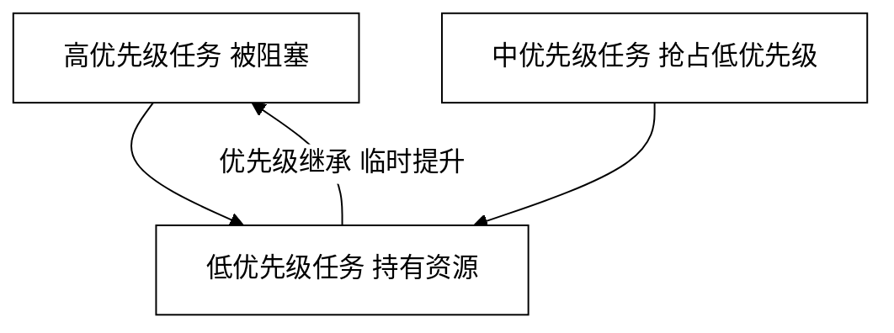

# 系统分析师｜第17章 嵌入式系统分析与设计（备考讲义＋章节自测题）

> **教材依据**：《系统分析师教程（第2版）》第17章 嵌入式系统分析与设计（共5节：17.1 嵌入式系统概述｜17.2 嵌入式数据库系统｜17.3 嵌入式操作系统｜17.4 嵌入式系统开发｜17.5 嵌入式系统验证）。第1版第17章同名「嵌入式系统分析与设计」，两版主体结构相承；此外，第1版第16章16.5多核与多线程的部分内容跨章纳入第2版17.1。第2版主要变化：①新增 17.5 嵌入式系统验证（验证与确认、基于系统的构件测试方法）；②17.1概述承接多核处理器嵌入式系统相关内容；③17.3 节题由《嵌入式实时操作系统》改题为《嵌入式操作系统》（17.3.1～17.3.3 两版同号同名对应，含 17.3.3 优先级反转）；17.4 各节（17.4.1～17.4.5）两版同号同名对应，其中 17.4.4 系统分析与设计两版均有专节（正文近乎一致，非并入关系）。教材外内容来源口径：本章知识点几乎全部来自教材第2版，无教材外补充。

> **考纲定位说明**：2024版考纲科目二「系统分析师案例分析」案例专题「嵌入式系统分析与设计」（对应第17章，综合应用）；按2024版考纲该章不再单列科目一独立模块（依第00章总纲 line 63 注①），其相关知识点可少量低频出现在上午综合知识（2024上～2026上综合未检出，0道/0场，仅旧大纲期检出）。

> **考试形式**：上午综合知识单选题；2024上～2026上综合未检出（0道/0场，仅旧大纲期检出），第三梯队；本章属科目二案例分析专题，案例分析嵌入式方向累计4题组（2021上／2023上／2024上／2026上），其中2024上～2026上2题组（2024上、2026上），2026上新增 RTOS 与 Linux 选型，为案例选答重要素材；论文0题次。计算题范围（教材维度，依第00章 line 27）：RM调度、MTBF、响应时间、功耗。

> 标签：系统分析师、嵌入式系统、EDBMS、RTOS、RM调度、EDF、优先级反转、软硬件协同、交叉开发、低功耗、案例分析

[TOC]

## 章节结构对照与来源标注

> 本讲义为《系统分析师教程（第2版）》第17章 嵌入式系统分析与设计的学习讲义。说明本章哪些是教材内容、哪些是教材之外的补充。

| 讲义模块 | 对应教材第2版章节 | 内容性质 | 备考要求 |
|---|---|---|---|
| 模块1 嵌入式系统概述 | 17.1 嵌入式系统概述 | 教材 | 了解：定义/特点/组成/多核 |
| 模块2 嵌入式数据库系统 | 17.2 嵌入式数据库系统 | 教材 | 了解：EDBMS与特点/分类 |
| 模块3 嵌入式操作系统 | 17.3 嵌入式操作系统（17.3.1 概述｜17.3.2 多任务调度算法｜17.3.3 优先级反转） | 教材 | 了解：RTOS特征/RM与EDF调度/优先级反转 |
| 模块4 嵌入式系统开发 | 17.4 嵌入式系统开发（17.4.1 开发平台｜17.4.3 软硬件协同设计｜17.4.5 低功耗设计） | 教材 | 了解：交叉开发/协同设计/低功耗 |
| 模块5 嵌入式系统验证 | 17.5 嵌入式系统验证（17.5.1 验证与确认｜17.5.3 基于系统的构件测试方法） | 教材 | 了解：V&V/构件测试 |

> （按教材原文核读）教材第2版第17章章节结构：17.1 嵌入式系统概述；17.2 嵌入式数据库系统；17.3 嵌入式操作系统（17.3.1 嵌入式操作系统概述、17.3.2 多任务调度算法、17.3.3 优先级反转）；17.4 嵌入式系统开发（17.4.1 开发平台、17.4.2 开发流程、17.4.3 软硬件协同设计、17.4.4 系统分析与设计、17.4.5 低功耗设计）；17.5 嵌入式系统验证（17.5.1 嵌入式系统的验证与确认、17.5.3 基于系统的构件测试方法）。

> ⚠️ 教材第2版第17章**不包含**（对照第1版第17章及考纲边界，逐项列出）：
> - 引脚级外设接口（GPIO/UART/I2C/SPI/CAN/USB/ADC/DAC 等）：两版第17章均未系统展开（仅 17.1 组成以「通用设备接口和 I/O 接口（A/D、D/A、I/O 等）」「总线」概括提及），本章不收录为备考知识点；引脚级接口属硬件底层知识，不在第2版第17章备考范围。
> - 看门狗（Watchdog）、固件安全/OTA 升级、前后台系统：两版第17章均无系统论述（v2「安全」多指验证与确认中的功能安全/ASIL，非固件安全），本章不收录；可靠性指标（MTBF/MTTR/可用性）仅作教材维度计算题范围（依第00章 line 27）在综合模拟题中体现，不单列可靠性模块。
> - SoC：第2版将多核处理器内容并入 17.1 概述（基于多核处理器的嵌入式系统），SoC 未单列；相关前身（第1版第16章 SoC/多核）已随第2版重构归位，本章仅以多核处理器视角简述。

> 说明：本章属科目二案例分析专题（第00章总纲 line 63 注①），上午综合知识不单列独立模块、近年窗0场；模块优先级一律按「上午综合未检出（0场）」定为了解🟢，但嵌入式是案例选答重点方向（2024上～2026上连年有题组，2026上新增 RTOS 与 Linux 选型），且 RM调度、MTBF、响应时间、功耗为教材维度计算题范围（依第00章 line 27），故综合模拟题保留计算题供案例/上午备考演练。

---

## 模块1：嵌入式系统概述（教材17.1）【教材｜了解】

**前置说明**：本模块对应教材第2版第17章 17.1 嵌入式系统概述，覆盖嵌入式系统定义、特点、软硬件组成及多核处理器嵌入式系统；适配上午综合知识概念题与案例分析背景知识。

**模块优先级**：🟢 了解为主（了解）——上午综合知识未检出（0场，全量统计窗内仅旧大纲期检出），仅作案例背景知识。

**考情分析**（2021年以后真题）：近年频次窗未检出（0场）；全量统计窗内仅旧大纲期有检出；核心考点：嵌入式定义与特点、硬实时/软实时、软硬件组成。

### 1.1 核心知识点精讲

#### 1.1.1 嵌入式系统定义与软硬件组成（教材17.1）【教材｜了解】

- 嵌入式系统：以应用为中心、以计算机技术为基础，可配置、可裁减的**软硬件一体的专用计算机系统**，适应不同应用在功能、可靠性、成本、体积、功耗上的要求。
- 体系架构四层：硬件层（嵌入式微处理器、存储器、通用设备接口与 I/O 接口）｜中间层（硬件抽象层 HAL/板级支持包 BSP）｜系统软件层（RTOS、文件系统、GUI、嵌入式数据库、网络系统、通用组件）｜功能层（运行于 OS 上的应用程序）。
- 核心功能部件：传感器、处理单元（PE）、作动器、输入接口、输出接口。

> 记忆：专用、可裁剪、软硬件一体；四层＝硬件/HAL/系统软件/功能。

#### 1.1.2 嵌入式系统特点（教材17.1）【教材｜了解】

- 专用性强、实时性强、软硬件依赖性强、专用处理器、多种技术紧密结合、系统透明性、系统资源受限。

> 记忆：专、实、依、专、融、透、限。

#### 1.1.3 实时性分类：硬实时与软实时（教材17.1）【教材｜了解】

- 硬实时：任务须准时完成，超时即失效（如飞行控制、安全气囊）。
- 软实时：只要求尽快执行，不要求特定时间内完成（如多媒体播放）。

> 易错：硬实时绝不容忍超时，软实时可容忍一定延迟。

#### 1.1.4 基于多核处理器的嵌入式系统（教材17.1）【教材｜了解】

- 多核处理器（CMP）以低功耗、多线程并发优势广泛用于嵌入式系统；多核结构包括多核结构、共享 Cache 多核结构、超线程多核结构等。
- 多核技术提升运算能力，同时降低系统功耗、体积与成本。

---

## 模块2：嵌入式数据库系统（教材17.2）【教材｜了解】

**前置说明**：本模块对应教材第2版第17章 17.2 嵌入式数据库系统，覆盖 EDBMS 概念、特点与分类；适配上午综合知识概念题。

**模块优先级**：🟢 了解为主（了解）——上午综合知识未检出（0场）。

**考情分析**（2021年以后真题）：近年频次窗未检出（0场）；核心考点：EDBMS 特点（嵌入性/实时性/移动性/伸缩性）。

### 2.1 核心知识点精讲

#### 2.1.1 嵌入式数据库管理系统 EDBMS（教材17.2）【教材｜了解】

- EDBMS（Embedded Database Management System）：嵌入式系统中存储、管理数据的 DBMS，资源要求有限，与 OS 及应用软件集成固化于嵌入式计算机，支持与专用用途密切相关的应用；多用于移动信息设备（掌上电脑、手机、车载设备），亦称移动数据库/嵌入式移动数据库。

#### 2.1.2 EDBMS 特点（教材17.2）【教材｜了解】

- 嵌入性（可嵌入软硬件/设备）、实时性（第一时间响应请求）、移动性（移动设备大规模应用）、伸缩性（软硬件平台千差万别，按需伸缩）。

> 记忆：嵌、实、移、伸。

#### 2.1.3 嵌入式数据库分类（教材17.2）【教材｜了解】

- 多数 EDBMS 基于关系模型实现；按结构模型（关系/层次/网状）分类。

---

## 模块3：嵌入式操作系统（教材17.3）【教材｜了解】

**前置说明**：本模块对应教材第2版第17章 17.3 嵌入式操作系统（17.3.1 概述、17.3.2 多任务调度算法、17.3.3 优先级反转），覆盖 RTOS 特征、RM/EDF 调度与优先级反转；适配上午综合知识概念题与案例分析（RTOS 选型）背景。

**模块优先级**：🟢 了解为主（了解）——上午综合知识未检出（0场）；但 RM/EDF 调度为教材维度计算题范围（依第00章 line 27），案例 RTOS 选型常见。

**考情分析**（2021年以后真题）：近年频次窗未检出（0场）；核心考点：RTOS 特征、RM 与 EDF 调度、优先级反转与解决。

### 3.1 核心知识点精讲

#### 3.1.1 嵌入式操作系统概述与特征（教材17.3.1）【教材｜了解】

- RTOS 特征：确定性（响应时间可预测）、抢占式调度；与通用 OS 区别在于追求时限保障而非吞吐/公平。
- 任务状态：就绪 → 运行 → 阻塞 → 就绪。

> 记忆：就绪→运行→阻塞→就绪循环。

#### 3.1.2 多任务调度算法：RM 与 EDF（教材17.3.2）【教材｜了解】

- **RM（速率单调调度，RMS）**：静态固定优先级，周期越短优先级越高；假设任务周期性、无共享资源、抢占式、时限为下一周期开始。
  - 可调度性（充分条件）：CPU 利用率 $U = \sum \dfrac{C_i}{T_i} < n(2^{1/n}-1)$；$n \to \infty$ 时上限约 69.3%，通常设计原则 CPU 利用率在 60%～70%。
- **EDF（截止时间优先）**：动态优先级，截止时间越早优先级越高；可调度性上限为 100%（利用率 $U \le 1$ 即充分必要），调度能力最优，但实现复杂。
- 其他：基于优先级的抢占调度（静态/动态优先级）、时间轮转调度。

> 记忆：RM静态看周期、EDF动态看截止；EDF 上限100%优于 RM 约70%。

#### 3.1.3 优先级反转与解决（教材17.3.3）【教材｜了解】

- 优先级反转：低优先级任务占用资源、高优先级任务等待，中优先级任务抢占低优先级，导致高优先级被无限期拖延（无界/有界）。
- 解决：优先级继承协议（低优先级任务进入临界区时继承被阻塞高优先级任务的优先级，具传递性）、优先级天花板协议（信号量优先级天花板取所有使用者中最高优先级，避免传递阻塞）。

> 记忆：反转＝高被低拖、中被抢；解决＝继承或天花板。

---

## 模块4：嵌入式系统开发（教材17.4）【教材｜了解】

**前置说明**：本模块对应教材第2版第17章 17.4 嵌入式系统开发（17.4.1 开发平台、17.4.3 软硬件协同设计、17.4.5 低功耗设计），覆盖交叉开发、分析与设计方法、软硬件协同与低功耗；适配上午综合知识概念题与案例分析（软硬件划分）背景。

**模块优先级**：🟢 了解为主（了解）——上午综合知识未检出（0场）；但低功耗为教材维度计算题范围（依第00章 line 27），软硬件协同为案例重点。

**考情分析**（2021年以后真题）：近年频次窗未检出（0场）；核心考点：交叉开发（宿主机/目标机）、软硬件协同设计、低功耗设计。

### 4.1 核心知识点精讲

#### 4.1.1 开发平台与交叉开发（教材17.4.1）【教材｜了解】

- 交叉式开发：软件在通用平台（宿主机）开发，在嵌入式目标平台（目标机）运行。
- 宿主机：开发编译环境（PC）；目标机：嵌入式运行环境（板卡）；交叉编译器在宿主机编译、生成目标机代码。
- 开发模型：ROOPES 半螺旋模型（瀑布+螺旋裁剪，需求分析与系统工程先单次完成，再迭代原型）；分析与设计方法：改进的结构化方法、面向对象方法、基于构件方法、基于模型的开发方法（MBD，UML/SysML/AADL）。

> 记忆：宿主编译、目标执行、交叉编译是桥梁。

#### 4.1.2 软硬件协同设计（教材17.4.3）【教材｜了解】

- 嵌入式设计含硬件与软件两方面，前端活动（规格说明、系统架构）须同时考虑软硬件。
- 软硬件划分原则：性能关键/固定功能 → 硬件（快、功耗低，但不灵活、成本高）；复杂多变/需升级 → 软件（灵活、可升级，但慢）。

> 记忆：固定高频进硬件、多变升级留软件。

#### 4.1.3 低功耗设计（教材17.4.5）【教材｜了解】

- 基于硬件：板级电路低功耗、选择低功耗处理器、总线低功耗（LVDS）、接口驱动电路、分区分时供电（关闭空闲分区电源）。
- 基于软件：编译优化、软硬件协同再分配、算法优化（降低执行时间）。

> 记忆：硬件降电压/关分区、软件优编译/优算法。

---

## 模块5：嵌入式系统验证（教材17.5）【教材｜了解】

**前置说明**：本模块对应教材第2版第17章 17.5 嵌入式系统验证（17.5.1 验证与确认、17.5.3 基于系统的构件测试方法），覆盖 V&V 定义与构件测试；适配上午综合知识概念题。

**模块优先级**：🟢 了解为主（了解）——上午综合知识未检出（0场）。

**考情分析**（2021年以后真题）：近年频次窗未检出（0场）；核心考点：验证与确认的区别（正确地做事/做正确的事）。

### 5.1 核心知识点精讲

#### 5.1.1 验证与确认 V&V（教材17.5.1）【教材｜了解】

- 验证（Verification）：通过客观证据确认满足规定要求（设计验证评估是否符合规定要求）——「正确地做事」。
- 确认（Validation）：确认对特定预期用途的要求已满足（检查是否符合用户需求）——「做正确的事」。

> 记忆：验证＝正确地做；确认＝做正确的。

#### 5.1.2 基于系统的构件测试方法（教材17.5.3）【教材｜了解】

- 以构件为单位的系统级测试方法，验证嵌入式系统构件集成后的行为符合预期。

---

# 章节总复习综合模拟题

## 一、单项选择题（9题）

1. 嵌入式系统区别于通用计算机的典型特征不包括（）
A. 专用性 B. 资源受限 C. 软硬件可裁剪 D. 高性能通用
> 【解析】嵌入式专用、受限、可裁剪；「高性能通用」是通用计算机特征。
> 【答案】D

2. 飞行控制系统对任务超时零容忍，属于（）
A. 软实时 B. 硬实时 C. 无实时 D. 批处理
> 【解析】超时即灾难 → 硬实时系统。
> 【答案】B

3. RM 速率单调调度中，优先级分配依据是（）
A. 截止时间 B. 任务周期 C. 执行时间 D. 内存大小
> 【解析】RM：周期越短优先级越高（静态）。
> 【答案】B

4. EDF 调度中，优先级分配依据是（）
A. 周期 B. 截止时间 C. 执行时间 D. 到达顺序
> 【解析】EDF 最早截止优先，截止时间越早优先级越高（动态）。
> 【答案】B

5. 低优先级任务持有资源导致高优先级任务被阻塞、且被中优先级任务抢占，该问题称为（）
A. 死锁 B. 优先级反转 C. 饥饿 D. 活锁
> 【解析】高优被低优拖住、中被抢 → 优先级反转。
> 【答案】B

6. 解决优先级反转的协议不包括（）
A. 优先级继承 B. 优先级天花板 C. 时间轮转 D. 优先级继承协议
> 【解析】时间轮转是调度算法，非解决优先级反转的协议；继承与天花板协议才是。
> 【答案】C

7. 嵌入式软件开发采用宿主机编译、目标机运行，这种开发方式称为（）
A. 本地开发 B. 交叉开发 C. 云开发 D. 并行开发
> 【解析】软件在宿主机开发、目标机运行 → 交叉开发。
> 【答案】B

8. 嵌入式数据库管理系统 EDBMS 的特点不包括（）
A. 嵌入性 B. 实时性 C. 移动性 D. 高吞吐通用性
> 【解析】EDBMS 资源要求有限、嵌入移动设备，非高吞吐通用 DBMS。
> 【答案】D

9. 验证与确认中，「验证」的含义更接近（）
A. 做正确的事 B. 正确地做事 C. 用户满意 D. 功能丰富
> 【解析】验证确认满足规定要求＝「正确地做事」；确认＝「做正确的事」。
> 【答案】B

## 二、计算题（4道，教材维度）

### 计算题1【RM 调度可调度性判定】

三个周期任务：T1 周期 20ms 执行 5ms；T2 周期 50ms 执行 10ms；T3 周期 100ms 执行 20ms。用 RM 调度判断是否可调度。
> 【解析】利用率 $U = \dfrac{5}{20} + \dfrac{10}{50} + \dfrac{20}{100} = 0.25 + 0.2 + 0.2 = 0.65$。$n=3$ 时 RM 可调度充分条件上限 $n(2^{1/n}-1) = 3 \times (2^{1/3}-1) \approx 3 \times 0.26 = 0.78$。$U = 0.65 \le 0.78$，满足充分条件，RM 可调度。
> 【答案】$U=0.65 < 0.78$，可调度

### 计算题2【EDF 调度可调度性判定】

同上三个任务，用 EDF 调度判断是否可调度（EDF 利用率上限为 1）。
> 【解析】利用率 $U = 0.65 \le 1$，EDF 充分必要条件满足，可调度。
> 【答案】$U=0.65 \le 1$，可调度

### 计算题3【MTBF 与可用性计算】

某嵌入式系统运行一年（8760 小时），发生 2 次故障，总修复时间共 48 小时。计算：① MTBF；② 可用性。
> 【解析】① MTBF = 总运行时间 / 故障次数 = $(8760 - 48) / 2 \approx 4356$ 小时。② 可用性 = $(8760 - 48) / 8760 \approx 99.45\%$；或 MTBF / (MTBF + MTTR) = $4356 / (4356 + 24) \approx 99.45\%$。
> 【答案】MTBF ≈ 4356 小时；可用性 ≈ 99.45%

### 计算题4【低功耗平均功耗评估】

某设备工作模式电流 200mA、电压 3.3V；休眠模式电流 50mA。每 10 分钟工作 2 分钟、休眠 8 分钟。计算：① 工作功耗与休眠功耗；② 平均功耗（不考虑转换损耗）。
> 【解析】① 工作功耗 = $200\text{mA} \times 3.3\text{V} = 660\text{mW}$；休眠功耗 = $50\text{mA} \times 3.3\text{V} = 165\text{mW}$。② 平均功耗 = $(660 \times 2 + 165 \times 8) / 10 = (1320 + 1320) / 10 = 264\text{mW}$。
> 【答案】工作 660mW、休眠 165mW；平均 264mW

## 三、简答概念题（2道）

1. 简述嵌入式系统的定义与主要特点
> 【解析】嵌入式系统是以应用为中心、以计算机技术为基础，可配置可裁减的软硬件一体的专用计算机系统，由硬件层、中间层（HAL/BSP）、系统软件层（RTOS 等）、功能层组成。特点：专用性强、实时性强、软硬件依赖性强、专用处理器、多种技术紧密结合、系统透明性、系统资源受限。

2. 简述 RM 与 EDF 两种实时调度算法的区别
> 【解析】RM 速率单调调度：静态优先级，周期越短优先级越高，可调度性充分条件为利用率 $\le n(2^{1/n}-1)$（$n \to \infty$ 约 69.3%），仅适用周期任务，实现简单；EDF 最早截止优先：动态优先级，截止越早优先级越高，利用率 $\le 1$ 即充分必要（最优），但实现复杂。EDF 调度能力更强，RM 实现更简单。

---

> **备考提示**：本章上午综合知识 2024上～2026上 未检出（0场，仅旧大纲期），第三梯队，熟悉概念即可。重点在**案例分析嵌入式选答方向**（累计4题组：2021上/2023上/2024上/2026上，2024上～2026上2题组，2026上新增 RTOS 与 Linux 选型）：备考时重点掌握 ① 嵌入式定义/特点/硬软实时；② RTOS 与 RM/EDF 调度（教材维度计算题：RM 利用率判定、响应时间、MTBF 可用性、低功耗平均功耗，依第00章 line 27）；③ 软硬件协同划分原则；④ 低功耗设计软硬两方面。其余内容以理解为主，不必死记。
