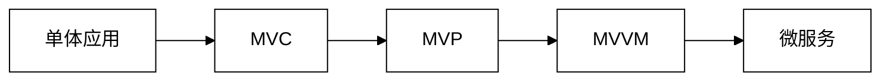
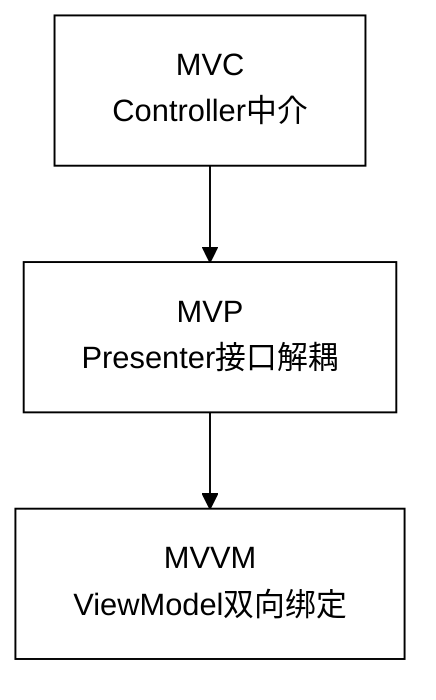
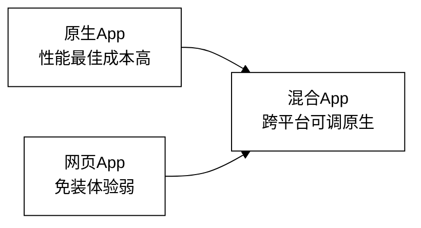

# 系统分析师｜第18章 移动应用系统分析与设计（备考讲义＋章节自测题）

> **教材依据**：《系统分析师教程（第2版）》第18章 移动应用系统分析与设计（共5节：18.1 移动应用平台概述｜18.2 移动应用开发环境｜18.3 移动应用架构｜18.4 移动应用开发｜18.5 无代码开发）。第1版第18章为系统安全性分析与设计（主题不同，非同构迁移），第2版无对应旧章、新增移动应用系统分析与设计专章；本章两版实质无继承关系，无教材外补充。

> **考纲定位说明**：2024版考纲：依《第00章—考纲总纲》注①，第16～21章（Web/嵌入式/移动/大数据/微服务/CPS）属科目二案例分析专题，不再作为科目一综合知识独立模块单列；本章对应科目二「移动应用系统分析与设计」案例专题，科目一综合知识无独立考纲条目。

> **考试形式**：上午综合知识 0道（2024上～2026上 0场，综合、案例、论文三科均未检出）；属科目二案例分析专题预备，上午题量可忽略；案例分析移动方向 0题组、论文无移动主题。计算题范围（教材维度，依《第00章》索引）＝弱网吞吐、缓存命中、同步冲突、功耗，但真题三科均未检出、教材第2版本章未系统展开，了解即可、不配计算习题。

> 标签：系统分析师、移动应用、移动架构、MVC/MVP/MVVM、原生App、混合App、小程序、无代码开发、备考

[TOC]

## 章节结构对照与来源标注

> 本讲义为《系统分析师教程（第2版）》第18章的学习讲义。本章全部内容为教材原生，无教材外补充（第1版无对应章）。

| 讲义模块 | 对应教材第2版章节 | 内容性质 | 备考要求 |
|---|---|---|---|
| 模块1 移动应用平台概述 | 18.1 移动应用平台概述（18.1.1 移动端应用开发平台） | 教材 | 了解：移动应用基础概念、主流移动开发平台 |
| 模块2 移动应用开发环境 | 18.2 移动应用开发环境（18.2.1 App开发环境｜18.2.2 小程序开发环境｜18.2.3 网页应用开发环境） | 教材 | 了解：安卓/iOS开发环境、小程序开发环境、网页应用开发环境 |
| 模块3 移动应用架构 | 18.3 移动应用架构 | 教材 | 了解：架构演进（单体→MVC→MVP→MVVM→微服务）、MVC、MVP、MVVM特点 |
| 模块4 移动应用开发 | 18.4 移动应用开发（18.4.1 开发语言｜18.4.2 小程序开发方式｜18.4.3 原生App开发方式｜18.4.4 网页App开发方式｜18.4.5 混合App开发） | 教材 | 了解：各类开发方式特点与选型 |
| 模块5 无代码开发 | 18.5 无代码开发（18.5.1 无代码开发的发展阶段｜18.5.2 无代码开发的优劣｜18.5.3 主流开发平台和测试平台｜18.5.4 无代码开发流程｜18.5.5 无代码开发案例：Zapier） | 教材 | 了解：无代码发展阶段、优劣、主流平台 |

> 教材第2版第18章章节结构（按教材原文核读）：18.1 移动应用平台概述（18.1.1 移动端应用开发平台）；18.2 移动应用开发环境（18.2.1 App开发环境、18.2.2 小程序开发环境、18.2.3 网页应用开发环境）；18.3 移动应用架构；18.4 移动应用开发（18.4.1 开发语言、18.4.2 小程序开发方式、18.4.3 原生App开发方式、18.4.4 网页App开发方式、18.4.5 混合App开发）；18.5 无代码开发（18.5.1 发展阶段、18.5.2 优劣、18.5.3 主流开发平台和测试平台、18.5.4 无代码开发流程、18.5.5 无代码开发案例：Zapier）。

> ⚠️ 教材第2版第18章**不包含**：移动安全（HTTPS/证书锁定/最小权限/隐私合规/加密存储/重放防护）→ 属第9章信息安全，本章仅案例处零星提及、无独立安全节，不收录；离线能力/数据同步/多端冲突 → 本章未设独立节（同步/离线各仅1处提及）、真题0场，不收录；消息推送/弱网优化/长连接心跳保活 → 本章未设独立节（推送仅3处、弱网0处）、真题0场，不收录；移动专项性能测试/帧率/灰度发布/热更新 → 本章未系统展开（灰度2处、热更新1处、帧率0处）、属通用工程实践，不收录；计算题范围（弱网吞吐/缓存命中/同步冲突/功耗）依《第00章》为教材维度，但本章未系统展开、真题三科均未检出，了解即可、不配计算习题。

> 说明：本章为科目二案例分析专题技术储备，真题三科均未检出（2024上～2026上 0道/0场）；全部模块按了解级处理，不配例题、课后习题与易错点，综合模拟题仅设概念题。

---

## 模块1：移动应用平台概述（教材18.1）【教材｜了解】

**前置说明**：本模块对应教材第2版第18章 18.1 移动应用平台概述（18.1.1 移动端应用开发平台）；属科目二移动应用案例专题基础；适配上午综合选择题概念识记。

**模块优先级**：🟢 了解为主（了解）—— 2024上～2026上综合0场、案例0题组、论文无移动主题，本章全章了解级。

**考情分析**（2021年以后真题）：2024上～2026上 0道/0场（综合、案例、论文三科均未检出）；核心考点：移动应用基础概念、主流移动开发平台（EMAS/mPaaS、TMF、FinClip等）。

### 1.1 核心知识点精讲

#### 1.1.1 移动应用基础概念（教材18.1）【教材｜了解】

移动应用是运行于移动终端（手机、平板等）上的应用程序。第2版从移动应用平台基础概念出发，依次展开开发环境、架构、开发方式与无代码开发。移动端开发的典型特征：平台多样（Android/iOS/小程序/Web）、开发环境与语言差异大、跨端复用需求强烈。

> 记忆：移动应用＝终端程序；主线＝平台→环境→架构→开发方式→无代码。

#### 1.1.2 移动端应用开发平台（教材18.1.1）【教材｜了解】

教材介绍了多家一站式移动开发平台，特点如下：

- **EMAS / mPaaS**：阿里巴巴系，面向全端（App、H5、小程序、Web、PC）的一站式研发运营平台；云原生底座、组件化框架、小程序容器，企业级视觉与 Mobile DevOps 实践。
- **TMF**：腾讯移动开发平台，整合开发、测试、发布、运营能力，覆盖全生命周期。
- **FinClip**：小程序容器技术，App 集成其 SDK 即可获得运行小程序能力，支持沙箱隔离与跨端运行，支持灰度发布与 A/B 测试。
- **APICloud / EMOP**：移动研发技术平台（APICloud 小而精；EMOP 为京东产品，产品大而全）。

> 记忆：阿里 EMAS/mPaaS、腾讯 TMF、凡泰 FinClip（小程序容器）、APICloud/EMOP。

---

## 模块2：移动应用开发环境（教材18.2）【教材｜了解】

**前置说明**：本模块对应教材第2版第18章 18.2 移动应用开发环境（18.2.1 App开发环境｜18.2.2 小程序开发环境｜18.2.3 网页应用开发环境）；适配上午综合选择题概念识记。

**模块优先级**：🟢 了解为主（了解）—— 同全章，真题0场。

**考情分析**（2021年以后真题）：2024上～2026上 0道/0场；核心考点：安卓/iOS 原生开发环境组成、小程序开发技术与工具。

### 2.1 核心知识点精讲

#### 2.1.1 App开发环境（教材18.2.1）【教材｜了解】

- **安卓开发环境**：JDK（Java 开发工具包，含 javac 编译器与 JRE）、JRE（运行环境，含 JVM）、JVM（Java 虚拟机，实现「一次编译、多处运行」的跨平台特性）、Eclipse/IDEA（集成开发环境）、Android Studio（谷歌推出的 Android IDE）。
- **iOS开发环境**：Xcode（苹果集成开发环境，编码/测试/调试一体）、iOS SDK（开发资料与 API 集合）、Objective-C / Swift（iOS 开发语言）。

> 记忆：安卓＝JDK/JRE/JVM＋Android Studio；iOS＝Xcode＋iOS SDK＋OC/Swift；JVM 实现跨平台。

#### 2.1.2 小程序开发环境（教材18.2.2）【教材｜了解】

小程序开发技术：WXML（页面结构标签语言）、WXSS（样式语言，兼容 CSS 大部分特性）、JS（逻辑）、JSON（配置页面顺序与菜单栏）。微信开发者工具基于 nw.js，同一套代码跨 Mac/Windows；内置模拟器支持多机型尺寸适配。小程序渲染层运行于 WebView，逻辑层加载单一 JS 文件。

> 记忆：小程序四件套＝WXML＋WXSS＋JS＋JSON；渲染层 WebView、逻辑层单 JS。

#### 2.1.3 网页应用开发环境（教材18.2.3）【教材｜了解】

移动端网页应用开发环境包括：HTML5 开发工具（如 DevExtreme）、移动设备开发技术（跨浏览器兼容、移动设备设计）、移动端开发技术（Native App、Hybrid App 等）。

> 记忆：网页应用环境＝HTML5工具＋移动设备技术＋移动端技术（含 Native/Hybrid）。

---

## 模块3：移动应用架构（教材18.3）【教材｜了解】

**前置说明**：本模块对应教材第2版第18章 18.3 移动应用架构；适配上午综合选择题概念识记（MVC/MVP/MVVM 辨析为高频概念点，但全章仍按了解级处置）。

**模块优先级**：🟢 了解为主（了解）—— 同全章，真题0场。

**考情分析**（2021年以后真题）：2024上～2026上 0道/0场；核心考点：架构演进阶段、MVC/MVP/MVVM 各自职责与特点。

### 3.1 核心知识点精讲

#### 3.1.1 应用架构与演进阶段（教材18.3）【教材｜了解】

应用架构按规范将业务能力拆分并由不同应用承接，分企业级（承上启下规划）与系统级（单系统设计实现）两个层次。移动应用架构发展历史大致经历：单体应用 → MVC → MVP → MVVM → 微服务。

> 记忆：架构演进＝单体→MVC→MVP→MVVM→微服务。

#### 3.1.2 MVC、MVP、MVVM（教材18.3）【教材｜了解】

- **MVC（Model-View-Controller）**：分为模型层、视图层、控制器层，实现代码解耦与复用；控制器层可能变得庞大难管。常见框架 SpringMVC、Struts2、.NET。
- **MVP（Model-View-Presenter）**：Presenter 持有 View 接口，View 与 Model 完全解耦，可测试性好。
- **MVVM（Model-View-ViewModel）**：ViewModel 与 View 双向绑定，自动同步，为 Android/iOS 主流模式。

> 记忆：MVC 老牌解耦、MVP 可测、MVVM 绑定主流。

#### 3.1.3 微服务架构（教材18.3）【教材｜了解】

随移动应用规模扩大与功能复杂化，微服务架构逐渐应用于移动后端：将单体拆分为多个独立服务，各自独立开发、部署与扩展，通过 API 协同。微服务属后端架构风格，与前端移动架构演进相承接。

> 记忆：微服务＝拆分独立服务＋API 协同，承接规模复杂化。

---

## 模块4：移动应用开发（教材18.4）【教材｜了解】

**前置说明**：本模块对应教材第2版第18章 18.4 移动应用开发（18.4.1 开发语言｜18.4.2 小程序开发方式｜18.4.3 原生App开发方式｜18.4.4 网页App开发方式｜18.4.5 混合App开发）；适配上午综合选择题概念识记（各类开发方式优劣对比）。

**模块优先级**：🟢 了解为主（了解）—— 同全章，真题0场。

**考情分析**（2021年以后真题）：2024上～2026上 0道/0场；核心考点：原生/Web/H5/混合/桥接/Flutter 各类开发方式优劣与选型。

### 4.1 核心知识点精讲

#### 4.1.1 开发语言与方式分类（教材18.4.1）【教材｜了解】

常见开发 App 语言与方式：

- **原生 App（Native）**：Android 用 Java/Kotlin，iOS 用 Objective-C/Swift；体验与性能最佳，成本高。
- **Web App**：HTML/CSS/JS 编写，运行于浏览器并封装为安装文件；一套代码两平台，执行效率不如原生。
- **H5**：HTML/CSS/JS，浏览器访问、无需上架；一套代码两平台，效率不如原生。
- **混合 App（Hybrid）**：HTML/CSS/JS＋Native，一套代码两平台并可调原生功能；效率不如原生。
- **桥接 App（Bridged）**：仅用 JS，执行环境编译为原生代码，效率高但两平台不完全一致。
- **Flutter App**：Dart 语言，直接在显卡绘图；一套代码两平台、效率高、效果一致，但语言较新、生态进度慢。

> 记忆：原生贵而快、Web/H5 轻而慢、混合折中、桥接高效不全同、Flutter 一致高效。

#### 4.1.2 小程序开发方式（教材18.4.2）【教材｜了解】

以微信小程序为例：原生开发（微信公众号平台工具）、混合开发（原生＋第三方组件结合）、第三方组件（SDK）开发。小程序运行于多端微信客户端与硬件框架，开发者工具支持实时预览与机型适配。

#### 4.1.3 原生App开发方式（教材18.4.3）【教材｜了解】

针对特定操作系统使用原生语言开发，可充分利用设备软硬件能力，提供最佳体验与性能；但开发难度高、成本高，需分平台开发。

#### 4.1.4 网页App开发方式（教材18.4.4）【教材｜了解】

使用网页技术开发网站/网页，无需下载安装、浏览器访问即可；便捷易维护，但体验受限、页面跳转可能卡顿、功能受浏览器限制。

#### 4.1.5 混合App开发（教材18.4.5）【教材｜了解】

使用网页技术（HTML5/CSS3/JavaScript）开发，跨平台运行，可调用原生 API 实现特定功能；性能不如原生、页面交互有限。常借助 AngularJS、Cordova 等开源框架。

> 记忆：原生最佳、网页最轻、混合居中、小程序容器化。

---

## 模块5：无代码开发（教材18.5）【教材｜了解】

**前置说明**：本模块对应教材第2版第18章 18.5 无代码开发（18.5.1 无代码开发的发展阶段｜18.5.2 无代码开发的优劣｜18.5.3 主流开发平台和测试平台｜18.5.4 无代码开发流程｜18.5.5 无代码开发案例：Zapier）；适配上午综合选择题概念识记。

**模块优先级**：🟢 了解为主（了解）—— 同全章，真题0场。

**考情分析**（2021年以后真题）：2024上～2026上 0道/0场；核心考点：无代码发展阶段、优劣、主流平台（Airtable/Mendix/OutSystems 等）。

### 5.1 核心知识点精讲

#### 5.1.1 无代码开发的发展阶段（教材18.5.1）【教材｜了解】

无代码概念可追溯至20世纪50年代第一代编程语言；2014年前后随云计算与可视化工具兴起。四阶段：单一功能代码生成工具（报表/表单）→ 面向业务的应用开发平台（PowerBuilder、Visual Basic）→ 模型驱动开发平台（Mendix、OutSystems）→ 低代码/云计算无代码平台（Salesforce、Airtable）。应用领域含企业级应用、移动应用、网站、物联网、人工智能。

> 记忆：无代码四阶段＝代码生成→业务平台→模型驱动→云无代码。

#### 5.1.2 无代码开发的优劣（教材18.5.2）【教材｜了解】

- **优点**：降低技术门槛（非专业人员可参与）、提高开发效率、缩短周期、模块化可重用易维护。
- **缺点**：灵活性与可扩展性有限、可能因无代码导致性能与安全问题、平台依赖与成本风险。

> 记忆：优＝降门槛提效率；缺＝受限依赖性能安全隐忧。

#### 5.1.3 主流平台与开发流程（教材18.5.3～18.5.5）【教材｜了解】

主流无代码平台：Airtable、Mendix、OutSystems、AppSheet、Salesforce Lightning Platform 等，提供可视化界面、组件库与自定义规则。开发流程：通过拖放组件、配置属性与规则创建应用，无须编写代码。案例：Zapier（自动化集成平台）。

> 记忆：平台＝Airtable/Mendix/OutSystems/AppSheet/Salesforce；流程＝拖放配置免编码。

---

# 章节总复习综合模拟题

## 一、单项选择题（6题）

1. 移动开发中实现「一次编译、多处运行」跨平台特性的核心组件是（）
A. JDK B. JVM C. JRE D. IDEA
> 【解析】JVM（Java 虚拟机）解释执行字节码，向各平台编译器提供相同接口，实现 Java 跨平台。
> 【答案】B

2. 微信小程序页面结构使用的标签语言是（）
A. HTML B. WXML C. XML D. JSP
> 【解析】WXML（WeiXin Markup Language）是小程序框架的页面结构标签语言；WXSS 负责样式。
> 【答案】B

3. 移动应用架构演进中，ViewModel 与 View 双向绑定、为移动端主流的模式是（）
A. MVC B. MVP C. MVVM D. 单体
> 【解析】MVVM 通过 ViewModel 与 View 双向绑定自动同步，是 Android/iOS 主流。
> 【答案】C

4. 使用 HTML/CSS/JS 编写、浏览器访问无需下载安装的移动应用方式是（）
A. 原生App B. 混合App C. 网页App D. 桥接App
> 【解析】网页 App 使用网页技术，浏览器访问、免安装，但体验受限。
> 【答案】C

5. 无代码开发相比传统编码的主要缺点是（）
A. 开发更慢 B. 灵活性与可扩展性有限、存在平台依赖 C. 无法拖放 D. 必须写代码
> 【解析】无代码缺点：灵活/可扩展有限、可能因无代码导致性能与安全问题、依赖第三方平台。
> 【答案】B

6. 阿里系面向全端的一站式移动研发运营平台是（）
A. TMF B. FinClip C. EMAS/mPaaS D. APICloud
> 【解析】EMAS/mPaaS 为阿里巴巴系，面向全端（App/H5/小程序/Web/PC）的一站式研发运营平台。
> 【答案】C

## 二、简答概念题（2道）

1. 简述移动应用架构从早期到当前的演进阶段及其代表模式。
> 【解析】移动应用架构发展大致经历：单体应用（所有功能集成于一个工程，简单但难维护）→ MVC（模型/视图/控制器三层解耦）→ MVP（Presenter 接口解耦 View 与 Model，可测试性好）→ MVVM（ViewModel 双向绑定，移动端主流）→ 微服务（后端拆分为独立服务、API 协同，应对规模与复杂度）。

2. 简述无代码开发的主要优点与局限性。
> 【解析】优点：降低技术门槛使非专业人员可参与、提高开发效率、缩短周期、组件模块化易维护。局限性：灵活性与可扩展性有限、可能因不写代码带来性能与安全隐患、依赖特定平台增加依赖与成本风险。

---

> **备考提示**：本章（移动应用系统分析与设计）2024上～2026上三科均未检出（综合0道、案例移动0题组、论文无移动主题），属科目二案例分析专题技术储备，全章了解即可，无需投入大量精力。重点识记：移动开发平台（EMAS/mPaaS、TMF、FinClip）、安卓/iOS 与小程序开发环境、架构演进与 MVC/MVP/MVVM 特点、各类开发方式（原生/网页/混合/小程序/无代码）优劣。教材维度计算题范围（弱网吞吐、缓存命中、同步冲突、功耗）真题0场、本章未系统展开，了解即可，不配计算习题；移动安全属第9章信息安全，离线/推送/性能测试等通用工程实践本章未设独立节，均不收录。
