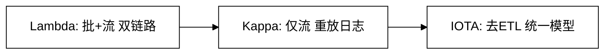
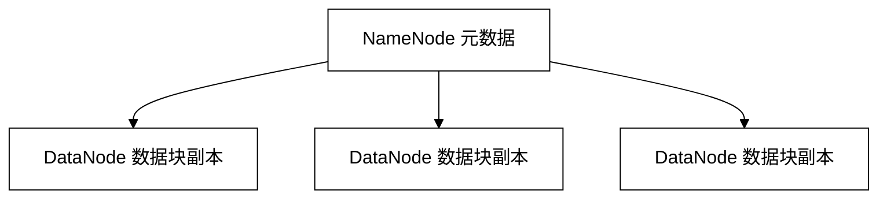
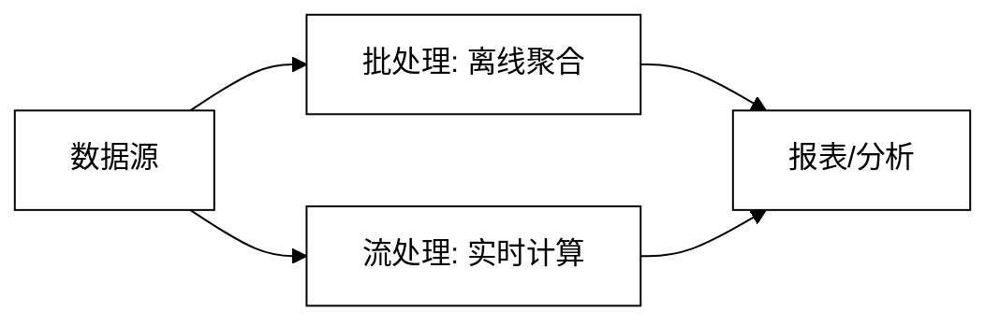

# 系统分析师｜第19章 大数据处理系统分析与设计（备考讲义＋章节自测题）

> **教材依据**：《系统分析师教程（第2版）》第19章 大数据处理系统分析与设计（共4节：19.1 大数据处理系统概述｜19.2 大数据处理系统架构｜19.3 大数据处理系统开发｜19.4 大数据处理系统测试）。第1版第19章为「系统可靠性分析与设计」，主题完全不同，大数据为第2版新增专章，两版无同构迁移、无教材外补充；教材维度计算题素材（HDFS容量、Kafka吞吐、分层成本、流延迟）依第00章计算题范围列明，正文按第2版原生表述。

> **考纲定位说明**：2024版考纲科目一「系统分析师综合知识」第19条 大数据处理系统分析与设计（大数据处理系统架构、开发框架、开发过程、系统测试，与教材第2版第19章各节一一对应）。注：依第00章章末注②，第16～21章属科目二案例分析专题、不单列科目一独立模块，但大数据相关知识点仍少量出现于上午综合知识（多属低频）。

> **考试形式**：上午综合知识单选题；2021年以后真题约1道/1场（2024上～2026上 1道/1场，大数据特征与架构低频；数据中台未检出，仅旧大纲期）；章节地位：上午题低频、第三梯队；案例分析大数据方向累计2题组（2023上/2024下，其中2024上～2026上1题组），为案例选答重点之一；论文无大数据主题。

> 标签：系统分析师、上午题、大数据、4V、Lambda、Kappa、IOTA、批处理、流处理、HDFS、数据仓库、数据治理、备考

[TOC]

## 章节结构对照与来源标注

> 本讲义为《系统分析师教程（第2版）》第19章的学习讲义。说明本章哪些是教材内容、哪些是教材之外的补充。

| 讲义模块 | 对应教材第2版章节 | 内容性质 | 备考要求 |
|---|---|---|---|
| 模块1 大数据处理系统概述 | 19.1 大数据处理系统概述 | 教材 | 了解：4V特征、典型应用 |
| 模块2 大数据处理系统架构 | 19.2 大数据处理系统架构（19.2.1～19.2.3） | 教材 | 了解：大数据处理系统架构原则、架构类型（批处理/流处理）、架构模式（Lambda/Kappa/IOTA） |
| 模块3 数据存储与数据管理 | 19.3.1 数据存储｜19.3.2 数据管理 | 教材 | 了解：行/列存储、HDFS、元数据、数据血缘 |
| 模块4 数据处理、分析与部署 | 19.3.3 数据处理｜19.3.4 数据分析｜19.3.5 部署 | 教材 | 了解：批/流处理、机器学习与可视化、部署要点 |
| 模块5 大数据处理系统测试 | 19.4 大数据处理系统测试（19.4.1～19.4.2） | 教材 | 了解：测试特点、测试过程与类型 |

> 教材第2版第19章章节结构（按教材原文核读）：19.1 大数据处理系统概述；19.2 大数据处理系统架构（19.2.1 大数据处理系统架构原则｜19.2.2 大数据处理系统架构类型｜19.2.3 大数据处理系统架构模式）；19.3 大数据处理系统开发（19.3.1 数据存储｜19.3.2 数据管理｜19.3.3 数据处理｜19.3.4 数据分析｜19.3.5 系统部署）；19.4 大数据处理系统测试（19.4.1 测试特点｜19.4.2 测试过程）。

> ⚠️ 教材第2版第19章**不包含**：①数据湖、湖仓一体——教材仅论及数据仓库与行/列存储，数据湖/湖仓为通用生态概念、第2版未展开，属相邻知识而非本章内容；②ODS/DWD/DWS/ADS 数据分层四层模型——第2版未采用该命名体系；③Flink 水印（Watermark）、YARN 资源调度——第2版论及流处理但未展开水印机制、未提 YARN；④隐私计算（联邦学习/多方安全计算/差分隐私）、对象存储——第2版安全部分仅及认证授权与脱敏，未展开隐私计算与对象存储；⑤NoSQL 四类（KV/列/文档/图）完整分类与图数据库——第2版以行/列存储及 HBase、MongoDB 为例，未系统给出四类划分。以上均非第2版本章原生内容（第1版第19章为系统可靠性，无对应来源），不收录为正文考点；其中分层成本、HDFS容量、Kafka吞吐、流处理延迟依第00章计算题范围列明，可按教材维度在章节综合模拟题出现。

> 说明：本章为第2版新增专章，内容以架构原则与处理范式为主，不追求具体组件版本细节；上午综合仅低频检出，备考以理解概念、辨析批/流与架构模式为主。

## 模块1：大数据处理系统概述（教材19.1）【教材｜了解】

**前置说明**：本模块对应教材第2版第19章 19.1 大数据处理系统概述，覆盖大数据定义、4V特征与典型应用；适配上午综合选择题。

**模块优先级**：🟢 了解为主（了解）——2024上～2026上 上午综合大数据特征与架构仅1道/1场（低频），全章以理解概念为主。

**考情分析**（2021年以后真题）：2024上～2026上约1道/1场（大数据特征与架构，低频）；核心考点：4V特征、批处理与流处理的区别。

### 1.1 核心知识点精讲

#### 1.1.1 大数据定义与4V特征（教材19.1、19.2.1）【教材｜了解】

大数据处理系统是一种高效、综合的数据处理平台，旨在处理和分析海量数据。构建与设计架构时应考虑大数据自身的「4V」特性：

- **Volume 大量**：数据规模海量（TB/PB级），要求分布式存储与水平扩展。
- **Variety 多样**：数据类型多样，含结构化、半结构化与非结构化。
- **Velocity 高速**：数据产生与处理速度快，要求高吞吐采集与实时计算。
- **Value 价值密度低**：海量数据中价值信息稀疏，需治理与挖掘以提取价值。

> 记忆：量大、速快、多样、价值密度低。

#### 1.1.2 大数据典型应用场景（教材19.1）【教材｜了解】

- 商业智能与报表、金融风险分析、市场营销与用户画像、日志与监控分析、个性化推荐等。

> 记忆：商智、风控、营销、日志、推荐。

## 模块2：大数据处理系统架构（教材19.2）【教材｜了解】

**前置说明**：本模块对应教材第2版第19章 19.2 大数据处理系统架构（19.2.1 原则｜19.2.2 类型｜19.2.3 模式），覆盖架构设计原则、批/流类型与 Lambda/Kappa/IOTA 模式；适配上午综合选择题。

**模块优先级**：🟢 了解为主（了解）——同上，上午综合低频，以辨析架构模式为主。

**考情分析**（2021年以后真题）：2024上～2026上约1道/1场（大数据特征与架构，低频）；核心考点：批处理与流处理区别、Lambda/Kappa/IOTA 模式定位。

### 2.1 核心知识点精讲

#### 2.1.1 大数据处理系统架构原则（教材19.2.1）【教材｜了解】

教材列出六类原则指导架构决策：

- **可扩展**：轻松容纳不断增长的数据量与计算量，优先水平扩展。
- **模块化**：拆分为独立模块，降低耦合、便于维护。
- **可管理**：自动化管理、统一监控，保障高效运行。
- **安全**：认证（用户名/口令、令牌、生物识别）、授权、备份与恢复。
- **高性能**：数据分区、并行与内存计算提升吞吐与效率。
- **高可用**：冗余、副本与故障转移保证持续服务。

> 记忆：扩、模、管、安、性、可（可扩展/模块化/可管理/安全/高性能/高可用）。

#### 2.1.2 大数据处理系统架构类型：批处理与流处理（教材19.2.2）【教材｜了解】

- **批处理架构**：数据集划分为多个组、在未来时间统一处理，适合离线报表与分析，吞吐大、延迟高。
- **流处理架构**：数据持续到达、实时计算，适合监控与推荐，延迟低、强调准确与有序。

> 记忆：批处理算过去（T+1），流处理算现在（实时）。

#### 2.1.3 大数据处理系统架构模式：Lambda、Kappa、IOTA（教材19.2.3）【教材｜了解】

- **Lambda**：批处理＋流处理结合，兼顾批的准确与流的低延迟，最成熟但需维护两套逻辑。
- **Kappa**：以流处理统一承载，去掉独立批处理层，简化架构、靠重放日志处理历史。
- **IOTA**：强调数据流连续性与一致性、去 ETL 化，以通用数据模型统一实时与历史。

> 记忆：Lambda 双管、Kappa 单流、IOTA 去ETL。

## 模块3：数据存储与数据管理（教材19.3.1～19.3.2）【教材｜了解】

**前置说明**：本模块对应教材第2版第19章 19.3.1 数据存储与 19.3.2 数据管理，覆盖存储方案（行/列存储、HDFS）与数据管理（元数据、血缘）；适配上午综合选择题与案例选答背景。

**模块优先级**：🟢 了解为主（了解）——上午综合低频；案例大数据方向涉及存储选型，作理解性背景。

**考情分析**（2021年以后真题）：2024上～2026上约1道/1场（大数据特征与架构，低频）；核心考点：行存储与列存储适用场景、HDFS 主从与副本、元数据与数据血缘。

### 3.1 核心知识点精讲

#### 3.1.1 数据存储：行存储、列存储与HDFS（教材19.3.1）【教材｜了解】

- **行存储**：按记录连续存放，适合事务型、整行读写（关系数据库）。
- **列存储**：按列存放，适合批量访问同一属性的统计（HBase 采用列存储）。
- **文档存储**：半结构化、灵活模式（MongoDB 采用文档存储）。
- **HDFS（分布式文件系统）**：主从架构，NameNode 管理元数据、DataNode 存储数据块；多副本冗余保证容错，适合大文件批量读写、高吞吐。

> 记忆：行存事务、列存统计、HDFS 主从多副本。

#### 3.1.2 数据管理：元数据与数据血缘（教材19.3.2）【教材｜了解】

- **元数据管理**：描述数据的数据（模式、来源、含义），教材列举多种管理方式，是数据可理解、可治理的基础。
- **数据血缘**：记录数据之间的关联与产生链路，支持数据融合处理的可追溯；血缘分析实现数据来源与加工过程的可回溯。

> 记忆：元数据管「是什么」，血缘管「从哪来、怎么变」。

## 模块4：数据处理、分析与部署（教材19.3.3～19.3.5）【教材｜了解】

**前置说明**：本模块对应教材第2版第19章 19.3.3 数据处理、19.3.4 数据分析、19.3.5 系统部署，覆盖批/流处理手段、分析与部署要点；适配上午综合选择题与案例选答背景。

**模块优先级**：🟢 了解为主（了解）——上午综合低频；案例方向涉及处理管线与部署规划，作理解性背景。

**考情分析**（2021年以后真题）：2024上～2026上约1道/1场（大数据特征与架构，低频）；核心考点：批处理与流处理手段、常见分析能力（机器学习/可视化）、部署原则。

### 4.1 核心知识点精讲

#### 4.1.1 数据处理：批处理与流处理（教材19.3.3）【教材｜了解】

- **批处理**：使用最广泛，多机分布式、离线计算，适合大规模历史数据聚合；特点为吞吐大、延迟高。
- **流处理（实时计算）**：处理流式数据，强调低延迟与顺序/一致性，是当下重点关注方向。
- 内存计算（如 Spark）可显著降低磁盘 IO、提升迭代计算效率。

> 记忆：批算历史、流算实时、内存计算更快。

#### 4.1.2 数据分析与可视化（教材19.3.4）【教材｜了解】

- **机器学习**：依赖大量样本，支撑分类、预测等价值挖掘。
- **搜索与推荐**：引入专业组件，应对海量数据下的检索与个性化。
- **可视化**：以图表直观展示分析结果，辅助决策。

#### 4.1.3 系统部署要点（教材19.3.5）【教材｜了解】

- **部署分析**：需求分析、模型设计、硬件规划、IP 规划；高存储需求加大 DataNode、用多机架分担压力。
- **部署原则**：增量部署、机架感知、在线与离线应用隔离。
- **部署环境**：多为类 UNIX（Linux）；涉及集群规划、网络配置、安全配置、时间同步、SSH 登录与版本控制。

> 记忆：需求→模型→硬件→网络/安全/时钟/版本。

## 模块5：大数据处理系统测试（教材19.4）【教材｜了解】

**前置说明**：本模块对应教材第2版第19章 19.4 大数据处理系统测试（19.4.1 特点｜19.4.2 过程），覆盖测试特点、过程与类型；适配上午综合选择题。

**模块优先级**：🟢 了解为主（了解）——上午综合低频，以理解测试特殊性为主。

**考情分析**（2021年以后真题）：2024上～2026上约1道/1场（大数据特征与架构，低频）；核心考点：大数据测试区别于传统测试的特点、测试类型（功能/性能/可靠容错/安全/兼容）。

### 5.1 核心知识点精讲

#### 5.1.1 测试特点（教材19.4.1）【教材｜了解】

与传统软件测试相比，大数据系统测试的独特挑战：

- **分布式环境**：多节点、数据分片与复制、分布式调度。
- **多样化的数据类型与格式**：结构化/半结构化/非结构化均需覆盖。
- **实时与批处理**：需分别针对两种模式验证正确性与效率。
- **高性能与可扩展性**：高负载与并发下的表现、横向扩展能力。
- **复杂的数据处理逻辑**：清洗、转换、聚合、查询、机器学习等逻辑的正确性与一致性。

> 记忆：分布、多样、实时批、高性能、逻辑复杂。

#### 5.1.2 测试过程与类型（教材19.4.2）【教材｜了解】

- **测试过程**：仍遵循需求分析→计划与方案→准备→执行→报告的传统流程，但工具与技巧差异大；前期数据分析（数据源选择）尤为关键。
- **测试类型**：功能测试、性能测试、可靠性与容错测试、安全性测试、兼容性测试（含云平台、容器平台等）。

> 记忆：流程同传统、类型五分（功能/性能/可靠容错/安全/兼容）。

---

# 章节总复习综合模拟题

## 一、单项选择题（9题）

1. 描述「数据量大、产生速度快、类型多样、价值密度低」的是大数据的（）
A. 3V特征 B. 4V特征 C. 5V特征 D. 事务特征
> 【解析】Volume/Velocity/Variety/Value 即4V特征。
> 【答案】B

2. 下列不适合用列存储支撑的场景是（）
A. 按属性批量统计 B. 宽表稀疏数据 C. 整行事务读写 D. 海量聚合分析
> 【解析】列存储适合批量访问同一属性的统计；整行事务读写更适合行存储。
> 【答案】C

3. HDFS 中负责管理元数据的是（）
A. NameNode B. DataNode C. ResourceManager D. Zookeeper
> 【解析】NameNode 管理元数据，DataNode 存储数据块与副本。
> 【答案】A

4. 同时兼顾批处理准确性与流处理低延迟的架构模式是（）
A. Kappa B. Lambda C. IOTA D. MVC
> 【解析】Lambda 以批+流双链路兼顾准确与低延迟。
> 【答案】B

5. 仅以流处理统一承载、靠重放日志处理历史的架构模式是（）
A. Lambda B. Kappa C. IOTA D. 数据仓库
> 【解析】Kappa 去掉独立批处理层，以流处理重放日志。
> 【答案】B

6. 用于追溯数据加工来源与流向的是（）
A. 数据血缘 B. 数据脱敏 C. 数据备份 D. 数据压缩
> 【解析】数据血缘记录数据产生链路与加工流向，支持可追溯。
> 【答案】A

7. 数据持续到达、强调低延迟的计算模式是（）
A. 批处理 B. 流处理 C. 离线计算 D. 全量计算
> 【解析】流处理处理流式数据、实时计算、延迟低。
> 【答案】B

8. 大数据系统测试区别于传统测试的特点不包括（）
A. 分布式环境 B. 单一数据类型 C. 实时与批处理 D. 高性能与可扩展性
> 【解析】大数据测试需覆盖结构化/半结构化/非结构化多种数据类型，而非单一。
> 【答案】B

9. 大数据平台部署中为提升可用与可扩展，常采用（）
A. 单节点垂直升级 B. 机架感知与多副本 C. 关闭副本 D. 降低网络带宽
> 【解析】机架感知＋多副本/多节点提升容错、可用与水平扩展。
> 【答案】B

## 二、计算题（4道，教材维度）

### 计算题1【HDFS容量估算】

某平台每日新增日志 200 GB，HDFS 默认 3 副本，数据保留 30 天。请计算：①单份数据 30 天总量；②含副本后的总存储需求（GB）。
> 【解析】
> ①单份 30 天总量 = 200 × 30 = 6000 GB。
> ②含副本总量 = 6000 × 3 = 18000 GB。
> 【答案】单份 6000 GB；含副本 18000 GB

### 计算题2【Kafka吞吐评估】

某 Kafka 集群单分区可支撑写入 10 MB/s，Topic 需支撑峰值写入 200 MB/s。请计算至少需要多少分区（按 1 分区 1 消费者并行）。
> 【解析】分区数 ≥ 200 ÷ 10 = 20 个，方可并行支撑峰值写入。
> 【答案】至少 20 分区

### 计算题3【分层存储成本测算】

某数据平台日增原始数据 100 GB，按数据分层设定：原始层全量存储 30 天、明细层为原量 60% 存储 90 天、汇总层为原量 20% 存储 180 天；存储单价 0.1 元/GB/天。请计算单个自然日新增数据在生命周期内的总存储成本。
> 【解析】原始层 = 100 × 30 × 0.1 = 300 元；明细层 = 100 × 0.6 × 90 × 0.1 = 540 元；汇总层 = 100 × 0.2 × 180 × 0.1 = 360 元；合计 = 300 + 540 + 360 = 1200 元。
> 【答案】总成本约 1200 元

### 计算题4【流处理端到端延迟估算】

某实时系统数据从采集到入库平均 80 ms，流计算窗口计算 30 ms，结果写出 40 ms，因乱序等待额外引入 50 ms。估算端到端处理延迟。
> 【解析】端到端延迟 = 80 + 30 + 40 + 50 = 200 ms。
> 【答案】端到端约 200 ms

## 三、简答概念题（2道）

1. 简述大数据 4V 特征及其对系统的要求。
> 【解析】Volume 大量：要求分布式存储与水平扩展；Velocity 高速：要求高吞吐采集与实时计算；Variety 多样：要求统一处理结构化、半结构化、非结构化；Value 价值密度低：要求治理与挖掘以提取价值。

2. 简述 Lambda 与 Kappa 架构模式的区别。
> 【解析】Lambda 同时维护批处理与流处理两条链路，兼顾批的准确与流的低延迟，但需维护两套逻辑、复杂度高；Kappa 仅以流处理统一承载，通过重放日志处理历史数据，架构更简洁，但对流处理框架的可靠性与重放能力要求更高。

---

> **备考提示**：本章2021年以后真题约1道/1场（大数据特征与架构，低频），上午综合以概念辨析为主，重点掌握 4V 特征、批处理与流处理的区别、Lambda/Kappa/IOTA 模式定位、行/列存储与 HDFS、元数据与数据血缘、测试特点。计算题（HDFS容量、Kafka吞吐、分层成本、流延迟）依教材维度列明，案例大数据方向累计2题组（2024上～2026上1题组）、为案例选答重点之一，建议在案例复习中结合处理管线与部署规划理解，不必死记组件版本细节。
