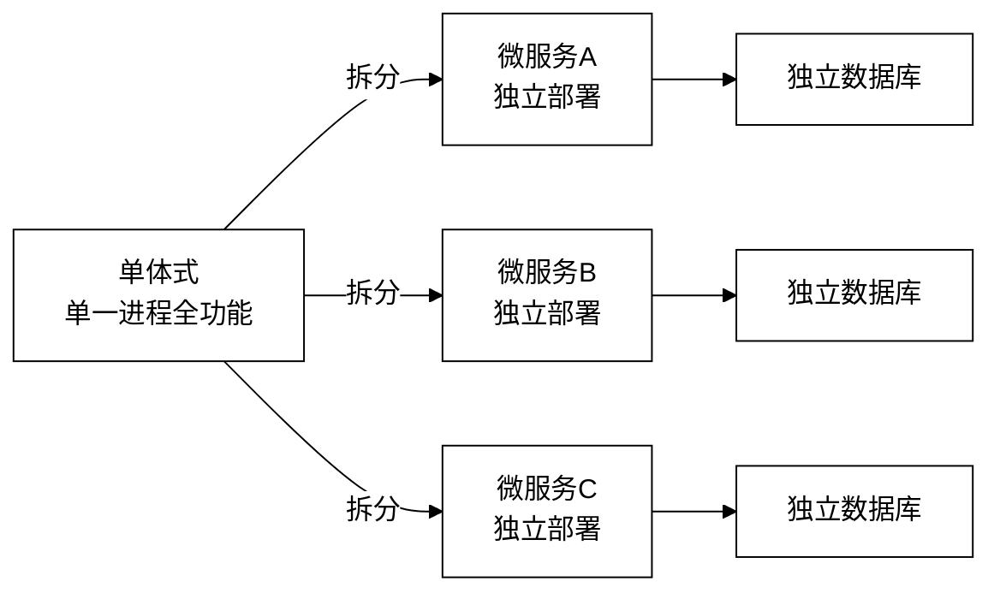
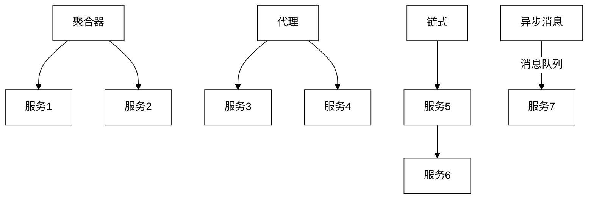
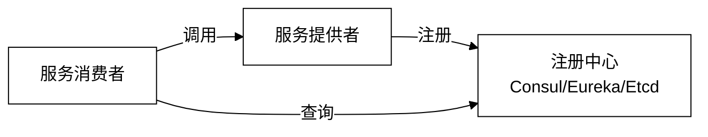

# 系统分析师｜第20章 微服务系统分析与设计（备考讲义＋章节自测题）

> **教材依据**：《系统分析师教程（第2版）》第20章 微服务系统分析与设计（共4节：20.1 微服务系统概述｜20.2 微服务系统架构｜20.3 微服务系统开发｜20.4 微服务系统测试）。第1版第20章为「项目管理」（主题完全不同），微服务属第2版新增专章，两版非同构、无继承来源；第2版原生内容即本章全部范围，无教材外补充。

> **考纲定位说明**：2024版考纲：第20章微服务系统分析与设计属科目二「系统分析师案例分析」专题（第00章归口综合应用，见科目二映射表）；依第00章 line 63 注②，第16～21章不再作为科目一独立模块单列，故本章无科目一独立考纲子项。与教材第2版第20章各节（20.1～20.4）一一对应；上午综合知识中微服务特点与服务发现仅零星出现，且2024上～2026上0道/0场。

> **考试形式**：上午综合知识单选题；2024上～2026上0道/0场（全量统计窗仅2022上1道，属旧大纲期，仅老真题支撑），本章近年几乎不考；案例分析微服务方向仅2022上1题组（近窗0题组）；论文无微服务主题。属科目二案例专题预备，上午题量可忽略。

> 标签：系统分析师、上午题、微服务、单体架构、服务注册发现、API网关、容器化、架构模式、运维监控

[TOC]

## 章节结构对照与来源标注

> 本讲义为《系统分析师教程（第2版）》第20章的学习讲义。本章知识点几乎全部来自教材原生内容，无教材外补充。

| 讲义模块 | 对应教材第2版章节 | 内容性质 | 备考要求 |
|---|---|---|---|
| 模块1 微服务系统概述 | 20.1 微服务系统概述（20.1.1 简介｜20.1.2 特征） | 教材 | 了解：微服务定义、与单体式区别、核心特征、实现方式及平台 |
| 模块2 微服务系统架构 | 20.2 微服务系统架构（20.2.1 架构原则｜20.2.2 架构模式｜20.2.3 智能端点与简单消息传递） | 教材 | 了解：架构八原则、六种架构模式、智能端点原则 |
| 模块3 微服务系统开发 | 20.3 微服务系统开发（20.3.1 容器化和自动化部署｜20.3.2 服务注册与发现｜20.3.3 服务通信｜20.3.5 运维与监控） | 教材 | 了解：容器化与CI/CD、注册发现组件、服务通信方式、运维监控技术栈 |
| 模块4 微服务系统测试 | 20.4 微服务系统测试（20.4.1 测试特点｜20.4.2 测试过程｜功能/性能/安全性测试） | 教材 | 了解：微服务测试特点、测试过程、功能/性能/安全测试要点 |

> 教材第2版第20章章节结构（按教材原文核读）：20.1 微服务系统概述（20.1.1 微服务系统简介、20.1.2 微服务系统特征）；20.2 微服务系统架构（20.2.1 微服务系统架构原则、20.2.2 微服务系统架构模式、20.2.3 智能端点与简单消息传递）；20.3 微服务系统开发（20.3.1 容器化和自动化部署、20.3.2 服务注册与发现、20.3.3 服务通信、20.3.5 运维与监控）；20.4 微服务系统测试（20.4.1 测试特点、20.4.2 测试过程、功能测试、性能测试、安全性测试）。

> ⚠️ 教材第2版第20章**不包含**：以下常被混入微服务复习材料、但不属本章原生边界的内容，复习时注意区分——①分布式事务理论（CAP/BASE、2PC/TCC/Saga、本地消息表）：第2版第20章0命中，属通用分布式理论与第5章数据库事务范畴，不在本章；②领域驱动设计 DDD（限界上下文、聚合根、子域拆分）：第2版第20章0命中，不在本章；③服务治理深度专题（熔断/降级/雪崩防护、可观测性三支柱组合提法）：第2版第20章仅零星提及限流与注册发现，熔断降级与链路追踪三支柱组合非原生表述，不在本章；④发布策略（蓝绿/金丝雀/灰度发布）、绞杀者模式：第2版第20章0命中，不在本章；⑤第1版第20章「项目管理」整体不属本章（两版主题不同构）。上述属通用工程实践或其他章节内容，本章不收录、不配例题习题。

> 说明：链路追踪（Zipkin）、日志管理（ELK）、指标监控（Prometheus/Grafana）属第2版第20章 20.3.5 运维与监控原生内容，可正常归入模块3，勿与上述「可观测性三支柱」组合提法混淆。

## 模块1：微服务系统概述（教材20.1）【教材｜了解】

**前置说明**：本模块对应教材第2版第20章 20.1 微服务系统概述（20.1.1 简介、20.1.2 特征），覆盖微服务定义、与单体式系统的区别及核心特征；适配上午综合选择题概念辨析。

**模块优先级**：🟢 了解为主（了解）—— 2024上～2026上综合0道/0场，仅旧大纲期2022上1道，近年几乎不考。

**考情分析**（2021年以后真题）：近年频次窗（2024上～2026上）0道/0场；核心考点：微服务与单体式区别、微服务核心特征。

### 1.1 核心知识点精讲

#### 1.1.1 微服务定义与核心特征（教材20.1.2）【教材｜了解】

微服务是一种将大型应用拆分为一系列小型、自治服务的架构风格。第2版归纳其核心特征如下（每项定义微服务本质）：

- **自治**：每个服务拥有独立的代码库、数据库和团队，故障隔离。
- **单一职责**：每个服务专注解决一个特定业务问题，保持内聚与可维护。
- **松耦合**：服务间尽量减少依赖，通过契约交互。
- **独立部署**：可独立部署于不同服务器或容器，甚至跨数据中心。
- **异构技术栈**：各服务可选用不同语言与工具，取最适合自身者。
- **弹性与可伸缩**：按负载自动调整实例数量。
- **独立演化**：可独立更新与部署，不影响其他服务。

#### 1.1.2 单体式系统与微服务系统对比（教材20.1.1）【教材｜了解】

在微服务被提出前，传统 Web 开发多为单体式（一个进程打包全部功能）。表20-1 对比二者区别：

| 维度 | 单体式系统 | 微服务系统 |
|---|---|---|
| 部署 | 整体打包、整体部署 | 每服务独立部署 |
| 故障影响 | 单点故障影响整体 | 故障隔离、局部影响 |
| 扩展 | 整体扩容 | 按服务水平扩展 |
| 技术栈 | 统一技术栈 | 异构技术栈 |
| 团队 | 集中团队 | 自治小团队 |

> 记忆：单体耦合难扩故障广；微服务自治隔离弹性异构。

#### 1.1.3 微服务实现方式及平台（教材20.1 实现方式及平台）【教材｜了解】

实现微服务的关键技术选择包括：

- **通信方式**：同步（RESTful API、HTTP/HTTPS）、异步（消息队列 Kafka/RabbitMQ）、UI 集成；协议含 GraphQL。
- **容器化**：Docker 打包镜像、Kubernetes 编排调度。
- **服务注册与发现**：Eureka、Consul 等（见模块3）。
- **服务网关**：Zuul、NGINX 作统一入口与路由（见模块3）。
- **数据库**：每服务可独享数据库，或特定场景共享数据。

## 模块2：微服务系统架构（教材20.2）【教材｜了解】

**前置说明**：本模块对应教材第2版第20章 20.2 微服务系统架构（20.2.1 架构原则、20.2.2 架构模式、20.2.3 智能端点与简单消息传递），覆盖架构设计原则与典型模式；适配上午综合选择题概念辨析。

**模块优先级**：🟢 了解为主（了解）—— 与模块1同判，近窗0道/0场。

**考情分析**（2021年以后真题）：近年频次窗（2024上～2026上）0道/0场；核心考点：架构八原则、六种架构模式。

### 2.1 核心知识点精讲

#### 2.1.1 微服务架构设计原则（教材20.2.1）【教材｜了解】

第2版提出微服务架构设计的主要原则（确保可靠性、可维护性、可伸缩性与高可用）：

- **单一职责**：每服务只关注一个业务领域，避免职责过多。
- **隔离性**：服务为独立进程、自有资源，故障不影响他者；可用容器实现。
- **自治性**：服务有自身生命周期、状态与行为，可独立管理。
- **弹性**：按负载动态增减实例数量。
- **可观察性**：可收集分析状态与行为数据（日志、指标、跟踪）。
- **可测试性**：支持自动化与集成测试，配合 CI/CD。
- **可维护性**：规范命名、版本控制、OpenAPI 一致接口。
- **安全性**：提供足够保护，安全处理敏感信息。

#### 2.1.2 微服务系统架构模式（教材20.2.2）【教材｜了解】

第2版介绍六种典型架构模式：

- **聚合器微服务（Aggregator）**：从多个服务检索数据并聚合展示或组合。
- **代理微服务（Proxy）**：作为代理，将请求路由到不同服务。
- **链式微服务（Chained）**：服务按顺序链式调用，前一服务输出为后一输入。
- **分支微服务（Branch）**：链式模式的扩展，支持并行分支调用后汇合。
- **数据共享微服务（Shared Data）**：多个服务共享同一数据库（如图20.5 的 Service C、Service D）。
- **异步消息微服务（Asynchronous Messaging）**：服务间通过消息队列异步解耦。

#### 2.1.3 智能端点与简单消息传递（教材20.2.3）【教材｜了解】

微服务间通信的重要原则：服务间通过智能端点（各自内聚的业务能力）与简单消息传递（REST、轻量消息）交互，避免在通信层引入复杂的中间件逻辑（对比传统 ESB 重总线）。即「智能端点＋哑管道」，保持通信简单、端点自治。

## 模块3：微服务系统开发（教材20.3）【教材｜了解】

**前置说明**：本模块对应教材第2版第20章 20.3 微服务系统开发（20.3.1 容器化和自动化部署、20.3.2 服务注册与发现、20.3.3 服务通信、20.3.5 运维与监控），覆盖落地技术栈；适配上午综合选择题概念辨析。

**模块优先级**：🟢 了解为主（了解）—— 与全章同判，近窗0道/0场。

**考情分析**（2021年以后真题）：近年频次窗（2024上～2026上）0道/0场；核心考点：容器化与编排、注册发现组件、服务通信方式、运维监控技术栈。

### 3.1 核心知识点精讲

#### 3.1.1 容器化与自动化部署（教材20.3.1）【教材｜了解】

- **Docker**：轻量虚拟化容器技术，基于 Linux 命名空间/控制组/联合文件系统实现隔离；Dockerfile 定义镜像，Docker Engine 管理容器，秒级启停、可移植。
- **Kubernetes（K8s）**：开源容器编排平台，架构含 Master（集群状态决策）与 Node（工作节点）；核心概念 Pod（最小调度单元，含紧密耦合容器、共享网络与存储）、Service（固定入口、负载均衡与服务发现）、Volume（持久化）、Namespace（虚拟集群划分）；支持自动扩展、自修复、滚动更新。
- **Jenkins**：自动化构建与持续集成/持续交付（CI/CD）工具，可与 Docker、Kubernetes、GitLab 插件集成，实现微服务的自动构建、测试、部署。

#### 3.1.2 服务注册与发现（教材20.3.2）【教材｜了解】

分布式系统中服务数量多、依赖复杂，需注册发现机制解耦提供者与消费者。基本原理：提供者注册到注册中心，消费者从注册中心获取信息并调用，保证高可用与可扩展。常用组件：

- **Consul**：分布式服务注册发现，含服务发现、健康检查、KV 存储、多数据中心、故障转移。
- **ZooKeeper**：分布式协调服务，ZAB 协议保证一致，Znode 数据模型，常用于注册发现、分布式锁、选举。
- **Eureka**：基于 REST 的服务治理框架（Netflix），含 Eureka Server（注册中心、心跳剔除不可用实例）与 Eureka Client（注册并拉取注册表、负载均衡调用）。
- **Etcd**：基于 Raft 的分布式 KV 存储，K8s 默认存储与服务发现组件，亦作配置中心。

#### 3.1.3 服务通信（教材20.3.3）【教材｜了解】

微服务通信技术涉及通信方式、协议、数据格式。选择需考虑调用频率、数据大小、实时性与安全要求：

- **同步通信**：RESTful API、HTTP/HTTPS、gRPC（高性能强类型二进制，适内部调用）。
- **异步通信**：消息队列（Kafka/RabbitMQ）解耦削峰；GraphQL 灵活查询。
- 服务网关（Zuul/NGINX）作统一入口，承担路由转发、鉴权、限流、协议转换。

#### 3.1.4 运维与监控（教材20.3.5）【教材｜了解】

微服务运维监控保证稳定与高可用，主要技术栈：

- **APM（应用性能监控）**：实时采集性能指标。
- **Prometheus**：基于 pull 的监控告警，核心组件 Server/Client Library/Push Gateway/Alertmanager，支持 PromQL。
- **Grafana**：数据可视化与监控平台，多数据源、丰富面板与报警。
- **ELK Stack**：Elasticsearch（搜索分析）+ Logstash（收集过滤）+ Kibana（可视化），日志管理。
- **Zipkin**：分布式链路追踪，Span 表示单操作，树状结构呈现微服务调用关系，定位跨服务问题。

## 模块4：微服务系统测试（教材20.4）【教材｜了解】

**前置说明**：本模块对应教材第2版第20章 20.4 微服务系统测试（20.4.1 测试特点、20.4.2 测试过程、功能/性能/安全性测试），覆盖测试特殊性与方法；适配上午综合选择题概念辨析。

**模块优先级**：🟢 了解为主（了解）—— 与全章同判，近窗0道/0场。

**考情分析**（2021年以后真题）：近年频次窗（2024上～2026上）0道/0场；核心考点：微服务测试特点、测试过程阶段、功能/性能/安全测试。

### 4.1 核心知识点精讲

#### 4.1.1 微服务系统测试特点（教材20.4.1）【教材｜了解】

微服务分布式特性与服务间通信使传统测试方法无法直接套用。测试侧重点：

- 确保服务的自治性与独立性；
- 保证服务间正确交互与数据一致性；
- 验证系统功能与性能；
- 验证系统弹性与容错能力。

需针对微服务开发生命周期各阶段分析，不能仅用传统方式。

#### 4.1.2 测试过程（教材20.4.2）【教材｜了解】

测试过程与传统系统相似，一般包括：

- 测试计划制订；
- 测试环境搭建（模拟生产环境，含各服务部署与配置）；
- 测试用例设计（分析需求，设计覆盖服务内外交互的用例）；
- 测试执行与结果分析。

#### 4.1.3 功能测试、性能测试与安全性测试（教材20.4 功能/性能/安全）【教材｜了解】

- **功能测试**：验证各服务及服务间协作的业务正确性。
- **性能测试**：验证高并发、高负载下系统响应与稳定，团队可据此优化容量与弹性。
- **安全性测试**：验证服务与数据的安全保护（与 20.2.1 安全性原则呼应）。

---

# 章节总复习综合模拟题

## 一、单项选择题（8题）

1. 微服务区别于单体式系统的显著特征是（）
A. 整体打包部署 B. 单进程全功能 C. 每服务独立部署与自治 D. 统一技术栈

> 【解析】微服务将应用拆分为独立、自治的小服务，可独立部署、独立数据库；单体式整体打包。
> 【答案】C

2. 下列微服务核心特征中，强调「每个服务专注一个特定业务问题」的是（）
A. 自治 B. 单一职责 C. 弹性 D. 异构技术栈

> 【解析】单一职责原则要求服务只关注一个业务领域，避免职责过多。
> 【答案】B

3. 微服务架构中，服务提供者将自身信息注册、消费者查询并调用的机制称为（）
A. 服务注册与发现 B. 服务网关 C. 容器编排 D. 链路追踪

> 【解析】注册中心管理服务地址与健康检查，提供者注册、消费者发现，即服务注册与发现。
> 【答案】A

4. Kubernetes 中作为最小调度单元、包含紧密耦合容器的是（）
A. 镜像 B. Pod C. Service D. Volume

> 【解析】Pod 是 K8s 最小调度单元，含一个或多个紧密耦合容器、共享网络与存储。
> 【答案】B

5. 下列架构模式中，从多个微服务检索数据并聚合展示的是（）
A. 代理微服务 B. 聚合器微服务 C. 链式微服务 D. 分支微服务

> 【解析】聚合器微服务从多个服务获取数据并聚合展示或组合。
> 【答案】B

6. 微服务间通过消息队列异步解耦的架构模式是（）
A. 数据共享微服务 B. 异步消息微服务 C. 链式微服务 D. 代理微服务

> 【解析】异步消息微服务通过消息队列实现服务间异步解耦。
> 【答案】B

7. 用于分布式链路追踪、以 Span 树状结构呈现微服务调用关系的工具是（）
A. Prometheus B. Grafana C. Zipkin D. ELK

> 【解析】Zipkin 用 Span 表示单操作，树状结构呈现跨服务调用关系，定位问题。
> 【答案】C

8. 微服务架构原则中「智能端点与简单消息传递」反对的是（）
A. 轻量 REST 通信 B. 端点自治 C. 通信层引入复杂中间件逻辑 D. 异步消息

> 【解析】该原则主张智能端点＋哑管道，避免在通信层引入重中间件逻辑（如传统 ESB 重总线）。
> 【答案】C

## 二、简答概念题（2道）

1. 简述微服务系统与单体式系统的主要区别。

> 【解析】单体式将全部功能打包于单一进程，整体部署、故障影响面广、扩展需整体扩容、技术栈统一；微服务拆分为多个自治小服务，每服务独立部署与数据库、故障隔离、可按服务水平扩展、技术栈异构、团队自治。代价是引入分布式复杂度（网络、一致性、运维）。

2. 简述微服务系统测试的主要特点与测试过程阶段。

> 【解析】特点：分布式特性使传统测试不可直接套用，侧重点为保证服务自治独立、服务间正确交互与数据一致、功能与性能、弹性与容错。过程：测试计划制订 → 测试环境搭建（模拟生产、含各服务部署配置）→ 测试用例设计 → 测试执行与结果分析；按内容分功能、性能、安全性测试。

---

> **备考提示**：本章（2024上～2026上）综合0道/0场、案例仅2022上1题组（近窗0题组）、论文无微服务主题，属科目二案例专题预备，上午题量可忽略，按🟢了解掌握即可。重点理解：①微服务与单体式区别及核心特征（自治/单一职责/弹性等）；②架构八原则与六种架构模式（聚合器/代理/链式/分支/数据共享/异步消息）；③落地技术栈——容器化 Docker/K8s、注册发现 Consul/Eureka/Etcd、服务通信 REST/gRPC/MQ、运维监控 Prometheus/Grafana/ELK/Zipkin。通用分布式事务（CAP/BASE/2PC/TCC）、DDD、发布策略等不属第2版第20章原生内容，本章不收录、不配计算习题；教材维度计算题范围（容量、限流、事务开销、集群可用性）了解即可，不深究。
