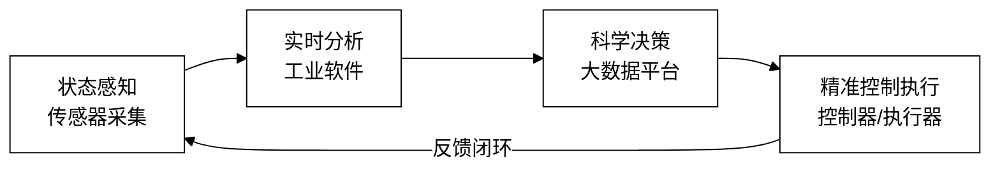
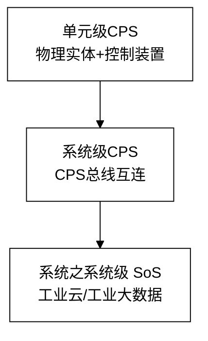
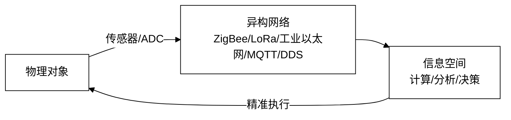

# 系统分析师｜第21章 信息物理系统分析与设计（备考讲义＋章节自测题）

> **教材依据**：《系统分析师教程（第2版）》第21章 信息物理系统分析与设计（共6节：21.1 信息物理系统概述｜21.2 信息物理系统架构｜21.3 信息物理系统技术框架｜21.4 信息物理系统开发技术｜21.5 控制系统与网络通信｜21.6 CPS 应用分析与设计）。第1版无对应章（CPS 为第2版新增专章，第1版止于第20章 项目管理、其后为参考文献），两版无同构迁移；无教材外补充。

> **考纲定位说明**：2024版考纲科目一「系统分析师综合知识」第21条 信息物理系统分析与设计（CPS 架构与技术框架｜CPS 开发技术｜控制系统与网络通信｜CPS 典型应用场景，与教材第2版第21章各节一一对应）。注：按新版考纲第16～21章属科目2案例分析专题、不作为科目1独立模块单列，但其知识点仍可能少量出现在上午综合真题（本章近窗0场）。

> **考试形式**：上午综合知识单选题；2024上～2026上 0道/0场（未检出，仅旧大纲期有检出），近年频次窗内几乎不考；案例分析 CPS 方向 0题组、论文无 CPS 主题。

> 标签：系统分析师、上午题、信息物理系统、CPS、闭环反馈、数字孪生、协议标准、混合系统、确定性通信、工业 CPS

[TOC]

## 章节结构对照与来源标注

> 本讲义为教材第2版第21章的学习讲义。本章知识点几乎全部来自教材，无教材外补充（第1版无对应章）。

| 讲义模块 | 对应教材第2版章节 | 内容性质 | 备考要求 |
|---|---|---|---|
| 模块1 信息物理系统概述 | 21.1 信息物理系统概述 | 教材 | 了解：CPS 简介、与 IoT/嵌入式关系 |
| 模块2 信息物理系统架构 | 21.2 信息物理系统架构（21.2.1 分层架构｜21.2.3 CPS 特点） | 教材 | 了解：三级模型、10项特点 |
| 模块3 信息物理系统技术框架 | 21.3 信息物理系统技术框架（21.3.1 CPS 技术概况｜21.3.4 协议标准） | 教材 | 了解：核心技术、协议分类、确定性通信 |
| 模块4 信息物理系统开发技术 | 21.4 信息物理系统开发技术（21.4.1 感知和控制相关技术） | 教材 | 了解：感知控制、协同设计、工业大数据 |
| 模块5 控制系统与网络通信 | 21.5 控制系统与网络通信 | 教材 | 了解：确定性通信、通信时延、事件告警 |
| 模块6 CPS 应用分析与设计 | 21.6 CPS 应用分析与设计（21.6.1 工业设计系统｜21.6.2 生产制造系统） | 教材 | 了解：工业/制造/装备诊断应用 |

> 教材第2版第21章章节结构（按教材原文核读）：21.1 信息物理系统概述；21.2 信息物理系统架构（21.2.1 分层架构、21.2.3 CPS 特点）；21.3 信息物理系统技术框架（21.3.1 CPS 技术概况、21.3.4 协议标准）；21.4 信息物理系统开发技术（21.4.1 感知和控制相关技术）；21.5 控制系统与网络通信；21.6 CPS 应用分析与设计（21.6.1 工业设计系统、21.6.2 生产制造系统）。

> ⚠️ 教材第2版第21章**不包含**：下列内容常被考生材料或旧讲义混入，但 v2 第21章无原文，复习时注意区分，勿误当成该章本身内容——①四层功能架构（感知层/网络层/计算控制层/应用层）：v2 21.2.1 为**三级模型**（单元级/系统级/系统之系统级），四层功能架构非 v2 原生表述；②IEC 61508 / SIL 安全完整性等级 / 功能安全：v2 仅提及「安全关键性（Safety/Security/Privacy）」，无 IEC 61508/SIL 标准，属通用功能安全标准；③混合自动机 / 形式化验证 / 混合动态系统建模：v2 仅以「混合系统（Hybrid Systems）」作 CPS 别称（21.2.3⑦），无混合自动机与形式化验证建模内容；④HIL 硬件在环 / 故障注入测试：v2 无此内容，属通用嵌入式测试方法；⑤奈奎斯特采样定理 / 采样周期、RM 速率单调调度可调度性：v2 第21章0命中（仅「调度」泛称），属信号与系统/实时调度理论。注：数字孪生（Digital Twin）为 v2 21.3.1 明确列出的 CPS 核心技术，属原生内容，本章保留。

> 说明：第00章「计算题范围」列将「调度可调度性、时延预算、SIL、采样周期」列为本章教材维度计算题，但经逐字核读 v2 第21章，SIL 与采样周期实为0命中、并非第2版原生，疑似上位口径待复核；时延预算（确定性通信时延）与调度（资源调度泛称）有弱原文支撑。因本章近窗0场、属了解级，本讲义不配计算习题，仅在此声明边界。

---

## 模块1：信息物理系统概述（教材21.1）【教材｜了解】

**前置说明**：本模块对应教材第2版第21章 21.1 信息物理系统概述，覆盖 CPS 定义及其与物联网、嵌入式系统的关系；适配上午综合选择题（概念辨析）。

**模块优先级**：🟢 了解为主（了解）—— 2024上～2026上 0道/0场（未检出），全量统计窗内仅旧大纲期检出。

**考情分析**（2021年以后真题）：2024上～2026上 0道/0场（未检出），全量统计窗内仅旧大纲期有检出；核心考点：CPS 简介、CPS 与 IoT/嵌入式辨析。

### 1.1 核心知识点精讲

#### 1.1.1 CPS 简介（教材21.1）【教材｜了解】

- **CPS（信息物理系统／赛博物理系统，Cyber-Physical System）**：计算资源与物理资源紧密结合的复杂系统，是物联网的演进。
- 本质：以实时、可靠、安全的网络为支撑，在信息（Cyber）空间与物理（Physical）空间之间基于**数据流动**形成「状态感知 → 实时分析 → 科学决策 → 精准控制和执行」的**闭环赋能体系**。
- 微观：物理系统中嵌入计算与通信内核，计算过程与物理过程通过**反馈循环**相互作用；宏观：由异步、异构子系统组成、具备感知/决策/控制能力的混合系统。

> 记忆：状态感知、实时分析、科学决策、精准执行，四步闭环是 CPS 本质。

#### 1.1.2 CPS 与物联网、嵌入式的关系（教材21.1）【教材｜了解】

- **物联网 IoT**：通过互联网延伸，将信息传感设备与网络结合，实现人/机/物的互联互通；本质特征为整体感知、可靠传输、智能处理。
- **嵌入式系统**：软件嵌入硬件，侧重单机控制与软硬融合，是 CPS 的局部物理基础。
- **三者辨析**：CPS 更强调**循环反馈**——感知物理世界后通过通信与计算再对物理世界起到反馈控制作用；IoT 可看作 CPS 的一种简约应用，CPS 让 IoT 的定义明晰起来。

> 记忆：嵌入式单机、IoT 联网采集、CPS 闭环反馈控制物理世界。

---

## 模块2：信息物理系统架构（教材21.2）【教材｜了解】

**前置说明**：本模块对应教材第2版第21章 21.2 信息物理系统架构（21.2.1 分层架构、21.2.3 CPS 特点）；适配上午综合选择题（架构层级与特点辨析）。

**模块优先级**：🟢 了解为主（了解）—— 2024上～2026上 0道/0场（未检出）。

**考情分析**（2021年以后真题）：2024上～2026上 0道/0场（未检出）；核心考点：三级模型、CPS 特点（10项）。

### 2.1 核心知识点精讲

#### 2.1.1 CPS 分层架构（三级模型）（教材21.2.1）【教材｜了解】

- v2 采用**三级递进模型**，而非功能四层：
  - **单元级 CPS**：最小单元，含物理实体与控制装置。
  - **系统级 CPS**：单元级通过 CPS 总线等互连集成而成。
  - **系统之系统级（System of Systems, SoS）**：系统级通过工业云、工业大数据等平台构建，提供企业级数字化运营等服务。

> 记忆：单元 → 系统 → SoS，三级递进扩展。

#### 2.1.2 CPS 特点（教材21.2.3）【教材｜了解】

v2 列出 CPS 的10项特点：

1. **全局虚拟、局部物理性**：局部物理世界的感知与操作可通过虚拟网络被安全、可靠、实时地观察和控制。
2. **深度嵌入性**：计算嵌入物理部件，甚至嵌入物质里，使设备具备计算/通信/控制/协同/自治能力。
3. **事件驱动性**：物理环境变化构成事件，形成「事件→感知→决策→控制」闭环，改变物理对象状态。
4. **以数据为中心**：各层级围绕数据融合向上服务，数据沿路径不断提炼抽象。
5. **时间关键性**：物理世界时间不可逆，重要基础设施对实时性（Timeliness）有严格要求。
6. **安全关键性**：需同时考虑系统自身安全性（Safety）、外部攻击下的安全性（Security）与用户隐私（Privacy）。
7. **异构性**：功能结构各异的子系统通过有线/无线通信协调，CPS 亦称混合系统（Hybrid Systems）或系统的系统（System of Systems）。
8. **高可信赖性**：保证鲁棒性，满足可靠性、效率、可扩展性、适应性等要求。
9. **高度自主性**：部件具备自组织/自配置/自维护/自优化/自保护，支持自感知/自决策/自控制。
10. **领域相关性**：与汽车、石油化工、航空航天、制造业等工程领域强相关。

> 记忆：虚局、深嵌、事件、数据、时关、安关、异构、可信、自主、领域（十项）。

---

## 模块3：信息物理系统技术框架（教材21.3）【教材｜了解】

**前置说明**：本模块对应教材第2版第21章 21.3 信息物理系统技术框架（21.3.1 CPS 技术概况、21.3.4 协议标准）；适配上午综合选择题（核心技术、协议分类）。

**模块优先级**：🟢 了解为主（了解）—— 2024上～2026上 0道/0场（未检出）。

**考情分析**（2021年以后真题）：2024上～2026上 0道/0场（未检出）；核心考点：CPS 核心技术清单、CPS 相关协议分类、确定性通信（TSN）。

### 3.1 核心知识点精讲

#### 3.1.1 CPS 技术概况（教材21.3.1）【教材｜了解】

- v2 将 CPS 技术分为**核心技术**与**支撑技术**两类。
- 核心技术示例：虚实融合控制、智能装备、**MBD（基于模型定义）**、**数字孪生（Digital Twin）**、现场总线、工业以太网、CAX、MES（制造执行系统）、ERP、PLM 等。

> 记忆：虚实融合、智能装备、MBD、数字孪生、现场总线/工业以太网、CAX/MES/ERP/PLM。

#### 3.1.2 CPS 相关协议标准（教材21.3.4）【教材｜了解】

- 典型网络协议栈含 OSI 七层或五层模型；应用层协议如 HTTP、DNS 等。
- v2 以分类表列举**CPS 相关协议**：ZigBee、LoRa、RS-485、USB、AMQP、CoAP、DDS、LwM2M、MQTT、XMPP、Z-Wave、MBus、IEEE 802.11、工业以太网等，并说明各自适用场景（低速短距/长距离/工业总线/消息队列/受限设备等）。
- **TSN（时间敏感网络）**相关表述（如 uRLLC 的1ms 超低时延）体现 CPS 对确定性低时延通信的需求。

> 记忆：CPS 协议众多，按场景选——工业总线用 RS-485/工业以太网，受限设备用 CoAP/LwM2M/MQTT，低时延用 TSN/uRLLC。

---

## 模块4：信息物理系统开发技术（教材21.4）【教材｜了解】

**前置说明**：本模块对应教材第2版第21章 21.4 信息物理系统开发技术（21.4.1 感知和控制相关技术）；适配上午综合选择题（感知控制、协同设计、工业大数据）。

**模块优先级**：🟢 了解为主（了解）—— 2024上～2026上 0道/0场（未检出）。

**考情分析**（2021年以后真题）：2024上～2026上 0道/0场（未检出）；核心考点：感知与控制、软硬件协同、工业大数据/边缘处理。

### 4.1 核心知识点精讲

#### 4.1.1 感知和控制相关技术（教材21.4.1）【教材｜了解】

- 通过传感器感知物质世界运行状态，经 ADC（模数转换器）将模拟量转为数字量进入信息空间。
- 包含**基于硬件的安全模块**（解决计算安全问题）、工业大数据（产品创新、故障诊断与预测）、SDN（网络资源调度与快速重组）、短周期数据分析（边缘侧实时智能处理）等支撑技术。
- 开发强调**软硬件协同**：异构异质网络融合、不同设备/软件/协议互联，实现资源与制造协同。

> 记忆：感知靠传感器+ADC，控制靠控制器/执行器；开发重协同，数据靠工业大数据与边缘分析。

---

## 模块5：控制系统与网络通信（教材21.5）【教材｜了解】

**前置说明**：本模块对应教材第2版第21章 21.5 控制系统与网络通信；适配上午综合选择题（确定性通信、时延、事件告警）。

**模块优先级**：🟢 了解为主（了解）—— 2024上～2026上 0道/0场（未检出）。

**考情分析**（2021年以后真题）：2024上～2026上 0道/0场（未检出）；核心考点：确定性通信、通信时延预算、事件/告警与故障响应。

### 5.1 核心知识点精讲

#### 5.1.1 确定性通信与通信时延（教材21.5）【教材｜了解】

- CPS 控制通信要求**确定性**：通信时延限制在给定阈值内；对周期确定性通信，时延变化（抖动）有更严格要求。
- 时延预算需覆盖采样、传输、计算、执行与反馈返回各环节，满足控制周期要求。

> 记忆：确定性通信＝时延有界+抖动受限；时延预算＝采样+传输+计算+执行+反馈。

#### 5.1.2 事件、告警与故障响应（教材21.5）【教材｜了解】

- 设备状态变化产生事件；告警（如设备故障、过程异常）多需确认，超时未确认则重发或触发故障响应动作。
- 体现 CPS「事件驱动」特点（见模块2）在运行维护中的落地。

> 记忆：事件驱动→告警确认→超时重发/故障响应。

---

## 模块6：CPS 应用分析与设计（教材21.6）【教材｜了解】

**前置说明**：本模块对应教材第2版第21章 21.6 CPS 应用分析与设计（21.6.1 工业设计系统、21.6.2 生产制造系统）；适配上午综合选择题（典型应用场景）。

**模块优先级**：🟢 了解为主（了解）—— 2024上～2026上 0道/0场（未检出）。

**考情分析**（2021年以后真题）：2024上～2026上 0道/0场（未检出）；核心考点：工业设计、生产制造、装备故障诊断与远程维护。

### 6.1 核心知识点精讲

#### 6.1.1 工业设计系统与生产制造系统（教材21.6.1～21.6.2）【教材｜了解】

- **工业设计系统**：CPS 解决传统仿真不能完整描述产品综合应用环境的问题，综合设备/软件/协议信息模型。
- **生产制造系统**：通过装备互联互通监控生产过程、有序管理调度生产资源，实现资源与制造协同；CPS 对生产计划、资源管理、生产调度各环节管控调优。
- **装备故障诊断与远程维护**：装备故障时远程专家调取报警信息/日志，在虚拟健康诊断模型中推演，实现远程故障诊断与预测维护，减少停机与维修成本。
- 典型领域：智能制造、智能电网、能源自动化、航空（虚拟仿真模型推演最优方案）、船舶（高安全性重型装备）等。

> 记忆：CPS 应用＝工业设计与生产制造协同＋装备远程故障诊断/预测维护；领域含智能制造/电网/航空/船舶。

---

# 章节总复习综合模拟题

> 说明：本章近窗0场、属了解级，以下仅配概念选择题与简答，帮助建立 CPS 整体认知，不配计算题（计算题维度见头部说明，待上位复核）。

## 一、单项选择题（8题）

1. CPS 区别于物联网的核心特征是（）
A. 设备联网 B. 感知—计算—控制闭环反馈 C. 数据上传云端 D. 无线传输
> 【解析】CPS 强调感知物理世界后通过通信与计算再对物理世界反馈控制；IoT 侧重联网采集，可看作 CPS 的简约应用。
> 【答案】B

2. CPS 本质是信息空间与物理空间之间基于数据流动的闭环赋能体系，其四步顺序是（）
A. 感知→分析→决策→执行 B. 决策→感知→执行→分析 C. 执行→感知→分析→决策 D. 分析→决策→感知→执行
> 【解析】v2 明确为「状态感知→实时分析→科学决策→精准控制和执行」四步闭环。
> 【答案】A

3. v2 第21章 CPS 分层架构采用的三级模型，最高一级是（）
A. 单元级 B. 系统级 C. 系统之系统级（SoS） D. 应用级
> 【解析】三级递进：单元级→系统级→系统之系统级（SoS），SoS 通过工业云/工业大数据构建。
> 【答案】C

4. 下列关于 CPS 特点的说法，属于 v2 列出的10项之一的是（）
A. 单一厂商锁定 B. 高度自主性（自组织/自配置/自优化） C. 无数据融合 D. 仅单机运行
> 【解析】v2 CPS 特点含高度自主性（自组织/自配置/自维护/自优化/自保护，自感知/自决策/自控制）。
> 【答案】B

5. CPS 安全关键性需要同时考虑的三方面不包括（）
A. 系统自身安全性（Safety） B. 外部攻击下的安全性（Security） C. 用户隐私（Privacy） D. 商业盈利（Profit）
> 【解析】v2 安全关键性涵盖 Safety、Security 与 Privacy，不包括商业盈利。
> 【答案】D

6. 下列协议中，属于 v2 第21章列举的 CPS 相关协议的是（）
A. SMTP B. MQTT C. FTP D. SSH
> 【解析】v2 21.3.4 列举 ZigBee/LoRa/RS-485/MQTT/CoAP/DDS/LwM2M/XMPP 等，MQTT 为物联网主流开源协议。
> 【答案】B

7. CPS 确定性通信对时延的要求是（）
A. 尽力而为、无界 B. 时延有界且抖动受限 C. 仅关注带宽 D. 仅关注丢包率
> 【解析】v2 21.5 要求确定性通信：时延限制在阈值内，周期通信的抖动有更严格要求。
> 【答案】B

8. CPS 在装备发生故障时，可支持的实现方式是（）
A. 等待人员现场维修 B. 远程专家调取报警/日志在虚拟健康模型推演诊断 C. 直接报废装备 D. 仅本地重启
> 【解析】v2 21.6 描述远程故障诊断：远程专家调取报警信息/日志，在虚拟设备健康诊断模型中推演，实现远程诊断与预测维护。
> 【答案】B

## 二、简答概念题（2道）

1. 简述 CPS 的定义及其与物联网、嵌入式系统的关系。
> 【解析】CPS 是计算资源与物理资源紧密结合、作为物联网演进的复杂系统，本质是信息空间与物理空间之间基于数据流动的「状态感知→实时分析→科学决策→精准控制执行」闭环赋能体系。嵌入式系统是软件嵌入硬件、侧重单机控制，是 CPS 的局部物理基础；物联网通过互联网延伸实现人/机/物互联（整体感知、可靠传输、智能处理），可看作 CPS 的简约应用，CPS 让 IoT 定义更明晰，核心差异在「闭环反馈控制物理世界」。

2. 简述 v2 第21章 CPS 分层架构的三级模型与 CPS 的10项特点要点。
> 【解析】三级模型：单元级 CPS（最小单元，含物理实体+控制装置）→系统级 CPS（CPS 总线互连集成）→系统之系统级 SoS（工业云/工业大数据构建，企业级数字化运营），三级递进扩展。10项特点：全局虚拟局部物理、深度嵌入、事件驱动、以数据为中心、时间关键、安全关键（Safety/Security/Privacy）、异构（亦称混合系统/System of Systems）、高可信赖（鲁棒/可靠/可扩展/适应）、高度自主（自组织/自配置/自维护/自优化/自保护）、领域相关性。

---

> **备考提示**：本章（信息物理系统 CPS）2024上～2026上 0道/0场（未检出，仅旧大纲期有检出），案例分析 CPS 方向 0题组、论文无 CPS 主题，属了解级。重点建立整体认知：①CPS 定义与「状态感知→实时分析→科学决策→精准执行」闭环、与 IoT/嵌入式辨析；②v2 三级模型（单元/系统/SoS）与10项特点；③核心技术含数字孪生、协议标准众多（MQTT/CoAP/DDS/工业以太网等）；④确定性通信（时延有界、抖动受限）与工业应用（智能制造/装备远程诊断）。计算题维度（调度可调度性/时延预算/SIL/采样周期）见第00章，但 SIL 与采样周期经核读非 v2 第21章原生、疑似上位口径待复核，且本章近窗0场，了解即可，不投入计算训练。其余内容以理解为主，不必死记。
